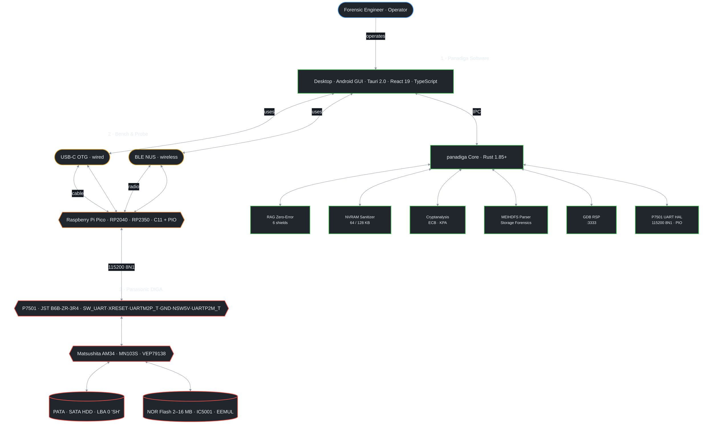

<p align="center">
  <strong>English</strong> | <a href="README.pt-BR.md">Português (Brasil)</a>
</p>

# Panadiga — Hardware Diagnostic, Firmware & Reverse Engineering Suite for Panasonic DIGA Recorders

[](https://www.rust-lang.org/)
[-blue.svg>)]()
[-green.svg>)]()
[-yellow.svg>)]()
[](LICENSE)

> **Master Technical Systems & Hardware Engineering Reference**
> **Classification:** Forensic Engineering / Unified Recovery & Tooling Platform
> **Primary Target Device:** Digital DVD/HDD Video Recorder **Panasonic DMR-EH55** (DIGA Chassis / Main Board `VEP79138`)
> **Ecosystem Compatibility:** Panasonic DIGA Lineup (**DMR-E, DMR-EH, DMR-ES, DMR-EX, DMR-BW Series**)
> **Core Architecture:** Matsushita `AM34` / `MN103S` (32-bit RISC `MN10300` / UniPhier)
> **Flash Memory Range:** 2 MB (16 Mbit) to 16 MB (128 Mbit) TSOP-48 / TSOP-56 Parallel NOR Flash
> **Storage Subsystem:** PATA/IDE and SATA Hard Disk Drives with proprietary **MEIHDFS** partition tables
> **Hardware Interface:** Asynchronous **P7501 UART (`115200 8N1`) + Discrete `SW_UART` / `XRESET` / `NSW5V` Sense** (with legacy `pico-p7501` PIO fallback)

---

## 1. Executive Project Overview

The **Panasonic DIGA** series represents the pinnacle of Japanese consumer electronics engineering from the 2001–2008 era. Designed by **Matsushita Electric Industrial Co., Ltd.** (now Panasonic Corporation), these devices integrate high-performance audio/video processing built upon the proprietary **UniPhier** System-on-Chip (SoC) family, executing the **Matsushita AM34** (MN10300 architecture) instruction set.

While the primary laboratory focus of this project is the widely deployed **DMR-EH55**, the engineering discoveries, algorithms, and tools within Panadiga span the **entire Panasonic DIGA recorder ecosystem**:

1. **Two-Stage Hybrid Bootloader Architecture:** The onboard Spansion NOR Flash (`IC5001` on DMR-EH55 `VEP79138`, 2 MB to 16 MB depending on generation) stores only the Initial Program Loader (*IPL*). The primary operating system, OSD graphics acceleration drivers, optical drive servo microcodes, and codecs reside entirely in reserved sectors within the internal hard drive and optical update containers.
2. **Proprietary MEIHDFS Storage System:** The internal hard drive does not use standard PC MBR partition tables or FAT/ext filesystems. The storage layout is structured around **MEIHDFS** (*Matsushita Electric Industrial HDD File System*), featuring an ASCII `"SH"` magic superblock at LBA 0, a redundant security mirror at LBA 57,344 (28 MB), a 10-block transactional journal, and encrypted firmware partitions.
3. **Cryptography & Intellectual Property Protection:** The optical distribution container (`PANA_DVD.FRM`) and the executable HDD partitions are protected with proprietary 64-bit symmetric block ciphers operating in ECB mode, tied to CPRM (*Content Protection for Recordable Media*) and DivX DRM engines.
4. **The Critical `U99` Error Vulnerability:** Channel presets, HDD volume mount states, and operating parameters are saved into the final 64 KB sector of the Flash memory, which emulates EEPROM wear-leveling (`EEMUL`). Cell degradation, unexpected power loss during disk write operations, or corrupted status words trigger startup validation panics. Consequently, the Matsushita kernel halts permanently with the fatal code **`U99`** on the front VFD vacuum fluorescent display, ignoring remote commands and deadlocking the optical tray mechanism.

This repository establishes the **definitive forensic reverse engineering, physical unbricking, and laboratory diagnosis ecosystem** for the Panasonic DIGA lineup. It provides the high-performance Rust toolchain **`panadiga`**, a zero-latency desktop and mobile Android (`.apk`) bench GUI, C11/PIO firmware for **Raspberry Pi Pico (RP2040) and Pico 2 (RP2350)** with **Bluetooth Low Energy (BLE)** and USB-C OTG support, 30 cataloged factory service manuals, schematics and silicon datasheets, and 13 comprehensive bilingual engineering reference dossiers.

---

## 2. End-to-End System Architecture



---

## 3. Repository File Structure & Semantic Mapping

```text
Panadiga/
├── package.json                                      <-- Unified Entrypoint (`npm start`, `npm run build:desktop`, `npm run validate`)
├── Cargo.toml                                        <-- Master Rust Workspace Specification (2024 Edition)
├── tauri.conf.json                                   <-- Tauri 2.0 Desktop & Mobile Configuration
├── scripts/                                          <-- Cross-Platform Build, Packaging & 9-Gate Validation (`build.py`, `validate.py`)
├── src/                                              <-- High-Performance Native Rust Core Engine
│   ├── main.rs                                       <-- Unified Entrypoint (CLI Dispatcher & Tauri GUI)
│   ├── lib.rs                                        <-- Core Library Crate Exporting All Engines
│   ├── logger.rs                                     <-- Unified Multi-Sink Structured Logger
│   ├── manuals.rs                                    <-- Service Manuals Indexer & Fast Regex Scanner
│   ├── nvram/                                        <-- Multi-Geometry NVRAM & EEPROM Emulation Parser
│   ├── hdd/                                          <-- MEIHDFS Storage & Partition Table Engine
│   ├── frm/                                          <-- PANA_DVD.FRM Container Cryptanalysis Engine
│   ├── rag/                                          <-- Zero-Error RAG Engine & 6 Invariant Shields
│   └── desktop/                                      <-- Tauri 2.0 Native Rust Commands & GDB Bridge
├── apps/desktop/                                     <-- Zero-Latency Modern Desktop UI (React 19 + Vite)
│   ├── src/                                          <-- Strict MVVM Components & ViewModels
│   │   ├── components/                               <-- Pure UI Panels (GDB, P7501 UART, HexViewer)
│   │   ├── services/                                 <-- Typed Tauri IPC Transport & Native Bridges
│   │   └── viewmodels/                               <-- Algebraic State Machines (Pure FP Logic)
│   ├── package.json                                  <-- Node.js Dependencies & Build Scripts
│   └── playwright.config.ts                          <-- End-to-End Browser Testing Configuration
├── docs/                                             <-- Official Technical Documentation Repository
│   ├── INDEX.md                                      <-- Master Documentation Index & Gateway Portal
│   ├── en-US/                                        <-- Canonical English Technical Dossiers (13 Docs)
│   ├── pt-BR/                                        <-- Native Portuguese Technical Dossiers (13 Docs)
│   └── images/                                       <-- High-Resolution Schematics, Photos & Pinouts
├── manuals_and_schematics/                           <-- Technical Library (30 Manuals, Schematics & Datasheets)
│   ├── README.md                                     <-- Master Catalog Indexed by Model & Subsystem
│   ├── datasheets/                                   <-- Silicon Datasheets (MN103, RP2040, RP2350, Spansion)
│   ├── dmr-eh55/                                     <-- DMR-EH55 Manuals (Service, Schematics, User, Firmware)
│   ├── dmr-eh56/                                     <-- DMR-EH56 European Operating Instructions
│   ├── dmr-eh50/                                     <-- DMR-EH50 User & Operations Manual
│   ├── dmr-eh65/                                     <-- DMR-EH65 High-Capacity HDD User Manual
│   ├── dmr-eh80v/                                    <-- DMR-EH80V VHS+DVD+HDD Service Manual & Schematics
│   ├── dmr-es10/                                     <-- DMR-ES10 Service Manual (U99 Code & Schematics)
│   ├── dmr-es30v/                                    <-- DMR-ES30V Combo VHS+DVD User Manual
│   ├── dmr-e55/                                      <-- DMR-E55 2MB Flash Optical User Manual
│   ├── dmr-e85h/                                     <-- DMR-E85H 4MB Flash Pioneer HDD/DVD Manual
│   ├── dmr-e500h/                                    <-- DMR-E500H Massive Storage HDD User Manual
│   └── dmr-ex98v/                                    <-- DMR-EX98V DVB-T/HDMI Service Manual Vol 1
├── tools/                                            <-- Lab Utilities, Ghidra Scripts & Windows Launchers
│   ├── Abrir_HxD.cmd                                 <-- Fast HxD Hex Editor Benchmark Launcher (Windows)
│   ├── conectar_gdb_multiarch.cmd                    <-- GDB Multiarch Target Connection Script (Windows)
│   ├── iniciar_ponte_gdb.cmd                         <-- GDB RSP Server TCP Forwarder (:3333, Windows)
│   ├── iniciar_ghidra.cmd                            <-- Ghidra Workspace Launcher (Windows)
│   └── ghidra/                                       <-- Ghidra AM34/MN103S Scripts (Generated from Rust SSOT)
├── scripts/                                          <-- Cross-Platform Build & 9-Gate Validation Suite
│   ├── build.py                                      <-- Unified Desktop, Android APK & Pico UF2 Builder
│   └── validate.py                                   <-- 9 Mandatory Quality Gates Runner
└── firmware/
    └── pico-p7501/                                   <-- RP2040/RP2350 C11 Modular P7501 UART & Legacy OCD Firmware
        ├── p7501_uart.pio                            <-- PIO UART 115200 8N1 / Half-Duplex State Machine
        ├── p7501_pico_main.c                         <-- Entrypoint & Serial Diagnostic Console (PANADIGA>)
        ├── hal/                                      <-- Open-Drain, NSW5V Safety & Timing HAL
        ├── gdb/                                      <-- Deterministic GDB RSP Protocol Codec & Handlers
        └── CMakeLists.txt                            <-- Dual-Target Bare-Metal CMake Pipeline
```

---

### 3.1. Unified Cross-Platform Commands (`package.json` & `scripts/`)

| Command | Platform | Mode | Description |
| :--- | :--- | :--- | :--- |
| **`npm start`** | Windows / Linux / macOS | Fast Launch / Auto-Build | Launches the Desktop GUI directly from `dist/` or `target/release/` (auto-builds via `scripts/build.py --desktop` if missing). |
| **`npm run dev`** | Windows / Linux / macOS | Vite Dev Server | Starts the frontend live-reload development server in `apps/desktop`. |
| **`npm run cli -- <args>`** | Windows / Linux / macOS | Native CLI Dispatch | Forwards arguments to `panadiga` (`dist/`, `target/release/`, or `cargo run -p panadiga --`). |
| **`npm run build:desktop`** | Windows / Linux / macOS | Desktop Release | Builds React bundle, exports Ghidra SSOT scripts, compiles Rust release binary, copies UF2s & `tools/`, and packages `.zip`/`.tar.gz` + `SHA256SUMS.txt`. |
| **`npm run build:android`** | Windows / Linux / macOS | Android APK Release | Configures Android SDK/NDK, compiles AArch64 APK via Tauri Mobile, and safely restores `Cargo.toml`. |
| **`npm run build:all`** | Windows / Linux / macOS | Dual Target + Pico | Compiles Pico UF2 firmwares (if ARM GCC present), Desktop Release, and Android APK. |
| **`npm run validate`** (`npm test`) | Windows / Linux / macOS | 9 Quality Gates | Executes `python scripts/validate.py` covering Rust, TypeScript, Vitest, `jscpd`, `uxlint`, Playwright, Ghidra SSOT, C11 host tests, `mypy --strict`, and `pytest`. |

---

## 4. Complete Native Rust CLI Guide (`panadiga`)

The native binary `panadiga` functions as both the Tauri graphical desktop client and a high-performance command-line utility.

### 4.1. Release Compilation

```bash
# Build the native binary with maximum optimizations
cargo build --release -p panadiga

# Directly launch GUI or CLI via unified npm scripts (Windows / Linux / macOS):
npm start
npm run cli -- --help
```

### 4.2. Command 1: Multi-Geometry NVRAM Sanitation (`nvram clean`)

Wipes the corrupted wear-leveling state (`EEMUL`) within the NOR Flash without modifying the bootloader (*IPL*). Automatically detects dump size (2 MB, 4 MB, 8 MB, 16 MB) and calculates the exact 64 KB sector at `len - 64 KB`.

```bash
# 8 MB Dump (DMR-EH50 / EH55 / EH56 / EH60 / EH65 / EH80V):
panadiga nvram clean --input flash_dump_8mb.bin --output flash_recovered.bin

# 4 MB Dump (DMR-E85H / E95H / ES20):
panadiga nvram clean --input flash_dump_4mb.bin --output flash_recovered.bin

# 2 MB Dump (DMR-E50 / E55 / ES10):
panadiga nvram clean --input flash_dump_2mb.bin --output flash_recovered.bin

# 16 MB Dump (DMR-EX75 / EX85 / EX98V):
panadiga nvram clean --input flash_dump_16mb.bin --output flash_recovered.bin
```

* **Sanitation Byte:** Erased state `0xFF` (canonical virgin state of NOR flash sectors).
* **Silicon Invariant:** Never touches offsets `0x00000000` to `len - 65537`, preserving the factory IPL.

### 4.3. Command 2: Structural Hard Drive Inspection (`hdd inspect`)

Parses the MEIHDFS partition layout, locates the ASCII `"SH"` superblock, verifies the 28 MB backup mirror, and outputs partition boundaries.

```bash
panadiga hdd inspect --input hdd_image.bin
```

### 4.4. Command 3: Surgical Partition Extraction (`hdd extract`)

Extracts raw firmware partitions from the MEIHDFS drive image for reverse engineering in Ghidra or IDA Pro.

```bash
panadiga hdd extract --input hdd_image.bin --output-dir partitions/
```

### 4.5. Command 4: Optical Container Cryptanalysis (`frm analyze`)

Validates the optical update container `PANA_DVD.FRM`, checking block entropy, TOC records, and electronic codebook (ECB) leakage patterns.

```bash
panadiga frm analyze --input firmware_and_images/PANA_DVD.FRM
```

### 4.6. Command 5: MEIHDFS Bit-Inverted Descriptor Decoding (`hdd decode-descriptors`)

Decodes the bit-inverted (One's Complement / XOR 0xFF) partition descriptors found in the MEIHDFS superblock.

```bash
panadiga hdd decode-descriptors --input hdd_100.bin
```

### 4.7. Command 6: Container Deconstruction & TOC Extraction (`frm dump-toc`)

Splits `PANA_DVD.FRM` into its three functional payloads: Main CPU OS (AM34), Optical Drive Servo DSP (MN102), and OSD Graphics Engine.

```bash
panadiga frm dump-toc --input firmware_and_images/PANA_DVD.FRM
```

### 4.8. Command 7: 64-Bit ECB Codebook Audit (`frm codebook`)

Extracts high-frequency 64-bit blocks across the optical container and HDD firmware partitions to establish cryptographic equivalence.

```bash
panadiga frm codebook --frm firmware_and_images/PANA_DVD.FRM --hdd firmware_and_images/hdd_100.bin
```

### 4.9. Command 8: Critical Firmware Headers Inspection (`headers`)

```bash
panadiga headers --input firmware_and_images/hdd_100.bin
```

### 4.10. Command 9: Forensic String & Keyword Scanner (`scan`)

```bash
panadiga scan --input firmware_and_images/PANA_DVD.FRM --terms U99,FIRMWARE,PANASONIC
```

### 4.11. Command 10: Service Manuals Indexer & Fast Search (`manuals`)

Searches the 30 official Panasonic service manuals, schematics, and silicon datasheets using fast regex matching across subdirectories.

```bash
panadiga manuals --query "P7501"
panadiga manuals --query "U99" --filter "dmr-es10"
panadiga manuals --query "MN103" --filter "datasheets"
```

### 4.12. Command 11: Zero-Error RAG Engine Query (`rag query`)

Queries the local retrieval-augmented generation engine, enforcing the 6 physical invariant shields.

```bash
panadiga rag query --question "Qual o pino de terra canônico do conector P7501?"
panadiga rag query --question "What is the canonical ground pin of P7501?" --json
```

---

## 5. Electrical Specification & `P7501` Async UART Interface (`115200 8N1`)

### 5.1. Canonical Pinout, Bench Wiring & Universal RP2040 / RP2350 Connection

On the digital/main board `VEP79138` (Panasonic DMR-EH55 schematic `TO JIGU`), the service header **`P7501 [B6B-ZR-3R4]`** is an **asynchronous 115200 8N1 UART + discrete boot/reset control interface**, physically positioned on the top edge between the 10-conductor flat flex cable (`FP50003`) on the left and the 8-conductor flat flex cable (`FP50004`) on the right.

> [!CAUTION]
> **ELECTRICAL SAFETY INVARIANTS — `GND` CONTINUITY & `NSW5V` (`GP3`) Hi-Z PROTECTION:**
>
> * **Canonical Ground:** Per the official Panasonic Service Manual (`P7501`), **`GND` IS STRICTLY PIN 4**. Always measure **$0.0\,\Omega$ continuity** between Pin 4 and bare chassis ground with a multimeter before connecting any bench wire.
> * **`NSW5V` (`Pin 5`, `X_SW_5R2V` -> `GP3`):** Driven from `IC1506` (`~5.15V` upstream) through `D7510` (resting ~`3.29V` on bench) to bias pull-up resistors `R7570`/`R7572` (`10 kΩ`) and `IC7501` VDD. **`GP3` MUST ALWAYS remain `Hi-Z Input` with NO internal pulls — NEVER drive push-pull LOW or HIGH!**
> * **No Back-Powering:** NEVER power the Raspberry Pi Pico from `P7501`; keep USB/VSYS as the sole supply.
> * **`Q7510`/`Q7514` Interlock:** Driving `SW_UART` (Pin 1) LOW activates `XFWE` serial boot mode and cuts off `Q7514`, disconnecting `UARTM2P_T` (Pin 3) from AM34 RX. Keep `SW_UART` in `Hi-Z` (~`3.25V`) when transmitting UART bytes from Pico `GP4` into AM34!

<p align="center">
  
  <br/>
  <em>Figure 5.1: Physical topography of PCB VEP79138 showing connector P7501 between flat cables FP50003 (10-pin) and FP50004 (8-pin).</em>
</p>

```text
       CANONICAL MECHANICAL ORIENTATION OF CONNECTOR P7501 [B6B-ZR-3R4] (PANASONIC SCHEMATIC)
       Rear wall facing board interior (top) | Locking key window facing front edge (bottom)
   
       10-Pin Flat Cable (FP50003)                                         8-Pin Flat Cable (FP50004)
       [On the Left]                                                                     [On the Right]
            ┌──────────────────────────────────────────────────────────────────────────────────┐
      Pin 6 │ ■ UARTP2M_T [Square Pad] MAX TXD: AM34 TX -> Pico RX GP2 (115200 8N1, R7572 10k) │
      Pin 5 │ ● NSW5V     [Round Pad]  X_SW_5R2V via D7510 (~5.15V up / ~3.29V) GP3 Hi-Z ONLY! │
      Pin 4 │ ● GND       [Round Pad]  Canonical Chassis Ground (0.0Ω Continuous!)              │
      Pin 3 │ ● UARTM2P_T [Round Pad]  MAX RXD: Pico TX GP4 -> AM34 RX (via Q7514, R7570 10k)  │
      Pin 2 │ ● XRESET    [Round Pad]  Master Reset Control (Strict Open-Drain GP5)            │
      Pin 1 │ ● SW_UART   [Round Pad]  Serial Boot / Q7510 Interlock (GP26 / ADC0, ~3.25V)     │
            └──────────────────────────────────────────────────────────────────────────────────┘
```

<p align="center">
  
  <br/>
  <em>Figure 5.2: Excerpt from official Panasonic DMR-EH55 schematic (VEP79138) detailing header P7501 [B6B-ZR-3R4] "TO JIGU".</em>
</p>

> [!NOTE]
> **RP2040 / RP2350 Hardware Compatibility:** Any board powered by an **RP2040** (Pico, Pico W) or **RP2350** (Pico 2) is 100% compatible. Standard `115200 8N1` UART framing (`p7501_uart.pio`) and deterministic `XRESET`/`SW_UART` open-drain timing are executed directly by the RP2040/RP2350 hardware.

| P7501 Pin (Canonical) | Matsushita Signal |     RP2040 / Pico Pin     |              Conditioning / Board Network              |        Signal Type        | Bench Function & Safety Directive                                                                                                                |
| :-------------------: | :---------------: | :-----------------------: | :----------------------------------------------------: | :-----------------------: | :----------------------------------------------------------------------------------------------------------------------------------------------- |
|    **Pin 1**    | `SW_UART` `(D)` | `GP26 / ADC0` (Pin 31) | $1.0\text{ k}\Omega$ ADC series resistor; Q7510/R7562/R7559 | Analog Sense / Open-Drain | Reads `~3.25V` Hi-Z (`~2.69V` Pull-Down via `Q7510`). Driving LOW forces `XFWE` serial boot and disables `Q7514` RX path (`I < 10 mA`). |
|    **Pin 2**    |    `XRESET`    |      `GP5` (Pin 7)      |          Optional $100\,\Omega$ series resistor          | **Strict Open-Drain** | Master system reset. **Drain to 0V (`LOW`) to assert reset; release to `Hi-Z` (~20 µs rise) to run. Never drive 3.3V Push-Pull!** |
|    **Pin 3**    | `UARTM2P_T` (`MAX RXD`) | `GP4` (Pin 6) | Board `R7570 10 kΩ` pull-up to `NSW5V` + `Q7514` gate | **UART TX (Pico -> AM34)** | Asynchronous `115200 8N1` command input to AM34. Requires `SW_UART` in `Hi-Z` so `Q7514` conducts. **Do NOT add external 3.3V pull-up.** |
|    **Pin 4**    | **`GND`** | **Pin 38 (`GND`)** |         **Direct low-impedance bond**         |   **0V Reference**   | **Mandatory equipotential bond: verify $0.0\,\Omega$ continuity to bare metal recorder chassis!**                                        |
|    **Pin 5**    | `NSW5V` (`X_SW_5R2V`) | `GP3` (Pin 5) |    High-impedance sense via board `IC1506` / `D7510`    | **Static Sense ONLY** | Upstream ~5.15V via `D7510` (`~3.29V` resting). **MUST remain `Hi-Z Input` with NO pulls — NEVER configure as push-pull output!** |
|    **Pin 6**    | `UARTP2M_T` (`MAX TXD`) | `GP2` (Pin 4) |   Board `R7572 10 kΩ`; optional $100\,\Omega$ series   | **UART RX (AM34 -> Pico)** | Asynchronous `115200 8N1` console output from AM34 (`<00>DDR CHECK: OK`, `CD diag boot mode`, `X(...)`). Square PCB pad. |

<p align="center">
  
  <br/>
  <em>Figure 5.3: Standardized electrical schematic (IEEE Std 315 / IEC 60617) for building the P7501 async UART bench probe linking Raspberry Pi Pico to header P7501.</em>
</p>

---

### 5.2. Critical Engineering Rules & Damage Prevention

1. **Rule 1 (`NSW5V` Strict `Hi-Z` Protection):** `P7501` Pin 5 (`NSW5V`) is NOT a synchronous clock (`SCLK`). It links through `D7510` to the `~5.15V` auxiliary rail (`IC1506`). Configure `GP3` strictly as `Hi-Z Input` with pulls disabled; never sink or source current into Pin 5.
2. **Rule 2 (Open-Drain Emulation on `XRESET`):** Driving `XRESET` with active 3.3V push-pull logic contends against the onboard reset supervisor. Always sink to `0V` to assert reset and float to `Hi-Z` to release execution.
3. **Rule 3 (Mandatory Ground Verification):** Ensure $0.0\,\Omega$ continuity between Pin 4 and chassis ground before mating any other signals.
4. **Rule 4 (No External Pull-Up on `UARTM2P_T` & No Desoldering Required):** `VEP79138` already pulls `UARTM2P_T` via `R7570` (`10 kΩ`) to `NSW5V`; connect a 1.5mm pitch JST ZR female socket (`B6B-ZR-3R4`) cleanly without removing the TSOP-48 Flash (`IC5001`).
5. **Rule 5 (`SW_UART` / `Q7514` Interlock Awareness):** Pulse `SW_UART` low together with `XRESET` only to latch `XFWE` serial/JIG boot mode, then release `SW_UART` to `Hi-Z` before sending `115200 8N1` commands over `GP4` (`UARTM2P_T`).

---

### 5.3. Asynchronous `P7501` UART (`115200 8N1`) & Boot Mode Sequencing

```text
UART Frame (GP2 RX <- UARTP2M_T | GP4 TX -> UARTM2P_T @ 115200 baud, 8N1):
IDLE (HIGH) ──\ START (0) /─ B0 ─ B1 ─ B2 ─ B3 ─ B4 ─ B5 ─ B6 ─ B7 ─\ STOP (1) ──  (8.68 µs/bit)

Verified DMR-EH55 Bench Boot Sequence (CDDIAG Trap via P7501):
  1. XRESET (GP5) = LOW (10 ms Open-Drain) -> Release Hi-Z (~20 µs rise)
  2. SW_UART (GP26) = LOW during reset window for JIG / CDDIAG sampling -> Release Hi-Z for Q7514 TX
  3. UARTP2M_T (GP2) emits <00>DDR CHECK: OK -> CD diag boot mode -> X(80020401)59..X(80040904)0
```

---

## 6. Physical Memory Map of Matsushita AM34 (`MN103S` / `VEP79138`)

```text
+-------------------+-------------------+----------------------+--------------------------------------------+
| Physical Range    | Mirrored Range    | Bus Type / Target    | Functional Description                     |
+-------------------+-------------------+----------------------+--------------------------------------------+
| 0x00000000..0FFF  | 0x40000000..0FFF  | On-Chip I-RAM/SRAM   | 4 KB Core Scratchpad & Exception Vectors   |
| 0x00400000..07FF  | 0x40400000..07FF  | On-Chip D-RAM        | 64 KB High-Speed System Data Memory        |
| 0x04000000..07FF  | 0x44000000..07FF  | DDR-SDRAM Controller | 64 MB Main System Memory (DDR 333/400)     |
| 0x08000000..0FFF  | 0x48000000..0FFF  | MPEG / OSD Frame     | 32 MB Dedicated Framebuffer / Video Plane  |
| 0x10000000..10FF  | 0x50000000..10FF  | IDE / PATA Master    | PATA ATA/ATAPI-5 Host Controller (HDD/DVD) |
| 0x18000000..187F  | 0x58000000..187F  | External CS0 (NOR)   | Spansion S29JL064H Flash (8 MB - IPL)      |
| 0x187F0000..187F  | 0x587F0000..187F  | External CS0 (NV)    | 64 KB NVRAM / EEMUL Sector (U99 Target)    |
| 0x1F000000..1FFF  | 0x5F000000..1FFF  | Internal MMIO/SoC    | Peripheral Registers, Timers & OCD Module  |
+-------------------+-------------------+----------------------+--------------------------------------------+
```

### 6.1. JEDEC Golden Rule for Injected RAM Loader

When loading executable payloads into DDR-SDRAM or querying target registers over the P7501/GDB bridge:

* **Target Load Address:** `0x04010000` (safe DDR buffer offset avoiding zero-page exception vectors).
* **Stack Pointer Initializer:** `SP = 0x0040FFF0` (within high-speed on-chip SRAM).
* **Watchdog Disable:** Write `0x00000000` to MMIO register `0x1F000104` within $100\text{ ms}$ of cold boot.

---

## 7. Forensic Cryptanalysis & Storage Architecture Deep-Dive

### 7.1. Electronic Codebook (ECB) Leakage

Statistical analysis of both `PANA_DVD.FRM` and raw HDD dumps reveals that Matsushita implemented 64-bit symmetric block encryption without Cipher Block Chaining (CBC). Consecutive identical 8-byte blocks in plaintext yield identical 8-byte ciphertext blocks, exposing memory tables and structures.

### 7.2. 64-Bit ECB Codebook & Known-Plaintext Attack (KPA)

| Ciphertext Block (Hex) |      Plaintext Meaning      | FRM Occurrences | HDD Occurrences | Forensic Significance                        |
| :--------------------: | :-------------------------: | :-------------: | :-------------: | :------------------------------------------- |
|  `035065C87BB8E090`  | `FF FF FF FF FF FF FF FF` |      3,812      |      1,280      | Virgin NOR Flash erased cells / zero-padding |
|  `E5D1F34A518B2690`  | `00 00 00 00 00 00 00 00` |       196       |        3        | Null padding / Zero blocks                   |
|  `4D3C5DBB0C357777`  |   Partition Table Header   |      1,280      |        0        | Internal Module Descriptor Frame             |
|  `EFDC1CDA13881BAB`  |   Processor Family Header   |        3        |        0        | TOC: Matsushita UniPhier SoC Family Marker   |
|  `74A78ACD789B84FF`  |      CPU Core Selector      |        2        |        0        | TOC: AM34 / MN103S Core Identifier           |
|  `3B7E7EDBB6C57A53`  |      DSP Core Selector      |        1        |        0        | TOC: MN102 Optical Drive Servo DSP           |

### 7.3. Optical Container Structure (`PANA_DVD.FRM`)

The update disc packaging decomposes cleanly into three discrete modules preceded by a 16-byte container header (`492F0560CEDE508CE3C08AFD49B64A9A`) and a 144-byte TOC (three 48-byte records):

1. **Module 0 (`MOD_0`):** Main OS Kernel for the AM34 processor (operating system, GUI, filesystem drivers).
2. **Module 1 (`MOD_1`):** Optical drive servo microcode for the MN102 DSP.
3. **Module 2 (`MOD_2`):** OSD assets, font tables, graphics primitives, and multi-language strings.

### 7.4. Irrefutable Cryptographic Link to the Internal HDD

The presence of identical cipher blocks `E5D1F34A518B2690` (zeros) and `035065C87BB8E090` (erased flash) in both the optical `.FRM` container and the hard drive partitions proves conclusively that:

1. The firmware stored on the hard drive is encrypted using the **same algorithm and key** as the optical update media.
2. The internal HDD cannot be cloned or repaired with arbitrary unencrypted data; it requires the correct Panasonic partition structure and decryption keys.

### 7.5. Bit-Inverted (One's Complement / XOR 0xFF) MEIHDFS Architecture

The LBA 0 superblock stores partition geometry inverted with bitwise NOT (`XOR 0xFF`):

* ASCII magic `"SH"` appears in raw disk hex as `0xAE 0xB7` (`~0x51 0x48`).
* LBA offset counters and cluster sizes are similarly inverted, preventing standard partition managers from identifying or corrupting the volume.

---

## 8. Practical U99 Resolution Guide (3 Engineering Routes)

```text
                   +---------------------------------------------+
                   |       PANASONIC DMR-EH55 U99 ERROR         |
                   |       (Permanent VFD Display Panic)         |
                   +----------------------+----------------------+
                                          |
                +-------------------------+-------------------------+
                |                         |                         |
                v                         v                         v
     [ROUTE A: HARDWARE LAB]   [ROUTE B: IN-CIRCUIT UART]  [ROUTE C: FORENSIC CLONE]
     Desolder TSOP-48 Flash    Connect RP2040 to P7501     Direct raw clone of HDD
     Program via T48 / SVOD4   115200 8N1 / CDDIAG Trap    Zero sector 0x7F0000
     Direct Clean 0x7F0000     Live NVRAM Capture / GDB    Preserve 100 MB System Area
```

### Route A: External Flash Programmer (TSOP-48 via T48 / SVOD4)

* Desolder `IC5001` (Spansion S29JL064H70TFI00).
* Read full 8 MB dump and save backup.
* Use `panadiga nvram clean --input dump.bin --output fixed.bin`.
* Flash `fixed.bin` back to chip and resolder.

### Route B: In-Circuit via `P7501` Async UART & GDB Bridge (Raspberry Pi Pico / RP2040 / RP2350)

* Connect the 6-wire JST ZR bench probe from Pico to header `P7501` (confirm Pin 4 `GND` = $0.0\,\Omega$ and keep `GP3` / `NSW5V` strictly `Hi-Z`).
* Execute `panadiga pico uart-probe` / `panadiga gdb-bridge` to capture live boot telemetry (`CD diag boot mode`) and service commands over `115200 8N1`.

### Route C: Hard Drive Cloning & Sector Sanitization (Preserving MEIHDFS)

* When U99 is caused by corrupted HDD system state, connect drive to bench PC.
* Clone raw 100 MB system area: `panadiga hdd extract --input /dev/sdb --output-dir backup/`.
* Write clean partition descriptors and remount in recorder.

---

## 9. Comprehensive Panasonic DIGA Lineup Compatibility & Architectural Comparison Matrix

The following matrix formally specifies the architecture, silicon variants, Flash geometries, NVRAM locations, and unbricking compatibility across the 5 generations of the Panasonic DIGA lineup:

| Device Lineup & Models                                                                                          | Generation / Era                             | SoC Processor & Architecture                                              | NOR Flash Size & Chip                                   | NVRAM / EEMUL Offset Range              | Storage System & Interface                     | Service / Debug Header (`P7501` & Lineup)                                                              | U99 Root Cause & Panadiga Unbrick Method                                                                                |
| :-------------------------------------------------------------------------------------------------------------- | :------------------------------------------- | :------------------------------------------------------------------------ | :------------------------------------------------------ | :-------------------------------------- | :--------------------------------------------- | :--------------------------------------------------------------------------------------- | :---------------------------------------------------------------------------------------------------------------------- |
| **DMR-E20, DMR-E30, DMR-E50, DMR-E55, DMR-E60**                                                           | **Gen 1** (2001–2003)                 | Matsushita MN10300 (16/32-bit AM32 / AM33)                                | **2 MB** (16 Mbit) TSOP-48 (Am29LV160)            | `0x001F0000..0x001FFFFF` (Last 64 KB) | Optical DVD-RAM / DVD-R (Direct UDF 1.5)       | 5-pin / 6-pin factory UART / service header (3.3V)                                                       | Flash wear-leveling corruption. Fixed via `panadiga nvram clean` (auto-detected 2 MB).                                |
| **DMR-E80H, DMR-E85H, DMR-E95H, DMR-E100H, DMR-E500H, DMR-ES20**                                          | **Gen 2** (2003–2004)                 | Matsushita MN103S / Early UniPhier                                        | **4 MB** (32 Mbit) TSOP-48 (Am29LV320)            | `0x003F0000..0x003FFFFF` (Last 64 KB) | PATA/IDE HDD (40–160 GB) + MEIHDFS-V1         | 6-pin service UART header (3.3V LVTTL)                                                           | Pioneer generation of the `U99` panic. Fixed via `panadiga nvram clean` (auto-detected 4 MB).                       |
| **DMR-EH50, DMR-EH52, DMR-EH55, DMR-EH56, DMR-EH60, DMR-EH65, DMR-EH75V, DMR-EH80V, DMR-ES10, DMR-ES30V** | **Gen 3** (2005–2007) [Core Platform] | Matsushita `AM34` / `MN103S` (`VEP79138` Main / Syscon `IC7501`)                      | **8 MB** (64 Mbit) TSOP-48 (`IC5001` Spansion S29JL064H)   | `0x007F0000..0x007FFFFF` (Last 64 KB) | PATA/IDE HDD (80–250 GB) + MEIHDFS-V2         | Canonical **`P7501`** (JST B6B-ZR-3R4: `SW_UART`, `XRESET`, `UARTM2P_T`, `GND`, `NSW5V`, `UARTP2M_T`) | Classical `U99` panic due to EEMUL ring desync. Fixed via `panadiga nvram clean` or in-circuit UART telemetry (`P7501`). |
| **DMR-EX75, DMR-EX85, DMR-EX95V, DMR-EX98V, DMR-EH67, DMR-EH68**                                          | **Gen 4** (2006–2008)                 | Matsushita `MN103S` / `AM34` Gen 2 | **16 MB** (128 Mbit) TSOP-56 (Spansion S29GL128N) | `0x00FF0000..0x00FFFFFF` (Last 64 KB) | SATA / PATA HDD (160–320 GB) + MEIHDFS-V2+    | 6-pin JST ZR `115200 8N1` UART / service header                                                     | Digital DVB-T channel table desync triggering U99. Fixed via `panadiga nvram clean` (auto-detected 16 MB).            |
| **DMR-BW500, DMR-BR500, DMR-BW700, DMR-BW800, DMR-BWT700**                                                | **Gen 5** (2008–2011)                 | Matsushita UniPhier Dual-Core (`MN103S` / ARM hybrid)             | **32 MB -- 64 MB** NOR/NAND Flash                 | Dynamic allocation per volume           | SATA 3.5" HDD (250 GB -- 1 TB) + BD-RE Optical | Service UART / JTAG debug header                                                         | Blu-ray generation. MEIHDFS-V3 with AES encryption. Partition extraction via `panadiga hdd extract`.                  |

### 9.1. Why Panadiga Operates Universally Across Generations ("Why It Works")

1. **Mathematical Invariant of Flash Sizing (`len - 64 KB`):** Matsushita firmware engineers strictly allocated the circular EEPROM emulation ring buffer (`EEMUL`) in the highest 64 KB physical sector of the primary NOR Flash across all generations. Instead of hardcoding static offsets, `panadiga nvram clean` dynamically evaluates `offset = len - 65536`. Thus, whether an engineer feeds a 2 MB dump (`0x1F0000`), 4 MB dump (`0x3F0000`), 8 MB dump (`0x7F0000`), or 16 MB dump (`0xFF0000`), the tool safely targets the exact wear-leveling sector without touching IPL code.
2. **Service UART & Discrete Control Invariance (`115200 8N1`):** Across `VEP79xxx` service headers (`P7501`), console telemetry runs over asynchronous `115200 8N1` UART paired with open-drain reset (`XRESET`) and high-impedance rail sensing (`NSW5V`). The `p7501_uart.pio` + C11 HAL interacts deterministically with these headers while enforcing zero push-pull contention.
3. **Storage Superblock Invariance (MEIHDFS-V1 through V2+):**
   The ASCII `"SH"` magic byte sequence and 28 MB backup mirror geometry were preserved from early HDD models (DMR-E85H) through mature digital units (DMR-EH55, DMR-EX98V).

---

## 10. Technical Documentation Library (30 Manuals, Schematics & Datasheets)

All official documentation is cataloged and hierarchically structured in `manuals_and_schematics/`:

### A. Panasonic DIGA Service Manuals & Technical Schematics

* `dmr-eh55/service/panasonic_dmr_eh55ec_service_manual_vol2_schematics.pdf` (177 pages, VEP79138 schematics, P7501 pinout)
* `dmr-eh55/service/panasonic_dmr_eh55ec_service_manual_vol1_diagnostics.pdf` (97 pages, diagnostics, U99 error flow)
* `dmr-eh55/service/panasonic_dmr_eh55p9_eh55pc9_service_manual_north_america.pdf` (97 pages, North American NTSC chassis)
* `dmr-eh55/service/panasonic_dmr_eh55ec_service_manual_europe.pdf` (92 pages, European PAL chassis)
* `dmr-eh55/service/panasonic_dmr_eh55ee_service_manual_east_europe.pdf` (91 pages, Eastern European SECAM chassis)
* `dmr-eh80v/service/panasonic_dmr_eh80v_service_manual_europe.pdf` (12.2 MB, Triple combo VHS+DVD+HDD service schematics)
* `dmr-es10/service/panasonic_dmr_es10_service_manual_north_america.pdf` (5.3 MB, DVD-RAM service manual, U99 error code analysis)
* `dmr-ex98v/service/panasonic_dmr_ex98v_service_manual_vol1.pdf` (10.4 MB, DVB-T/HDMI combo service manual Vol 1)
* `dmr-eh55/firmware_update/panasonic_dmr_eh55_firmware_installation_guide.pdf` (8 pages, factory firmware CD-R update guide)

### B. Panasonic DIGA User & Operational Instructions

* `dmr-eh55/user/panasonic_dmr_eh55_operating_instructions_global.pdf` (89 pages)
* `dmr-eh55/user/panasonic_dmr_eh55s_operating_instructions_silver.pdf` (89 pages)
* `dmr-eh55/user/panasonic_dmr_eh55_eh56_operating_instructions_europe.pdf` (84 pages)
* `dmr-eh55/user/panasonic_diga_dmr_eh55_user_manual.pdf` (84 pages)
* `dmr-eh55/user/panasonic_dmr_eh55_user_manual_oceania.pdf` (76 pages)
* `dmr-eh55/user/panasonic_dmr_eh55_australia_new_zealand_manual.pdf` (76 pages)
* `dmr-eh55/user/panasonic_dmr_eh55_hdmi_hdavi_control_guide.pdf` (6 pages)
* `dmr-eh55/user/panasonic_dmr_eh55_quick_setup_guide.pdf` (2 pages)
* `dmr-eh56/user/panasonic_dmr_eh56_operating_instructions.pdf` (89 pages)
* `dmr-eh50/user/panasonic_dmr_eh50_user_manual.pdf` (4.1 MB)
* `dmr-eh65/user/panasonic_dmr_eh65_user_manual.pdf` (4.8 MB)
* `dmr-e85h/user/panasonic_dmr_e85h_user_manual.pdf` (2.7 MB)
* `dmr-e55/user/panasonic_dmr_e55_operating_instructions.pdf` (3.2 MB)
* `dmr-e500h/user/panasonic_dmr_e500h_user_manual.pdf` (4.9 MB)
* `dmr-es30v/user/panasonic_dmr_es30v_user_manual.pdf` (7.9 MB)

### C. Silicon Datasheets & Architecture Reference Manuals (`datasheets/`)

* `datasheets/matsushita_mn10300_series_cross_assembler_users_manual.pdf` (Instruction set, addressing modes, register conventions)
* `datasheets/matsushita_mn10300_series_c_debugger_users_manual.pdf` (C-level debugging and On-Chip Debug OCD protocol)
* `datasheets/rp2040_datasheet_raspberrypi.pdf` (5.3 MB, RP2040 microcontroller datasheet, PIO state machines)
* `datasheets/rp2350_datasheet_raspberrypi.pdf` (11.1 MB, RP2350 microcontroller datasheet, Pico 2 architecture)
* `datasheets/spansion_am29lv640d_nor_flash_datasheet.pdf` (1.0 MB, Parallel NOR Flash 64 Mbit TSOP-48 specifications)
* `datasheets/spansion_s29gl128n_nor_flash_datasheet.pdf` (4.2 MB, MirrorBit NOR Flash 128 Mbit TSOP-56 specifications)

---

## 11. Direct Links to Specialized Technical Dossiers (`docs/`)

The full repository of 14 bilingual engineering dossiers listed below is maintained in `docs/en-US/` (with Portuguese mirrors in `docs/pt-BR/` and full portal index at `docs/INDEX.md`):

* 🏛️ **[Systems Architecture &amp; Engineering Blueprint](docs/en-US/SYSTEM_ARCHITECTURE_AND_ENGINEERING_BLUEPRINT.md)** ([Portuguese Mirror](docs/pt-BR/ARQUITETURA_E_BLUEPRINT_DE_ENGENHARIA.md))*Master specification: modular decomposition, Pure FP domain, strict MVVM, GDB ring buffer, and silicon invariants.*
* 📱 **[Android APK &amp; Bluetooth Architecture](docs/en-US/ANDROID_APK_AND_BLUETOOTH_ARCHITECTURE.md)** ([Portuguese Mirror](docs/pt-BR/ARQUITETURA_MOBILE_ANDROID_E_BLUETOOTH.md))*Android APK build, Native Rust HAL (BLE NUS / USB-C OTG), and P7501 power safety rules.*
* 🧪 **[Testing Architecture &amp; Compliance Verification](docs/en-US/TESTING_ARCHITECTURE_AND_COMPLIANCE.md)** ([Portuguese Mirror](docs/pt-BR/ARQUITETURA_DE_TESTES_E_CONFORMIDADE.md))*5-layer test pyramid (Pure FP, GDB RSP, MVVM ADTs, CLI SSOT, E2E), traceability matrix, and CI/CD status.*
* ⚡ **[Bench Wiring Blueprint &amp; Electrical Schematic](docs/en-US/BLUEPRINT_BENCH_WIRING_AND_SCHEMATIC.md)** ([Portuguese Mirror](docs/pt-BR/BLUEPRINT_ESQUEMA_ELETRICO_BANCADA.md))*Complete wiring harness, P7501 connector pinout, RP2040 hookup, prototype vs production resistors.*
* 💾 **[MEIHDFS Storage &amp; Partition Forensics](docs/en-US/STORAGE_ARCHITECTURE_MEIHDFS_PARTITIONS.md)** ([Portuguese Mirror](docs/pt-BR/ARQUITETURA_STORAGE_MEIHDFS_PARTICOES.md))*Panasonic MEIHFS, LBA 0 "SH" MBR, 28 MB mirror, 8 MB journal, and firmware partitions.*
* 🔐 **[Dossier on Cryptography &amp; PANA_DVD.FRM Container](docs/en-US/DOSSIER_CRYPTOGRAPHY_AND_FIRMWARE_PANA_DVD.md)** ([Portuguese Mirror](docs/pt-BR/DOSSIE_CRIPTOGRAFIA_E_FIRMWARE_PANA_DVD.md))*Optical container PANA_DVD.FRM, CPRM/C2 ciphers, 64-bit ECB codebooks, and entropy analysis.*
* 🔬 **[Ghidra &amp; GDB Integration Strategy](docs/en-US/GHIDRA_GDB_INTEGRATION_STRATEGY.md)** ([Portuguese Mirror](docs/pt-BR/ESTRATEGIA_INTEGRACAO_GHIDRA_GDB.md))*AM34/MN103S processor architecture, Ghidra SLED module, and GDB Remote Serial Protocol (:3333).*
* 🛠️ **[Bench Probe Assembly &amp; Photographic Guide](docs/en-US/BENCH_PROBE_ASSEMBLY_AND_PHOTOS_GUIDE.md)** ([Portuguese Mirror](docs/pt-BR/GUIA_MONTAGEM_E_FOTOS_PROBE_BANCADA.md))*Step-by-step soldering, JST ZR 1.5mm female socket mating, Pin 4 GND continuity verification.*
* 📋 **[Technical Inventory &amp; Operations Manual](docs/en-US/TECHNICAL_INVENTORY_AND_OPERATIONS_MANUAL.md)** ([Portuguese Mirror](docs/pt-BR/INVENTARIO_TECNICO_E_GUIA_DE_OPERACAO.md))*File inventory, cryptographic SHA-256 manifests, and step-by-step U99 unbrick runbook.*
* 📊 **[Final Audit &amp; Modularization Report](docs/en-US/FINAL_AUDIT_AND_MODULARIZATION_REPORT.md)** ([Portuguese Mirror](docs/pt-BR/RELATORIO_AUDITORIA_E_MODULARIZACAO_FINAL.md))*Modularization audit, cross-stack integration (Rust/C/Python/TypeScript), 9 quality gates status.*
* 📡 **[Logging &amp; Telemetry Subsystem Specification](docs/en-US/LOGGING_AND_TELEMETRY_SUBSYSTEM.md)** ([Portuguese Mirror](docs/pt-BR/SUBSISTEMA_LOGGING_E_TELEMETRIA.md))*Structured JSON logging, thread-safe sinks, and real-time serial terminal integration.*
* 💡 **[Semiconductor Theory &amp; Practical U99 Unbricking](docs/en-US/THEORY_AND_PRACTICE_U99_UNBRICK_MATSUSHITA_CRYPTO.md)** ([Portuguese Mirror](docs/pt-BR/TEORIA_E_PRATICA_UNBRICK_U99_E_CRIPTOGRAFIA_MATSUSHITA.md))*Semiconductor physics of NOR Flash, EEMUL circular wear-leveling, and 64 KB NVRAM sanitization.*
* 🛡️ **[Zero-Error RAG Engine &amp; Physical Safety Invariants](docs/en-US/ZERO_ERROR_RAG_ENGINE_AND_PHYSICAL_SAFETY.md)** ([Portuguese Mirror](docs/pt-BR/ZERO_ERROR_RAG_ENGINE_E_SEGURANCA_FISICA.md))
  *6-layer defense system (QueryGuard, CRAG, GroundedSynthesis, FactCritic, InvariantShield).*
* 🔬 **[Deep Reverse Engineering Dossier: MN103S Bootloader, Optical Drive &amp; Live Telemetry](docs/en-US/REVERSE_ENGINEERING_BOOTLOADER_AND_OPTICAL_DRIVE_MN103S.md)** ([Portuguese Mirror](docs/pt-BR/DOSSIE_ENGENHARIA_REVERSA_BOOTLOADER_E_DRIVE_MN103S.md))
  *Live `DMR-EH55` bench telemetry (`P7501`/`CDDIAG`), MN103S disassembly of `BOOT.BIN` & `DRV_decomp.bin`, 74 ATAPI opcodes, 62 factory CLI commands, and the full 431-entry Shift-JIS error dictionary (`0x83A7`).*

---

## 12. Recommended Laboratory Equipment & Consumables

* **Microcontroller Probe:** Raspberry Pi Pico (RP2040) or Raspberry Pi Pico 2 (RP2350).
* **Mating Connector:** JST ZR female 6-pin socket, 1.5mm pitch (`B6B-ZR-3R4` compatible).
* **Passive Protection:** Optional $100\,\Omega$ $0.25\text{W}$ series current-limiting resistors (`GP2`, `GP4`, `GP5`), one $1.0\text{ k}\Omega$ ADC series isolation resistor (`GP26` / `SW_UART`). No external pull-up required (`VEP79138` integrates `R7570` / `R7572` `10 kΩ`).
* **Instrumentation:** Digital Multimeter (continuity testing), 2-channel 100 MHz Oscilloscope or 24 MHz USB Logic Analyzer.
* **Storage Forensics:** PATA/IDE to USB 3.0 bridge adapter with independent 12V/5V Molex power supply.

---

## 13. Total Quality, Test Pyramid & 9 Quality Gates

The Panadiga engineering ecosystem enforces a strict **9 Quality Gates** anti-regression pipeline:

```text
       Layer 5: End-to-End E2E Tests (Playwright Chromium 8/8)
       Layer 4: Desktop UI Unit Tests (Vitest + React Testing Library 33/33)
       Layer 3: C11 Pico Firmware Host Tests (GCC Host Test Harness 7/7)
       Layer 2: Python Typer CLI & RAG Pytest Verification (Pytest 21/21, Mypy Strict)
       Layer 1: Native Rust Core & RAG Integration Tests (Cargo Test 41/41)
```

### 13.1. The 9 Active Quality Gates

1. **Rust Cargo Check & Test Gate:** Verifies formatting (`cargo fmt`), type safety, and all 41 unit/integration tests.
2. **TypeScript Strict Type-Check Gate:** `tsc --noEmit` verifies strict frontend types with zero `any` leaks.
3. **Frontend Vitest Unit Suite:** 33 ViewModel and algebraic state transition tests.
4. **Copy/Paste Detector (`jscpd`):** Enforces 0.00% code duplication threshold.
5. **UI/UX Completeness Linter (`uxlint`):** Verifies loading, empty, and error state coverage across all views (100/100).
6. **Playwright E2E Suite:** 8 browser-level functional tests running against headless Chromium.
7. **Ghidra Script Generator Gate:** Validates automatic export of memory maps and symbols from Rust SSOT.
8. **C11 Firmware Host Test Gate:** Compiles and tests bare-metal Pico firmware with `-Wall -Wextra -Werror`.
9. **Python Typer & Pytest Gate:** Verifies strict typing (`mypy --strict`) and 21 automated tests.

### 13.2. Executing the Full Validation Suite

```bash
# Universal across Windows, Linux, and macOS:
npm run validate
# or directly via Python 3:
python scripts/validate.py
```

---

## 14. Artificial Intelligence Governance, MCP Server & Structured Logging

### 14.1. Dedicated Specialist Subagents (`.agents/agents/`)

The project configures 6 specialized subagents for autonomous engineering assistance:

* **`panadiga-architect`:** Cross-stack orchestration across Rust, C11, TypeScript, Python, and bench tooling.
* **`panadiga-hardware-embedded`:** Schematics, PCB layout, voltages, RP2040/RP2350 PIO C11 firmware, `P7501` Async UART (`115200 8N1`), and `NSW5V` Hi-Z signal integrity.
* **`panadiga-firmware-re`:** Matsushita AM34/MN103S firmware reverse engineering, Ghidra scripts, CPRM/C2 cryptanalysis, and entropy analysis.
* **`panadiga-storage-forensics`:** MEIHFS partition geometry, MBR `"SH"` repair, and filesystem forensics.
* **`panadiga-desktop-ui`:** Tauri 2.0 desktop/mobile frontend, React 18, TypeScript, Tailwind CSS, Vitest, and Playwright E2E.
* **`panadiga-qa-auditor`:** Strict 9 Quality Gates compliance, invariant verification, zero duplication (`jscpd`), and FMEA safety.

### 14.2. Native Rust Model Context Protocol (MCP) Server (`panadiga mcp`)

A standardized JSON-RPC 2.0 MCP stdio server (`panadiga mcp`) exposes native tools for AI agents:

* `panadiga_memory_map`: Returns the official physical memory map of the Matsushita AM34 / MN103S (`VEP79138`) architecture.
* `panadiga_safety_check`: Validates bench voltages (`<= 3.3V` LVTTL / `3.35V` ceiling) and memory write ranges.
* `panadiga_inspect_hdd`: Inspects partition boundaries and validates the MEIHFS `"SH"` MBR and mirror sectors.
* `panadiga_clean_nvram`: Analyzes or sanitizes the 64 KB NVRAM/EEMUL region (`0x807F0000..0x807FFFFF`) on 8 MB Flash dumps.
* `panadiga_search_manuals`: Searches the official technical manuals and schematics catalog under `manuals_and_schematics/`.
* `panadiga_rag_query`: Queries the native Rust 6-layer Zero-Error RAG engine with factual grounding.

### 14.3. Unified Logging Subsystem (`src/logger.rs`)

All components log exclusively through structured sinks:

* **Zero console.log/println:** No raw or unstructured logging is permitted in production code.
* **Log Levels:** `TRACE`, `DEBUG`, `INFO`, `WARN`, `ERROR` with microsecond timestamps and subsystem tags.
* **Desktop GUI Streaming:** Real-time log events stream directly into the UI terminal panel.

---

## 15. Engineering Compliance & License

Distributed under the **MIT License**. See [`LICENSE`](LICENSE) for complete terms.

All reverse engineering, cryptanalysis, and hardware documentation in this project were conducted strictly for interoperability, historical preservation, and repair of obsolete electronics in accordance with international reverse engineering exceptions.
