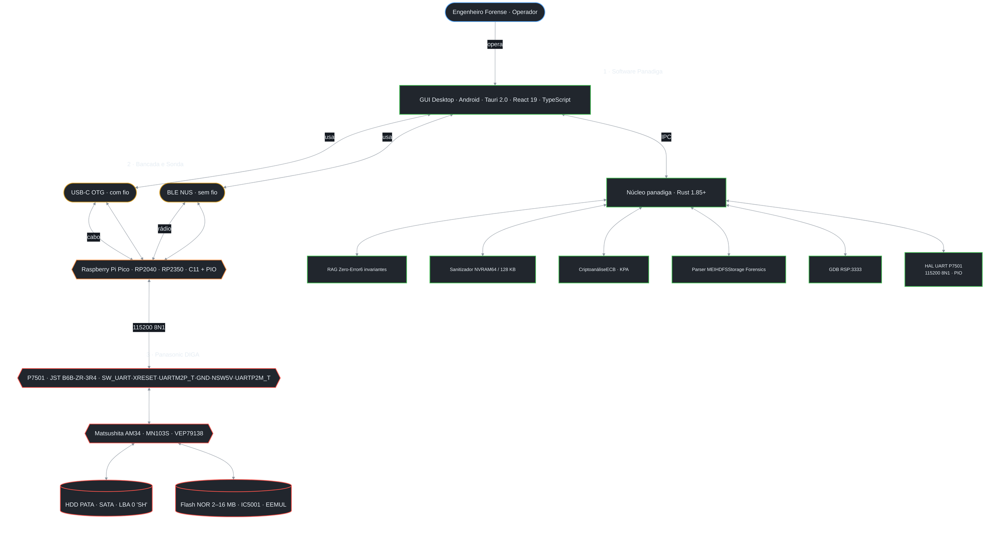
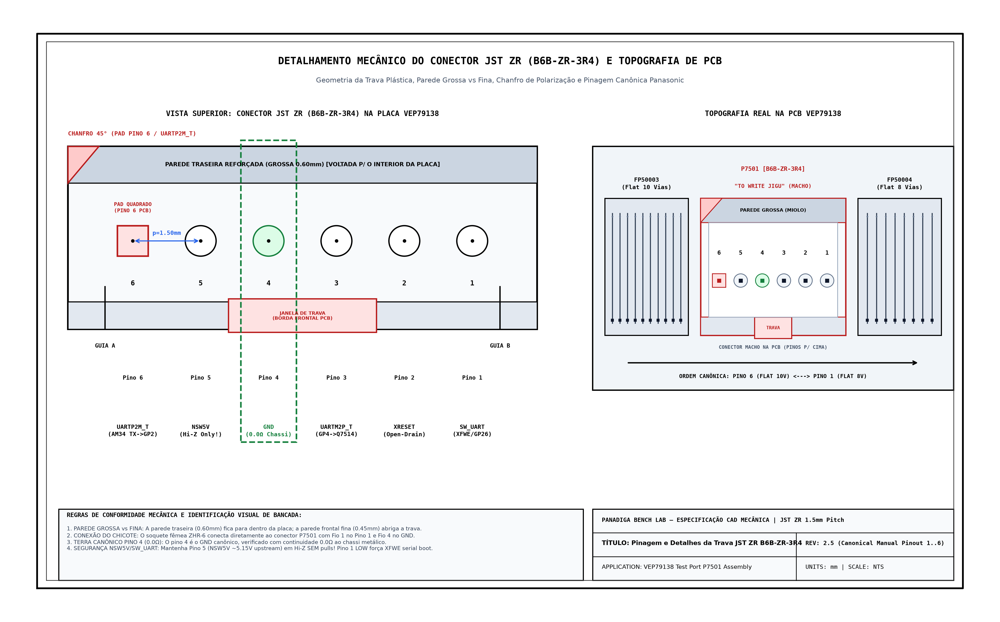
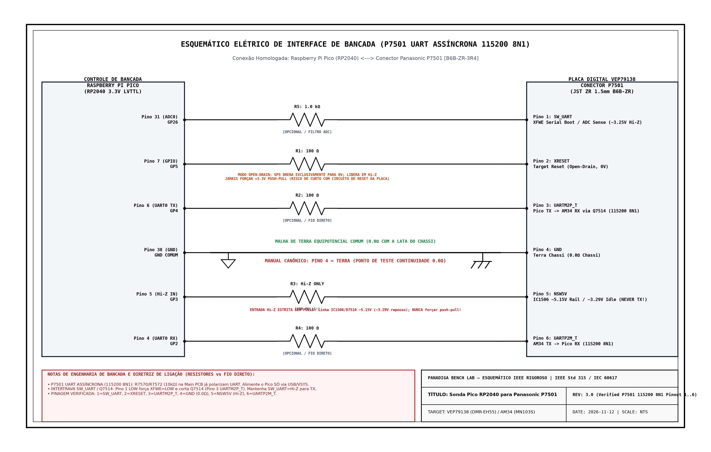

<p align="center">
  <a href="README.md">English</a> | <strong>Português (Brasil)</strong>
</p>

# Central de Engenharia Reversa, Firmware e Diagnóstico de Hardware — Gravadores Panasonic DIGA

[](https://www.rust-lang.org/)
[-blue.svg>)]()
[-green.svg>)]()
[-yellow.svg>)]()
[](LICENSE)

> **Documento Mestre de Referência Técnica de Sistemas e Hardware**
> **Classificação:** Engenharia Forense / Plataforma Unificada de Recuperação e Ferramentas
> **Dispositivo-Alvo Principal:** Gravador Digital de Vídeo DVD/HDD **Panasonic DMR-EH55** (Chassi DIGA / PCB Principal `VEP79138`)
> **Compatibilidade do Ecossistema:** Linha Panasonic DIGA (**Séries DMR-E, DMR-EH, DMR-ES, DMR-EX, DMR-BW**)
> **Processador:** Matsushita `AM34` / `MN103S` (Núcleo RISC de 32 bits `MN10300` / UniPhier)
> **Faixa de Memória Flash NOR:** 2 MB (16 Mbit) a 16 MB (128 Mbit) TSOP-48 / TSOP-56
> **Subsistema de Armazenamento:** Discos Rígidos PATA/IDE e SATA com particionamento e sistema de arquivos proprietário **MEIHDFS**
> **Interface de Depuração:** **UART Assíncrona `P7501` (`115200 8N1`) + Controle Discreto `SW_UART` / `XRESET` / `NSW5V`** (com fallback legado `pico-p7501` PIO)

---

## 1. Visão Geral e Apresentação Executiva do Projeto

A linha de gravadores **Panasonic DIGA** representa o ápice da engenharia japonesa de eletrônicos de consumo da era 2001–2008. Projetada pela **Matsushita Electric Industrial Co., Ltd.** (atual Panasonic Corporation), essa família de aparelhos integra processamento de áudio e vídeo de alto desempenho baseado na família de SoCs proprietários **UniPhier**, executando o conjunto de instruções **Matsushita AM34** (família MN10300).

Embora o foco inicial de laboratório deste projeto seja o modelo amplamente difundido **DMR-EH55**, os métodos de engenharia, algoritmos e ferramentas desenvolvidos no Panadiga abrangem **todo o ecossistema da linha Panasonic DIGA**:

1. **Bootloader Híbrido em Duas Fases:** A memória NOR Flash Spansion (`IC5001` no DMR-EH55 `VEP79138`, 2 MB a 16 MB dependendo da geração) carrega apenas o estágio inicial de inicialização (*IPL - Initial Program Loader*). O sistema operacional principal, drivers de aceleração gráfica OSD, microcódigos do servo óptico e codecs residem em setores reservados no disco rígido interno e contêineres ópticos de atualização.
2. **Sistema de Armazenamento Proprietário MEIHDFS:** O disco rígido não utiliza partição MBR padrão PC nem sistemas de arquivos FAT/ext. O layout baseia-se no formato **MEIHDFS** (*Matsushita Electric Industrial HDD File System*), com superbloco na assinatura ASCII `"SH"` no LBA 0, espelho de segurança no LBA 57.344 (28 MB), journal transacional de 10 blocos e partições de firmware cifradas.
3. **Criptografia e Proteção de Propriedade Intelectual:** O contêiner de distribuição óptica (`PANA_DVD.FRM`) e as partições executáveis do HD são blindados com cifras de bloco simétricas de 64 bits em modo ECB, associadas a esquemas CPRM (*Content Protection for Recordable Media*) e DivX DRM.
4. **A Vulnerabilidade Crítica do Erro `U99`:** A calibração de canais, estado de montagem do HDD e parâmetros do gravador são mantidos nos últimos 64 KB da Flash, emulando uma EEPROM (`EEMUL`). Desgaste de células, desligamento abrupto durante gravação ou parâmetros corrompidos provocam falha de validação na inicialização. Como consequência, o firmware Matsushita entra em pânico e trava irreversivelmente com o código **`U99`** no display VFD frontal, rejeitando comandos do controle e travando o mecanismo óptico.

Este repositório consolida o **ecossistema definitivo de engenharia reversa, recuperação física e análise forense** para a linha Panasonic DIGA, disponibilizando a suíte de ferramentas de alta performance em Rust **`panadiga`**, interface de bancada desktop e mobile Android (`.apk`), firmware C11/PIO para microcontroladores **Raspberry Pi Pico (RP2040) e Pico 2 (RP2350)** com suporte a **Bluetooth Low Energy (BLE)** e USB-C OTG, 30 manuais técnicos de fábrica, esquemas elétricos e datasheets de silício, e o acervo completo de 13 grandes dossiês técnicos bilíngues de referência.

---

## 2. Diagrama Mermaid de Arquitetura Ponta-a-Ponta



---

## 3. Árvore Completa do Repositório e Descrição Semântica dos Arquivos

```text
Panadiga/
├── package.json                                      <-- Ponto de Entrada Unificado (`npm start`, `npm run build:desktop`, `npm run validate`)
├── Cargo.toml                                        <-- Especificação Mestre do Workspace Rust (Edição 2024)
├── tauri.conf.json                                   <-- Configuração Desktop & Mobile Tauri 2.0
├── scripts/                                          <-- Orquestração Multiplataforma (`build.py`, `validate.py`, `panadiga_ops.py`)
├── src/                                              <-- Motor Nativo em Rust de Alta Performance
│   ├── main.rs                                       <-- Ponto de Entrada Unificado (CLI & GUI Tauri)
│   ├── lib.rs                                        <-- Biblioteca Crate Exportando os Módulos Centrais
│   ├── logger.rs                                     <-- Subsistema Unificado de Logging Estruturado
│   ├── manuals.rs                                    <-- Indexador de Manuais & Scanner Regex Ultrarrápido
│   ├── nvram/                                        <-- Parser Multi-Geometria de NVRAM & Emulação EEMUL
│   ├── hdd/                                          <-- Motor de Armazenamento MEIHDFS & Tabela de Partições
│   ├── frm/                                          <-- Motor de Criptoanálise do Contêiner PANA_DVD.FRM
│   ├── rag/                                          <-- Motor RAG Zero-Error & 6 Camadas de Defesa
│   └── desktop/                                      <-- Comandos Nativos Tauri 2.0 & Ponte GDB RSP
├── apps/desktop/                                     <-- Interface Gráfica de Bancada (React 19 + Vite)
│   ├── src/                                          <-- Componentes & ViewModels em Arquitetura MVVM Rigorosa
│   │   ├── components/                               <-- Painéis de Interface Pura (GDB, P7501 UART, HexViewer)
│   │   ├── services/                                 <-- Transporte Tipado Tauri IPC & Pontes Nativas
│   │   └── viewmodels/                               <-- Máquinas de Estados Algébricas (Lógica Pure FP)
│   ├── package.json                                  <-- Dependências Node.js & Scripts de Automação
│   └── playwright.config.ts                          <-- Configuração de Testes de Navegador toEnd-to-End
├── docs/                                             <-- Acervo Oficial de Documentação Técnica
│   ├── INDEX.md                                      <-- Portal e Índice Gateway de Documentação
│   ├── en-US/                                        <-- Dossiês Técnicos Canônicos em Inglês (13 Dossiês)
│   ├── pt-BR/                                        <-- Dossiês Técnicos de Bancada em Português (13 Dossiês)
│   └── images/                                       <-- Esquemáticos em Alta Resolução, Fotos e Pinouts
├── manuals_and_schematics/                           <-- Acervo Técnico (30 Manuais, Esquemas & Datasheets)
│   ├── README.md                                     <-- Catálogo Mestre Indexado por Modelo e Disciplina
│   ├── datasheets/                                   <-- Datasheets de Silício (MN103, RP2040, RP2350, Spansion)
│   ├── dmr-eh55/                                     <-- Manuais DMR-EH55 (Serviço, Esquemas, Usuário, Firmware)
│   ├── dmr-eh56/                                     <-- Manual de Operação Europeu DMR-EH56
│   ├── dmr-eh50/                                     <-- Manual de Operação e Uso DMR-EH50
│   ├── dmr-eh65/                                     <-- Manual de Uso da Variante 250 GB DMR-EH65
│   ├── dmr-eh80v/                                    <-- Manual de Serviço Combo VHS+DVD+HDD DMR-EH80V
│   ├── dmr-es10/                                     <-- Manual de Serviço DMR-ES10 (Código U99 & Esquemas)
│   ├── dmr-es30v/                                    <-- Manual de Operação Combo VHS+DVD DMR-ES30V
│   ├── dmr-e55/                                      <-- Manual de Operação Gravador Óptico 2MB DMR-E55
│   ├── dmr-e85h/                                     <-- Manual Pioneiro HDD/DVD 4MB Flash DMR-E85H
│   ├── dmr-e500h/                                    <-- Manual do Gravador Massivo 400 GB DMR-E500H
│   └── dmr-ex98v/                                    <-- Manual de Serviço DVB-T/HDMI Vol 1 DMR-EX98V
├── tools/                                            <-- Ferramentas de Laboratório, Ghidra & Launchers Windows
│   ├── Abrir_HxD.cmd                                 <-- Inicializador Rápido do Editor Hexadecimal HxD (Windows)
│   ├── conectar_gdb_multiarch.cmd                    <-- Conexão GDB Multiarch ao Alvo MN10300 (Windows)
│   ├── iniciar_ponte_gdb.cmd                         <-- Encaminhador TCP do Servidor GDB RSP (:3333, Windows)
│   ├── iniciar_ghidra.cmd                            <-- Inicializador do Workspace Ghidra (Windows)
│   └── ghidra/                                       <-- Scripts Ghidra AM34/MN103S (Gerados da SSOT em Rust)
├── scripts/                                          <-- Orquestração Cross-Platform de Build & 9 Quality Gates
│   ├── build.py                                      <-- Compilação Unificada Desktop, Android APK & Pico UF2
│   └── validate.py                                   <-- Executor dos 9 Portões Obrigatórios de Qualidade
└── firmware/
    └── pico-p7501/                                   <-- Firmware C11 Modular P7501 UART & OCD Legado para RP2040/RP2350
        ├── p7501_uart.pio                            <-- Máquina de Estados PIO UART 115200 8N1 / Half-Duplex
        ├── p7501_pico_main.c                         <-- Ponto de Entrada & Console Diagnóstico Serial (PANADIGA>)
        ├── hal/                                      <-- Camada HAL Open-Drain, Proteção NSW5V & Temporização
        ├── gdb/                                      <-- Codec Determinístico e Handlers GDB RSP
        └── CMakeLists.txt                            <-- Pipeline CMake Bare-Metal Dual-Target
```

---

### 3.1. Comandos Unificados Multiplataforma (`package.json` & `scripts/`)

| Comando | Plataforma | Modo | Descrição |
| :--- | :--- | :--- | :--- |
| **`npm start`** | Windows / Linux / macOS | Execução / Auto-Build | Inicia a GUI Desktop diretamente de `dist/` ou `target/release/` (compila via `scripts/build.py --desktop` se ausente). |
| **`npm run dev`** | Windows / Linux / macOS | Dev Server Vite | Inicia o servidor de desenvolvimento com hot-reload em `apps/desktop`. |
| **`npm run cli -- <args>`** | Windows / Linux / macOS | Dispatcher CLI Nativa | Encaminha argumentos para `panadiga` (`dist/`, `target/release/`, ou `cargo run -p panadiga --`). |
| **`npm run build:desktop`** | Windows / Linux / macOS | Release Desktop | Compila bundle React, exporta scripts Ghidra do SSOT, compila Rust release, copia UF2s & `tools/` e empacota `.zip`/`.tar.gz` + `SHA256SUMS.txt`. |
| **`npm run build:android`** | Windows / Linux / macOS | Release Android APK | Configura SDK/NDK Android, compila APK AArch64 via Tauri Mobile e restaura `Cargo.toml` com segurança. |
| **`npm run build:all`** | Windows / Linux / macOS | Release Completo | Compila firmwares Pico UF2 (se ARM GCC presente), Release Desktop e APK Android. |
| **`npm run validate`** (`npm test`) | Windows / Linux / macOS | 9 Quality Gates | Executa `python scripts/validate.py` cobrindo Rust, TypeScript, Vitest, `jscpd`, `uxlint`, Playwright, Ghidra SSOT, testes C11 host, `mypy --strict` e `pytest`. |

---

## 4. Guia de Uso Completo da Ferramenta Rust `panadiga` (`src/`)

O binário compilado `panadiga` opera tanto como servidor gráfico de bancada Desktop quanto utilitário de linha de comando de alta velocidade.

### 4.1 Compilação em Modo Release

```bash
# Compilação do binário unificado de produção
cargo build --release -p panadiga

# Execução direta via scripts npm unificados (Windows / Linux / macOS):
npm start
npm run cli -- --help
```

### 4.2 Comando 1: Limpeza Cirúrgica da NVRAM Multi-Geometria (`nvram clean`)

Executa a sanitização do setor circular de emulação EEPROM (`EEMUL`) dentro da memória Flash NOR sem alterar o bootloader (*IPL*). Detecta dinamicamente a geometria do arquivo (2 MB, 4 MB, 8 MB, 16 MB) e calcula o setor de 64 KB em `len - 64 KB`.

```bash
# Dump de 8 MB (DMR-EH50 / EH55 / EH56 / EH60 / EH65 / EH80V):
panadiga nvram clean --input dump_flash_8mb.bin --output flash_recuperada.bin

# Dump de 4 MB (DMR-E85H / E95H / ES20):
panadiga nvram clean --input dump_flash_4mb.bin --output flash_recuperada.bin

# Dump de 2 MB (DMR-E50 / E55 / ES10):
panadiga nvram clean --input dump_flash_2mb.bin --output flash_recuperada.bin

# Dump de 16 MB (DMR-EX75 / EX85 / EX98V):
panadiga nvram clean --input dump_flash_16mb.bin --output flash_recuperada.bin
```

* **Byte de Sanitização:** Estado virgem `0xFF` (padrão de células apagadas em memórias Flash NOR).
* **Invariante de Silício:** Jamais modifica os primeiros setores (`0x00000000` até `len - 65537`), preservando integralmente o IPL de fábrica.

### 4.3 Comando 2: Inspeção Estrutural do Disco Rígido (`hdd inspect`)

Analisa a geometria e integridade do particionamento MEIHDFS, localiza o superbloco `"SH"` no LBA 0, valida o espelho de segurança em 28 MB (LBA 57.344) e detalha as fronteiras das partições.

```bash
panadiga hdd inspect --input imagem_hd.bin
```

### 4.4 Comando 3: Extração Cirúrgica de Partições (`hdd extract`)

Extrai as partições executáveis brutas do disco rígido MEIHDFS para análise forense no Ghidra ou IDA Pro.

```bash
panadiga hdd extract --input imagem_hd.bin --output-dir particoes/
```

### 4.5 Comando 4: Criptoanálise Forense do Contêiner Óptico (`frm analyze`)

Audita o contêiner óptico de atualização `PANA_DVD.FRM`, avaliando a entropia por blocos, registros da TOC e padrões de vazamento do modo ECB.

```bash
panadiga frm analyze --input firmware_and_images/PANA_DVD.FRM
```

### 4.6 Comando 5: Decodificação de Descritores Bit-Invertidos MEIHDFS (`hdd decode-descriptors`)

Decodifica os descritores de partição gravados com inversão bit a bit (Complemento de Um / XOR 0xFF) no superbloco MEIHDFS.

```bash
panadiga hdd decode-descriptors --input hdd_100.bin
```

### 4.7 Comando 6: Dump e Desconstrução da TOC e Módulos do `.FRM` (`frm dump-toc`)

Desconstrói o contêiner `PANA_DVD.FRM` em seus três módulos funcionais: Sistema Operacional Principal da CPU (AM34), Servo Controlador Óptico (DSP MN102) e Camada Gráfica OSD.

```bash
panadiga frm dump-toc --input firmware_and_images/PANA_DVD.FRM
```

### 4.8 Comando 7: Consulta e Auditoria do Codebook ECB de 64 bits (`frm codebook`)

Cataloga os blocos de 64 bits de maior frequência entre o contêiner óptico e as partições do HD para comprovar a identidade das chaves criptográficas.

```bash
panadiga frm codebook --frm firmware_and_images/PANA_DVD.FRM --hdd firmware_and_images/hdd_100.bin
```

### 4.9 Comando 8: Inspeção de Cabeçalhos e Hex Dumper (`headers`)

```bash
panadiga headers --input firmware_and_images/hdd_100.bin
```

### 4.10 Comando 9: Varredura Forense de Strings e Palavras-Chave (`scan`)

```bash
panadiga scan --input firmware_and_images/PANA_DVD.FRM --terms U99,FIRMWARE,PANASONIC
```

### 4.11 Comando 10: Indexação e Busca em Manuais de Serviço e Esquemas Técnicos (`manuals`)

Pesquisa nos 30 manuais técnicos de serviço, esquemas elétricos e datasheets através de busca recursiva ultrarrápida.

```bash
panadiga manuals --query "P7501"
panadiga manuals --query "U99" --filter "dmr-es10"
panadiga manuals --query "MN103" --filter "datasheets"
```

### 4.12 Comando 11: Consulta ao Motor RAG Zero-Error e Guardrails Físicos (`rag query`)

Executa consultas técnicas fundamentadas com proteção estrita contra alucinações e limites elétricos garantidos por 6 invariantes de silício.

```bash
panadiga rag query --question "Qual o pino de terra canônico do conector P7501?"
panadiga rag query --question "What is the canonical ground pin of P7501?" --json
```

---

## 5. Especificação Elétrica e Pinout da Interface UART Assíncrona `P7501` (`115200 8N1`)

### 5.1 Pinout Elétrico Canônico, Mapeamento Físico de Bancada e Conexão Universal RP2040 / RP2350

Na placa digital/principal `VEP79138` do DMR-EH55 (legenda *"TO JIGU"* no esquemático oficial Panasonic), o conector **`P7501 [B6B-ZR-3R4]`** é uma **interface UART assíncrona `115200 8N1` + controle discreto de boot e reset**, localizada na borda superior entre o cabo flat de 10 vias (`FP50003`) à esquerda e o de 8 vias (`FP50004`) à direita.

> [!CAUTION]
> **REGRAS DE SEGURANÇA ELÉTRICA — CONTINUIDADE `GND` E PROTEÇÃO Hi-Z DE `NSW5V` (`GP3`):**
>
> * **Terra Canônico:** Conforme o Manual de Serviço Oficial (`P7501`), **`GND` é ESTRITAMENTE O PINO 4**. Valide sempre **$0.0\,\Omega$ contínuo** entre o Pino 4 e a carcaça metálica antes de conectar qualquer cabo.
> * **`NSW5V` (`Pino 5`, `X_SW_5R2V` -> `GP3`):** Provém de `IC1506` (`~5.15V` upstream via diodo `D7510`, medido ~`3.29V` em repouso na bancada) para alimentar os pull-ups `R7570`/`R7572` (`10 kΩ`) e o VDD de `IC7501`. **`GP3` DEVE permanecer SEMPRE em `Hi-Z Input` sem pulls — NUNCA dirigir push-pull!**
> * **Sem Retroalimentação:** NUNCA alimente o Raspberry Pi Pico pelo conector `P7501`; alimente exclusivamente por USB/VSYS.
> * **Intertravamento `Q7510`/`Q7514`:** Colocar `SW_UART` (Pino 1) em nível `LOW` aciona o modo de boot serial `XFWE` e coloca `Q7514` em corte, desconectando `UARTM2P_T` (Pino 3) do RX do SoC AM34. Mantenha `SW_UART` em `Hi-Z` (~`3.25V`) ao transmitir bytes UART do `GP4` para o AM34!

<p align="center">
  
  <br/>
  <em>Figura 5.1: Topografia física da PCB VEP79138 delimitando o conector P7501 entre os cabos flat FP50003 (10 vias) e FP50004 (8 vias).</em>
</p>

```text
       ORIENTAÇÃO MECÂNICA CANÔNICA DO CONECTOR P7501 [B6B-ZR-3R4] (ESQUEMÁTICO PANASONIC)
       Parede Traseira voltada para o interior da placa (acima) | Janela de trava voltada para a borda frontal (abaixo)
   
       Cabo Flat 10 Vias (FP50003)                                         Cabo Flat 8 Vias (FP50004)
       [À Esquerda]                                                                      [À Direita]
            ┌───────────────────────────────────────────────────────────────────────────────────┐
     Pino 6 │ ■ UARTP2M_T [Pad Quadrado] MAX TXD: AM34 TX -> Pico RX GP2 (115200 8N1, R7572 10k)│
     Pino 5 │ ● NSW5V     [Pad Redondo]  X_SW_5R2V via D7510 (~5.15V up / ~3.29V) GP3 Hi-Z ONLY!│
     Pino 4 │ ● GND       [Pad Redondo]  Terra Canônico (0.0Ω Contínuo ao Chassi!)              │
     Pino 3 │ ● UARTM2P_T [Pad Redondo]  MAX RXD: Pico TX GP4 -> AM34 RX (via Q7514, R7570 10k) │
     Pino 2 │ ● XRESET    [Pad Redondo]  Linha de Reset Mestre (Open-Drain Estrito GP5)         │
     Pino 1 │ ● SW_UART   [Pad Redondo]  Boot Serial / Intertravamento Q7510 (GP26, ~3.25V)     │
            └───────────────────────────────────────────────────────────────────────────────────┘
```

<p align="center">
  
  <br/>
  <em>Figura 5.2: Recorte do esquemático oficial da Panasonic DMR-EH55 (VEP79138) detalhando o barramento P7501 [B6B-ZR-3R4] "TO JIGU".</em>
</p>

> [!NOTE]
> **Compatibilidade de Hardware RP2040 / RP2350:** Qualquer placa equipada com **RP2040** (Pico, Pico W) ou **RP2350** (Pico 2) é 100% suportada. O enquadramento padrão `115200 8N1` (`p7501_uart.pio`) e a temporização open-drain determinística de `XRESET`/`SW_UART` rodam diretamente no hardware do RP2040/RP2350.

| Pino P7501 (Canônico) | Sinal Matsushita |     Pino RP2040 / Pico     |              Condicionamento / Rede na PCB              |        Tipo de Sinal        | Veredito de Bancada & Função Técnica                                                                                                         |
| :--------------------: | :---------------: | :------------------------: | :-----------------------------------------------------: | :-------------------------: | :------------------------------------------------------------------------------------------------------------------------------------------- |
|    **Pino 1**    | `SW_UART` `(D)` | `GP26 / ADC0` (Pino 31) | Resistor $1.0\text{ k}\Omega$ ADC em série; Q7510/R7562/R7559 | Leitura ADC / Open-Drain | Lê `~3.25V` em Hi-Z (`~2.69V` Pull-Down via `Q7510`). Nível `LOW` ativa boot serial `XFWE` e corta `Q7514` (`I < 10 mA`). |
|    **Pino 2**    |    `XRESET`    |      `GP5` (Pino 7)      |          Resistor $100\,\Omega$ em série (opcional)          | **Open-Drain Estrito** | Reset mestre da CPU. **Drenar para 0V (`LOW`) para resetar; soltar em `Hi-Z` (~20 µs subida) para rodar. Nunca 3.3V Push-Pull!** |
|    **Pino 3**    | `UARTM2P_T` (`MAX RXD`) | `GP4` (Pino 6) | Pull-up interno `R7570 10 kΩ` ao `NSW5V` + chave `Q7514` | **UART TX (Pico -> AM34)** | Entrada UART `115200 8N1` no AM34. Exige `SW_UART` em `Hi-Z` para `Q7514` conduzir. **NÃO adicionar pull-up externo para 3.3V.** |
|    **Pino 4**    | **`GND`** | **Pino 38 (`GND`)** |         **Ligação direta de baixa impedância**         | **Referência de 0V** | **Equipotencial mandatória: $0.0\,\Omega$ contínuo com a carcaça metálica do chassi!**                                                   |
|    **Pino 5**    | `NSW5V` (`X_SW_5R2V`) | `GP3` (Pino 5) |     Leitura em alta impedância via `IC1506` / `D7510`     | **Sense Estático APENAS** | Linha ~5.15V upstream via `D7510` (`~3.29V` em repouso). **DEVE permanecer `Hi-Z Input` sem pulls — NUNCA configurar como saída push-pull!** |
|    **Pino 6**    | `UARTP2M_T` (`MAX TXD`) | `GP2` (Pino 4) |    Rede `R7572 10 kΩ`; resistor $100\,\Omega$ (opcional)    | **UART RX (AM34 -> Pico)** | Console assíncrono `115200 8N1` do AM34 (`<00>DDR CHECK: OK`, `CD diag boot mode`, `X(...)`). Pad quadrado na PCB. |

<p align="center">
  
  <br/>
  <em>Figura 5.3: Esquema elétrico normatizado (IEEE Std 315 / IEC 60617) para montagem da sonda de bancada conectando o Raspberry Pi Pico ao conector P7501.</em>
</p>

---

### 5.2 Regras Críticas de Engenharia e Prevenção de Danos

1. **Regra 1 (Proteção Estrita `Hi-Z` em `NSW5V`):** O Pino 5 de `P7501` (`NSW5V`) NÃO é clock síncrono (`SCLK`). Ele deriva do barramento de `~5.15V` (`IC1506`) via `D7510`. Configure `GP3` estritamente como `Hi-Z Input` sem pulls internos; jamais drene ou impulsione corrente nesse pino.
2. **Regra 2 (Open-Drain no `XRESET`):** Acionar `XRESET` via push-pull de 3.3V gera contenda elétrica com o supervisor de reset da placa. Sempre aterre (`0V`) para resetar e libere para `Hi-Z` para operar.
3. **Regra 3 (Validação Mandatória de Continuidade do Terra):** Meça $0.0\,\Omega$ entre o Pino 4 do conector e o chassi metálico antes de conectar qualquer cabo serial ou de alimentação.
4. **Regra 4 (Sem Pull-Up Externo em `UARTM2P_T` e Sem Dessolda):** A PCB `VEP79138` já polariza `UARTM2P_T` por `R7570` (`10 kΩ`) ao `NSW5V`; conecte o soquete fêmea JST ZR de 1.5mm (`B6B-ZR-3R4`) diretamente sem risco de delaminação da Flash TSOP-48 (`IC5001`).
5. **Regra 5 (Intertravamento `SW_UART` / `Q7514`):** Pulse `SW_UART` em nível baixo junto com `XRESET` somente para capturar o modo serial/JIG, e devolva `SW_UART` para `Hi-Z` antes de transmitir comandos `115200 8N1` pelo `GP4` (`UARTM2P_T`).

---

### 5.3 Enquadramento UART Assíncrono `P7501` (`115200 8N1`) & Sequência de Boot

```text
Quadro UART (GP2 RX <- UARTP2M_T | GP4 TX -> UARTM2P_T @ 115200 baud, 8N1):
IDLE (HIGH) ──\ START (0) /─ B0 ─ B1 ─ B2 ─ B3 ─ B4 ─ B5 ─ B6 ─ B7 ─\ STOP (1) ──  (8.68 µs/bit)

Sequência Validada na Bancada DMR-EH55 (Captura CDDIAG via P7501):
  1. XRESET (GP5) = LOW (10 ms Open-Drain) -> Solta Hi-Z (~20 µs subida)
  2. SW_UART (GP26) = LOW na janela de reset para amostragem JIG / CDDIAG -> Solta Hi-Z para TX via Q7514
  3. UARTP2M_T (GP2) emite <00>DDR CHECK: OK -> CD diag boot mode -> X(80020401)59..X(80040904)0
```

---

## 6. Mapa de Memória Físico da Arquitetura Matsushita AM34 (`MN103S` / `VEP79138`)

```text
+-------------------+-------------------+--------------------+---------------------------------------------+
| Faixa Física      | Faixa Espelhada   | Tipo de Barramento | Descrição Funcional                         |
+-------------------+-------------------+--------------------+---------------------------------------------+
| 0x00000000..0FFF  | 0x40000000..0FFF  | I-RAM/SRAM Interna | 4 KB Scratchpad e Vetores de Exceção        |
| 0x00400000..07FF  | 0x40400000..07FF  | D-RAM Interna      | 64 KB Memória Rápida de Dados do Sistema    |
| 0x04000000..07FF  | 0x44000000..07FF  | Controlador DDR    | 64 MB Memória Principal do Sistema (DDR)    |
| 0x08000000..0FFF  | 0x48000000..0FFF  | Framebuffer MPEG   | 32 MB Memória de Vídeo Dedicada / OSD       |
| 0x10000000..10FF  | 0x50000000..10FF  | Mestre IDE / PATA  | Registradores ATA/ATAPI-5 (HDD e Drive DVD) |
| 0x18000000..187F  | 0x58000000..187F  | CS0 Externo (NOR)  | Flash Spansion S29JL064H (8 MB - IPL)       |
| 0x187F0000..187F  | 0x587F0000..187F  | CS0 Externo (NV)   | 64 KB Setor de NVRAM/EEMUL (Alvo do U99)    |
| 0x1F000000..1FFF  | 0x5F000000..1FFF  | MMIO Interno SoC   | Registradores de Periféricos, Timers e OCD  |
+-------------------+-------------------+--------------------+---------------------------------------------+
```

### 6.1 Regra de Ouro JEDEC para o RAM Loader Injetado

Ao carregar payloads executáveis na memória DDR-SDRAM ou consultar registradores-alvo pela ponte P7501/GDB:

* **Endereço de Carga do Payload:** `0x04010000` (offset seguro de buffer DDR, evitando a página zero).
* **Ponteiro de Pilha Inicial:** `SP = 0x0040FFF0` (dentro da SRAM de alta velocidade interna do chip).
* **Desativação do Watchdog:** Escrever `0x00000000` no registrador MMIO `0x1F000104` em menos de $100\text{ ms}$ após o boot.

---

## 7. Síntese das Descobertas Criptográficas e Forenses (Forensic Cryptanalysis & Storage Deep-Dive)

### 7.1 O Modo ECB e o Vazamento Estrutural ("ECB Leak")

A análise estatística do arquivo `PANA_DVD.FRM` e dos dumps do disco rígido revelou que a Matsushita adotou criptografia de bloco simétrica de 64 bits sem encadeamento de blocos (CBC). Blocos idênticos de 8 bytes no texto claro geram blocos idênticos no texto cifrado, expondo tabelas e estruturas internas.

### 7.2 Codebook ECB de 64 bits e Ataque de Texto-Plano Conhecido (Known-Plaintext Attack - KPA)

| Bloco Cifrado (Hex) | Significado em Texto Claro | Ocorrências FRM | Ocorrências HD | Relevância Forense                                 |
| :------------------: | :-------------------------: | :--------------: | :-------------: | :-------------------------------------------------- |
| `035065C87BB8E090` | `FF FF FF FF FF FF FF FF` |      3.812      |      1.280      | Células virgens de Flash NOR apagada / Padding     |
| `E5D1F34A518B2690` | `00 00 00 00 00 00 00 00` |       196       |        3        | Padding nulo de zeros / Zeros estruturais           |
| `4D3C5DBB0C357777` |    Cabeçalho de Tabela    |      1.280      |        0        | Quadro descritor de módulo de partição interna   |
| `EFDC1CDA13881BAB` |   Cabeçalho de Família   |        3        |        0        | TOC: Marcador de Família de Processadores UniPhier |
| `74A78ACD789B84FF` |     Seletor de Core CPU     |        2        |        0        | TOC: Identificador de Núcleo AM34 / MN103S         |
| `3B7E7EDBB6C57A53` |     Seletor de Core DSP     |        1        |        0        | TOC: DSP do Servo do Drive Óptico MN102            |

### 7.3 Desconstrução do Contêiner `PANA_DVD.FRM` em 3 Módulos de Firmware

O contêiner do disco óptico de atualização divide-se em três módulos precedidos por um cabeçalho global de 16 bytes (`492F0560CEDE508CE3C08AFD49B64A9A`) e uma TOC de 144 bytes (três registros de 48 bytes):

1. **Módulo 0 (`MOD_0`):** Kernel do Sistema Operacional para o processador AM34 (SO, GUI, drivers).
2. **Módulo 1 (`MOD_1`):** Microcódigo do servo óptico para o processador MN102 DSP.
3. **Módulo 2 (`MOD_2`):** Recursos gráficos OSD, tabelas de fontes, primitivas e textos de menus.

### 7.4 Vínculo Criptográfico Irrefutável entre o CD (`.FRM`) e o HD (`hdd_100.bin`)

A presença de blocos cifrados idênticos `E5D1F34A518B2690` (zeros) e `035065C87BB8E090` (Flash virgem) tanto no contêiner óptico quanto nas partições do HD comprova que:

1. O firmware mantido no HD é cifrado com o **mesmo algoritmo e mesma chave** do contêiner óptico.
2. Não é possível reparar um HD simplesmente injetando dados em texto-claro; a estrutura precisa respeitar a chave de cifragem e geometria do MEIHDFS.

### 7.5 Arquitetura Bit-Invertida (One's Complement / XOR 0xFF) do MEIHDFS

O superbloco no LBA 0 armazena a geometria com inversão bit a bit (`XOR 0xFF`):

* O identificador ASCII `"SH"` aparece em hexadecimal como `0xAE 0xB7` (`~0x51 0x48`).
* Contadores de LBA e clusters são igualmente invertidos, impedindo que utilitários de partição convencionais de PC identifiquem ou corrompam o disco.

---

## 8. Guia Prático de Resolução do Erro U99 em 3 Rotas de Engenharia

```text
                   +---------------------------------------------+
                   |       PANASONIC DMR-EH55 ERRO U99          |
                   |      (Pânico Permanente no Display VFD)     |
                   +----------------------+----------------------+
                                          |
                +-------------------------+-------------------------+
                |                         |                         |
                v                         v                         v
     [ROTA A: LABORATÓRIO]      [ROTA B: UART IN-CIRCUIT]  [ROTA C: CLONE FORENSE]
     Dessoldagem TSOP-48 Flash  Conexão RP2040 no P7501    Clone bit a bit do HDD
     Gravador T48 / SVOD4       115200 8N1 / Captura CDDIAG Limpeza Setor 0x7F0000
     Limpeza Direta 0x7F0000    Captura Live NVRAM / GDB   Preservação 100 MB Sistema
```

### Rota A: Gravação Física Externa TSOP-48 via SVOD 4 / XGecu T48

* Dessolde `IC5001` (Spansion S29JL064H70TFI00).
* Faça leitura de backup de 8 MB.
* Execute `panadiga nvram clean --input dump.bin --output limpo.bin`.
* Regrave `limpo.bin` no chip e solde de volta na placa.

### Rota B: In-Circuit via UART Assíncrona `P7501` & Ponte GDB (Raspberry Pi Pico / RP2040 / RP2350)

* Conecte a sonda JST ZR de 6 vias do Pico ao conector `P7501` (confirmando pino 4 `GND` = $0.0\,\Omega$ e mantendo `GP3` / `NSW5V` estritamente `Hi-Z`).
* Execute `panadiga pico uart-probe` / `panadiga gdb-bridge` para capturar telemetria ao vivo (`CD diag boot mode`) e comandos de serviço em `115200 8N1`.

### Rota C: Substituição do HD por SSD Preservando os 100 MB do MEIHDFS

* Conecte o disco IDE a um adaptador USB com alimentação dedicada.
* Extraia a partição do sistema: `panadiga hdd extract --input /dev/sdb --output-dir backup/`.
* Grave em SSD compatível e reinsira no aparelho.

---

## 9. Matriz Completa de Compatibilidade e Comparação Arquitetural da Linha Panasonic DIGA

A tabela a seguir especifica detalhadamente a arquitetura de silício, capacidade de Flash, endereçamento da NVRAM e métodos de recuperação aplicáveis em todas as 5 gerações de gravadores Panasonic DIGA:

| Família & Modelos de Gravadores                                                                                | Geração / Ano                                      | Processador SoC & Arquitetura                                                     | Memória Flash NOR (Tamanho & Chip)                     | Faixa de Endereço da NVRAM (EEMUL)         | Subsistema de Armazenamento                       | Conector de Serviço / Depuração (`P7501` & Linha)                                                                | Causa do Erro U99 & Solução Panadiga                                                                                         |
| :-------------------------------------------------------------------------------------------------------------- | :--------------------------------------------------- | :-------------------------------------------------------------------------------- | :------------------------------------------------------ | :------------------------------------------ | :------------------------------------------------ | :------------------------------------------------------------------------------------------------- | :----------------------------------------------------------------------------------------------------------------------------- |
| **DMR-E20, DMR-E30, DMR-E50, DMR-E55, DMR-E60**                                                           | **Geração 1** (2001–2003)                   | Matsushita MN10300 (16/32-bit AM32 / AM33)                                        | **2 MB** (16 Mbit) TSOP-48 (Am29LV160)            | `0x001F0000..0x001FFFFF` (Últimos 64 KB) | Gravador Óptico DVD-RAM / DVD-R (UDF 1.5 direto) | Conector UART / serviço de 5 ou 6 pinos (3.3V)                                                                | Corrupção de wear-leveling na Flash. Limpeza via `panadiga nvram clean` (auto-detecta 2 MB).                               |
| **DMR-E80H, DMR-E85H, DMR-E95H, DMR-E100H, DMR-E500H, DMR-ES20**                                          | **Geração 2** (2003–2004)                   | Matsushita MN103S / Primeiros UniPhier                                            | **4 MB** (32 Mbit) TSOP-48 (Am29LV320)            | `0x003F0000..0x003FFFFF` (Últimos 64 KB) | HDD PATA/IDE (40–160 GB) + MEIHDFS-V1            | Barra de pinos UART de serviço de 6 vias (3.3V LVTTL)                                                         | Berço do erro `U99` histórico. Limpeza do setor `0x3F0000` via `panadiga nvram clean` (auto-detecta 4 MB).             |
| **DMR-EH50, DMR-EH52, DMR-EH55, DMR-EH56, DMR-EH60, DMR-EH65, DMR-EH75V, DMR-EH80V, DMR-ES10, DMR-ES30V** | **Geração 3** (2005–2007) [Plataforma Base] | Matsushita `AM34` / `MN103S` (`VEP79138` Main / Syscon `IC7501`)                              | **8 MB** (64 Mbit) TSOP-48 (`IC5001` Spansion S29JL064H)   | `0x007F0000..0x007FFFFF` (Últimos 64 KB) | HDD PATA/IDE (80–250 GB) + MEIHDFS-V2            | Conector Canônico **`P7501`** (JST B6B-ZR-3R4: `SW_UART`, `XRESET`, `UARTM2P_T`, `GND`, `NSW5V`, `UARTP2M_T`) | Erro clássico `U99` por dessincronia do anel EEMUL. Solução via `panadiga nvram clean` ou telemetria UART in-circuit (`P7501`). |
| **DMR-EX75, DMR-EX85, DMR-EX95V, DMR-EX98V, DMR-EH67, DMR-EH68**                                          | **Geração 4** (2006–2008)                   | Matsushita `MN103S` / `AM34` 2ª Geração | **16 MB** (128 Mbit) TSOP-56 (Spansion S29GL128N) | `0x00FF0000..0x00FFFFFF` (Últimos 64 KB) | HDD SATA / PATA (160–320 GB) + MEIHDFS-V2+       | Barra UART `115200 8N1` / serviço de 6 vias (JST ZR)                                                            | Dessincronia de tabelas de canal DVB-T gerando U99. Limpeza via `panadiga nvram clean` (auto-detecta 16 MB).                 |
| **DMR-BW500, DMR-BR500, DMR-BW700, DMR-BW800, DMR-BWT700**                                                | **Geração 5** (2008–2011)                   | Matsushita UniPhier Dual-Core (`MN103S` / ARM híbrido)                     | **32 MB -- 64 MB** Flash NOR/NAND                 | Alocação dinâmica por volume             | HDD SATA 3.5" (250 GB -- 1 TB) + Drive BD-RE      | Interface de serviço UART / JTAG                                                                    | Geração Blu-ray. MEIHDFS-V3 com cifras AES. Extração de partições via `panadiga hdd extract`.                          |

### 9.1 Por Que Funciona em Todos os Modelos DIGA ("Invariantes de Silício")

1. **Invariante Matemática de Dimensionamento de Flash (`len - 64 KB`):** Os engenheiros de firmware da Matsushita alocaram consistentemente o anel de emulação de EEPROM (`EEMUL`) no último setor de 64 KB da Flash NOR principal em todas as gerações. O comando `panadiga nvram clean` avalia dinamicamente `offset = len - 65536`. Portanto, seja em dumps de 2 MB (`0x1F0000`), 4 MB (`0x3F0000`), 8 MB (`0x7F0000`) ou 16 MB (`0xFF0000`), a limpeza cirúrgica atua com 100% de precisão sem risco ao IPL.
2. **Invariância da Telemetria UART & Controle Discreto (`115200 8N1`):** Nos conectores de serviço `VEP79xxx` (`P7501`), o console opera por UART assíncrona `115200 8N1` combinada a reset open-drain (`XRESET`) e sensoriamento em alta impedância (`NSW5V`). A máquina `p7501_uart.pio` + HAL C11 interage deterministicamente com esses sinais prevenindo qualquer contenda push-pull.
3. **Invariância do Superbloco MEIHDFS:**
   A assinatura mágica ASCII `"SH"` e a geometria com espelho de segurança em 28 MB são idênticas desde a série E85H até as séries digitais EH e EX.

---

## 10. Acervo de Manuais Técnicos, Esquemas e Datasheets (30 Documentos Catalogados)

Todos os manuais de serviço, esquemas e datasheets estão organizados hierarquicamente em `manuals_and_schematics/`:

### A. Manuais de Serviço e Esquemas Técnicos Panasonic DIGA

* `dmr-eh55/service/panasonic_dmr_eh55ec_service_manual_vol2_schematics.pdf` (177 págs, esquemas placa VEP79138, pinout P7501)
* `dmr-eh55/service/panasonic_dmr_eh55ec_service_manual_vol1_diagnostics.pdf` (97 págs, fluxo de autodiagnóstico e erro U99)
* `dmr-eh55/service/panasonic_dmr_eh55p9_eh55pc9_service_manual_north_america.pdf` (97 págs, chassi NTSC norte-americano)
* `dmr-eh55/service/panasonic_dmr_eh55ec_service_manual_europe.pdf` (92 págs, chassi PAL europeu)
* `dmr-eh55/service/panasonic_dmr_eh55ee_service_manual_east_europe.pdf` (91 págs, chassi SECAM leste-europeu)
* `dmr-eh80v/service/panasonic_dmr_eh80v_service_manual_europe.pdf` (12.2 MB, esquemas combo triplo VHS+DVD+HDD)
* `dmr-es10/service/panasonic_dmr_es10_service_manual_north_america.pdf` (5.3 MB, manual de serviço DVD-RAM, erro U99 na pág. 13)
* `dmr-ex98v/service/panasonic_dmr_ex98v_service_manual_vol1.pdf` (10.4 MB, manual de serviço combo digital DVB-T/HDMI Vol 1)
* `dmr-eh55/firmware_update/panasonic_dmr_eh55_firmware_installation_guide.pdf` (8 págs, guia oficial de atualização por CD-R)

### B. Manuais de Usuário e Operação Panasonic DIGA

* `dmr-eh55/user/panasonic_dmr_eh55_operating_instructions_global.pdf` (89 págs)
* `dmr-eh55/user/panasonic_dmr_eh55s_operating_instructions_silver.pdf` (89 págs)
* `dmr-eh55/user/panasonic_dmr_eh55_eh56_operating_instructions_europe.pdf` (84 págs)
* `dmr-eh55/user/panasonic_diga_dmr_eh55_user_manual.pdf` (84 págs)
* `dmr-eh55/user/panasonic_dmr_eh55_user_manual_oceania.pdf` (76 págs)
* `dmr-eh55/user/panasonic_dmr_eh55_australia_new_zealand_manual.pdf` (76 págs)
* `dmr-eh55/user/panasonic_dmr_eh55_hdmi_hdavi_control_guide.pdf` (6 págs)
* `dmr-eh55/user/panasonic_dmr_eh55_quick_setup_guide.pdf` (2 págs)
* `dmr-eh56/user/panasonic_dmr_eh56_operating_instructions.pdf` (89 págs)
* `dmr-eh50/user/panasonic_dmr_eh50_user_manual.pdf` (4.1 MB)
* `dmr-eh65/user/panasonic_dmr_eh65_user_manual.pdf` (4.8 MB)
* `dmr-eh80v/service/panasonic_dmr_eh80v_service_manual_europe.pdf` (12.2 MB)
* `dmr-e85h/user/panasonic_dmr_e85h_user_manual.pdf` (2.7 MB)
* `dmr-e55/user/panasonic_dmr_e55_operating_instructions.pdf` (3.2 MB)
* `dmr-e500h/user/panasonic_dmr_e500h_user_manual.pdf` (4.9 MB)
* `dmr-es30v/user/panasonic_dmr_es30v_user_manual.pdf` (7.9 MB)

### C. Datasheets de Silício e Manuais de Arquitetura (`datasheets/`)

* `datasheets/matsushita_mn10300_series_cross_assembler_users_manual.pdf` (Conjunto de instruções AM34, registradores, opcodes)
* `datasheets/matsushita_mn10300_series_c_debugger_users_manual.pdf` (Protocolo de depuração On-Chip Debug OCD em linguagem C)
* `datasheets/rp2040_datasheet_raspberrypi.pdf` (5.3 MB, especificação técnica oficial do microcontrolador RP2040 e máquinas PIO)
* `datasheets/rp2350_datasheet_raspberrypi.pdf` (11.1 MB, especificação técnica oficial do novo microcontrolador RP2350 - Pico 2)
* `datasheets/spansion_am29lv640d_nor_flash_datasheet.pdf` (1.0 MB, Flash NOR Paralela 64 Mbit TSOP-48, comandos JEDEC)
* `datasheets/spansion_s29gl128n_nor_flash_datasheet.pdf` (4.2 MB, Flash NOR MirrorBit 128 Mbit TSOP-56 para a série DMR-EX)

---

## 11. Links Diretos para o Acervo de Dossiês Técnicos Especializados (`docs/`)

O acervo oficial de 14 grandes dossiês técnicos bilíngues listados abaixo está disponível em `docs/pt-BR/` (com espelho em inglês em `docs/en-US/` e índice completo em `docs/INDEX.md`):

* 🏛️ **[Arquitetura de Sistemas e Blueprint de Engenharia](docs/pt-BR/ARQUITETURA_E_BLUEPRINT_DE_ENGENHARIA.md)** ([English Mirror](docs/en-US/SYSTEM_ARCHITECTURE_AND_ENGINEERING_BLUEPRINT.md))*Especificação mestre do ecossistema: decomposição de monólitos, Pure FP domain, MVVM rigoroso, anel GDB e invariantes de silício.*
* 📱 **[Arquitetura Mobile Android e Bluetooth](docs/pt-BR/ARQUITETURA_MOBILE_ANDROID_E_BLUETOOTH.md)** ([English Mirror](docs/en-US/ANDROID_APK_AND_BLUETOOTH_ARCHITECTURE.md))*Construção de APK Android (`aarch64-linux-android`), HAL nativa em Rust (BLE NUS / USB-C OTG) e isolamento da porta P7501.*
* 🧪 **[Arquitetura de Testes e Matriz de Conformidade](docs/pt-BR/ARQUITETURA_DE_TESTES_E_CONFORMIDADE.md)** ([English Mirror](docs/en-US/TESTING_ARCHITECTURE_AND_COMPLIANCE.md))*Pirâmide de testes em 5 camadas (Pure FP, GDB RSP, MVVM ADTs, CLI SSOT, E2E), rastreabilidade e status CI/CD.*
* ⚡ **[Blueprint do Esquema Elétrico de Bancada](docs/pt-BR/BLUEPRINT_ESQUEMA_ELETRICO_BANCADA.md)** ([English Mirror](docs/en-US/BLUEPRINT_BENCH_WIRING_AND_SCHEMATIC.md))*Chicote de conexão, pinagem do conector P7501, RP2040, disclaimer de resistores de protótipo vs produto final.*
* 💾 **[Arquitetura de Armazenamento MEIHDFS e Partições](docs/pt-BR/ARQUITETURA_STORAGE_MEIHDFS_PARTICOES.md)** ([English Mirror](docs/en-US/STORAGE_ARCHITECTURE_MEIHDFS_PARTITIONS.md))*MEIHFS Panasonic, MBR 'SH' em LBA 0, espelho a 28 MB, journal transacional de 10 blocos e partições de firmware.*
* 🔐 **[Dossiê de Criptografia e Contêiner PANA_DVD.FRM](docs/pt-BR/DOSSIE_CRIPTOGRAFIA_E_FIRMWARE_PANA_DVD.md)** ([English Mirror](docs/en-US/DOSSIER_CRYPTOGRAPHY_AND_FIRMWARE_PANA_DVD.md))*Contêiner óptico PANA_DVD.FRM, cifras CPRM/C2, codebook ECB de 64 bits e análise matemática de entropia.*
* 🔬 **[Estratégia de Integração Ghidra e Servidor GDB](docs/pt-BR/ESTRATEGIA_INTEGRACAO_GHIDRA_GDB.md)** ([English Mirror](docs/en-US/GHIDRA_GDB_INTEGRATION_STRATEGY.md))*Processador Matsushita AM34/MN103S, módulo SLED Ghidra e servidor GDB Remote Serial Protocol (:3333).*
* 🛠️ **[Guia Ilustrado de Montagem da Sonda de Bancada](docs/pt-BR/GUIA_MONTAGEM_E_FOTOS_PROBE_BANCADA.md)** ([English Mirror](docs/en-US/BENCH_PROBE_ASSEMBLY_AND_PHOTOS_GUIDE.md))*Montagem da sonda passo a passo, chicote JST ZR 1.5mm e teste mandatória de continuidade do terra (Pino 4 GND).*
* 📋 **[Inventário Técnico e Guia de Operações](docs/pt-BR/INVENTARIO_TECNICO_E_GUIA_DE_OPERACAO.md)** ([English Mirror](docs/en-US/TECHNICAL_INVENTORY_AND_OPERATIONS_MANUAL.md))*Inventário de arquivos, hashes SHA-256 e roteiro passo a passo de desbrick do erro U99.*
* 📊 **[Relatório de Auditoria e Modularização Final](docs/pt-BR/RELATORIO_AUDITORIA_E_MODULARIZACAO_FINAL.md)** ([English Mirror](docs/en-US/FINAL_AUDIT_AND_MODULARIZATION_REPORT.md))*Relatório de modularização, integração cross-stack (Rust/C/Python/TypeScript) e homologação dos 9 Quality Gates.*
* 📡 **[Subsistema de Logging e Telemetria Unificada](docs/pt-BR/SUBSISTEMA_LOGGING_E_TELEMETRIA.md)** ([English Mirror](docs/en-US/LOGGING_AND_TELEMETRY_SUBSYSTEM.md))*Logging estruturado em JSON, sinks thread-safe e telemetria serial em tempo real na interface gráfica.*
* 💡 **[Teoria e Prática: Resolução do U99 e Semicondutores](docs/pt-BR/TEORIA_E_PRATICA_UNBRICK_U99_E_CRIPTOGRAFIA_MATSUSHITA.md)** ([English Mirror](docs/en-US/THEORY_AND_PRACTICE_U99_UNBRICK_MATSUSHITA_CRYPTO.md))*Física de semicondutores da Flash NOR Spansion, motor circular EEMUL e sanitização dos 64 KB de NVRAM para 0xFF.*
* 🛡️ **[Motor RAG Zero-Error e Segurança Física de Bancada](docs/pt-BR/ZERO_ERROR_RAG_ENGINE_E_SEGURANCA_FISICA.md)** ([English Mirror](docs/en-US/ZERO_ERROR_RAG_ENGINE_AND_PHYSICAL_SAFETY.md))
  *Sistema de defesa em 6 camadas determinísticas (QueryGuard, CRAG, GroundedSynthesis, FactCritic, InvariantShield).*
* 🔬 **[Dossiê de Engenharia Reversa Profunda: Bootloader MN103S, Drive Óptico e Telemetria ao Vivo](docs/pt-BR/DOSSIE_ENGENHARIA_REVERSA_BOOTLOADER_E_DRIVE_MN103S.md)** ([English Mirror](docs/en-US/REVERSE_ENGINEERING_BOOTLOADER_AND_OPTICAL_DRIVE_MN103S.md))
  *Telemetria ao vivo no `DMR-EH55` (`P7501`/`CDDIAG`), disassembly MN103S de `BOOT.BIN` e `DRV_decomp.bin`, 74 opcodes ATAPI, 62 comandos CLI de fábrica e dicionário Shift-JIS completo de 431 erros (`0x83A7`).*

---

## 12. Equipamentos e Consumíveis Recomendados de Laboratório

* **Sonda Microcontrolada:** Raspberry Pi Pico (RP2040) ou Raspberry Pi Pico 2 (RP2350).
* **Conector Fêmea de Acoplamento:** Conector JST ZR fêmea de 6 vias, passo 1.5mm (compatível com `B6B-ZR-3R4`).
* **Componentes Passivos de Proteção:** Resistores em série de $100\,\Omega$ $0.25\text{W}$ (opcionais em `GP2`, `GP4`, `GP5`), um resistor de isolamento ADC de $1.0\text{ k}\Omega$ (`GP26` / `SW_UART`). Sem pull-up externo (`VEP79138` já integra `R7570` / `R7572` de `10 kΩ`).
* **Instrumentação:** Multímetro Digital (teste de continuidade sonoro), Osciloscópio de 2 canais 100 MHz ou Analisador Lógico USB de 24 MHz.
* **Forense de Armazenamento:** Adaptador de bancada PATA/IDE para USB 3.0 com fonte Molex externa independente de 12V/5V.

---

## 13. Qualidade Total, Pirâmide de Testes e Proteção Anti-Regressão (9 Quality Gates)

O ecossistema Panadiga impõe uma rigorosa pipeline anti-regressão composta por **9 Quality Gates**:

```text
       Camada 5: Testes de Navegador End-to-End (Playwright Chromium 8/8)
       Camada 4: Testes Unitários de UI Desktop (Vitest + React Testing Library 33/33)
       Camada 3: Testes de Host C11 do Firmware Pico (Harness de Teste GCC 7/7)
       Camada 2: CLI Typer & Verificação Pytest RAG em Python (Pytest 21/21, Mypy Strict)
       Camada 1: Testes de Integração & Core Nativo Rust (Cargo Test 41/41)
```

### 13.1. Os 9 Quality Gates Integrados e Ativos

1. **Rust Cargo Check & Test Gate:** Formatação (`cargo fmt`), tipagem e 41 testes unitários/integração.
2. **TypeScript Strict Type-Check Gate:** `tsc --noEmit` valida tipagem estrita com zero escapes `any`.
3. **Frontend Vitest Unit Suite:** 33 testes de ViewModels e transições de estado algébricas.
4. **Copy/Paste Detector (`jscpd`):** Limite estrito de 0.00% de duplicação de código.
5. **UI/UX Completeness Linter (`uxlint`):** Cobertura total de estados loading, empty e error em todas as views (100/100).
6. **Playwright E2E Suite:** 8 testes funcionais completos em navegador Chromium headless.
7. **Ghidra Script Generator Gate:** Exportação automática de mapas de memória e símbolos do SSOT em Rust.
8. **C11 Firmware Host Test Gate:** Compilação e execução com `-Wall -Wextra -Werror` do firmware do Pico.
9. **Python Typer & Pytest Gate:** Tipagem estrita (`mypy --strict`) e 21 testes automatizados.

### 13.2. Execução da Validação Completa Local

```bash
# Universal no Windows, Linux e macOS:
npm run validate
# ou diretamente via Python 3:
python scripts/validate.py
```

---

## 14. Governança de Inteligência Artificial, Servidor MCP e Logging Estruturado

### 14.1. Matriz de Subagentes Especialistas (`.agents/agents/`)

O repositório define 6 subagentes de engenharia especializados para suporte autônomo:

* **`panadiga-architect`:** Orquestração cross-stack entre Rust, C11, TypeScript, Python e ferramentas de bancada.
* **`panadiga-hardware-embedded`:** Esquemáticos, topografia de PCB, tensões, firmware PIO C11 RP2040/RP2350, UART Assíncrona `P7501` (`115200 8N1`) e integridade `NSW5V` Hi-Z.
* **`panadiga-firmware-re`:** Engenharia reversa de firmware Matsushita AM34/MN103S, scripts Ghidra, criptoanálise CPRM/C2 e entropia.
* **`panadiga-storage-forensics`:** Geometria MEIHFS, reparo de MBR `"SH"` e análise forense de sistemas de arquivos.
* **`panadiga-desktop-ui`:** Interface Tauri 2.0 Desktop/Android, React 18, TypeScript, Tailwind CSS, Vitest e Playwright E2E.
* **`panadiga-qa-auditor`:** Auditoria dos 9 Quality Gates, verificação de invariantes, tolerância zero a clones (`jscpd`) e segurança FMEA.

### 14.2. Servidor Nativo Model Context Protocol (`panadiga mcp`)

Um servidor MCP padronizado em JSON-RPC 2.0 via `stdio` (`panadiga mcp`) expõe ferramentas de laboratório em Rust para agentes de IA:

* `panadiga_memory_map`: Retorna o mapa de memória físico oficial da arquitetura Matsushita AM34 / MN103S (`VEP79138`).
* `panadiga_safety_check`: Valida tensões de bancada (`<= 3.3V` LVTTL / teto `3.35V`) e fronteiras de gravação em Flash.
* `panadiga_inspect_hdd`: Inspeciona fronteiras de partição e valida o MBR `"SH"` e setores espelho MEIHFS.
* `panadiga_clean_nvram`: Analisa ou sanitiza a região NVRAM/EEMUL de 64 KB (`0x807F0000..0x807FFFFF`) em dumps de Flash de 8 MB.
* `panadiga_search_manuals`: Busca no catálogo oficial de manuais técnicos e esquemas em `manuals_and_schematics/`.
* `panadiga_rag_query`: Consulta a base local do motor RAG Zero-Error de 6 camadas em Rust com fundamentação factual estrita.

### 14.3. Subsistema de Logging e Telemetria Unificada (`src/logger.rs`)

Todos os componentes operam através de sinks estruturados:

* **Zero console.log/println:** É terminantemente proibido o uso de logs não-estruturados soltos em código de produção.
* **Níveis de Log:** `TRACE`, `DEBUG`, `INFO`, `WARN`, `ERROR` com carimbo de tempo em microssegundos e tags de subsistema.
* **Streaming na Interface Desktop:** Eventos de log são transmitidos em tempo real para o painel de terminal da UI.

---

## 15. Conformidade e Integridade de Engenharia

Distribuído sob a **Licença MIT**. Consulte [`LICENSE`](LICENSE) para termos completos.

Toda a engenharia reversa, análise criptográfica e documentação de hardware neste projeto foram conduzidas estritamente para fins de interoperabilidade, preservação histórica e reparo de equipamentos eletrônicos descontinuados, em estrita conformidade com exceções legais de engenharia reversa para interoperabilidade e reparabilidade.
