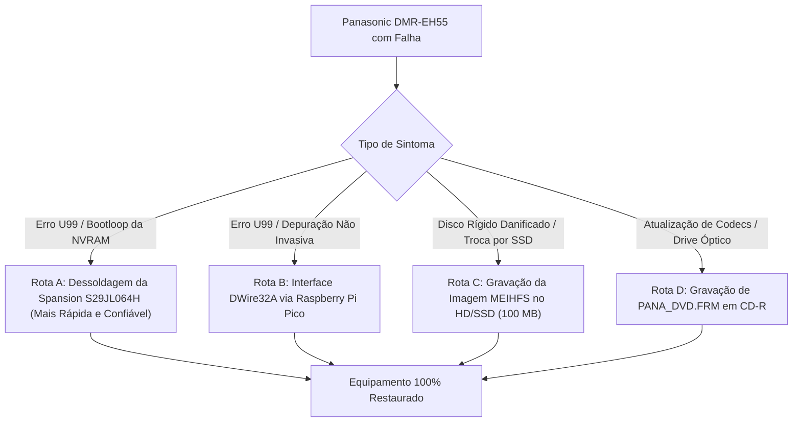

# Central de Recuperação, Engenharia Reversa e Firmware — Panasonic DMR-EH55

Repositório centralizado de engenharia reversa, recuperação de falhas críticas de inicialização (em particular o travamento **`U99`**), restauração de firmware, reconstrução do sistema de arquivos de disco rígido (**MEIHFS**) e especificação técnica do protocolo proprietário de depuração **Matsushita DWire32A / OCD**.

---

## 1. Documentos Mestres de Engenharia e Auditoria

A documentação do ecossistema é composta por três relatórios técnicos aprofundados e homologados:

* 🧠 **[Dossiê de Arquitetura da Suíte Panadiga, Decisões de Silício e Matriz de Compatibilidade](docs/ARQUITETURA_SUITE_PANADIGA_E_COMPATIBILIDADE_UNIVERSAL.md)**  
  *Arquitetura da Suíte Panadiga em 3 camadas, análise de silício RP2040 (C11 + PIO vs MicroPython), distinção USB assíncrono vs DWire32A síncrono, compatibilidade universal JEDEC/CFI de memórias Flash e suporte à família Panasonic DIGA / UniPhier.*
* 📘 **[Inventário Técnico, Auditoria de QA e Guia de Operação de Bancada](docs/INVENTARIO_TECNICO_E_GUIA_DE_OPERACAO.md)**  
  *Inventário criptográfico exaustivo de todos os arquivos, análise detalhada dos 15 manuais de serviço, especificações de equipamentos de bancada, fluxograma passo a passo de recuperação e matriz FMEA de riscos e mitigações.*
* ⚡ **[Blueprint de Engenharia de Hardware e Circuitos de Bancada](docs/BLUEPRINT_ESQUEMA_ELETRICO_BANCADA.md)**  
  *Esquema elétrico completo de bancada para interconexão RP2040 $\leftrightarrow$ CN55001, pinagem detalhada da Flash Spansion S29JL064H TSOP-48, rotinas de solda e condicionamento de sinais.*
* 🔐 **[Dossiê de Engenharia Reversa e Criptoanálise de Firmware](docs/DOSSIE_CRIPTOGRAFIA_E_FIRMWARE_PANA_DVD.md)**  
  *Criptoanálise do ecossistema CPRM/DRM, estudo da alta entropia de PANA_DVD.FRM, o paradoxo de segurança da Flash física e vetores de extração de chaves.*
* 💾 **[Arquitetura de Storage, Filesystem MEIHDFS e Partições de Disco](docs/ARQUITETURA_STORAGE_MEIHDFS_PARTICOES.md)**  
  *Engenharia reversa completa do disco rígido de 100 MB, MBR proprietário (ASCII "SH"), tabela espelho em 28 MB (LBA 57344), journal de alocação de 10 blocos em 8 MB, partições de firmware em 32 MB e 64 MB, e arquitetura de vídeo streaming MEIHDFS-V2.0.*
* 🔬 **[Especificação Técnica e Reconstrução da Interface DWire32A](dwire32a_jtag_research/PANASONIC_DWIRE32A_JTAG_RECONSTRUCTION.md)**  
  *Blueprint de engenharia do protocolo síncrono half-duplex Matsushita AM34/MN103S, temporizações do barramento no conector CN55001 da placa VEP79138 e emulação via máquina PIO do Raspberry Pi Pico.*

---

## 2. Estrutura Modular do Ecossistema

```text
Panasonic Firmware HDD bin/
│
├── docs/                                          <-- Documentação de engenharia e auditoria de QA
│   ├── INVENTARIO_TECNICO_E_GUIA_DE_OPERACAO.md   <-- Inventário criptográfico e guia operacional completo
│   ├── ARQUITETURA_SUITE_PANADIGA_E_COMPATIBILIDADE_UNIVERSAL.md <-- Arquitetura da suíte e matriz universal
│   ├── BLUEPRINT_ESQUEMA_ELETRICO_BANCADA.md      <-- Blueprint elétrico de bancada (RP2040 e TSOP-48)
│   ├── DOSSIE_CRIPTOGRAFIA_E_FIRMWARE_PANA_DVD.md <-- Dossiê de criptoanálise e segurança de firmware
│   └── ARQUITETURA_STORAGE_MEIHDFS_PARTICOES.md   <-- Arquitetura de storage, MEIHDFS, MBR e partições do HDD
│
├── firmware_and_images/                           <-- Imagens binárias e dumps do sistema
│   ├── panasonic DMR EH-55 Firmware hdd_100.bin   <-- Dump MEIHFS dos primeiros 100 MB do HD original
│   ├── PANA_DVD.FRM                               <-- Imagem de atualização óptica para CD-R/DVD-RAM
│   ├── UPDATE_EH55.zip                            <-- Pacote oficial compactado contendo PANA_DVD.FRM
│   └── extracted_partitions/                      <-- Partições limpas extraídas pelo parser de HDD
│
├── scripts/                                       <-- Conjunto de ferramentas e utilitários em Python
│   ├── parse_panasonic_hdd_partitions.py          <-- Parser e extrator de partições, MBR, mirrors e MEIHDFS
│   ├── clean_spansion_nvram.py                    <-- Limpeza cirúrgica dos 64 KB de NVRAM da Spansion S29JL064H
│   ├── inspect_hdd_image.py                       <-- Mapeador de blocos de 1 MB e analise de cabeçalho do HD
│   ├── analyze_deep.py                            <-- Scanner de strings e busca de assinaturas no sistema
│   ├── inspect_firmware_headers.py                <-- Inspetor hexadecimal de headers em 32MB, 64MB e FRM
│   └── search_manuals.py                          <-- Indexador automatizado de termos técnicos no acervo de PDFs
│
├── dwire32a_jtag_research/                        <-- Reconstrução da interface de depuração in-circuit
│   ├── PANASONIC_DWIRE32A_JTAG_RECONSTRUCTION.md  <-- Blueprint do protocolo Matsushita DWire32A / OCD
│   ├── dwire32a.pio                               <-- Transceptor síncrono half-duplex em assembly PIO (RP2040)
│   ├── dwire32a_pico_main.c                       <-- Firmware C do Raspberry Pi Pico (Cold Break-In e scanner)
│   ├── ram_loader.c                               <-- Driver JEDEC nativo AM34 injetável na SRAM interna
│   └── CMakeLists.txt                             <-- Arquivo de compilação CMake para o Pico SDK
│
├── manuals_and_schematics/                        <-- Biblioteca de 15 Manuais Oficiais e Esquemas Elétricos
│   ├── c2c7f1.pdf                                 <-- Manual de Serviço Completo com Todos os Esquemas Elétricos
│   ├── 9e8a23.pdf                                 <-- Manual de Serviço Oficial Vol. 1 (Diagnóstico e Desmontagem)
│   ├── panasonic_dmr-eh55ec.pdf                   <-- Manual de Serviço Oficial (Europa Continental / Alemanha)
│   ├── panasonic_dmr-eh55ee.pdf                   <-- Manual de Serviço Oficial (Rússia / Leste Europeu / Oriente Médio)
│   ├── panasonic_dmr-eh55p9_eh55pc9.pdf           <-- Manual de Serviço Oficial (Estados Unidos / Canadá)
│   ├── Panasonic dmr-eh55 installation.pdf        <-- Guia Oficial de Instalação e Atualização de Firmware
│   └── Manuais de operação regionais e guias rápidos (RQT8361, RQT8365, RQT8415)...
│
├── tools/                                         <-- Utilitários de análise de baixo nível
│   ├── Abrir_HxD.bat                              <-- Launcher portátil de 1 clique para o HxD Hex Editor
│   └── HxD/                                       <-- HxD Hex Editor v2.5 Portable (32-bit e 64-bit)
│
└── README_ECOSSISTEMA.md                          <-- Portal principal do projeto
```

---

## 3. Guia Rápido dos Scripts Utilitários

Todos os scripts foram auditados e utilizam caminhos relativos robustos; podem ser executados a partir da raiz do projeto ou de dentro da pasta `scripts/`.

### A. Limpeza Cirúrgica do Bloco NVRAM/EEMUL da Memória Spansion
Ao realizar a leitura do dump da memória Flash de 8 MB (`IC55007` - Spansion `S29JL064H70TFI00`), execute:
```bash
python scripts/clean_spansion_nvram.py DMR_EH55_ORIGINAL.bin [DMR_EH55_CLEAN.bin]
```
* **O que faz:** Isola os 64 KB corrompidos (`0x7F0000` a `0x7FFFFF`), salva backup em `nvram_corrupt_backup.bin`, preenche a região com `0xFF` e audita via SHA-256 se os 8.323.072 bytes do sistema operacional continuam estritamente idênticos.

### B. Inspeção e Mapeamento de Blocos do Disco Rígido (100 MB)
```bash
python scripts/inspect_hdd_image.py
```
* **O que faz:** Analisa o setor LBA 0 (MEIHFS), identifica partições ativas e gera um histograma em ASCII da ocupação de dados nos 100 blocos de 1 MB.

### C. Parser, Mapeador e Extrator de Partições do HDD (MEIHDFS)
```bash
python scripts/parse_panasonic_hdd_partitions.py --extract --outdir firmware_and_images/extracted_partitions --json firmware_and_images/extracted_partitions/hdd_analysis_report.json
```
* **O que faz:** Decodifica a estrutura do MBR proprietário (LBA 0 com tag ASCII `"SH"` e Disk GUID), valida o setor espelho a 28 MB (LBA 57.344), mapeia o catálogo e os 10 blocos de journaling em 8 MB, analisa e calcula hashes MD5/SHA-256 e entropia das partições de firmware com assinatura `51 87 13 8D 5B 0A FB 22` (em 32 MB e 64 MB), e extrai todos os componentes para arquivos `.bin` limpos acompanhados do manifesto `SHA256SUMS.txt`.

### D. Inspeção de Headers Críticos de Firmware
```bash
python scripts/inspect_firmware_headers.py
```
* **O que faz:** Exibe dumps hexadecimais dos primeiros 128 bytes dos blocos de 32 MB e 64 MB do HD (contêineres Matsushita iniciando com a assinatura mágica `51 87 13 8D 5B 0A FB 22`) e do arquivo de atualização óptica `PANA_DVD.FRM`.

### D. Indexação e Busca Técnica nos Manuais em PDF
```bash
python scripts/search_manuals.py
```
* **O que faz:** Efetua varredura completa nas centenas de páginas dos manuais procurando referências a circuitos integrados (`S29JL064`, `MN2DS0016`, `IC55007`), conectores de teste (`CN55001`) e procedimentos de serviço.

---

## 4. Blueprint de Bancada: 4 Rotas Operacionais de Recuperação



1. **Rota A (Dessoldagem e Reprogramação Externa):**
   * Remoção do chip `IC55007` com estação de ar quente a 345°C e proteção com fita Kapton nas SDRAMs Elpida vizinhas.
   * Leitura de 8 MB no programador universal (XGECU T48 / TL866II / SVOD 4) com adaptador TSOP-48.
   * Aplicação do `clean_spansion_nvram.py` e regravação com verificação de integridade.
2. **Rota B (Injeção DWire32A in-circuit via RP2040):**
   * Conexão de 6 fios no conector `CN55001` com resistores de proteção ($100\,\Omega$) e Open-Drain em `nRESET`.
   * Verificação de $3.3\,\text{V}$ no pino 14 (`WP#`) da Flash.
   * Parada da CPU no boot via Cold Break-In e execução do driver `ram_loader.c` na SRAM para apagar os 8 micro-setores da NVRAM.
3. **Rota C (Restauração de Disco Rígido MEIHFS):**
   * Aplicação do arquivo `panasonic DMR EH-55 Firmware hdd_100.bin` no novo HD IDE ou SSD SATA (com adaptador Marvell `88SA8052`) a partir do LBA 0.
   * Inicialização e formatação via menu de serviço do DMR-EH55.
4. **Rota D (Atualização via CD-R Óptico):**
   * Gravação de `PANA_DVD.FRM` em CD-R em 4x modo ISO9660 Disc-At-Once.
   * Atualização automática pelo painel frontal com sequência de mensagens `BYE` $\rightarrow$ `L1 P01..P05` $\rightarrow$ `COMPLETE`.

---

## 5. Resumo do Acervo Técnico de Manuais (15 Volumes)

| Categoria | Arquivos no Repositório | Modelos Cobertos | Destaque Técnico |
| :--- | :--- | :--- | :--- |
| **Esquemas Elétricos e PCB** | `c2c7f1.pdf` (177 pág.) | DMR-EH55EC, DMR-EH55EP, DMR-EH56EG | Diagramas esquemáticos completos de todas as placas, barramentos de memória e pinagem do conector CN55001. |
| **Manuais de Serviço Oficiais** | `9e8a23.pdf`, `panasonic_dmr-eh55ec.pdf`, `panasonic_dmr-eh55ee.pdf`, `panasonic_dmr-eh55p9_eh55pc9.pdf` | Modelos EC/EP/EG (Europa), EE/GC/GN (Leste Europeu/Rússia/Oceania), P9/PC9 (América do Norte) | Tabelas de códigos de erro de auto-diagnóstico (U99, U61, F01..F99), substituição de fusíveis B24 e desmontagem mecânica. |
| **Manuais de Operação do Usuário** | `Panasonic_DIGA_DMR-EH55_DVD_Recorder_User_Manual.pdf`, `a5e678.pdf`, `panasonic_dmr-eh55,dmr-eh56_dvd_user_manual.pdf`, `6097ea.pdf`, `cb6cee.pdf`, `2Panasonic_DIGA_DMR-EH55_DVD_Recorder_User_Manual.pdf`, `philips-dmr-eh55.pdf` | DMR-EH55 / DMR-EH56 (Global, América do Norte, Europa e Australásia) | Instruções detalhadas de gravação, conexões A/V, sincronismo de canais e modos de qualidade de vídeo. |
| **Guias Rápidos e Atualização** | `Panasonic dmr-eh55 installation.pdf`, `22767039.pdf`, `dmreh55.pdf` | DMR-EH55 / Linha DIGA | Guia passo a passo de queima de disco e mensagens de status do firmware; manual de integração VIERA Link via HDMI. |

---

## 6. Ferramentas Recomendadas de Laboratório

* **Programador Universal:** XGECU T48 / TL866II-Plus / SVOD 4 com soquete TSOP-48 ZIF v3.
* **Microcontrolador Host:** Raspberry Pi Pico (RP2040) com firmware DWire32A.
* **Estação de Retrabalho:** Ar quente digital (340°C–350°C) + Ferro de solda com ponta chanfrada/faca.
* **Consumíveis:** Fluxo pastoso *no-clean* (Amtech NC-559-ASM), malha de cobre trançado, fita térmica Kapton e fio AWG 30 Kynar.
* **Software Hexadecimal:** HxD Hex Editor (disponível em `tools/Abrir_HxD.bat`).

---

**Equipe de Engenharia Reversa e Controle de Qualidade (QA)**  
*Homologado para uso imediato em bancada técnica.*
