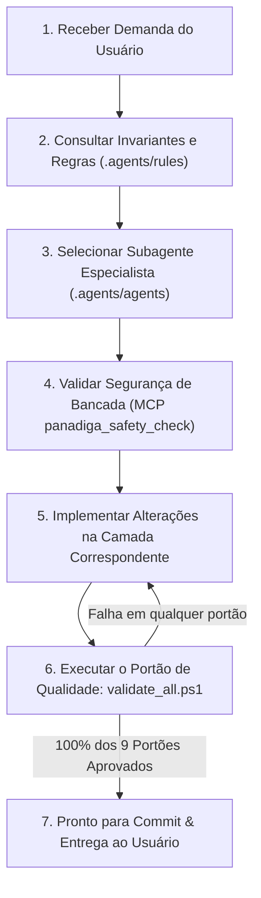

# Guia de Arquitetura de IA, Agentes, MCP e Ferramentas — Panadiga

Este documento estabelece a especificação oficial de integração e operação de Inteligência Artificial no repositório **Panadiga** (Engenharia Reversa, Storage Forensics e Hardware Workbench do Panasonic DMR-EH55).

---

## 1. Visão Geral da Configuração de IA

O ecossistema foi configurado para suportar qualquer assistente ou orquestrador de IA moderno (Antigravity, Gemini CLI, Claude Code, Cursor, Copilot, Windsurf) com total consciência das especificidades da nossa base de código e restrições de silício.

```text
Panasonic Firmware HDD bin/
│
├── AGENTS.md                                   <-- Diretrizes globais para qualquer agente de IA
├── GEMINI.md                                   <-- Instruções para Antigravity e Gemini CLI
├── .cursorrules                                <-- Regras de contexto para Cursor IDE
├── .mcp.json                                   <-- Configuração padrão do Model Context Protocol (MCP)
│
├── .agents/                                    <-- Configurações nativas do Antigravity Framework
│   ├── mcp_config.json                         <-- Registro do servidor MCP da workspace
│   ├── rules/                                  <-- Regras ativas carregadas automaticamente
│   │   ├── AGENTS.md                           <-- Regras gerais da workspace
│   │   ├── hardware_safety.md                  <-- Invariantes elétricas (<= 3.3V) e limites de Flash
│   │   ├── storage_meihfs.md                   <-- Invariantes forenses de disco e MBR "SH"
│   │   └── quality_gates.md                    <-- Os 9 portões obrigatórios de commit
│   │
│   ├── agents/                                 <-- Definição dos 6 Subagentes Especialistas
│   │   ├── panadiga-architect.md               <-- Orquestrador de sistemas cross-stack
│   │   ├── panadiga-storage-forensics.md       <-- Especialista em MEIHFS, MBR e partições HDD
│   │   ├── panadiga-firmware-re.md             <-- Especialista AM34, Ghidra, CPRM e entropia
│   │   ├── panadiga-hardware-embedded.md       <-- Especialista RP2040 PIO, C11, TSOP-48 e CN55001
│   │   ├── panadiga-desktop-ui.md              <-- Especialista Tauri 2, React, Vitest e Playwright
│   │   └── panadiga-qa-auditor.md              <-- Auditor dos 9 Quality Gates e conformidade
│   │
│   └── skills/                                 <-- Runbooks procedurais executáveis on-demand
│       ├── panadiga-validate/SKILL.md          <-- Execução e diagnóstico dos 9 Quality Gates
│       ├── panadiga-nvram-unbrick/SKILL.md     <-- Procedimento cirúrgico de correção do erro U99
│       ├── panadiga-extract-partitions/SKILL.md<-- Extração e validação de partições MEIHFS
│       ├── panadiga-ghidra-workflow/SKILL.md   <-- Mapa de memória AM34 e importação no Ghidra
│       └── panadiga-pico-flashing/SKILL.md     <-- Compilação e flash do firmware RP2040
│
├── tools/
│   ├── panadiga_mcp_server.py                  <-- Servidor MCP nativo em Python (JSON-RPC 2.0 stdio)
│   ├── panadiga_cli.py                         <-- CLI administrativo com Typer
│   ├── rag_engine/                             <-- Mecanismo RAG com crítico de segurança determinístico
│   └── tests/
│       ├── test_panadiga_cli.py                <-- Testes unitários do CLI
│       └── test_panadiga_mcp_server.py         <-- Testes unitários do servidor MCP (5 testes)
│
└── .vscode/                                    <-- Configurações para desenvolvedores no VS Code
    ├── settings.json                           <-- Configuração de Rust, Python strict e arquivos
    ├── tasks.json                              <-- Tarefas rápidas para validação e MCP
    └── extensions.json                         <-- Extensões recomendadas
```

---

## 2. Matriz de Agentes Especialistas

Cada subagente possui uma persona rigorosamente delimitada, ferramentas autorizadas e regras de domínio:

| Subagente | Arquivo de Definição | Gatilho de Uso Recomendado |
| :--- | :--- | :--- |
| **`panadiga-architect`** | `.agents/agents/panadiga-architect.md` | Quando a tarefa envolver decisões que toquem múltiplos subsistemas (ex: Rust + Tauri + Firmware Pico), modelagem de dados global ou revisão estrutural. |
| **`panadiga-storage-forensics`** | `.agents/agents/panadiga-storage-forensics.md` | Quando o usuário pedir para inspecionar dumps de HDD, decodificar LBA 0 "SH", analisar o mirror em 28 MB, inspecionar o journal em 8 MB ou extrair partições de 32MB/64MB. |
| **`panadiga-firmware-re`** | `.agents/agents/panadiga-firmware-re.md` | Para tarefas de desmontagem do processador Matsushita AM34, scripts Ghidra, criptoanálise de `PANA_DVD.FRM`, cálculo de entropia de Shannon e DRM CPRM. |
| **`panadiga-hardware-embedded`** | `.agents/agents/panadiga-hardware-embedded.md` | Para desenvolvimento ou testes da máquina de estados PIO (`dwire32a.pio`), servidor GDB RSP em C11, esquema elétrico de bancada e pinagem TSOP-48 / CN55001. |
| **`panadiga-desktop-ui`** | `.agents/agents/panadiga-desktop-ui.md` | Para criar ou alterar telas no desktop em Tauri 2, componentes React, estilos Tailwind, testes Vitest (`npm test`) e testes E2E com Playwright. |
| **`panadiga-qa-auditor`** | `.agents/agents/panadiga-qa-auditor.md` | Para auditar alterações antes do commit, verificar a conformidade dos 9 Quality Gates, garantir 0% de duplicação (`jscpd`) e validar tipagem estrita. |

---

## 3. Servidor e Ferramentas Model Context Protocol (MCP)

O arquivo `tools/panadiga_mcp_server.py` implementa o protocolo aberto **Model Context Protocol (MCP)** sobre transporte `stdio` via JSON-RPC 2.0.

### Como Registrar e Usar
O arquivo `.mcp.json` na raiz da workspace e `.agents/mcp_config.json` registram o servidor automaticamente:

```json
{
  "mcpServers": {
    "panadiga-tools": {
      "command": "python",
      "args": ["tools/panadiga_mcp_server.py"],
      "env": {
        "PYTHONIOENCODING": "utf-8",
        "PANADIGA_WORKSPACE_ROOT": "."
      }
    }
  }
}
```

### Ferramentas Nativas Expostas:
1. **`panadiga_memory_map`**: Retorna as 8 regiões de memória do Matsushita AM34 / UniPhier MN2DS0016 com permissões de acesso e filtros opcionais.
2. **`panadiga_inspect_hdd`**: Analisa dumps de disco rígido, valida a tag `"SH"` no LBA 0, a integridade do espelho em 28 MB e localiza as partições ativas.
3. **`panadiga_safety_check`**: Escudo determinístico que verifica se tensões elétricas respeitam o teto de 3.3V e se endereços de escrita não violam a área protegida de Bootloader/IPL (`0x80000000 - 0x807EFFFF`).
4. **`panadiga_clean_nvram`**: Executa a verificação ou sanitização cirúrgica dos 64 KB de NVRAM Spansion para reparo do erro fatal `U99`.
5. **`panadiga_search_manuals`**: Pesquisa rápida nos 15 manuais de serviço oficiais indexados.
6. **`panadiga_rag_query`**: Consulta semântica avançada com guardrails e crítico de grounding contra alucinações.

---

## 4. MVP (Minimum Viable Protocol) — Fluxo Operacional Recomendado

Para qualquer desenvolvedor ou agente de IA operando nesta codebase, o fluxo de trabalho padrão deve seguir o ciclo **MVP (Understand $\rightarrow$ Delegate $\rightarrow$ Check Safety $\rightarrow$ Implement $\rightarrow$ Gate Validate)**:



### Passo a Passo:
1. **Contextualização**: Leia `AGENTS.md` e verifique as regras específicas em `.agents/rules/`.
2. **Delegação**: Assuma a persona do especialista correto (ex: `panadiga-storage-forensics` para tarefas de HDD).
3. **Checagem de Segurança**: Se envolver comandos elétricos ou escrita em Flash, consulte a ferramenta MCP `panadiga_safety_check`.
4. **Implementação**: Escreva código modular, tipado e com testes unitários.
5. **Portão de Qualidade**: Execute `powershell -ExecutionPolicy Bypass -File validate_all.ps1` e certifique-se de que os 9 portões sejam aprovados antes de concluir.
