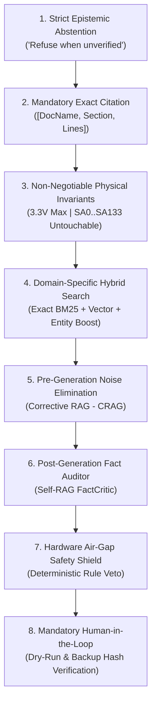
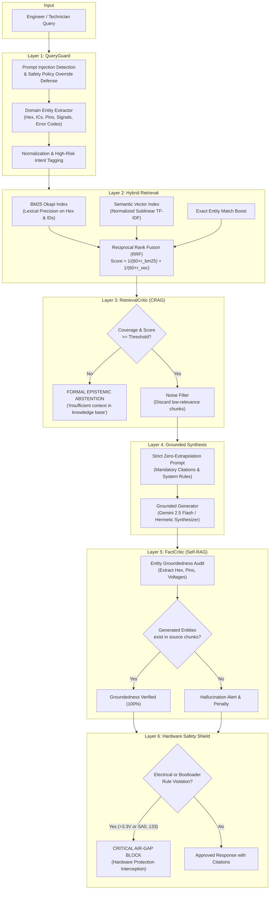

# AI ENGINEERING GUIDELINES & ZERO-ERROR RAG ARCHITECTURE
## Hardware Reverse Engineering, Diagnostics & Preservation — Panasonic DIGA DMR-EH55

[]()
[]()
[]()
[]()

---

## 1. Mission and Engineering Rationale

The **Panasonic DIGA DMR-EH55** preservation and reverse engineering project involves high-risk silicon-level operations, proprietary buses, NOR Flash memory, and low-level storage interfaces:
* **Matsushita MN2DS0016 (UniPhier / AM34 Core) SoC**: Proprietary chip with zero commercial replacement availability;
* **Spansion S29JL064H (8 MB) NOR Flash**: Houses the *Initial Program Loader* (IPL / Root-of-Trust) in the lower 7.93 MB (`0x00000000` to `0x007EFFFF`);
* **DWire32A Bus on Connector CN55001**: Proprietary half-duplex synchronous 3.3V on-chip debug port;
* **MEIHDFS PATA/IDE Hard Drive Subsystem**: Does not use standard PC MBR/GPT partition tables; utilizes a custom superblock tagged `"SH"` at LBA 0 and encrypted firmware partitions at LBA 65,536 and LBA 131,072.

### Why Conventional RAG Is Strictly Prohibited Here
In general web development, a language model hallucination (e.g. proposing an obsolete package or an invalid CSS parameter) results in a recoverable compiler error or debug log.  
In **embedded reverse engineering**, an AI hallucination can be **fatal and physically irreversible**:
1. **Electrical Overvoltage**: Recommending 5V or 12V instead of 3.3V on pin 14 (`WP#/ACC`) or connector `CN55001` immediately destroys the I/O gates of the MN2DS0016 SoC;
2. **Permanent Bricking**: Suggesting a Flash wipe starting from `0x00000000` instead of NVRAM (`0x007F0000`) wipes the factory encrypted IPL bootloader, rendering the board permanently inoperable;
3. **Bus Collision & Deadlock**: Confusing the DWire32A port with traditional 4-wire JTAG (suggesting connecting TDI, TDO, or TMS) causes bus contention on the bidirectional `SDATA` transceiver;
4. **Filesystem Obliteration**: Suggesting standard PC formatting tools (`fdisk`, `format`, `diskpart`) destroys the recorder's reserved firmware partitions and optical drive calibration.

For these reasons, the project enforces a **Zero-Error AI Policy** backed by a multi-layered defensive RAG architecture with formal deterministic safety shields.

---

## 2. The 8 Golden Rules of AI Engineering



### Rule 1: Strict Epistemic Abstention
If a technical detail (hexadecimal address, connector pin, register address, or voltage threshold) is not explicitly present in the verified corpus, the assistant **MUST refuse to answer** and state:
> *"Information not verified in technical corpus. In proprietary embedded systems, ungrounded inferences cause physical hardware destruction."*  
**Never assume standard PC (x86/BIOS/UEFI/Linux) conventions by analogy.**

### Rule 2: Mandatory Exact Citation
Every factual technical statement, diagnostic recommendation, or procedure must explicitly cite its source inside brackets: `[DocumentName, SectionTitle]`.

### Rule 3: Non-Negotiable Physical Invariants
Four critical physical boundaries are hardcoded into the pipeline:
1. **Absolute Maximum Voltage**: All digital board rails (`VEP79138`) operate strictly at **3.3V nominal** (absolute maximum $3.35\text{V}$). No line tolerates $5\text{V}$;
2. **Protected IPL Bootloader Range**: Sectors `SA0` through `SA133` (`0x00000000` to `0x007EFFFF`) house the Root-of-Trust. **Never modify or erase during U99 repair**;
3. **Exclusive Target for Error U99 Recovery**: The only region permitted for sanitation is `EEMUL` / NVRAM across sectors `SA134` through `SA141` (`0x007F0000` to `0x007FFFFF`, exactly 64 KB);
4. **MEIHDFS Storage Signature**: The disk must feature ASCII signature `"SH"` at LBA 0 and an identical mirror at LBA 57,344. Generic PC MBR/GPT partitioning is prohibited.

### Rule 4: Domain-Specific Hybrid Indexing
Dense vector embeddings treat hexadecimal strings as arbitrary tokens (`0x007F0000` vs `0x007E0000`). The project uses:
* **Custom Technical Tokenizer**: Protects hex addresses, IC numbers (`S29JL064H70TFI00`, `MN2DS0016`), connectors (`CN55001`), signals (`SDATA`, `SCLK`, `nRESET`), and error codes (`U99`);
* **BM25 Okapi with Inverted Index**: Guarantees zero recall loss on numeric values and pin names;
* **Sublinear TF-IDF Semantic Index**: Captures conceptual intentions;
* **Reciprocal Rank Fusion (RRF)** with deterministic boosting for exact entity matches.

### Rule 5: Corrective RAG (CRAG) Pre-Generation Filter
Prior to feeding chunks to the prompt generator, the critic checks:
* Fused RRF similarity score against `ABSTENTION_SIMILARITY_THRESHOLD`;
* Query term coverage percentage;
* Direct technical entity match.  
If the query lacks strong documentary grounding, the engine triggers **Immediate Abstention**, preventing hallucinated extrapolation.

### Rule 6: Self-RAG Post-Generation Fact Auditor
After generating the response, an automated critic extracts:
* All hexadecimal addresses (`0x[0-9A-Fa-f]+`);
* All IC component names;
* All signals and pin identifiers;
* All voltage specifications.  
Each extracted entity is cross-checked against the retrieved source chunks. Any entity fabricated by the model triggers an immediate **Hallucination Alert**.

### Rule 7: Hardware Air-Gap Safety Shield
A rule-based invariant validator inspects generated recommendations:
* Intercepts any instruction suggesting $> 3.3\text{V}$;
* Intercepts any suggestion to erase Flash below `0x007F0000`;
* Rejects legacy JTAG pins (TDI/TDO/TMS) on `CN55001`;
* Blocks PC formatting commands (`mkfs`, `fdisk`, `diskpart`, `format`).  
**Violations cause immediate response blocking and alert generation.**

### Rule 8: Mandatory Human-in-the-Loop & Dry-Run
No physical write command may be executed on hardware without:
* Dry-run simulation and sector map display;
* Pre-write SHA-256 backup verification;
* Explicit two-factor user confirmation in the UI/CLI.

---

## 3. End-to-End RAG Architecture (`tools/rag_engine`)



---

## 4. Hallucination Risk vs Mitigation Matrix

| Risk Vector | Typical Generic LLM Hallucination | Physical Consequence on Hardware | Mitigation Implemented |
| :--- | :--- | :--- | :--- |
| **Voltage Hallucination** | *"To unlock pin 14 WP#/ACC, connect it to 5V from the USB port."* | **Immediate gate breakdown** on Spansion internal buffers and MN2DS0016 bus. | **`HardwareSafetyValidator`**: Strict rule intercepting and vetoing any voltage $> 3.35\text{V}$. |
| **Offset Hallucination** | *"To fix error U99, erase the flash memory starting from 0x00000000."* | **Permanent destruction of IPL** (Root of Trust). Board rendered unusable forever. | **`HardwareSafetyValidator` & `FactCritic`**: Blocks writes to `0x00000000..0x007EFFFF`; cross-checks `0x007F0000`. |
| **Protocol Confusion** | *"Connect TDI, TDO, and TMS pins from your JTAG programmer to CN55001."* | **Bus collision**, high currents, and synchronous bus freeze. | **`HardwareSafetyValidator`**: Verifies that CN55001 only exposes `SDATA`, `SCLK`, `EXTRG`, `nRESET`, `GND`. Rejects JTAG pins. |
| **Filesystem Wipe** | *"Format the hard drive in Windows using diskpart and format NTFS."* | **Wipes 28 MB of reserved sectors**, MEIHDFS tables, and firmware partitions. | **`HardwareSafetyValidator`**: Blocks PC disk utilities and requires `"SH"` signature preservation. |
| **Fictional Hardware Feature** | *"Set the DIP switch on the rear panel to activate factory service mode."* | Physical damage, wasted technician time, improper disassembly. | **`RetrievalCritic` & `FactCritic`**: Epistemic abstention triggered immediately when entity is absent from corpus. |

---

## 5. Dual-Stack Implementation & CLI Operations

The Zero-Error RAG Engine is implemented natively in high-performance **Rust 2021** ([`src/rag/`](../src/rag/)) for sub-millisecond production inference and zero-copy desktop workbench integration, with parity tooling maintained in **Python 3.10+** ([`tools/rag_engine/`](../tools/rag_engine/)).

### A. High-Performance Native Rust Engine (`panadiga rag`)

The Rust engine delivers sub-millisecond retrieval, exact BM25 + sublinear TF-IDF scoring, and deterministic invariant checks with zero external runtime dependencies:

```bash
# Query the native Zero-Error RAG Engine
cargo run -- rag query "What causes error U99 on Panasonic DMR-EH55 and how to fix it?"

# Query with structured JSON output for GUI/tool integration
cargo run -- rag query --json "Explain the MEIHDFS allocation table structure."

# Display official AM34 / UniPhier MN2DS0016 memory map
cargo run -- memory-map --format table

# Verify artifact cryptographic integrity with strict SHA-256 assertion
cargo run -- verify-artifact "firmware_and_images/panasonic DMR EH-55 Firmware hdd_100.bin"

# Running Rust RAG & Core Unit/Integration Tests (35 tests)
cargo test --workspace --verbose
```

### B. Python Administration & Maintenance Parity (`tools/rag_engine/`)

```bash
# Running Pytest RAG Unit & Adversarial Tests
python -m pytest tools/rag_engine/tests/test_rag_zero_error.py -v

# Running Mypy Strict Typechecking (0 errors)
python -m mypy --strict tools/panadiga_cli.py tools/rag_engine

# Running Adversarial Attack Benchmark (100% interception)
python -m tools.rag_engine.cli benchmark

# Querying via Python CLI
python -m tools.rag_engine.cli query "What causes error U99 on Panasonic DMR-EH55 and how to fix it?"

# Knowledge Base Corpus Statistics
python -m tools.rag_engine.cli stats
```

---

## 6. Red-Team Robustness & Architectural Hardening

The engine has undergone adversarial Red-Team hardening to eliminate all common edge cases:
* **Unicode & UTF-8 Multi-Byte Safety**: Safe sentence window slicing (`sentence_context_window`) eliminating runtime panics on multi-byte codepoints (`─`, `•`, `ç`, `ã`).
* **Boilerplate & Claim Separation**: Post-generation fact-auditing separates synthesized claims from safety disclaimers, preventing false-positive hallucination alerts on standard safety notes.
* **Bus vs. File Memory Protection**: Memory safety shield enforces distinction between file offsets (`0x00000000..0x007EFFFF`) and bus addresses (`0x80000000..0x807EFFFF`), while permitting legitimate operations on AM34 internal SRAM (`0x00000000..0x0003FFFF`).
* **Full Audit Report**: Detailed in [`docs/RELATORIO_RED_TEAM_E_AUDITORIA_LOGICA.md`](./RELATORIO_RED_TEAM_E_AUDITORIA_LOGICA.md).
