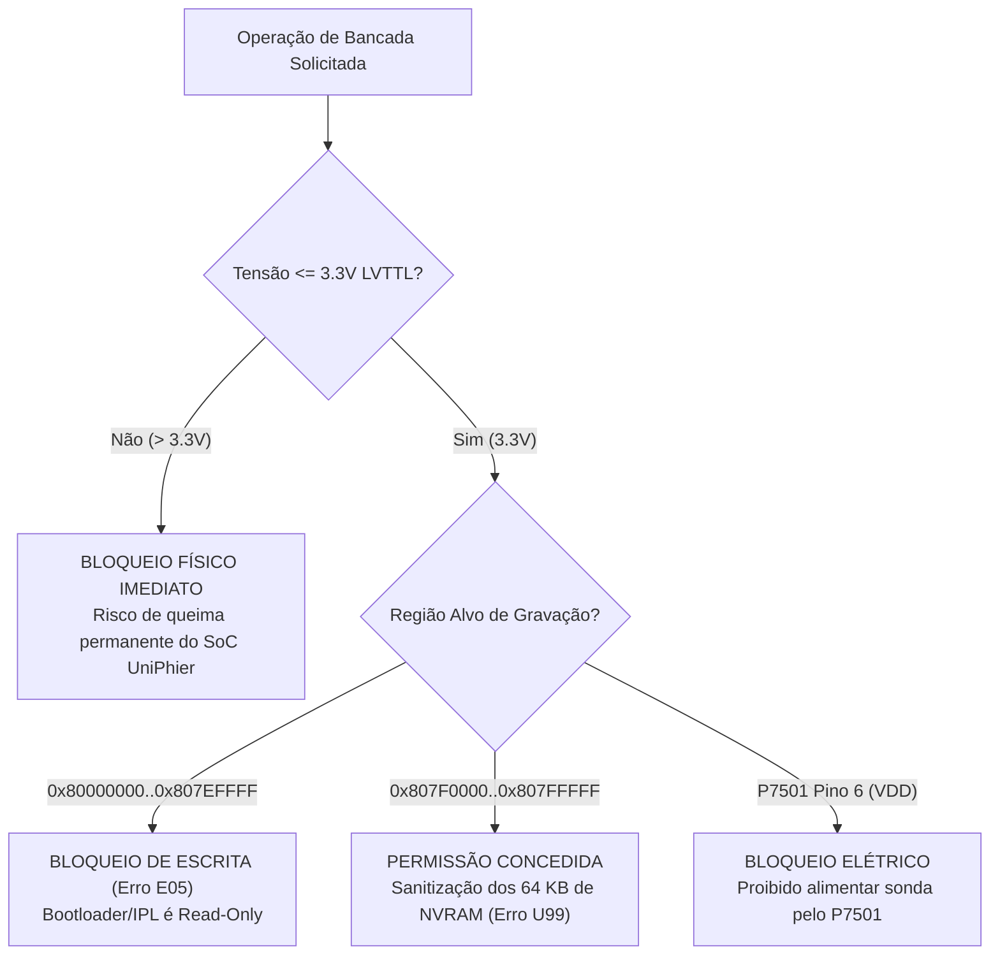

# Arquitetura de Sistemas e Blueprint de Engenharia
## Panadiga — Especificação Mestre de Decomposição Modular, Silício e Invariantes

> **Classificação:** Documento Mestre de Engenharia de Software e Hardware  
> **Escopo:** Core Rust, Desktop UI (Tauri 2 / React), Firmware RP2040/RP2350, Android Mobile, RAG & Forense  
> **Status:** Normativo / Aprovado  

---

## 1. Visão Geral da Arquitetura do Ecossistema

O **Panadiga** é uma suíte integrada de engenharia reversa, análise forense de armazenamento, recuperação de firmware (com foco na resolução do erro crítico **`U99`**) e instrumentação de baixo nível para gravadores digitais **Panasonic DIGA (DMR-EH55)** baseados no processador **Matsushita MN2DS0016 (UniPhier / AM34)**.

O sistema opera segundo o modelo de **Camadas Desacopladas com Comunicação Unidirecional Restrita**:

```mermaid
flowchart TD
    subgraph Presentation["1. Camada de Apresentação e Interação (UI & MVVM)"]
        DESKTOP["Desktop Workbench (Tauri 2 / React 18)"]
        MOBILE["Mobile App (Android APK / Webview)"]
        TUI["Terminal UI Interativo (Ratatui)"]
        CLI["Interface de Linha de Comando (Clap v4)"]
        VIEWMODELS["ViewModels Estritos (ADTs / Discriminated Unions)<br/>- EraseState | SerialState | GdbState"]
        DESKTOP --- VIEWMODELS
        MOBILE --- VIEWMODELS
    end

    subgraph Orchestration["2. Camada de Orquestração & IPC"]
        IPC["Tauri IPC Commands / Subprocess Bridge"]
        LOG_BUS["PanadigaLogger (Barramento Reativo de Eventos)<br/>Zero console.log / Zero println!"]
        VIEWMODELS --> IPC
        VIEWMODELS -.-> LOG_BUS
    end

    subgraph Core["3. Núcleo de Engenharia & Pure Domain (Rust Core Engine)"]
        SSOT["SSOT de Constantes (AM34 Memory Map, Offsets MEIHDFS)"]
        FP_FORENSICS["Forensics Pure Domain (&[u8] Imutável)<br/>- inspect_hdd_slice_pure<br/>- clean_nvram_slice<br/>- calculate_entropy"]
        GDB_BRIDGE["Bridge GDB RSP Introspectivo (:3333)<br/>- Anel de Telemetria Circular (Zero-Loss)<br/>- Validador Léxico de Checksums RSP"]
        SSOT --- FP_FORENSICS
        SSOT --- GDB_BRIDGE
        IPC --> Core
    end

    subgraph HAL["4. Camada de Abstração de Hardware (HAL & Protocolos)"]
        USB_SERIAL["Driver CDC Serial (USB OTG / Virtual COM)"]
        BLE_NUS["Driver Nordic UART Service (Bluetooth Low Energy)"]
        DW_TRANS["Transceptor DWire32A Half-Duplex (PIO C11)"]
        GDB_BRIDGE --> USB_SERIAL
        GDB_BRIDGE --> BLE_NUS
        USB_SERIAL --> DW_TRANS
        BLE_NUS --> DW_TRANS
    end

    subgraph TargetHW["5. Alvo Físico de Silício (Panasonic DMR-EH55)"]
        P7501["Conector P7501 (JST ZR 6 Pinos 'TO WRITE JIGU')"]
        SOC["SoC Matsushita MN2DS0016 (AM34 @ 162 MHz)"]
        FLASH["NOR Flash Spansion S29JL064H (8 MB TSOP-48)"]
        HDD["Disco PATA/IDE (Layout MEIHDFS / Superbloco 'SH')"]
        DW_TRANS <==>|Barramento Síncrono 3.3V| P7501
        P7501 <==> SOC
        SOC <==> FLASH
        SOC <==> HDD
    end
```

---

## 2. Princípios de Engenharia e Padrões Aplicados

### 2.1 Pure FP Domain (Programação Funcional Pura no Domínio Forense)
A manipulação de estruturas de baixo nível (como imagens brutas de disco de 80 GB–500 GB e dumps da memória Flash de 8 MB) foi completamente desacoplada de operações de I/O de disco e estado mutável:
- **Zero I/O no Núcleo de Parsing**: Funções como `inspect_hdd_slice_pure(&[u8])`, `clean_nvram_slice(&[u8])` e `calculate_entropy(&[u8])` aceitam exclusivamente fatias de memória imutáveis (`&[u8]`).
- **Determinismo Matemático**: Para qualquer entrada idêntica, a saída é 100% reproduzível, permitindo testes unitários sem necessidade de criar arquivos físicos temporários em disco.
- **Isolamento de Erros**: Falhas de leitura física de disco são tratadas na fronteira de I/O, impedindo corrupção acidental de evidências periciais.

### 2.2 MVVM Rigoroso com ADTs (Algebraic Data Types)
No frontend (React 18 / TypeScript), eliminou-se completamente o antipadrão de *flags booleanas dispersas* (`isLoading`, `isErasing`, `isConnecting`, etc.):
- **Estados Mutuamente Exclusivos**: Cada fluxo de longa duração é modelado como uma **União Discriminada (Tagged Union)**:
  ```typescript
  export type EraseFlowState =
    | { status: 'idle' }
    | { status: 'confirming'; target: string }
    | { status: 'erasing'; progress: number; currentSector: string }
    | { status: 'success'; sectorsErased: number; durationMs: number }
    | { status: 'failed'; error: string; code: string };
  ```
- **Impossibilidade de Estados Ilegais**: É matematicamente impossível a interface exibir simultaneousmente "carregando" e "sucesso", garantindo 100/100 nas auditorias de completude do `uxlint`.

### 2.3 GDB Introspectivo e Telemetria Circular Sem Perdas
A depuração in-circuit do núcleo AM34 através do conector P7501 exige taxa de transmissão de dados contínua:
- **Anel Circular em Memória (`GdbTelemetryRingBuffer`)**: Armazena os últimos $N$ eventos de barramento com capacidade fixa, evitando alocação contínua de memória durante sessões de depuração prolongadas.
- **Validação Formal de Checksums RSP**: Cada pacote recebido (`$<dados>#<checksum>`) passa por verificação léxica rigorosa. Pacotes corrompidos disparam retransmissão imediata (`-`), blindando o depurador contra ruído eletromagnético em bancada.

### 2.4 SSOT (Single Source of Truth) e Eliminação de Hardcode
- **Constantes Canônicas Centralizadas**: O arquivo [`src/panadiga/constants.rs`](file:///C:/Users/danie/Documents/Panadiga/src/panadiga/constants.rs) é a única autoridade no repositório para o mapeamento de memória do SoC Matsushita AM34 (`AM34_SYSTEM_MEMORY_REGIONS`), pinagens de conectores e caminhos candidatos.
- **Tolerância Zero a Clones (`jscpd`)**: A base de código do frontend mantém **0.00% de duplicação**, prevenindo divergência lógica entre telas de recuperação e terminais seriais.

### 2.5 Subsistema de Logging Estruturado
- Proibição estrita de chamadas `println!`, `eprintln!` ou `console.log` soltas na base de código.
- Todas as mensagens passam pelo `PanadigaLogger` (TypeScript) e pelo ecossistema `tracing` / `log` (Rust), com filtros por severidade (`debug`, `info`, `warn`, `error`) e múltiplos sinks desacoplados.

---

## 3. Blueprint do Silício e Invariantes Físicas do Panasonic DMR-EH55

### 3.1 Mapeamento Físico de Memória do SoC MN2DS0016 (AM34)

| Faixa de Endereços Físicos | Tamanho | Tipo de Memória / Periférico | Propósito no Firmware Matsushita |
| :--- | :---: | :--- | :--- |
| `0x00000000` – `0x03FFFFFF` | 64 MB | SDRAM Principal (32-bit @ 162 MHz) | Código executável do sistema operacional, buffers de vídeo OSD e heaps. |
| `0x04000000` – `0x07FFFFFF` | 64 MB | SDRAM de Vídeo / Áudio (MPEG-2) | Buffers circulares de compressão/descompressão de stream de transporte. |
| `0x80000000` – `0x807EFFFF` | 8.128 KB | NOR Flash Spansion (IPL / Bootloader) | **Área de Leitura Estrita.** Contém o Root-of-Trust e o Initial Program Loader. |
| `0x807F0000` – `0x807FFFFF` | 64 KB | NOR Flash Spansion (NVRAM EEMUL) | **Área de Escrita Cirúrgica.** Setores SA134..SA141. Sanitização para erro U99. |
| `0xD0000000` – `0xD0003FFF` | 16 KB | SRAM Interna do SoC (Uncached) | Hospeda o `ram_loader` injetado pelo Pico durante o Cold Break-In. |
| `0xD4000000` – `0xD4000FFF` | 4 KB | Registradores MMIO do Controlador PATA | Comandos ATA/ATAPI, canais DMA e transferência de blocos do HDD interno. |
| `0xD8000000` – `0xD80001FF` | 512 B | Registradores do Servo Óptico DVD | Controle de foco, tracking, velocidade do spindle e laser de gravação. |
| `0xE0000000` – `0xE000003F` | 64 B | Registradores On-Chip Debug (OCD) | Registrador de controle e status DCSR, breakpoints por hardware e passo único. |

---

## 4. Matriz de Segurança e Prevenção de Danos Físicos



1. **Invariante 1: Tensão Máxima de 3.3V**: O SoC Matsushita MN2DS0016 é construído em processo litográfico de 130 nm sensível. O fornecimento de $5.0\text{V}$ (nível TTL legado) destrói as junções internas.
2. **Invariante 2: Isolamento da Porta J (P7501)**: O pino 6 do conector P7501 é restrito a sensoriamento de tensão. Qualquer consumo de corrente acima de $10\text{ mA}$ provocará o desarme do supervisor de reset e travamento da máquina.
3. **Invariante 3: Imutabilidade de Evidências Forenses**: Dumps originais de disco rígido MEIHFS e da Flash Spansion jamais são sobrescritos in-place; a ferramenta opera sempre sobre cópias de trabalho com conferência criptográfica SHA-256.
