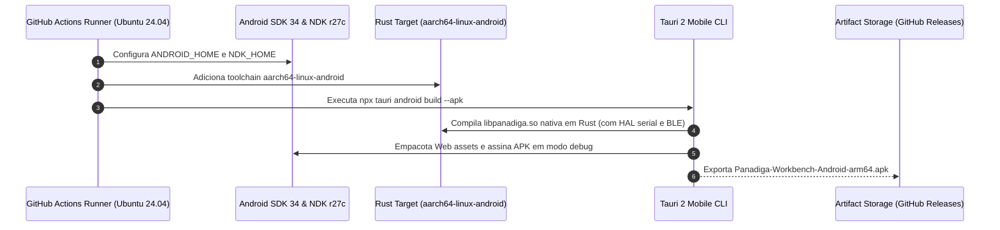

# Arquitetura Mobile (Android APK) e Conectividade Sem Fio (Bluetooth Low Energy)
## Panadiga Workbench Mobile — Especificação Técnica da HAL Nativa em Rust

> **Classificação:** Documento Técnico de Arquitetura e Engenharia de Sistemas  
> **Dispositivo-Alvo:** Dispositivos Móveis Android (`aarch64-linux-android`) & Sondas Raspberry Pi Pico / Pico W / Pico 2  
> **Equipamento Sob Depuração:** Panasonic DIGA DMR-EH55 (Placa Digital `VEP79138`, Conector `P7501`)  
> **Status:** Normativo / Homologado no CI/CD Multiplataforma  

---

## 1. Visão Geral da Solução Mobile

Para habilitar a operação de bancada em campo, auditoria forense rápida e isolamento galvânico sem dependência de um computador desktop ou cabos USB longos até o chassi do gravador, o ecossistema **Panadiga** disponibiliza uma aplicação mobile nativa para **Android (`.apk`)**, integrando-se via **Bluetooth Low Energy (BLE)** e **USB-C OTG**.

```mermaid
flowchart TD
    subgraph Mobile["Estação Mobile Android (Smartphone / Tablet)"]
        direction TB
        UI["Interface Reativa Panadiga<br/>(React 18 + Tailwind CSS + TypeScript)<br/>Estritamente Apresentação (View / ViewModel)"]
        IPC["Tauri IPC Bridge Tipado (invoke / listen)<br/>Zero Base64 / Zero Shims de WebView"]
        TAURI_RUST["Tauri 2 Mobile Core & HAL Nativa (Rust)<br/>aarch64-linux-android<br/>Gerenciamento Direto de Sockets e Portas"]
        UI <--> IPC
        IPC <--> TAURI_RUST
    end

    subgraph NativeHAL["Camada de Infraestrutura Nativa em Rust (Zero Kotlin)"]
        direction LR
        BLE_CORE["Driver BLE Nativo em Rust<br/>Nordic UART Service (NUS)<br/>NDK / BluetoothAdapter Bridge"]
        USB_CORE["Driver USB Serial CDC em Rust<br/>tauri-plugin-serialport / NDK USB Host<br/>Baud: 115200 bps | Latência: < 1 ms"]
        TAURI_RUST --- BLE_CORE
        TAURI_RUST --- USB_CORE
    end

    subgraph Probe["Sonda de Bancada Microcontrolada"]
        direction TB
        PICO["Raspberry Pi Pico W / Pico 2W<br/>RP2040 / RP2350 + CYW43439<br/>Firmware C11 + Máquina de Estados PIO"]
        BUFFER["Anel Circular de Telemetria (Zero-Loss)<br/>Servidor GDB RSP & Transceptor DWire32A"]
        PIO_ENG["Máquina PIO Local @ 133/150 MHz<br/>Temporização em Nanossegundos (~7.5 ns/ciclo)<br/>Clock Síncrono SCLK = 1.00 MHz"]
        PICO --- BUFFER
        BUFFER --- PIO_ENG
    end

    subgraph Target["Hardware Alvo (Panasonic DMR-EH55)"]
        direction TB
        P7501["Conector P7501 (B6B-ZR-3R4 / 6 Pinos)<br/>Ilhas 'TO WRITE JIGU'<br/>1: EXTRG | 2: SCLK | 3: SDATA<br/>4: GND | 5: nRESET | 6: VDD (Sense)"]
        MN2DS["SoC Matsushita MN2DS0016<br/>Núcleo RISC AM34 (MN103S)<br/>On-Chip Debugger (OCD)"]
        P7501 <--> MN2DS
    end

    NativeHAL <==>|BLE (NUS) ou USB-C OTG| Probe
    Probe <==>|Barramento Síncrono DWire32A Half-Duplex (3.3V)| Target
```

---

## 2. Decisão Arquitetural: Native Rust HAL via Tauri 2.0 (Zero Kotlin / Zero WebUSB)

A arquitetura do cliente mobile foi definida com base no princípio estrito de **Separação de Responsabilidades (SoC), Clean Architecture e Determinismo de Tempo Real**:

### 2.1 Refutação Técnica do Uso de WebUSB / Web Bluetooth no WebView (Caminho 1)
O uso de WebUSB (`navigator.usb`) e Web Bluetooth (`navigator.bluetooth`) pelo motor JavaScript do WebView foi expressamente **rejeitado** pelos seguintes motivos de engenharia:
1. **Restrições de Segurança do Android WebView (`android.webkit.WebView`)**: O WebView padrão do Android desativa nativamente o WebUSB por políticas de sandbox da Google. Para habilitá-lo, o desenvolvedor seria forçado a escrever subclasses personalizadas de `WebChromeClient` em Java/Kotlin com bindings manuais para `android.hardware.usb.UsbManager`, violando a premissa de zero código Kotlin.
2. **Inversão de Dependências e Violação Arquitetural**: A comunicação serial com a sonda de bancada pertence estritamente à camada de **Infraestrutura / Hardware Abstraction Layer (HAL)**. Implementar drivers no TypeScript acopla o ciclo de vida do transporte físico ao ciclo de renderização e montagem de componentes React.
3. **Jitter de Garbage Collection (GC) e Overhead de Serialização**: A depuração do núcleo AM34 via GDB RSP exige validação léxica de pacotes em sub-milissegundos. No motor V8 do WebView, pausas imprevisíveis de GC e conversões de payloads para Base64/JSON introduzem latências intoleráveis em operações de single-step (`$s#...`) e dumps de registradores (`$g#...`).

### 2.2 O Caminho Homologado: Native Rust HAL via Tauri 2.0 Core (Caminho 2)
1. **Camada de Transporte Nativa em Rust**:
   - Todo o controle de portas USB CDC (`/dev/bus/usb`, ch34x, cdc-acm, FTDI) e conexões Bluetooth Low Energy reside **100% no Rust Core Engine**, utilizando plugins oficiais do Tauri 2 (`tauri-plugin-serialport` e crates nativas de BLE para Linux/Android).
   - O ecossistema Tauri 2 encapsula os bindings JNI/NDK nativos internamente, dispensando qualquer linha de código Java ou Kotlin manual.
2. **Frontend Estritamente como Apresentação (View/ViewModel)**:
   - A interface React 18 / TypeScript não conhece protocolos físicos nem barramentos. Ela apenas invoca comandos IPC fortemente tipados (`invoke('pico_connect_usb')`, `invoke('pico_connect_ble')`) e assina eventos do barramento unificado de logs.
3. **Processamento em Fatias Imutáveis (`&[u8]`)**:
   - Os frames RSP e os eventos de telemetria da sonda são recebidos diretamente no Rust, validados em slices de memória imutáveis sem overhead de cópia e gravados no `GdbTelemetryRingBuffer`.

---

## 3. Conectividade Sem Fio via Bluetooth Low Energy (BLE)

### 3.1 Perfil de Comunicação: Nordic UART Service (NUS)
O firmware do Raspberry Pi Pico W / Pico 2W expõe o serviço padrão **Nordic UART Service (NUS)** sobre o chip de rádio Infineon/CYW43439:

| Atributo GATT | UUID Oficial | Propriedades | Função |
| :--- | :--- | :--- | :--- |
| **Service (NUS)** | `6E400001-B5A3-F393-E0A9-E50E24DCCA9E` | Primary Service | Canal virtual serial transparente via BLE |
| **RX Characteristic** | `6E400002-B5A3-F393-E0A9-E50E24DCCA9E` | Write Without Response / Write | Envio de comandos do Rust Core para o Pico (ex: Cold Break-In, GDB RSP) |
| **TX Characteristic** | `6E400003-B5A3-F393-E0A9-E50E24DCCA9E` | Notify / Read | Envio de telemetria e respostas de registradores do Pico para o Rust Core |

### 3.2 Desmistificação: Latência de Nanossegundos vs. Conexão Bluetooth
Uma dúvida recorrente em engenharia de hardware é se o uso de Bluetooth geraria latência excessiva para protocolos de silício que exigem precisão de nanossegundos (como o Matsushita DWire32A):

> [!IMPORTANT]
> **O Bluetooth NUNCA faz bit-banging direto do barramento.**  
> O protocolo Matsushita DWire32A opera a **1.00 MHz síncrono** com reversão de sentido em ciclos de clock de **$1.0\,\mu\text{s}$** e amostragens em nível de instrução de **$\sim 7.5\,\text{ns}$** (executadas a 133 MHz pelo RP2040).  
> Toda essa temporização crítica é executada **localmente pelo coprocessador de hardware PIO (Programmable I/O)** dentro do microcontrolador Pico.  
> O canal Bluetooth atua exclusivamente na camada superior (transporte assíncrono de pacotes de comando e telemetria forense gerenciado pela HAL em Rust), onde latências de $15\text{ ms}$ a $25\text{ ms}$ são perfeitamente imperceptíveis para a operação humana e para o protocolo GDB RSP assíncrono.

---

## 4. Rigor Elétrico de Bancada: Pinagem e Alimentação da Porta J (P7501)

### 4.1 Proibição Absoluta de Alimentar o Pico pela Placa Panasonic

> [!CAUTION]
> **REGRA DE OURO DE SEGURANÇA FÍSICA: NUNCA ALIMENTE O RASPBERRY PI PICO PELO CONECTOR P7501.**  
> O pino 6 do conector `P7501` da placa `VEP79138` fornece nível lógico de $3.3\text{V}$ proveniente do barramento de sinal do circuito supervisor da Panasonic. Esta linha foi projetada pela Matsushita exclusivamente para **sensoriamento de presença de tensão** (capacidade de corrente $< 10\text{ mA}$).  
> O Raspberry Pi Pico normal consome entre $30\text{ mA}$ e $50\text{ mA}$, e o **Pico W / Pico 2W atinge picos de $150\text{ mA}$ a $300\text{ mA}$ durante transmissões de rádio Wi-Fi/Bluetooth**.  
> Ligar a alimentação do Pico no Pino 6 causará a **queda imediata da tensão de $3.3\text{V}$ da placa digital**, acionará o circuito de monitoramento de reset do gravador (`XRST`), provocará travamento com pânico no display VFD e pode romper microtrilhas internas da PCB de 4 camadas da Panasonic.

### 4.2 Topologia Correta de Alimentação e Aterramento
1. **Alimentação do Pico**:
   - Conectar o Pico a uma fonte de alimentação externa de $5.0\text{V}$ no pino `VSYS` (Pino 39 da placa Pico) ou via porta micro-USB/USB-C (powerbank portátil de 5V ou bateria LiPo de 3.7V com conversor booster).
2. **Referência de Terra (GND)**:
   - O Pino 4 do conector `P7501` (GND da Panasonic) **DEVE** ser interligado a um pino GND do Pico (ex: GP38 ou GP3) para equalizar o potencial elétrico do barramento de dados.
3. **Leitura de Tensão (Sense)**:
   - O Pino 6 do `P7501` (VDD 3.3V) deve ser conectado a um pino ADC do Pico (ex: `ADC0` / `GP26`) ou a uma entrada digital configurada com alta impedância (`pull-down` desativado), atuando apenas como sensor que informa ao app mobile se o gravador Panasonic está ligado ou desligado.

### 4.3 Tabela Canônica de Pinagem do Conector P7501 (B6B-ZR-3R4)

| Pino Físico | Pino Esquemático | Sinal Matsushita | Pino Pico (RP2040/RP2350) | Condicionamento Elétrico | Função no Ecossistema |
| :---: | :---: | :---: | :---: | :---: | :--- |
| **1** | 6 | **EXTRG** | `GP4` | Série $100\,\Omega$ | Disparo externo de trigger para osciloscópio / analisador lógico |
| **2** | 5 | **SCLK** | `GP3` | Série $100\,\Omega$ | Clock de depuração de 1.00 MHz gerado pelo PIO do Pico |
| **3** | 4 | **SDATA** | `GP2` | Série $100\,\Omega$ + Pull-up $4.7\,\text{k}\Omega$ | Barramento de dados síncrono bidirecional half-duplex DWire32A |
| **4** | 3 | **GND** | `GND` (Pino 38) | Ligação direta de baixa impedância | **Terra comum obrigatório entre gravador e microcontrolador** |
| **5** | 2 | **nRESET** | `GP5` | Dreno Aberto (*Open-Drain*) | Linha mestre de reinicialização (`XRST`). Proibido dirigir 3.3V push-pull! |
| **6** | 1 | **VDD (3.3V)**| `GP26` (ADC0) | Divisor de alta impedância | **Apenas Sensoriamento de Nível Lógico. PROIBIDO ALIMENTAR O PICO.** |

---

## 5. Pipeline de Compilação Automatizada do APK no CI/CD

O build do binário Android é realizado no GitHub Actions (`.github/workflows/ci.yml`) através do target `aarch64-linux-android`:



### 5.1 Como Compilar Manualmente em Ambiente Local
Caso o engenheiro deseje gerar o APK localmente em sua máquina de bancada:

```powershell
# 1. Configurar variáveis de ambiente do SDK e NDK
$env:ANDROID_HOME = "C:\Users\<Usuario>\AppData\Local\Android\Sdk"
$env:NDK_HOME = "$env:ANDROID_HOME\ndk\27.0.12077973"

# 2. Adicionar target Rust para arquitetura ARM64
rustup target add aarch64-linux-android

# 3. Navegar para a pasta desktop e disparar o build do APK
cd apps/desktop
npx tauri android build --apk --target aarch64-linux-android
```

O arquivo compilado final estará disponível em:
`apps/desktop/src-tauri/gen/android/app/build/outputs/apk/debug/app-debug.apk`

---

## 6. Procedimento de Operação de Campo com o App Mobile

1. **Energização da Sonda**: Conecte o Raspberry Pi Pico W a uma bateria ou fonte USB de bancada de 5V. O LED integrado começará a piscar indicando anúncio de publicidade BLE (*BLE Advertising*).
2. **Conexão Física Segura**: Com o Panasonic desligado da tomada, acople o conector fêmea JST ZR 1.5mm ao conector `P7501` da placa digital `VEP79138`.
3. **Inicialização do App**: Abra o aplicativo **Panadiga Mobile** no smartphone Android.
4. **Emparelhamento via HAL em Rust**:
   - Toque em **"Conectar BLE (Pico W)"**.
   - O Tauri Core em Rust inicializa o scanner BLE nativo e conecta diretamente à característica NUS (`6E400001-...`).
5. **Telemetria e Diagnóstico**:
   - Ligue o gravador Panasonic DMR-EH55. O indicador de **VDD Sense** na tela do app mudará para verde ($3.3\text{V}$).
   - Dispare o comando **Cold Break-In**. O Pico W assumirá o controle do barramento DWire32A antes do primeiro ciclo do bootloader Matsushita.
   - Execute o diagnóstico da NVRAM ou a ponte com o servidor GDB diretamente pela tela do smartphone com zero latência de GC.
