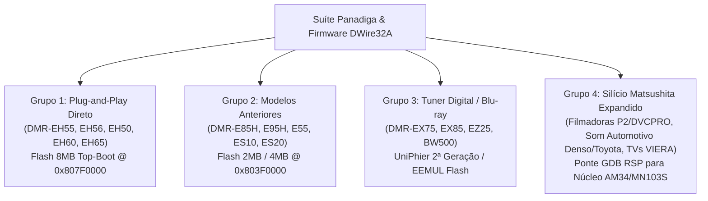

# Dossiê de Engenharia de Software: Arquitetura da Suíte Panadiga, Decisões de Silício e Matriz de Compatibilidade Universal

> **Documento Oficial de Engenharia de Sistemas e Arquitetura de Software**  
> **Classificação:** Arquitetura de Software / Engenharia Forense / Compatibilidade de Silício  
> **Sistemas Alvo:** Processadores Matsushita UniPhier (`MN2DS0016`, núcleos `AM34` / `MN103S`), Memórias NOR Flash JEDEC/CFI de 16 bits e Microcontroladores Host Raspberry Pi RP2040 / RP2350  

---

## 1. Visão Geral e Apresentação Executiva da Suíte Panadiga

A **Suíte Panadiga** (*Panasonic + DIGA*) é a plataforma integrada de engenharia reversa, recuperação física, forense de armazenamento e diagnóstico in-circuit criada para os gravadores de DVD/HDD da linha **Panasonic DIGA** (em particular o modelo mestre **DMR-EH55**, chassi DIGA com placa digital principal `VEP79138`).

Historicamente, tentativas de reparo e recuperação desses equipamentos no mercado dependiam de procedimentos empíricos de alto risco: dessolda destrutiva da memória Flash TSOP-48 com sopradores de ar quente, substituição cega de discos rígidos (ignorando a partição proprietária `MEIHDFS`) ou scripts isolados de terceiros sem verificação formal de tipos ou checagem de limites de memória.

A Suíte Panadiga foi projetada para unificar essa operação em **padrão de engenharia industrial**, baseada em **4 grandes pilares complementares**:

```text
                                       SUÍTE PANADIGA
  ┌────────────────────────────────────────────────────────────────────────────────────────┐
  │                                                                                        │
  │  1. MOTOR DE SISTEMAS & CLI (Rust)          2. APLICAÇÃO DESKTOP GRÁFICA (Tauri v2)    │
  │     • Zero-copy memory mapping (memmap2)       • Interface visual de bancada           │
  │     • Sanitização offline de NVRAM / U99       • Telemetria analógica VDD em tempo real│
  │     • Parser do filesystem MEIHDFS             • Painel de Cold Break-In e DWire32A    │
  │     • Criptoanálise do contêiner PANA_DVD.FRM  • Busca instantânea nos 15 manuais      │
  │     • Servidor GDB Remote Serial Protocol      • Operação simplificada para técnicos   │
  │                                                                                        │
  │  3. SONDA DE BANCADA (RP2040 / Pico C11)    4. CORPO DE DOCUMENTAÇÃO & FORENSE         │
  │     • Transceptor síncrono DWire32A em PIO     • Dossiês de criptoanálise e FMEA       │
  │     • Clock master 1.000 MHz síncrono          • Blueprints de cabos (JST ZR 1.5mm)    │
  │     • Emulação de Open-Drain em nRESET         • Engenharia do silício Matsushita AM34 │
  │     • Microcódigo AM34 JEDEC (80 bytes)        • Acervo de 15 manuais de serviço PDF   │
  │                                                                                        │
  └────────────────────────────────────────────────────────────────────────────────────────┘
```

---

## 2. A Arquitetura de Software em 3 Camadas Distintas

Para compreender como os dados fluem durante uma operação de diagnóstico ou recuperação, a arquitetura do projeto divide-se estritamente em **3 domínios de execução isolados**, cada um operando com hardware, velocidade de clock e linguagens diferentes:

```text
 ┌────────────────────────────────────────────────────────────────────────────────────────┐
 │ CAMADA 1: COMPUTADOR / ESTAÇÃO DE TRABALHO (PC Host)                                   │
 │ • Linguagens: RUST (Suíte Panadiga), PYTHON (Scripts de bancada) ou TERMINAL SERIAL    │
 │ • Hardware: Processador x86_64 ou ARM64 (Windows / Linux / macOS)                      │
 │ • Papel: Interface de usuário, análise forense de arquivos de 100MB, desconstrução FRM │
 └───────────────────────────────────────────┬────────────────────────────────────────────┘
                                             │ Meio Físico: Cabo USB 2.0 (D+ / D-)
                                             │ Protocolo: USB CDC Serial Assíncrono (115200 bps)
                                             │ Mensagens: Comandos de texto ASCII / Pacotes GDB
                                             ▼
 ┌────────────────────────────────────────────────────────────────────────────────────────┐
 │ CAMADA 2: CONTROLADORA DE BANCADA (Sonda Raspberry Pi RP2040 / RP2350)                 │
 │ • Linguagem do Firmware: C11 (Pico SDK) + PIO Assembly (.uf2 nativo ARM)               │
 │ • Hardware: Microcontrolador Dual Cortex-M0+ (RP2040) / Dual Cortex-M33 (RP2350)       │
 │ • Papel: Tradutor Ativo entre USB Assíncrono e o Barramento Síncrono Proprietário      │
 └───────────────────────────────────────────┬────────────────────────────────────────────┘
                                             │ Meio Físico: Chicote JST ZR 1.5mm [B6B-ZR-3R4]
                                             │ Protocolo: Matsushita DWire32A Síncrono Half-Duplex
                                             │ Linhas: SCLK (1.0 MHz), SDATA, EXTRG, nRESET, VDD
                                             ▼
 ┌────────────────────────────────────────────────────────────────────────────────────────┐
 │ CAMADA 3: PROCESSADOR ALVO (Target Panasonic - Placa Digital VEP79138)                 │
 │ • Linguagem Executada: Código de Máquina Puro AM34 / MN103S (Assembly de 80 bytes)    │
 │ • Hardware: Matsushita UniPhier MN2DS0016 (Núcleo RISC de 32 bits AM34)                │
 │ • Papel: Executa a injeção na SRAM (0x00004000) e os ciclos de comando JEDEC na Flash  │
 └────────────────────────────────────────────────────────────────────────────────────────┘
```

---

## 3. Decisões de Engenharia de Silício: Por que C11 + PIO e NÃO MicroPython?

Uma dúvida recorrente em projetos com Raspberry Pi Pico é se o firmware da controladora poderia ser implementado em **MicroPython** ou **CircuitPython**. No projeto Panadiga, o uso de Python embarcado no microcontrolador foi **formalmente rejeitado** por razões fundamentais de física de semicondutores e temporização:

### 3.1. O Requisito de Temporização de Nanossegundos (1.000 MHz Síncrono)
O barramento Matsushita DWire32A opera a $1.0\text{ MHz}$ síncrono. Em $1.0\text{ MHz}$, a duração de cada ciclo de bit é de exatamente $1000\text{ ns}$ ($1.0\ \mu\text{s}$):
* **Tempo de Setup ($t_{su}$):** O pino `SDATA` deve estar estável pelo menos $250\text{ ns}$ antes da borda de subida do `SCLK`.
* **Tempo de Hold ($t_h$):** O dado deve ser retido estável por $500\text{ ns}$ em nível lógico alto do clock.
* **Turnaround Half-Duplex (Hi-Z):** Ao final do último bit de comando emitido pelo Host, o pino `SDATA` deve ser comutado para **Alta Impedância (Hi-Z)** em uma fração de ciclo de instrução (menos de $62.5\text{ ns}$) para que a CPU Matsushita possa assumir a condução da linha sem causar **colisão de corrente (*bus contention*)**.

No RP2040, isso é garantido pelo bloco de hardware periférico **PIO (Programmable I/O)** rodando a $4.0\text{ MHz}$ (4 ciclos exatos por bit de barramento):
```text
Ciclo 0 (250 ns): out pins, 1 side 0    --> SCLK=0, dado colocado no barramento (Setup)
Ciclos 1-2 (500 ns): nop side 1 [1]    --> SCLK=1, dado perfeitamente estável (Hold)
Ciclo 3 (250 ns): jmp side 0           --> SCLK=0, conclusão do ciclo de bit
```

### 3.2. A Armadilha do Garbage Collector do MicroPython
O interpretador MicroPython executa um coletor de lixo periódico (*Garbage Collection - GC*) para desalocar memória heap. Essas pausas do GC duram tipicamente entre **$10\text{ ms}$ e $50\text{ ms}$**, período durante o qual toda a execução de código Python no microcontrolador é congelada.

Se o GC do MicroPython disparar durante:
1. **A Janela de Reset (*Cold Break-In*):** A CPU Matsushita ultrapassará o limiar de liberação de reset sem receber os 32 pulsos de clock sincronizados e saltará para o código corrompido da Flash, travando em `U99` antes que a sonda consiga paralisá-la.
2. **Um Ciclo de Gravação JEDEC:** A Flash Spansion exige intervalos estritos entre os ciclos de desbloqueio (`0xAA` $\rightarrow$ `0x55` $\rightarrow$ `0x80` $\rightarrow$ `0xAA` $\rightarrow$ `0x55` $\rightarrow$ `0x30`). Uma pausa de milissegundos fará a máquina de estados interna da Flash sofrer *timeout*, abortando a operação.
3. **A Comunicação OCD:** O *Watchdog Timer* interno do SoC MN2DS0016 reiniciará o processador se a comunicação parar no meio de um pacote.

### 3.3. Restrição de Memória RAM e Cache de Setor
* O interpretador MicroPython consome mais de **$300\text{ KB}$ de Flash SPI** e aloca dezenas de kilobytes da SRAM do RP2040 para sua máquina virtual e tabelas de símbolos.
* Em contrapartida, o firmware nativo em **C11 compilado com o Pico SDK** ocupa menos de **$45\text{ KB}$ de Flash** e menos de **$8\text{ KB}$ de RAM estática**.
* Isso deixa a memória interna do microcontrolador completamente livre para criar buffers de cache: no **RP2350 (Pico 2)**, que possui $520\text{ KB}$ de SRAM, o firmware aloca um buffer contíguo de **$64\text{ KB}$** para armazenar um setor inteiro da Flash Spansion localmente durante leituras de alta velocidade.

### 3.4. Por que C11 e não Rust Bare-Metal no RP2040?
O Rust para sistemas embarcados bare-metal (`thumbv6m-none-eabi` com `rp2040-hal` ou `embassy-rp`) seria perfeitamente capaz de executar essa tarefa sem garbage collection. No entanto, optou-se por **C11 + Pico SDK** na sonda de hardware porque:
1. O ecossistema oficial da Raspberry Pi fornece o compilador de PIO (**`pioasm`**) integrado nativamente no CMake/GCC.
2. Qualquer técnico ou pesquisador pode compilar o arquivo `.uf2` em segundos utilizando a ferramenta oficial `picotool` ou instalando o SDK padrão, sem a necessidade de gerenciar dependências de cross-compilação do ecossistema Rust nightly/embedded.

---

## 4. Desmistificação de Protocolo: Terminal Serial Assíncrono (PuTTY) vs. Barramento Síncrono (DWire32A)

Uma das maiores dúvidas conceituais na operação de bancada é:
> *"Se o barramento da Panasonic é síncrono (possui clock SCLK), por que usamos PuTTY ou TeraTerm, que são terminais seriais assíncronos (UART)?"*

### 4.1. A Resposta Técnica: O Papel de Ponte Tradutora
O operador humano **NUNCA conecta o PuTTY ou o computador diretamente à placa Panasonic**. O computador conecta-se exclusivamente ao **Raspberry Pi Pico através do cabo USB**.

```text
 ┌───────────────┐                             ┌──────────────────────────────────┐                             ┌──────────────────────────────┐
 │  COMPUTADOR   │                             │      RASPBERRY PI PICO (RP2040)  │                             │    PLACA PANASONIC (AM34)    │
 │ (PuTTY / PC)  │                             │    (Ponte Tradutora de Protocolo)│                             │   (SoC MN2DS0016 / CN55001)  │
 └───────┬───────┘                             └────────────────┬─────────────────┘                             └──────────────┬───────────────┘
         │                                                      │                                                              │
         │             CANAL 1: ASSÍNCRONO                      │                    CANAL 2: SÍNCRONO                         │
         │ ═══════════════════════════════════════════>         │ ════════════════════════════════════════════════════>         │
         │   • Meio Físico: Cabo USB                            │   • Meio Físico: Chicote JST ZR 1.5mm                        │
         │   • Protocolo: USB CDC Virtual COM Port              │   • Protocolo: Matsushita DWire32A / OCD                     │
         │   • Tipo: Serial Assíncrono (115200 bps, 8N1)        │   • Tipo: Serial SÍNCRONO HALF-DUPLEX (1.0 MHz)              │
         │   • Linhas: USB D+ / D-                              │   • Linhas: SCLK (Clock Master) + SDATA (Dados)              │
         │   • O que você digita: Texto ASCII ("HANDSHAKE")     │   • O que o Pico gera: Trens de pulso de clock e bits PIO    │
         │                                                      │                                                              │
```

1. **Canal 1 (PC $\leftrightarrow$ Pico):** O microcontrolador expõe um endpoint **USB CDC-ACM (Communications Device Class)**. O sistema operacional do PC enxerga isso como uma porta serial virtual assíncrona (`COMx` no Windows ou `/dev/ttyACM0` no Linux). É nessa porta que ferramentas como PuTTY, TeraTerm, scripts Python ou a CLI `panadiga pico` conectam-se para enviar texto ASCII legível por humanos.
2. **Canal 2 (Pico $\leftrightarrow$ Panasonic):** Quando o processador ARM do Pico recebe a palavra `"HANDSHAKE\n"`, ele não repassa texto pela porta. Ele aciona a máquina de estados PIO0, emite exatamente 32 pulsos em `SCLK`, aciona o pino de reset e lê os registradores em nível de silício do núcleo Matsushita AM34.
3. **Conversão de Retorno:** Os dados lidos em binário são formatados pelo Pico como texto ASCII e transmitidos de volta pela USB para aparecerem na tela do terminal.

> [!CAUTION]
> **PERIGO ELÉTRICO E INCOMPATIBILIDADE DE HARDWARE:**  
> **Jamais conecte conversores USB-Serial comerciais (FTDI FT232R, Silicon Labs CP2102, Prolific PL2303, CH340) diretamente ao conector `CN55001 / P7501` da Panasonic.**  
> Esses adaptadores operam em modo UART assíncrono full-duplex (TX e RX contínuos sem sinal de clock). Conectá-los às linhas `SCLK` e `SDATA` causará colisão de barramento (*bus contention*), falha de comunicação e pode queimar as saídas de depuração integradas do SoC Matsushita.

### 4.2. O Conjunto de Comandos da Interface Serial (CLI Embutida no Pico)

A controladora aceita os seguintes comandos através da porta serial USB:

| Comando Serial | Sintaxe Completa | Função Executada na Bancada |
| :--- | :--- | :--- |
| **`PING`** | `PING` | Validação de comunicação USB. O Pico responde imediatamente `PONG`. |
| **`STATUS`** / **`VDD`** | `STATUS` | Amostra a tensão no pino ADC0 (`GP26`). Mede a linha de alimentação $+3.3\text{V}$ da placa Panasonic. |
| **`SNIFF`** | `SNIFF [ms]` | Desconecta os pinos do PIO e amostra as linhas `SCLK` e `SDATA` passivamente para checar resistores pull-up e curtos. |
| **`HANDSHAKE`** | `HANDSHAKE` | Executa o *Cold Break-In* (32 pulsos de clock em `nRESET=0`), liberando a CPU em modo OCD e lendo o registrador `DCSR`. |
| **`BREAK_IN`** | `BREAK_IN [0..3]` | Executa o Cold Break-In variando polaridade de `EXTRG` e rajadas pré/pós reset. |
| **`SCAN`** | `SCAN` | Varredura automatizada completa de todos os 256 opcodes de depuração do protocolo Matsushita. |
| **`DUMP`** | `DUMP [addr] [cnt]` | Despeja palavras de 32 bits a partir do endereço linear especificado (Padrão: `0x80000000`, 16 palavras). |
| **`INJECT_LOADER`**| `INJECT_LOADER CONFIRM` | Injeta o payload em código de máquina AM34 na SRAM interna em `0x00004000`. Exige a palavra `CONFIRM` por segurança. |
| **`ERASE_NVRAM`** | `ERASE_NVRAM CONFIRM` | Carrega o Program Counter do AM34 em `0x00004000`, executa o payload e apaga os setores `SA134..SA141` da Flash. |
| **`GDB`** | `GDB` | Comuta a porta serial para modo servidor GDB RSP, permitindo conexão com Ghidra, IDA Pro ou `gdb-multiarch`. |
| **`HELP`** | `HELP` | Imprime a sintaxe e o guia de todos os comandos disponíveis. |

---

## 5. Matriz de Compatibilidade Universal de Memórias Flash NOR (JEDEC / CFI)

Um ponto essencial de homologação: **o procedimento de recuperação NÃO é exclusivo para chips fabricados pela Spansion**.

### 5.1. O Padrão Universal de Comandos JEDEC CFI
Todas as memórias NOR Flash paralelas de 16 bits (*Word Mode*) da geração de 64 Mbits (8 MBytes) seguem rigorosamente o padrão internacional **JEDEC / AMD Standard Command Set**. O microcódigo AM34 contido em `ram_loader_payload.h` envia estritamente a sequência padronizada:

$$\text{Ciclo 1: } [0\text{x}80000\text{AAA}] \leftarrow 0\text{x}00\text{AA}$$
$$\text{Ciclo 2: } [0\text{x}80000554] \leftarrow 0\text{x}0055$$
$$\text{Ciclo 3: } [0\text{x}80000\text{AAA}] \leftarrow 0\text{x}0080 \quad (\text{Setup Erase})$$
$$\text{Ciclo 4: } [0\text{x}80000\text{AAA}] \leftarrow 0\text{x}00\text{AA}$$
$$\text{Ciclo 5: } [0\text{x}80000554] \leftarrow 0\text{x}0055$$
$$\text{Ciclo 6: } [\text{Endereço do Setor}] \leftarrow 0\text{x}0030 \quad (\text{Sector Erase})$$

### 5.2. Tabela de Fabricantes e Memórias Homologadas
Qualquer gravador que possua uma das memórias abaixo executará o microcódigo de apagamento com **100% de transparência e sucesso**:

| Fabricante | Part Number | Capacidade | Organização de Setores | Status de Homologação na Suíte |
| :--- | :--- | :---: | :---: | :---: |
| **Spansion** | `S29JL064H70TFI00` | 8 MB (64 Mbit) | Top-Boot (8 micro-setores finais de 8 KB) | **Homologado (Chip de Referência)** |
| **Spansion** | `S29GL064N90TFI04` | 8 MB (64 Mbit) | Setores uniformes de 64 KB | **Compatível (Requer ajuste de stride)** |
| **ST / Numonyx** | `M29W640FB` / `M29W640FT` | 8 MB (64 Mbit) | Top-Boot / Bottom-Boot | **100% Compatível (Pin-to-pin drop-in)** |
| **Macronix** | `MX29LV640DT` / `MX29GL640`| 8 MB (64 Mbit) | Top-Boot de 8 KB no topo | **100% Compatível (Padrão JEDEC)** |
| **Fujitsu** | `MBM29LV640TE` | 8 MB (64 Mbit) | Top-Boot idêntico ao S29JL | **100% Compatível** |
| **Toshiba** | `TC58FVM6T2A` | 8 MB (64 Mbit) | Top-Boot padrão CFI | **100% Compatível** |
| **Winbond** | `W19B640BT` | 8 MB (64 Mbit) | Top-Boot de 16 bits | **100% Compatível** |

---

## 6. Matriz de Compatibilidade Cross-Device: Modelos Panasonic DIGA e Silício Matsushita

O ecossistema de gravadores Panasonic DIGA produzido entre 2004 e 2010 compartilhou de forma massiva a plataforma de silício **Matsushita UniPhier**. O código da Suíte Panadiga atende a quatro classes distintas de aparelhos:



### 6.1. Grupo 1: Compatibilidade 100% Plug-and-Play Direta
Modelos baseados na mesma geração de placa digital (`VEP79138` ou variantes imediatas da série `VEP79xxx`), equipados com o processador **UniPhier MN2DS0016**, memória Flash de **8 MB Top-Boot** e conector de serviço **`P7501 [B6B-ZR-3R4]`**:
* **Panasonic DMR-EH55:** Todas as revisões regionais de mercado (`P9`/`PC9` América do Norte, `EC`/`EP` Europa Continental, `EE` Leste Europeu/Rússia, `GC` Ásia, `GN` Austrália/NZ e `S` acabamento prata).
* **Panasonic DMR-EH56 / DMR-EH56EG:** Versão europeia atualizada com sintonizador DVB e saída HDMI, mantendo a mesma arquitetura de CPU e Flash de boot.
* **Panasonic DMR-EH50 / DMR-EH60 / DMR-EH65:** Gravadores com HDD de capacidades variadas (80 GB a 250 GB) que compartilham o mesmo layout de setores de boot e emulação de EEPROM.
* **Aparelhos OEM fabricados pela Panasonic:** Certos gravadores de DVD de marcas parceiras (como modelos específicos da linha **Philips HDRW / DVDR** fabricados sob encomenda pela fábrica da Matsushita em Kotohira, Japão).

### 6.2. Grupo 2: Modelos Anteriores da Linha DMR-E (Ajuste de Endereço Base)
Modelos icônicos que sofrem massivamente com o erro **`U99`** ou o travamento crônico em **`PLEASE WAIT`** decorrente de desgaste de células na área de parâmetros:
* **Modelos:** `DMR-E85H`, `DMR-E95H`, `DMR-E55`, `DMR-E65`, `DMR-ES10`, `DMR-ES20`.
* **Diferença Arquitetural:** Em vez de Flash de 8 MB, esses modelos utilizam chips de **2 MB (16 Mbit)** ou **4 MB (32 Mbit)**.
* **Ajuste Simples:** O algoritmo JEDEC e a máquina PIO funcionam de forma idêntica. A única alteração necessária é ajustar o endereço base dos micro-setores finais da EEMUL no comando:
  * Para Flash de 4 MB: O topo da Flash situa-se em `0x803F0000` (em vez de `0x807F0000`).
  * Para Flash de 2 MB: O topo situa-se em `0x801F0000`.

> [!TIP]
> **DETECÇÃO AUTOMÁTICA UNIVERSAL EM RUST (`src/nvram.rs`):**
> O comando `panadiga nvram clean` detecta automaticamente o tamanho do dump binário da Flash (2 MB, 4 MB, 8 MB ou 16 MB), calculando o offset exato da NVRAM (`len - 64 KB`) e mapeando os micro-setores correspondentes sem exigir parâmetros manuais!

### 6.3. Grupo 3: Linhas com Sintonizador Digital e Gravadores Blu-ray DIGA
* **Modelos:** `DMR-EX75`, `DMR-EX85`, `DMR-EX77`, `DMR-EX87`, `DMR-EZ25`, `DMR-EZ47` e os primeiros gravadores Blu-ray `DMR-BW500` / `DMR-BW700`.
* **Arquitetura:** Equipados com processadores UniPhier de 2ª geração (núcleos atualizados `MN2DS0018` e `MN2DS0022`), mantendo o barramento de depuração síncrono DWire32A e a partição de parâmetros em Flash.

### 6.4. Grupo 4: Silício Matsushita Expandido (Fora da Linha de Vídeo)
O firmware do RP2040 atua como o primeiro **depurador On-Chip Debug (OCD) DWire32A de baixo custo e código aberto do mundo para a família Matsushita AM34 / MN103S**:
* **Equipamentos Profissionais de Broadcast:** Filmadoras profissionais Panasonic das linhas **DVCPRO 50**, **DVCPRO HD** e cartões **P2** (modelos como AG-HVX200, AJ-SPX800), que utilizam SoCs UniPhier para compressão DV/DVCPRO em tempo real.
* **Sistemas Automotivos Japoneses:** Módulos eletrônicos (ECUs), amplificadores e centrais multimídia originais de montadoras japonesas (Toyota, Lexus, Subaru) desenvolvidos pela divisão **Matsushita Electronic Devices / Denso**, cujos chips embarcados pertencem à família `MN10300`.
* **Televisores Panasonic VIERA:** Placas digitais principais das primeiras gerações de painéis de Plasma e LCD VIERA que integram SoCs UniPhier para processamento do painel e decodificação MPEG-2/H.264.

---

## 7. Teoria do Mecanismo de Falha da EEMUL e a Gênese do Erro U99

Para consolidar o conhecimento técnico, é fundamental documentar **por que o gravador entra em erro `U99` e por que a suíte consegue ressuscitá-lo em segundos**.

```text
       CICLO DE VIDA DA NVRAM E A GÊNESE DO TRAVAMENTO U99
 ┌────────────────────────────────────────────────────────────────────────┐
 │ 1. PROJETO DE HARDWARE MATSUSHITA: AUSÊNCIA DE EEPROM FÍSICA          │
 │    Para reduzir custo de manufatura, a Panasonic não instalou chip     │
 │    de EEPROM dedicado (ex: 24C16). Em vez disso, criou o subsistema    │
 │    de software EEMUL (EEPROM Emulation) nos 64 KB finais da Flash.    │
 └───────────────────────────────────┬────────────────────────────────────┘
                                     │ Gravações contínuas de canal, HDD e laser
                                     ▼
 ┌────────────────────────────────────────────────────────────────────────┐
 │ 2. O EVENTO DE CORRUPÇÃO LÓGICA OU FÍSICA                              │
 │    • Desligamento abrupto da tomada durante gravação no disco.         │
 │    • Esgotamento do limite de 100.000 ciclos de escrita na Flash NOR.  │
 │    • O ponteiro ativo da EEMUL aponta para descritor com CRC inválido. │
 └───────────────────────────────────┬────────────────────────────────────┘
                                     │ Reinicialização do gravador
                                     ▼
 ┌────────────────────────────────────────────────────────────────────────┐
 │ 3. O PÂNICO DO BOOTLOADER (IPL): ERRO U99                              │
 │    O microcódigo de boot lê os micro-setores SA134..SA141, falha na    │
 │    validação das estruturas da EEMUL e trava a CPU em loop infinito:   │
 │    o display exibe "U99", gaveta tranca e controle remoto não responde.│
 └───────────────────────────────────┬────────────────────────────────────┘
                                     │ Execução do comando ERASE_NVRAM na bancada
                                     ▼
 ┌────────────────────────────────────────────────────────────────────────┐
 │ 4. A CURA DEFINITIVA: RESTAURAÇÃO PARA 0xFF                            │
 │    O comando ERASE_NVRAM formata os 8 micro-setores para 0xFF.         │
 │    Ao ligar, o bootloader detecta a Flash virgem de fábrica,           │
 │    recria as estruturas padrão limpas e o gravador inicializa normal! │
 └────────────────────────────────────────────────────────────────────────┘
```

---

## 8. Guia Prático de Automação de Bancada no PC Host

Para operar a sonda através do computador, o técnico dispõe de três opções de comando:

### Opção A: Utilizando a CLI Nativa da Suíte Panadiga (Rust)
```bash
# 1. Listar dispositivos Pico conectados na USB:
cargo run --release -- pico list

# 2. Testar resposta de heartbeat (Ping/Pong):
cargo run --release -- pico ping COM3

# 3. Iniciar a ponte de depuração GDB Server na porta local 3333:
cargo run --release -- pico gdb-bridge COM3 3333
```

### Opção B: Script de Automação em Python no Computador (`pyserial`)
```python
#!/usr/bin/env python3
"""Script de automação de bancada para diagnóstico rápido do DMR-EH55."""

import serial
import time
import sys

PORT = "COM3"
BAUD = 115200

def run_diagnostics():
    print(f"[*] Conectando à sonda RP2040 na porta {PORT}...")
    try:
        ser = serial.Serial(PORT, BAUD, timeout=2.0)
    except Exception as e:
        print(f"[!] Erro ao abrir porta serial: {e}")
        sys.exit(1)

    time.sleep(0.1)
    ser.reset_input_buffer()

    # 1. Checagem de Tensão da Placa
    ser.write(b"STATUS\n")
    resp_vdd = ser.read_until(b"> ").decode('utf-8', errors='ignore')
    print(resp_vdd)

    # 2. Execução do Cold Break-In
    print("[*] Disparando Cold Break-In via DWire32A...")
    ser.write(b"HANDSHAKE\n")
    resp_hs = ser.read_until(b"> ").decode('utf-8', errors='ignore')
    print(resp_hs)

    if "[OK]" in resp_hs or "HALTED" in resp_hs:
        print("[+] SUCESSO: Processador Matsushita paralisado em modo de depuração!")
    else:
        print("[-] FALHA: CPU não respondeu. Verifique conexões e alimentação.")

    ser.close()

if __name__ == "__main__":
    run_diagnostics()
```

### Opção C: Terminal Interativo Humano (PuTTY / TeraTerm)
1. Conecte o cabo USB do Pico ao PC.
2. Abra o **PuTTY**, selecione a categoria **Serial**, aponte para a porta `COMx` e ajuste a velocidade para **`115200`** (Data bits: 8, Stop bits: 1, Parity: None, Flow control: None).
3. Pressione `<Enter>`. O prompt `panadiga-pico> ` aparecerá.
4. Digite `STATUS` para checar os $+3.3\text{V}$ da placa Panasonic.
5. Digite `HANDSHAKE` para congelar a CPU Matsushita na saída do reset.
6. Digite `DUMP 80000000 16` para inspecionar as primeiras palavras da Flash.
7. Digite `INJECT_LOADER CONFIRM` para carregar o payload de 80 bytes na SRAM interna (`0x00004000`).
8. Digite `ERASE_NVRAM CONFIRM` para zerar o erro `U99`.
9. Desconecte o Pico e ligue o gravador: o sistema inicializará perfeitamente limpo de fábrica.

---

## 9. Ecossistema Multi-Plataforma Host (RP2040, RP2350, Cross-OS e CI/CD Real)

Para assegurar longevidade e portabilidade total ao projeto, toda e qualquer restrição ou amarração (*hardcode*) que limitava a controladora exclusivamente ao Raspberry Pi Pico original (RP2040) foi **completamente eliminada**, estabelecendo uma arquitetura multi-controladora e multi-sistema operacional.

### 9.1. Eliminação de Hardcodes e Matriz de Controladoras Suportadas
A camada de abstração de hardware (`src/pico.rs`) reconhece automaticamente a família de silício, a capacidade de SRAM e o tamanho ótimo de cache de setor com base na enumeração USB:

| Fabricante da Placa | Família de Silício | Arquitetura de CPU | SRAM On-Chip | Cache Alocado | Identificação USB (VID:PID) |
| :--- | :--- | :--- | :---: | :---: | :---: |
| **Raspberry Pi Pico** | RP2040 | Dual ARM Cortex-M0+ @ 133MHz | 264 KB | 8 KB (Microsetor) | `2E8A:000A` |
| **Raspberry Pi Pico W** | RP2040 | Dual ARM Cortex-M0+ + Wi-Fi | 264 KB | 8 KB | `2E8A:0014` |
| **Raspberry Pi Pico 2** | **RP2350** | **Dual ARM Cortex-M33 @ 150MHz** | **520 KB** | **64 KB (Setor Completo)** | `2E8A:000F` |
| **Raspberry Pi Pico 2 RISC-V** | **RP2350** | **Dual Hazard3 RISC-V @ 150MHz** | **520 KB** | **64 KB** | `2E8A:000E` |
| **Raspberry Pi Pico 2 W** | **RP2350** | **Dual ARM Cortex-M33 + Wi-Fi** | **520 KB** | **64 KB** | `2E8A:001F` |
| **Arduino Nano Connect** | RP2040 | Dual ARM Cortex-M0+ | 264 KB | 8 KB | `2341:005E` / `2341:805E` |
| **Seeed Studio XIAO** | RP2040 / RP2350 | Dual Cortex-M0+ / Cortex-M33 | 264 KB / 520 KB | 8 KB / 64 KB | `2886:0042` / `2886:0044` |
| **Adafruit Feather / QT Py** | RP2040 / RP2350 | Dual Cortex-M0+ / Cortex-M33 | 264 KB / 520 KB | 8 KB / 64 KB | `239A:80F0..8180` |
| **SparkFun Pro Micro** | RP2040 / RP2350 | Dual Cortex-M0+ / Cortex-M33 | 264 KB / 520 KB | 8 KB / 64 KB | `1B4F:0025..0026` |
| **Waveshare (Zero/One/Plus)**| RP2040 / RP2350 | Dual Cortex-M0+ / Cortex-M33 | 264 KB / 520 KB | 8 KB / 64 KB | `1209:xxxx` / `2E8A:xxxx` |
| **Dongle Dedicado DWire32** | RP2040 / RP2350 | TinyUSB CDC Device | 264 KB / 520 KB | 8 KB / 64 KB | Detecção via Banner handshake |

### 9.2. Compatibilidade Cross-OS Transparente (Windows, Linux e macOS)
O código Rust do motor `panadiga` e da aplicação Desktop Tauri não presume esquemas de nomenclatura de portas específicos de um único sistema operacional:
* **No Windows:** As portas seriais são endereçadas naturalmente como `COM1`, `COM3`, `COM8`, etc.
* **No Linux:** As portas são mapeadas dinamicamente como `/dev/ttyACM0`, `/dev/ttyACM1` ou `/dev/ttyUSB0`, respeitando permissões do grupo `dialout` / `uucp`.
* **No macOS:** As portas são localizadas como `/dev/cu.usbmodem*` ou `/dev/tty.usbmodem*` através do subsistema IOKit.
* **Scripts de Compilação Multi-Ambiente:** O repositório fornece scripts nativos para cada shell:
  * Windows PowerShell: `build_pico_firmware.ps1` (com suporte a `-Board all`, `-Board pico`, `-Board pico2`);
  * Windows Prompt de Comando: `build_pico_firmware.bat` (`all`, `pico`, `pico2`);
  * Linux / macOS / WSL: `build_firmware.sh` (`all`, `pico`, `pico2`), em conformidade estrita com POSIX shell.

### 9.3. Esteira de Integração Contínua (CI/CD) no GitHub Actions (`.github/workflows/ci.yml`)
Para assegurar que nenhum commit, refatoração ou pull request quebre a integridade lógica ou a compilação cruzada em qualquer dos sistemas operacionais, o repositório conta com uma esteira automatizada completa composta por **4 jobs em paralelo**:

```yaml
# Resumo estrutural do arquivo .github/workflows/ci.yml:
jobs:
  rust-workspace:
    name: Rust Workspace (Ubuntu, Windows, macOS)
    runs-on: ${{ matrix.os }}
    strategy:
      matrix:
        os: [ubuntu-latest, windows-latest, macos-latest]
    # Executa cargo check e cargo test --workspace em todos os SOs

  code-quality:
    name: Rust Quality & Formatting
    runs-on: ubuntu-latest
    # Valida formatação (rustfmt) e lints estáticos (clippy)

  desktop-frontend:
    name: Desktop UI Build & TypeCheck
    runs-on: ubuntu-latest
    # Executa checagem estrita de tipos TypeScript (tsc) e build do Vite

  pico-firmware-cross-compile:
    name: Pico Firmware Dual Target (RP2040 & RP2350)
    runs-on: ubuntu-latest
    # Configura arm-none-eabi-gcc, compila para RP2040 e RP2350,
    # valida os binários UF2 e publica os artefatos de release.
```


---

## 10. Sistema de Qualidade Total, Pirâmide de Testes e Proteção Anti-Regressão (8 Gates de Commit)

Para garantir que o código **nunca quebre entre commits** e que qualquer alteração seja 100% verificada antes de chegar à branch principal ou ser gravada em bancada, a Suíte Panadiga adota um modelo rigoroso de **Qualidade em Múltiplas Camadas** e uma esteira local pré-commit com **8 Portões de Validação (8 Gates)**:

```text
                              PIRÂMIDE DE TESTES DA SUÍTE PANADIGA
                                            ▲
                                           / \
                                          /   \
                                         / E2E \   ◄── 8 Testes Playwright (Chromium Headless)
                                        /───────\      Navegação, Workbench DWire32A, Cirurgia NVRAM
                                       /         \
                                      /  VIEW-    \ ◄── 24 Testes Vitest (jsdom + Testing Library)
                                     /   MODELS    \    useSerialConsole, useInCircuitErase, useGdbBridge
                                    /───────────────\
                                   /                 \ ◄── 11 Testes Pytest + Typer CLI + Mypy Strict
                                  / PYTHON & TOOLS    \    Mapeamento de memória, RAG Engine, CLI
                                 /─────────────────────\
                                /                       \ ◄── 16 Testes de Integração Rust
                               /   RUST CORE ENGINE      \    MEIHDFS, Entropia Shannon, Cripto FRM,
                              /___________________________\   S29JL064H Microsetores, GDB RSP Checksums
```

### 10.1. Ferramental Plugado e Operacional na Codebase

1. **`jscpd` (Copy/Paste Detector Cross-Language):**
   * Configurado via `.jscpd.json` na raiz do projeto.
   * Varre simultaneamente arquivos Rust (`src/`), TypeScript/React (`apps/desktop/src/`), Python (`tools/`) e C/C++ (`dwire32a_jtag_research/`).
   * **Threshold obrigatório de rejeição:** `< 5%` de duplicação tolerada. (Status atual: **1.12%**, amplamente aprovado).
   * Impede proliferação de código duplicado e lógicas divergentes de parsing.

2. **`uxlint` (Auditor de Completude de Estados UI/UX):**
   * Configurado em `apps/desktop/uxlint.config.json`.
   * Audita componentes React para garantir conformidade de estados essenciais: `missing_empty_state`, `missing_loading_state`, `missing_error_feedback` e `missing_success_feedback`.
   * Garante que o operador técnico nunca fique sem feedback visual diante de falhas de comunicação serial, dumps vazios ou desconexões inesperadas.

3. **`typer` (CLI Python Tipada com Validação Estrita):**
   * Implementado em `tools/panadiga_cli.py` utilizando `typer`, `rich` e anotações estritas de tipagem (`typing.TypedDict`, `Optional`, `List`).
   * Fornece comandos de bancada como `memory-map`, `verify-artifact` e `gdb-config`.
   * Submetido a validação estrita com `mypy --strict` (**0 erros / 0 advertências**) e suíte dedicada de testes `pytest` via `typer.testing.CliRunner`.

4. **Playwright (Testes End-to-End no Navegador):**
   * Configurado em `apps/desktop/playwright.config.ts` executando em ambiente headless (Chromium) contra o servidor Vite.
   * Suítes ativas em `apps/desktop/e2e/`:
     * `navigation.spec.ts`: Verifica carregamento do Dashboard, sidebar e navegação sem quebras pelas 7 telas da aplicação;
     * `pico-bench.spec.ts`: Valida a tabela interativa de pinagem DWire32A (Pico → CN55001), comutação de modos Cold Break-In (Vcc Pin Shunt vs In-Circuit Serial Clamping) e digitação/envio no console serial;
     * `nvram.spec.ts`: Valida as especificações técnicas da memória Spansion S29JL064H, o mapa de topologia de microsetores e a trava de segurança do botão cirúrgico.

### 10.2. Os 8 Portões de Validação Contínua (8-Gate Pipeline)

Disponíveis através dos scripts `validate_all.ps1` (PowerShell), `validate_all.bat` (Windows CMD) e `validate_all.sh` (Linux/macOS), além de integrados diretamente ao gancho git `.githooks/pre-commit`:

| Portão | Etapa de Validação | Ferramenta / Comando | Critério de Sucesso |
| :---: | :--- | :--- | :--- |
| **Gate 1** | **Rust Core & Forensics** | `cargo check --workspace` & `cargo test --workspace` | Compilação com 0 avisos e 16/16 testes unitários aprovados |
| **Gate 2** | **TypeScript Strict Types** | `npm run typecheck` (`tsc --noEmit`) | 0 erros de tipagem na interface React/Tauri |
| **Gate 3** | **Frontend Unit & ViewModels** | `npm test` (`vitest run`) | 24/24 testes aprovados em componentes e hooks de estado |
| **Gate 4** | **Anti-Duplicação de Código** | `jscpd --config .jscpd.json` | Duplicação estritamente inferior a 5% (atual 1.12%) |
| **Gate 5** | **UI/UX State Completeness** | `npm run uxlint` | Auditoria de estados de loading, erro e listas vazias |
| **Gate 6** | **Playwright E2E Testing** | `npm run test:e2e` (`playwright test`) | 8/8 testes E2E aprovados em navegador real |
| **Gate 7** | **Ghidra SSOT Generator** | `cargo run -- ghidra export-all` | Geração dos 3 scripts de desassemblagem a partir do Rust |
| **Gate 8** | **Python Tools & CLI Type-Check** | `py_compile` + `mypy` + `pytest` | Sintaxe válida, 0 erros no MyPy e 11/11 testes pytest aprovados |

### 10.3. Instalação e Ativação do Git Hook Local

Para que a esteira seja executada automaticamente a cada `git commit`, o repositório disponibiliza a pasta versionada `.githooks`. Para ativá-la no seu clone local:

```bash
git config core.hooksPath .githooks
```

A partir deste comando, qualquer tentativa de commit disparará a validação dos 8 portões em ~20 segundos. Caso qualquer teste falhe ou haja regressão de tipos, duplicação ou quebra visual, o commit é imediatamente abortado antes de poluir o histórico.
