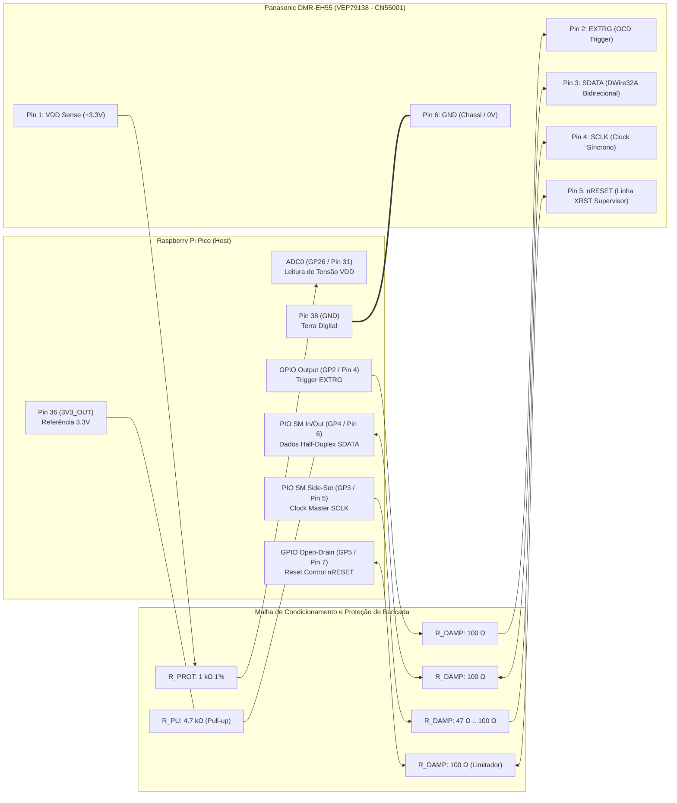

# BLUEPRINT DE ENGENHARIA DE HARDWARE E CIRCUITOS DE BANCADA
## Interface In-Circuit DWire32A (RP2040) & Gravação Externa Spansion S29JL064H (TSOP-48)
### Gravador Digital Panasonic DMR-EH55 — Placa Digital Principal (PCB: VEP79138)

---

## 1. Identificação Geral do Sistema e Escopo de Engenharia

O presente documento constitui o **Blueprint de Engenharia Eletrônica e Hardware de Bancada** para recuperação, diagnóstico em nível de silício, leitura e reprogramação de firmware do gravador de DVD/HDD **Panasonic DMR-EH55** (Chassi DIGA).

```
                      ARQUITETURA DE HARDWARE PANASONIC DMR-EH55
   ┌─────────────────────────────────────────────────────────────────────────────┐
   │                        PLACA DIGITAL PRINCIPAL (VEP79138)                   │
   │                                                                             │
   │   ┌───────────────────────────┐             ┌───────────────────────────┐   │
   │   │   Matsushita / Panasonic  │             │   Spansion S29JL064H      │   │
   │   │        MN2DS0016          │   16-Bit    │      (IC55007)            │   │
   │   │   (UniPhier / AM34 Core)  │◄───────────►│   64 Mbit / 8 MByte NOR   │   │
   │   │  RISC 32-bit @ 108/162MHz │    Bus      │     TSOP-48 Package       │   │
   │   └─────────────┬─────────────┘             └─────────────┬─────────────┘   │
   │                 │                                         │                 │
   │                 │ Matsushita DWire32A                     │ WP#/ACC         │
   │                 │ On-Chip Debug (OCD)                     │ (Pin 14 Unlock) │
   │                 ▼                                         ▼                 │
   │        [ CN55001 Header ]                        [ Pad Quadrado SMD ]       │
   │         6-Pin Debug Port                          Hardware Unlock           │
   └─────────────────┬───────────────────────────────────────────────────────────┘
                     │
                     │ Chicote Blindado / Cabos de Bancada (< 15 cm)
                     ▼
   ┌──────────────────────────────────┐        OU       ┌────────────────────────┐
   │    INTERFACE 1: IN-CIRCUIT       │                 │ INTERFACE 2: EXTERNO   │
   │     Raspberry Pi Pico (RP2040)   │                 │  Gravador Profissional │
   │  DWire32A PIO Engine @ 1.0 MHz   │                 │   SVOD 4 / XGecu T48   │
   │     (Modo Não-Destrutivo)        │                 │ (Soquete ZIF TSOP-48)  │
   └──────────────────────────────────┘                 └────────────────────────┘
```

### Contexto da Falha e Missão de Hardware
* **Falha Crítica:** Travamento em ciclo fechado com display em código de pane `U99` (*Drive Communication / Parameter Timeout*), gerado pela corrupção dos blocos de parâmetros de calibração não-volátil emulados em Flash (`EEMUL` / NVRAM) mapeados no topo da memória NOR (`0x7F0000` a `0x7FFFFF`, micro-setores `SA134` a `SA141`).
* **Objetivos de Engenharia:**
  1. **Interface In-Circuit DWire32A:** Conectar e operar o microcontrolador **Raspberry Pi Pico (RP2040)** diretamente ao conector de teste **`CN55001`** da placa `VEP79138`, implementando o transceptor síncrono half-duplex em PIO, condicionamento de sinais, amortecimento de reflexões e controle de reset seguro por dreno aberto (*Open-Drain*).
  2. **Interface de Gravação Direta TSOP-48:** Prover o mapa elétrico completo pino-a-pino da memória **Spansion `S29JL064H70TFI00` (`IC55007`)**, roteiro de dessoldagem térmica de baixo estresse com liga Sn63/Pb37 e perfil de bancada, inserção no soquete ZIF e parametrização nos gravadores **SVOD 4** e **XGecu T48**.

---

## 2. Esquema Elétrico Detalhado de Bancada: Interface RP2040 $\leftrightarrow$ CN55001

A interconexão física entre o **Raspberry Pi Pico (RP2040)** e o conector **`CN55001`** da placa digital `VEP79138` deve ser rigidamente condicionada. Como a interface DWire32A opera de forma síncrona com reversão rápida de sentido no barramento `SDATA`, qualquer capacitância parasita excessiva ou falta de resistores de terminação em série provocará *ringing*, falsas bordas de clock e disparos espúrios do supervisor de reset da Panasonic.

### 2.1 Esquema Elétrico Completo em Arte ASCII

```text
       RASPBERRY PI PICO (RP2040)                                   PLACA DIGITAL VEP79138
             PLACA DE BANCADA                                         CONECTOR CN55001
    ┌───────────────────────────────┐                             ┌────────────────────────┐
    │                               │                             │                        │
    │  3V3_OUT (Pino 36) ───┐       │                             │                        │
    │                       │       │                             │                        │
    │                     [R_PU]    │                             │                        │
    │                     4.7kΩ     │                             │                        │
    │                       │       │                             │                        │
    │  GP4 (Pino 6) ────────┴───────┼───[ R_DAMP3 ]───────────────┼───► Pino 3: SDATA      │
    │  (PIO SM0 Data I/O)           │     100Ω                    │     (Bidirecional)     │
    │                               │                             │                        │
    │  GP3 (Pino 5) ────────────────┼───[ R_DAMP2 ]───────────────┼───► Pino 4: SCLK       │
    │  (PIO Side-Set Clock Out)     │    47Ω..100Ω                │     (Clock 1.0 MHz)    │
    │                               │                             │                        │
    │  GP2 (Pino 4) ────────────────┼───[ R_DAMP1 ]───────────────┼───► Pino 2: EXTRG      │
    │  (External OCD Trigger)       │     100Ω                    │     (Gatilho / Halt)   │
    │                               │                             │                        │
    │  GP5 (Pino 7) ────────────────┼───[ R_DAMP4 ]───────────────┼───► Pino 5: nRESET     │
    │  (Open-Drain Emulated)        │     100Ω                    │     (Ativo em 0V)      │
    │                               │                             │                        │
    │  GP26 / ADC0 (Pino 31) ───────┼───[ R_PROT1 ]───────────────┼───◄ Pino 1: VDD Sense  │
    │  (Monitor de Tensão 3.3V)     │     1.0kΩ                   │     (+3.3V Target Ref) │
    │                               │                             │                        │
    │  GND (Pino 38) ───────────────┴─────────────────────────────┴──── Pino 6: GND Comum │
    │  (Referência 0V)              ═════════════════════════════      (Chassi Blindagem)  │
    │                               Malha de Terra / Malha Trançada                        │
    └──────────────────────────────────────────────────────────────────────────────────────┘
```

### 2.2 Diagrama Mermaid de Arquitetura e Fluxo de Sinais



### 2.3 Tabela Mestra de Interconexão Pino-a-Pino

| Pino RP2040 | Sinal Pico | GPIO / MUX | Componente de Proteção | Pino CN55001 | Sinal Placa VEP79138 | Tipo Lógico | Nível de Tensão | Descrição Funcional Detalhada |
| :---: | :---: | :---: | :---: | :---: | :---: | :---: | :---: | :--- |
| **Pino 31** | `ADC0` | `GP26` | Resistor $1.0\text{ k}\Omega$ $0.25\text{W}$ $1\%$ | **Pino 1** | `VDD Sense` | Entrada Analógica | $+3.3\text{V DC}$ | Monitora a presença da linha de alimentação principal da placa antes de injetar clocks ou comandos. |
| **Pino 4** | `GP2` | `GPIO2` | Resistor $100\,\Omega$ $0.25\text{W}$ $5\%$ | **Pino 2** | `EXTRG` | Saída Digital | $0\text{V} / 3.3\text{V}$ | *External Trigger*: força o núcleo AM34 a desviar para o manipulador OCD no momento do boot. |
| **Pino 6** | `GP4` | `PIO0_SM0` | Resistor $100\,\Omega$ em série + Pull-up $4.7\text{ k}\Omega$ | **Pino 3** | `SDATA` | I/O Bidirecional | $0\text{V} / 3.3\text{V}$ | Linha de dados *half-duplex*. Injeta comandos de debug e recebe registradores e dumps do SoC. |
| **Pino 5** | `GP3` | `PIO0_SIDE` | Resistor $47\,\Omega$ a $100\,\Omega$ $0.25\text{W}$ | **Pino 4** | `SCLK` | Saída Digital | $0\text{V} / 3.3\text{V}$ | Clock síncrono fornecido pelo master RP2040 ($1.0\text{ MHz}$ contínuo/pulsado em rajadas). |
| **Pino 7** | `GP5` | `GPIO5` | Resistor $100\,\Omega$ $0.25\text{W}$ | **Pino 5** | `nRESET` | Saída Open-Drain | $0\text{V} / \text{Hi-Z}$ | Mantém a CPU em reset ($0\text{V}$) e libera para rodar ($\text{Hi-Z}$). **Jamais injetar 3.3V ativo!** |
| **Pino 38** | `GND` | `GND` | Conexão direta de baixa impedância | **Pino 6** | `GND` | Referência de 0V | $0.0\text{V}$ | Plano de terra comum entre RP2040, placa digital e blindagem metálica do chassi. |

---

## 3. Análise de Integridade de Sinais, Níveis Lógicos e Timing Crítico

### 3.1 Compatibilidade de Níveis Lógicos (3.3V LVTTL / LVCMOS)

O processador Matsushita **MN2DS0016** e o microcontrolador Raspberry Pi **RP2040** compartilham compatibilidade nativa no domínio de I/O de $3.3\text{V}$:

| Parâmetro Elétrico | Especificação MN2DS0016 (Target) | Especificação RP2040 (Host) | Margem de Ruído Garantida ($V_{noise}$) |
| :--- | :---: | :---: | :---: |
| Tensão Máxima de Entrada Alta ($V_{IH\_min}$) | $2.00\text{ V}$ | $2.00\text{ V}$ | $+0.40\text{ V}$ ($V_{OH} \approx 3.0\text{V}$) |
| Tensão Máxima de Entrada Baixa ($V_{IL\_max}$) | $0.80\text{ V}$ | $0.80\text{ V}$ | $+0.40\text{ V}$ ($V_{OL} \approx 0.2\text{V}$) |
| Tensão Mínima de Saída Alta ($V_{OH\_min}$) | $2.40\text{ V}$ ($I_{OH} = -4\text{ mA}$) | $2.62\text{ V}$ ($I_{OH} = -5\text{ mA}$) | Seguro (dentro dos limites LVTTL) |
| Tensão Máxima de Saída Baixa ($V_{OL\_max}$) | $0.40\text{ V}$ ($I_{OL} = +4\text{ mA}$) | $0.40\text{ V}$ ($I_{OL} = +5\text{ mA}$) | Seguro (dentro dos limites LVTTL) |
| Tensão Máxima Absoluta no Pino ($V_{max}$) | $3.60\text{ V}$ | $3.63\text{ V}$ | Sem risco de quebra de dielétrico |

### 3.2 Mitigação de Ringing Capacitivo e Reflexões em Cabos de Bancada

Em ambientes de bancada, a fiação de teste (jumpers de $10\text{ a }20\text{ cm}$) introduz indutância distribuída considerável ($L_{wire} \approx 1\text{ nH/mm} \rightarrow 100\text{--}200\text{ nH}$) e acoplamento capacitivo mútuo com o terra ($C_{load} \approx 15\text{--}30\text{ pF}$ somado à capacitância interna das portas CMOS dos CIs).

$$f_{ring} = \frac{1}{2\pi \sqrt{L \cdot C}} \approx \frac{1}{2\pi \sqrt{150\text{ nH} \cdot 25\text{ pF}}} \approx 82\text{ MHz}$$

Sem amortecimento, as transições ultra-rápidas dos buffers de saída do RP2040 (tempo de subida $t_r < 2\text{ ns}$) excitam essa frequência de ressonância natural, gerando sobreelevações (*overshoots*) que ultrapassam $4.2\text{V}$ e subelevações (*undershoots*) abaixo de $-0.8\text{V}$. Tais picos acionam os diodos de proteção ESD internos do MN2DS0016, podendo causar *latch-up* ou queima do pino de debug.

#### Função Específica dos Componentes Passivos de Bancada:
1. **Resistores de Amortecimento em Série ($R_{DAMP} = 47\,\Omega \text{ a } 100\,\Omega$):**
   * Posicionados o mais próximo possível dos pinos do RP2040.
   * Somados à resistência interna dos MOSFETs do RP2040 ($R_{ON} \approx 25\text{--}35\,\Omega$), resultam em uma impedância total de fonte ($Z_S \approx 75\text{--}130\,\Omega$), casando-se com a impedância característica do cabo e amortecendo criticamente o circuito ($Q < 0.5$).
2. **Pull-Up em `SDATA` ($R_{PU} = 4.7\text{ k}\Omega$):**
   * Garante nível lógico alto determinístico durante os intervalos de alta impedância (*Hi-Z*) na comutação entre transmissão e recepção, evitando estados flutuantes que seriam interpretados pela CPU como bits falsos `0`.
3. **Resistor de Proteção de Reset ($100\,\Omega$):**
   * Limita a corrente máxima a $33\text{ mA}$ ($3.3\text{V} / 100\,\Omega$) mesmo no caso hipotético de erro de software em que o pino `GP5` seja incorretamente acionado em nível alto push-pull enquanto o circuito supervisor de reset original da Panasonic (`XRST`) estiver aterrado.

### 3.3 Diagrama Temporal da Máquina de Estados PIO (1 MHz DWire32A)

A máquina de estados PIO do RP2040 opera a um clock interno de **$4.0\text{ MHz}$**, dividindo cada ciclo de bit da linha DWire32A de **$1.0\text{ MHz}$** em exatamente quatro fatias temporais de **$250\text{ ns}$**:

```text
                  CICLO DE TRANSMISSÃO HOST -> TARGET (WRITE)
         |<----------------------- 1000 ns (1.0 MHz) ----------------------->|
         |   Fat 1 (250ns)   |   Fat 2 (250ns)   |   Fat 3 (250ns)   |   Fat 4 (250ns)   |
SCLK     ────────────────────┐                   ┌───────────────────────────────────────
 (GP3)                       │                   │
                             └───────────────────┘
         |<- t_setup=250ns ->|                   |<-  t_hold=500ns ->|
SDATA    ════════════════════╤═══════════════════════════════════════╤═══════════════════
 (GP4)                       │         DADO VÁLIDO ESTÁVEL           │
         ────────────────────┴───────────────────────────────────────┴───────────────────
                             ▲                   ▲
                             │                   CPU Target amostra
                             Host coloca dado    na borda de subida

-----------------------------------------------------------------------------------------

                  CICLO DE RECEPÇÃO TARGET -> HOST (READ)
         |<----------------------- 1000 ns (1.0 MHz) ----------------------->|
         |   Fat 1 (250ns)   |   Fat 2 (250ns)   |   Fat 3 (250ns)   |   Fat 4 (250ns)   |
SCLK     ────────────────────┐                   ┌───────────────────────────────────────
 (GP3)                       │                   │
                             └───────────────────┘
                                                 ▲                   ▲
                                                 │                   RP2040 amostra
                                                 CPU Target coloca   na borda de descida
SDATA    ════════════════════════════════════════╤═══════════════════╤═══════════════════
 (GP4)   (High-Z / Pull-up mantem nivel)         │ DADO DO PROCESSADOR│
         ────────────────────────────────────────┴───────────────────┴───────────────────

-----------------------------------------------------------------------------------------

              INTERVALO DE TURNAROUND HALF-DUPLEX (TX -> RX)
                    [ Fim de Comando Host ]        [ Resposta Target ]
SDATA Dir:  SAÍDA ATIVA (Pico) ──► ALTA IMPEDÂNCIA (Hi-Z) ──► SAÍDA ATIVA (CPU AM34)
Linha SDATA:                    |<- Turnaround: 2 clocks ->|
                                |       (2.0 µs)           |
```

* **Setup Time ($t_{su}$):** Mínimo de $250\text{ ns}$ antes da borda de subida do `SCLK`.
* **Hold Time ($t_h$):** Mínimo de $500\text{ ns}$ após a borda de subida do `SCLK`.
* **Turnaround Time ($t_{turnaround}$):** Duas transições completas de clock ($2.0\text{ }\mu\text{s}$) garantidas por software antes que o host leia a FIFO, permitindo que os drivers de silício do MN2DS0016 comutem com segurança sem colisão de corrente.

---

## 4. Memória Flash Spansion S29JL064H70TFI00 (IC55007): Pinout e Gravação em Bancada

A memória Flash principal de boot e sistema é o circuito integrado **`IC55007`**, modelo **Spansion `S29JL064H70TFI00`**, montada na face superior da placa digital `VEP79138`.

### 4.1 Características Técnicas do Chip
* **Densidade:** 64 Megabits ($8\text{ Megabytes} = 8.388.608\text{ bytes}$).
* **Arquitetura de Barramento:** Configurável em 8 bits (Byte Mode: $8\text{M} \times 8$) ou 16 bits (Word Mode: $4\text{M} \times 16$). Na placa Panasonic, opera permanentemente em **Word Mode de 16 bits** (`BYTE# = 3.3V`).
* **Tempo de Acesso ($t_{AA}$):** $70\text{ ns}$.
* **Faixa de Tensão ($V_{CC}$):** $2.7\text{ V}$ a $3.6\text{ V}$ (Nominal: $3.3\text{ V}$).
* **Encapsulamento:** **TSOP-48 Tipo I** ($12\text{ mm} \times 20\text{ mm}$, passo entre pinos de $0.5\text{ mm}$).
* **Topologia de Setores (Modelo 00 - Top Boot):**
  * 126 setores principais homogêneos de $64\text{ KBytes}$.
  * 8 micro-setores homogêneos de $8\text{ KBytes}$ no topo do mapa de memória (`SA134` a `SA141`, faixa física `0x7F0000` a `0x7FFFFF`), exatamente onde reside a partição de calibração dinâmica `EEMUL`.

### 4.2 Diagrama de Pinos do Encapsulamento TSOP-48 (Top View)

```text
                                SPANSION S29JL064H70TFI00
                               ENCAPSULAMENTO TSOP-48 (TIPO I)
                                    (Visto de Cima / Top View)
                                      ┌───────────┐
                       [Endereço] A15 │ 1  o   48 │ A16       [Endereço]
                       [Endereço] A14 │ 2      47 │ BYTE#     [Controle Word/Byte]
                       [Endereço] A13 │ 3      46 │ VSS (GND) [Alimentação Terra]
                       [Endereço] A12 │ 4      45 │ DQ15/A-1  [Dado D15 / End. Byte]
                       [Endereço] A11 │ 5      44 │ DQ7       [Dado D7]
                       [Endereço] A10 │ 6      43 │ DQ14      [Dado D14]
                       [Endereço]  A9 │ 7      42 │ DQ6       [Dado D6 / Toggle]
                       [Endereço]  A8 │ 8      41 │ DQ13      [Dado D13]
                       [Endereço] A19 │ 9      40 │ DQ5       [Dado D5 / Flag Erro]
                       [Endereço] A20 │ 10     39 │ DQ12      [Dado D12]
                     [Controle]   WE# │ 11     38 │ DQ4       [Dado D4]
                     [Controle] RESET#│ 12     37 │ VCC       [Alimentação +3.3V]
                       [Endereço] A21 │ 13     36 │ DQ11      [Dado D11]
           [Hardware Lock]   WP#/ACC  │ 14     35 │ DQ3       [Dado D3]
             [Status Flag]     RY/BY# │ 15     34 │ DQ10      [Dado D10]
                       [Endereço] A18 │ 16     33 │ DQ2       [Dado D2 / Toggle 2]
                       [Endereço] A17 │ 17     32 │ DQ9       [Dado D9]
                       [Endereço]  A7 │ 18     31 │ DQ1       [Dado D1]
                       [Endereço]  A6 │ 19     30 │ DQ8       [Dado D8]
                       [Endereço]  A5 │ 20     29 │ DQ0       [Dado D0]
                       [Endereço]  A4 │ 21     28 │ OE#       [Controle Output Enable]
                       [Endereço]  A3 │ 22     27 │ VSS (GND) [Alimentação Terra]
                       [Endereço]  A2 │ 23     26 │ CE#       [Controle Chip Enable]
                       [Endereço]  A1 │ 24     25 │ A0        [Endereço]
                                      └───────────┘
```

### 4.3 Tabela Detalhada de Mapeamento de Pinos TSOP-48

| Pino | Nome | Grupo | Tipo | Nível Ativo | Descrição Elétrica e Funcional |
| :---: | :---: | :---: | :---: | :---: | :--- |
| **1** | `A15` | Endereço | Entrada | CMOS | Linha de endereço de palavra 15 |
| **2** | `A14` | Endereço | Entrada | CMOS | Linha de endereço de palavra 14 |
| **3** | `A13` | Endereço | Entrada | CMOS | Linha de endereço de palavra 13 |
| **4** | `A12` | Endereço | Entrada | CMOS | Linha de endereço de palavra 12 |
| **5** | `A11` | Endereço | Entrada | CMOS | Linha de endereço de palavra 11 |
| **6** | `A10` | Endereço | Entrada | CMOS | Linha de endereço de palavra 10 |
| **7** | `A9` | Endereço | Entrada | CMOS | Linha de endereço de palavra 9 |
| **8** | `A8` | Endereço | Entrada | CMOS | Linha de endereço de palavra 8 |
| **9** | `A19` | Endereço | Entrada | CMOS | Seleção de banco de alta ordem |
| **10** | `A20` | Endereço | Entrada | CMOS | Seleção de banco de alta ordem |
| **11** | `WE#` | Controle | Entrada | Baixo ($0\text{V}$) | *Write Enable*: trava escritas e comandos JEDEC no chip |
| **12** | `RESET#` | Controle | Entrada | Baixo ($0\text{V}$) | Reset por hardware da máquina interna da Flash |
| **13** | `A21` | Endereço | Entrada | CMOS | Bit mais significativo de endereço (espaço de 8MB) |
| **14** | `WP#/ACC` | Proteção | Entrada | Especial | Proteção contra gravação por hardware dos setores de boot |
| **15** | `RY/BY#` | Status | Saída | Open-Drain | Nível baixo indica ciclo de erase/programação em andamento |
| **16** | `A18` | Endereço | Entrada | CMOS | Linha de endereço de palavra 18 |
| **17** | `A17` | Endereço | Entrada | CMOS | Linha de endereço de palavra 17 |
| **18** | `A7` | Endereço | Entrada | CMOS | Linha de endereço de palavra 7 |
| **19** | `A6` | Endereço | Entrada | CMOS | Linha de endereço de palavra 6 |
| **20** | `A5` | Endereço | Entrada | CMOS | Linha de endereço de palavra 5 |
| **21** | `A4` | Endereço | Entrada | CMOS | Linha de endereço de palavra 4 |
| **22** | `A3` | Endereço | Entrada | CMOS | Linha de endereço de palavra 3 |
| **23** | `A2` | Endereço | Entrada | CMOS | Linha de endereço de palavra 2 |
| **24** | `A1` | Endereço | Entrada | CMOS | Linha de endereço de palavra 1 |
| **25** | `A0` | Endereço | Entrada | CMOS | Bit menos significativo no modo 16 bits |
| **26** | `CE#` | Controle | Entrada | Baixo ($0\text{V}$) | *Chip Enable*: habilita o chip para leitura/escrita |
| **27** | `VSS` | Alimentação| Ground | $0.0\text{V}$ | Terra do circuito integrado |
| **28** | `OE#` | Controle | Entrada | Baixo ($0\text{V}$) | *Output Enable*: ativa buffers de saída tri-state para leitura |
| **29** | `DQ0` | Dados | I/O | CMOS | Linha de dados bit 0 (LSB) |
| **30** | `DQ8` | Dados | I/O | CMOS | Linha de dados bit 8 |
| **31** | `DQ1` | Dados | I/O | CMOS | Linha de dados bit 1 |
| **32** | `DQ9` | Dados | I/O | CMOS | Linha de dados bit 9 |
| **33** | `DQ2` | Dados | I/O | CMOS | Linha de dados bit 2 (Toggle bit 2) |
| **34** | `DQ10` | Dados | I/O | CMOS | Linha de dados bit 10 |
| **35** | `DQ3` | Dados | I/O | CMOS | Linha de dados bit 3 |
| **36** | `DQ11` | Dados | I/O | CMOS | Linha de dados bit 11 |
| **37** | `VCC` | Alimentação| Power | $+3.3\text{V}$ | Alimentação principal positiva do chip |
| **38** | `DQ4` | Dados | I/O | CMOS | Linha de dados bit 4 |
| **39** | `DQ12` | Dados | I/O | CMOS | Linha de dados bit 12 |
| **40** | `DQ5` | Dados | I/O | CMOS | Linha de dados bit 5 (Flag de erro interno de Erase/Program) |
| **41** | `DQ13` | Dados | I/O | CMOS | Linha de dados bit 13 |
| **42** | `DQ6` | Dados | I/O | CMOS | Linha de dados bit 6 (Toggle bit de progresso) |
| **43** | `DQ14` | Dados | I/O | CMOS | Linha de dados bit 14 |
| **44** | `DQ7` | Dados | I/O | CMOS | Linha de dados bit 7 (*Data# Polling* de conclusão) |
| **45** | `DQ15/A-1`| MUX | I/O | CMOS | Bit MSB em 16-bit ou endereço A-1 em 8-bit |
| **46** | `VSS` | Alimentação| Ground | $0.0\text{V}$ | Terra de referência do circuito integrado |
| **47** | `BYTE#` | Controle | Entrada | Alto ($3.3\text{V}$) | Alto = Modo Word (16 bits), Baixo = Modo Byte (8 bits) |
| **48** | `A16` | Endereço | Entrada | CMOS | Linha de endereço de palavra 16 |

### 4.4 Configuração em Gravadores Universais de Bancada (SVOD 4 / XGecu T48)

Ao utilizar os gravadores de bancada **SVOD 4** ou **XGecu T48** com adaptador universal **TSOP-48 ZIF**:

```
                         MONTAGEM NO GRAVADOR DE BANCADA
       ┌──────────────────────────────────────────────────────────────┐
       │   GRAVADOR SVOD 4 / XGECU T48 (USB 3.0 / USB 2.0 Host)       │
       │   Soquete ZIF Principal (DIP-48 / Pin Header 48 Pinos)       │
       └──────────────────────────────┬───────────────────────────────┘
                                      │ Encaixe Direto
       ┌──────────────────────────────▼───────────────────────────────┐
       │   PLACA ADAPTADORA TSOP-48 PARA GRAVADOR (ADP_F48_EX-1)      │
       │   - Capacitores de Desacoplamento 100nF + 10µF em VCC        │
       │   - Configuração de VCC: 3.3V Estabilizado                   │
       └──────────────────────────────┬───────────────────────────────┘
                                      │ Soquete Clamshell
       ┌──────────────────────────────▼───────────────────────────────┐
       │   SOQUETE CLAMSHELL ZIF TSOP-48 (Passo 0.5mm, 12x20mm)       │
       │   [ IC55007: Spansion S29JL064H70TFI00 Alinhada ]           │
       │   (Pino 1 voltado para o ponto de referência do adaptador)   │
       └──────────────────────────────────────────────────────────────┘
```

#### Parâmetros de Configuração de Software:
1. **Seleção do Dispositivo:**
   * No **XGecu T48 (Software Xgpro):** Selecionar `SPANSION S29JL064H [TSOP48]`.
   * No **SVOD 4:** Selecionar `Spansion -> S29JL064H` (Verificar se o algoritmo está em *16-bit mode*).
2. **Checagem de ID JEDEC (*Device ID Check*):**
   * Pressionar `Read ID` / `Check ID`. O gravador deve retornar obrigatoriamente:
     * **Manufacturer Code (Hex):** `0x0001` (Spansion / AMD).
     * **Device Identifier (Hex):** `0x227E` (Família S29JL064H) seguido de sub-códigos de modelo top-boot `0x2200` e `0x2201`.
   * Se o software retornar `0x0000`, `0xFFFF` ou valores aleatórios: **Não prossiga com gravação!** Há pinos com contato deficiente ou oxidação no soquete ZIF.
3. **Fluxo de Leitura, Patch e Gravação:**
   * **Passo 1 (Leitura Segura):** Ler o chip duas vezes consecutivas, salvando `DMR_EH55_DUMP_1.bin` e `DMR_EH55_DUMP_2.bin`.
   * **Passo 2 (Verificação Criptográfica):** Comparar os hashes SHA-256 de ambos os arquivos no terminal (`Get-FileHash`). Devem ser idênticos.
   * **Passo 3 (Limpeza da NVRAM Corrompida):** Executar o script oficial do projeto:
     ```bash
     python scripts/clean_spansion_nvram.py DMR_EH55_DUMP_1.bin DMR_EH55_PATCHED_CLEAN.bin
     ```
   * **Passo 4 (Gravação e Verificação):** Carregar `DMR_EH55_PATCHED_CLEAN.bin` no software do gravador, desmarcar a opção de apagar o chip inteiro se desejar apenas sobrescrever, ou executar *Erase Full + Blank Check + Program + Verify*.

---

## 5. Procedimento Operacional Padrão (POP): Dessoldagem e Ressoldagem Segura SMD

O chip `IC55007` possui 48 terminais com espaçamento fino (*pitch* de $0.5\text{ mm}$). O manuseio inadequado com soprador de ar quente pode causar arrancamento de ilhas (*pads*), empenamento do laminado multicamada da PCB `VEP79138` ou delaminação térmica do encapsulamento plástico.

### 5.1 Perfil Térmico Recomendado de Dessoldagem

```text
    Temperatura (°C)
      250 ┼─────────────────────────────────┐ (Pico: 235°C - 245°C / Max 25 seg)
          │                                 │
      200 ┼───────────────────────────/     \───────── Alívio e Remoção
          │                          /                 com Pinça ESD
      150 ┼─────────────/───────────/                  (Sem tração mecânica)
          │            / Pré-aquecimento
      100 ┼───────────/  Uniforme (120-150°C / 45 seg)
          │          /
       25 ┼─────────/
          └─────────┴───────────────┴───────┴─────────► Tempo (segundos)
          0        30              75      100
```

### 5.2 Roteiro Operacional Passo a Passo

#### Fase A: Preparação e Mascaramento Térmico
1. **Descarga Eletrostática (ESD):** O operador deve estar conectado à manta antiestática com pulseira aterrada ($1\text{ M}\Omega$).
2. **Isolamento de Componentes Críticos:**
   * Cobrir os capacitores eletrolíticos SMD próximos, o conector flat da mecânica do DVD e os pequenos resistores de precisão $0402$ ao redor da Flash com **duas camadas de Fita Kapton de poliimida**.
   * Aplicar fita adesiva de folha de alumínio sobre a fita Kapton para defletir o calor radiante do bocal de ar quente.

#### Fase B: Alívio Térmico com Liga Sn63/Pb37
1. A solda original de fábrica da Panasonic DMR-EH55 (ano de fabricação 2006) é livre de chumbo (*Lead-Free* / SAC305), cujo ponto de fusão gira em torno de $217\text{--}220^\circ\text{C}$.
2. Com o ferro de solda ajustado a $320^\circ\text{C}$, ponta chanfrada e fluxo **Amtech RMA-223-TPF / NC-559-V2**, aplique uma pequena quantidade de solda **Sn63/Pb37** em todas as 48 pernas do CI.
3. A mistura da liga eutética com chumbo reduz o ponto de fusão efetivo para cerca de **$183^\circ\text{C}$**, permitindo a retirada do chip sob menor estresse térmico da placa.

#### Fase C: Aplicação de Ar Quente e Remoção
1. **Configuração da Estação de Ar Quente:**
   * Temperatura: **$240^\circ\text{C}$** (se foi adicionada solda Sn63Pb37) ou **$280^\circ\text{C}$** (se mantida a liga original sem chumbo, medido no bocal a $2\text{ cm}$).
   * Vazão de ar (*Air Flow*): **Média-Baixa** ($30\text{--}40\text{ l/min}$) para evitar o deslocamento acidental de componentes $0402$/$0603$ vizinhos.
2. **Movimentação do Bocal:**
   * Mantenha o bocal circular de $8\text{--}10\text{ mm}$ em movimento elíptico contínuo sobre as duas fileiras de terminais, a uma distância de $1.5\text{ cm}$ da placa.
   * **Nunca concentre o jato em um único ponto ou diretamente no centro do silício.**
3. **Extração com Pinça ESD:**
   * Com a pinça curva ESD-15, toque suavemente a lateral do encapsulamento.
   * **Regra de Ouro:** Só levante o componente quando a solda de todos os 48 terminais estiver visivelmente em estado líquido brilhante. **Zero força mecânica vertical.** O chip deve "flutuar" para sair.

#### Fase D: Preparação dos Pads na PCB
1. Aplique fluxo líquido/gel nos pads da PCB.
2. Com a malha dessoldadora de cobre de boa absorção ($1.5\text{ mm}$) e ferro a $320^\circ\text{C}$, passe a malha suavemente sem pressionar contra o laminado para remover o excesso de estanho e nivelar os pads.
3. Limpe a região com cotonete e **Álcool Isopropílico 99.8%**. Inspecione sob microscópio estéreo ou lupa de bancada para assegurar que nenhum pad foi arrancado ou sofreu curto.

#### Fase E: Ressoldagem após Reprogramação
1. Alinhe o chip perfeitamente com os pads, conferindo a orientação do **Pino 1** (ponto chanfrado no chip alinhado com a marcação em serigrafia na placa).
2. Solde inicialmente dois pinos diagonais opostos (ex: Pino 1 e Pino 25) para travar o alinhamento mecânico.
3. Aplique fluxo NC-559 generosamente em ambas as fileiras de pinos.
4. Execute a técnica de **soldagem por arraste (*drag soldering*)** com ponta faca (K) ou concha: deslize suavemente a ponta aquecida ao longo dos terminais com um filete mínimo de solda, aproveitando a tensão superficial.
5. Inspecione visualmente a $360^\circ$ com microscópio:
   * Ausência de pontes de solda (*solder bridges*) entre pinos adjacentes.
   * Molhabilidade perfeita da solda (*fillet*) na junção entre o pino do chip e a ilha de cobre.
6. Limpeza final completa com Álcool Isopropílico para retirar todo resíduo de fluxo condutivo.

---

## 6. Lista Completa de Componentes de Bancada (Bill of Materials - BOM)

| Item | Qtd | Designador / Referência | Especificação Técnica / Fabricante | Tolerância / Tensão | Função Específica no Projeto de Bancada |
| :---: | :---: | :--- | :--- | :---: | :--- |
| **1** | 1 | `U_HOST` | Raspberry Pi Pico (RP2040 Dual ARM Cortex-M0+ @ 133MHz) | Standard | Host controlador do barramento DWire32A via PIO |
| **2** | 3 | `R_DAMP1, R_DAMP3, R_DAMP4` | Resistor de Filme de Metal $100\,\Omega$ $0.25\text{W}$ Through-Hole ou SMD 0805 | $\pm 1\%$ ou $\pm 5\%$ | Amortecimento de reflexões em `EXTRG`, `SDATA` e `nRESET` |
| **3** | 1 | `R_DAMP2` | Resistor de Filme de Metal $47\,\Omega \text{ a } 68\,\Omega$ $0.25\text{W}$ | $\pm 1\%$ | Amortecimento crítico da linha de clock `SCLK` (1.0 MHz) |
| **4** | 1 | `R_PU` | Resistor de Filme de Metal $4.7\text{ k}\Omega$ $0.25\text{W}$ | $\pm 1\%$ | Pull-up da linha bidirecional `SDATA` para 3.3V do Pico |
| **5** | 1 | `R_PROT1` | Resistor de Filme de Metal $1.0\text{ k}\Omega$ $0.25\text{W}$ | $\pm 1\%$ | Proteção e limitação de corrente para ADC0 / VDD Sense |
| **6** | 1 | `C_DECOUPL` | Capacitor Cerâmico Multicamada (MLCC) $100\text{ nF}$ X7R | $50\text{V} \pm 10\%$ | Desacoplamento local entre 3V3_OUT e GND do Pico |
| **7** | 1 | `J_HARNESS` | Chicote de 6 condutores flexíveis 28 AWG blindados (< 15 cm) | Standard | Ligação mecânica entre Pico e conector CN55001 |
| **8** | 1 | `CN_MALE` | Conector Barra de Pinos 2.54mm macho / micro-jumper | Dourado / Baixa R | Conexão firme nas ilhas de teste do conector CN55001 |
| **9** | 1 | `PROG_TSOP` | Gravador Universal SVOD 4 ou XGecu T48 (Original) | USB 2.0/3.0 | Programação externa de alta velocidade da Flash TSOP-48 |
| **10** | 1 | `ADP_TSOP48`| Adaptador ZIF TSOP-48 para DIP-48 (Soquete Clamshell) | Passo $0.5\text{ mm}$ | Acomodação mecânica da Spansion S29JL064H sem solda |
| **11** | 1 | `SOLDER_L` | Solda em Fio Sn63/Pb37 0.5mm com fluxo ativado | Ponto $183^\circ\text{C}$ | Alívio térmico para dessoldagem e ressoldagem segura |
| **12** | 1 | `FLUX_GEL` | Fluxo de Solda No-Clean Amtech NC-559-V2 ou RMA-223 | Seringa / Gel | Proteção antioxidante e condução térmica na refusão |
| **13** | 1 | `KAPTON_T` | Fita Adesiva de Poliimida Kapton $15\text{ mm}$ | Térmica $300^\circ\text{C}$| Blindagem térmica de conectores e componentes adjacentes |
| **14** | 1 | `DESOLD_W` | Malha Dessoldadora de Cobre Tratado Goot Wick $1.5\text{ mm}$ | Baixo resíduo | Limpeza e nivelamento dos pads TSOP-48 na placa |
| **15** | 1 | `CLEAN_IPA` | Álcool Isopropílico $99.8\%$ Puro | Grau Eletrônico | Limpeza química de resíduos de fluxo pós-solda |

---

## 7. Protocolo de Segurança Operacional e Validação Pré-Energização

Antes de ligar o aparelho à rede elétrica ou plugar o cabo USB do RP2040 ao computador, o operador de bancada deve cumprir rigorosamente o seguinte roteiro de testes:

```text
               FLUXOGRAMA DE VERIFICAÇÃO DE SEGURANÇA EM BANCADA
    ┌────────────────────────────────────────────────────────────────────────┐
    │ 1. TESTE DE CURTO A FRIO (Aparelho Desligado da Tomada)               │
    │    Multímetro na escala de Resistência / Continuidade:                 │
    │    - Medir entre CN55001 Pino 6 (GND) e Chassi Metálico: Deve dar 0.0Ω │
    │    - Medir entre CN55001 Pino 1 (VDD) e Pino 6 (GND): Deve dar > 500Ω  │
    └───────────────────────────────────┬────────────────────────────────────┘
                                        │ PASSOU (Sem curto VDD-GND)
                                        ▼
    ┌────────────────────────────────────────────────────────────────────────┐
    │ 2. TESTE DE TENSÃO EM STANDBY (Aparelho Conectado na Tomada)           │
    │    Multímetro na escala DC 20V:                                        │
    │    - Medir tensão no Pino 1 do CN55001: Deve indicar +3.3V ± 0.15V     │
    │    - Confirmar que a leitura no GP26 do Pico acusa ~3.3V               │
    └───────────────────────────────────┬────────────────────────────────────┘
                                        │ TENSÃO NOMINAL CONFIRMADA
                                        ▼
    ┌────────────────────────────────────────────────────────────────────────┐
    │ 3. TESTE DE COLD BREAK-IN OCD (Pico USB Conectado ao PC)               │
    │    - Pico assume controle de nRESET (0V) antes de energizar a fonte    │
    │    - Disparo de 32 clocks síncronos em SCLK para acordar o bloco OCD   │
    │    - Liberação de nRESET em modo Hi-Z com EXTRG em nível ativo         │
    │    - CPU AM34 entra em HALT: Display NÃO avança para código U99        │
    └────────────────────────────────────────────────────────────────────────┘
```

> [!CRITICAL]
> **Aviso de Sobrevivência de Hardware:**
> O pino 5 do conector `CN55001` está conectado diretamente à linha mestre de reset do sistema (`XRST`), compartilhada com o circuito integrado de monitoramento e supervisão de voltagem da Panasonic. **Sob nenhuma hipótese configure o pino GP5 do RP2040 em modo Push-Pull dirigindo nível alto ($3.3\text{V}$).**
> A condução de nível alto contra o supervisor em estado baixo queimará a porta do microcontrolador ou danificará a linha de reset do SoC Matsushita MN2DS0016. Use **sempre e exclusivamente** a técnica de emulação de dreno aberto (*Open-Drain*), alternando entre `GPIO_OUT com nível 0` (reset forçado) e `GPIO_IN em Hi-Z` (reset liberado para flutuar via resistor de pull-up nativo da placa).
