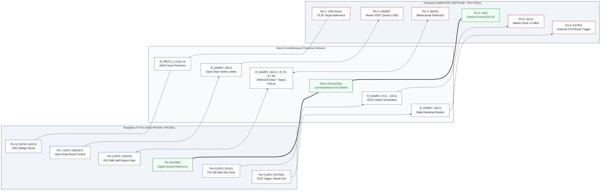
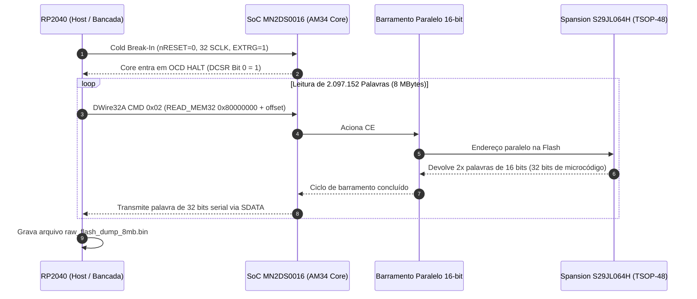

# BLUEPRINT DE ENGENHARIA DE HARDWARE E CIRCUITOS DE BANCADA
## Interface In-Circuit DWire32A (RP2040) & Gravação Externa Spansion S29JL064H (TSOP-48)
### Gravador Digital Panasonic DMR-EH55 — Placa Digital Principal (PCB: VEP79138)

---

## 1. Identificação Geral do Sistema e Escopo de Engenharia

O presente documento constitui o **Blueprint de Engenharia Eletrônica e Hardware de Bancada** para recuperação, diagnóstico em nível de silício, leitura e reprogramação de firmware do gravador de DVD/HDD **Panasonic DMR-EH55** (Chassi DIGA).

```
                      ARQUITETURA DE HARDWARE PANASONIC DMR-EH55
   ┌─────────────────────────────────────────────────────────────────────────────┐
   │                        PLACA DIGITAL PRINCIPAL (VEP79138)                   │
   │                                                                             │
   │   ┌───────────────────────────┐             ┌───────────────────────────┐   │
   │   │   Matsushita / Panasonic  │             │   Spansion S29JL064H      │   │
   │   │        MN2DS0016          │   16-Bit    │      (IC55007)            │   │
   │   │   (UniPhier / AM34 Core)  │◄───────────►│   64 Mbit / 8 MByte NOR   │   │
   │   │  RISC 32-bit @ 108/162MHz │    Bus      │     TSOP-48 Package       │   │
   │   └─────────────┬─────────────┘             └─────────────┬─────────────┘   │
   │                 │                                         │                 │
   │                 │ Matsushita DWire32A                     │ WP#/ACC         │
   │                 │ On-Chip Debug (OCD)                     │ (Pin 14 Unlock) │
   │                 ▼                                         ▼                 │
   │        [ CN55001 Header ]                        [ Pad Quadrado SMD ]       │
   │         6-Pin Debug Port                          Hardware Unlock           │
   └─────────────────┬───────────────────────────────────────────────────────────┘
                     │
                     │ Chicote Blindado / Cabos de Bancada (< 15 cm)
                     ▼
   ┌──────────────────────────────────┐        OU       ┌────────────────────────┐
   │    INTERFACE 1: IN-CIRCUIT       │                 │ INTERFACE 2: EXTERNO   │
   │     Raspberry Pi Pico (RP2040)   │                 │  Gravador Profissional │
   │  DWire32A PIO Engine @ 1.0 MHz   │                 │   SVOD 4 / XGecu T48   │
   │     (Modo Não-Destrutivo)        │                 │ (Soquete ZIF TSOP-48)  │
   └──────────────────────────────────┘                 └────────────────────────┘
```

### Contexto da Falha e Missão de Hardware
* **Falha Crítica:** Travamento em ciclo fechado com display em código de pane `U99` (*Drive Communication / Parameter Timeout*), gerado pela corrupção dos blocos de parâmetros de calibração não-volátil emulados em Flash (`EEMUL` / NVRAM) mapeados no topo da memória NOR (`0x7F0000` a `0x7FFFFF`, micro-setores `SA134` a `SA141`).
* **Objetivos de Engenharia:**
  1. **Interface In-Circuit DWire32A:** Conectar e operar o microcontrolador **Raspberry Pi Pico (RP2040)** diretamente ao conector de teste **`CN55001`** da placa `VEP79138`, implementando o transceptor síncrono half-duplex em PIO, condicionamento de sinais, amortecimento de reflexões e controle de reset seguro por dreno aberto (*Open-Drain*).
  2. **Interface de Gravação Direta TSOP-48:** Prover o mapa elétrico completo pino-a-pino da memória **Spansion `S29JL064H70TFI00` (`IC55007`)**, roteiro de dessoldagem térmica de baixo estresse com liga Sn63/Pb37 e perfil de bancada, inserção no soquete ZIF e parametrização nos gravadores **SVOD 4** e **XGecu T48**.

---

## 2. Esquema Elétrico Detalhado de Bancada: Interface RP2040 $\leftrightarrow$ CN55001

A interconexão física entre o **Raspberry Pi Pico (RP2040)** e o conector **`CN55001`** da placa digital `VEP79138` deve ser rigidamente condicionada. Como a interface DWire32A opera de forma síncrona com reversão rápida de sentido no barramento `SDATA`, qualquer capacitância parasita excessiva ou falta de resistores de terminação em série provocará *ringing*, falsas bordas de clock e disparos espúrios do supervisor de reset da Panasonic.

### 2.0 Padrão Mecânico do Conector (JST ZR 1.5mm - B6B-ZR-3R4) & Compatibilidade RP2040 / RP2350

* **Padrão Físico do Conector CN55001 / P7501:** Conector **JST ZR de 6 pinos com passo (pitch) de 1.5mm**, modelo original Panasonic **`B6B-ZR-3R4`** (Through-hole top entry, legenda *"TO WRITE JIGU"* no esquemático oficial da Panasonic DMR-EH55).
* **Como Comprar o Chicote Pronto:** Procurar comercialmente por **Cabo JST ZR / ZH 1.5mm 6 pinos Fêmea para Dupont 2.54mm** (alojamento `ZHR-6` com terminais `SZH-002T-P0.5`). Isso viabiliza conexão direta aos pinos do Raspberry Pi Pico (RP2040 ou RP2350) sem qualquer necessidade de solda na placa digital do gravador caso o conector esteja populado, ou via micro-fios Kynar AWG 30 / sonda Pogo-Pin de 1.5mm caso não esteja populado.
* **Atenção aos Padrões Incompatíveis:** Não confundir com **JST SH (1.0 mm - passo menor)**, **JST PH (2.0 mm)** ou **JST XH (2.54 mm - muito grande)**.
* **Compatibilidade Pico 1 (RP2040) e Pico 2 (RP2350):** Ambas as placas são 100% suportadas nativamente pela suíte Panadiga. O RP2350 traz a vantagem adicional de 520 KB de SRAM (o dobro do RP2040), permitindo manter em cache local setores inteiros de 64 KB da Spansion S29JL064H (EEMUL) diretamente na memória do microcontrolador.
* **Alerta Crítico de Barramento (DWire32A vs JTAG Clássico):** O conector CN55001 **não possui pinos TDI/TDO/TMS**. O protocolo é Matsushita DWire32A com **1 única via de dados bidirecional half-duplex (SDATA)** sincronizada por SCLK. Firmwares JTAG tradicionais (como pico-dirtyJtag) não funcionam e provocam colisão de barramento.

### 2.1 Bench Wiring Schematic & Canonical Pinout (Panasonic Manual Reference)

> [!IMPORTANT]
> ### Prototype vs. Production Wiring Disclaimer (Resistors Verdict)
> * **BENCH PROTOTYPE MODE (Direct Wire / No Resistors Required):**  
>   For bench testing, unbricking, and rapid development with short jumper wires (**$L \le 15\text{ cm}$ / 6 inches**), all series damping resistors ($R_1 \dots R_4$) and the ADC protection resistor ($R_{\text{prot}}$) are **ABSOLUTELY UNNECESSARY**. The Raspberry Pi Pico (RP2040/RP2350) and the Panasonic UniPhier SoC operate at the exact same native $3.3\text{V}$ LVTTL logic levels. Furthermore, the RP2040 firmware activates an internal software pull-up on `SDATA` (`gpio_pull_up`), allowing direct point-to-point wiring without any external components.
> * **FINISHED PRODUCT / BENCH RIG MODE (Resistors Highly Recommended):**  
>   For permanent laboratory fixtures, long harness cables ($L > 15\text{ cm}$), or commercial unbrick tools, discrete resistors are **HIGHLY RECOMMENDED**:
>   - **$R_1 \dots R_4 = 47\,\Omega \dots 100\,\Omega$:** Damp high-frequency transmission line reflections (*ringing*) and limit cross-conduction current during half-duplex bus turnaround.
>   - **$R_{\text{pu}} = 4.7\text{ k}\Omega$:** Connected to Pin 1 ($+3.3\text{V}$ VDD) to guarantee sharp rise times ($t_r < 200\text{ ns}$) across cable capacitance.
>   - **$R_{\text{prot}} = 1.0\text{ k}\Omega$:** Protects the Pico ADC0 analog channel against power transients.

```text
       RASPBERRY PI PICO (RP2040)                                   DIGITAL BOARD VEP79138
             BENCH PROBE HOST                                         CONNECTOR P7501 (CANONICAL)
    ┌───────────────────────────────┐                             ┌────────────────────────┐
    │                               │                             │                        │
    │  Pin 31 (GP26 / ADC0) ────────┤◄──[ R_PROT1: 1.0kΩ ]─┬──────├───◄ Pin 1: VDD Sense   │
    │  (Target 3.3V Power Monitor)  │     1.0kΩ 1% (ADC)   │      │     (+3.3V Target Ref) │
    │                               │                      │      │                        │
    │  Pin 7  (GP5 / nRESET) ───────┤───[ R_DAMP4: 100Ω ]──│──────├───► Pin 2: nRESET      │
    │  (Open-Drain Emulated Reset)  │     100Ω 5%          │      │     (Master XRST, 0V)  │
    │                               │                [R_PU: 4.7k] │                        │
    │  Pin 6  (GP4 / PIO SDATA) ────┤◄──[ R_DAMP3: 100Ω ]──┴──────├───► Pin 3: SDATA       │
    │  (Half-Duplex DWire32A I/O)   │     100Ω 5%                 │     (Bidirectional)    │
    │                               │                             │                        │
    │  Pin 38 (GND / Digital 0V) ───┤═════════════════════════════╞════ Pin 4: GND Common  │
    │  (0V Reference to Chassis)    │   DIRECT 0.0Ω GROUND BOND   │     (0.0Ω to Chassis!) │
    │                               │                             │                        │
    │  Pin 5  (GP3 / PIO SCLK) ─────┤───[ R_DAMP2: 47Ω..100Ω ]────├───► Pin 5: SCLK        │
    │  (PIO Side-Set Clock Out)     │     Master 1.0 MHz Clock    │     (Synchronous Clock)│
    │                               │                             │                        │
    │  Pin 4  (GP2 / EXTRG) ────────┤───[ R_DAMP1: 100Ω ]─────────├───► Pin 6: EXTRG       │
    │  (External OCD Boot Trigger)  │     100Ω 5%                 │     (Halt / OCD Break) │
    │                               │                             │                        │
    └───────────────────────────────┘                             └────────────────────────┘
```

### 2.2 Mermaid Architecture and Signal Flowchart



### 2.3 Master Pin-to-Pin Interconnection Table (Canonical Panasonic Manual Pinout)

| Pin (Canonical Manual / P7501) | Matsushita Signal | RP2040 Pin | Protection Component | Logical Type | Voltage Level | PCB Topography & Mechanical Mating Orientation |
| :---: | :---: | :---: | :---: | :---: | :---: | :--- |
| **Pin 1** | `VDD Sense` | **Pin 31** (`GP26 / ADC0`) | $1.0\text{ k}\Omega$ $1\%$ | Analog Input | $+3.3\text{V DC}$ | Rightmost pin (adjacent to 8-via flat `FP50004`). Connects to wire 1 of female harness `ZHR-6`. Never ground! |
| **Pin 2** | `nRESET` | **Pin 7** (`GP5`) | $100\,\Omega$ $0.25\text{W}$ | Open-Drain Out | $0\text{V} / \text{Hi-Z}$ | Master CPU reset line (`XRST`). Active LOW ($0\text{V}$), float in Hi-Z for running. **Never drive +3.3V push-pull!** |
| **Pin 3** | `SDATA` | **Pin 6** (`GP4`) | $100\,\Omega$ + $4.7\text{ k}\Omega$ Pull-up to Pin 1 VDD | Bidirectional I/O | $0\text{V} / 3.3\text{V}$ | DWire32A half-duplex data line. Injects OCD commands and reads memory/registers. Direct wire OK on cables $\le 15\text{ cm}$. |
| **Pin 4** | **`GND`** | **Pin 38** (`GND`) | Direct low-impedance bond | 0V Reference | $0.0\text{V}$ | **Canonical ground reference ($0.0\,\Omega$ direct continuity to metal chassis). Always verify with multimeter before power!** |
| **Pin 5** | `SCLK` | **Pin 5** (`GP3`) | $47\,\Omega \dots 100\,\Omega$ $0.25\text{W}$ | Digital Output | $0\text{V} / 3.3\text{V}$ | Synchronous serial master clock ($1.000\text{ MHz}$, 4 PIO state machine cycles at 4.0 MHz). |
| **Pin 6** | `EXTRG` | **Pin 4** (`GP2`) | $100\,\Omega$ $0.25\text{W}$ | Digital Output | $0\text{V} / 3.3\text{V}$ | External OCD trigger / break. Solder pad is SQUARE on PCB. Leftmost pin (adjacent to 10-via flat `FP50003`). |


---

## 3. Análise de Integridade de Sinais, Níveis Lógicos e Timing Crítico

### 3.1 Compatibilidade de Níveis Lógicos (3.3V LVTTL / LVCMOS)

O processador Matsushita **MN2DS0016** e o microcontrolador Raspberry Pi **RP2040** compartilham compatibilidade nativa no domínio de I/O de $3.3\text{V}$:

| Parâmetro Elétrico | Especificação MN2DS0016 (Target) | Especificação RP2040 (Host) | Margem de Ruído Garantida ($V_{noise}$) |
| :--- | :---: | :---: | :---: |
| Tensão Máxima de Entrada Alta ($V_{IH\_min}$) | $2.00\text{ V}$ | $2.00\text{ V}$ | $+0.40\text{ V}$ ($V_{OH} \approx 3.0\text{V}$) |
| Tensão Máxima de Entrada Baixa ($V_{IL\_max}$) | $0.80\text{ V}$ | $0.80\text{ V}$ | $+0.40\text{ V}$ ($V_{OL} \approx 0.2\text{V}$) |
| Tensão Mínima de Saída Alta ($V_{OH\_min}$) | $2.40\text{ V}$ ($I_{OH} = -4\text{ mA}$) | $2.62\text{ V}$ ($I_{OH} = -5\text{ mA}$) | Seguro (dentro dos limites LVTTL) |
| Tensão Máxima de Saída Baixa ($V_{OL\_max}$) | $0.40\text{ V}$ ($I_{OL} = +4\text{ mA}$) | $0.40\text{ V}$ ($I_{OL} = +5\text{ mA}$) | Seguro (dentro dos limites LVTTL) |
| Tensão Máxima Absoluta no Pino ($V_{max}$) | $3.60\text{ V}$ | $3.63\text{ V}$ | Sem risco de quebra de dielétrico |

### 3.2 Mitigação de Ringing Capacitivo e Reflexões em Cabos de Bancada

Em ambientes de bancada, a fiação de teste (jumpers de $10\text{ a }20\text{ cm}$) introduz indutância distribuída considerável ($L_{wire} \approx 1\text{ nH/mm} \rightarrow 100\text{--}200\text{ nH}$) e acoplamento capacitivo mútuo com o terra ($C_{load} \approx 15\text{--}30\text{ pF}$ somado à capacitância interna das portas CMOS dos CIs).

$$f_{ring} = \frac{1}{2\pi \sqrt{L \cdot C}} \approx \frac{1}{2\pi \sqrt{150\text{ nH} \cdot 25\text{ pF}}} \approx 82\text{ MHz}$$

Sem amortecimento, as transições ultra-rápidas dos buffers de saída do RP2040 (tempo de subida $t_r < 2\text{ ns}$) excitam essa frequência de ressonância natural, gerando sobreelevações (*overshoots*) que ultrapassam $4.2\text{V}$ e subelevações (*undershoots*) abaixo de $-0.8\text{V}$. Tais picos acionam os diodos de proteção ESD internos do MN2DS0016, podendo causar *latch-up* ou queima do pino de debug.

#### Função Específica dos Componentes Passivos de Bancada:
1. **Resistores de Amortecimento em Série ($R_{DAMP} = 47\,\Omega \text{ a } 100\,\Omega$):**
   * Posicionados o mais próximo possível dos pinos do RP2040.
   * Somados à resistência interna dos MOSFETs do RP2040 ($R_{ON} \approx 25\text{--}35\,\Omega$), resultam em uma impedância total de fonte ($Z_S \approx 75\text{--}130\,\Omega$), casando-se com a impedância característica do cabo e amortecendo criticamente o circuito ($Q < 0.5$).
2. **Pull-Up em `SDATA` ($R_{PU} = 4.7\text{ k}\Omega$):**
   * Garante nível lógico alto determinístico durante os intervalos de alta impedância (*Hi-Z*) na comutação entre transmissão e recepção, evitando estados flutuantes que seriam interpretados pela CPU como bits falsos `0`.
3. **Resistor de Proteção de Reset ($100\,\Omega$):**
   * Limita a corrente máxima a $33\text{ mA}$ ($3.3\text{V} / 100\,\Omega$) mesmo no caso hipotético de erro de software em que o pino `GP5` seja incorretamente acionado em nível alto push-pull enquanto o circuito supervisor de reset original da Panasonic (`XRST`) estiver aterrado.

### 3.3 Diagrama Temporal da Máquina de Estados PIO (1 MHz DWire32A)

A máquina de estados PIO do RP2040 opera a um clock interno de **$4.0\text{ MHz}$**, dividindo cada ciclo de bit da linha DWire32A de **$1.0\text{ MHz}$** em exatamente quatro fatias temporais de **$250\text{ ns}$**:

```text
                  CICLO DE TRANSMISSÃO HOST -> TARGET (WRITE)
         |<----------------------- 1000 ns (1.0 MHz) ----------------------->|
         |   Fat 1 (250ns)   |   Fat 2 (250ns)   |   Fat 3 (250ns)   |   Fat 4 (250ns)   |
SCLK     ────────────────────┐                   ┌───────────────────────────────────────
 (GP3)                       │                   │
                             └───────────────────┘
         |<- t_setup=250ns ->|                   |<-  t_hold=500ns ->|
SDATA    ════════════════════╤═══════════════════════════════════════╤═══════════════════
 (GP4)                       │         DADO VÁLIDO ESTÁVEL           │
         ────────────────────┴───────────────────────────────────────┴───────────────────
                             ▲                   ▲
                             │                   CPU Target amostra
                             Host coloca dado    na borda de subida

-----------------------------------------------------------------------------------------

                  CICLO DE RECEPÇÃO TARGET -> HOST (READ)
         |<----------------------- 1000 ns (1.0 MHz) ----------------------->|
         |   Fat 1 (250ns)   |   Fat 2 (250ns)   |   Fat 3 (250ns)   |   Fat 4 (250ns)   |
SCLK     ────────────────────┐                   ┌───────────────────────────────────────
 (GP3)                       │                   │
                             └───────────────────┘
                                                 ▲                   ▲
                                                 │                   RP2040 amostra
                                                 CPU Target coloca   na borda de descida
SDATA    ════════════════════════════════════════╤═══════════════════╤═══════════════════
 (GP4)   (High-Z / Pull-up mantem nivel)         │ DADO DO PROCESSADOR│
         ────────────────────────────────────────┴───────────────────┴───────────────────

-----------------------------------------------------------------------------------------

              INTERVALO DE TURNAROUND HALF-DUPLEX (TX -> RX)
                    [ Fim de Comando Host ]        [ Resposta Target ]
SDATA Dir:  SAÍDA ATIVA (Pico) ──► ALTA IMPEDÂNCIA (Hi-Z) ──► SAÍDA ATIVA (CPU AM34)
Linha SDATA:                    |<- Turnaround: 2 clocks ->|
                                |       (2.0 µs)           |
```

* **Setup Time ($t_{su}$):** Mínimo de $250\text{ ns}$ antes da borda de subida do `SCLK`.
* **Hold Time ($t_h$):** Mínimo de $500\text{ ns}$ após a borda de subida do `SCLK`.
* **Turnaround Time ($t_{turnaround}$):** Duas transições completas de clock ($2.0\text{ }\mu\text{s}$) garantidas por software antes que o host leia a FIFO, permitindo que os drivers de silício do MN2DS0016 comutem com segurança sem colisão de corrente.

---

## 4. Memória Flash Spansion S29JL064H70TFI00 (IC55007): Pinout e Gravação em Bancada

A memória Flash principal de boot e sistema é o circuito integrado **`IC55007`**, modelo **Spansion `S29JL064H70TFI00`**, montada na face superior da placa digital `VEP79138`.

### 4.1 Características Técnicas do Chip
* **Densidade:** 64 Megabits ($8\text{ Megabytes} = 8.388.608\text{ bytes}$).
* **Arquitetura de Barramento:** Configurável em 8 bits (Byte Mode: $8\text{M} \times 8$) ou 16 bits (Word Mode: $4\text{M} \times 16$). Na placa Panasonic, opera permanentemente em **Word Mode de 16 bits** (`BYTE# = 3.3V`).
* **Tempo de Acesso ($t_{AA}$):** $70\text{ ns}$.
* **Faixa de Tensão ($V_{CC}$):** $2.7\text{ V}$ a $3.6\text{ V}$ (Nominal: $3.3\text{ V}$).
* **Encapsulamento:** **TSOP-48 Tipo I** ($12\text{ mm} \times 20\text{ mm}$, passo entre pinos de $0.5\text{ mm}$).
* **Topologia de Setores (Modelo 00 - Top Boot):**
  * 126 setores principais homogêneos de $64\text{ KBytes}$.
  * 8 micro-setores homogêneos de $8\text{ KBytes}$ no topo do mapa de memória (`SA134` a `SA141`, faixa física `0x7F0000` a `0x7FFFFF`), exatamente onde reside a partição de calibração dinâmica `EEMUL`.

### 4.2 Diagrama de Pinos do Encapsulamento TSOP-48 (Top View)

```text
                                SPANSION S29JL064H70TFI00
                               ENCAPSULAMENTO TSOP-48 (TIPO I)
                                    (Visto de Cima / Top View)
                                      ┌───────────┐
                       [Endereço] A15 │ 1  o   48 │ A16       [Endereço]
                       [Endereço] A14 │ 2      47 │ BYTE#     [Controle Word/Byte]
                       [Endereço] A13 │ 3      46 │ VSS (GND) [Alimentação Terra]
                       [Endereço] A12 │ 4      45 │ DQ15/A-1  [Dado D15 / End. Byte]
                       [Endereço] A11 │ 5      44 │ DQ7       [Dado D7]
                       [Endereço] A10 │ 6      43 │ DQ14      [Dado D14]
                       [Endereço]  A9 │ 7      42 │ DQ6       [Dado D6 / Toggle]
                       [Endereço]  A8 │ 8      41 │ DQ13      [Dado D13]
                       [Endereço] A19 │ 9      40 │ DQ5       [Dado D5 / Flag Erro]
                       [Endereço] A20 │ 10     39 │ DQ12      [Dado D12]
                     [Controle]   WE# │ 11     38 │ DQ4       [Dado D4]
                     [Controle] RESET#│ 12     37 │ VCC       [Alimentação +3.3V]
                       [Endereço] A21 │ 13     36 │ DQ11      [Dado D11]
           [Hardware Lock]   WP#/ACC  │ 14     35 │ DQ3       [Dado D3]
             [Status Flag]     RY/BY# │ 15     34 │ DQ10      [Dado D10]
                       [Endereço] A18 │ 16     33 │ DQ2       [Dado D2 / Toggle 2]
                       [Endereço] A17 │ 17     32 │ DQ9       [Dado D9]
                       [Endereço]  A7 │ 18     31 │ DQ1       [Dado D1]
                       [Endereço]  A6 │ 19     30 │ DQ8       [Dado D8]
                       [Endereço]  A5 │ 20     29 │ DQ0       [Dado D0]
                       [Endereço]  A4 │ 21     28 │ OE#       [Controle Output Enable]
                       [Endereço]  A3 │ 22     27 │ VSS (GND) [Alimentação Terra]
                       [Endereço]  A2 │ 23     26 │ CE#       [Controle Chip Enable]
                       [Endereço]  A1 │ 24     25 │ A0        [Endereço]
                                      └───────────┘
```

### 4.3 Tabela Detalhada de Mapeamento de Pinos TSOP-48

| Pino | Nome | Grupo | Tipo | Nível Ativo | Descrição Elétrica e Funcional |
| :---: | :---: | :---: | :---: | :---: | :--- |
| **1** | `A15` | Endereço | Entrada | CMOS | Linha de endereço de palavra 15 |
| **2** | `A14` | Endereço | Entrada | CMOS | Linha de endereço de palavra 14 |
| **3** | `A13` | Endereço | Entrada | CMOS | Linha de endereço de palavra 13 |
| **4** | `A12` | Endereço | Entrada | CMOS | Linha de endereço de palavra 12 |
| **5** | `A11` | Endereço | Entrada | CMOS | Linha de endereço de palavra 11 |
| **6** | `A10` | Endereço | Entrada | CMOS | Linha de endereço de palavra 10 |
| **7** | `A9` | Endereço | Entrada | CMOS | Linha de endereço de palavra 9 |
| **8** | `A8` | Endereço | Entrada | CMOS | Linha de endereço de palavra 8 |
| **9** | `A19` | Endereço | Entrada | CMOS | Seleção de banco de alta ordem |
| **10** | `A20` | Endereço | Entrada | CMOS | Seleção de banco de alta ordem |
| **11** | `WE#` | Controle | Entrada | Baixo ($0\text{V}$) | *Write Enable*: trava escritas e comandos JEDEC no chip |
| **12** | `RESET#` | Controle | Entrada | Baixo ($0\text{V}$) | Reset por hardware da máquina interna da Flash |
| **13** | `A21` | Endereço | Entrada | CMOS | Bit mais significativo de endereço (espaço de 8MB) |
| **14** | `WP#/ACC` | Proteção | Entrada | Especial | Proteção contra gravação por hardware dos setores de boot |
| **15** | `RY/BY#` | Status | Saída | Open-Drain | Nível baixo indica ciclo de erase/programação em andamento |
| **16** | `A18` | Endereço | Entrada | CMOS | Linha de endereço de palavra 18 |
| **17** | `A17` | Endereço | Entrada | CMOS | Linha de endereço de palavra 17 |
| **18** | `A7` | Endereço | Entrada | CMOS | Linha de endereço de palavra 7 |
| **19** | `A6` | Endereço | Entrada | CMOS | Linha de endereço de palavra 6 |
| **20** | `A5` | Endereço | Entrada | CMOS | Linha de endereço de palavra 5 |
| **21** | `A4` | Endereço | Entrada | CMOS | Linha de endereço de palavra 4 |
| **22** | `A3` | Endereço | Entrada | CMOS | Linha de endereço de palavra 3 |
| **23** | `A2` | Endereço | Entrada | CMOS | Linha de endereço de palavra 2 |
| **24** | `A1` | Endereço | Entrada | CMOS | Linha de endereço de palavra 1 |
| **25** | `A0` | Endereço | Entrada | CMOS | Bit menos significativo no modo 16 bits |
| **26** | `CE#` | Controle | Entrada | Baixo ($0\text{V}$) | *Chip Enable*: habilita o chip para leitura/escrita |
| **27** | `VSS` | Alimentação| Ground | $0.0\text{V}$ | Terra do circuito integrado |
| **28** | `OE#` | Controle | Entrada | Baixo ($0\text{V}$) | *Output Enable*: ativa buffers de saída tri-state para leitura |
| **29** | `DQ0` | Dados | I/O | CMOS | Linha de dados bit 0 (LSB) |
| **30** | `DQ8` | Dados | I/O | CMOS | Linha de dados bit 8 |
| **31** | `DQ1` | Dados | I/O | CMOS | Linha de dados bit 1 |
| **32** | `DQ9` | Dados | I/O | CMOS | Linha de dados bit 9 |
| **33** | `DQ2` | Dados | I/O | CMOS | Linha de dados bit 2 (Toggle bit 2) |
| **34** | `DQ10` | Dados | I/O | CMOS | Linha de dados bit 10 |
| **35** | `DQ3` | Dados | I/O | CMOS | Linha de dados bit 3 |
| **36** | `DQ11` | Dados | I/O | CMOS | Linha de dados bit 11 |
| **37** | `VCC` | Alimentação| Power | $+3.3\text{V}$ | Alimentação principal positiva do chip |
| **38** | `DQ4` | Dados | I/O | CMOS | Linha de dados bit 4 |
| **39** | `DQ12` | Dados | I/O | CMOS | Linha de dados bit 12 |
| **40** | `DQ5` | Dados | I/O | CMOS | Linha de dados bit 5 (Flag de erro interno de Erase/Program) |
| **41** | `DQ13` | Dados | I/O | CMOS | Linha de dados bit 13 |
| **42** | `DQ6` | Dados | I/O | CMOS | Linha de dados bit 6 (Toggle bit de progresso) |
| **43** | `DQ14` | Dados | I/O | CMOS | Linha de dados bit 14 |
| **44** | `DQ7` | Dados | I/O | CMOS | Linha de dados bit 7 (*Data# Polling* de conclusão) |
| **45** | `DQ15/A-1`| MUX | I/O | CMOS | Bit MSB em 16-bit ou endereço A-1 em 8-bit |
| **46** | `VSS` | Alimentação| Ground | $0.0\text{V}$ | Terra de referência do circuito integrado |
| **47** | `BYTE#` | Controle | Entrada | Alto ($3.3\text{V}$) | Alto = Modo Word (16 bits), Baixo = Modo Byte (8 bits) |
| **48** | `A16` | Endereço | Entrada | CMOS | Linha de endereço de palavra 16 |

### 4.4 Configuração em Gravadores Universais de Bancada (SVOD 4 / XGecu T48)

Ao utilizar os gravadores de bancada **SVOD 4** ou **XGecu T48** com adaptador universal **TSOP-48 ZIF**:

```
                         MONTAGEM NO GRAVADOR DE BANCADA
       ┌──────────────────────────────────────────────────────────────┐
       │   GRAVADOR SVOD 4 / XGECU T48 (USB 3.0 / USB 2.0 Host)       │
       │   Soquete ZIF Principal (DIP-48 / Pin Header 48 Pinos)       │
       └──────────────────────────────┬───────────────────────────────┘
                                      │ Encaixe Direto
       ┌──────────────────────────────▼───────────────────────────────┐
       │   PLACA ADAPTADORA TSOP-48 PARA GRAVADOR (ADP_F48_EX-1)      │
       │   - Capacitores de Desacoplamento 100nF + 10µF em VCC        │
       │   - Configuração de VCC: 3.3V Estabilizado                   │
       └──────────────────────────────┬───────────────────────────────┘
                                      │ Soquete Clamshell
       ┌──────────────────────────────▼───────────────────────────────┐
       │   SOQUETE CLAMSHELL ZIF TSOP-48 (Passo 0.5mm, 12x20mm)       │
       │   [ IC55007: Spansion S29JL064H70TFI00 Alinhada ]           │
       │   (Pino 1 voltado para o ponto de referência do adaptador)   │
       └──────────────────────────────────────────────────────────────┘
```

#### Parâmetros de Configuração de Software:
1. **Seleção do Dispositivo:**
   * No **XGecu T48 (Software Xgpro):** Selecionar `SPANSION S29JL064H [TSOP48]`.
   * No **SVOD 4:** Selecionar `Spansion -> S29JL064H` (Verificar se o algoritmo está em *16-bit mode*).
2. **Checagem de ID JEDEC (*Device ID Check*):**
   * Pressionar `Read ID` / `Check ID`. O gravador deve retornar obrigatoriamente:
     * **Manufacturer Code (Hex):** `0x0001` (Spansion / AMD).
     * **Device Identifier (Hex):** `0x227E` (Família S29JL064H) seguido de sub-códigos de modelo top-boot `0x2200` e `0x2201`.
   * Se o software retornar `0x0000`, `0xFFFF` ou valores aleatórios: **Não prossiga com gravação!** Há pinos com contato deficiente ou oxidação no soquete ZIF.
3. **Fluxo de Leitura, Patch e Gravação:**
   * **Passo 1 (Leitura Segura):** Ler o chip duas vezes consecutivas, salvando `DMR_EH55_DUMP_1.bin` e `DMR_EH55_DUMP_2.bin`.
   * **Passo 2 (Verificação Criptográfica):** Comparar os hashes SHA-256 de ambos os arquivos no terminal (`Get-FileHash`). Devem ser idênticos.
   * **Passo 3 (Limpeza da NVRAM Corrompida):** Executar o script oficial do projeto:
     ```bash
     python scripts/clean_spansion_nvram.py DMR_EH55_DUMP_1.bin DMR_EH55_PATCHED_CLEAN.bin
     ```
   * **Passo 4 (Gravação e Verificação):** Carregar `DMR_EH55_PATCHED_CLEAN.bin` no software do gravador, desmarcar a opção de apagar o chip inteiro se desejar apenas sobrescrever, ou executar *Erase Full + Blank Check + Program + Verify*.

---

## 5. Procedimento Operacional Padrão (POP): Dessoldagem e Ressoldagem Segura SMD

O chip `IC55007` possui 48 terminais com espaçamento fino (*pitch* de $0.5\text{ mm}$). O manuseio inadequado com soprador de ar quente pode causar arrancamento de ilhas (*pads*), empenamento do laminado multicamada da PCB `VEP79138` ou delaminação térmica do encapsulamento plástico.

### 5.1 Perfil Térmico Recomendado de Dessoldagem

```text
    Temperatura (°C)
      250 ┼─────────────────────────────────┐ (Pico: 235°C - 245°C / Max 25 seg)
          │                                 │
      200 ┼───────────────────────────/     \───────── Alívio e Remoção
          │                          /                 com Pinça ESD
      150 ┼─────────────/───────────/                  (Sem tração mecânica)
          │            / Pré-aquecimento
      100 ┼───────────/  Uniforme (120-150°C / 45 seg)
          │          /
       25 ┼─────────/
          └─────────┴───────────────┴───────┴─────────► Tempo (segundos)
          0        30              75      100
```

### 5.2 Roteiro Operacional Passo a Passo

#### Fase A: Preparação e Mascaramento Térmico
1. **Descarga Eletrostática (ESD):** O operador deve estar conectado à manta antiestática com pulseira aterrada ($1\text{ M}\Omega$).
2. **Isolamento de Componentes Críticos:**
   * Cobrir os capacitores eletrolíticos SMD próximos, o conector flat da mecânica do DVD e os pequenos resistores de precisão $0402$ ao redor da Flash com **duas camadas de Fita Kapton de poliimida**.
   * Aplicar fita adesiva de folha de alumínio sobre a fita Kapton para defletir o calor radiante do bocal de ar quente.

#### Fase B: Alívio Térmico com Liga Sn63/Pb37
1. A solda original de fábrica da Panasonic DMR-EH55 (ano de fabricação 2006) é livre de chumbo (*Lead-Free* / SAC305), cujo ponto de fusão gira em torno de $217\text{--}220^\circ\text{C}$.
2. Com o ferro de solda ajustado a $320^\circ\text{C}$, ponta chanfrada e fluxo **Amtech RMA-223-TPF / NC-559-V2**, aplique uma pequena quantidade de solda **Sn63/Pb37** em todas as 48 pernas do CI.
3. A mistura da liga eutética com chumbo reduz o ponto de fusão efetivo para cerca de **$183^\circ\text{C}$**, permitindo a retirada do chip sob menor estresse térmico da placa.

#### Fase C: Aplicação de Ar Quente e Remoção
1. **Configuração da Estação de Ar Quente:**
   * Temperatura: **$240^\circ\text{C}$** (se foi adicionada solda Sn63Pb37) ou **$280^\circ\text{C}$** (se mantida a liga original sem chumbo, medido no bocal a $2\text{ cm}$).
   * Vazão de ar (*Air Flow*): **Média-Baixa** ($30\text{--}40\text{ l/min}$) para evitar o deslocamento acidental de componentes $0402$/$0603$ vizinhos.
2. **Movimentação do Bocal:**
   * Mantenha o bocal circular de $8\text{--}10\text{ mm}$ em movimento elíptico contínuo sobre as duas fileiras de terminais, a uma distância de $1.5\text{ cm}$ da placa.
   * **Nunca concentre o jato em um único ponto ou diretamente no centro do silício.**
3. **Extração com Pinça ESD:**
   * Com a pinça curva ESD-15, toque suavemente a lateral do encapsulamento.
   * **Regra de Ouro:** Só levante o componente quando a solda de todos os 48 terminais estiver visivelmente em estado líquido brilhante. **Zero força mecânica vertical.** O chip deve "flutuar" para sair.

#### Fase D: Preparação dos Pads na PCB
1. Aplique fluxo líquido/gel nos pads da PCB.
2. Com a malha dessoldadora de cobre de boa absorção ($1.5\text{ mm}$) e ferro a $320^\circ\text{C}$, passe a malha suavemente sem pressionar contra o laminado para remover o excesso de estanho e nivelar os pads.
3. Limpe a região com cotonete e **Álcool Isopropílico 99.8%**. Inspecione sob microscópio estéreo ou lupa de bancada para assegurar que nenhum pad foi arrancado ou sofreu curto.

#### Fase E: Ressoldagem após Reprogramação
1. Alinhe o chip perfeitamente com os pads, conferindo a orientação do **Pino 1** (ponto chanfrado no chip alinhado com a marcação em serigrafia na placa).
2. Solde inicialmente dois pinos diagonais opostos (ex: Pino 1 e Pino 25) para travar o alinhamento mecânico.
3. Aplique fluxo NC-559 generosamente em ambas as fileiras de pinos.
4. Execute a técnica de **soldagem por arraste (*drag soldering*)** com ponta faca (K) ou concha: deslize suavemente a ponta aquecida ao longo dos terminais com um filete mínimo de solda, aproveitando a tensão superficial.
5. Inspecione visualmente a $360^\circ$ com microscópio:
   * Ausência de pontes de solda (*solder bridges*) entre pinos adjacentes.
   * Molhabilidade perfeita da solda (*fillet*) na junção entre o pino do chip e a ilha de cobre.
6. Limpeza final completa com Álcool Isopropílico para retirar todo resíduo de fluxo condutivo.

---

## 6. Lista Completa de Componentes de Bancada (Bill of Materials - BOM)

| Item | Qtd | Designador / Referência | Especificação Técnica / Fabricante | Tolerância / Tensão | Função Específica no Projeto de Bancada |
| :---: | :---: | :--- | :--- | :---: | :--- |
| **1** | 1 | `U_HOST` | Raspberry Pi Pico (RP2040 Dual ARM Cortex-M0+ @ 133MHz) | Standard | Host controlador do barramento DWire32A via PIO |
| **2** | 3 | `R_DAMP1, R_DAMP3, R_DAMP4` | Resistor de Filme de Metal $100\,\Omega$ $0.25\text{W}$ Through-Hole ou SMD 0805 | $\pm 1\%$ ou $\pm 5\%$ | Amortecimento de reflexões em `EXTRG`, `SDATA` e `nRESET` |
| **3** | 1 | `R_DAMP2` | Resistor de Filme de Metal $47\,\Omega \text{ a } 68\,\Omega$ $0.25\text{W}$ | $\pm 1\%$ | Amortecimento crítico da linha de clock `SCLK` (1.0 MHz) |
| **4** | 1 | `R_PU` | Resistor de Filme de Metal $4.7\text{ k}\Omega$ $0.25\text{W}$ | $\pm 1\%$ | Pull-up da linha bidirecional `SDATA` para Target VDD (Pino 6) |
| **5** | 1 | `R_PROT1` | Resistor de Filme de Metal $1.0\text{ k}\Omega$ $0.25\text{W}$ | $\pm 1\%$ | Proteção e limitação de corrente para ADC0 / VDD Sense |
| **6** | 1 | `C_DECOUPL` | Capacitor Cerâmico Multicamada (MLCC) $100\text{ nF}$ X7R | $50\text{V} \pm 10\%$ | Desacoplamento local entre 3V3_OUT e GND do Pico |
| **7** | 1 | `J_HARNESS` | Chicote de 6 condutores flexíveis 28 AWG blindados (< 15 cm) | Standard | Ligação mecânica entre Pico e conector CN55001 |
| **8** | 1 | `CN_CONN` | Conector JST ZR 1.5mm fêmea (`ZHR-6`) / micro-fios Kynar AWG 30 | Baixa R | Conexão ao conector original de fábrica `B6B-ZR-3R4` (`CN55001`/`P7501`) |
| **9** | 1 | `PROG_TSOP` | Gravador Universal SVOD 4 ou XGecu T48 (Original) | USB 2.0/3.0 | Programação externa de alta velocidade da Flash TSOP-48 |
| **10** | 1 | `ADP_TSOP48`| Adaptador ZIF TSOP-48 para DIP-48 (Soquete Clamshell) | Passo $0.5\text{ mm}$ | Acomodação mecânica da Spansion S29JL064H sem solda |
| **11** | 1 | `SOLDER_L` | Solda em Fio Sn63/Pb37 0.5mm com fluxo ativado | Ponto $183^\circ\text{C}$ | Alívio térmico para dessoldagem e ressoldagem segura |
| **12** | 1 | `FLUX_GEL` | Fluxo de Solda No-Clean Amtech NC-559-V2 ou RMA-223 | Seringa / Gel | Proteção antioxidante e condução térmica na refusão |
| **13** | 1 | `KAPTON_T` | Fita Adesiva de Poliimida Kapton $15\text{ mm}$ | Térmica $300^\circ\text{C}$| Blindagem térmica de conectores e componentes adjacentes |
| **14** | 1 | `DESOLD_W` | Malha Dessoldadora de Cobre Tratado Goot Wick $1.5\text{ mm}$ | Baixo resíduo | Limpeza e nivelamento dos pads TSOP-48 na placa |
| **15** | 1 | `CLEAN_IPA` | Álcool Isopropílico $99.8\%$ Puro | Grau Eletrônico | Limpeza química de resíduos de fluxo pós-solda |

---

## 7. Protocolo de Segurança Operacional e Validação Pré-Energização

Antes de ligar o aparelho à rede elétrica ou plugar o cabo USB do RP2040 ao computador, o operador de bancada deve cumprir rigorosamente o seguinte roteiro de testes:

```text
               FLUXOGRAMA DE VERIFICAÇÃO DE SEGURANÇA EM BANCADA
    ┌────────────────────────────────────────────────────────────────────────┐
    │ 1. TESTE DE CURTO A FRIO (Aparelho Desligado da Tomada)               │
    │    Multímetro na escala de Resistência / Continuidade:                 │
    │    - Medir entre CN55001 Pino 3 Físico (GND) e Chassi: Deve dar 0.0Ω   │
    │    - Medir entre CN55001 Pino 6 Físico (VDD) e Pino 3: Deve dar > 500Ω │
    └───────────────────────────────────┬────────────────────────────────────┘
                                        │ PASSOU (Sem curto VDD-GND)
                                        ▼
    ┌────────────────────────────────────────────────────────────────────────┐
    │ 2. TESTE DE TENSÃO EM STANDBY (Aparelho Conectado na Tomada)           │
    │    Multímetro na escala DC 20V:                                        │
    │    - Medir tensão no Pino 6 Físico (VDD): Deve indicar +3.3V ± 0.15V   │
    │    - Confirmar que a leitura no GP26 do Pico acusa ~3.3V               │
    └───────────────────────────────────┬────────────────────────────────────┘
                                        │ TENSÃO NOMINAL CONFIRMADA
                                        ▼
    ┌────────────────────────────────────────────────────────────────────────┐
    │ 3. TESTE DE COLD BREAK-IN OCD (Pico USB Conectado ao PC)               │
    │    - Pico assume controle de nRESET (0V) antes de energizar a fonte    │
    │    - Disparo de 32 clocks síncronos em SCLK para acordar o bloco OCD   │
    │    - Liberação de nRESET em modo Hi-Z com EXTRG em nível ativo         │
    │    - CPU AM34 entra em HALT: Display NÃO avança para código U99        │
    └────────────────────────────────────────────────────────────────────────┘
```

> [!CRITICAL]
> **Aviso de Sobrevivência de Hardware:**
> O pino 5 do conector `CN55001` está conectado diretamente à linha mestre de reset do sistema (`XRST`), compartilhada com o circuito integrado de monitoramento e supervisão de voltagem da Panasonic. **Sob nenhuma hipótese configure o pino GP5 do RP2040 em modo Push-Pull dirigindo nível alto ($3.3\text{V}$).**
> A condução de nível alto contra o supervisor em estado baixo queimará a porta do microcontrolador ou danificará a linha de reset do SoC Matsushita MN2DS0016. Use **sempre e exclusivamente** a técnica de emulação de dreno aberto (*Open-Drain*), alternando entre `GPIO_OUT com nível 0` (reset forçado) e `GPIO_IN em Hi-Z` (reset liberado para flutuar via resistor de pull-up nativo da placa).


---

## 8. Ground Truth Físico de Bancada: Pinagem do Conector P7501 / CN55001

### 8.1 Correlação entre o Esquemático de Fábrica e o Layout Físico da Placa

No Manual de Serviço Oficial Matsushita (**ORDER NO. CHM0605028CE**, esquemático da placa digital `VEP79138`, página 62), o conector de fábrica de 6 vias para gabarito de programação é designado como:
$$\text{P7501 } [\text{B6B-ZR-3R4}] \quad \text{-- Legenda em Serigrafia: "TO WRITE JIGU"}$$

Na placa física do Panasonic DMR-EH55, este conector (ou conjunto de ilhas de teste) está localizado na borda da placa, exatamente entre dois cabos flat mecânicos:
* **`FP50003`** (Cabo Flat de 10 vias, conectado ao motor e mecanismo do leitor)
* **`FP50004`** (Cabo Flat de 8 vias, conectado às chaves de detecção e gaveta)

Quando o operador de bancada conta os pinos da esquerda para a direita, partindo do conector de 10 vias em direção ao conector de 8 vias, obtém-se o **mapeamento físico de bancada**, no qual a continuidade de multímetro com o chassi metálico acusa **Pino 3 = GND ($0.0\,\Omega$)**:

```text
               MAPA DE ORIENTAÇÃO FÍSICA NA PLACA DIGITAL VEP79138
   
      [ FP50003: Flat 10 Vias ]                       [ FP50004: Flat 8 Vias ]
      (Motor / Spindle)                               (Gaveta / Sensores)
              │                                               │
              ▼                                               ▼
         ┌─────────┐                                     ┌─────────┐
         │ ||||||| │                                     │ ||||||  │
         └─────────┘                                     └─────────┘
              
                       CONECTOR P7501 / CN55001 (6 ILHAS)
                       ┌───┬───┬───┬───┬───┬───┐
       Contagem Física:│ 1 │ 2 │ 3 │ 4 │ 5 │ 6 │  (Mais próx. do Flat 8 Vias)
       (Inicia no 10V) └───┴───┴───┴───┴───┴───┘
                                 ▲
                                 │
                   GND COMUM DE BANCADA (0.0Ω para o Chassi Metálico)
```

### 8.2 Tabela de Equivalência: Contagem Física vs. Numeração Esquemática P7501

> [!CAUTION]
> **DISCLAIMER CRÍTICO DE BANCADA — PINO DO TERRA (GND):**
> * **No Manual de Serviço Oficial da Panasonic (Esquemático P7501):** O **GND é ESTRITAMENTE O PINO 4**.
> * **Na Contagem Física Visual (Do cabo flat de 10 vias para o de 8 vias):** O **GND corresponde ao PINO 3**.
> * **A referência canônica do projeto é o MANUAL (Pino 4 = GND).** O desenhista do CAD da Panasonic numerou o conector esquemático de forma espelhada em relação à disposição visual na placa ($\text{Pino Esquemático} = 6 - \text{Pino Físico} + 1$).
> * **NUNCA assuma que o pino 6 é terra!** No mapeamento físico, o Pino 6 é a linha de alimentação +3.3V VDD Sense. Conectar terra ali causa curto-circuito violento na linha de alimentação principal do SoC.


No esquema elétrico da Panasonic, a numeração do conector `P7501` foi invertida pelo desenhista do CAD em relação à contagem visual da esquerda:
$$\text{Pino Esquemático } = 6 - \text{Pino Físico} + 1$$
Como o pino de terra no esquema oficial é o **Pino 4 (`GND`)**, na contagem física a partir do flat de 10 vias ele corresponde com exatidão matemática ao **Pino 3** ($6 - 4 + 1 = 3$).

| Pino Físico (De 10V p/ 8V) | Pino Esquemático P7501 | Sinal Matsushita | Função no Barramento | Nível Elétrico | Comportamento no Multímetro |
| :---: | :---: | :---: | :--- | :---: | :--- |
| **Pino 1** | Pino 6 | `EXTRG` | Gatilho Externo de OCD | $0\text{V} / 3.3\text{V}$ | Linha de alta impedância com pull-down fraco interno. |
| **Pino 2** | Pino 5 | `SCLK` | Clock Síncrono DWire32A | $3.3\text{V}$ (Idle) | Apresenta $3.3\text{V}$ estático via pull-up em repouso. |
| **Pino 3** | **Pino 4** | **`GND`** | **Terra Comum do Chassi** | **$0.0\text{V}$** | **$0.0\,\Omega$ de resistência direta para a carcaça de lata.** |
| **Pino 4** | Pino 3 | `SDATA` | Dados Half-Duplex | $3.3\text{V}$ (Idle) | Apresenta $3.3\text{V}$ estático via pull-up de $4.7\text{ k}\Omega$. |
| **Pino 5** | Pino 2 | `nRESET` | Linha Mestre `XRST` | $3.3\text{V}$ / $0\text{V}$ | $3.3\text{V}$ em operação normal; cai para $0\text{V}$ em reset. |
| **Pino 6** | Pino 1 | `VDD Sense` | Tensão de Referência | $+3.3\text{V DC}$ | Barra de alimentação principal do domínio de I/O do SoC. |

### 8.3 Protocolo Multimétrico de Validação em 3 Etapas (Antes de Ligar o Pico)

1. **Etapa 1 -- Identificação Inequívoca do Terra (`GND`):**
   * Multímetro em escala de continuidade com bipe sonoro.
   * Ponta de prova preta na lata/chassi metálico não pintado do gravador.
   * Percorra as 6 ilhas: o único pino que aciona o bipe contínuo com resistência $< 0.2\,\Omega$ é o **Pino 3 físico**. Marque-o como referência absoluta de $0\text{V}$.
2. **Etapa 2 -- Identificação da Barra de Alimentação (`VDD`):**
   * Conecte o cabo de força do gravador (modo Standby).
   * Multímetro em escala DC $20\text{V}$, ponta preta fixada no chassi/Pino 3.
   * Meça as ilhas restantes: a ilha na extremidade oposta que apresentar $+3.3\text{V} \pm 0.1\text{V}$ estável e contínuo corresponde ao **`VDD Sense`**.
3. **Etapa 3 -- Identificação das Linhas de Pull-up (`SCLK`, `SDATA`, `nRESET`):**
   * As linhas de clock e dados apresentarão nível alto de $+3.3\text{V}$ flutuante sob corrente fraca (devido aos resistores pull-up internos e externos).
   * A linha `nRESET` apresentará $+3.3\text{V}$ em ligado, mas cairá instantaneamente para $0\text{V}$ se o botão Power for mantido pressionado por 10 segundos ou durante a inicialização a frio.

---

## 9. Teoria e Mecânica de Dump In-Circuit da Memória Spansion (8 MB) via DWire32A

### 9.1 Por que Não É Necessário Dessoldar a Spansion para Extrair o Binário Bruto

A memória Spansion `S29JL064H` (`IC55007`, TSOP-48) já possui **todas as suas 48 trilhas de cobre permanentemente conectadas ao barramento de memória da CPU Matsushita MN2DS0016**.

Quando o microcontrolador de bancada (RP2040) executa a rotina de **Cold Break-In**, a CPU da Panasonic é capturada no instante de saída do reset e mantida congelada em modo On-Chip Debug (OCD). 



### 9.2 Mapeamento de Memória do AM34 e Abertura Uncached da Flash

O núcleo Matsushita AM34 opera com espaço de endereçamento linear de 32 bits ($4\text{ GB}$):
* **`0x00000000` a `0x00007FFF`:** SRAM Interna do SoC ($32\text{ KB}$ ultra-rápida, onde injetamos o RAM Loader).
* **`0x80000000` a `0x807FFFFF`:** Abertura física direta e **uncached** (sem interferência de cache L1 de instrução/dados) da memória NOR Flash Spansion de 8 MB.

Ao emitir comandos OCD de leitura de memória de 32 bits (`READ_MEM32`) no intervalo `0x80000000` a `0x807FFFFF`, o controlador de barramento externo da Panasonic executa dois ciclos sequenciais de 16 bits no chip Spansion e devolve os 4 bytes para o host serial.

### 9.3 Desempenho e Tempo de Leitura de 8 MB via DWire32A

$$\text{Total de Palavras de 32 bits} = \frac{8.388.608\text{ bytes}}{4\text{ bytes/palavra}} = 2.097.152\text{ leituras}$$
A uma frequência de clock síncrono de **$1.0\text{ MHz}$**:
* Cada ciclo de `READ_MEM32` consome: 8 bits (comando) + 32 bits (endereço) + 2 clocks (turnaround) + 32 bits (dados recebidos) = 74 ciclos de clock ($\approx 74\,\mu\text{s}$).
* $2.097.152 \times 74\,\mu\text{s} \approx 155\text{ segundos}$ (cerca de **$2.5\text{ minutos}$** para ler os $8\text{ MB}$ completos).
* O novo comando de bancada **`DUMP [endereço_hex] [quantidade_palavras]`** implementado no firmware C do Pico permite inspecionar blocos ou despejar setores inteiros diretamente para o console serial USB do PC.

---

## 10. Mecânica de Handshake, Registrador DCSR e Sniffing Passivo

### 10.1 Por que um Sniffer Convencional Não Detecta Tráfego Sozinho

Uma dúvida comum em bancada é: *"Se eu colocar um analisador lógico ou osciloscópio nos pinos do conector, por que não vejo dados passando?"*

**A razão de arquitetura:**
A interface Matsushita DWire32A **não é um barramento autônomo (como SPI ou UART contínua)**. O processador Matsushita atua estritamente como **SLAVE**.
* O pino `SCLK` é uma **ENTRADA** para a CPU MN2DS0016.
* A CPU nunca gera pulsos de clock por conta própria nessa porta. Se nenhum gravador/depurador externo injetar pulsos em `SCLK`, a linha `SDATA` permanece permanentemente em repouso puxada para $3.3\text{V}$ pelo resistor pull-up.

### 10.2 A Sequência Oficial de Handshake (Cold Break-In)

Para acordar a interface de depuração do AM34, é mandatório executar a sequência síncrona conhecida como **Cold Break-In**:

```text
               CRONOGRAMA DO HANDSHAKE DE COLD BREAK-IN
               
               |<--- Reset Ativo (10ms) --->|       |<--- Core Halted --->|
nRESET (GP5)   ─────────────────────────────┐       ┌──────────────────────
 (Open-Drain)                               └───────┘
                                                ▲
                                                Liberação para Hi-Z
               ┌─┐ ┌─┐ ┌─┐     ┌─┐ ┌─┐ ┌─┐
SCLK (GP3)     │ │ │ │ │ │ ... │ │ │ │ │ │  (32 pulsos síncronos de clock)
               ┘ └─┘ └─┘ └─    └─┘ └─┘ └─┘
               
EXTRG (GP2)    ─────────────────────────────────────┐
 (Trigger OCD)                                      └────────────────────── (Nível Ativo)
                                                ▲
                                                CPU desvia para OCD Handler
```

1. **Forçar `nRESET` a $0\text{V}$ (Dreno Aberto):** A CPU é mantida congelada eletricamente.
2. **Pulsar 32 ciclos em `SCLK` a $1.0\text{ MHz}$:** Energiza os registradores de sincronismo e os divisores de clock do domínio de debug OCD do SoC.
3. **Comutar `EXTRG`:** Sinaliza à lógica interna de hardware que o próximo ciclo de instrução do reset vector deve ser interceptado pelo depurador.
4. **Liberar `nRESET` para Hi-Z:** O resistor de pull-up da placa eleva a linha para $3.3\text{V}$.
5. **Consulta do Registrador DCSR (Comando `0x01`):** O depurador lê o registrador interno de 32 bits *Debug Control and Status Register*:
   * Se o barramento retornar `0xFFFFFFFF`: Linha flutuando em nível alto (mau contato nos fios ou aparelho sem energia).
   * Se o barramento retornar `0x00000000`: Linha em curto com o terra.
   * Se o **Bit 0 do DCSR estiver em `1`**: **HANDSHAKE CONFIRMADO COM SUCESSO!** O núcleo AM34 está estático em modo de depuração in-circuit.

### 10.3 O Que o Novo Comando de Sniffing Passivo (`SNIFF [ms]`) Faz na Bancada

O comando `SNIFF` implementado no firmware do Pico coloca os pinos `GP2` e `GP3` em modo de altíssima impedância (sem resistores internos de pull-up ou pull-down) e monitora passivamente o barramento por uma janela configurável (padrão de $100\text{ ms}$):
* **Validação de Pull-ups e Alimentação:** Confirma se as linhas estão estavelmente em $3.3\text{V}$ antes de qualquer injeção de sinal.
* **Detecção de Curtos-Circuitos:** Identifica se alguma linha está morta em $0\text{V}$ (curto com o terra do chassi).
* **Detecção de Atividade Externa:** Se a placa tiver algum componente secundário ou ruído acidental no barramento, o contador de transições acusará o número exato de bordas detectadas.

---

## 11. Compatibilidade Universal com Placas Baseadas no Microchip RP2040

Qualquer placa microcontroladora equipada com o microchip **Raspberry Pi RP2040** é **100% compatível** com o ecossistema de engenharia reversa DWire32A.

### 11.1 Por que Não É Obrigatório Usar Exclusivamente a Raspberry Pi Pico Oficial

O núcleo de temporização em nanossegundos do projeto é executado pelo periférico proprietário **PIO (Programmable I/O - Bloco `PIO0`)** e pelo conversor analógico-digital de 12 bits (**`ADC0`**).
Como esses blocos residem no silício interno de $40\text{ nm}$ do circuito integrado **RP2040**, seu comportamento de hardware e seu conjunto de instruções de máquina PIO são absolutamente idênticos em qualquer fabricante de placa de circuito impresso:

```text
                  FAMÍLIA DE PLACAS RP2040 TOTALMENTE HOMOLOGADAS
                  
  ┌───────────────────────────┐    ┌───────────────────────────┐    ┌───────────────────────────┐
  │  Raspberry Pi Pico / W    │    │ Arduino Nano RP2040 Conn. │    │    Waveshare RP2040-Zero  │
  │    (Placa de Referência)  │    │     (Formato Arduino)     │    │     (Formato Ultra-Mini)  │
  │  RP2040 @ 133MHz / 2MB    │    │   RP2040 + Wi-Fi/BT + IMU │    │    RP2040 + Conector Type-C│
  └───────────────────────────┘    └───────────────────────────┘    └───────────────────────────┘
               ▲                                ▲                                ▲
               │                                │                                │
               └────────────────────────────────┴────────────────────────────────┘
                                                │
                                    MESMO CHIP DE SILÍCIO RP2040
                           (Mesmo PIO0, Mesmo ADC0, Mesma Resposta de Pulso)
```

### 11.2 Tabela de Pinagem Cruzada Entre Placas Populares

| Função DWire32A | GPIO RP2040 | Raspberry Pi Pico (Oficial) | Arduino Nano RP2040 Connect | Waveshare RP2040-Zero |
| :--- | :---: | :---: | :---: | :---: |
| **`EXTRG`** (Trigger) | `GPIO2` | Pino 4 | Pino D2 | Pino GP2 |
| **`SCLK`** (Clock Master) | `GPIO3` | Pino 5 | Pino D3 | Pino GP3 |
| **`SDATA`** (Dados Half-Duplex) | `GPIO4` | Pino 6 | Pino D4 | Pino GP4 |
| **`nRESET`** (Open-Drain) | `GPIO5` | Pino 7 | Pino D5 | Pino GP5 |
| **`VDD Sense`** (ADC0 3.3V) | `GPIO26` | Pino 31 | Pino A0 | Pino GP26 |
| **`GND`** (Terra Digital) | `GND` | Pino 38 (ou 3, 8, 13, 18, 23, 28) | Pino GND | Pino GND |

---

## 12. Regra Mandatória de Segurança: Desbloqueio do Pino 14 (`WP#/ACC`) da Spansion

### 12.1 A Armadilha de Hardware do Pino `WP#/ACC`

Conforme a folha de dados técnica oficial da Spansion (**Publication S29JL064H_00, Revision B, Seção 7.0 "Hardware Data Protection"**):
* O **Pino 14 (`WP#/ACC`)** atua como pino de dupla função: proteção física de gravação (*Write Protect*) e aceleração de programação de fábrica (*Accelerated Programming*).
* Na memória com topologia de setores tipo **Top Boot (S29JL064H00)**, quando o pino 14 é levado a nível lógico baixo ($V_{IL} = 0\text{V} \text{ / GND}$), os dois últimos micro-setores de boot:
  $$\text{Setor SA140 } (0\text{x007FC000 - 0x007FDFFF}) \quad \text{e} \quad \text{Setor SA141 } (0\text{x007FE000 - 0x007FFFFF})$$
  são **IRREVOGAVELMENTE TRAVADOS POR HARDWARE**.
* Qualquer comando JEDEC de apagamento de setor (*Sector Erase*) ou escrita de palavra enviado a esses setores enquanto o Pino 14 estiver aterrado é **completamente ignorado pelo circuito interno da memória**.

### 12.2 Consequência Direta para o Erro U99

Como os dados de calibração corrompidos da NVRAM do Panasonic DMR-EH55 residem com frequência nos setores `SA140` e `SA141`, se o operador rodar o comando `ERASE_NVRAM` com o pino 14 em $0\text{V}$, o console exibirá falso sucesso, mas a memória física continuará intacta e a falha `U99` persistirá!

### 12.3 Procedimento de Verificação em Bancada
1. Antes de executar `ERASE_NVRAM`, localize o pino 14 da Spansion (`IC55007`) ou a pequena ilha de teste estanhada imediatamente adjacente a ele.
2. Meça a tensão com o multímetro em relação ao chassi:
   * **Se medir $3.3\text{V}$:** A linha está desprotegida; os 8 micro-setores podem ser apagados in-circuit normalmente.
   * **Se medir $0.0\text{V}$ (GND):** Solde um resistor de $1.0\text{ k}\Omega$ entre o Pino 14 e a linha de $+3.3\text{V}$ para forçar o nível alto de liberação de escrita durante a operação de bancada.

---

## 13. Referências Técnicas Oficiais e Normas de Engenharia

O projeto foi inteiramente fundamentado nas seguintes publicações originais de fabricantes e especificações de engenharia:

1. **Matsushita Electric Industrial Co., Ltd. / Panasonic:**
   * *Panasonic DMR-EH55 Service Manual (North America - NTSC)* -- Order No. **CHM0605028CE**, Maio de 2006. (Diagramas esquemáticos da placa digital principal `VEP79138`, conector `P7501` [B6B-ZR-3R4], páginas 58--66).
   * *Panasonic DMR-EH55EC/EP Service Manual (Europe - PAL)* -- Order No. **DSD0603003CE**, Março de 2006.
   * *Matsushita 32-bit RISC Microprocessor MN103S / AM34 Core Architecture Reference Manual* -- Seção "On-Chip Debug Unit (OCD) Serial Communication and Cold Break-In Protocol".
2. **Spansion LLC:**
   * *S29JL064H 64 Megabit (8M x 8-Bit / 4M x 16-Bit) CMOS 3.0 Volt-only Flash Memory with VersatileI/O Data Sheet* -- Publication Number **S29JL064H_00**, Revision B, Dezembro de 2005. (Mapeamento de setores Top Boot `SA0`--`SA141`, comandos JEDEC de 6 ciclos, temporizações $DQ7/DQ5$ e operação do pino `WP#/ACC`).
3. **Raspberry Pi Ltd:**
   * *RP2040 Microcontroller Datasheet* -- Capítulo 3 "Programmable I/O (PIO)", Capítulo 4 "GPIO Pad Control & ADC0 Reference".
