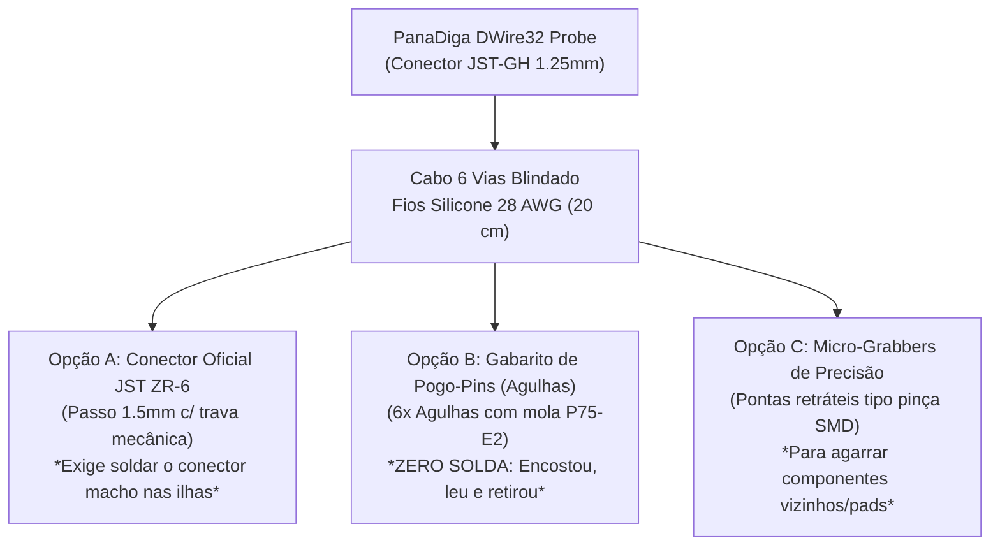

# ESPECIFICAÇÃO DE ENGENHARIA DE PRODUTO: HARDWARE DEDICADO, CABEAMENTO E EMBALAGEM
## PanaDiga DWire32 Probe — Interface Física de Depuração e Leitura de Silício
### Alvo: Gravador Panasonic DMR-EH55 (MN2DS0016 / Spansion S29JL064H / Conector P7501)

---

## 1. Apresentação e Escopo do Produto

O presente documento técnico define a **especificação completa de engenharia de produto, fabricação eletrônica, cabeamento industrial, gabinete (*enclosure*) e embalagem comercial** para a ferramenta de hardware **PanaDiga DWire32 Probe**.

O objetivo primordial é transformar a montagem preliminar de bancada (protoboard com fiação solta e componentes discretos) em um **instrumento profissional de bancada e laboratório**, com alta repetibilidade, imunidade a ruídos eletromagnéticos (EMI/ESD), proteção ativa contra sobretensão e ergonomia compatível com as melhores ferramentas de depuração do mercado global (tais como *Saleae Logic*, *Tigard*, *Bus Pirate v5* e *Black Magic Probe*).

```
                      PANADIGA DWIRE32 PROBE — VISÃO DE CONJUNTO
  ┌────────────────────────────────────────────────────────────────────────────────────────┐
  │                                                                                        │
  │   [ PC / Estação ] <=== Cabo USB-C 2.0 High-Speed ===> [ PanaDiga DWire32 Probe ]     │
  │                                                                  │                     │
  │                                                      Chicote Industrial Blindado       │
  │                                                      (JST-ZR 1.5mm / Pogo-Pins)        │
  │                                                                  ▼                     │
  │                                                       [ Placa VEP79138 ]               │
  │                                                       Conector P7501 / MN2DS0016       │
  │                                                                                        │
  └────────────────────────────────────────────────────────────────────────────────────────┘
```

---

## 2. Arquitetura da Placa de Circuito Impresso (PCB Dedicada)

Para garantir integridade de sinais a $1.0\text{ MHz}$ com tempos de subida rápidos ($t_r < 2\text{ ns}$ do microcontrolador RP2040), a placa dedicada deve obedecer a regras estritas de compatibilidade eletromagnética (EMC).

### 2.1 Topologia de Formato: "Dongle USB All-in-One"
A solução recomendada é um formato **Dongle USB em barra** ($\sim 68\text{ mm} \times 24\text{ mm}$), contendo o silício RP2040, memórias e conectores na mesma placa.

* **Camadas (Stackup):** 2 camadas de cobre ($1.6\text{ mm}$ FR-4, $1\text{ oz}$ / $35\,\mu\text{m}$ de cobre).
  * **Top Layer:** Roteamento de sinais digitais, barramentos de clock/dados e alimentação regulada.
  * **Bottom Layer:** **Plano de Terra Contínuo (Solid Ground Plane)** sem cortes sob as trilhas de dados e clock, garantindo retorno de corrente de baixa impedância e contenção de EMI.
* **Acabamento de Superfície:** **ENIG (Electroless Nickel Immersion Gold)** para evitar oxidação dos contatos, ou **HASL Lead-Free**.
* **Máscara de Solda:** Preto Fosco (*Matte Black*) com serigrafia branca de alta definição.

---

### 2.2 Esquema Elétrico Completo da Placa (Carrier / Dongle)

```text
                                 ESQUEMA ELÉTRICO COMPLETO DA PLACA DWIRE32 PROBE
                                 
           [ USB-C 16-PIN ]
         ┌───────────────────┐
         │ VBUS (5.0V) ──────┼───►[ Fusível PTC 500mA ]──►[ LDO 3.3V (RT9193-33) ]──► +3.3V_HOST
         │ D+ / D- ──────────┼───►[ Diodos TVS USB ]─────► RP2040 USB_DP / USB_DM
         │ GND ──────────────┼───────────────────────────► Plano de Terra Geral (GND)
         │ SHIELD ───────────┼───►[ Resistor 1MΩ // Cap 4.7nF 1kV ]──► Terra de Chassi
         └───────────────────┘
         
         [ MICROCONTROLADOR RP2040 ]
         ┌──────────────────────────────────────────────────────────────────────────────┐
         │                                                                              │
         │  GP2 (Pino 4)  ───────[ R1: 100Ω 0603 ]───────────► Pino 1: EXTRG (Trigger)  │
         │                                                                              │
         │  GP3 (Pino 5)  ───────[ R2: 47Ω 0603 ]────────────► Pino 2: SCLK (Clock)    │
         │                                                                              │
         │  GP4 (Pino 6)  ───────[ R3: 100Ω 0603 ]──────┬────► Pino 4: SDATA (Dados)    │
         │                                              │                               │
         │                                            [ R_PU: 4.7kΩ ]                   │
         │                                              │                               │
         │  GP5 (Pino 7)  ───────[ R4: 100Ω 0603 ]──────┼────► Pino 5: nRESET (Open-Dr) │
         │                                              │                               │
         │  GP26 / ADC0 ─────────[ R5: 1.0kΩ 0603 ]─────┼──┬─► Pino 6: VDD Sense (3.3V) │
         │                                              │  │  (Alimenta o R_PU!)        │
         │                                              │ [ D_ZEN: 3.6V Clamp ]         │
         │                                              │  │                            │
         │  GND DIGITAL ────────────────────────────────┴──┴─► Pino 3: GND Comum (0.0Ω)│
         │                                                                              │
         │  LED1 (GP16): HOST_PWR   (Azul, 0603)                                        │
         │  LED2 (GP17): TGT_PWR    (Verde, 0603 - aceso diretamente pelo VDD Sense)    │
         │  LED3 (GP18): OCD_ACTIVE (Âmbar, 0603 - pulsado por hardware na linha SCLK)  │
         │  LED4 (GP19): CPU_HALT   (Branco, 0603 - ativado quando DCSR Bit 0 == 1)     │
         │                                                                              │
         └──────────────────────────────────────────────────────────────────────────────┘
                                                                ▲
                                                                │
                                                  [ CONECTOR DE SAÍDA INDUSTRIAL ]
                                                  JST-GH (1.25mm) ou JST-ZH (1.5mm)
                                                  Macho com Trava Plástica Positiva
```

---

### 2.3 Circuito de Proteção Contra Danos e Sobretensão

Para que a ferramenta seja resiliente contra conexões erradas em bancada, foram inseridos 3 estágios de proteção:

1. **Diodos de Grampeamento ESD (Matriz TVS `USBLC6-2SC6`):**
   * Conectada em paralelo nas linhas `EXTRG`, `SCLK`, `SDATA` e `nRESET`.
   * Capacitância parasita ultrabaixa ($C_{io} \approx 3.5\text{ pF}$), permitindo transições rápidas sem arredondamento de bordas.
   * Grampeia transientes eletrostáticos de contato de até $\pm 8\text{ kV}$ e no ar de até $\pm 15\text{ kV}$.
2. **Grampeamento Zener na Entrada Analógica ADC0:**
   * Diodo Zener de $3.6\text{V}$ ($0.25\text{W}$) colocado entre o pino `GP26` e o terra, em conjunto com o resistor em série de $1.0\text{ k}\Omega$.
   * Caso o operador conecte acidentalmente a ponta de prova em uma linha de $+5\text{V}$ ou $+12\text{V}$ da fonte chaveada do gravador, a corrente é limitada a $\approx 8\text{ mA}$ e a tensão não ultrapassa $3.6\text{V}$, salvando o conversor ADC do RP2040.
3. **Isolamento de Alimentação Reversa do Pull-Up:**
   * O resistor de pull-up de $4.7\text{ k}\Omega$ da linha `SDATA` é obrigatoriamente soldado ao pino **`Pino 6 Físico (VDD Sense / Target)`**.
   * Quando o gravador Panasonic está desligado, a tensão do pull-up é $0\text{V}$, garantindo que nenhuma corrente do PC alimente os pinos do processador desligado.

---

## 3. Especificação do Cabeamento de Campo (Cable Harness)

O calcanhar de aquiles das montagens amadoras é o cabeamento solto. No DMR-EH55, o ponto de injeção na placa `VEP79138` é o conector oficial **`P7501 [B6B-ZR-3R4]`** (JST Família ZR, passo de $1.5\text{ mm}$, 6 vias verticais).

### 3.1 As 3 Opções de Conexão na Placa Panasonic



#### Opção A: Conector Macho JST ZR Soldado na Placa (Solução Definitiva de Oficina)
* Solda-se o conector macho SMD/Through-Hole **JST `B6B-ZR`** (passo $1.5\text{ mm}$) nas 6 ilhas de teste existentes entre os cabos flat de 10 vias e 8 vias.
* O chicote encaixa com trava audível (*click*), tornando impossível soltar ou inverter a polaridade durante a gravação.

#### Opção B: Gabarito Pogo-Pin "No-Solder" (Para Perícia sem Nenhuma Modificação)
* Uma micro-placa de circuito impresso com 6 agulhas com mola tipo **Pogo-Pin modelo P75-E2** (ponta cônica afiada em coroa para penetrar verniz e óxido de solda) montadas em passo rigoroso de $1.5\text{ mm}$.
* O técnico posiciona a sonda sobre os 6 pads da placa Panasonic e mantém pressionado manualmente por 2 minutos (tempo suficiente para o comando `DUMP 80000000 64` e `ERASE_NVRAM`).
* **Vantagem Comercial:** Nenhuma gota de solda é aplicada no aparelho do cliente.

---

### 3.2 Tabela de Cores Padronizada do Chicote (Código Industrial)

| Pino Físico (10V $\rightarrow$ 8V) | Sinal Matsushita | Função Técnica | Cor Recomendada do Fio | Bitola / Isolamento |
| :---: | :--- | :--- | :---: | :--- |
| **Pino 1** | `EXTRG` | Gatilho Externo OCD | **Laranja** | AWG 28 / Silicone Flexível $200^\circ\text{C}$ |
| **Pino 2** | `SCLK` | Clock Master (1.0 MHz) | **Amarelo** | AWG 28 / Silicone Flexível $200^\circ\text{C}$ |
| **Pino 3** | **`GND`** | **Terra Geral (Chassi 0.0Ω)** | **Preto** | AWG 26 (Mais espesso para terra) |
| **Pino 4** | `SDATA` | Dados Half-Duplex | **Verde** | AWG 28 / Silicone Flexível $200^\circ\text{C}$ |
| **Pino 5** | `nRESET` | Reset Mestre (Open-Drain)| **Azul** | AWG 28 / Silicone Flexível $200^\circ\text{C}$ |
| **Pino 6** | `VDD Sense` | Referência Alvo (+3.3V) | **Vermelho** | AWG 28 / Silicone Flexível $200^\circ\text{C}$ |

---

## 4. Projeto do Gabinete / Enclosure (Visual Industrial)

O gabinete protege a eletrônica sensível contra toques acidentais, pó de bancada e quedas.

### 4.1 Modelo A: Extrusão de Alumínio Anodizado (Estilo *Saleae Logic / CANable*)
* **Corpo:** Perfil retangular de alumínio extrudado ($22\text{ mm} \times 15\text{ mm} \times 70\text{ mm}$) com anodização preta fosca acetinada.
* **Painéis Frontal e Traseiro:** Placas de circuito impresso em fibra de vidro preto fosco (FR-4) com recortes usinados em CNC para o conector USB-C e o conector JST.
* **Gravação:** Logotipo gravado a laser em branco com o pinout completo estampado no corpo do metal:
  ```text
  PINOUT: 1:EXTRG | 2:SCLK | 3:GND | 4:SDATA | 5:nRESET | 6:VDD
  ```

### 4.2 Modelo B: Impressão 3D Industrial SLA (Resina ABS-Like Preto Fosco)
* **Estrutura:** Duas metades (*Top/Bottom*) unidas por 4 parafusos Allen pretos M2 fixados em insertos roscados de latão embutidos a quente (*heat-set inserts*).
* **Visores de LED:** 4 furos cilíndricos de $1.5\text{ mm}$ com guias de luz em acrílico transparente (*light pipes*) para visualização nítida dos LEDs de status no painel superior.
* **Pés:** 4 sapatas adesivas de borracha de silicone antiderrapante na base.

---

## 5. Embalagem Comercial e Apresentação de Mercado (Field Kit)

Para comercialização ou entrega técnica como ferramenta de recuperação de alto padrão:

```text
                      COMPOSIÇÃO DO "PANADIGA RECOVERY FIELD KIT"
                      
      ┌─────────────────────────────────────────────────────────────┐
      │  ESTOJO RÍGIDO EM PAPELÃO KRAFT PRETO COM FECHO MAGNÉTICO   │
      │  ┌───────────────────────────────────────────────────────┐  │
      │  │                                                       │  │
      │  │   [ Berço de Espuma EVA Preta Cortada a Laser ]       │  │
      │  │                                                       │  │
      │  │   ┌─────────────────────┐      ┌──────────────────┐   │  │
      │  │   │  Módulo DWire32     │      │ Cabo USB-C 1.0m  │   │  │
      │  │   │  Probe (Alumínio)   │      │ Nylon Trançado   │   │  │
      │  │   └─────────────────────┘      └──────────────────┘   │  │
      │  │                                                       │  │
      │  │   ┌─────────────────────┐      ┌──────────────────┐   │  │
      │  │   │ Chicote JST ZR-6    │      │ Sonda Pogo-Pin   │   │  │
      │  │   │ Fios de Silicone    │      │ "No-Solder" Jig  │   │  │
      │  │   └─────────────────────┘      └──────────────────┘   │  │
      │  │                                                       │  │
      │  │   ┌───────────────────────────────────────────────┐   │  │
      │  │   │ Cartão Laminado de Consulta Rápida (Pinout/QR)│   │  │
      │  │   └───────────────────────────────────────────────┘   │  │
      │  └───────────────────────────────────────────────────────┘  │
      └─────────────────────────────────────────────────────────────┘
```

### Componentes Inclusos no Kit Completo:
1. **1x Unidade PanaDiga DWire32 Probe:** Módulo programador/leitor USB-C montado e testado.
2. **1x Chicote de Conexão Oficial JST ZR-6:** Comprimento de $20\text{ cm}$, blindado, com conector original com trava mecânica.
3. **1x Sonda Manual Pogo-Pin (Opcional do Kit Pro):** Plaquinha ergonômica com agulhas de mola para perícias sem solda.
4. **1x Cabo USB-C para USB-A:** Revestido em malha de nylon, condutores 24/28 AWG blindados com ferrite anti-ruído.
5. **1x Cartão de Referência Rápida Plastificado:** Tabela com pinagem, diagrama de blocos e comandos do terminal serial (`STATUS`, `SNIFF`, `HANDSHAKE`, `DUMP`, `ERASE_NVRAM CONFIRM`).
6. **1x Envelope Antiestático ESD Metalizado:** Com adesivo de controle de qualidade e número de série homologado.

---

## 6. Lista Mestra de Materiais e Componentes (Bill of Materials - BOM)

A tabela abaixo especifica os part numbers comerciais para aquisição em distribuidores globais (DigiKey, Mouser ou LCSC):

| Ref | Qtd | Descrição Técnica | Encapsulamento | Fabricante / Part Number Sugerido | Finalidade no Circuito |
| :---: | :---: | :--- | :---: | :--- | :--- |
| **U1** | 1 | Microcontrolador Dual ARM Cortex-M0+ @ 133MHz | QFN-56 | Raspberry Pi `RP2040` | Processamento central e máquina PIO |
| **U2** | 1 | Regulador Linear LDO 3.3V 500mA Ultra-Low-Noise | SOT-23-5 | Richtek `RT9193-33GB` | Alimentação limpa do subsistema |
| **U3** | 1 | Matriz de Proteção ESD TVS Ultrabaixa Capacitância | SOT-23-6 | STMicroelectronics `USBLC6-2SC6` | Grampeamento ESD nas linhas de I/O |
| **U4** | 1 | Memória NOR Flash SPI 32 Mbit (4 MByte) | SOIC-8 | Winbond `W25Q32JVSSIQ` | Firmware permanente do probe |
| **J1** | 1 | Conector USB-C 16 Pinos Receptáculo SMD | SMD/Mid-Mount | Korean Hroparts `TYPE-C-31-M-12` | Interface com PC Host |
| **J2** | 1 | Conector Macho JST 6 Vias com Trava (Passo 1.25mm) | SMD Shrouded | JST `SM06B-GHS-TB` ou Molex PicoBlade | Conector de saída para o chicote |
| **D1** | 1 | Diodo Zener 3.6V 250mW Clamp Proteção ADC | SOD-323 | Nexperia `BZX384-C3V6` | Proteção de sobretensão no canal ADC0 |
| **R1, R3, R4** | 3 | Resistor de Filme Espesso $100\,\Omega \pm 1\%$ 0.1W | 0603 SMD | Yageo `RC0603FR-07100RL` | Amortecimento em EXTRG, SDATA, nRESET |
| **R2** | 1 | Resistor de Filme Espesso $47\,\Omega \pm 1\%$ 0.1W | 0603 SMD | Yageo `RC0603FR-0747RL` | Amortecimento crítico da linha SCLK |
| **R_PU** | 1 | Resistor de Filme Espesso $4.7\text{ k}\Omega \pm 1\%$ 0.1W | 0603 SMD | Yageo `RC0603FR-074K7L` | Pull-up da linha SDATA p/ Target VDD |
| **R5** | 1 | Resistor de Filme Espesso $1.0\text{ k}\Omega \pm 1\%$ 0.1W | 0603 SMD | Yageo `RC0603FR-071KL` | Proteção de entrada do sensor VDD ADC0 |
| **LED1..4** | 4 | LEDs SMD de Alta Eficiência (Azul, Verde, Âmbar, Branco) | 0603 SMD | Everlight `19-217/BHC...` | Telemetria e diagnóstico visual |
| **CN_JIG** | 1 | Conector Macho JST ZR 6 Vias Passo 1.5mm | Through-Hole | JST `B6B-ZR-3R4` | Conector oficial para a placa Panasonic |
| **POGO** | 6 | Agulhas de Teste com Mola (Ponta Coroa / Flauta) | Diâmetro 1.0mm | Leeno / ECT `P75-E2` | Montagem da sonda de teste sem solda |

---

## 7. Próximos Passos para Fabricação

1. **Desenho no KiCad:** Criar o esquemático `.kicad_sch` e o layout `.kicad_pcb` utilizando as regras de fabricação da JLCPCB ou PCBWay (trilhas mínimas de $0.15\text{ mm}$, espaçamento de $0.15\text{ mm}$, furos de $0.3\text{ mm}$).
2. **Geração dos Gerbers:** Exportar Gerbers RS-274X, arquivos de furação Excellon e lista de coordenadas de posicionamento de componentes (Pick-and-Place / CPL) para montagem SMT automatizada.
3. **Modelagem 3D do Gabinete:** Modelar a carcaça no Autodesk Fusion 360 ou FreeCAD e exportar em `.STL` / `.STEP` para encomenda de lote de impressão 3D em resina SLA preta fosca.
4. **Homologação do Protótipo:** Executar os testes de leitura com o software oficial [`panadiga`](file:///c:/Users/danie/Documents/Panasonic%20Firmware%20HDD%20bin/crates/panadiga) e validar a ausência de ruído com analisador lógico USB.
