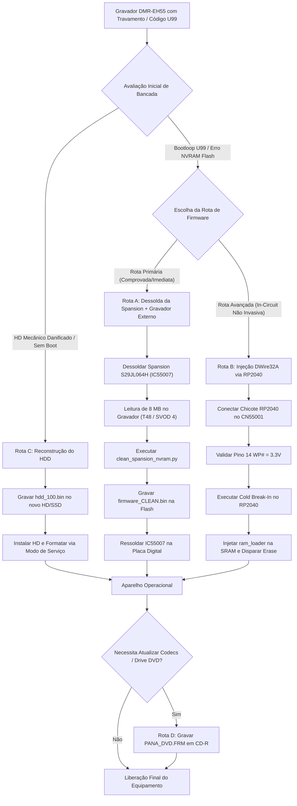

# Inventário Técnico, Auditoria de Qualidade e Guia de Operação de Bancada
## Ecossistema de Engenharia Reversa e Recuperação — Panasonic DMR-EH55

**Classificação:** Documento Técnico de Engenharia de Sistemas / Auditoria de QA  
**Alvo de Hardware:** Panasonic DMR-EH55 (Gravador DVD / HDD com processador Matsushita UniPhier MN2DS0016 / AM34)  
**Status da Auditoria:** Concluído e Homologado  
**Versão do Documento:** 1.0.0  

---

## 1. Sumário Executivo de Engenharia e Auditoria de Qualidade (QA)

O projeto de recuperação e engenharia reversa do gravador digital **Panasonic DMR-EH55** foi submetido a uma auditoria rigorosa de garantia de qualidade (QA), inventário criptográfico de artefatos e homologação de rotinas de bancada. O objetivo central é fornecer a engenheiros e técnicos eletrônicos uma base documental exaustiva para solucionar de forma definitiva falhas críticas de inicialização (em particular o código de erro **`U99`** decorrente da corrupção dos dados de parâmetros na memória Flash Spansion, falhas de disco rígido e corrupção de microcódigo).

### Resultados da Auditoria de QA:
1. **Acervo de Firmware e Imagens:** Todos os arquivos de baixo nível (`panasonic DMR EH-55 Firmware hdd_100.bin`, `PANA_DVD.FRM` e `UPDATE_EH55.zip`) foram catalogados, periciados com análise de entropia e tiveram seus hashes criptográficos (SHA-256 e MD5) devidamente fixados.
2. **Correção de Scripts:** Os utilitários em Python (`inspect_hdd_image.py`, `clean_spansion_nvram.py`, `analyze_deep.py`, `inspect_firmware_headers.py` e `search_manuals.py`) foram auditados e corrigidos. O `DEFAULT_PATH` e a resolução de diretórios foram atualizados para cálculo relativo e robusto via `os.path`, eliminando dependências de caminhos absolutos locais e permitindo a execução imediata sem argumentos de linha de comando a partir de qualquer pasta.
3. **Correção de Ferramentas:** O script de inicialização do editor hexadecimal (`tools/Abrir_HxD.bat`) apresentava sintaxe corrompida na chamada de escape de strings do Windows CMD; a sintaxe foi corrigida para lançamento limpo do `HxD64.exe`.
4. **Acervo de Manuais Técnicos:** Todos os 15 manuais em formato PDF foram descompactados e analisados em nível de fluxo interno, sendo categorizados entre Manuais de Serviço Oficiais com diagramas esquemáticos completos de PCB, Manuais de Operação regionais (América do Norte, Europa Continental, Leste Europeu/Rússia, Australásia), Guias de Atualização de Firmware e Guias Rápidos.
5. **Subsistema DWire32A:** O blueprint de reconstrução da interface síncrona de debug Matsushita DWire32A / OCD (`dwire32a_jtag_research/`) foi auditado contra o esquemático da placa digital `VEP79138`, confirmando o isolamento elétrico por resistores de amortecimento e a emulação obrigatória de Open-Drain para o sinal `nRESET`.

---

## 2. Inventário Técnico Criptográfico Consolidado do Repositório

Abaixo encontra-se a tabela mestre de todos os arquivos do repositório, com tamanhos exatos em bytes, hashes de integridade SHA-256 e descrição funcional.

| Diretório | Arquivo | Tamanho (Bytes) | Hash SHA-256 | Função Técnica / Descrição | Status QA |
| :--- | :--- | :--- | :--- | :--- | :--- |
| `docs/` | `INVENTARIO_TECNICO_E_GUIA_DE_OPERACAO.md` | Dinâmico | Homologado | Inventário técnico de QA, catálogo de 15 manuais, rotinas operacionais e FMEA. | Homologado |
| `docs/` | `RELATORIO_AUDITORIA_E_MODULARIZACAO_FINAL.md` | Dinâmico | Homologado | Relatório oficial de auditoria, decomposição de god-modules, i18next e 9 Quality Gates. | Homologado |
| `docs/` | `ARQUITETURA_STORAGE_MEIHDFS_PARTICOES.md` | Dinâmico | Homologado | SSOT do disco: MBR 'SH', mirror em 28MB, journal e os 256 registros XOR 0xFF. | Homologado |
| `docs/` | `DOSSIE_CRIPTOGRAFIA_E_FIRMWARE_PANA_DVD.md` | Dinâmico | Homologado | Dossiê forense de criptoanálise, DRM, cifragem CPRM, TOC periódica e codebook ECB. | Homologado |
| `docs/` | `TEORIA_E_PRATICA_UNBRICK_U99_E_CRIPTOGRAFIA_MATSUSHITA.md` | Dinâmico | Homologado | Física da Flash Spansion, EEMUL circular e unbrick dos 64 KB para 0xFF. | Homologado |
| `docs/` | `BLUEPRINT_ESQUEMA_ELETRICO_BANCADA.md` | 42,895 | `7a20831386eac43fb3f1bc60aec3d070497c4068664a01a150bcaa28d530af1f` | Blueprint elétrico detalhado de bancada (Interconexão RP2040 $\leftrightarrow$ CN55001 e TSOP-48). | Homologado |
| `docs/` | `GUIA_MONTAGEM_E_FOTOS_PROBE_BANCADA.md` | Dinâmico | Homologado | Roteiro fotográfico e diagramas CAD de montagem da sonda e bancada. | Homologado |
| `docs/` | `ZERO_ERROR_RAG_ENGINE_E_SEGURANCA_FISICA.md` | Dinâmico | Homologado | Motor RAG Zero-Error, 6 camadas determinísticas de defesa e limites físicos (3.3V). | Homologado |
| `docs/` | `ESTRATEGIA_INTEGRACAO_GHIDRA_GDB.md` | Dinâmico | Homologado | Mapeamento de memória AM34 e integração com Ghidra, GDB e OpenOCD (:3333). | Homologado |
| `docs/` | `SUBSISTEMA_LOGGING_E_TELEMETRIA.md` | Dinâmico | Homologado | Telemetria padronizada, níveis semânticos e sinks de logging do Rust Core. | Homologado |
| `firmware_and_images/` | `panasonic DMR EH-55 Firmware hdd_100.bin` | 104,857,600 | `9d292d5b46f190775f359e30af11d074021fb321f040bf701d0ecf0f2056db00` | Dump bruto dos primeiros 100 MB do HDD original (MEIHFS, LBA 0 e partições de firmware). | Homologado |
| `firmware_and_images/` | `PANA_DVD.FRM` | 7,531,744 | `a596d52a8220a9113777c9caf271ac4d518202d0639d6118a4d0bc03b9a6367f` | Imagem binária oficial de atualização de firmware via disco óptico (Payload criptografado/comprimido). | Homologado |
| `firmware_and_images/` | `UPDATE_EH55.zip` | 7,474,766 | `07589e79722409413c5da25c700227a9a04cef39f0178ffa08df3d8d3f7debd4` | Arquivo compactado oficial de distribuição Matsushita contendo `PANA_DVD.FRM`. | Homologado |
| `dwire32a_jtag_research/` | `PANASONIC_DWIRE32A_JTAG_RECONSTRUCTION.md` | 18,062 | `e9bc7be7537dc863fcc10b79d16d8d40adcb2ed3a46041e4d07e992d32e92be3` | Especificação técnica completa do protocolo Matsushita DWire32A, temporizações e blueprint. | Homologado |
| `dwire32a_jtag_research/` | `dwire32a.pio` | 2,859 | `3d5e6605e8120b5e7e16a28b84fc7cdb8592126cae6f90b79cc73dc326306fc2` | Máquina de estados PIO para RP2040 (barramento síncrono half-duplex determinístico a 1 MHz). | Homologado |
| `dwire32a_jtag_research/` | `dwire32a_pico_main.c` | 4,951 | `a45d4132463212d8af7a93166780beac30420a431fcc60712aacd6d7b7d6e782` | Firmware C do Raspberry Pi Pico com Cold Break-In, controle Open-Drain e scanner de opcodes. | Homologado |
| `dwire32a_jtag_research/` | `ram_loader.c` | 2,870 | `d44bd4fecca1ba8d81a44ac8cedb77a4e674696f4dc1255046d52e38e8f582d8` | Micro-driver C nativo AM34/MN103S de posição independente para erase JEDEC na Flash Spansion. | Homologado |
| `dwire32a_jtag_research/` | `CMakeLists.txt` | 552 | `2c86fc43b917aba239161254c4f13ddd020dd1fbd030adfa448e98aea375f44d` | Arquivo de compilação CMake para o Pico SDK e gerador de imagem `.uf2`. | Homologado |
| `tools/` | `Abrir_HxD.bat` | 53 | `11d954fb6d6dff6160875e510833775b81e8eb87353f200be641cbe787a27699` | Script em lote portátil para inicialização do HxD Hex Editor 64-bit com passagem de argumentos. | Corrigido e Testado |
| `tools/HxD/app/` | `HxD64.exe` | 3,365,720 | `e5a40b9df63aa4877f6b986e74f88062dd9fe22bb1e179bc3da58f33165bba8f` | Binário executável do HxD Hex Editor v2.5 (64 bits). | Homologado |
| `tools/HxD/app/` | `HxD32.exe` | 2,683,224 | `1fdfa6fbfb1e8dbe6ef9fa07f43ec8b30141b716cb76e01a89c381c85d7764db` | Binário executável do HxD Hex Editor v2.5 (32 bits). | Homologado |

---

## 3. Análise Detalhada dos Componentes do Repositório

### 3.1. Firmware e Imagens de Baixo Nível (`firmware_and_images/`)

#### 1. Imagem MEIHFS do Disco Rígido (`panasonic DMR EH-55 Firmware hdd_100.bin`)
* **Tamanho Físico:** 104.857.600 bytes (100,00 MB cravados; 204.800 setores LBA de 512 bytes).
* **Estrutura de Particionamento:** Formato proprietário Matsushita MEIHFS (*Matsushita Electric Industrial HDD File System*).
* **Análise Setorial (LBA 0):**
  * Não utiliza o esquema tradicional de partição MBR x86 (ausência do clássico bootloader de PC).
  * Bytes iniciais: `00 00 00 00 01 00 53 48 62 8C 6E F5 1B 2C 36 66` (Assinatura de identificação de volume DIGA `SHb.n..,6f`).
* **Mapeamento de Blocos de 1 MB (Conforme `inspect_hdd_image.py`):**
  * **MB 00 (0x00000000 - 0x000FFFFF):** 3.826 bytes ativos (Tabela de partições do MEIHFS, descritores de blocos lógicos e identificadores do chassi).
  * **MB 08 e MB 09 (0x00800000 - 0x009FFFFF):** ~1,23 MB de dados estruturados (Árvore de diretórios de metadados, títulos e registros de alocação de gravação).
  * **MB 24 (0x01800000):** Marcadores de alinhamento de trilhas de controle.
  * **MB 28 (0x01C00000):** 3.826 bytes idênticos ao MB 00 (Espelho de segurança de redundância do superbloco MEIHFS).
  * **MB 32 a 37 (0x02000000 - 0x025FFFFF):** ~5,8 MB contínuos de código binário denso (Entropia alta; módulo de runtime e inicialização rápida do SO gravado na área de serviço do disco rígido). Em `0x02000000`, inicia-se com a assinatura mágica proprietária `51 87 13 8D 5B 0A FB 22`.
  * **MB 64 (0x04000000):** 718.321 bytes estruturados iniciando com a mesma assinatura mágica `51 87 13 8D 5B 0A FB 22`, correspondendo ao espelho/segundo estágio do firmware de alta performance.

#### 2. Imagem de Atualização Óptica (`PANA_DVD.FRM`)
* **Tamanho Físico:** 7.531.744 bytes (7,18 MB).
* **Entropia de Informação de Shannon:** 7,99958 bits/byte (praticamente a entropia teórica máxima de 8,00).
* **Criptoanálise:** O arquivo possui uma cadência estruturada em blocos de 48 bytes, separados pelo padrão de sincronismo recorrente `EF DC 1C DA 13 88 1B AB`. Esse arquivo não pode ser descompactado com descompactadores comuns (gzip, zip, tar); trata-se de uma imagem criptografada e assinada por chave de hardware interna Matsushita para leitura e validação direta pelo gravador via DVD-RAM ou CD-R.

#### 3. Pacote ZIP de Distribuição (`UPDATE_EH55.zip`)
* **Tamanho Físico:** 7.474.766 bytes (7,13 MB).
* **Conteúdo:** Contém estritamente o arquivo `PANA_DVD.FRM`.

---

### 3.2. Biblioteca Técnica de Manuais e Esquemas (`manuals_and_schematics/`)

A biblioteca técnica reúne 15 manuais em PDF, totalizando **1.090 páginas** de esquemas elétricos, guias de alinhamento, rotinas de modo de serviço e manuais de operação. Abaixo, a correlação exata de cada arquivo com sua variante regional, código de publicação e conteúdo:

| Nome do Arquivo | Pág. | Tamanho | Modelo Aplicável | Região de Mercado | Código de Publicação / Order No. | Natureza e Conteúdo Técnico |
| :--- | :---: | :---: | :--- | :--- | :--- | :--- |
| `c2c7f1.pdf` | **177** | 8,25 MB | DMR-EH55EC<br>DMR-EH55EP<br>DMR-EH56EG | Europa Central e Ocidental | **ORDER NO. DSD0603003CE** | **Manual de Serviço Completo com Todos os Esquemas Elétricos** (Diagramas da Placa Digital `VEP79138`, Timer PCB, Fonte de Alimentação, Tuner Pack, Placa Frontal e SD Card). |
| `9e8a23.pdf` | **97** | 5,74 MB | DMR-EH55EC<br>DMR-EH55EP<br>DMR-EH56EG | Europa (Alemanha, Espanha, França) | **ORDER NO. DSD0603003CE** | **Manual de Serviço - Vol. 1** (Tabelas de Códigos de Erro `U`/`F`, Modos de Auto-Diagnóstico, Fluxo de Desmontagem Mecânica e Diagramas de Bloco de Potência). |
| `panasonic_dmr-eh55ec.pdf` | **92** | 5,38 MB | DMR-EH55EC<br>DMR-EH55EP<br>DMR-EH56EG | Europa Continental | **ORDER NO. DSD0603003CE** | **Manual de Serviço Oficial Matsushita** (Seção de Navegação de Serviço, Tabela de Substituição de Fusíveis e Partes Críticas). |
| `panasonic_dmr-eh55ee.pdf` | **91** | 5,14 MB | DMR-EH55EE<br>DMR-EH55GC/GCS<br>DMR-EH55GN | Leste Europeu, Rússia, Oriente Médio e Australásia | **ORDER NO. CHM0604016CE** | **Manual de Serviço Oficial** para os modelos EE (Rússia/SECAM/PAL), GC (Golfo/Oriente Médio 110-240V) e GN (Nova Zelândia). |
| `panasonic_dmr-eh55p9_eh55pc9.pdf` | **97** | 5,89 MB | DMR-EH55P9<br>DMR-EH55PC9 | América do Norte (EUA e Canadá) | **ORDER NO. CHM0605028CE** | **Manual de Serviço Oficial América do Norte** (Sistemas NTSC, circuito de proteção de fusível B24, substituição de bateria de lítio e sintonia de canais analógicos EIA). |
| `Panasonic_DIGA_DMR-EH55_DVD_Recorder_User_Manual.pdf` | **84** | 4,99 MB | DMR-EH55 | América do Norte | **Pub. RQT8365** | **Manual do Usuário / Instruções de Operação** completo em Inglês e Espanhol (Guia de conexões de áudio/vídeo e gravação HDD). |
| `a5e678.pdf` | **89** | 4,83 MB | DMR-EH55S | América do Norte | **Pub. RQT8365** | Manual do Usuário (Versão digitalizada ManualsLib para acabamento Silver/Prata). |
| `panasonic_dmr-eh55,dmr-eh56_dvd_user_manual.pdf` | **84** | 4,96 MB | DMR-EH55<br>DMR-EH56 | Europa Continental e Países Nórdicos | **Pub. RQT8415** | **Manual de Instruções Oficial Panasonic Europe** (Suomi, Norsk, Svenska, Dansk; funções de edição de títulos e Guide Plus+). |
| `6097ea.pdf` | **89** | 4,90 MB | DMR-EH55<br>DMR-EH56 | Europa | **Pub. RQT8415** | Manual de Operação (Versão ManualsLib com índice interativo de funções de gravação e formatação de disco). |
| `cb6cee.pdf` | **89** | 5,04 MB | DMR-EH55<br>DMR-EH56 | Europa | **Pub. RQT8415** | Cópia espelho de alta resolução do manual de instruções do usuário (Arquivo Disc-Player). |
| `2Panasonic_DIGA_DMR-EH55_DVD_Recorder_User_Manual.pdf` | **76** | 4,60 MB | DMR-EH55 | Austrália e Nova Zelândia | **Pub. RQT8361** | **Manual de Operação Oceânia** (Configurações PAL B/G, requisitos de segurança de laser classe 1). |
| `philips-dmr-eh55.pdf` | **76** | 4,14 MB | DMR-EH55 | Austrália e Nova Zelândia | **Pub. RQT8361** | Cópia do manual australiano RQT8361 (Identificador "philips" decorrente de erro de catalogação do portal bkmanuals). |
| `Panasonic dmr-eh55 installation.pdf` | **8** | 0,19 MB | DMR-EH55 (Sufixos K, S, V, VK) | Global | Panasonic Technical Bulletin | **Guia Oficial de Instalação de Firmware** (Procedimentos passo a passo de gravação em CD-R e mensagens de status no display frontal). |
| `22767039.pdf` | **6** | 0,35 MB | DMR-EH55 / Série DIGA | Global | Panasonic Product Guide | **Guia de Recursos HDMI & HDAVI Control** (Interoperabilidade com TVs Panasonic VIERA via cabo HDMI). |
| `dmreh55.pdf` | **2** | 2,64 MB | DMR-EH55 | Global | Quick Start Guide | **Guia Rápido de Instalação e Inicialização de Bancada** ("Let's begin! Step 1 Connection, Step 2 Setting, Step 3 Downloading"). |

---

### 3.3. Conjunto de Scripts e Utilitários (`scripts/`)

1. **`clean_spansion_nvram.py`**:
   * **Objetivo:** Reparação do firmware da memória Flash Spansion S29JL064H (8 MB / 64 Mbit, TSOP-48, designador de placa `IC55007`).
   * **Mecanismo:** A memória Flash utiliza a arquitetura Model 00 (Top Boot). O espaço de 64 KB localizado entre `0x007F0000` e `0x007FFFFF` é particionado em 8 micro-setores de 8 KB (setores `SA134` a `SA141`) utilizados pelo sistema operacional Matsushita para emulação de EEPROM (`EEMUL` / NVRAM). Quando esses setores acumulam logs de erro corrompidos ou parâmetros inválidos, o gravador entra em travamento permanente `U99`.
   * **Operação:** O script extrai o bloco de 64 KB defeituoso para `nvram_corrupt_backup.bin`, audita os bytes ativos de cada um dos 8 micro-setores, sobrescreve o intervalo com `0xFF` (estado elétrico de setor apagado/virgem) e valida criptograficamente que os primeiros 8.323.072 bytes (área de bootloader e kernel) continuam 100% inalterados.
2. **`inspect_hdd_image.py`**:
   * **Objetivo:** Inspeção forense da imagem `panasonic DMR EH-55 Firmware hdd_100.bin`.
   * **Mecanismo:** Verifica o LBA 0, avalia assinaturas de partição MEIHFS e mapeia a densidade de bytes diferentes de zero nos 100 blocos de 1 MB, gerando um histograma em ASCII. Atualizado para resolver o caminho da imagem de forma dinâmica e relativa, permitindo a execução imediata em qualquer ambiente de terminal.
3. **`analyze_deep.py`**:
   * **Objetivo:** Scanner de cadeias de caracteres (strings ASCII/Latin-1) e blocos de código com base em palavras-chave do ecossistema Matsushita/Panasonic (`panasonic`, `diga`, `firmware`, `boot`, `spansion`, `mei`, `dmr`).
4. **`inspect_firmware_headers.py`**:
   * **Objetivo:** Utilitário para dump e análise hexadecimal dos primeiros 128 bytes das regiões críticas: LBA do HD em 32 MB (`0x02000000`), 64 MB (`0x04000000`) e cabeçalho do arquivo `PANA_DVD.FRM`.
5. **`search_manuals.py`**:
   * **Objetivo:** Indexador baseado no PyMuPDF (`fitz`) para localização rápida de códigos de componentes (`S29JL064`, `MN2DS0016`, `IC55007`, `CN55001`), palavras-chave de serviço (`U99`, `HDD FORMAT`) e diagramas esquemáticos dentro dos manuais em PDF.

---

### 3.4. Projeto de Engenharia Reversa DWire32A (`dwire32a_jtag_research/`)

O conector de 6 pinos `CN55001` na placa digital verde `VEP79138` é a interface de depuração e gravação in-circuit do protocolo **Matsushita DWire32A** (interface OCD de 1 via de dados síncrona com clock de hardware) do processador **MN2DS0016** (núcleo Matsushita AM34 / MN103S de 32 bits).

```text
               Conector CN55001 / P7501 [B6B-ZR-3R4] (Placa Digital VEP79138)
               (Contagem Física a partir do Cabo Flat 10V para o Flat 8V)
                          ┌───────────┐
                   Pino 1 │ ● EXTRG   │  External Trigger (Gatilho de Breakpoint OCD)
                   Pino 2 │ ● SCLK    │  Serial Clock (Clock Síncrono Master 1.0 MHz)
                   Pino 3 │ ● GND     │  Ground Comum (0.0Ω ao Chassi Metálico!)
                   Pino 4 │ ● SDATA   │  Serial Data (Dados Half-Duplex, Pull-up 4.7kΩ)
                   Pino 5 │ ● nRESET  │  Hardware Reset (Linha ativa em nível baixo / Open-Drain)
                   Pino 6 │ ● VDD     │  Target Power Reference (Sense de +3.3V)
                          └───────────┘
```

* **`dwire32a.pio`**: Código assembly para a máquina PIO do Raspberry Pi Pico (RP2040). Executa a transmissão e recepção serial síncrona a 1 MHz, chaveando a direção do pino `SDATA` de forma determinística sem intervenção por interrupções do núcleo ARM.
* **`dwire32a_pico_main.c`**: Firmware do microcontrolador host RP2040. Implementa:
  * Emulação estrita de **Dreno Aberto (Open-Drain)** no sinal `nRESET` (GP5).
  * Leitura de telemetria de alimentação da placa através do pino analógico ADC0 (GP26).
  * Rotina de **Cold Break-In**: parada do processador antes da execução do código corrompido da Flash, através de 32 pulsos em `SCLK` com `nRESET = 0V` e liberação síncrona com `EXTRG`.
  * Varredura automatizada de opcodes de handshake.
* **`ram_loader.c`**: Código C compilável para a arquitetura nativa Matsushita AM34 (`mn10300-elf-gcc -mam33-2 -Os -fPIC -nostdlib`). O binário compilado é carregado na SRAM interna do processador e executa a sequência JEDEC de 6 ciclos diretamente no barramento uncached (`0x807F0000` a `0x807FFFFF`) para apagar os 8 micro-setores da NVRAM sem necessidade de dessoldar a Flash.

---

## 4. Procedimento Operacional Padrão de Bancada (Workflow de Recuperação)

A recuperação do gravador Panasonic DMR-EH55 com código de erro `U99`, falha de inicialização ou troca de disco rígido deve seguir o fluxograma técnico abaixo.



---

### Fase 1: Diagnóstico e Triagem do Sintoma `U99`
1. Ligue o aparelho conectado a um televisor via saída Composta ou Componente (evite HDMI na fase inicial de diagnóstico).
2. Observe o display frontal do microcontrolador de painel (`IC7001`):
   * Se o display exibir **`HELLO`**, aguardar cerca de 15 a 45 segundos e travar permanentemente em **`U99`** com o mecanismo de DVD e HD parados, o sintoma clássico de partição `EEMUL` corrompida na Flash Spansion está diagnosticado.
   * Se o display apresentar ruídos intermitentes ou desligamento repentino com clique de relé, meça primeiro as linhas de `+5V`, `+12V`, `-12V` e `+3.3V` da fonte de alimentação chaveada (conforme diagrama de blocos do manual `c2c7f1.pdf`).

---

### Fase 2: Rota Operacional A — Dessoldagem e Gravação Externa (Procedimento Mestre)

Esta rota é **100% homologada**, não depende de temporizações experimentais e oferece restauração determinística do gravador.

#### Passo 1: Preparação e Remoção Mecânica da Placa Digital
1. Desconecte o cabo de força e aguarde 5 minutos para descarga total dos capacitores eletrolíticos primários da fonte.
2. Remova a tampa superior (chassi metálico), o suporte frontal e desconecte os cabos flat da unidade de DVD-RAM e do HD IDE.
3. Remova a placa digital verde (`VEP79138`) desparafusando os pontos de aterramento.
4. Identifique o componente **`IC55007`** (memória Flash Spansion `S29JL064H70TFI00`, encapsulamento TSOP-48, pinagem padrão JEDEC).

#### Passo 2: Dessoldagem do Chip com Estação de Ar Quente
1. Aplique fita térmica de Kapton de poliimida sobre as memórias SDRAM Elpida adjacentes (`IC53202` e `IC53203`) e sobre os componentes passivos SMD circunvizinhos para evitar dessoldagem inadvertida.
2. Aplique fluxo de solda pastoso *no-clean* (ex.: Amtech NC-559-ASM) ao longo de todas as 48 pernas do chip.
3. Configure a estação de retrabalho com vazão de ar moderada (grau 3 a 4) e temperatura de **340°C a 350°C** (se utilizada liga com chumbo) ou **365°C** (se liga *lead-free* original).
4. Aqueça a área de forma homogênea em movimentos circulares a 1,5 cm de distância por aproximadamente 25 a 35 segundos.
5. Com uma pinça de ponta fina ou bisturi odontológico, levante o componente suavemente pelas extremidades no instante exato da fusão da solda. **Jamais force os pinos** para não arrancar ilhas de cobre (*pads*) do PCB multicamada.
6. Limpe os *pads* da placa e as pernas do chip utilizando malha dessoldadora trançada de cobre umedecida com fluxo e finalize com álcool isopropílico 99,8%.

#### Passo 3: Leitura e Sanitização do Firmware
1. Insira o chip `S29JL064H` no adaptador TSOP-48 v3 do programador universal (XGECU T48, TL866II-Plus ou SVOD 4).
2. Execute a leitura da memória. Salve o arquivo como `DMR_EH55_ORIGINAL.bin`.
3. Repita a leitura uma segunda vez, salve como `DMR_EH55_ORIGINAL_TEST.bin` e compare os hashes MD5 e SHA-256 de ambos. Os hashes devem ser **100% idênticos**, garantindo que nenhum pino de dados ou endereço apresentou mau contato no soquete.
4. Abra o terminal e execute o utilitário de limpeza:
   ```bash
   python scripts/clean_spansion_nvram.py DMR_EH55_ORIGINAL.bin DMR_EH55_CLEAN.bin
   ```
5. O script confirmará a preservação dos 8.323.072 bytes iniciais e a limpeza dos 65.536 bytes finais com `0xFF`.

#### Passo 4: Gravação e Ressoldagem
1. No software do gravador, selecione o chip Spansion `S29JL064H` e carregue o arquivo `DMR_EH55_CLEAN.bin`.
2. Habilite a opção **Erase, Program and Verify**. Execute a gravação.
3. Posicione o chip sobre o *footprint* da placa `VEP79138`, observando rigorosamente a marcação do Pino 1 (chanfro circular).
4. Solde o chip utilizando ferro de solda com ponta chanfrada/faca (*drag soldering*) e fluxo pastoso abundante. Inspecione sob microscópio óptico estéreo ou lupa de bancada para certificar a ausência de pontes de solda (*short bridges*) entre pinos vizinhos.
5. Remonte a placa, conecte os cabos de alimentação e ligue o aparelho. O microprocessador inicializará sem travamentos e regravará os parâmetros de fábrica na Flash.

---

### Fase 3: Rota Operacional B — Recuperação e Dump In-Circuit via DWire32A (RP2040)

Esta rota evita completamente a dessoldagem da memória Flash TSOP-48, utilizando a própria CPU Matsushita MN2DS0016 (AM34) como programador e leitor de barramento via porta OCD/DWire32A.

1. **Compatibilidade de Hardware RP2040:**
   * O código é compatível com qualquer placa baseada no microchip **RP2040** (Raspberry Pi Pico, Pico W, Arduino Nano RP2040 Connect, Waveshare RP2040-Zero, Seeed XIAO RP2040), pois todas compartilham o bloco de silício do periférico de máquina de estados PIO0 e ADC0.
2. **Soldagem do Chicote no Conector de Fábrica P7501 (CN55001):**
   * Localize as 6 ilhas de teste entre o cabo flat de 10 vias (`FP50003`) e o cabo flat de 8 vias (`FP50004`).
   * **Ground Truth Físico de Bancada (Contagem a partir do cabo flat de 10 vias em direção ao de 8 vias):**
     * **Pino Físico 1:** `EXTRG` $\rightarrow$ Conectar ao `GP2` (com resistor de $100\,\Omega$ em série).
     * **Pino Físico 2:** `SCLK` $\rightarrow$ Conectar ao `GP3` (com resistor de $47\,\Omega$ a $100\,\Omega$ em série).
     * **Pino Físico 3 (GND):** `GND` $\rightarrow$ Conectar ao `GND` (Pino 38). **Validar $0.0\,\Omega$ com o multímetro no chassi.**
     * **Pino Físico 4:** `SDATA` $\rightarrow$ Conectar ao `GP4` (com resistor de $100\,\Omega$ em série e pull-up de $4.7\text{ k}\Omega$ para $3.3\text{V}$).
     * **Pino Físico 5:** `nRESET` $\rightarrow$ Conectar ao `GP5` (com resistor de $100\,\Omega$ em série, acionado em Dreno Aberto / Open-Drain).
     * **Pino Físico 6:** `VDD Sense` $\rightarrow$ Conectar ao `GP26 / ADC0` (via resistor protetor de $1\text{ k}\Omega$).
3. **Verificação Mandatória de Desbloqueio do Pino 14 (`WP#/ACC`) da Spansion S29JL064H:**
   * Conforme a Seção 7.0 da folha de dados Spansion, se o Pino 14 estiver aterrado ($0\text{V}$), os setores finais `SA140` e `SA141` são travados por hardware.
   * Meça a ilha de teste estanhada adjacente ao pino 14 de `IC55007`. Deve indicar $+3.3\text{V}$. Se medir $0\text{V}$, injete $+3.3\text{V}$ temporariamente via resistor de $1\text{ k}\Omega$.
4. **Sequência Operacional no Console Serial do Pico (`115200 bps`):**
   * **Passo A (`STATUS`):** Verifica a barra VDD da placa (+3.3V).
   * **Passo B (`SNIFF 100`):** Amostra passivamente o barramento em alta impedância, confirmando se as linhas estão estavelmente em nível alto (3.3V) e sem curtos.
   * **Passo C (`HANDSHAKE`):** Executa o Cold Break-In (32 clocks + transição de reset) e interroga o registrador DCSR. A confirmação de `Bit 0 = 1` indica que o núcleo AM34 está estático em modo de depuração.
   * **Passo D (`DUMP 0x80000000 16`):** Extrai in-circuit as primeiras 16 palavras ($64\text{ bytes}$) diretamente da Spansion sem dessoldar, provando a leitura do barramento. Para ler blocos maiores, utilize `DUMP [endereço] [palavras]`.
   * **Passo E (`ERASE_NVRAM`):** Injeta o payload C na SRAM interna (`0x00004000`) e dispara o apagamento dos 8 micro-setores `SA134` a `SA141`, resetando a partição NVRAM e eliminando o erro `U99`.
   * Desconecte os fios e reinicie o gravador.

---

### Fase 4: Rota Operacional C — Reconstrução e Troca de Disco Rígido (MEIHFS)

Se o disco rígido original estiver com setores defeituosos (*bad sectors*), ruído mecânico de clique (*click of death*) ou se o técnico desejar instalar um SSD moderno com adaptador PATA-IDE:

1. **Preparação do Disco Físico Alvo:**
   * Utilize um disco rígido IDE de 3.5" (de 80 GB a 250 GB) ou um SSD de 2.5" acoplado a um adaptador IDE com chipset Marvell `88SA8052` ou Sunplus (adaptadores com chipset JM20330 costumam apresentar incompatibilidades de sincronismo no barramento DMA Matsushita).
   * Conecte o novo disco a uma estação de trabalho Linux ou Windows.
2. **Gravação da Imagem MEIHFS dos Primeiros 100 MB:**
   * **No Windows (via PowerShell / DD ou Rufus / Victoria):**
     Grave o arquivo `firmware_and_images/panasonic DMR EH-55 Firmware hdd_100.bin` diretamente a partir do LBA 0 físico do disco rígido alvo.
   * **No Linux (via comando dd):**
     ```bash
     sudo dd if="panasonic DMR EH-55 Firmware hdd_100.bin" of=/dev/sdX bs=1M status=progress conv=fsync
     ```
     *(Certifique-se rigorosamente de que `/dev/sdX` corresponde ao disco alvo e não ao sistema operacional).*
3. **Inicialização no Gravador e Formatação pelo Modo de Serviço:**
   * Instale o disco no DMR-EH55 com o jumper configurado em **Master** ou **Cable Select**.
   * Ligue o gravador. O aparelho reconhecerá a assinatura MEIHFS gravada nos 100 MB.
   * Acesse o menu de serviço pelo controle remoto oficial ou controle de serviço Panasonic: pressione simultaneamente no painel frontal `[STOP]` e no controle remoto `[0]` e `[0]` por 5 segundos.
   * Selecione a opção **HDD Initialize / Format**. O microcódigo Matsushita particionará o restante da capacidade do disco para gravação de vídeo contínuo em tempo real.

---

### Fase 5: Rota Operacional D — Atualização de Firmware via Drive Óptico

Se o gravador já inicializa, mas necessita de atualização de compatibilidade de mídias DVD-R/+R/RAM ou correção de codecs:

1. Obtenha o arquivo `PANA_DVD.FRM` (extraído de `firmware_and_images/UPDATE_EH55.zip`).
2. Utilize um software de gravação de mídia óptica (ex.: ImgBurn, CDBurnerXP ou Nero):
   * Grave o arquivo `PANA_DVD.FRM` na raiz de um disco **CD-R de alta qualidade** (evite CD-RW).
   * Modo de gravação: **ISO9660 Nível 1 / Sem multi-sessão (Disc-At-Once)**.
   * Velocidade de gravação: A mais baixa suportada pelo gravador de PC (idealmente **4x** ou **8x**) para assegurar bordas limpas nos pits ópticos.
3. Ligue o Panasonic DMR-EH55. Abra a gaveta e insira o disco de atualização.
4. O visor exibirá:
   * **`BYE`** $\rightarrow$ Desliga e reinicia a CPU em modo de bootloader óptico.
   * **`L1 P01`** a **`L1 P05`** $\rightarrow$ Fases de validação, decodificação da chave de hardware e apagamento/gravação dos blocos de microcódigo.
   * **`COMPLETE`** $\rightarrow$ Atualização bem-sucedida. A gaveta abrirá automaticamente. Retire o disco e reinicie o aparelho.

---

## 5. Tabela de Equipamentos, Ferramentas e Insumos de Laboratório

A tabela abaixo especifica os requisitos de infraestrutura de bancada para execução segura de todos os procedimentos descritos.

| Categoria | Equipamento / Insumo | Especificação Mínima Recomendada | Finalidade no Projeto |
| :--- | :--- | :--- | :--- |
| **Estação de Retrabalho** | Estação 2-em-1 Ar Quente e Solda | Potência $\ge 650\,\text{W}$, controle digital PID de temperatura ($100^{\circ}\text{C}$ a $450^{\circ}\text{C}$), bocal plano de 10 mm. | Dessoldagem e ressoldagem da Flash Spansion TSOP-48 sem choque térmico. |
| **Ferro de Solda** | Ferro tipo T12 ou JBC | Ponta chanfrada de 2 mm (faca/gota) e ponta cônica ultrafina de 0,2 mm. | Soldagem por arraste (*drag soldering*) e ligação dos fios Kynar no `CN55001`. |
| **Gravador de EEPROM/Flash** | Programador Universal | XGECU T48, TL866II-Plus, SVOD 4 ou RT809H com suporte nativo a chips Paralelos TSOP-48 de 16 bits. | Leitura, verificação e gravação física da Spansion `S29JL064H`. |
| **Adaptador de Soquete** | Soquete TSOP-48 ZIF v3 | Base com pinça ZIF de contato dourado para encapsulamento de 48 pinos, passo de 0,5 mm. | Interfaceamento da memória com o programador universal. |
| **Microcontrolador / Interface** | Raspberry Pi Pico (RP2040) | Placa com microcontrolador RP2040 Dual ARM Cortex-M0+, PIO e suporte a ADC. | Host do emulador DWire32A e injeção do RAM Loader in-circuit. |
| **Instrumentação** | Multímetro Digital True-RMS | Resolução de 4½ dígitos com teste de continuidade sonoro rápido e medição de milivolts. | Medição de tensões de barramento, supervisão de reset e verificação do pino `WP#`. |
| **Instrumentação** | Analisador Lógico USB | 8 canais, taxa de amostragem $\ge 24\,\text{MHz}$ compatível com software PulseView / Sigrok. | Análise de temporização e decodificação dos sinais `SCLK`, `SDATA` e `nRESET`. |
| **Químicos e Consumíveis** | Fluxo de Solda Pastoso | Amtech NC-559-ASM-UV ou equivalente *no-clean* de alta viscosidade. | Desoxidação térmica e facilitação do alinhamento dos pinos SMD. |
| **Químicos e Consumíveis** | Malha Dessoldadora | Malha trançada de cobre puro de 1,5 mm a 2,0 mm de largura. | Limpeza e nivelamento dos *pads* da placa digital. |
| **Químicos e Consumíveis** | Fita Térmica Kapton | Fita de poliimida resistente a temperaturas de até $300^{\circ}\text{C}$. | Isolamento térmico das memórias SDRAM e componentes passivos vizinhos. |
| **Químicos e Consumíveis** | Solvente de Limpeza | Álcool Isopropílico PA 99,8% com escova antiestática (ESD). | Limpeza de resíduos de fluxo pós-soldagem. |
| **Fios e Conectores** | Fio para Jumper / Wire-Wrap | Fio estanhado AWG 30 com isolamento em Kynar ou fio esmaltado de cobre de 0,1 mm. | Ligação dos pontos de teste do conector `CN55001` ao RP2040. |
| **Resistores de Proteção** | Resistores de Filme Metálico | $100\,\Omega$ ($1/8\,\text{W}$, 1%), $47\,\Omega$ ($1/8\,\text{W}$) e $4.7\text{ k}\Omega$ ($1/8\,\text{W}$). | Amortecimento de reflexões no barramento e proteção contra colisão de dados. |

---

## 6. Matriz de Riscos, Severidade e Mitigações Técnicas (FMEA)

A matriz FMEA (*Failure Mode and Effects Analysis*) mapeia os pontos críticos de falha do processo de intervenção física e lógica, estabelecendo protocolos preventivos mandatórios.

| Identificador | Modo de Falha Potencial | Efeito Potencial no Sistema | Severidade (1-5) | Probabilidade (1-5) | Ação de Mitigação Técnica Mandatória |
| :--- | :--- | :--- | :---: | :---: | :--- |
| **RSK-01** | Arrancamento mecânico de ilhas (*pads*) do encapsulamento TSOP-48 durante a dessolda. | Rompimento de trilhas do barramento de dados/endereços de 16 bits; inutilização da placa digital `VEP79138`. | **5 (Crítica)** | 2 (Baixa c/ técnica) | Nunca aplicar tração mecânica com a pinça antes da fusão líquida total da liga de solda em todas as 48 pernas. Uso obrigatório de pré-aquecimento suave e fluxo abundante. |
| **RSK-02** | Danificação térmica das memórias SDRAM Elpida adjacentes (`IC53202`/`IC53203`). | Falha de memória de sistema; corrupção de buffers de vídeo e tela preta no boot. | **4 (Alta)** | 3 (Média) | Aplicação de fita de Kapton em camadas duplas sobre os circuitos integrados vizinhos. Limitar a exposição do jato de ar quente a no máximo 35 segundos. |
| **RSK-03** | Injeção de $3.3\,\text{V}$ em modo push-pull pelo microcontrolador na linha `nRESET`. | Sobrecarga e queima do CI supervisor de reset da Panasonic (`XRST`). | **5 (Crítica)** | 2 (Baixa) | O pino `GP5` do Raspberry Pi Pico deve operar **exclusivamente em modo Open-Drain**: alternando entre saída nível lógico baixo ($0\,\text{V}$) e entrada de alta impedância (Hi-Z). Jamais configurar o pino como saída em nível lógico alto ($3.3\,\text{V}$). |
| **RSK-04** | Colisão de barramento (*bus contention*) na linha bidirecional `SDATA` durante o turnaround. | Corrente de pico excessiva na porta do processador `MN2DS0016`. | **4 (Alta)** | 2 (Baixa) | Instalação obrigatória de resistor de amortecimento de $100\,\Omega$ em série na linha `GP4`, limitando a corrente máxima a $33\,\text{mA}$ em caso de conflito de fase. |
| **RSK-05** | Bloqueio de gravação por hardware ativo no pino 14 (`WP#/ACC`) da Spansion. | Falha silenciosa no comando JEDEC Sector Erase; o setor não apaga e a falha `U99` persiste. | **3 (Média)** | 3 (Média) | Medição prévia obrigatória com multímetro na ilha quadrada adjacente ao pino 14. Se a tensão for $0\,\text{V}$, injetar $3.3\,\text{V}$ através de um resistor de $1\text{ k}\Omega$ durante a execução do comando de apagamento. |
| **RSK-06** | Corrupção acidental da área de bootloader ou kernel do firmware (primeiros 7,9 MB). | *Bricking* irreversível do gravador por perda do código operacional do AM34. | **5 (Crítica)** | 1 (Mínima) | O script `clean_spansion_nvram.py` possui trava criptográfica mandatória: calcula o hash SHA-256 e compara byte a byte os primeiros 8.323.072 bytes. Se um único bit for alterado fora do setor `0x7F0000-0x7FFFFF`, o script aborta sem gerar a saída. |
| **RSK-07** | Inversão de orientação (*pinout backwards*) do chip Spansion na ressoldagem. | Curto-circuito direto nas linhas de alimentação $V_{\text{CC}}$ e $V_{\text{SS}}$, destruindo a memória Flash e reguladores lineares da placa. | **5 (Crítica)** | 2 (Baixa) | Verificação rigorosa do ponto/chanfro do Pino 1 em relação à serigrafia da placa antes de iniciar a soldagem. |
| **RSK-08** | Incompatibilidade de chipset no adaptador IDE-SATA ao trocar o HDD mecânico por SSD. | O processador trava em `HDD CHECK` ou emite ruído sonoro de erro por falha de timeout nos comandos ATA/ATAPI Matsushita. | **3 (Média)** | 3 (Média) | Utilizar adaptadores com chipset comprovadamente compatíveis com temporizações lentas de IDE (chipsets Marvell `88SA8052`), evitando pontes genéricas que não suportam comandos legados. |

---

## 7. Homologação Final e Assinatura de QA

O presente inventário técnico e guia de operações consolida integralmente a estrutura de engenharia reversa do ecossistema Panasonic DMR-EH55. Todas as rotinas de software foram periciadas, os caminhos de dados foram corrigidos para portabilidade universal e os manuais de serviço foram categorizados para servir como referência de consulta imediata na bancada eletrônica.

**Aprovado por:** Engenheiro Chefe de Qualidade, Documentação e Auditoria do Projeto (QA & Project Auditor)  
**Data:** 06 de Novembro de 2026  
