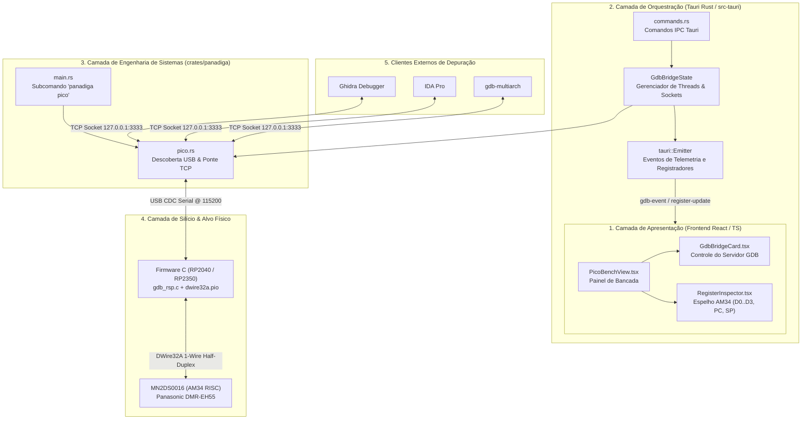

# Plano de Integração e Conexão na Codebase: Ponte GDB, Hardware e Desktop

**Documento de Arquitetura de Software e Roadmap de Implementação**  
**Projeto:** Panasonic DMR-EH55 DIGA Engineering Suite (`Panadiga`)  
**Subsistemas Conectados:** Firmware C (Pico), Crate Rust (`panadiga`), Backend Tauri (`src-tauri`), Frontend React/TypeScript (`apps/desktop`) e Ferramentas de Bancada (Ghidra / IDA Pro / OpenOCD)  

---

## 1. Visão Geral da Conexão na Codebase

O objetivo deste plano é conectar todas as pontas soltas da arquitetura em um fluxo operacional único, permitindo que o usuário controle o hardware, a depuração GDB e a recuperação de firmware tanto pela linha de comando (`panadiga`) quanto pela interface visual desktop (`Tauri`), com sincronização em tempo real.

---

## 2. As 5 Fases do Plano de Conexão

### Fase 1: Unificação de Tipos e Modelos de Dados (Rust $\leftrightarrow$ TypeScript)
* **Objetivo:** Garantir que o frontend React e o backend Rust compartilhem os mesmos modelos fortemente tipados sem divergências.
* **Tarefas:**
  1. Definir em `apps/desktop/src/types/pico.ts`:
     * `PicoDevice`: nome da porta, arquitetura (`RP2040`, `RP2350`, `Bootloader`), VID, PID.
     * `GdbBridgeStatus`: `active` (boolean), `listen_addr` (string), `connected_clients` (number), `last_event` (string).
     * `Am34RegisterState`: `d` (array de 4 u32), `a` (array de 4 u32), `pc` (u32), `sp` (u32), `psw` (u32), `mdr` (u32), `is_halted` (boolean).
  2. Ajustar `apps/desktop/src-tauri/src/pico_serial.rs` e `crates/panadiga/src/pico.rs` para serializarem os mesmos campos JSON esperados pelo frontend.

---

### Fase 2: Backend Tauri: Gerenciamento Assíncrono do Servidor GDB
* **Objetivo:** Permitir que a interface gráfica inicie e pare a ponte GDB sem bloquear a thread principal da UI.
* **Tarefas:**
  1. Implementar `GdbBridgeState` com controle de encerramento via `Arc<AtomicBool>`.
  2. Adicionar os novos comandos Tauri em `apps/desktop/src-tauri/src/commands.rs`:
     * `start_gdb_bridge(port_name: String, listen_addr: String) -> Result<GdbBridgeStatus>`
     * `stop_gdb_bridge() -> Result<()>`
     * `get_gdb_bridge_status() -> Result<GdbBridgeStatus>`
     * `get_am34_registers() -> Result<Am34RegisterState>`
  3. Emitir eventos assíncronos via `app_handle.emit("gdb-client-status", ...)` para que a interface acenda o indicador de "Cliente Conectado (Ghidra/GDB)" instantaneamente.

---

### Fase 3: Frontend Desktop: Painel de Controle GDB & Inspetor de Registradores
* **Objetivo:** Oferecer na tela de bancada (`PicoBenchView`) um painel completo para gerenciar o GDB e visualizar o estado da CPU AM34.
* **Tarefas:**
  1. **Atualizar `usePicoBenchViewModel.ts`:**
     * Conectar a listagem real de portas seriais chamando `invoke('list_pico_serial_ports')` na montagem do componente.
     * Adicionar funções `startGdbServer()`, `stopGdbServer()` e listener de eventos Tauri para atualizações de conexão.
  2. **Adicionar Card do Servidor GDB em `PicoBenchView.tsx`:**
     * Switch de ligar/desligar com indicador de status:
       * 🔴 Desativado
       * 🟡 Aguardando conexão em `127.0.0.1:3333`
       * 🟢 Cliente Ativo (`Ghidra` / `gdb-multiarch` conectado)
     * Botão rápido "Copiar Comando GDB": copia `target remote 127.0.0.1:3333` para a área de transferência.
  3. **Adicionar Painel de Registradores do Chip AM34:**
     * Grade visual mostrando os registradores capturados: `PC`, `SP`, `D0..D3`, `A0..A3`.
     * Botões de controle de execução: "Pausar CPU (Break)", "Retomar (Continue)", "Passo Único (Step)".

---

### Fase 4: Automações de Bancada & Integração com Ferramentas Externas (`tools/`)
* **Objetivo:** Fornecer scripts de 1 clique para abrir o depurador sem digitação manual de comandos.
* **Tarefas:**
  1. Criar `tools/iniciar_ponte_gdb.bat`
  2. Criar `tools/conectar_gdb_multiarch.bat`
  3. Criar `tools/executar_openocd.bat`
  4. Adicionar documentação de importação de mapa de memória para o Ghidra (`tools/ghidra_am34_memory_map.py`)

---

### Fase 5: Validação, Testes e Scripts de Build Unificado
* **Objetivo:** Assegurar que toda a suíte continue com 100% de integridade e compilação sem falhas.
* **Tarefas:**
  1. Adicionar testes de integração para o ciclo completo da ponte TCP.
  2. Script de build mestre `build_all.bat` na raiz.
