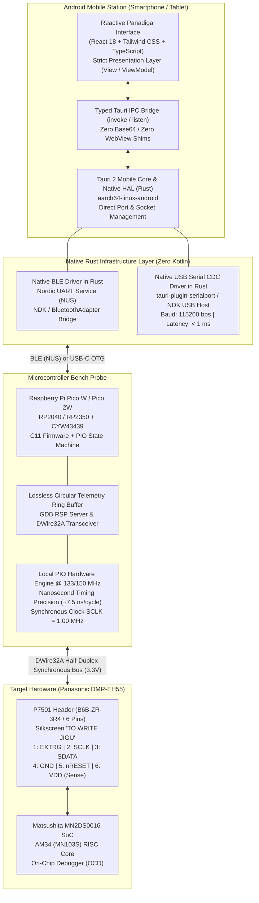
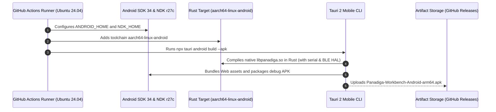

# Mobile Architecture (Android APK) and Wireless Connectivity (Bluetooth Low Energy)
## Panadiga Workbench Mobile — Native Rust Hardware Abstraction Layer Specification

> **Classification:** Systems Architecture and Hardware Engineering Specification  
> **Target Devices:** Android Mobile Devices (`aarch64-linux-android`) & Raspberry Pi Pico / Pico W / Pico 2 Probes  
> **Under-Test Target:** Panasonic DIGA DMR-EH55 (Digital PCB `VEP79138`, Header `P7501`)  
> **Status:** Normative / Validated in Multi-Platform CI/CD  

---

## 1. Solution Overview

To facilitate field bench operations, rapid forensic triage, and galvanic isolation without requiring a tethered desktop computer or long USB cables running to the recorder chassis, the **Panadiga** ecosystem provides a native mobile application for **Android (`.apk`)**, communicating over **Bluetooth Low Energy (BLE)** and **USB-C OTG**.



---

## 2. Architectural Decision: Native Rust HAL via Tauri 2.0 (Zero Kotlin / Zero WebUSB)

The mobile client architecture is governed by the principles of **Separation of Concerns (SoC), Clean Architecture, and Real-Time Determinism**:

### 2.1 Technical Refutation of WebUSB / Web Bluetooth in WebView (Path 1)
Using WebUSB (`navigator.usb`) and Web Bluetooth (`navigator.bluetooth`) from the WebView JavaScript engine was explicitly **rejected** for core engineering reasons:
1. **Android WebView Security Sandbox (`android.webkit.WebView`)**: The default Android WebView disables WebUSB by Google security policy. Enabling it would require authoring custom Java/Kotlin subclasses of `WebChromeClient` with manual wrappers around `android.hardware.usb.UsbManager`, violating the requirement of zero handcrafted Kotlin.
2. **Dependency Inversion Violation**: Hardware communication belongs strictly in the **Infrastructure / Hardware Abstraction Layer (HAL)**. Implementing device drivers in TypeScript couples hardware transport lifecycles to React UI component mounting.
3. **Garbage Collection (GC) Jitter & Serialization Overhead**: AM34 in-circuit debugging via GDB RSP requires sub-millisecond lexical packet turnaround. In the V8 engine, unpredictable GC pauses and Base64/JSON payload conversion introduce unacceptable latency into single-step (`$s#...`) and register dump (`$g#...`) operations.

### 2.2 The Approved Strategy: Native Rust HAL via Tauri 2.0 Core (Path 2)
1. **Native Rust Transport Layer**:
   - All USB CDC serial port control (`/dev/bus/usb`, ch34x, cdc-acm, FTDI) and Bluetooth Low Energy handling reside **100% inside the Rust Core Engine**, using official Tauri 2 plugins (`tauri-plugin-serialport` and native Rust BLE crates for Linux/Android).
   - Tauri 2 bundles the underlying JNI/NDK bindings internally, completely removing any need for manual Java or Kotlin code.
2. **Frontend Strictly as Presentation (View/ViewModel)**:
   - The React 18 / TypeScript interface has no direct knowledge of hardware buses. It strictly invokes strongly typed IPC commands (`invoke('pico_connect_usb')`, `invoke('pico_connect_ble')`) and listens to the unified logging event bus.
3. **Zero-Copy Processing over Immutable Slices (`&[u8]`)**:
   - Incoming RSP frames and probe telemetry arrive directly in Rust, are validated over immutable byte slices without serialization overhead, and are recorded to the `GdbTelemetryRingBuffer`.

---

## 3. Wireless Connectivity via Bluetooth Low Energy (BLE)

### 3.1 GATT Profile: Nordic UART Service (NUS)
The Raspberry Pi Pico W / Pico 2W firmware exposes the standard **Nordic UART Service (NUS)** on the Infineon/CYW43439 radio:

| GATT Attribute | Canonical UUID | Properties | Purpose |
| :--- | :--- | :--- | :--- |
| **Service (NUS)** | `6E400001-B5A3-F393-E0A9-E50E24DCCA9E` | Primary Service | Transparent virtual serial stream over BLE |
| **RX Characteristic** | `6E400002-B5A3-F393-E0A9-E50E24DCCA9E` | Write Without Response / Write | Commands sent from Rust Core to Pico (e.g., Cold Break-In, GDB RSP) |
| **TX Characteristic** | `6E400003-B5A3-F393-E0A9-E50E24DCCA9E` | Notify / Read | Telemetry streams and register responses from Pico to Rust Core |

### 3.2 Nanosecond Bus Timing vs. Bluetooth Latency
A common engineering question is whether Bluetooth latency compromises nanosecond-accurate silicon bus timings:

> [!IMPORTANT]
> **Bluetooth NEVER bit-bangs the hardware bus directly.**  
> The Matsushita DWire32A protocol operates at a synchronous **1.00 MHz** clock with bus turnaround times of **$1.0\,\mu\text{s}$** and single-cycle instruction timings of **$\sim 7.5\,\text{ns}$** (at 133 MHz RP2040 clock).  
> All time-critical operations are executed **locally by the hardware PIO (Programmable I/O) coprocessor** on the Pico board.  
> The Bluetooth channel operates solely on the upper transport layer (asynchronously streaming command and telemetry frames managed by the native Rust HAL), where latencies of $15\text{ ms}$ to $25\text{ ms}$ are completely transparent to the user and the asynchronous GDB RSP protocol.

---

## 4. Electrical Discipline: Pinout & P7501 Power Constraints

### 4.1 Strict Prohibition on Powering Pico via Panasonic P7501

> [!CAUTION]
> **CRITICAL PHYSICAL SAFETY RULE: NEVER POWER THE RASPBERRY PI PICO FROM HEADER P7501.**  
> Pin 6 of the `P7501` header on PCB `VEP79138` delivers $3.3\text{V}$ tapped from the Panasonic voltage supervisor logic rail. This line was designed by Matsushita strictly for **voltage presence sensing** (current capacity $< 10\text{ mA}$).  
> A standard Pico draws $30\text{ mA}$ to $50\text{ mA}$, while a **Pico W / Pico 2W peaks between $150\text{ mA}$ and $300\text{ mA}$ during Wi-Fi/Bluetooth RF transmissions**.  
> Sourcing power from Pin 6 will immediately **collapse the Panasonic 3.3V power rail**, trip the master reset IC (`XRST`), induce system panic on the front VFD, and risk burning internal traces on the 4-layer digital PCB.

### 4.2 Grounding and External Power Rules
1. **Pico Power Supply**:
   - Power the Pico from an external $5.0\text{V}$ supply on pin `VSYS` (Pin 39) or via its micro-USB/USB-C connector (portable 5V powerbank or regulated 3.7V LiPo booster).
2. **Ground Reference (GND)**:
   - Header Pin 4 of `P7501` (Panasonic GND) **MUST** be bonded to a Pico GND pin (e.g., GP38 or Pin 3) to equalize the bus ground reference.
3. **Voltage Sensing (Sense Only)**:
   - Header Pin 6 of `P7501` (VDD 3.3V) connects to a high-impedance Pico ADC or digital input pin (`GP26` / `ADC0`) solely to report to the mobile UI whether the Panasonic unit is powered on.

### 4.3 Canonical P7501 Pinout Table (B6B-ZR-3R4)

| Physical Pin | Schematic Pin | Matsushita Signal | Pico Pin (RP2040/RP2350) | Protection Circuitry | Function |
| :---: | :---: | :---: | :---: | :---: | :--- |
| **1** | 6 | **EXTRG** | `GP4` | $100\,\Omega$ Series | External trigger for logic analyzer / oscilloscope |
| **2** | 5 | **SCLK** | `GP3` | $100\,\Omega$ Series | 1.00 MHz synchronous clock driven by Pico PIO |
| **3** | 4 | **SDATA** | `GP2` | $100\,\Omega$ Series + $4.7\,\text{k}\Omega$ Pull-up | Half-duplex bidirectional synchronous data line |
| **4** | 3 | **GND** | `GND` (Pin 38) | Direct low-impedance bond | **Mandatory common ground reference** |
| **5** | 2 | **nRESET** | `GP5` | Open-Drain only | Master system reset (`XRST`). Push-pull 3.3V driving is strictly forbidden! |
| **6** | 1 | **VDD (3.3V)**| `GP26` (ADC0) | High-impedance divider | **Logic level sensing only. DO NOT POWER PICO.** |

---

## 5. Automated APK CI/CD Build Pipeline

The Android APK compilation is automated via GitHub Actions (`.github/workflows/ci.yml`) targeting `aarch64-linux-android`:



### 5.1 Local Compilation Instructions
To build the APK locally on a development workstation:

```powershell
# 1. Export Android SDK and NDK paths
$env:ANDROID_HOME = "C:\Users\<User>\AppData\Local\Android\Sdk"
$env:NDK_HOME = "$env:ANDROID_HOME\ndk\27.0.12077973"

# 2. Add Rust ARM64 target
rustup target add aarch64-linux-android

# 3. Enter desktop folder and build APK
cd apps/desktop
npx tauri android build --apk --target aarch64-linux-android
```

The resulting output APK is saved to:
`apps/desktop/src-tauri/gen/android/app/build/outputs/apk/debug/app-debug.apk`

---

## 6. Field Operation Runbook

1. **Powering the Probe**: Power the Raspberry Pi Pico W from an external 5V powerbank or bench supply. The on-board LED indicates BLE advertising.
2. **Safe Mechanical Mating**: With the Panasonic unit unplugged from AC mains, mate the JST ZR 1.5mm connector to header `P7501` on PCB `VEP79138`.
3. **App Initialization**: Launch **Panadiga Mobile** on the Android device.
4. **Pairing via Native Rust HAL**:
   - Tap **"Connect BLE (Pico W)"**.
   - The native Rust core scans and connects directly to the Nordic UART Service (`6E400001-...`).
5. **Telemetry and Unbrick**:
   - Power on the DMR-EH55. The **VDD Sense** indicator turns green ($3.3\text{V}$).
   - Execute **Cold Break-In** to halt AM34 execution before IPL boot.
   - Run NVRAM surgical sanitization or attach remote GDB sessions with zero GC jitter.
