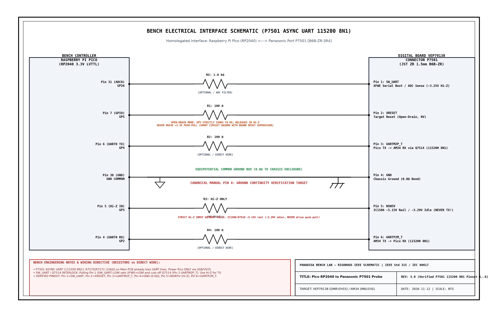

# HARDWARE ENGINEERING BLUEPRINT & BENCH CIRCUITS
## In-Circuit `P7501` Async UART (`115200 8N1`) & External Spansion S29JL064H (TSOP-48) Programming
### Panasonic DMR-EH55 Digital Recorder — Main Board (`VEP79138`)

---

## 1. System Overview & Engineering Scope

This document serves as the official **Hardware Engineering Blueprint and Bench Wiring Guide** for silicon-level diagnostics, live boot/UART capture, recovery, and firmware programming of the **Panasonic DMR-EH55** (DIGA Chassis) DVD/HDD recorder.

```text
                      PANASONIC DMR-EH55 HARDWARE ARCHITECTURE
   ┌─────────────────────────────────────────────────────────────────────────────┐
   │                           MAIN BOARD (VEP79138)                             │
   │                                                                             │
   │   ┌───────────────────────────┐             ┌───────────────────────────┐   │
   │   │   Matsushita / Panasonic  │             │   Spansion S29JL064H      │   │
   │   │      AM34 / MN103S        │   16-Bit    │       (IC5001)            │   │
   │   │   + Syscon IC7501         │◄───────────►│   64 Mbit / 8 MByte NOR   │   │
   │   │  RISC 32-bit Core         │    Bus      │     TSOP-48 Package       │   │
   │   └─────────────┬─────────────┘             └─────────────┬─────────────┘   │
   │                 │                                         │                 │
   │                 │ P7501 UART 115200 8N1                   │ WP#/ACC         │
   │                 │ + Q7510/Q7514 Control                   │ (Pin 14 Unlock) │
   │                 ▼                                         ▼                 │
   │           [ P7501 Header ]                       [ Square SMD Pad ]         │
   │         6-Pin TO JIGU Port                        Hardware Unlock           │
   └─────────────────┬───────────────────────────────────────────────────────────┘
                     │
                     │ Shielded Harness / Bench Test Leads (< 15 cm)
                     ▼
   ┌──────────────────────────────────┐        OR       ┌────────────────────────┐
   │    INTERFACE 1: IN-CIRCUIT       │                 │ INTERFACE 2: EXTERNAL  │
   │   Raspberry Pi Pico (RP2040/2350)│                 │  Universal Programmer  │
   │  P7501 UART Engine @ 115200 8N1  │                 │   SVOD 4 / XGecu T48   │
   │    (Non-Destructive In-Circuit)  │                 │ (TSOP-48 ZIF Socket)   │
   └──────────────────────────────────┘                 └────────────────────────┘
```

### Critical Failure Mode & Hardware Mission
* **Root Cause Failure:** Continuous reboot loop with front-panel error code **`U99`** (*Drive Communication / Parameter Timeout*), triggered by corrupted non-volatile calibration parameters emulated in Flash (`EEMUL` / NVRAM) residing in the top 64 KB of the NOR Flash (`0x7F0000` to `0x7FFFFF`, sectors `SA134` to `SA141`).
* **Engineering Objectives:**
  1. **In-Circuit `P7501` Async UART Interface:** Interface a **Raspberry Pi Pico (RP2040 / RP2350)** directly to the service port **`P7501`** on board `VEP79138` (`115200 8N1`), with strict Hi-Z protection on Pin 5 (`NSW5V` / `GP3`), open-drain reset control (`XRESET` / `GP5`), and `Q7510`/`Q7514`-aware `SW_UART` handling (`GP26`).
  2. **Direct TSOP-48 Programmer Interface:** Provide complete pin-to-pin mapping for the **Spansion `S29JL064H70TFI00` (`IC5001`)**, thermal hot-air rework runbook with Sn63/Pb37 alloy, ZIF socket insertion, and configuration profiles for **SVOD 4** and **XGecu T48** programmers.

---

## 2. Detailed Bench Electrical Schematic: RP2040 / RP2350 $\leftrightarrow$ P7501

The physical link between the **Raspberry Pi Pico (RP2040 / RP2350)** and the **`P7501`** header on board `VEP79138` uses asynchronous **`115200 8N1` UART** over an onboard transistor buffer (`Q7510`/`Q7514`) plus discrete reset and rail-sense lines.

### 2.0 Connector Standard (JST ZR 1.5mm - B6B-ZR-3R4) & Microcontroller Compatibility

* **Physical Header Standard:** 6-pin **JST ZR connector with 1.5mm pitch**, Panasonic OEM part number **`B6B-ZR-3R4`** (labeled *"TO JIGU"* on schematic `VEP79138`).
* **Commercial Pre-Assembled Wiring Harness:** Search commercially for **JST ZR 1.5mm 6-pin Female to Dupont 2.54mm cable** (housing `ZHR-6` with crimp pins `SZH-002T-P0.5`). This allows direct plug-and-play connection to the Raspberry Pi Pico header pins without soldering onto the recorder PCB.
* **Incompatible Connectors (Do NOT Force):** Do not confuse with **JST SH (1.0mm - too small)**, **JST PH (2.0mm)**, or **JST XH (2.54mm - too large)**.
* **RP2040 vs. RP2350 Compatibility:** Both Raspberry Pi Pico (RP2040) and Pico 2 (RP2350) are 100% natively supported. The RP2350's 520 KB SRAM allows buffering extensive UART telemetry and memory inspection frames.
* **Protocol Alert (`P7501` Async UART vs. Legacy DWire32A/JTAG):** Official DMR-EH55 schematics prove that `P7501` is **NOT** synchronous `DWire32A` (`SDATA`/`SCLK`) or JTAG (`TDI`/`TDO`/`TMS`). Pin 6 (`UARTP2M_T`) is `115200 8N1` AM34 TX, Pin 3 (`UARTM2P_T`) is `115200 8N1` RX (when `SW_UART` is Hi-Z), and Pin 5 (`NSW5V`) is a `~5.15V` switched supply node via `D7510` that must NEVER be driven by the Pico.

### 2.1 Complete Bench Electrical Schematic (Official Panasonic Service Manual Reference)

> [!IMPORTANT]
> ### Assembly Disclaimer: Bench Prototype vs. Production Fixture (Resistors)
> * **PROTOTYPE BENCH MODE (Direct Jumper Wire / Optional Series Protection):**  
>   For rapid bench UART diagnostics using short leads (**$L \le 15\text{ cm}$**), `VEP79138` already includes onboard pull-up networks `R7570` (`10 kΩ`) and `R7572` (`10 kΩ`) tied to `NSW5V`, plus base biasing `R7562` (`4.7 kΩ`) and `R7559` (`10 kΩ`). **Do NOT attach any external $4.7\text{ k}\Omega$ pull-up to 3.3V** on `UARTM2P_T` (Pin 3). Ensure `GP3` (`NSW5V`) stays permanently `Hi-Z Input` with pulls disabled.
> * **FINISHED PRODUCT / PERMANENT BENCH FIXTURE MODE (Series Current-Limiting Resistors Recommended):**  
>   For permanent test jigs or harnesses ($L > 15\text{ cm}$):
>   - **$R_{\text{ser}} = 100\,\Omega$:** Optional inline damping/current-limiting on `GP2` (`UARTP2M_T`), `GP4` (`UARTM2P_T`), and `GP5` (`XRESET`).
>   - **$R_{\text{prot}} = 1.0\text{ k}\Omega$:** Series isolation on `GP26 / ADC0` (`SW_UART`) against ESD transients.

```text
       RASPBERRY PI PICO (RP2040 / RP2350)                           MAIN BOARD VEP79138
             BENCH CONTROLLER                                         CONNECTOR P7501 (CANONICAL)
    ┌───────────────────────────────┐                             ┌──────────────────────────────┐
    │                               │                             │                              │
    │  Pin 31 (GP26 / ADC0) ────────┤◄──[ R_PROT: 1.0kΩ ]─────────├───◄ Pin 1: SW_UART (D)       │
    │  (Boot Latch / ~3.25V Sense)  │     Q7510/R7562/R7559       │     (LOW->XFWE; Hi-Z->TX)    │
    │                               │                             │                              │
    │  Pin 7  (GP5 / XRESET) ───────┤───[ R_SER: 100Ω (opt) ]─────├───► Pin 2: XRESET            │
    │  (Strict Open-Drain)          │     LOW=Reset / Hi-Z=Run    │     (QR7503, ~20µs Hi-Z rise)│
    │                               │                             │                              │
    │  Pin 6  (GP4 / UART TX) ──────┤───[ R_SER: 100Ω (opt) ]─────├───► Pin 3: UARTM2P_T         │
    │  (115200 8N1 -> AM34 RX)      │     Onboard R7570 10kΩ      │     (MAX RXD via Q7514)      │
    │                               │                             │                              │
    │  Pin 38 (GND / Ground 0V) ────┤═════════════════════════════╞════ Pin 4: GND Common        │
    │  (0V Chassis Reference)       │   DIRECT 0.0Ω GROUND BUS    │     (0.0Ω to Chassis!)       │
    │                               │                             │                              │
    │  Pin 5  (GP3 / NSW5V Sense) ──┤◄──[ Hi-Z Input / NO PULLS ]─├───◄ Pin 5: NSW5V (X_SW_5R2V) │
    │  (NEVER Drive Push-Pull!)     │     D7510 / IC1506 ~5.15V   │     (~3.29V resting)         │
    │                               │                             │                              │
    │  Pin 4  (GP2 / UART RX) ──────┤◄──[ R_SER: 100Ω (opt) ]─────├───◄ Pin 6: UARTP2M_T         │
    │  (115200 8N1 <- AM34 TX)      │     Onboard R7572 10kΩ      │     (MAX TXD, Square Pad)    │
    │                               │                             │                              │
    └───────────────────────────────┘                             └──────────────────────────────┘
```

### 2.2 Canonical Pinout Table (Panasonic Service Manual `VEP79138` Reference)

| Canonical Pin | Schematic Net | Circuit / SoC Role | Electrical Behavior | RP2040 Terminal | Functional Role in Recovery |
| :---: | :---: | :---: | :--- | :---: | :--- |
| **1** | `SW_UART` | `Q7510` / `IC7501` Pin 80 | `~3.25V` Hi-Z / `~2.69V` PD | Pin 31 (`GP26 / ADC0`) | Forces `XFWE` serial/JIG boot when driven LOW (cuts off `Q7514`); keep Hi-Z to enable `UARTM2P_T` TX. |
| **2** | `XRESET` | `QR7503` / Reset Line | Strict Open-Drain (0V/Hi-Z) | Pin 7 (`GP5`) | Master System Reset. Active LOW (0V); releases via pull-up in `~20 µs`. Never drive push-pull! |
| **3** | `UARTM2P_T` | `MAX RXD` (`Q7514` -> `UARTM2P`) | 3.3V `115200 8N1` (`R7570 10kΩ`) | Pin 6 (`GP4`, TX) | Async UART TX from Pico to AM34 RX (requires `SW_UART` = Hi-Z). No external pull-up. |
| **4** | `GND` | `GND_DIGITAL` | `0.0V` Chassis | Pin 38 (`GND`) | Equipotential Common Ground. Direct $0.0\,\Omega$ bond to metal chassis. |
| **5** | `NSW5V` | `X_SW_5R2V` (`IC1506` -> `D7510`) | `~5.15V` up / `~3.29V` resting | Pin 5 (`GP3`) | **Static rail sense ONLY.** Feeds `R7570`/`R7572`/`IC7501`. MUST remain `Hi-Z Input` without pulls! |
| **6** | `UARTP2M_T` | `MAX TXD` (`R7535` -> `R7572`) | 3.3V `115200 8N1` | Pin 4 (`GP2`, RX) | Async UART RX from AM34 (`<00>DDR CHECK: OK`, `CD diag boot mode`). Square Solder Pad. |

---

## 3. High-Resolution Visual Inspection & Physical PCB Topography

Below are the official laboratory CAD drawings and electrical schematics generated from the Panadiga engineering database:

### 3.1 Connector Orientation & PCB Topography


### 3.2 Official Panasonic Schematic Excerpt


### 3.3 Laboratory Bench Electrical Schematic


---

## 4. `P7501` Asynchronous UART Timings & PIO Engine

The PIO UART engine in `p7501_uart.pio` operates on deterministic asynchronous framing:
1. **Baud Rate:** `115200 bps` ($T_{\text{bit}} = 8.68\,\mu\text{s}$), **8 data bits, No parity, 1 stop bit (`8N1`)**.
2. **XRESET Open-Drain Rise Verification:** releasing `GP5` from LOW to Hi-Z measures pull-up rise time (`XRESET Release Rise Time (Hi-Z) : ~20 us`).
3. **`NSW5V` Safety Guardrail:** `GP3` stays initialized as `GPIO_IN` with `gpio_disable_pulls(3)` throughout boot, capture, and `ISOLATE` states.
4. **`SW_UART` Interlock Window:** Asserting `GP26` LOW with `XRESET` traps `CD diag boot mode` / `SDDIAG`; restoring `GP26` to Hi-Z restores `Q7514` bias for interactive `GP4` UART transmission.
