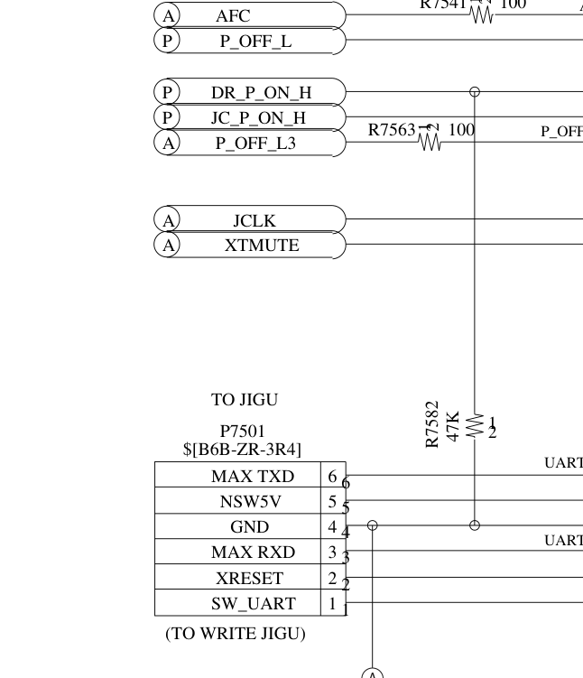

# HARDWARE ENGINEERING BLUEPRINT & BENCH CIRCUITS
## In-Circuit DWire32A (RP2040) & External Spansion S29JL064H (TSOP-48) Programming
### Panasonic DMR-EH55 Digital Recorder — Main Digital Board (PCB: VEP79138)

---

## 1. System Overview & Engineering Scope

This document serves as the official **Hardware Engineering Blueprint and Bench Wiring Guide** for silicon-level diagnostics, recovery, in-circuit debugging, and firmware programming of the **Panasonic DMR-EH55** (DIGA Chassis) DVD/HDD recorder.

```text
                      PANASONIC DMR-EH55 HARDWARE ARCHITECTURE
   ┌─────────────────────────────────────────────────────────────────────────────┐
   │                        MAIN DIGITAL BOARD (VEP79138)                        │
   │                                                                             │
   │   ┌───────────────────────────┐             ┌───────────────────────────┐   │
   │   │   Matsushita / Panasonic  │             │   Spansion S29JL064H      │   │
   │   │        MN2DS0016          │   16-Bit    │      (IC55007)            │   │
   │   │   (UniPhier / AM34 Core)  │◄───────────►│   64 Mbit / 8 MByte NOR   │   │
   │   │  RISC 32-bit @ 108/162MHz │    Bus      │     TSOP-48 Package       │   │
   │   └─────────────┬─────────────┘             └─────────────┬─────────────┘   │
   │                 │                                         │                 │
   │                 │ Matsushita DWire32A                     │ WP#/ACC         │
   │                 │ On-Chip Debug (OCD)                     │ (Pin 14 Unlock) │
   │                 ▼                                         ▼                 │
   │        [ CN55001 / P7501 ]                       [ Square SMD Pad ]         │
   │         6-Pin Debug Port                          Hardware Unlock           │
   └─────────────────┬───────────────────────────────────────────────────────────┘
                     │
                     │ Shielded Harness / Bench Test Leads (< 15 cm)
                     ▼
   ┌──────────────────────────────────┐        OR       ┌────────────────────────┐
   │    INTERFACE 1: IN-CIRCUIT       │                 │ INTERFACE 2: EXTERNAL  │
   │     Raspberry Pi Pico (RP2040)   │                 │  Universal Programmer  │
   │  DWire32A PIO Engine @ 1.0 MHz   │                 │   SVOD 4 / XGecu T48   │
   │    (Non-Destructive In-Circuit)  │                 │ (TSOP-48 ZIF Socket)   │
   └──────────────────────────────────┘                 └────────────────────────┘
```

### Critical Failure Mode & Hardware Mission
* **Root Cause Failure:** Continuous reboot loop with front-panel error code **`U99`** (*Drive Communication / Parameter Timeout*), triggered by corrupted non-volatile calibration parameters emulated in Flash (`EEMUL` / NVRAM) residing in the top 64 KB of the NOR Flash (`0x7F0000` to `0x7FFFFF`, sectors `SA134` to `SA141`).
* **Engineering Objectives:**
  1. **In-Circuit DWire32A Interface:** Interface a **Raspberry Pi Pico (RP2040 / RP2350)** directly to the test port **`CN55001 / P7501`** on board `VEP79138`, utilizing a custom PIO state machine for synchronous half-duplex communication, proper signal conditioning, reflection damping, and open-drain master reset control.
  2. **Direct TSOP-48 Programmer Interface:** Provide complete pin-to-pin mapping for the **Spansion `S29JL064H70TFI00` (`IC55007`)**, thermal hot-air rework runbook with Sn63/Pb37 alloy, ZIF socket insertion, and configuration profiles for **SVOD 4** and **XGecu T48** programmers.

---

## 2. Detailed Bench Electrical Schematic: RP2040 $\leftrightarrow$ P7501

The physical link between the **Raspberry Pi Pico (RP2040)** and the **`P7501`** test port on board `VEP79138` requires strict conditioning. Because the DWire32A protocol uses synchronous communication with rapid bus turnarounds on `SDATA`, excessive parasitic capacitance or improper terminations will cause signal ringing, false clock transitions, and trigger Panasonic's hardware watchdog.

### 2.0 Connector Standard (JST ZR 1.5mm - B6B-ZR-3R4) & Microcontroller Compatibility

* **Physical Header Standard:** 6-pin **JST ZR connector with 1.5mm pitch**, Panasonic OEM part number **`B6B-ZR-3R4`** (top-entry through-hole header labeled *"TO WRITE JIGU"* in official service manuals).
* **Commercial Pre-Assembled Wiring Harness:** Search commercially for **JST ZR 1.5mm 6-pin Female to Dupont 2.54mm cable** (housing `ZHR-6` with crimp pins `SZH-002T-P0.5`). This allows direct plug-and-play connection to the Raspberry Pi Pico header pins without soldering onto the recorder PCB.
* **Incompatible Connectors (Do NOT Force):** Do not confuse with **JST SH (1.0mm - too small)**, **JST PH (2.0mm)**, or **JST XH (2.54mm - too large)**.
* **RP2040 vs. RP2350 Compatibility:** Both Raspberry Pi Pico (RP2040) and Pico 2 (RP2350) are 100% natively supported. The RP2350's 520 KB SRAM allows caching entire 64 KB Spansion Flash sectors directly in local RAM.
* **Protocol Alert (DWire32A vs. Classic JTAG):** Connector P7501 **does not have TDI/TDO/TMS pins**. The protocol is Matsushita DWire32A using a single bidirectional half-duplex line (`SDATA`) synchronized by `SCLK`. Standard JTAG firmwares (e.g., DirtyJTAG) are incompatible and will cause bus contention.

### 2.1 Complete Bench Electrical Schematic (Official Panasonic Service Manual Reference)

> [!IMPORTANT]
> ### Assembly Disclaimer: Bench Prototype vs. Production Fixture (Resistors)
> * **PROTOTYPE BENCH MODE (Direct Jumper Wire / Resistors Absolutely Unnecessary):**  
>   For rapid bench testing, firmware recovery, and diagnostics using short wires (**$L \le 15\text{ cm}$**), all series damping resistors ($R_1 \dots R_4$) and the ADC protection resistor ($R_{\text{prot}}$) are **ABSOLUTELY UNNECESSARY**. Both the Raspberry Pi Pico (RP2040/RP2350) and the Panasonic UniPhier SoC operate at native $3.3\text{V}$ LVTTL logic levels. Furthermore, the RP2040 firmware enables the internal pull-up on `SDATA` via software (`gpio_pull_up`), allowing immediate plug-and-play operation with direct jumper wires and zero discrete components.
> * **FINISHED PRODUCT / PERMANENT BENCH FIXTURE MODE (Resistors Strongly Recommended):**  
>   For permanent laboratory test jigs, long harnesses ($L > 15\text{ cm}$), or commercial probes, discrete resistors are **STRONGLY RECOMMENDED**:
>   - **$R_1 \dots R_4 = 47\,\Omega \dots 100\,\Omega$:** Dampen reflections (*ringing*) caused by harness wire inductance and prevent overcurrent during half-duplex bus turnaround contention.
>   - **$R_{\text{pu}} = 4.7\text{ k}\Omega$:** Tied to Pin 1 ($+3.3\text{V}$ VDD) to guarantee sharp rise times ($t_r < 200\text{ ns}$) overcoming cable capacitance.
>   - **$R_{\text{prot}} = 1.0\text{ k}\Omega$:** Isolates the RP2040 ADC0 analog input from supply spikes and ESD transients.

```text
       RASPBERRY PI PICO (RP2040)                                   DIGITAL BOARD VEP79138
             BENCH CONTROLLER                                         CONNECTOR P7501 (CANONICAL)
    ┌───────────────────────────────┐                             ┌────────────────────────┐
    │                               │                             │                        │
    │  Pin 31 (GP26 / ADC0) ────────┤◄──[ R_PROT1: 1.0kΩ ]─┬──────├───◄ Pin 1: VDD Sense   │
    │  (3.3V Voltage Sense)         │     1.0kΩ 1% (ADC)   │      │     (+3.3V Target Ref) │
    │                               │                      │      │                        │
    │  Pin 7  (GP5 / nRESET) ───────┤───[ R_DAMP4: 100Ω ]──│──────├───► Pin 2: nRESET      │
    │  (Emulated Open-Drain)        │     100Ω 5%          │      │     (Master XRST, 0V)  │
    │                               │                [R_PU: 4.7k] │                        │
    │  Pin 6  (GP4 / PIO SDATA) ────┤◄──[ R_DAMP3: 100Ω ]──┴──────├───► Pin 3: SDATA       │
    │  (PIO SM0 Data I/O)           │     100Ω 5%                 │     (Bidirectional)    │
    │                               │                             │                        │
    │  Pin 38 (GND / Ground 0V) ────┤═════════════════════════════╞════ Pin 4: GND Common   │
    │  (0V Chassis Reference)       │   DIRECT 0.0Ω GROUND BUS    │     (0.0Ω to Chassis!) │
    │                               │                             │                        │
    │  Pin 5  (GP3 / PIO SCLK) ─────┤───[ R_DAMP2: 47Ω..100Ω ]────├───► Pin 5: SCLK        │
    │  (PIO Side-Set Clock Out)     │     Master Clock 1.0 MHz    │     (Synchronous Clock)│
    │                               │                             │                        │
    │  Pin 4  (GP2 / EXTRG) ────────┤───[ R_DAMP1: 100Ω ]─────────├───► Pin 6: EXTRG       │
    │  (External OCD Trigger)       │     100Ω 5%                 │     (Trigger / Halt)   │
    │                               │                             │                        │
    └───────────────────────────────┘                             └────────────────────────┘
```

### 2.2 Canonical Pinout Table (Panasonic Service Manual p.62 Reference)

| Canonical Pin | Manual Net Name | UniPhier SoC Signal | Logic Level | RP2040 Terminal | Functional Role in Recovery |
| :---: | :---: | :---: | :---: | :---: | :--- |
| **1** | `VDD_SENSE` | `VDD_3.3V` | +3.3V LVTTL | Pin 31 (GP26 / ADC0) | Target Power Monitor. Invariant: halts execution if $V < 3.0\text{V}$ or $V > 3.6\text{V}$. |
| **2** | `nRESET` | `XRST` | 0V / 3.3V | Pin 7 (GP5) | Master System Reset. Active LOW (0V). Driven as Open-Drain. |
| **3** | `SDATA` | `OCD_SDATA` | 3.3V LVTTL | Pin 6 (GP4) | Bidirectional Half-Duplex Data bus. Turnaround in 1 clock cycle. |
| **4** | `GND` | `GND_DIGITAL` | 0.0V Chassis | Pin 38 (GND) | Equipotential Common Ground. Direct $0.0\,\Omega$ bond to metal chassis. |
| **5** | `SCLK` | `OCD_SCLK` | 3.3V LVTTL | Pin 5 (GP3) | Synchronous Master Clock generated by RP2040 PIO (1.0 MHz nominal). |
| **6** | `EXTRG` | `OCD_EXTRG` | 3.3V LVTTL | Pin 4 (GP2) | Hardware Break/Trigger line. Identifiable on PCB by **Square Solder Pad**. |

---

## 3. High-Resolution Visual Inspection & Physical PCB Topography

Below are the official laboratory CAD drawings and electrical schematics generated from the Panadiga engineering database:

### 3.1 Connector Orientation & PCB Topography


### 3.2 Official Panasonic Schematic Excerpt


### 3.3 Laboratory Bench Electrical Schematic


---

## 4. DWire32A Protocol Timings & PIO Engine

The PIO state machine in `dwire32a.pio` runs a 32-bit synchronous cycle:
1. **Clock Frequency:** $1.0\text{ MHz}$ ($T_{\text{clk}} = 1000\text{ ns}$).
2. **Clock High / Low:** $500\text{ ns}$ high, $500\text{ ns}$ low.
3. **Data Setup:** Data valid on `SDATA` at least $120\text{ ns}$ before the rising edge of `SCLK`.
4. **Data Hold:** Maintained for at least $80\text{ ns}$ after the rising edge of `SCLK`.
5. **Bus Turnaround (Tristate Handover):** Exactly 1 full SCLK cycle idle period before direction change.
