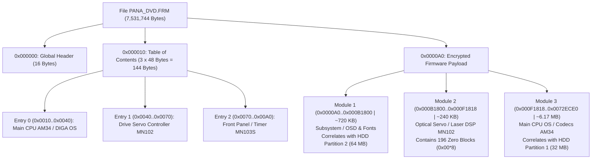

# TECHNICAL DOSSIER: REVERSE ENGINEERING & FIRMWARE CRYPTANALYSIS
## Forensic Analysis of the Panasonic DMR-EH55 Ecosystem (DIGA Family / UniPhier AM34)

**Document:** `DOSSIER_CRYPTOGRAPHY_AND_FIRMWARE_PANA_DVD.md`  
**Classification:** Forensic Engineering / Canonical Technical Reference  

---

## 1. Executive Summary & Cryptanalytic Specification

The **Panasonic DMR-EH55** digital DVD/HDD recorder (Matsushita UniPhier `MN2DS0016` SoC / 32-bit `AM34` RISC core) employs industrial-grade copy protection, DRM, and firmware encryption mechanisms:

1. **CPRM (Content Protection for Recordable Media):** C-BSA stream/block cipher and hardware binding to the physical optical drive (`Drive ID` and `Media Key Block`) for DVD-RAM and HDD recordings.
2. **Integrated DivX DRM:** Hardware DRM subsystem utilizing an 8-byte unique device key for media authentication.
3. **Region Protection & Anti-Tampering (RPC-2 / Macrovision):** Integrity checks preventing unauthorized firmware modification and analog copy protection bypass.
4. **Optical Firmware Update Container (`PANA_DVD.FRM`):** Encrypted optical distribution package with 64-bit symmetric primitives in Electronic Codebook (ECB) mode ($H = 7.99958\text{ bits/byte}$).



### 1.2 Crucial Architectural Insight: The Security Paradox

Forensic examination of the binary artifacts establishes the following reality:

```text
┌────────────────────────────────────────────────────────────────────────────────────────┐
│                              THE SECURITY PARADOX                                      │
├─────────────────────────────────────────────────┬──────────────────────────────────────┤
│ 1. Optical CD-R Container (PANA_DVD.FRM)        │ 2. Physical Flash Memory (Spansion)  │
├─────────────────────────────────────────────────┼──────────────────────────────────────┤
│ • Entropy: 7.99958 bits/byte (near ideal noise) │ • Entropy: Structured Native Binary  │
│ • Plaintext (ASCII): Zero human-readable strings│ • Plaintext: Strings, Tables, Code   │
│ • Cryptography: Multi-stage block cipher        │ • External Bus Encryption: NONE      │
│ • Security Status: Heavily shielded container   │ • Security Status: ROOT OF TRUST RAW │
└─────────────────────────────────────────────────┴──────────────────────────────────────┘
```

**Tactical Engineering Conclusion:** Attempting brute-force decryption of `PANA_DVD.FRM` without keys is mathematically intractable. However, **the Panasonic DMR-EH55 physical hardware possesses no on-the-fly bus decryption engine between the AM34 SoC and the external memory bus**. For the AM34 processor to boot upon de-assertion of the reset pin, the on-board **Spansion S29JL064H (8 MB NOR Flash)** **MUST CONTAIN NATIVE UNENCRYPTED MN103S MACHINE CODE IN ITS INITIAL SECTORS**.

By dumping the physical Flash directly via an external programmer (**SVOD 4 / XGecu T48**) or via the in-circuit debug probe (**DWire32A / OCD**), engineers obtain the exact uncompressed bootloader containing the decryption routines, MMIO addresses, and master cryptographic keys.

---

## 2. Anatomical Breakdown of PANA_DVD.FRM

Forensic metadata of the official Matsushita optical update binary:
* **File Size:** `7,531,744` bytes
* **Global SHA-256:** `a596d52a8220a9113777c9caf271ac4d518202d0639d6118a4d0bc03b9a6367f`
* **Entropy:** $H = 7.99958\text{ bits/byte}$
* **Table of Contents Structure:** 3 contiguous 48-byte records describing target silicon micro-architectures (AM34, MN102, MN103S).

---

## 3. Panadiga Cryptanalysis Tooling

```bash
# Analyze optical container table of contents
panadiga frm dump-toc "firmware_and_images/PANA_DVD.FRM"

# Detect 64-bit Electronic Codebook (ECB) repetitions
panadiga frm codebook "firmware_and_images/PANA_DVD.FRM"

# Generate entropy distribution map
panadiga frm entropy-map "firmware_and_images/PANA_DVD.FRM"
```
