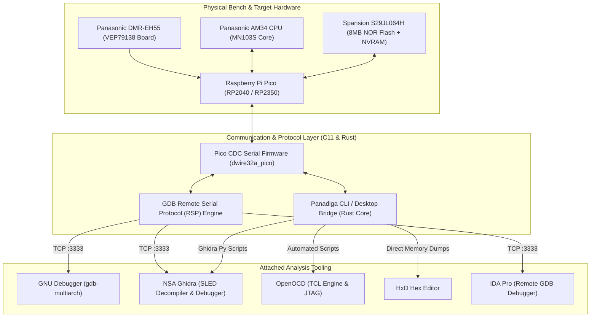

# ECOSYSTEM INTEGRATION STRATEGY: GHIDRA, GDB, OPENOCD & PANADIGA
## Silicon Reverse Engineering Architecture for Matsushita AM34 / MN103S

**Document:** `GHIDRA_GDB_INTEGRATION_STRATEGY.md`  
**Classification:** Reverse Engineering Strategy / Architecture Specification  

---

## 1. Architectural Overview

The Panadiga ecosystem acts as the central **Master Hub** bridging proprietary Panasonic hardware (based on the Matsushita AM34 / MN103S processor and Spansion S29JL064H Flash memory) with industry-standard binary analysis and debugging suites: **NSA Ghidra**, **GNU Debugger (`gdb-multiarch`)**, **OpenOCD**, and **IDA Pro**.



---

## 2. Tool Integration Protocols

### 2.1 GNU Debugger (`gdb-multiarch`)
* **Protocol:** Standardized GDB Remote Serial Protocol (RSP).
* **Port:** `127.0.0.1:3333` (TCP).
* **Target Architecture:** `mn10300` / `am34`.
* **Execution Flow:**
  1. Start the GDB bridge using Panadiga CLI (`panadiga pico gdb-bridge`) or Desktop UI.
  2. The server binds `127.0.0.1:3333` and opens the USB CDC channel to the Raspberry Pi Pico.
  3. Execute `gdb-multiarch -ex "set architecture mn10300" -ex "target remote 127.0.0.1:3333"`.
  4. Full debugging primitives available: breakpoints, register inspection (`info registers`), memory reads (`x/16wx 0x807FE000`), and single-stepping (`stepi`).

### 2.2 NSA Ghidra Integration (Single Source of Truth)
* **Processor Module:** Matsushita AM34 / MN103S SLED processor specification.
* **Rust SSOT Generator:** All memory-map definitions and symbol names originate in Rust (`src/ghidra.rs`) and export deterministically:
  ```bash
  panadiga ghidra export-all --dir tools/
  ```
  This creates:
  - `tools/ghidra_am34_memory_map.py`: Configures physical bus segments in Ghidra.
  - `tools/ghidra_import_symbols_panadiga.py`: Annotates interrupt vectors, IPL entry points, and NVRAM offsets.
  - `tools/ghidra_connect_debugger.py`: Connects Ghidra's visual debugger to the `127.0.0.1:3333` RSP target.

---

## 3. AM34 Memory Map Architecture

| Memory Region | Physical Start | Physical End | Size | Access | Description |
| :--- | :---: | :---: | :---: | :---: | :--- |
| **Boot ROM / IPL** | `0x80000000` | `0x807EFFFF` | 8,128 KB | Read-Only | Protected Initial Program Loader |
| **NVRAM / EEMUL** | `0x807F0000` | `0x807FFFFF` | 64 KB | Read/Write | Emulated EEPROM (Target of U99 unbrick) |
| **System SDRAM** | `0x90000000` | `0x93FFFFFF` | 64 MB | Read/Write | Main Execution Memory |
| **UniPhier MMIO** | `0xA0000000` | `0xAFFFFFFF` | 256 MB | Read/Write | Hardware Peripheral Registers |
| **On-Chip SRAM** | `0xD0000000` | `0xD0007FFF` | 32 KB | Read/Write | High-Speed Cache / Scratchpad |
