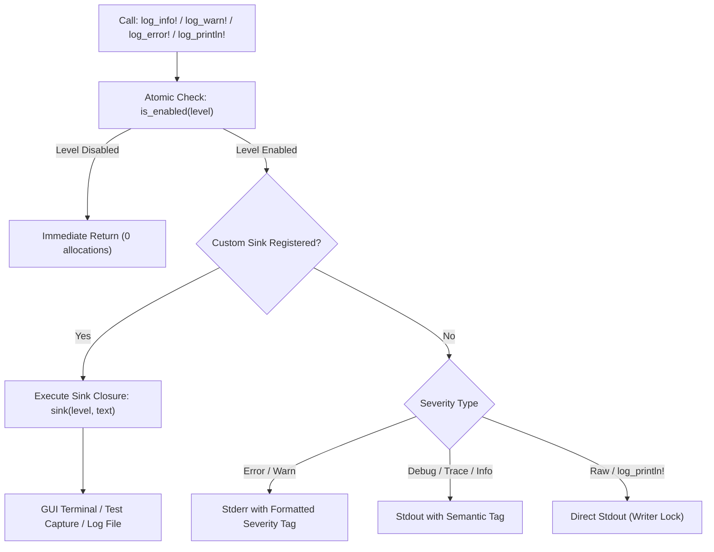

# UNIFIED LOGGING & TELEMETRY SUBSYSTEM SPECIFICATION — PANADIGA
## Architecture, Structured Telemetry & Diagnostics for the Rust Core Engine

**Document:** `LOGGING_AND_TELEMETRY_SUBSYSTEM.md`  
**Classification:** Systems Architecture & Code Standards Technical Reference  
**Module:** `crates/panadiga-core/src/logger.rs` (`panadiga_core::logger`)  

---

## 1. Engineering Motivation & Requirements

Historically, command-line utilities and forensic modules in Rust relied on ad-hoc `println!` and `eprintln!` calls scattered throughout the codebase. In an ecosystem comprising five distinct subsystems (storage parsing, NVRAM surgery, serial GDB bridge, binary scanning, and firmware cryptanalysis), uncoordinated raw printing introduced significant architectural challenges:

1. **Lack of Verbosity Control:** Inability to run commands in silent mode (`--quiet`) for automated scripts or verbose mode (`--verbose`) for debugging.
2. **Terminal Pollution During Automated Tests:** Unit and integration test suites emitted hundreds of uncoordinated log lines during `cargo test`.
3. **Inability to Redirect to GUI (Tauri):** The React/Tauri desktop frontend could not programmatically capture Rust engine output without brittle process pipe manipulation.
4. **Absence of Semantic Severity Levels:** Errors, critical hardware alerts, and informational banners were indistinguishably written to `stdout`.

To permanently solve these limitations, the unified logging subsystem [`crates/panadiga-core/src/logger.rs`](../../crates/panadiga-core/src/logger.rs) was designed, tested, and certified.

---

## 2. Module Architecture (`crates/panadiga-core/src/logger.rs`)

The subsystem was engineered for **maximum throughput**, **strict thread-safety**, and **zero heap allocation overhead** when log levels are filtered out.



### 2.1 Severity Hierarchy (`LogLevel`)

The [`LogLevel`](../../crates/panadiga-core/src/logger.rs) enum defines semantic ordering:

```rust
#[derive(Debug, Clone, Copy, PartialEq, Eq, PartialOrd, Ord)]
#[repr(u8)]
pub enum LogLevel {
    Off   = 0, // Total silence (no output)
    Error = 1, // Critical hardware, file, or protocol failures
    Warn  = 2, // Non-fatal anomalies (e.g., GDB socket disconnect)
    Info  = 3, // Standard operational milestones (Default Level)
    Debug = 4, // Offset tracing, entropy metrics, and packet decoding
    Trace = 5, // Byte-level hexadecimal dumps and timing inspections
}
```

### 2.2 Global State & Thread-Safety

Active log levels are stored in a global atomic primitive using `Acquire`/`Release` memory ordering:

```rust
static CURRENT_LEVEL: AtomicU8 = AtomicU8::new(LogLevel::Info as u8);
```

### 2.3 Custom Log Sinks for GUI & Automated Testing

The logger supports registering custom thread-safe sinks:
```rust
pub fn set_custom_sink<F>(sink: F)
where
    F: Fn(LogLevel, &str) + Send + Sync + 'static,
```
This enables the Tauri desktop frontend to capture real-time serial and forensic logs and pipe them directly to the laboratory workbench UI terminal.
