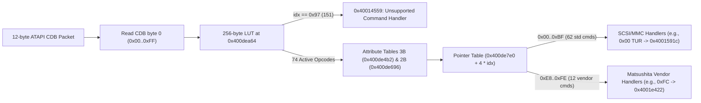

# Deep Reverse Engineering Dossier: MN103S Bootloader, R6-MV4 Optical Drive (`DRV`), and Live Bench Telemetry

> **Classification:** Empirical Silicon, Firmware, and Bench Hardware Reverse Engineering  
> **Live Bench Hardware Target:** **Panasonic DMR-EH55** DVD/HDD Recorder (Main PCB `VEP79138`, `Loader ver0.61 [06/03/06]`, Pico RP2040 interface on `COM10` / `P7501`)  
> **Disassembled Binary Reference:** **DMR-EH58** service package extracted from [DVDRAM.7z](../../firmware_and_images/dmr-eh58/DVDRAM.7z) (`Loader ver0.63 [07/10/24]`, Optical Drive `MATSHITA R6-MV4 A0 S415 05/14/08`) + **DMR-EH55** HDD partitions (`0x02000000` / `0x04000000`) & `PANA_DVD.FRM`  
> **Technical Scope:** 32-bit **Matsushita AM34 / MN103S (`MN10300`)** machine code, bootloader state dispatch, `[SDCD]` / `ACMD13` root-cause trace, ATAPI CDB dispatch architecture, hidden factory UART CLI monitor, and the complete **431-entry Shift-JIS Optical Drive Internal Error Dictionary**.

---

## 1. Methodology and Strict Evidence Separation (Live EH55 vs. Static EH58)

To uphold strict scientific provenance for the reverse-engineering community, this dossier explicitly separates live target observations from static cross-generation binary analysis:

1. **Live Hardware Telemetry (`DMR-EH55` / `VEP79138`):**
   * Captured directly off header **`P7501 (TO WRITE JIGU)`** via a **Raspberry Pi Pico (RP2040)** probe at `115200 8N1` running **`Loader ver0.61 [06/03/06]`**.
   * Includes controlled hardware ablation runs: normal boot (`SW_UART` Hi-Z / `U99` halt), `serial boot mode` (`SW_UART = LOW` / front VFD displaying `SDDIAG`), SD slot ribbon cable disconnected, HDD/drive Molex disconnected, IDE ribbon disconnected, and optical drive top cover fully screwed shut.
2. **Bit-Level Static Disassembly (`DMR-EH58 DVDRAM.7z` + EH55 HDD Correlation):**
   * While the raw EH55 NOR Flash shares the identical `MN103S` bootloader family, the service update package `DVDRAM.7z` provides cleanly isolated binaries — including the **uncompressed** 1.44 MB optical drive MCU image (`DRV_decomp.bin`), `BOOT.BIN`, `DEV.BIN`, and `MAIN.BIN` — enabling end-to-end cross-correlation.
   * **Precision Boundary:** Absolute virtual addresses (`0x44xxxxxx` and `0x40xxxxxx`) cited in the disassembly tables refer to the **EH58** binaries inventoried below; architectural headers, ECB cipher blocks, console strings, ATAPI protocols, and factory internal error codes (`0x83A7`) manifest identically on live **DMR-EH55** hardware.

---

## 2. Cryptographic Inventory and Cross-Generation Correlation Proofs (EH55 ↔ EH58)

| Model | Component | Size (Bytes / Hex) | MD5 | SHA-256 (Prefix) | Architectural Role |
| :--- | :--- | ---: | :--- | :--- | :--- |
| DMR-EH58 | `VERSION.TXT` | `83` (`0x000053`) | `53f2e8c30a5013bad58555ff5bc7aba6` | `9d21f0ddbce7d559...` | ASCII Metadata (`BOOT_VER,0.63`, `DEV_VER,3110PC`) |
| DMR-EH58 | `BOOT.BIN` | `262,144` (`0x040000`) | `7737e5710b351bd4b0f9b2b59c7b40f3` | `7c13c72a54c77387...` | MN103S SoC Loader `ver0.63 [07/10/24]` (`0x44000000`, plaintext) |
| DMR-EH58 | `DEV.BIN` | `512` (`0x000200`) | `b0c41cdfade27202a02507f9acf969bb` | `7ae160135acb2f3a...` | Device Header (`AA 55 FF FF EH58EE`, `PANA_DVD_REC` @ `+0x20`) |
| DMR-EH58 | `DRV.BIN` | `720,896` (`0x0B0000`) | `78202974d402db9802d3fab3fdb31579` | `3a9699dd576e96ac...` | Compressed F/E Drive FW (`EXTRHEADDRV`, exact match to EH55 Part 2 size) |
| DMR-EH58 | `DRV_decomp.bin` | `1,441,792` (`0x160000`) | `56cbd63993c800e05d0f914710d3c393` | `694a4ab8aa29fcc4...` | Decompressed MN103S Drive MCU (`0x40000000`, `MATSHITAR6-MV4 A0 S415`) |
| DMR-EH58 | `MAIN.BIN` | `6,361,216` (`0x611080`) | `4e6500cff94d923140ca52f00c38940e` | `f89af74a255f91ca...` | Main OS (`M_FIRM`, 64-bit ECB header `5187138d...`, `e5d1f34a...` @ `+0x38`) |
| DMR-EH58 | `DVDRAM.7z` | `7,179,299` (`0x6D8C23`) | `b24750771125d45e5672a4bd66d92aa7` | `d58297d6581551a9...` | Service optical/USB update container stored in repository |
| DMR-EH55 | `PANA_DVD.FRM` | `7,531,744` (`0x72ECE0`) | `2b1b5754d63d131b54bd93a6fa73f39d` | `a596d52a8220a911...` | Optical update container (`492F0560...`, CPRM/C2 64-bit ECB) |
| DMR-EH55 | `hdd_partition_firmware_0x02000000.bin` | `6,173,264` (`0x5E3250`) | `393e52d939eee76bbf06a98f2415253f` | `6ec63de059c00b28...` | HDD Part 1 (`M_FIRM`, `5187138d...` header, `e5d1f34a...` @ `+0x38`) |
| DMR-EH55 | `hdd_partition_firmware_0x04000000.bin` | `720,896` (`0x0B0000`) | `ee465f12930bef1599bb4fc256346ef0` | `487d5951d4aa7bc4...` | HDD Part 2 (`DRV` compressed image, 64-bit ECB encrypted on disk) |

### 2.1 Forensic Proofs Across Generations

1. **EH55 HDD Partition 2 (`0x04000000`) = Compressed F/E Optical Drive Firmware (`DRV`):**
   * Earlier documentation in [STORAGE_ARCHITECTURE_MEIHDFS_PARTITIONS.md](STORAGE_ARCHITECTURE_MEIHDFS_PARTITIONS.md) hypothesized that HDD Partition 2 (`720,896` bytes = `0x0B0000`) held OSD font assets or auxiliary media resources.
   * Cross-binary correlation proves **`DRV.BIN` in EH58 measures exactly `720,896` bytes (`0x0B0000`)**. In `DVDRAM.7z`, `DRV.BIN` carries a plaintext header (`EXTRHEADDRV \x01\x00\x00\x00`) declaring a decompressed length of `0x00160000` (`1,441,792` bytes). On the EH55 HDD, Partition 2 has the identical `720,896`-byte size but is encrypted with Matsushita's 64-bit ECB cipher (`1,280` occurrences of the `0xFF*8` ciphertext block `03 50 65 C8 7B B8 E0 90` and `2` occurrences of the `0x00*8` block `E5 D1 F3 4A 51 8B 26 90`).
   * On live **DMR-EH55** UART telemetry, the bootloader literally prints:
     ```text
     F/E Address = 0x90202000 , Drive(compress) Size = 0xACC50
     uncompress dst=90202000 len=160000 src=84080040 len=acc01
     HEADER:5627DD54, DECOMP:5627DD54
     ```
     The decompressed target length `len=160000` (`1,441,792` bytes) matches **`DRV_decomp.bin` (`1,441,792` bytes)** down to the exact byte.
2. **64-Bit ECB Continuity Between EH55 Partition 1 (`0x02000000`) and EH58 `MAIN.BIN`:**
   * The opening **16 bytes** of `MAIN.BIN` (EH58, `6,361,216` bytes) are **`51 87 13 8D 5B 0A FB 22 08 CE 26 BC 77 EA 8E 24`**, byte-identical to EH55 HDD Partition 1 (`hdd_partition_firmware_0x02000000.bin`).
   * Furthermore, offset `+0x38` in both `MAIN.BIN` and EH55 Partition 1 stores the exact same ciphertext block **`E5 D1 F3 4A 51 8B 26 90`** (corresponding to all-zero plaintext `0x00 * 8`, documented in [DOSSIER_CRYPTOGRAPHY_AND_FIRMWARE_PANA_DVD.md](DOSSIER_CRYPTOGRAPHY_AND_FIRMWARE_PANA_DVD.md)).
3. **Structure of `DEV.BIN` and Unencrypted Service Payloads:**
   * `DEV.BIN` (`512` bytes) opens with `AA 55 FF FF` followed by model tag `EH58EE` (`+0x04`) and the ASCII signature **`PANA_DVD_REC`** at `+0x0020`.
   * Unlike `MAIN.BIN` and HDD partitions, neither `BOOT.BIN` nor `DRV.BIN` in `DVDRAM.7z` contains any `0x00*8` or `0xFF*8` ECB ciphertext blocks (`ciph_00=0, ciph_FF=0`).

---

## 3. Verified MN10300 / AM34 (`MN103S`) Disassembly Semantics

Disassembling both `BOOT.BIN` and `DRV_decomp.bin` established a critical ISA offset-calculation rule required for accurate **Ghidra** (`txt231/GhidraMn10300`) and script-based control-flow recovery:

* **Verified Image Base Addresses:**
  * `BOOT.BIN`: Base address `0x44000000` (all pointer tables and `0x4403xxxx` string literals resolve directly in `0x44000000..0x4403FFFF`).
  * `DRV_decomp.bin`: Base address `0x40000000` (ASCII `"1.00"` at `+0x04`, reset entry vector `0x40001000` at `+0x08` little-endian, service vector `0x40030080` at `+0x10`).
* **Exact Relative Branch Target Rule (`va + disp`):**
  * For 32-bit calls/jumps (**`0xDD`** `call32` / **`0xDC`** `jmp32`) and 16-bit calls/jumps (**`0xCD`** `call16` / **`0xCC`** `jmp16`), Matsushita MN10300/AM3x computes targets relative to the **current instruction's start PC**, NOT the post-instruction PC (`va + len + disp`):
    `target = instruction_VA + signed_displacement`
  * **Binary Proof:**
    * At `0x4400b35d` (`BOOT.BIN`), `dd 77 b0 ff ff` (`disp = -0x4f89`) resolves via `0x4400b35d - 0x4f89` to **`0x440063d4`**, landing directly on the `cf 10 3f f8 fe f4 f8 13` prologue immediately following the previous function's `fc df 10 04` return epilogue. Adding instruction length (`+5`) would miss the prologue by 5 bytes.
    * Likewise, `0x44009cb7` (`cd 5a fe`, `-0x1a6`) resolves via `0x44009cb7 - 0x1a6 = 0x44009b11`, landing directly on `atapi_issue_pkt`'s `cf 10` prologue.
* **Common Instruction Patterns:**
  * Function prologues push callee-saved registers with **`cf 10`** (`movm [d2,d3,a2,a3],(sp)`) followed by negative stack adjustment (`f8 fe <off>`). Epilogues unwind with **`fc df 10 04`**.
  * 32-bit string/MMIO immediates load via **`fc cc <u32>`**, **`fc cd <u32>`**, **`fc c2 <u32>`**, and **`fc 81 <u32>`**.

---

## 4. Complete Reverse Engineering of `BOOT.BIN` (`Loader ver0.63`)

### 4.1 Verified Function & Symbol Map (`0x44000000`)

| Virtual Address | Function / Role | Prologue Bytes | Callers & Xrefs | Verified Machine Behavior |
| :--- | :--- | :--- | :--- | :--- |
| **`0x4400479f`** | `uart_getc` (Serial RX) | `cf 10 3f f8 fe fc fc ac` | `2` (`0x4400489a`, `0x44004904`) | Polls UART MMIO `0xd400200c` and reads byte from `0xd4002009`. **Unreachable** at runtime due to dead caller `0x4400488a`. |
| **`0x440047c7`** | `uart_putc` (Serial TX) | `cf 10 3f f8 fe fc f8 53` | `9` (within `0x44004808` / `0x4400488a`) | Polls TX status `0xd400200c` and writes output byte to `0xd4002008`. |
| **`0x44004808`** | `printf` (Boot Console) | `cf 10 3f f8 fe e8 f8 13` | `335` call sites | Primary `115200 8N1` boot telemetry formatter. |
| **`0x4400488a`** | `console_getline` *(Unreachable)* | `cf 10 3f f8 fe ec f8 13` | **`0` callers / `0` ptr xrefs** | Unreferenced dead function; only routine in `BOOT.BIN` invoking `uart_getc`. Proves no interactive RX prompt exists in `BOOT`. |
| **`0x440063d4`** | `delay_ms` (Millisecond Wait) | `cf 10 3f f8 fe f4 f8 13` | `25` call sites (incl. `0x4400b35d`) | Busy/timer millisecond delay loop (`d0 = 0x3e8` = `1000` passed after `'wait 1 second.\n'`). |
| **`0x440065bc`** | `fmu_sd_dispatcher` | `cf 10 3f f8 fe c8 f8 53` | `2` (`0x44004ad9` conditional, `0x44004af1` serial) | Coordinates SD card / `fmu` recovery sequence (helper at `0x44006cd9`). |
| **`0x44007812`** | `post_init_continuation` | `cf 10 3f f8 fe f4 80 01` | `12` call sites (all 4 boot modes) | Common post-dispatch continuation handler. |
| **`0x44007c59`** | `cd_diag_boot_mode` | `cf 10 3f f8 fe e0 00 f8` | `1` (`0x44007c0a`) | Logs `'*** CD diag boot mode ***\n'`, writes `'CDDIAG'` to VFD (`0x4400c777`), uncompresses F/E (`0x4400bcc2`), runs RTSC reset and `startup_drive` (`0x44009cea`). |
| **`0x4400836f`** | `bgo_driver_init` | `cf 10 3f f8 fe e4 fc a4` | `3` (`0x44004a2b`, `0x44004abd`, `0x44004b14`) | Initializes BGO subsystem; prints `'BGO driver init failed[%u].\n'` (`0x44034bf0`). **Skipped ONLY in `serial boot mode`**. |
| **`0x44009b11`** | `atapi_issue_pkt` | `cf 10 3f f8 fe dc f8 13` | `6` (`0x44009c04`, `0x44009c52`, `0x44009cb7`...) | Sends stack-constructed 12-byte ATAPI packet over PATA/ATAPI bus. |
| **`0x44009cea`** | `startup_drive` | `cf 10 3f f8 fe d8 f8 13` | `5` call sites | Prints `'** startup drive **'` and loops `TEST UNIT READY` countdown. |
| **`0x4400b34d`** | `wait_1_sec_timer_sync` | `fc cc 22 52 03 44 dd b5` | Table/indirect dispatch | Prints `'wait 1 second.\n'`, loads `mov 0x3e8, d0` (`2c e8 03`), calls `delay_ms` (`0x440063d4`), then prints `'*** timer correspond initialize ***\n'`. |
| **`0x4400bcc2`** | `uncompress` (F/E Loader) | `cf 10 3f f8 fe dc f8 13` | `6` call sites (`0x44006e71`..`0x44007d1f`) | Decompresses F/E drive image into RAM (`0x90202000` on EH55) and validates `HEADER:` vs `DECOMP:` checksum. |
| **`0x44027826`** | `GetSD_Status` (`ACMD13`) | `cf c0 fa fe 74 ff 80 40` | `2` (`0x44027d87`, `0x44027f93`) | Issues `CMD55 + ACMD13` into `0x505748f0`, validates `SD_CARD_TYPE` at `0x50574914`, returns `-91006` (`0xfffe9c82`) with `"[SDCD]This SD Card is't memory card"`. |

### 4.2 Boot Mode Dispatch State Machine (`0x44004930..0x44004b50`)

```mermaid
flowchart TD
    START(["Reset / Hardware Init + DDR CHECK"]) --> BANNER["0x44004942: Print Loader ver0.63 Banner"]
    BANNER --> BRANCH{"Inspect Hardware Straps and Flags"}

    BRANCH -- "FEonly Flag" --> FE["0x440049de: ***** FEonly mode *****"]
    FE --> FE_BGO["0x44004b14: Call BGO driver init (0x4400836f)"]

    BRANCH -- "Support Card Flag" --> SUP["0x44004a1e: ***** support card mode *****"]
    SUP --> SUP_BGO["0x44004a2b: Call BGO driver init (0x4400836f)"]
    SUP_BGO --> POST["0x44007812: post_init_continuation"]

    BRANCH -- "Normal Boot (SW_UART Hi-Z)" --> NORM["0x44004ab0: ***** normal mode *****"]
    NORM --> NORM_BGO["0x44004abd: Call BGO driver init (0x4400836f)"]
    NORM_BGO --> NORM_POST["0x44004ace: post_init_continuation -> ATAPI + HDD OS"]

    BRANCH -- "Serial Boot (SW_UART = LOW / XFWE)" --> SER["0x44004ae2: ***** serial boot mode *****"]
    SER --> SKIP_BGO["Skip BGO driver init (Only mode that skips it!)"]
    SKIP_BGO --> FMU["0x44004af1: Call fmu_sd_dispatcher (0x440065bc)"]
    FMU --> SYNC["0x4400b34d: wait 1 second (delay_ms 1000) -> timer correspond initialize"]
    SYNC --> SDINIT["SD init start... (GetSD_Status / SetBusWidth)"]
    SDINIT -- "SD Error -90001 / -90002" --> CDDIAG["0x44007c59: *** CD diag boot mode *** (VFD 'CDDIAG')"]
    CDDIAG --> UNCOMP["Decompress DRV -> RAM and call startup_drive (0x44009cea)"]
```



### 4.3 Proof Against an Active Bootloader UART RX Window (`fmu` / `wait 1 second.`)

Prior hypotheses conjectured that printing `'!!! start fmu to read & exec fvu. !!!'` followed by `'wait 1 second.'` opened a 1-second serial RX window for host `fvu.exe` / `fio_recv` uploads. Disassembly of `BOOT.BIN` disproves this with three deterministic findings:
1. At `0x4400b34d`, immediately after `'wait 1 second.\n'`, the bootloader loads **`1000` (`2c e8 03` = `0x03e8`)** into `d0` and calls **`delay_ms` (`0x440063d4`)**, then proceeds directly at `0x4400b364` to `'*** timer correspond initialize ***\n'` with zero UART status polling.
2. The sole UART input helper (`uart_getc` at `0x4400479f`) has only 2 call sites (`0x4400489a` and `0x44004904`), both inside `0x4400488a`. Function `0x4400488a` has **0 direct callers (`dd`/`cd`) and 0 pointer xrefs** across the entire binary.
3. Strings `'fvu.exe'` (`0x440398df`), `'fio_recv'` (`0x44039966`), and `'!!! start fmu to read & exec fvu. !!!'` (`0x440344e5`) have empty pointer-xref lists in production Loader `0.63`, representing leftover diagnostic scaffolding around the SD-slot recovery flow (`[SDCD]`).

### 4.4 Root-Cause Trace of SD Card Error `-91006` / `-90002` (`[SDCD]`)

When a test SD card inserted in the front panel fails during `serial boot mode`, live telemetry reports:
```text
SD init start...
[SDCD] sdcd_insrmv_check:SD Card inserted 
[SDCD]This SD Card is't memory card 
[SDCD]SetBusWidth:SD Status ERROR -91006
[SDCD] Set SD Bus Width fail ERROR:-91006
[SDCD] === This Card can't be controled ==== 
... SD init end
SD init failed[-90002].
```
Tracing `[SDCD]` inside `BOOT.BIN` (`0x44027826..0x44028019`):
1. `SetBusWidth` (`0x44027f8c..0x44027fe0`) switches the SD bus to 4-bit width (`ACMD6_SET_BUS_WIDTH`) and immediately calls **`GetSD_Status` (`0x44027826` @ `0x44027f93`)**.
2. `GetSD_Status` issues `CMD55` + `ACMD13` over the 4-bit SD bus into SRAM buffer `0x505748f0`.
3. It checks **`SD_CARD_TYPE` at `0x50574914`**. When `SD_CARD_TYPE` fails validation (due to non-SDSC/SDHC response layout or 4-bit `ACMD13` mismatch), it prints `"[SDCD]This SD Card is't memory card \n"` (`0x4403923b`) and returns **`-91006`** (`0xFFFE9C82`), bubbling up through `SetBusWidth` to `SD init failed[-90002]`.
4. **Practical Consequence:** A classic **SDSC (v1.0/v1.1 <= 1 GB, FAT16)** card that passes 4-bit `ACMD13` `SD_CARD_TYPE` validation is mandatory; disconnecting the front SD flex ribbon drops earlier into **`SD init failed[-90001]`** (`Card remove`).

### 4.5 Dynamic ATAPI Tray Control (`1B 00 00 00 03`) in `BOOT.BIN`

Inside the drive tray routine (`0x44009c40..0x44009ce5`), `BOOT.BIN` zeroes a 12-byte stack buffer and constructs the **`START STOP UNIT`** CDB directly in registers/stack before calling `atapi_issue_pkt` (`0x44009b11`):
* `0x44009c9c`: `80 1b` + `f8 53 f4` -> `CDB[0] = 0x1B` (`START STOP UNIT`)
* `0x44009ca6`: `80 03` + `f8 53 f8` -> `CDB[4] = 0x03` (`LoEj=1, Start=1` -> Close Tray / Load)
* `0x44009cb7`: `cd 5a fe` -> Calls `atapi_issue_pkt` (`0x44009b11`). Failure logs **`** can not close tray **\n`** (`0x44034fe5`).

---

## 5. Electrical Hardware Layer (`P7501` / `VEP79138`) and Live Ablation Matrix

### 5.1 `P7501 (TO WRITE JIGU)` Circuit Behavior and FTDI Passive Failure Analysis

While early documentation labeled connector **`P7501` / `CN55001`** (JST ZR 6-pin 1.5mm pitch, `B6B-ZR-3R4`) strictly with DWire32A OCD pin names, the official `VEP79138` schematic labels it **`TO WRITE JIGU`** with factory UART/control wiring:

| `P7501` Pin | Schematic Signal (`VEP79138`) | RP2040 Pin | Main & Digital PCB Circuit |
| :---: | :--- | :---: | :--- |
| **1** | `SW_UART` | `GP26` (LOW / ADC) | Connected to **Pin 80 (`SW_UART`) of `IC7501`** and **`Q7510` (`2SD0601A0L`)**. Pulling `SW_UART` LOW drops **`XFWE`**, latching **`serial boot mode`** (`SDDIAG`), but simultaneously **cuts base bias to `Q7514` (`R7528 4.7kΩ`)**. |
| **2** | `XRESET` | `GP5` (Open-Drain) | Collector of `QR7503` (active-low system reset; always drive Open-Drain). |
| **3** | `MAX RXD` | `GP4` | Collector of **`Q7514`** (`UARTM2P_T`); emitter feeds `UARTM2P` (SoC RX), which only conducts when `XFWE` is HIGH. |
| **4** | `GND` | `GND` | Common ground (`0.0V`). |
| **5** | `NSW5V` | `GP3` | Supplies the top rail of pull-up resistors **`R7527 (4.7kΩ)`**, **`R7559 (10kΩ)`**, and **`R7562 (4.7kΩ)`**. Passive FT232RL adapters float near `~3.3V` with `0V` switched 5V rail when `NSW5V` is unpowered. |
| **6** | `MAX TXD` | `GP2` (Pico RX) | `UARTP2M_T` via series resistor **`R7535 (100Ω)`** directly from SoC `115200 8N1` TX. |

### 5.2 Live DMR-EH55 Bench Capture Ablation Matrix (`COM10` / Pico)

| Capture Log (Bench) | Pico Command / Hardware State | Size / Lines | `startup reason` / SD Init | Tray / Boot State | Optical Drive Outcome |
| :--- | :--- | :---: | :--- | :--- | :--- |
| **`bootcap_cover_shut_live.log`** | `BOOTCAP 30000` (`SW_UART` Hi-Z, **top cover screwed shut**) | `4568 B` / `96` | *(Normal mode)* + `BGO driver init failed[1].` | `** can not close tray **` | `X(80020401) 59..52` -> `X(80040904)` + `SENSE[.. 83 A7 09 04 ..]` |
| **`normal_boot_90s.log`** | `BOOTCAP 30000` (`normal mode` extended) | `24362 B` / `995` | `BGO driver init failed[1].` | `** can not close tray **` | Identical (`80040904` + `83 A7 09 04`) |
| **`no_ide_cable_boot.log`** | `JIGBOOT 25000` (`SW_UART=LOW`, **IDE flat disconnected**, 2GB SD inserted) | `3019 B` / `69` | `startup reason = [70]` -> **`SD -91006` / `-90002`** | `*** CD diag boot mode ***` (no tray error) | `X(80062900) X(80023a00)` -> `X(80020401)` -> `X(80040904)` + `83 A7` |
| **`no_molex_boot.log`** | `JIGBOOT 25000` (`SW_UART=LOW`, **Molex power unplugged**) | `2732 B` / `70` | `startup reason = [70]` -> **`SD -91006` / `-90002`** | `*** CD diag boot mode ***` + mid-boot brownout reset (`<00>DDR CHECK: OK`) after `DECOMP` | Repeats `80040904` + `83 A7` |
| **`no_sd_flat_boot.log`** | `JIGBOOT 25000` (`SW_UART=LOW`, **SD front ribbon unplugged**) | `2884 B` / `66` | `startup reason = [5]` -> **`SD init failed[-90001]`** (`Card remove`) | `*** CD diag boot mode ***` | `X(80020401)` -> `X(80040904)` + `83 A7` |
| **`jigboot_20s.log` / `70s.log`** | `JIGBOOT 20000` / `70000` (`SW_UART=LOW`, VFD `SDDIAG`, SD inserted) | `2026 B` / `4157 B` | `startup reason = [70]` -> **`SD -91006` / `-90002`** | `*** CD diag boot mode ***` | `X(80040904)` countdown to `Drive start failed[-2147219196]` |
| **`sd_fmu_attempt1.log` / `2.log`** | `JIGBOOT 25000` (2GB SD FAT/payload file tests) | `3019 B` / `2830 B` | `startup reason = [70]` -> **`SD -91006` / `-90002`** | `*** CD diag boot mode ***` | Identical `83 A7 09 04`; card fails in `ACMD13` hardware check before FAT read |

---

## 6. Optical Drive Controller `DRV_decomp.bin` (`MATSHITA R6-MV4`) Architecture

### 6.1 Definitive Proof of 32-Bit `MN103S` Architecture (Not `MN102`) & Memory Map

Contrary to repair-forum assumptions calling the DIGA optical drive controller an `MN102` chip, disassembly of **`DRV_decomp.bin` (`1,441,792` bytes)** establishes that it runs **32-bit `MN103S` (`AM3x`)** firmware:
* **Header & Vector Layout (`0x40000000`):**
  * `+0x04`: **`"1.00"`**
  * `+0x08`: **`0x40001000`** (Reset entry point)
  * `+0x10`: **`0x40030080`** (Service table pointer)
* **Identical MN103S Opcode & 32-Bit MMIO Space:**
  * Uses `cf 10` / `fc df 10 04` prologues/epilogues and `va + disp` `dd`/`cd` branching.
  * **UART Hardware MMIO:** `0x880000c0` (`33` xrefs), `0x880000c2` (`13` xrefs), `0x880000c3` (`27` xrefs), `0x880000c4` (`5` xrefs), `0x880000c8` (`6` xrefs), `0x880000c9` (`23` xrefs), `0x880000cc` (`7` xrefs).
  * **ODC / Laser Control MMIO:** `0x88800000` (`@0x4000578d`).
  * **Internal SRAM Auth/Mode Flag:** `0x889f5523` (`103` xrefs across the UART CLI handlers).
* **Embedded Inquiry / Firmware Strings:**
  * `0x40008bf4`: `MATSHITAR6-MV4  A0     B014S05/14/08`
  * `0x40008ca4`: `MATSHITARAM47FK8AVC AVC 0000CommonFwHeader010000...`
  * `0x400dec04`: `MATSHITAR6-MV4  A0      S41505/14/08`

### 6.2 ATAPI `CDB[0]` Dispatch Pipeline and All 74 Active Opcodes

`DRV` indexes every incoming ATAPI command via a 256-byte lookup table (`0x400dea64`), where unsupported opcodes resolve to sentinel index **`151` (`0x97` -> `0x40014559`)**. Exactly **74 opcodes are active**: **62 standard SCSI/MMC commands** plus **12 Matsushita Vendor Opcodes** (`0xE8..0xFE`):

* **256-byte LUT:** `0x400dea64`
* **3-byte Descriptor Table (`3 * idx`):** `0x400de4b2`
* **2-byte Descriptor Table (`2 * idx`):** `0x400de696`
* **Handler Pointer Table (`4 * idx`):** `0x400de7e0`



| CDB[0] | LUT Index | attr3 (0x400de4b2) | attr2 (0x400de696) | Handler VA | SCSI/MMC Command & Role |
| :---: | :---: | :---: | :---: | :---: | :--- |
| `0x00` | `26` (`0x1A`) | `7d40b1` | `ff03` | `0x4001591c` | **`TEST UNIT READY`** — Mandatory polling command; EH55 `BOOT` issues `59..0` cycles expecting ready; live failure yields Sense `04/09/04` (`83 A7`) |
| `0x01` | `83` (`0x53`) | `7fb0f2` | `ff03` | `0x4001bba2` | **`REZERO UNIT`** — Recalibrate actuator/head to track zero |
| `0x03` | `1` (`0x01`) | `004001` | `ff03` | `0x400159ce` | **`REQUEST SENSE`** — Returns 18-byte SCSI fixed sense buffer (bytes `[10..11]` hold Panasonic internal uint16 error code) |
| `0x04` | `133` (`0x85`) | `7fbaf0` | `1202` | `0x4001c15d` | **`FORMAT UNIT`** — Format rewritable media (DVD-RAM / DVD-RW) |
| `0x08` | `79` (`0x4F`) | `7f85b3` | `ff03` | `0x4001bd03` | **`READ(6)`** — Legacy 6-byte sector read |
| `0x0A` | `136` (`0x88`) | `7f8737` | `1a03` | `0x4001be42` | **`WRITE(6)`** — Legacy 6-byte sector write |
| `0x0B` | `84` (`0x54`) | `7f85f2` | `ff03` | `0x4001bba2` | **`SEEK(6)`** — Legacy 6-byte seek |
| `0x12` | `0` (`0x00`) | `004001` | `ff03` | `0x4001591f` | **`INQUIRY`** — Returns `MATSHITAR6-MV4  A0      ` / `S415 05/14/08` drive identity string |
| `0x15` | `8` (`0x08`) | `6938f1` | `ff03` | `0x4001a795` | **`MODE SELECT(6)`** — Configure 6-byte drive mode pages |
| `0x1A` | `6` (`0x06`) | `600001` | `ff03` | `0x4001a253` | **`MODE SENSE(6)`** — Query 6-byte drive mode pages |
| `0x1B` | `12` (`0x0C`) | `69b8f2` | `ff03` | `0x4001b718` | **`START STOP UNIT`** — Controls spindle & tray (`1B 00 00 00 03` = Close Tray / Load; `02` = Open Tray / Eject) |
| `0x1E` | `10` (`0x0A`) | `000001` | `ff03` | `0x40015bd5` | **`PREVENT ALLOW MEDIUM REMOVAL`** — Lock/unlock mechanical eject latch |
| `0x23` | `78` (`0x4E`) | `6900f0` | `ff03` | `0x4001ccff` | **`READ FORMAT CAPACITIES`** — Report supported format capacities for blank/rewritable discs |
| `0x25` | `72` (`0x48`) | `7f00f1` | `ff03` | `0x40015cae` | **`READ CAPACITY(10)`** — Read last LBA and logical block size |
| `0x28` | `80` (`0x50`) | `7f85b3` | `ff03` | `0x4001bd03` | **`READ(10)`** — Standard 10-byte data read |
| `0x2A` | `137` (`0x89`) | `7f8737` | `1a03` | `0x4001be42` | **`WRITE(10)`** — Standard 10-byte data write |
| `0x2B` | `85` (`0x55`) | `7f85f2` | `ff03` | `0x4001bba2` | **`SEEK(10)`** — Standard 10-byte optical seek |
| `0x2E` | `139` (`0x8B`) | `7f0718` | `0202` | `0x4001be42` | **`WRITE AND VERIFY(10)`** — Write followed by read-back verification (DVD-RAM) |
| `0x2F` | `87` (`0x57`) | `7f35f2` | `de03` | `0x4001c0f7` | **`VERIFY(10)`** — Verify media sectors without host transfer |
| `0x35` | `132` (`0x84`) | `718090` | `ff03` | `0x4001d099` | **`SYNCHRONIZE CACHE(10)`** — Flush buffered write blocks to disc |
| `0x37` | `89` (`0x59`) | `7f3818` | `8602` | `0x40015d96` | **`READ DEFECT DATA(10)`** — Read primary/grown defect lists (DVD-RAM) |
| `0x3B` | `15` (`0x0F`) | `49f8f0` | `ff03` | `0x4002168d` | **`WRITE BUFFER`** — Diagnostic/firmware buffer download into drive RAM (`idx=15`) |
| `0x3C` | `13` (`0x0D`) | `49f8f0` | `ff03` | `0x40021476` | **`READ BUFFER`** — Diagnostic/memory buffer upload from drive (`idx=13`) |
| `0x3E` | `82` (`0x52`) | `7f39f2` | `1e03` | `0x4001c0ae` | **`READ LONG(10)`** — Read data plus ECC raw bytes |
| `0x3F` | `141` (`0x8D`) | `7f3b30` | `1a03` | `0x4001c0d5` | **`WRITE LONG(10)`** — Write data plus raw ECC bytes |
| `0x42` | `128` (`0x80`) | `7e20f3` | `e000` | `0x400176d9` | **`READ SUB-CHANNEL`** — Read CD Q-subchannel time/catalog info |
| `0x43` | `90` (`0x5A`) | `7c00f3` | `ff03` | `0x40015e48` | **`READ TOC/PMA/ATIP`** — Read CD Table of Contents, PMA, or ATIP |
| `0x44` | `127` (`0x7F`) | `7e80f3` | `e000` | `0x4001d86b` | **`READ HEADER`** — Read CD data sector header |
| `0x45` | `122` (`0x7A`) | `fe28f3` | `e000` | `0x4001d112` | **`PLAY AUDIO(10)`** — CD-DA audio playback (LBA) |
| `0x46` | `3` (`0x03`) | `000001` | `ff03` | `0x4001adf0` | **`GET CONFIGURATION`** — MMC feature descriptors & current drive profile |
| `0x47` | `124` (`0x7C`) | `fe28f3` | `e000` | `0x4001d15e` | **`PLAY AUDIO MSF`** — CD-DA audio playback (Min:Sec:Frame) |
| `0x4A` | `5` (`0x05`) | `000001` | `ff03` | `0x40017b49` | **`GET EVENT STATUS NOTIFICATION`** — Asynchronous tray/media event polling |
| `0x4B` | `121` (`0x79`) | `fe28f3` | `e000` | `0x4001d601` | **`PAUSE/RESUME`** — Pause or resume CD-DA audio playback |
| `0x4E` | `125` (`0x7D`) | `fe80f1` | `e000` | `0x4001d64e` | **`STOP PLAY/SCAN`** — Stop audio playback/scan |
| `0x51` | `91` (`0x5B`) | `7d00b1` | `ff03` | `0x400167ff` | **`READ DISC INFORMATION`** — MMC disc status, OPC tables, session count |
| `0x52` | `92` (`0x5C`) | `7f00b3` | `ff03` | `0x40016bae` | **`READ TRACK INFORMATION`** — MMC track/RZone metadata & next writable address |
| `0x53` | `144` (`0x90`) | `7eaaf4` | `1801` | `0x4001d971` | **`RESERVE TRACK`** — Reserve fixed track size on DVD-R/CD-R |
| `0x54` | `135` (`0x87`) | `7fbaf0` | `1a03` | `0x4001e1a2` | **`SEND OPC INFORMATION`** — Set Optimum Power Control calibration values |
| `0x55` | `9` (`0x09`) | `6938f1` | `ff03` | `0x4001a795` | **`MODE SELECT(10)`** — 10-byte mode parameter selection |
| `0x58` | `143` (`0x8F`) | `7e2af4` | `1801` | `0x4001dba0` | **`REPAIR TRACK`** — Recover incomplete RZone on write-once/RW media |
| `0x5A` | `7` (`0x07`) | `600001` | `ff03` | `0x4001a253` | **`MODE SENSE(10)`** — 10-byte mode parameter sense |
| `0x5B` | `142` (`0x8E`) | `7fa294` | `1803` | `0x4001dc35` | **`CLOSE TRACK/SESSION`** — Finalize track/border/session |
| `0x5C` | `120` (`0x78`) | `7c00b0` | `d803` | `0x4001da71` | **`READ BUFFER CAPACITY`** — Query drive write buffer size and free bytes |
| `0x5D` | `93` (`0x5D`) | `7e3af0` | `c000` | `0x40017fa4` | **`SEND CUE SHEET`** — Submit DAO recording cue sheet |
| `0xA1` | `134` (`0x86`) | `7faaf0` | `1000` | `0x4001df68` | **`BLANK`** — Erase rewritable optical media |
| `0xA3` | `95` (`0x5F`) | `fd00f1` | `1f03` | `0x400183b8` | **`SEND KEY`** — CSS/CPRM authentication challenge key exchange |
| `0xA4` | `17` (`0x11`) | `fd00f1` | `1f03` | `0x40018717` | **`REPORT KEY`** — CSS/CPRM key & title/MKB retrieval |
| `0xA5` | `123` (`0x7B`) | `fe28f3` | `e000` | `0x4001d138` | **`PLAY AUDIO(12)`** — 12-byte CD-DA audio playback |
| `0xA7` | `86` (`0x56`) | `7f00f0` | `1f03` | `0x4001d868` | **`SET READ AHEAD`** — Configure streaming cache read-ahead LBA trigger |
| `0xA8` | `81` (`0x51`) | `7f85b3` | `ff03` | `0x4001bd03` | **`READ(12)`** — 12-byte streaming data read |
| `0xAA` | `138` (`0x8A`) | `7f8737` | `1a03` | `0x4001be42` | **`WRITE(12)`** — 12-byte streaming data write |
| `0xAC` | `27` (`0x1B`) | `e900f0` | `ff03` | `0x4001f2e7` | **`GET PERFORMANCE`** — Query drive speed/performance & write descriptors |
| `0xAD` | `99` (`0x63`) | `fc00f1` | `1f03` | `0x40018e16` | **`READ DVD STRUCTURE`** — Read physical format, BCA, CPRM/CSS copyright info |
| `0xAE` | `140` (`0x8C`) | `7f0718` | `0202` | `0x4001be42` | **`WRITE AND VERIFY(12)`** — 12-byte write with verification (shares `READ/WRITE` engine) |
| `0xAF` | `88` (`0x58`) | `7f35f2` | `de03` | `0x4001c0f7` | **`VERIFY(12)`** — 12-byte media sector verify |
| `0xB6` | `73` (`0x49`) | `ff10f0` | `ff03` | `0x4001f954` | **`SET STREAMING`** — Configure real-time bitrate & DVD-Video/RAM streaming window |
| `0xB9` | `130` (`0x82`) | `7e01b3` | `e000` | `0x4001d6ad` | **`READ CD MSF`** — Raw CD sector read by MSF |
| `0xBA` | `126` (`0x7E`) | `fe28f3` | `e000` | `0x4001d291` | **`SCAN`** — Audio/track fast scan |
| `0xBB` | `94` (`0x5E`) | `6800f0` | `ff03` | `0x4001e145` | **`SET CD SPEED`** — Set read/write spindle velocity ceiling |
| `0xBD` | `25` (`0x19`) | `6000f0` | `ff03` | `0x40017ab8` | **`MECHANISM STATUS`** — Query tray open/closed state, slot & current LBA |
| `0xBE` | `129` (`0x81`) | `fe01b3` | `e000` | `0x4001d665` | **`READ CD`** — Raw 2352-byte CD sector & subchannel read |
| `0xBF` | `65` (`0x41`) | `fd02f0` | `1800` | `0x40018ad3` | **`SEND DVD STRUCTURE`** — Write DVD structure parameters (e.g. timestamp, CMDP) |
| `0xE8` | `14` (`0x0E`) | `49f8f0` | `ff03` | `0x40021913` | **`VENDOR (Matsushita)`** **[VENDOR]** — Matsushita custom buffer/diag read variant (`idx=14`, shared flag `49f8f0`) |
| `0xEA` | `16` (`0x10`) | `49b8f0` | `ff03` | `0x40021b57` | **`VENDOR (Matsushita)`** **[VENDOR]** — Matsushita custom buffer/diag command (`idx=16`, flag `49b8f0`) |
| `0xED` | `131` (`0x83`) | `000000` | `ff03` | `0x400209f3` | **`VENDOR (Matsushita)`** **[VENDOR]** — Matsushita vendor diagnostic/EEPROM command (`idx=131`, handler `0x400209f3`) |
| `0xF4` | `145` (`0x91`) | `febbf0` | `1a03` | `0x4001fcaf` | **`VENDOR (Matsushita)`** **[VENDOR]** — Matsushita vendor optical/write utility (`idx=145`, handler `0x4001fcaf`) |
| `0xF5` | `11` (`0x0B`) | `49f8f0` | `ff03` | `0x400219ac` | **`VENDOR (Matsushita)`** **[VENDOR]** — Matsushita vendor diagnostic read/control (`idx=11`, flag `49f8f0`) |
| `0xF6` | `71` (`0x47`) | `600000` | `ff03` | `0x4002099e` | **`VENDOR (Matsushita)`** **[VENDOR]** — Matsushita vendor inquiry/telemetry extension (`idx=71`, handler `0x4002099e`) |
| `0xF9` | `73` (`0x49`) | `ff10f0` | `ff03` | `0x4001f954` | **`VENDOR (Matsushita)`** **[VENDOR]** — Shares `SET STREAMING` (`0xB6`) descriptor index `idx=73` (`0x4001f954`) |
| `0xFA` | `27` (`0x1B`) | `e900f0` | `ff03` | `0x4001f2e7` | **`VENDOR (Matsushita)`** **[VENDOR]** — Shares `GET PERFORMANCE` (`0xAC`) descriptor index `idx=27` (`0x4001f2e7`) |
| `0xFB` | `50` (`0x32`) | `fd3802` | `0600` | `0x4001ee9c` | **`VENDOR (Matsushita)`** **[VENDOR]** — Matsushita dedicated vendor engine (`idx=50`, handler `0x4001ee9c`) |
| `0xFC` | `35` (`0x23`) | `fc0000` | `0600` | `0x4001e422` | **`VENDOR (Matsushita)`** **[VENDOR]** — Matsushita dedicated vendor engine (`idx=35`, handler `0x4001e422`) |
| `0xFD` | `4` (`0x04`) | `400000` | `ff03` | `0x40020147` | **`VENDOR (Matsushita)`** **[VENDOR]** — Matsushita factory/service command (`idx=4`, handler `0x40020147`) |
| `0xFE` | `2` (`0x02`) | `000000` | `ff03` | `0x4002025e` | **`VENDOR (Matsushita)`** **[VENDOR]** — Matsushita factory/service command (`idx=2`, handler `0x4002025e`) |

### 6.3 Hidden Factory Serial CLI Monitor: All 62 Commands (`0x400df5c0`)

The drive firmware embeds a full 62-command serial diagnostic shell dispatched at **`0x400280ca`** (loading command table **`0x400df5c0`** at `@0x40028108`). Each entry is a **20-byte** packed record `<8sIII`:
* `+0x00..0x07` (`char[8]`): Inline ASCII command mnemonic (zero-padded).
* `+0x08..0x0B` (`uint32 arg_flags`): Argument parser / count flags.
* `+0x0C..0x0F` (`uint32 priv_mask`): Privilege gate (`0x00`, `0x08`, `0x18`, `0x80`).
* `+0x10..0x13` (`uint32 handler`): Executable handler address (`0x40029xxx` or `0x4013xxxx`).

While locked by SRAM gate `0x889f5523`, protected operations like `EEP` print `"  Prohibited access!\n"` (`0x400e9e33`), requiring `SLOGON` / `PASS`. Concurrent collisions report `"  Cancel [drive task busy]\n"` (`0x400e8ed4`) or `"  Cancel [serial command busy]\n"` (`0x400e8ef0`).

| # | Mnemonic | arg_flags | priv_mask | Handler VA | Subsystem | Verified / Mnemonic Role |
| :---: | :--- | :---: | :---: | :---: | :--- | :--- |
| `00` | **`SLOGON`** | `0x0c000000` | `0x00000000` | `0x40133ed0` | Session Auth | Open serial diagnostic session (paired with SRAM state at `0x889f5523`) |
| `01` | **`SLOGOFF`** | `0x0c000000` | `0x00000000` | `0x40133ede` | Session Auth | Close serial diagnostic session |
| `02` | **`PASS`** | `0x22000000` | `0x00000080` | `0x4013420a` | Session Auth | Password/privilege elevation check (`priv_mask=0x80`) |
| `03` | **`VER`** | `0x00000000` | `0x00000008` | `0x40134243` | System | Print drive firmware & loader version strings |
| `04` | **`RESET`** | `0x00000000` | `0x00000080` | `0x40134335` | System | Software reset drive MCU (`priv_mask=0x80`) |
| `05` | **`LOGCUT`** | `0x11000000` | `0x00000000` | `0x40134343` | Logging | Filter/throttle internal debug log output |
| `06` | **`MMODE`** | `0x01000000` | `0x00000000` | `0x40134382` | Mode | Select master/monitor operational mode |
| `07` | **`SMODE`** | `0x01000000` | `0x00000000` | `0x401343c2` | Mode | Select slave/serial operational mode |
| `08` | **`PRMPT`** | `0x11000000` | `0x00000008` | `0x4013445d` | Console | Configure UART CLI prompt behavior |
| `09` | **`RB`** | `0x11000000` | `0x00000008` | `0x40134483` | Memory I/O | Read Byte from 32-bit address space (`arg_flags=0x11000000`) |
| `10` | **`RW`** | `0x11000000` | `0x00000008` | `0x401344af` | Memory I/O | Read Word/Half-word from address space (`arg_flags=0x11000000`) |
| `11` | **`WB`** | `0x22000000` | `0x00000008` | `0x401344e0` | Memory I/O | Write Byte to address space (`arg_flags=0x22000000`) |
| `12` | **`WW`** | `0x22000000` | `0x00000008` | `0x40134535` | Memory I/O | Write Word to address space (`arg_flags=0x22000000`) |
| `13` | **`EEP`** | `0x02000000` | `0x00000008` | `0x401345de` | EEPROM I2C | Read/Write External I2C EEPROM (`0x0000..0x0EFF` across `FW/SRV/LPC/WT/SIG`; prints `Prohibited access!` / `Verify error!` when locked at `0x889f5523`) |
| `14` | **`D`** | `0x13000000` | `0x00000008` | `0x40134850` | Memory Dump | Hex + ASCII memory dump (`ADDRESS 00 01 ... 0F`) |
| `15` | **`MLOG`** | `0x01000000` | `0x00000008` | `0x401348d7` | Diag Logs | Dump Mecha Error log (`[Mecha Log]`) using error dictionary @ `0x400e3736` |
| `16` | **`DSCLOG`** | `0x01000000` | `0x00000008` | `0x40134902` | Diag Logs | Dump DSC (Digital Servo Controller) log |
| `17` | **`CLOG`** | `0x01000000` | `0x00000008` | `0x4013492e` | Diag Logs | Clear or inspect command/cycle log |
| `18` | **`ACSLOG`** | `0x01000000` | `0x00000008` | `0x4013495a` | Diag Logs | Dump Access Error log (`ｱｸｾｽｴﾗｰ`) |
| `19` | **`TMPLOG`** | `0x01000000` | `0x00000008` | `0x40134986` | Diag Logs | Dump Thermal / Temperature management log |
| `20` | **`LFMLOG`** | `0x01000000` | `0x00000008` | `0x401349b2` | Diag Logs | Dump LFM diagnostic log |
| `21` | **`LINFO`** | `0x01000000` | `0x00000008` | `0x40134cf9` | Disc Info | Print laser / disc layer information |
| `22` | **`RMD`** | `0x12000000` | `0x00000008` | `0x40134f36` | Disc Info | Read/dump DVD-R/RW Recording Management Data (RMD) |
| `23` | **`RZONE`** | `0x01000000` | `0x00000008` | `0x4013583a` | Disc Info | Read/dump RZone allocation table |
| `24` | **`LPP`** | `0x00000000` | `0x00000008` | `0x40135020` | Disc Info | Inspect DVD-R Land Pre-Pit (LPP) decoded info |
| `25` | **`ADIP`** | `0x00000000` | `0x00000008` | `0x401353d1` | Disc Info | Inspect DVD+R/RW Address in Pregroove (ADIP) info |
| `26` | **`TOC`** | `0x01000000` | `0x00000008` | `0x40136014` | Disc Info | Dump CD/DVD Table of Contents |
| `27` | **`TRACK`** | `0x01000000` | `0x00000008` | `0x4013607c` | Disc Info | Dump per-track metadata table |
| `28` | **`PON`** | `0x00000000` | `0x00000008` | `0x40136137` | Power / Laser | Power/HF-related enable (`shares handler 0x40136137 with HON`) |
| `29` | **`HON`** | `0x00000000` | `0x00000008` | `0x40136137` | Power / Laser | Shares exact handler `0x40136137` with `PON` (likely Heater/HF ON) |
| `30` | **`POFF`** | `0x00000000` | `0x00000008` | `0x40136156` | Power / Laser | Power/HF-related disable (`shares handler 0x40136156 with HOFF`) |
| `31` | **`HOFF`** | `0x00000000` | `0x00000008` | `0x40136156` | Power / Laser | Shares exact handler `0x40136156` with `POFF` |
| `32` | **`PCONT`** | `0x00000000` | `0x00000008` | `0x40136175` | Power / Laser | Continuous laser/power control toggle |
| `33` | **`PDOWN`** | `0x00000000` | `0x00000008` | `0x4013619f` | Power / Laser | Step down / standby laser power |
| `34` | **`PTIME`** | `0x02000000` | `0x00000008` | `0x401361c8` | Power / Laser | Configure/query laser power timing parameter |
| `35` | **`ZTBL`** | `0x05000000` | `0x00000008` | `0x4013627b` | Zone Table | Dump/inspect DVD-RAM Zone Table (`Zoneﾃｰﾌﾞﾙ`) |
| `36` | **`TSTWT`** | `0x11000000` | `0x00000008` | `0x40136405` | Write Calib | Execute Test Write / OPC test calibration (`PCA`) |
| `37` | **`MSF2PBA`** | `0x13000000` | `0x00000008` | `0x4013649b` | Addressing | Convert CD Min:Sec:Frame (MSF) to Physical Block Address |
| `38` | **`PBA2MSF`** | `0x11000000` | `0x00000008` | `0x401364bd` | Addressing | Convert Physical Block Address (PBA) to MSF |
| `39` | **`REVADR`** | `0x11000000` | `0x00000008` | `0x400298e2` | Addressing | Reverse/translate physical address (`0x400298e2`) |
| `40` | **`CONT`** | `0x00000000` | `0x00000008` | `0x401364fd` | Exec Flow | Continue/resume halted test/execution |
| `41` | **`BREAK`** | `0x00000000` | `0x00000008` | `0x4013652f` | Exec Flow | Break/halt running test loop |
| `42` | **`DSCC`** | `0x13000000` | `0x00000008` | `0x400290c4` | DSC Chip | DSC continuous / command interface (`priv_mask=0x08`) |
| `43` | **`DSC`** | `0x02000000` | `0x00000008` | `0x4002912d` | DSC Chip | Issue raw DSC (Digital Servo Controller) command |
| `44` | **`FEP`** | `0x03000000` | `0x00000008` | `0x40029266` | Front-End | Inspect/write Front-End Processor (FEP) registers |
| `45` | **`DSCREG`** | `0x12000000` | `0x00000018` | `0x40029549` | DSC Chip | Direct DSC register R/W (`priv_mask=0x18`) |
| `46` | **`LDD`** | `0x02000000` | `0x00000018` | `0x40029342` | Laser Driver | Inspect/control Laser Diode Driver (LDD) parameters |
| `47` | **`CIRC`** | `0x22000000` | `0x00000018` | `0x400295ed` | Decoder | CIRC (Cross-Interleaved Reed-Solomon Code) register/control |
| `48` | **`DRC`** | `0x02000000` | `0x00000018` | `0x40029646` | Read Channel | Digital Read Channel (DRC) register R/W |
| `49` | **`ODCMEM`** | `0x12000000` | `0x00000018` | `0x40029758` | ODC Controller | Read/write Optical Disc Controller (ODC) internal memory |
| `50` | **`ODCCTL`** | `0x16000000` | `0x00000018` | `0x4002990d` | ODC Controller | ODC control register / download management (`arg_flags=0x16000000`) |
| `51` | **`ODCSTS`** | `0x00000000` | `0x00000018` | `0x40029a0b` | ODC Controller | Poll Optical Disc Controller (ODC) status flags |
| `52` | **`ADR`** | `0x05000000` | `0x00000018` | `0x40029ab8` | Addressing | Address block monitor / configuration (`priv_mask=0x18`) |
| `53` | **`DVDROM`** | `0x11000000` | `0x00000018` | `0x40029ccb` | Media Profile | Force/configure DVD-ROM servo/profile parameters |
| `54` | **`DUAL`** | `0x11000000` | `0x00000018` | `0x40029cd8` | Media Profile | Force/configure Dual-Layer (DL) switching profile |
| `55` | **`CDROM`** | `0x11000000` | `0x00000018` | `0x40029ce6` | Media Profile | Force/configure CD-ROM 780nm IR servo/profile parameters |
| `56` | **`RAM26`** | `0x11000000` | `0x00000018` | `0x40029cf4` | Media Profile | Configure DVD-RAM 2.6 GB cartridge profile |
| `57` | **`RAM47`** | `0x11000000` | `0x00000018` | `0x40029d02` | Media Profile | Configure DVD-RAM 4.7 GB profile |
| `58` | **`DVDR`** | `0x11000000` | `0x00000018` | `0x40029d10` | Media Profile | Configure DVD-R write/read profile |
| `59` | **`DVDRW`** | `0x11000000` | `0x00000018` | `0x40029d1e` | Media Profile | Configure DVD-RW write/read profile |
| `60` | **`CDR`** | `0x11000000` | `0x00000018` | `0x40029d2c` | Media Profile | Configure CD-R 780nm write/read profile |
| `61` | **`CDRW`** | `0x11000000` | `0x00000018` | `0x40029d3a` | Media Profile | Configure CD-RW write/read profile |

### 6.4 External I2C EEPROM Calibration Map (`0x0000..0x0EFF`)

Diagnostic help strings at `0x400e9e7d..0x400e9f80` expose the exact EEPROM layout managed by CLI command **`EEP`**:

| Address Range (Hex) | Subsystem Tag | Original String (Shift-JIS) | Stored Calibration Data |
| :--- | :---: | :--- | :--- |
| **`0x0000 - 0x00FF`** | `FW` | `FW : ﾌｧｰﾑ制御ﾊﾟﾗﾒｰﾀ(0x0000-0x00FF)` | Firmware control parameters |
| **`0x0100 - 0x04FF`** | `SRV` | `SRV: ｻｰﾎﾞ系ﾊﾟﾗﾒｰﾀ  (0x0100-0x04FF)` | Servo calibration parameters (focus/tracking/tilt) |
| **`0x0500 - 0x06FF`** | `LPC` | `LPC: ﾚｰｻﾞ系ﾊﾟﾗﾒｰﾀ  (0x0500-0x06FF)` | Laser Power Controller (`LPC`) parameters |
| **`0x0700 - 0x08FF`** | `WT` | `WT : 記録系ﾊﾟﾗﾒｰﾀ  (0x0700-0x08FF)` | Write/recording strategy parameters |
| **`0x0900 - 0x0BFF`** | `SIG` | `SIG: 信号系ﾊﾟﾗﾒｰﾀ  (0x0900-0x0BFF)` | RF/DRC/FEP signal processing parameters |
| **`0x0C00 - 0x0CFF`** | `SRV` (High-Spd) | `   : 高ｻｰﾎﾞ系ﾊﾟﾗﾒｰﾀ(0x0C00-0x0CFF)` | High-speed servo parameters |
| **`0x0D00 - 0x0DFF`** | `LPC` (High-Spd) | `   : 高ﾚｰｻﾞ系ﾊﾟﾗﾒｰﾀ(0x0D00-0x0DFF)` | High-speed laser parameters |
| **`0x0E00 - 0x0EFF`** | `SIG` (High-Spd) | `   : 高信号系ﾊﾟﾗﾒｰﾀ(0x0E00-0x0EFF)` | High-speed signal parameters |

---

## 7. Key Discovery: Decoding Live Sense `83 A7 09 04` & Full 431-Code Error Dictionary

### 7.1 Byte-by-Byte Anatomy of Live EH55 Fault `80040904`

Even with the optical drive's steel top lid and magnetic clamper screwed firmly in place (clearing `** can not close tray **` in `CD diag boot mode`), the live **DMR-EH55** still failed all 52 `TEST UNIT READY` retries with:

```text
[RTSD] === DRIVE ACCESS ERROR === ( 80040904 )
*** CDB  [00 00 00 00 00 00 00 00 00 00 00 00] 
*** SENSE[70 00 04 00 00 00 00 0A 00 00 83 A7 09 04 00 00 00 00] 
H_STAT [0] T_STAT [2]
```

Frame breakdown:
* `Byte [0] = 0x70`: Current Error, Fixed Format Sense Data.
* `Byte [2] = 0x04`: Sense Key **`0x04` = `HARDWARE ERROR`**.
* **`Bytes [10..11] = 83 A7` (`0x83A7`)**: Vendor-specific **Matsushita Internal Drive Error Code**.
* `Bytes [12..13] = 09 04`: SCSI `ASC = 0x09` / `ASCQ = 0x04` (*Track Following Error / Head Select Fault*), packed by `[RTSD]` into `0x80040904` (`-2147219196`).

In `DRV_decomp.bin`, log printer **`0x40028ea0`** (`@0x40028ea5`) indexes the contiguous 52-byte (`0x34`) table at **`0x400e3736`** to print `"\tﾒｶｴﾗｰ  [%wh]    : %s\n"`. Both base code **`0x00A7`** (`0x400e47de`) and `0x8300`-ORed runtime code **`0x83A7`** (`0x400e8c1e`) decode identically to:

> **`0x83A7` (`@0x400e8c1e`):** **`0.5mW発光ができない(HFｵﾝ密調整)`**  
> **Literal Translation:** ***"Cannot emit 0.5mW laser light (HF ON fine adjustment)."***

#### Hardware Diagnosis for Live DMR-EH55 Bench Fault
During Automatic Power Control (APC) startup calibration — before disc spin-up or focus pull-in can succeed in `CDDIAG` — the drive closes the photodiode feedback loop to calibrate **`0.5 mW`** emission with the HF modulator ON (fine adjustment `0x83A7`). Failure isolates to two root physical causes:
1. **Degraded/open 780 nm CD (or 650 nm DVD) Laser Diode (LD)** or failed monitor photodiode (`PD`); **OR**
2. **Missing switched `DR+12V` / `DR+5V` power rails** to `IC50002` / `IC50003`: controlled by `IC7501` Pin 42 (`DR_P_ON_H`) -> `QR1501` -> MOSFETs `Q1509` (`X_SW12V`) & `Q1501` (`X_SW5.8V`) feeding Molex `P1503` (Pins `1` +12V / `4` +5V) and `P7402`/`P59001` through SMD fuses **`IP50001`** (`12V`) and **`IP50002`** (`5V`). Because the drive MCU itself is powered by always-on `D3R3V (3.3V)`, it remains responsive on ATAPI while laser/spindle actuators lack power!

### 7.2 Complete Optical Drive Internal Error Dictionary (`431` Records, `0x0000..0x83FF`)

Below is the complete factory table of **431 consecutive 52-byte records (`0x400e3736` through `0x400e8e8e`)** recovered from `DRV_decomp.bin`:

| Code | Address (`DRV`) | Original Factory String (Shift-JIS) | Technical Translation |
| :---: | :---: | :--- | :--- |
| `0x0000` | `0x400e3736` | `ｴﾗｰなし` | No error |
| `0x0001` | `0x400e376a` | `ｺﾏﾝﾄﾞｴﾗｰ` | Command error |
| `0x0002` | `0x400e379e` | `ﾓｰﾀｵﾝｴﾗｰ` | Spindle motor ON error |
| `0x0003` | `0x400e37d2` | `ﾓｰﾀｵﾌｴﾗｰ` | Spindle motor OFF error |
| `0x0004` | `0x400e3806` | `ﾓｰﾀﾛｯｸ外れ` | Spindle motor lock lost |
| `0x0005` | `0x400e383a` | `記録面検出せず` | Recording layer not detected |
| `0x0006` | `0x400e386e` | `ﾌｫｰｶｽｵﾝｴﾗｰ` | Focus ON error |
| `0x0007` | `0x400e38a2` | `ｽﾃｯﾊﾟ内周ｽｲｯﾁ未検出` | Stepper inner-limit switch not detected |
| `0x0008` | `0x400e38d6` | `ｽﾃｯﾊﾟ内周ｽｲｯﾁ検出` | Stepper inner-limit switch detected |
| `0x0009` | `0x400e390a` | `ｽﾃｯﾊﾟ外周ﾘﾐｯﾄ検出` | Stepper outer-limit switch detected |
| `0x000A` | `0x400e393e` | `ﾄﾗｯｷﾝｸﾞ引き込み周期NG` | Tracking pull-in period NG |
| `0x000B` | `0x400e3972` | `ﾄﾗｯｷﾝｸﾞ引き込みｴﾗｰ` | Tracking pull-in error |
| `0x000C` | `0x400e39a6` | `TE 飽和ｴﾗｰ` | TE saturation error |
| `0x000D` | `0x400e39da` | `ODFTE 飽和ｴﾗｰ` | ODFTE saturation error |
| `0x000E` | `0x400e3a0e` | `FEﾚｲﾔｰNG` | FE layer NG |
| `0x000F` | `0x400e3a42` | `ｼｰｸ/ﾏﾙﾁｼﾞｬﾝﾌﾟﾀｲﾑｱｳﾄｴﾗｰ` | Seek / multi-jump timeout error |
| `0x0010` | `0x400e3a76` | `ﾄﾗｯｸｼﾞｬﾝﾌﾟ` | Track jump failure |
| `0x0011` | `0x400e3aaa` | `ﾌｫｰｶｽ駆動異常` | Focus drive fault |
| `0x0012` | `0x400e3ade` | `ﾄﾗｯｷﾝｸﾞ駆動異常` | Tracking drive fault |
| `0x0013` | `0x400e3b12` | `BBﾓｰﾄﾞ検出` | BB mode detected |
| `0x0014` | `0x400e3b46` | `FG未検出/ID未検出` | FG not detected / ID not detected |
| `0x0015` | `0x400e3b7a` | `ﾌｫｰｶｽｼﾞｬﾝﾌﾟﾀｲﾑｱｳﾄ` | Focus jump timeout |
| `0x0016` | `0x400e3bae` | `ﾌｫｰｶｽ飛びｴﾗｰ` | Focus skip / jump error |
| `0x0017` | `0x400e3be2` | `IDｹﾞｰﾄ検出悪化ｴﾗｰ` | ID gate detection degradation error |
| `0x0018` | `0x400e3c16` | `ﾄﾗｯｷﾝｸﾞｵﾌ状態の為、実行できない` | Cannot execute because tracking is OFF |
| `0x0019` | `0x400e3c4a` | `ﾌｫｰｶｽｵﾌ状態の為、実行できない` | Cannot execute because focus is OFF |
| `0x001A` | `0x400e3c7e` | `ﾘｰﾄﾞｹﾞｰﾄが短いよｴﾗｰ` | Read gate too short error |
| `0x001B` | `0x400e3cb2` | `未記録部ｴﾗｰ` | Unrecorded region error |
| `0x001C` | `0x400e3ce6` | `ID ｹﾞｰﾄ検出 ﾀｲﾑｱｳﾄｴﾗｰ` | ID gate detection timeout error |
| `0x001D` | `0x400e3d1a` | `ﾚﾝｽﾞ切り替えASﾚﾍﾞﾙｴﾗｰ` | Lens switch AS level error |
| `0x001E` | `0x400e3d4e` | `ﾚﾝｽﾞ切り替えﾀｲﾑｱｳﾄ` | Lens switch timeout |
| `0x0020` | `0x400e3d82` | `ﾓｰﾀ径判定ﾀｲﾑｱｳﾄｴﾗｰ` | Motor diameter detection timeout error |
| `0x0021` | `0x400e3db6` | `L/G切替えﾀｲﾑｱｳﾄｴﾗｰ` | Land/Groove (L/G) switch timeout error |
| `0x0022` | `0x400e3dea` | `ﾓｰﾀ-の状態と実行条件が一致しない` | Motor state mismatches execution precondition |
| `0x0023` | `0x400e3e1e` | `AS飽和ｴﾗｰ` | AS (All-Sum / RF) saturation error |
| `0x0024` | `0x400e3e52` | `ﾄﾗｯｸｾﾝﾀｵﾌｾｯﾄｷｬﾝｾﾙNG` | Track center offset cancel NG |
| `0x002B` | `0x400e3e86` | `DVD±R/RW記録学習ﾊﾟﾀｰﾝが正しく展開できない` | DVD+/-R/RW write-learning pattern expansion failure |
| `0x002C` | `0x400e3eba` | `OPCｱｼﾝﾒﾄﾘ/ｼﾞｯﾀ計測時 ODCﾌﾟﾛﾄｺﾙ違反発生` | ODC protocol violation during OPC asymmetry/jitter measurement |
| `0x002D` | `0x400e3eee` | `OPCｱｼﾝﾒﾄﾘ/ｼﾞｯﾀ計測時 LPP誤検出発生` | LPP false detection during OPC asymmetry/jitter measurement |
| `0x002E` | `0x400e3f22` | `OPCｱｼﾝﾒﾄﾘ/ｼﾞｯﾀ計測ﾀｲﾑｱｳﾄ` | OPC asymmetry/jitter measurement timeout |
| `0x002F` | `0x400e3f56` | `ﾓｰﾀ異常` | Motor fault |
| `0x0030` | `0x400e3f8a` | `ﾁﾙﾄOKNG = NG` | Tilt OK/NG check = NG |
| `0x0031` | `0x400e3fbe` | `ﾓｰﾀ回転数異常` | Motor rotation speed fault |
| `0x0033` | `0x400e3ff2` | `ｽﾃｯﾊﾟ移動論理矛盾` | Stepper move logic contradiction |
| `0x0034` | `0x400e4026` | `ﾁﾙﾄ粗調整で測定ｴﾗｰ発生` | Measurement error during coarse tilt adjustment |
| `0x0035` | `0x400e405a` | `ﾊﾟﾗﾒｰﾀｴﾗｰ` | Parameter error |
| `0x0036` | `0x400e408e` | `SVIDGTﾀｲﾑｱｳﾄ` | SVIDGT timeout |
| `0x0037` | `0x400e40c2` | `JFMODEｴﾗｰ` | JFMODE error |
| `0x0038` | `0x400e40f6` | `ﾁﾙﾄ粗学習ｴﾗｰ` | Coarse tilt learning error |
| `0x0039` | `0x400e412a` | `ﾁﾙﾄ密学習範囲ｴﾗｰ` | Fine tilt learning range error |
| `0x003A` | `0x400e415e` | `ﾌｫｰｶｽ位置学習ｼﾞｯﾀﾎﾞﾄﾑのﾌｫｰｶｽ位置検出中` | Focus position learning: jitter bottom focus position detection active/fault |
| `0x003B` | `0x400e4192` | `ﾌｫｰｶｽ密学習片検出中 L/G待ちﾀｲﾑｱｳﾄ発生 ` | Fine focus learning one-side detect: L/G wait timeout |
| `0x003C` | `0x400e41c6` | `指紋検出量大` | Excessive fingerprint/smudge detection magnitude |
| `0x003D` | `0x400e41fa` | `指紋検出待ちﾀｲﾑｱｳﾄｴﾗｰ` | Fingerprint detection wait timeout error |
| `0x003F` | `0x400e422e` | `一般ｴﾗｰ` | General error |
| `0x0080` | `0x400e4262` | `再生ﾊﾟﾜｰｵﾝ動作開始時に異常発生(XLDERR)` | Fault detected at playback power-ON start (XLDERR) |
| `0x0081` | `0x400e4296` | `LPC-IC異常検出ﾏｽｸﾚｼﾞｽﾀ初期化ｴﾗｰ` | LPC-IC fault-detection mask register init error |
| `0x0082` | `0x400e42ca` | `LPC-IC異常検出要因ﾚｼﾞｽﾀｸﾘｱｴﾗｰ(ERRCLR=1)` | LPC-IC fault-detection cause register clear error (ERRCLR=1) |
| `0x0083` | `0x400e42fe` | `XLDERR解除できない(ERRCLR=1)` | Cannot clear XLDERR (ERRCLR=1) |
| `0x0084` | `0x400e4332` | `LPC-IC異常検出ﾏｽｸﾚｼﾞｽﾀｴﾗｰ(ERRCLR=1)` | LPC-IC fault-detection mask register error (ERRCLR=1) |
| `0x0085` | `0x400e4366` | `XLDERR解除できない(ERRCLR=0)` | Cannot clear XLDERR (ERRCLR=0) |
| `0x0091` | `0x400e439a` | `再生時のｵﾌｾｯﾄが過大(x10,AAFON)` | Playback offset excessive (x10, AAFON) |
| `0x0092` | `0x400e43ce` | `再生時のｵﾌｾｯﾄが過大(x10,AAFOFF)` | Playback offset excessive (x10, AAFOFF) |
| `0x0093` | `0x400e4402` | `記録検波時のｵﾌｾｯﾄが過大(x1,AAFOFF)` | Record envelope-detect offset excessive (x1, AAFOFF) |
| `0x0094` | `0x400e4436` | `記録Peak Hold時のｵﾌｾｯﾄが過大(x1,AAFOFF)` | Record Peak Hold offset excessive (x1, AAFOFF) |
| `0x0095` | `0x400e446a` | `記録Bottom Hold時のｵﾌｾｯﾄが過大(x1,AAFOFF)` | Record Bottom Hold offset excessive (x1, AAFOFF) |
| `0x0096` | `0x400e449e` | `X5再生時のｵﾌｾｯﾄが過大(x5,AAFON)` | X5 playback offset excessive (x5, AAFON) |
| `0x0097` | `0x400e44d2` | `X5再生時のｵﾌｾｯﾄが過大(x5,AAFOFF)` | X5 playback offset excessive (x5, AAFOFF) |
| `0x0098` | `0x400e4506` | `記録ｽﾙｰ時のｵﾌｾｯﾄが過大(x1,AAFOFF)` | Record thru offset excessive (x1, AAFOFF) |
| `0x0099` | `0x400e453a` | `LPCｴﾗｰ` | LPC error (0x0099) |
| `0x009A` | `0x400e456e` | `LPCｴﾗｰ` | LPC error (0x009A) |
| `0x009B` | `0x400e45a2` | `LPCｴﾗｰ` | LPC error (0x009B) |
| `0x009C` | `0x400e45d6` | `LPCｴﾗｰ` | LPC error (0x009C) |
| `0x009D` | `0x400e460a` | `LPCｴﾗｰ` | LPC error (0x009D) |
| `0x009E` | `0x400e463e` | `LPCｴﾗｰ` | LPC error (0x009E) |
| `0x00A0` | `0x400e4672` | `0.5mW発光ができない(HFｵﾝ粗調整)` | Cannot emit 0.5mW laser light (HF ON coarse adjustment) |
| `0x00A1` | `0x400e46a6` | `1.5mW発光ができない(HFｵﾝ粗調整)` | Cannot emit 1.5mW laser light (HF ON coarse adjustment) |
| `0x00A2` | `0x400e46da` | `0.5mW発光ができない(HFｵﾌ粗調整)` | Cannot emit 0.5mW laser light (HF OFF coarse adjustment) |
| `0x00A3` | `0x400e470e` | `1.5mW発光ができない(HFｵﾌ粗調整)` | Cannot emit 1.5mW laser light (HF OFF coarse adjustment) |
| `0x00A4` | `0x400e4742` | `閾値Ith 増加(HFｵﾌ時)` | Laser threshold current Ith increased (HF OFF) |
| `0x00A5` | `0x400e4776` | `ｽﾛｰﾌﾟ効率η減少(HFｵﾌ時)` | Laser slope efficiency eta decreased (HF OFF) |
| `0x00A6` | `0x400e47aa` | `HF切れ込み電流減少` | HF cut-in current decreased |
| `0x00A7` | `0x400e47de` | `0.5mW発光ができない(HFｵﾝ密調整)` | Cannot emit 0.5mW laser light (HF ON fine adjustment) |
| `0x00A8` | `0x400e4812` | `1.5mW発光ができない(HFｵﾝ密調整)` | Cannot emit 1.5mW laser light (HF ON fine adjustment) |
| `0x00B0` | `0x400e4846` | `5.0mW発光ができない(HFｵﾌ粗調整時)` | Cannot emit 5.0mW laser light (HF OFF coarse adjustment) |
| `0x00B1` | `0x400e487a` | `10.0mW発光ができない(HFｵﾌ粗調整時)` | Cannot emit 10.0mW laser light (HF OFF coarse adjustment) |
| `0x00B2` | `0x400e48ae` | `ｽﾛｰﾌﾟ効率η減少(HFｵﾌ時)` | Laser slope efficiency eta decreased (HF OFF) |
| `0x00B3` | `0x400e48e2` | `5.0mW発光ができない(HFｵﾌ密調整時)` | Cannot emit 5.0mW laser light (HF OFF fine adjustment) |
| `0x00B4` | `0x400e4916` | `10.0mW発光ができない(HFｵﾌ密調整時)` | Cannot emit 10.0mW laser light (HF OFF fine adjustment) |
| `0x00B6` | `0x400e494a` | `5.0mW発光ができない(HFｵﾌ粗調整時)` | Cannot emit 5.0mW laser light (HF OFF coarse adjustment, ch2) |
| `0x00B7` | `0x400e497e` | `10.0mW発光ができない(HFｵﾌ粗調整時)` | Cannot emit 10.0mW laser light (HF OFF coarse adjustment, ch2) |
| `0x00B8` | `0x400e49b2` | `ｽﾛｰﾌﾟ効率η減少(HFｵﾌ時)` | Laser slope efficiency eta decreased (HF OFF, ch2) |
| `0x00B9` | `0x400e49e6` | `5.0mW発光ができない(HFｵﾌ密調整時)` | Cannot emit 5.0mW laser light (HF OFF fine adjustment, ch2) |
| `0x00BA` | `0x400e4a1a` | `10.0mW発光ができない(HFｵﾌ密調整時)` | Cannot emit 10.0mW laser light (HF OFF fine adjustment, ch2) |
| `0x00C0` | `0x400e4a4e` | `再生ﾌｨﾙﾀ飽和(DAC1=00h,FFh)` | Playback filter saturation (DAC1=00h or FFh) |
| `0x00C1` | `0x400e4a82` | `ADIN3 範囲ｴﾗｰ(ﾊﾞｲｱｽﾃｽﾄﾊﾟﾙｽ異常発光)` | ADIN3 range error (abnormal bias test pulse emission) |
| `0x00C2` | `0x400e4ab6` | `ADIN23範囲ｴﾗｰ(ﾋﾟｰｸﾃｽﾄﾊﾟﾙｽ異常発光)` | ADIN23 range error (abnormal peak test pulse emission) |
| `0x00CA` | `0x400e4aea` | `再生ﾌｨﾙﾀﾘﾐｯﾄ(再生時に電流ﾘﾐｯﾀ作動)` | Playback filter current limiter triggered during read |
| `0x00CB` | `0x400e4b1e` | `R-OPC連続動作(1ﾌﾞﾛｯｸ単位)異常` | R-OPC continuous operation (1-block unit) fault |
| `0x00CC` | `0x400e4b52` | `[DVD-R記録]ﾃｽﾄ発光時に SH2またはSH3ｴｯｼﾞ未検出` | [DVD-R Write] SH2 or SH3 edge not detected during test pulse |
| `0x00CD` | `0x400e4b86` | `[DVD-R記録]FB制御中 ﾋﾟｰｸ - ｽﾍﾟｰｽﾊﾟﾜｰ範囲ｴﾗｰ` | [DVD-R Write] Peak - Space power range error under FB control |
| `0x00CE` | `0x400e4bba` | `[DVD-R記録]温度ｵﾌｾｯﾄ測定値異常(大)` | [DVD-R Write] Temperature offset measurement abnormally high |
| `0x00CF` | `0x400e4bee` | `[DVD-R記録]ﾊﾟﾜｰ学習ｴﾗｰ(ﾊﾟﾜｰDAC飽和)` | [DVD-R Write] Power learning error (power DAC saturated) |
| `0x00D0` | `0x400e4c22` | `記録ﾊﾟﾜｰ設定ｴﾗｰ(Land  :BS1をPK1より大きく設定)` | Write power setting error (Land: BS1 set > PK1) |
| `0x00D1` | `0x400e4c56` | `記録ﾊﾟﾜｰ設定ｴﾗｰ(Groove:BS1をPK1より大きく設定)` | Write power setting error (Groove: BS1 set > PK1) |
| `0x00D2` | `0x400e4c8a` | `最大ﾊﾟﾜｰの設定値がLD発光限界を越えた` | Target max power exceeds LD emission limit |
| `0x00D3` | `0x400e4cbe` | `指定ｾｸﾀ数が最大を超えた` | Specified sector count exceeds maximum |
| `0x00E0` | `0x400e4cf2` | `DVD-R RPCｵﾌｾｯﾄｷｬﾝｾﾙ用測定(FEPmuteなし)ｴﾗｰ` | DVD-R RPC offset-cancel measurement error (without FEP mute) |
| `0x0100` | `0x400e4d26` | `[SEK] ｼｰｸﾘﾄﾗｲｵｰﾊﾞｰ` | [SEK] Seek retry limit exceeded |
| `0x0101` | `0x400e4d5a` | `[SEK] ｼｰｸ中にAbort検出` | [SEK] Abort detected during seek |
| `0x0102` | `0x400e4d8e` | `[SEK] ﾀｰｹﾞｯﾄｱﾄﾞﾚｽ不正` | [SEK] Invalid target address |
| `0x0103` | `0x400e4dc2` | `[SEK] WPLLOKまたはWREFOKのﾀｲﾑｱｳﾄ` | [SEK] WPLLOK or WREFOK timeout |
| `0x0104` | `0x400e4df6` | `[SEK] ｽﾋﾟﾝﾄﾞﾙﾓｰﾀNG` | [SEK] Spindle motor NG |
| `0x0105` | `0x400e4e2a` | `[SEK] ｴﾝﾎﾞｽ領域でのｱﾄﾞﾚｽﾘｰﾄﾞ失敗` | [SEK] Address read failed in embossed area |
| `0x0106` | `0x400e4e5e` | `[SEK] LPP同期確認ﾘﾄﾗｲｵｰﾊﾞｰ` | [SEK] LPP sync verification retry limit exceeded |
| `0x0107` | `0x400e4e92` | `[SEK] LossLessLinkでCIRC設定保持されず` | [SEK] CIRC setting not held during LossLessLink |
| `0x0108` | `0x400e4ec6` | `[SEK] ATIP CLV引き込み確認ﾘﾄﾗｲｵｰﾊﾞｰ` | [SEK] ATIP CLV lock verification retry limit exceeded |
| `0x0109` | `0x400e4efa` | `[SEK] TILT OK確認ﾀｲﾑｱｳﾄ` | [SEK] TILT OK confirmation timeout |
| `0x010A` | `0x400e4f2e` | `[SEK] ﾄﾗｯｷﾝｸﾞﾘｶﾊﾞﾘﾘﾄﾗｲｵｰﾊﾞｰ` | [SEK] Tracking recovery retry limit exceeded |
| `0x010B` | `0x400e4f62` | `[SEK] ﾌｫｰｶｽﾘｶﾊﾞﾘﾘﾄﾗｲｵｰﾊﾞｰ` | [SEK] Focus recovery retry limit exceeded |
| `0x0180` | `0x400e4f96` | `[SEK] 再起動許可設定で論理矛盾` | [SEK] Logic contradiction in restart permission setting |
| `0x0181` | `0x400e4fca` | `[SEK] BCAﾘﾄﾗｲ指定回数が最大回数を越えた` | [SEK] BCA retry count exceeds maximum |
| `0x0182` | `0x400e4ffe` | `[SEK] 変更したZoneﾃｰﾌﾞﾙ更新による再ｼｰｸ要求` | [SEK] Re-seek requested due to modified Zone table update |
| `0x0200` | `0x400e5032` | `[TRY] ﾄﾚｲ動作ﾀｲﾑｱｳﾄ` | [TRY] Tray operation timeout |
| `0x0201` | `0x400e5066` | `[TRY] ﾘﾄﾗｲｵｰﾊﾞｰ` | [TRY] Tray retry limit exceeded |
| `0x0202` | `0x400e509a` | `[TRY] ﾘﾄﾗｲ反転動作でOK` | [TRY] Succeeded on reverse retry motion |
| `0x0280` | `0x400e50ce` | `[TRY] ﾄﾚｲｽｲｯﾁ検出矛盾` | [TRY] Tray switch detection contradiction |
| `0x0300` | `0x400e5102` | `[ADR] 現在ｱﾄﾞﾚｽ読込みがIDﾀｲﾑｱｳﾄした` | [ADR] Current address read ID timeout |
| `0x0301` | `0x400e5136` | `[ADR] 現在ｱﾄﾞﾚｽ読込みがWBLPLLﾀｲﾑｱｳﾄした` | [ADR] Current address read WBLPLL timeout |
| `0x0302` | `0x400e516a` | `[ADR] 現在ｱﾄﾞﾚｽ読込みでﾘｶﾊﾞﾘ回数ｵｰﾊﾞｰした` | [ADR] Current address read recovery count exceeded |
| `0x0303` | `0x400e519e` | `[ADR] ｱﾄﾞﾚｽﾊﾞｯﾌｧﾘﾝｸﾞでﾀｲﾑｱｳﾄ発生` | [ADR] Timeout during address buffering |
| `0x0304` | `0x400e51d2` | `[ADR] 追従監視でｱﾄﾞﾚｽ読込みがﾀｲﾑｱｳﾄした` | [ADR] Address read timeout during track follow monitor |
| `0x0305` | `0x400e5206` | `[ADR] 追従監視で内周側にｱﾌﾞｼﾞｬﾝ発生` | [ADR] Abnormal inner jump during follow monitor |
| `0x0306` | `0x400e523a` | `[ADR] 追従監視で外周側にｱﾌﾞｼﾞｬﾝ発生` | [ADR] Abnormal outer jump during follow monitor |
| `0x0307` | `0x400e526e` | `[ADR] 追従監視で外周側にｱﾌﾞｼﾞｬﾝ発生(通過?)` | [ADR] Abnormal outer jump / overshoot during follow monitor |
| `0x0308` | `0x400e52a2` | `[ADR] 追従監視でｺﾏﾝﾄﾞ指定前にﾀｰｹﾞｯﾄ通過発生` | [ADR] Target passed before command issued during follow monitor |
| `0x0309` | `0x400e52d6` | `[ADR] 追従監視でCD Header同期NG発生` | [ADR] CD Header sync NG during follow monitor |
| `0x030A` | `0x400e530a` | `[ADR] 追従監視でODCｺﾏﾝﾄﾞ発行がｴﾗｰ終了した` | [ADR] ODC command finished with error during follow monitor |
| `0x030B` | `0x400e533e` | `[ADR] ATIP有無判定でODCﾊﾝｸﾞ` | [ADR] ODC hang during ATIP presence detection |
| `0x030C` | `0x400e5372` | `[ADR] 追従監視でSub-Q/DataID同期NG発生` | [ADR] Sub-Q/DataID sync NG during follow monitor |
| `0x0380` | `0x400e53a6` | `[ADR] ｱﾄﾞﾚｽ割込み禁止でBufferingを実施` | [ADR] Buffering executed with address interrupt disabled |
| `0x0381` | `0x400e53da` | `[ADR] ｱﾄﾞﾚｽ読込み準備未実施` | [ADR] Address read preparation not performed |
| `0x0382` | `0x400e540e` | `[ADR] ｱﾄﾞﾚｽ追従停止し忘れ` | [ADR] Forgot to stop address following |
| `0x0383` | `0x400e5442` | `[ADR] ｱﾄﾞﾚｽ追従開始し忘れ` | [ADR] Forgot to start address following |
| `0x0384` | `0x400e5476` | `[ADR] 使用可能ｱﾄﾞﾚｽ情報が設定されていない` | [ADR] Usable address info not configured |
| `0x0385` | `0x400e54aa` | `[ADR] ATN検出したがｻｰﾎﾞｴﾗｰが残っていない` | [ADR] ATN detected but no servo error remains |
| `0x0400` | `0x400e54de` | `[MSP] RAM非有効面` | [MSP] Non-effective RAM side/surface |
| `0x0401` | `0x400e5512` | `[MSP] ﾘｶﾊﾞﾘでLaser異常検出` | [MSP] Laser fault detected during recovery |
| `0x0402` | `0x400e5546` | `[MSP] ﾘｶﾊﾞﾘでFocusはずれ検出` | [MSP] Focus loss detected during recovery |
| `0x0403` | `0x400e557a` | `[MSP] ﾘｶﾊﾞﾘでTrackingはずれ検出` | [MSP] Tracking loss detected during recovery |
| `0x0404` | `0x400e55ae` | `[MSP] ﾃﾞｨｽｸ判別用測定値異常` | [MSP] Abnormal measurement during disc discrimination |
| `0x0405` | `0x400e55e2` | `[MSP] DVD-RWでｳｫﾌﾞﾙ無しと判別` | [MSP] Discriminated DVD-RW as having no wobble |
| `0x0406` | `0x400e5616` | `[MSP] (暫定)再起動処理に突入` | [MSP] (Provisional) Entering restart handling |
| `0x0407` | `0x400e564a` | `[MSP] ﾚﾝｽﾞｸﾘｰﾅﾃﾞｨｽｸと判断` | [MSP] Identified as lens cleaner disc |
| `0x0408` | `0x400e567e` | `[MSP] Focusｼﾞｬﾝﾌﾟで指定Layerに飛べていない ` | [MSP] Focus jump failed to reach target layer |
| `0x0409` | `0x400e56b2` | `[MSP] Wobble有りでDVD-ROMだったので起動させない` | [MSP] Not started: wobble present on DVD-ROM |
| `0x040A` | `0x400e56e6` | `[MSP] 未ｻﾎﾟｰﾄﾃﾞｨｽｸと判断されたので起動させない` | [MSP] Not started: classified as unsupported disc |
| `0x040B` | `0x400e571a` | `[MSP] ﾄﾚｲ空き検出で起動させない(強制EJECT時など) ` | [MSP] Not started: empty tray detected (e.g. forced EJECT) |
| `0x040C` | `0x400e574e` | `[MSP] PlusWobble判別で回転数制定せず` | [MSP] Motor RPM failed to settle during +Wobble detection |
| `0x040D` | `0x400e5782` | `[MSP] SACD判断により起動ﾘﾄﾗｲ` | [MSP] Startup retry triggered by SACD identification |
| `0x040E` | `0x400e57b6` | `[MSP] DVD+R DLで起動時に記録領域みつからず` | [MSP] Recording area not found at DVD+R DL startup |
| `0x040F` | `0x400e57ea` | `[MSP] Disc装着不正` | [MSP] Improper disc mounting/seating |
| `0x0480` | `0x400e581e` | `[MSP] 詳細ｴﾗｰなしで論理矛盾` | [MSP] Logic contradiction without detailed error |
| `0x0481` | `0x400e5852` | `[MSP] 論理矛盾(詳細ｴﾗｰ振り分け未)` | [MSP] Logic contradiction (detailed error dispatch missing) |
| `0x0482` | `0x400e5886` | `[MSP] 指定起動で不正なﾃﾞｨｽｸｺｰﾄﾞ･ｽﾋﾟｰﾄﾞ指定` | [MSP] Invalid disc code / speed for directed startup |
| `0x0483` | `0x400e58ba` | `[MSP] CD-R/RW判別関数の結果が不正` | [MSP] Invalid result from CD-R/RW identification function |
| `0x0484` | `0x400e58ee` | `[MSP] WBL有無判別のﾘﾄﾗｲ時に結果が不正` | [MSP] Invalid result on WBL presence retry |
| `0x0485` | `0x400e5922` | `[MSP] ATIP-SubQ差の結果が不正` | [MSP] Invalid ATIP-SubQ delta result |
| `0x0486` | `0x400e5956` | `[MSP] ｻﾎﾟｰﾄしない起動ﾓｰﾄﾞが指定された` | [MSP] Unsupported startup mode requested |
| `0x04E1` | `0x400e598a` | `[MSP] 半起動[CD LD迷光調整]` | [MSP] Partial startup [CD LD stray-light adjustment] |
| `0x04E2` | `0x400e59be` | `[MSP] 半起動[DVD LD迷光調整]` | [MSP] Partial startup [DVD LD stray-light adjustment] |
| `0x04E3` | `0x400e59f2` | `[MSP] 半起動[CD TPSATT,FEATT,FEBAL調整]` | [MSP] Partial startup [CD TPSATT/FEATT/FEBAL adjust] |
| `0x04E4` | `0x400e5a26` | `[MSP] 半起動[CD TPSATT,FEATT,FEBAL調整後再開]` | [MSP] Partial startup [Resume after CD FE adjustments] |
| `0x04E5` | `0x400e5a5a` | `[MSP] 半起動[DVD FEATT,FEBAL調整]` | [MSP] Partial startup [DVD FEATT/FEBAL adjust] |
| `0x04E6` | `0x400e5a8e` | `[MSP] 半起動[DVD FEATT,FEBAL調整後、再開]` | [MSP] Partial startup [Resume after DVD FE adjustments] |
| `0x04E7` | `0x400e5ac2` | `[MSP] 半起動[ﾚｰｻﾞ初期学習前]` | [MSP] Partial startup [Before initial laser learning] |
| `0x04E8` | `0x400e5af6` | `[MSP] 半起動[ﾚｰｻﾞ初期学習後]` | [MSP] Partial startup [After initial laser learning] |
| `0x0500` | `0x400e5b2a` | `[LPJ] LPP振幅未学習` | [LPJ] LPP amplitude unlearned |
| `0x0501` | `0x400e5b5e` | `[LPJ] LPP振幅学習ｴﾗｰ` | [LPJ] LPP amplitude learning error |
| `0x0502` | `0x400e5b92` | `[LPJ] LPPｴﾗｰ数測定ｴﾗｰ` | [LPJ] LPP error-count measurement error |
| `0x0600` | `0x400e5bc6` | `[PTJ] FC位置密学習で基準FBAL値取得できずｴﾗｰ` | [PTJ] Failed to acquire ref FBAL in fine FC position learning |
| `0x0601` | `0x400e5bfa` | `[PTJ] RAM FC位置学習時のﾎﾟｼﾞｼｮﾆﾝｸﾞｴﾗｰ` | [PTJ] Positioning error during DVD-RAM FC position learning |
| `0x0602` | `0x400e5c2e` | `[PTJ] RAM FC位置学習時の消去/記録ｴﾗｰ` | [PTJ] Erase/write error during DVD-RAM FC position learning |
| `0x0603` | `0x400e5c62` | `[PTJ] RAM FC位置学習時のSEEKｴﾗｰ` | [PTJ] SEEK error during DVD-RAM FC position learning |
| `0x0680` | `0x400e5c96` | `[PTJ] FCｹﾞｲﾝ学習のLayer指定で論理矛盾` | [PTJ] Logic contradiction in Layer spec for FC gain learning |
| `0x0681` | `0x400e5cca` | `[PTJ] FC位置粗学習のLayer指定で論理矛盾` | [PTJ] Logic contradiction in Layer spec for coarse FC learning |
| `0x0682` | `0x400e5cfe` | `[PTJ] FC位置密学習のLayer指定で論理矛盾` | [PTJ] Logic contradiction in Layer spec for fine FC learning |
| `0x0683` | `0x400e5d32` | `[PTJ] ﾌｫｰｶｽｹﾞｲﾝ学習結果なしｴﾗｰ` | [PTJ] No focus gain learning result error |
| `0x0684` | `0x400e5d66` | `[PTJ] FC位置学習結果なしｴﾗｰ` | [PTJ] No FC position learning result error |
| `0x0685` | `0x400e5d9a` | `[PTJ] DiagｺﾏﾝﾄﾞでのFC位置学習ﾊﾟﾗﾒｰﾀ設定ｴﾗｰ` | [PTJ] FC position parameter error in Diag command |
| `0x0686` | `0x400e5dce` | `[PTJ] DVD-RW学習位置がPCA領域内でないｴﾗｰ` | [PTJ] DVD-RW learning location outside PCA area |
| `0x0687` | `0x400e5e02` | `[PTJ] 温度ﾃｰﾌﾞﾙ探索ｴﾗｰ` | [PTJ] Temperature table lookup error |
| `0x0688` | `0x400e5e36` | `[PTJ] 温度管理ﾃｰﾌﾞﾙｴﾗｰ` | [PTJ] Temperature management table error (0x0688) |
| `0x0689` | `0x400e5e6a` | `[PTJ] 温度管理ﾃｰﾌﾞﾙｴﾗｰ` | [PTJ] Temperature management table error (0x0689) |
| `0x068A` | `0x400e5e9e` | `[PTJ] RAM FC位置学習実施領域なしｴﾗｰ` | [PTJ] No area available for RAM FC position learning |
| `0x068B` | `0x400e5ed2` | `[PTJ] ｽｸﾘﾌﾟﾄから意図しない値が返送された` | [PTJ] Unexpected return value from learning script |
| `0x0700` | `0x400e5f06` | `[LDC] Laser発光状態でLDON指令が来た` | [LDC] LDON command received while laser already emitting |
| `0x0701` | `0x400e5f3a` | `[LDC] 再生LDﾊﾟﾜｰ未設定` | [LDC] Read LD power not configured |
| `0x0702` | `0x400e5f6e` | `[LDC] ﾚｰｻﾞｰﾓｰﾄﾞ未指定` | [LDC] Laser mode unspecified |
| `0x0703` | `0x400e5fa2` | `[LDC] ﾃﾞｨｽｸﾀｲﾌﾟの指定が不正` | [LDC] Invalid disc type specification |
| `0x0704` | `0x400e5fd6` | `[LDC] ﾚｰｻﾞｰonの最中にレーザー変更` | [LDC] Laser switch attempted while laser ON |
| `0x0705` | `0x400e600a` | `[LDC] WSSETのﾓｰﾄﾞ指定が不正` | [LDC] Invalid mode in WSSET |
| `0x0706` | `0x400e603e` | `[LDC] 遅延ｷｬﾘﾌﾞﾚｰｼｮﾝ整定待ちﾀｲﾑｱｳﾄ` | [LDC] Delay calibration settling timeout |
| `0x0707` | `0x400e6072` | `[LDC] 工程ﾊﾟﾜｰ未設定` | [LDC] Factory/process power unconfigured |
| `0x0708` | `0x400e60a6` | `[LDC] 未ｻﾎﾟｰﾄ回転倍速指定` | [LDC] Unsupported rotation speed requested |
| `0x0709` | `0x400e60da` | `[LDC] ropc基準値未学習ｴﾗｰ` | [LDC] R-OPC reference value unlearned error |
| `0x070A` | `0x400e610e` | `[LDC] 遅延ｷｬﾘﾌﾞﾚｰｼｮﾝでｵｰﾊﾞｰﾌﾛｰ` | [LDC] Overflow during delay calibration |
| `0x070B` | `0x400e6142` | `[LDC] 遅延ｷｬﾘﾌﾞﾚｰｼｮﾝでｱﾝﾀﾞｰﾌﾛｰ` | [LDC] Underflow during delay calibration |
| `0x070C` | `0x400e6176` | `[LDC] 遅延ｷｬﾘﾌﾞﾚｰｼｮﾝでWPLL NG発生` | [LDC] WPLL NG during delay calibration |
| `0x070D` | `0x400e61aa` | `[LDC] 遅延ｷｬﾘﾌﾞﾚｰｼｮﾝでSPM NG発生` | [LDC] SPM NG during delay calibration |
| `0x070E` | `0x400e61de` | `[LDC] WSSETでﾊﾟﾗﾒｰﾀ不正` | [LDC] Invalid parameter in WSSET |
| `0x070F` | `0x400e6212` | `[LDC] WSSETでﾚｼﾞｽﾀ更新に失敗した` | [LDC] Register update failed in WSSET |
| `0x0710` | `0x400e6246` | `[LDC] WSSETで未定義SWが通知された` | [LDC] Undefined SW notified in WSSET |
| `0x0711` | `0x400e627a` | `[LDC] WSSETでODCとの通信に失敗した` | [LDC] ODC communication failure in WSSET |
| `0x0712` | `0x400e62ae` | `[LDC] 遅延ｷｬﾘﾌﾞﾚｰｼｮﾝでODCがｴﾗｰを返した` | [LDC] ODC returned error during delay calibration |
| `0x0713` | `0x400e62e2` | `[LDC] Ram_Recoveryで想定外のﾓｰﾄﾞを指定された` | [LDC] Unexpected mode in Ram_Recovery |
| `0x0714` | `0x400e6316` | `[LDC] 初期特性学習未実施状態でLaserを発行` | [LDC] Laser emitted before initial characteristic learning |
| `0x0715` | `0x400e634a` | `[LDC] 不正規な再生Powerを設定しようとした` | [LDC] Attempted invalid playback power setting |
| `0x0716` | `0x400e637e` | `[LDC] 不正規な要求でCDWSﾚｼﾞｽﾀの設定を指定` | [LDC] Invalid CDWS register setting requested |
| `0x0717` | `0x400e63b2` | `[LDC] DVD系WSSETのｵﾌﾟｼｮﾝﾋﾞｯﾄの指定が不正規` | [LDC] Invalid option bits for DVD WSSET |
| `0x0718` | `0x400e63e6` | `[LDC] ｵﾌｾｯﾄﾊﾟﾗﾒｰﾀ展開処理で未ｻﾎﾟｰﾄ機能が要求` | [LDC] Unsupported feature in offset param expansion |
| `0x0719` | `0x400e641a` | `[LDC] WSSTUDYでﾊﾟﾗﾒｰﾀ不正` | [LDC] Invalid parameter in WSSTUDY |
| `0x071A` | `0x400e644e` | `[LDC] WSSTUDYで未定義SWが通知された` | [LDC] Undefined SW notified in WSSTUDY |
| `0x071B` | `0x400e6482` | `[LDC] SHSETｺﾏﾝﾄﾞ発行がｴﾗｰ終了した` | [LDC] SHSET command finished with error |
| `0x071C` | `0x400e64b6` | `[LDC] SHSETでﾚｼﾞｽﾀ更新失敗ｴﾗｰが発生した` | [LDC] Register update failed in SHSET |
| `0x071D` | `0x400e64ea` | `[LDC] SHSETで未定義SWが通知された` | [LDC] Undefined SW notified in SHSET |
| `0x0780` | `0x400e651e` | `[LDC] Write設定済み状態で､WRITE_BEFORE設定した` | [LDC] WRITE_BEFORE set while Write already configured |
| `0x0781` | `0x400e6552` | `[LDC] Write解除済み状態で､WRITE_BEHIND設定した` | [LDC] WRITE_BEHIND set while Write already cleared |
| `0x0782` | `0x400e6586` | `[LDC] 階段ﾊﾟﾜｰ指定が正しくない` | [LDC] Invalid staircase/step power specification |
| `0x0783` | `0x400e65ba` | `[LDC] CHGPWRで処理回数とﾓｰﾄﾞが不整合` | [LDC] Count/mode mismatch in CHGPWR |
| `0x0784` | `0x400e65ee` | `[LDC] 有効な階段ﾊﾟﾜｰﾓﾆﾀ結果を保持していない` | [LDC] No valid staircase power monitor result held |
| `0x0785` | `0x400e6622` | `[LDC] WSSTUDY指定が正しくない` | [LDC] Invalid WSSTUDY specification |
| `0x0786` | `0x400e6656` | `[LDC] CAV状態で遅延ｷｬﾘﾌﾞﾚｰｼｮﾝを実行した` | [LDC] Delay calibration ran in CAV state |
| `0x0787` | `0x400e668a` | `[LDC] PO_SET補正計算に必要な工程調整が未` | [LDC] Factory process adjust needed for PO_SET calc missing |
| `0x0880` | `0x400e66be` | `[RFJ] Layer指定で論理矛盾` | [RFJ] Layer specification logic contradiction |
| `0x0881` | `0x400e66f2` | `[RFJ] RF調整学習ｴﾗｰ` | [RFJ] RF adjustment learning error |
| `0x0882` | `0x400e6726` | `[RFJ] DIAG:RF調整学習ﾊﾟﾗﾒｰﾀ矛盾` | [RFJ] DIAG: RF adjustment learning parameter conflict |
| `0x0883` | `0x400e675a` | `[RFJ] OPC-ATT学習ｴﾗｰ` | [RFJ] OPC-ATT learning error |
| `0x0884` | `0x400e678e` | `[RFJ] OPC-ATT未学習` | [RFJ] OPC-ATT unlearned |
| `0x0885` | `0x400e67c2` | `[RFJ] OPCATTｵﾌｾｯﾄ設定ｴﾗｰ` | [RFJ] OPCATT offset configuration error |
| `0x0886` | `0x400e67f6` | `[RFJ] OPCATT学習論理矛盾` | [RFJ] OPCATT learning logic contradiction |
| `0x0887` | `0x400e682a` | `[RFJ] OPCATT学習ｽｸﾘﾌﾟﾄからの返送値ｴﾗｰ` | [RFJ] OPCATT learning script return value error |
| `0x0888` | `0x400e685e` | `[RFJ] OPCATT学習倍速矛盾` | [RFJ] OPCATT learning speed multiplier conflict |
| `0x0889` | `0x400e6892` | `[RFJ] RFATT学習ｽｸﾘﾌﾟﾄからの返送値ｴﾗｰ` | [RFJ] RFATT learning script return value error |
| `0x088A` | `0x400e68c6` | `[RFJ] RFATT学習倍速矛盾` | [RFJ] RFATT learning speed multiplier conflict |
| `0x088B` | `0x400e68fa` | `[RFJ] RFATT設定値矛盾` | [RFJ] RFATT configuration value conflict |
| `0x0980` | `0x400e692e` | `[LOG] ｽｸﾘﾌﾟﾄLOG取得禁止/許可で論理矛盾` | [LOG] Logic contradiction in script LOG enable/disable |
| `0x0981` | `0x400e6962` | `[LOG] SEEK LOG取得禁止/許可で論理矛盾` | [LOG] Logic contradiction in SEEK LOG enable/disable |
| `0x0A00` | `0x400e6996` | `[SGM] ｼﾞｯﾀ平均値計算用のｼﾞｯﾀ測定失敗ｴﾗｰ` | [SGM] Jitter measurement failed for average jitter calc |
| `0x0A80` | `0x400e69ca` | `[SGM] 提供されない測定間隔を指定` | [SGM] Unsupported measurement interval specified |
| `0x0A81` | `0x400e69fe` | `[SGM] 提供されないｼﾞｯﾀｰﾓｰﾄﾞを指定` | [SGM] Unsupported jitter mode specified |
| `0x0A82` | `0x400e6a32` | `[SGM] 測定対象でないﾒﾃﾞｨｱ種別` | [SGM] Media type not valid measurement target |
| `0x0A83` | `0x400e6a66` | `[SGM] SLIPｵﾌﾟｼｮﾝのﾊﾟﾗﾒｰﾀ不正` | [SGM] Invalid SLIP option parameter |
| `0x0A84` | `0x400e6a9a` | `[SGM] BER測定で比較対照のﾃﾞｰﾀﾊﾟﾀｰﾝが事前未展開` | [SGM] BER reference data pattern not pre-expanded |
| `0x1080` | `0x400e6ace` | `[SIG] DRC設定でm_pubinfが不適切` | [SIG] Inappropriate m_pubinf for DRC config |
| `0x1081` | `0x400e6b02` | `[SIG] DRC設定で内部管理不成立状態` | [SIG] Invalid internal management state for DRC config |
| `0x1082` | `0x400e6b36` | `[SIG] FEP設定で内部管理不成立状態` | [SIG] Invalid internal management state for FEP config |
| `0x1083` | `0x400e6b6a` | `[SIG] FEP設定でm_pubinfが不適切` | [SIG] Inappropriate m_pubinf for FEP config |
| `0x1084` | `0x400e6b9e` | `[SIG] CIRC設定でm_pubinfが不適切` | [SIG] Inappropriate m_pubinf for CIRC config |
| `0x1085` | `0x400e6bd2` | `[SIG] CIRC設定で内部管理不成立状態` | [SIG] Invalid internal management state for CIRC config |
| `0x1086` | `0x400e6c06` | `[SIG] 学習/測定用設定の要求が不正` | [SIG] Invalid setup request for learning/measurement |
| `0x1087` | `0x400e6c3a` | `[SIG] ﾊﾞﾗｴﾃｨ設定の要求が不正` | [SIG] Invalid variety configuration request |
| `0x1088` | `0x400e6c6e` | `[SIG] Zone指定が正しくない` | [SIG] Incorrect Zone specification |
| `0x1089` | `0x400e6ca2` | `[SIG] FEP OPCATTOFS設定EEPROMｱﾄﾞﾚｽ異常` | [SIG] FEP OPCATTOFS EEPROM address error |
| `0x108A` | `0x400e6cd6` | `[SIG] ﾊﾞﾗｴﾃｨ制御でZoneが特定されていない` | [SIG] Zone unidentified in variety control |
| `0x108B` | `0x400e6d0a` | `[SIG] FEP-LPC設定で内部管理不成立状態` | [SIG] Invalid internal management state for FEP-LPC config |
| `0x108C` | `0x400e6d3e` | `[SIG] SODC設定で内部管理不成立状態` | [SIG] Invalid internal management state for SODC config |
| `0x1180` | `0x400e6d72` | `[TKJ] ﾄﾗｯｷﾝｸﾞｹﾞｲﾝ学習ｴﾗｰ` | [TKJ] Tracking gain learning error |
| `0x1181` | `0x400e6da6` | `[TKJ] TE振幅学習ｴﾗｰ` | [TKJ] TE amplitude learning error |
| `0x1182` | `0x400e6dda` | `[TKJ] TECRSｴﾗｰ` | [TKJ] TECRS error |
| `0x1183` | `0x400e6e0e` | `[TKJ] ﾄﾗｯｷﾝｸﾞｹﾞｲﾝ学習結果なしｴﾗｰ` | [TKJ] No tracking gain learning result error |
| `0x1184` | `0x400e6e42` | `[TKJ] 差動後TEATT調整不正CALLｴﾗｰ` | [TKJ] Invalid CALL to differential TEATT adjust |
| `0x1185` | `0x400e6e76` | `[TKJ] ﾃﾞｨｽｸ内外差補正学習のｽｸﾘﾌﾟﾄ設定ｴﾗｰ` | [TKJ] Script config error in ID/OD delta compensation learn |
| `0x1186` | `0x400e6eaa` | `[TKJ] ﾃﾞｨｽｸ内外差補正ｺﾝﾄﾛｰﾙのｽｸﾘﾌﾟﾄ設定ｴﾗｰ` | [TKJ] Script config error in ID/OD delta compensation control |
| `0x1187` | `0x400e6ede` | `[TKJ] ﾃﾞｨｽｸ内外差補正学習の指定ﾚｲﾔと現在ﾚｲﾔが違う` | [TKJ] Target layer differs from current layer in radial comp |
| `0x1188` | `0x400e6f12` | `[TKJ] 温度管理ﾃｰﾌﾞﾙｴﾗｰ` | [TKJ] Temperature management table error |
| `0x1189` | `0x400e6f46` | `[TKJ] 温度管理ﾃｰﾌﾞﾙ更新ｴﾗｰ` | [TKJ] Temperature management table update error |
| `0x118A` | `0x400e6f7a` | `[TKJ] 温度ﾃｰﾌﾞﾙ探索ｴﾗｰ` | [TKJ] Temperature table search error |
| `0x118B` | `0x400e6fae` | `[TKJ] ﾚﾝｽﾞｼﾌﾄ学習未完了ｴﾗｰ` | [TKJ] Lens shift learning incomplete error |
| `0x118C` | `0x400e6fe2` | `[TKJ] ﾄﾗｯｷﾝｸﾞ学習完了状態論理矛盾` | [TKJ] Logic contradiction in tracking learning completion state |
| `0x118D` | `0x400e7016` | `[TKJ] 記録/未記録TEATT補正係数切替条件ｴﾗｰ ` | [TKJ] Condition error switching recorded/unrecorded TEATT coeff |
| `0x118E` | `0x400e704a` | `[TKJ] 位相差補正設定条件ｴﾗｰ` | [TKJ] Phase-diff compensation setup condition error |
| `0x118F` | `0x400e707e` | `[TKJ] 位相差補正設定ｸﾘｱ条件ｴﾗｰ` | [TKJ] Phase-diff compensation clear condition error |
| `0x1190` | `0x400e70b2` | `[TKJ] 位相差補正学習時のﾘﾐｯﾄ値確保できていないｴﾗｰ` | [TKJ] Failed to acquire limit value in phase-diff comp learn |
| `0x1191` | `0x400e70e6` | `[TKJ] 温度学習用ﾃｰﾌﾞﾙ作成時に学習値確保できずｴﾗｰ` | [TKJ] Failed to capture learning value building temp table |
| `0x1300` | `0x400e711a` | `[SPD] WREFOKとWPLLOKがHighにならずﾀｲﾑｱｳﾄ` | [SPD] Timeout waiting for WREFOK and WPLLOK High |
| `0x1301` | `0x400e714e` | `[SPD] ATIP同期が確立せずﾀｲﾑｱｳﾄ` | [SPD] Timeout establishing ATIP sync |
| `0x1302` | `0x400e7182` | `[SPD] ATIP CLVがﾛｯｸせずﾀｲﾑｱｳﾄ` | [SPD] ATIP CLV lock timeout |
| `0x1303` | `0x400e71b6` | `[SPD] ATIP CLVがﾛｯｸせず` | [SPD] ATIP CLV failed to lock |
| `0x1304` | `0x400e71ea` | `[SPD] ATIP CLVで回転数が整定せず` | [SPD] Motor speed failed to settle under ATIP CLV |
| `0x1305` | `0x400e721e` | `[SPD] WPLLOKがHighにならずﾀｲﾑｱｳﾄ` | [SPD] Timeout waiting for WPLLOK High |
| `0x1306` | `0x400e7252` | `[SPD] 記録不許可(記録倍速ｻﾎﾟｰﾄなし)` | [SPD] Write not permitted (write speed unsupported) |
| `0x1380` | `0x400e7286` | `[SPD] CAV設定でDVD-RAMを指定` | [SPD] DVD-RAM specified with CAV mode |
| `0x1381` | `0x400e72ba` | `[SPD] Wobble CLV設定でDVD-R/RW以外を指定` | [SPD] Non-DVD-R/RW media specified with Wobble CLV |
| `0x1382` | `0x400e72ee` | `[SPD] ATIP CLV設定でCD-R/RW以外を指定` | [SPD] Non-CD-R/RW media specified with ATIP CLV |
| `0x1383` | `0x400e7322` | `[SPD] Zone CLV設定でDVD-RAM以外を指定` | [SPD] Non-DVD-RAM media specified with Zone CLV |
| `0x1384` | `0x400e7356` | `[SPD] Rough CLV設定でDVD-RAMを指定` | [SPD] DVD-RAM specified with Rough CLV |
| `0x1385` | `0x400e738a` | `[SPD] BCA CAV設定でCD-ROM/R/RWを指定` | [SPD] CD-ROM/R/RW specified with BCA CAV |
| `0x1386` | `0x400e73be` | `[SPD] 回転数設定でDVD-RAMで回転数指定` | [SPD] Rotation RPM specified for DVD-RAM |
| `0x1387` | `0x400e73f2` | `[SPD] 回転数設定でRough CLV以外で回転数指定` | [SPD] Rotation RPM specified outside Rough CLV |
| `0x1388` | `0x400e7426` | `[SPD] 回転数設定でRough CLV以外で半径指定` | [SPD] Radius specified outside Rough CLV |
| `0x1389` | `0x400e745a` | `[SPD] 回転数設定でDVD-RAM以外でZone番号指定` | [SPD] Zone number specified for non-DVD-RAM media |
| `0x138A` | `0x400e748e` | `[SPD] 回転数設定でPure CLV以外で現在回転数指定` | [SPD] Current RPM specified outside Pure CLV |
| `0x138B` | `0x400e74c2` | `[SPD] ｻﾎﾟｰﾄしていない倍速指定` | [SPD] Unsupported speed multiplier specified |
| `0x138C` | `0x400e74f6` | `[SPD] Read only固定でWrite指定` | [SPD] Write requested on Read-Only fixed mode |
| `0x138D` | `0x400e752a` | `[SPD] 指定されたZone番号が存在しない` | [SPD] Specified Zone number does not exist |
| `0x138E` | `0x400e755e` | `[SPD] 倍速切り換えの禁止/許可設定で既に許可状態` | [SPD] Speed-switch enable requested when already enabled |
| `0x138F` | `0x400e7592` | `[SPD] 倍速切り換えの禁止/許可設定で既に禁止状態` | [SPD] Speed-switch disable requested when already disabled |
| `0x1390` | `0x400e75c6` | `[SPD] 倍速切り換え禁止/許可設定で未ｻﾎﾟｰﾄﾓｰﾄﾞ指定` | [SPD] Unsupported mode in speed-switch permit config |
| `0x1391` | `0x400e75fa` | `[SPD] 倍速切り換えで倍速ﾃｰﾌﾞﾙが無効` | [SPD] Speed table invalid during speed switch |
| `0x1392` | `0x400e762e` | `[SPD] 倍速ｱｯﾌﾟで倍速ﾃｰﾌﾞﾙが無効` | [SPD] Speed table invalid during speed-up |
| `0x1393` | `0x400e7662` | `[SPD] 倍速ｱｯﾌﾟでm_pubと一致しない` | [SPD] Mismatch with m_pub during speed-up |
| `0x1394` | `0x400e7696` | `[SPD] 倍速ﾀﾞｳﾝで倍速ﾃｰﾌﾞﾙが無効` | [SPD] Speed table invalid during speed-down |
| `0x1395` | `0x400e76ca` | `[SPD] 倍速ﾀﾞｳﾝでm_pubと一致しない` | [SPD] Mismatch with m_pub during speed-down |
| `0x1396` | `0x400e76fe` | `[SPD] 現在倍速がWrite未ｻﾎﾟｰﾄ` | [SPD] Current speed does not support Write |
| `0x1397` | `0x400e7732` | `[SPD] 使用可能倍速の作成未ｻﾎﾟｰﾄのﾓｰﾄﾞ指定` | [SPD] Unsupported mode building usable speeds |
| `0x1398` | `0x400e7766` | `[SPD] 使用不可倍速の設定で不正な倍速指定` | [SPD] Invalid speed setting unusable speeds |
| `0x1399` | `0x400e779a` | `[SPD] 使用不可倍速の設定で未ｻﾎﾟｰﾄのﾓｰﾄﾞ指定` | [SPD] Unsupported mode setting unusable speeds (0x1399) |
| `0x139A` | `0x400e77ce` | `[SPD] DVD-RAM限定関数を別ﾒﾃﾞｨｱで使用` | [SPD] DVD-RAM-only function called for other media |
| `0x139B` | `0x400e7802` | `[SPD] 使用不可倍速の設定で未ｻﾎﾟｰﾄのﾓｰﾄﾞ指定` | [SPD] Unsupported mode setting unusable speeds (0x139B) |
| `0x1F80` | `0x400e7836` | `[WTJ] 未ｻﾎﾟｰﾄ回転倍速から記録学習ﾏﾈｰｼﾞｬが呼ばれた` | [WTJ] Write learning manager called from unsupported speed |
| `0x1F81` | `0x400e786a` | `[WTJ] 記録Power/Strategyが設定できない状態` | [WTJ] State prevents setting Write Power/Strategy |
| `0x1F82` | `0x400e789e` | `[WTJ] 記録Power/Strategy設定が未定義ﾓｰﾄﾞで要求` | [WTJ] Write Power/Strategy setting requested in undefined mode |
| `0x7000` | `0x400e78d2` | `[DRC] DRCのﾊﾟﾜｰONﾘｾｯﾄｼｰｹﾝｽNG` | [DRC] DRC power-ON reset sequence NG |
| `0x7001` | `0x400e7906` | `[DRC] DRCのﾊﾟﾜｰONﾘｾｯﾄ時,1回目のODCﾀﾞｳﾝﾛｰﾄﾞ失敗` | [DRC] 1st ODC download failed during DRC power-ON reset |
| `0x7002` | `0x400e793a` | `[DRC] DRCのﾊﾟﾜｰONﾘｾｯﾄ時,2回目のODCﾀﾞｳﾝﾛｰﾄﾞ失敗` | [DRC] 2nd ODC download failed during DRC power-ON reset |
| `0x7003` | `0x400e796e` | `[DRC] DRCのﾊﾟﾜｰONﾘｾｯﾄDRCﾚｼﾞｽﾀ書込時,ｱﾄﾞﾚｽｵｰﾊﾞｰ` | [DRC] Address overrun writing DRC reg at power-ON reset |
| `0x7004` | `0x400e79a2` | `[DRC] DRCﾚｼﾞｽﾀ書込時,DRCｱﾄﾞﾚｽｵｰﾊﾞｰ` | [DRC] Address overrun writing DRC register |
| `0x7010` | `0x400e79d6` | `[CIRC] 初期化時、SODCへｺﾏﾝﾄﾞ発行できない状態` | [CIRC] Cannot issue command to SODC at init |
| `0x7080` | `0x400e7a0a` | `[DSC] SODC初期化NGなので、DSC初期化出来ず` | [DSC] Cannot init DSC because SODC init failed (NG) |
| `0x7081` | `0x400e7a3e` | `[DSC] DSCのiRAM版で再ﾘｾｯﾄ出来ず` | [DSC] Cannot re-reset iRAM variant of DSC |
| `0x7082` | `0x400e7a72` | `[DSC] DSCのﾀﾞｳﾝﾛｰﾄｺﾏﾝﾄﾞで、odcがｴﾗｰ終了` | [DSC] ODC ended with error during DSC download command |
| `0x7083` | `0x400e7aa6` | `[DSC] DSCﾌﾞﾛｯｸ等を読むODCREGRｺﾏﾝﾄﾞがﾀｲﾑｱｳﾄ` | [DSC] ODCREGR command timed out reading DSC block |
| `0x7084` | `0x400e7ada` | `[DSC] DSCｺﾏﾝﾄﾞのｽﾃｰﾀｽﾜｰﾄﾞがﾀｲﾑｱｳﾄを表明` | [DSC] DSC command status word reported timeout |
| `0x7086` | `0x400e7b0e` | `[DSC] DSCｺﾏﾝﾄﾞのｽﾃｰﾀｽﾜｰﾄﾞが未定義` | [DSC] DSC command status word undefined |
| `0x7087` | `0x400e7b42` | `[DSC] FEP OPCATTOFS設定EEPROMｱﾄﾞﾚｽ異常` | [DSC] FEP OPCATTOFS EEPROM address invalid |
| `0x7088` | `0x400e7b76` | `[DSC] FEP ﾚｼﾞｽﾀ書込でｱﾄﾞﾚｽ範囲越えた` | [DSC] FEP register write exceeded address range |
| `0x7089` | `0x400e7baa` | `[DSC] LPC ﾚｼﾞｽﾀ書込でｱﾄﾞﾚｽ範囲越えた` | [DSC] LPC register write exceeded address range |
| `0x708A` | `0x400e7bde` | `[DSC] ATNがたったのにエラーがないとADSCが報告した` | [DSC] ADSC reported no error despite ATN asserted |
| `0x708B` | `0x400e7c12` | `[DSC] LWOFF要因でないﾚｰｻﾞｰｴﾗｰであった` | [DSC] Laser error caused by factor other than LWOFF |
| `0x708C` | `0x400e7c46` | `[DSC] ATN,INTODCの要因解析できないｴﾗｰ` | [DSC] Unresolvable ATN/INTODC fault cause |
| `0x708D` | `0x400e7c7a` | `[DSC] ATNやLWOFF要因ﾋﾞｯﾄが立ってない` | [DSC] Neither ATN nor LWOFF cause bits asserted |
| `0x708E` | `0x400e7cae` | `[DSC] FCｴﾗｰ状態だが、全てのATN要因なし` | [DSC] FC error state active with zero ATN cause bits |
| `0x708F` | `0x400e7ce2` | `[DSC] trackingｴﾗｰ状態だが、全てのATN要因なし` | [DSC] Tracking error state active with zero ATN cause bits |
| `0x7090` | `0x400e7d16` | `[DSC] tiltｴﾗｰ状態だが、全てのATN要因なし` | [DSC] Tilt error state active with zero ATN cause bits |
| `0x7091` | `0x400e7d4a` | `[DSC] DSCやCPUの何処さがしてもｴﾗｰがない` | [DSC] Fault unlocated across both DSC and CPU |
| `0x7500` | `0x400e7d7e` | `[CMD] ADSC Command実行ｴﾗｰｺｰﾄﾞ` | [CMD] ADSC Command execution error code |
| `0x7E00` | `0x400e7db2` | `[ATN] LDERRが立っているがｴﾗｰ詳細決定できない` | [ATN] LDERR asserted but detailed error indeterminable |
| `0x7FF0` | `0x400e7de6` | `[HRD] ﾊｰﾄﾞに与えられた特別ｴﾗｰｺｰﾄﾞ` | [HRD] Special error code assigned to hardware |
| `0x8101` | `0x400e7e1a` | `TKON-NG` | TKON-NG (Tracking ON failed) |
| `0x8102` | `0x400e7e4e` | `TKON状態で実行しようとした` | Attempted execution while TKON active |
| `0x8103` | `0x400e7e82` | `TKON時にFo外れ発生` | Focus loss occurred during TKON |
| `0x8104` | `0x400e7eb6` | `TK低域駆動異常` | Low-band tracking drive fault |
| `0x81C1` | `0x400e7eea` | `分散最大閾値の有効範囲外` | Variance max threshold out of valid range |
| `0x81C2` | `0x400e7f1e` | `分散最小閾値の有効範囲外` | Variance min threshold out of valid range |
| `0x81C3` | `0x400e7f52` | `ﾓｰﾀ回転数整定せず` | Spindle RPM did not settle |
| `0x8200` | `0x400e7f86` | `ﾃﾞｨｽｸ指定なしｴﾗｰ` | No disc specified error |
| `0x8201` | `0x400e7fba` | `apc spｵﾌｾｯﾄ異常` | APC sp offset fault |
| `0x8202` | `0x400e7fee` | `apc mpｵﾌｾｯﾄ異常` | APC mp offset fault |
| `0x8210` | `0x400e8022` | `ｺﾏﾝﾄﾞｷｬﾝｾﾙ中に記録終了` | Recording terminated during command cancel |
| `0x8220` | `0x400e8056` | `ｸｰﾘﾝｸﾞﾊﾟﾙｽ未対応ﾃﾞｨｽｸが選択された` | Disc without cooling-pulse support selected |
| `0x8221` | `0x400e808a` | `2点発光0.3mWと0.7mWの電流値の大小関係ｴﾗｰ` | Dual-point 0.3mW/0.7mW current order error (I_0.3 >= I_0.7) |
| `0x8222` | `0x400e80be` | `ｸｰﾘﾝｸﾞﾊﾟﾜｰ計算時のｽﾛｰﾌﾟが異常` | Abnormal slope calculating cooling power |
| `0x8223` | `0x400e80f2` | `ｸｰﾘﾝｸﾞﾊﾟﾜｰ電流値が負の数、or 最大値を超えた` | Cooling power current negative or exceeded max |
| `0x8224` | `0x400e8126` | `ｽﾍﾟｰｽﾊﾟﾜｰ電流値が負の数になった` | Space power current became negative |
| `0x82D0` | `0x400e815a` | `記録ﾊﾟﾜｰ設定ｴﾗｰ(Land:BS1をPK1より大きく設定)` | Write power setting error (Land: BS1 > PK1) |
| `0x82D1` | `0x400e818e` | `記録ﾊﾟﾜｰ設定ｴﾗｰ(Groove:BS1をPK1より大きく設定)` | Write power setting error (Groove: BS1 > PK1) |
| `0x82D2` | `0x400e81c2` | `設定記録ﾊﾟﾜｰ値が最大値を超えた` | Configured write power exceeded max |
| `0x82D3` | `0x400e81f6` | `記録ﾊﾟﾜｰ学習用ﾊﾟﾜｰ設定のｾｸﾀ数指定NG` | Invalid sector count for write power learning |
| `0x8301` | `0x400e822a` | `TE振幅測定ﾃﾞｰﾀなし` | No TE amplitude measurement data |
| `0x8302` | `0x400e825e` | `ｻﾌﾞTE飽和ｴﾗｰ` | Sub-TE saturation error |
| `0x8303` | `0x400e8292` | `ﾒｲﾝTE飽和ｴﾗｰ` | Main-TE saturation error (0x8303) |
| `0x8304` | `0x400e82c6` | `差動後TE飽和ｴﾗｰ` | Post-differential TE saturation error |
| `0x8305` | `0x400e82fa` | `ads_teのﾘﾄﾗｲｵｰﾊﾞｰｴﾗｰ` | ads_te retry limit exceeded |
| `0x8306` | `0x400e832e` | `ads_tklsのﾘﾄﾗｲｵｰﾊﾞｰｴﾗｰ` | ads_tkls retry limit exceeded |
| `0x8307` | `0x400e8362` | `TEBAL調整ﾘﾄﾗｲｵｰﾊﾞｰ` | TEBAL adjustment retry limit exceeded |
| `0x8308` | `0x400e8396` | `RFENVﾁﾙﾄ学習ｴﾗｰ` | RFENV tilt learning error |
| `0x8309` | `0x400e83ca` | `ﾁﾙﾄ片切れ検出` | One-sided tilt saturation/cutoff detected |
| `0x830A` | `0x400e83fe` | `ｼﾞｯﾀｰﾍﾞｽﾄのﾁﾙﾄ学習ｴﾗｰ` | Best-jitter tilt learning error |
| `0x830B` | `0x400e8432` | `補間ﾃｰﾌﾞﾙがない状態で呼ばれた` | Called without interpolation table present |
| `0x830C` | `0x400e8466` | `ﾌｫｰｶｽ駆動値のﾁﾙﾄ学習ｴﾗｰ` | Focus-drive-value tilt learning error |
| `0x830E` | `0x400e849a` | `TCTI ON状態でﾁﾙﾄ値変更しようとした` | Attempted tilt change while TCTI ON |
| `0x830F` | `0x400e84ce` | `非ｻﾎﾟｰﾄ機能を呼び出した,又は論理矛盾` | Unsupported function call or logic contradiction |
| `0x8310` | `0x400e8502` | `TEｵﾌｾｯﾄ調整ｴﾗｰ(ADSTE)` | TE offset adjustment error (ADSTE) |
| `0x8311` | `0x400e8536` | `FG異常(ﾓｰﾀ異常停止?)` | FG fault (abnormal motor stop?) |
| `0x8312` | `0x400e856a` | `学習領域NG` | Learning area NG |
| `0x8313` | `0x400e859e` | `ﾄﾗｯｸｸﾛｽ学習ｴﾗｰ` | Track-cross learning error |
| `0x8318` | `0x400e85d2` | `TI FEP学習ﾘﾄﾗｲｵｰﾊﾞｰ` | TI FEP learning retry limit exceeded |
| `0x8321` | `0x400e8606` | `ﾌｫｰｶｽｹﾞｲﾝｺｲﾙ片切れ検出ｴﾗｰ` | Focus gain coil one-sided cutoff/open detected |
| `0x8322` | `0x400e863a` | `演算ｵｰﾊﾞｰﾌﾛｰ` | Arithmetic overflow |
| `0x8329` | `0x400e866e` | `ｹﾞｲﾝ学習終了前ｴﾗｰﾁｪｯｸ` | Pre-completion error check before gain learning end |
| `0x8330` | `0x400e86a2` | `bottom jit大NG(Groove)` | Bottom jitter too large NG (Groove) |
| `0x8331` | `0x400e86d6` | `ｼﾞｯﾀ右肩未検出(Groove)` | Jitter right shoulder undetected (Groove) |
| `0x8332` | `0x400e870a` | `ｼﾞｯﾀ左肩未検出(Groove)` | Jitter left shoulder undetected (Groove) |
| `0x8333` | `0x400e873e` | `bottom jit大NG(Land)` | Bottom jitter too large NG (Land) |
| `0x8334` | `0x400e8772` | `ｼﾞｯﾀ右肩未検出(Land)` | Jitter right shoulder undetected (Land) |
| `0x8335` | `0x400e87a6` | `ｼﾞｯﾀ左肩未検出(Land)` | Jitter left shoulder undetected (Land) |
| `0x8339` | `0x400e87da` | `FC位置学習終了前ｴﾗｰﾁｪｯｸNG` | Pre-completion FC position learning check NG |
| `0x833B` | `0x400e880e` | `ｼﾞｯﾀ肩検出区間でL/G未検ｴﾗｰ` | L/G undetected in jitter shoulder scan window |
| `0x8349` | `0x400e8842` | `FBAL租学習終了前ｴﾗｰﾁｪｯｸ` | Pre-completion check before coarse FBAL learning end |
| `0x8351` | `0x400e8876` | `B/A平均値が所定値を超えた` | B/A average exceeded threshold |
| `0x8352` | `0x400e88aa` | `RFmp,orRFspcが0mVであった` | RFmp or RFspc measured 0 mV |
| `0x8360` | `0x400e88de` | `ｻﾎﾟｰﾄ外DSCﾊﾞｰｼﾞｮﾝ` | Unsupported DSC firmware version |
| `0x8361` | `0x400e8912` | `補正学習ﾘﾄﾗｲｵｰﾊﾞ` | Correction learning retry limit exceeded |
| `0x8362` | `0x400e8946` | `ﾄﾗｯｷﾝｸﾞON又はOFFのため実行できない` | Cannot execute due to tracking ON or OFF state |
| `0x8370` | `0x400e897a` | `所定時間内にﾓｰﾀの回転数が静定しなかった` | Spindle motor RPM failed to settle within timeout |
| `0x8380` | `0x400e89ae` | `計算ﾚﾝｼﾞｵｰﾊﾞｰ(係数ｼﾌﾄﾌｫｰﾏｯﾄ変換)` | Calculation range overflow (coeff shift format conv) |
| `0x8390` | `0x400e89e2` | `ﾒｲﾝTE飽和ｴﾗｰ` | Main-TE saturation error (0x8390) |
| `0x8391` | `0x400e8a16` | `測定結果の不備により演算ができない` | Cannot compute due to defective measurement results |
| `0x8392` | `0x400e8a4a` | `TKONの為、実行できない` | Cannot execute while TKON active |
| `0x8393` | `0x400e8a7e` | `DVD-RAMでRTTADJを実行しようとした` | Attempted RTTADJ execution on DVD-RAM |
| `0x83A0` | `0x400e8ab2` | `0.5mW発光ができない(HFｵﾝ粗調整)` | Cannot emit 0.5mW laser light (HF ON coarse adjust) |
| `0x83A1` | `0x400e8ae6` | `1.5mW発光ができない(HFｵﾝ粗調整)` | Cannot emit 1.5mW laser light (HF ON coarse adjust) |
| `0x83A2` | `0x400e8b1a` | `0.5mW発光ができない(HFｵﾌ粗調整)` | Cannot emit 0.5mW laser light (HF OFF coarse adjust) |
| `0x83A3` | `0x400e8b4e` | `1.5mW発光ができない(HFｵﾌ粗調整)` | Cannot emit 1.5mW laser light (HF OFF coarse adjust) |
| `0x83A4` | `0x400e8b82` | `閾値Ith 増加(HFｵﾌ時)` | Laser threshold current Ith increased (HF OFF) |
| `0x83A5` | `0x400e8bb6` | `ｽﾛｰﾌﾟ効率η減少(HFｵﾌ時)` | Laser slope efficiency eta decreased (HF OFF) |
| `0x83A6` | `0x400e8bea` | `HF切れ込み電流減少` | HF cut-in current decreased |
| **`0x83A7`** | `0x400e8c1e` | `0.5mW発光ができない(HFｵﾝ密調整)` | **Cannot emit 0.5mW laser light (HF ON fine adjust) [LIVE EH55 FAULT]** |
| `0x83A8` | `0x400e8c52` | `1.5mW発光ができない(HFｵﾝ密調整)` | Cannot emit 1.5mW laser light (HF ON fine adjust) |
| `0x83B0` | `0x400e8c86` | `5.0mW発光ができない(HFｵﾌ粗調整)` | Cannot emit 5.0mW laser light (HF OFF coarse adjust, blk1) |
| `0x83B1` | `0x400e8cba` | `10.0mW発光ができない(HFｵﾌ粗調整)` | Cannot emit 10.0mW laser light (HF OFF coarse adjust, blk1) |
| `0x83B2` | `0x400e8cee` | `ｽﾛｰﾌﾟ効率η減少(HFｵﾌ時)` | Laser slope efficiency eta decreased (HF OFF, blk1) |
| `0x83B3` | `0x400e8d22` | `5.0mW発光ができない(HFｵﾌ密調整)` | Cannot emit 5.0mW laser light (HF OFF fine adjust, blk1) |
| `0x83B4` | `0x400e8d56` | `10.0mW発光ができない(HFｵﾌ密調整)` | Cannot emit 10.0mW laser light (HF OFF fine adjust, blk1) |
| `0x83B6` | `0x400e8d8a` | `5.0mW発光ができない(HFｵﾌ粗調整)` | Cannot emit 5.0mW laser light (HF OFF coarse adjust, blk2) |
| `0x83B7` | `0x400e8dbe` | `10.0mW発光ができない(HFｵﾌ粗調整)` | Cannot emit 10.0mW laser light (HF OFF coarse adjust, blk2) |
| `0x83B8` | `0x400e8df2` | `ｽﾛｰﾌﾟ効率η減少(HFｵﾌ時)` | Laser slope efficiency eta decreased (HF OFF, blk2) |
| `0x83B9` | `0x400e8e26` | `5.0mW発光ができない(HFｵﾌ密調整)` | Cannot emit 5.0mW laser light (HF OFF fine adjust, blk2) |
| `0x83BA` | `0x400e8e5a` | `10.0mW発光ができない(HFｵﾌ密調整)` | Cannot emit 10.0mW laser light (HF OFF fine adjust, blk2) |
| `0x83FF` | `0x400e8e8e` | `LD_OFSCANｴﾗｰ(引数おかしい)` | LD_OFSCAN error (invalid arguments) |

---

## 8. Consolidated Empirical Errata (Correcting Earlier Assumptions)

| # | Prior Working Hypothesis | Disassembly & Hardware-Proven Fact | Primary Proof |
| :---: | :--- | :--- | :--- |
| **1** | Optical drive MCU is a 16/24-bit **`MN102`** chip. | It is a **32-bit `MN103S` / `AM3x`** microcontroller sharing the Main SoC's ISA family. | `DRV_decomp.bin` (`0x40000000`, `1,441,792 B`, reset `0x40001000`) executes native `MN10300` opcodes (`cf 10`, `fc df 10 04`, `dd`/`cd`, 32-bit `0x88xxxxxx` MMIO). |
| **2** | HDD Partition 2 (`0x04000000`, `720,896` B) stores OSD fonts/assets. | It stores the **compressed F/E Optical Drive Firmware (`DRV`)**. | EH58 `DRV.BIN` is identically **`720,896` bytes (`0x0B0000`)**; EH55 logs `uncompress dst=90202000 len=160000`, matching `len(DRV_decomp.bin) = 1,441,792 B`. |
| **3** | `wait 1 second.` after `!!! start fmu...` listens 1s on UART RX for `fvu.exe`/`fio_recv`. | It is a fixed **`delay_ms(1000)`** pause; **`BOOT.BIN` has zero active UART RX listeners**. | `0x4400b34d` passes `0x03e8` (`1000`) to `delay_ms` (`0x440063d4`). `uart_getc` (`0x4400479f`) is only called by unreachable `0x4400488a` (`0` callers, `0` ptr xrefs). |
| **4** | Live EH55 `80040904` is solely top-cover open, and `BGO` only runs in normal mode. | `80040904` carries code **`83 A7`: 0.5mW laser emission failure (HF ON fine adj)**; only `serial boot mode` skips `BGO`. | `0x400e8c1e` (`0.5mW発光ができない(HFｵﾝ密調整)`). `bgo_driver_init` (`0x4400836f`) is called in `FEonly`, `support card`, and `normal` (`0x44004b14`, `0x44004a2b`, `0x44004abd`). |

---

## 9. Community Context & Actionable Recovery Checklist

### 9.1 Novelty Within Public Literature
Cross-referencing open repositories and forums confirms that while Matsushita's **AMOBP** (`8E1`, even parity, auto-baud up to `230,400 bps`) factory flasher protocol and container utilities (**`theubusu/unixtract`**, **`WeebDataHoarder/pana-fw`**, **`txt231/GhidraMn10300`**, **`leecher1337/panasonic-rec`**) exist in public view, **no prior public documentation existed** for the `115200 8N1` `Loader ver0.61/0.63` boot log protocol, `JIGBOOT`/`SDDIAG` state machine (`startup reason`, `[SDCD] -91006`, `CD diag boot mode`), or the complete **431-entry Shift-JIS dictionary** and **62 serial CLI commands** of the `R6-MV4` optical controller.

### 9.2 Actionable Bench & Unbrick Checklist
1. **Resolving `U99` NVRAM Lockouts (`P7501`):** Sanitize the circular 64 KB `EEMUL` sector at the top of `S29JL064H` Flash (detailed in [THEORY_AND_PRACTICE_U99_UNBRICK_MATSUSHITA_CRYPTO.md](THEORY_AND_PRACTICE_U99_UNBRICK_MATSUSHITA_CRYPTO.md)) without altering the lower IPL.
2. **Resolving Front SD `SD init failed[-90002]` (`-91006`):** Use a legacy **SDSC (v1.0/v1.1, <= 1 GB, FAT16)** SD card capable of passing the 4-bit `ACMD6 -> ACMD13 (GetSD_Status)` `SD_CARD_TYPE` validation at `0x50574914`.
3. **Isolating Optical Drive `83 A7` (`80040904`) on Live EH55 Hardware:**
   * Probe DC voltage on **`P1503`** Pin `1` (+12V) and Pin `4` (+5V) — and `P7402`/`P59001` (`Pins 14,16` +12V / `Pins 22,24` +5V).
   * If missing (`0V`): trace `DR_P_ON_H` (`IC7501` Pin 42), `QR1501`, and MOSFETs `Q1509` (`X_SW12V`) / `Q1501` (`X_SW5.8V`).
   * If `12V`/`5V` are present: check continuity across Digital PCB SMD fuses **`IP50001`** (`12V`) and **`IP50002`** (`5V`) before replacing the optical pickup laser diode (`OPU`). Note that `CDDIAG` fires the **780 nm near-IR** CD diode (invisible to the naked eye; inspect with a smartphone camera in darkness during the initial focus search).
