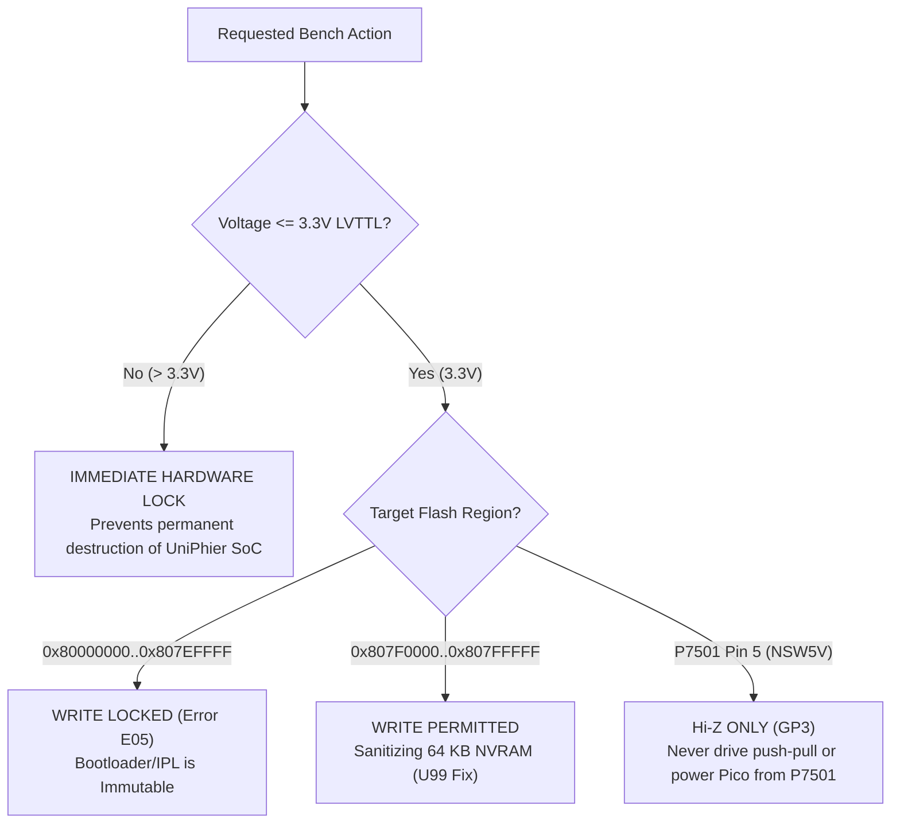

# Systems Architecture and Engineering Blueprint
## Panadiga — Master Specification on Modular Decomposition, Silicon, and Invariants

> **Classification:** Master Systems Architecture and Hardware Engineering Specification  
> **Scope:** Core Rust, Desktop UI (Tauri 2 / React), RP2040/RP2350 Firmware, Android Mobile, RAG & Forensics  
> **Status:** Normative / Approved  

---

## 1. Ecosystem Architectural Overview

**Panadiga** is an integrated software and hardware suite for reverse engineering, storage forensics, firmware recovery (specifically addressing the critical **`U99`** panics), and low-level in-circuit telemetry for **Panasonic DIGA (DMR-EH55)** DVD/HDD recorders powered by the **Matsushita AM34 / MN103S (`VEP79138`)** platform.

The system is architected as **Decoupled Layers with Restricted Unidirectional Communication**:

```mermaid
flowchart TD
    subgraph Presentation["1. Presentation & Interaction Layer (UI & MVVM)"]
        DESKTOP["Desktop Workbench (Tauri 2 / React 18)"]
        MOBILE["Mobile App (Android APK / Webview)"]
        TUI["Interactive Terminal UI (Ratatui)"]
        CLI["Command Line Interface (Clap v4)"]
        VIEWMODELS["Strict ViewModels (ADTs / Discriminated Unions)<br/>- EraseState | SerialState | GdbState"]
        DESKTOP --- VIEWMODELS
        MOBILE --- VIEWMODELS
    end

    subgraph Orchestration["2. Orchestration & IPC Layer"]
        IPC["Tauri IPC Commands / Subprocess Bridge"]
        LOG_BUS["PanadigaLogger (Reactive Event Bus)<br/>Zero console.log / Zero println!"]
        VIEWMODELS --> IPC
        VIEWMODELS -.-> LOG_BUS
    end

    subgraph Core["3. Engineering Core & Pure Domain (Rust Core Engine)"]
        SSOT["SSOT Central Constants (AM34 Memory Map, MEIHDFS Offsets)"]
        FP_FORENSICS["Forensics Pure Domain (Immutable &[u8])<br/>- inspect_hdd_slice_pure<br/>- clean_nvram_slice<br/>- calculate_entropy"]
        GDB_BRIDGE["Introspective GDB RSP Bridge (:3333)<br/>- Lossless Circular Telemetry Ring Buffer<br/>- Lexical RSP Checksum Validator"]
        SSOT --- FP_FORENSICS
        SSOT --- GDB_BRIDGE
        IPC --> Core
    end

    subgraph HAL["4. Hardware Abstraction Layer (HAL & Protocols)"]
        USB_SERIAL["CDC Serial Driver (USB OTG / Virtual COM)"]
        BLE_NUS["Nordic UART Service Driver (Bluetooth Low Energy)"]
        P7501_TRANS["P7501 Async UART 115200 8N1 (C11 PIO)"]
        GDB_BRIDGE --> USB_SERIAL
        GDB_BRIDGE --> BLE_NUS
        USB_SERIAL --> P7501_TRANS
        BLE_NUS --> P7501_TRANS
    end

    subgraph TargetHW["5. Target Physical Silicon (Panasonic DMR-EH55)"]
        P7501["P7501 Header (JST ZR 6-Pin 'TO JIGU')"]
        SOC["Matsushita AM34 / MN103S (VEP79138)"]
        FLASH["IC5001 Spansion S29JL064H NOR Flash (8 MB TSOP-48)"]
        HDD["PATA/IDE Drive (MEIHDFS Layout / 'SH' Superblock)"]
        P7501_TRANS <-->|"Async UART 3.3V / NSW5V Hi-Z"| P7501
        P7501 <--> SOC
        SOC <--> FLASH
        SOC <--> HDD
    end
```

---

## 2. Engineering Principles & Applied Patterns

### 2.1 Pure FP Domain (Functional Programming in Forensics)
Forensic manipulation of raw data streams (80 GB–500 GB disk images and 8 MB NOR Flash dumps) is completely isolated from physical I/O side effects:
- **Zero I/O in Parsing Engine**: Operations such as `inspect_hdd_slice_pure(&[u8])`, `clean_nvram_slice(&[u8])`, and `calculate_entropy(&[u8])` operate strictly over immutable memory slices (`&[u8]`).
- **Mathematical Determinism**: Given identical inputs, outputs are guaranteed to be bit-for-bit identical, allowing robust unit testing without creating disk files.
- **Accidental Corruption Prevention**: Disk I/O failures are trapped at the boundary, ensuring forensic integrity.

### 2.2 Rigorous MVVM with ADTs (Algebraic Data Types)
In the presentation layer (React 18 / TypeScript), loose boolean state flags (`isLoading`, `isErasing`, `isConnecting`) were completely replaced:
- **Mutually Exclusive States**: Long-running asynchronous operations are modeled as **Discriminated Unions**:
  ```typescript
  export type EraseFlowState =
    | { status: 'idle' }
    | { status: 'confirming'; target: string }
    | { status: 'erasing'; progress: number; currentSector: string }
    | { status: 'success'; sectorsErased: number; durationMs: number }
    | { status: 'failed'; error: string; code: string };
  ```
- **Illegal States Are Unrepresentable**: Prevents UI deadlocks and guarantees 100/100 scores in `uxlint` audits.

### 2.3 Introspective GDB & Lossless Telemetry Ring Buffer
In-circuit debugging over the P7501 header requires resilient telemetry handling:
- **In-Memory Ring Buffer (`GdbTelemetryRingBuffer`)**: Retains the last $N$ bus transactions in a fixed-capacity ring buffer, eliminating heap allocations during high-frequency stepping.
- **Formal RSP Packet Checksum Verification**: Every frame (`$<data>#<checksum>`) undergoes strict lexical verification. Corrupted frames trigger immediate retransmission requests (`-`), shielding the session against electrical noise.

### 2.4 SSOT (Single Source of Truth) & Zero Clones
- **Central Constants**: [`crates/panadiga-core/src/constants.rs`](../../crates/panadiga-core/src/constants.rs) provides the authoritative definition for AM34 memory layouts, candidate file paths, and hardware pinouts.
- **Zero Duplication Policy (`jscpd`)**: Frontend codebase maintains a strict **0.00% duplication** rate across 10,000+ lines of TypeScript code.

### 2.5 Structured Logging Subsystem
- Raw `println!`, `eprintln!`, and `console.*` statements are strictly prohibited across production code.
- Messages route through `PanadigaLogger` (TypeScript) and `tracing` (Rust) with fine-grained level filtering and decoupled sinks.

---

## 3. Silicon Blueprint & Panasonic DMR-EH55 Invariants

### 3.1 Matsushita AM34 (`MN103S` / `VEP79138`) Physical Address Map

| Physical Address Range | Size | Memory / Peripheral Type | Purpose in Matsushita Firmware |
| :--- | :---: | :--- | :--- |
| `0x00000000` – `0x03FFFFFF` | 64 MB | Main SDRAM (32-bit @ 162 MHz) | Operating system kernel code, OSD framebuffers, dynamic heap. |
| `0x04000000` – `0x07FFFFFF` | 64 MB | Video / Audio SDRAM (MPEG-2) | Hardware MPEG codec transport stream circular buffers. |
| `0x80000000` – `0x807EFFFF` | 8,128 KB | Spansion NOR Flash (IPL / Bootloader) | **Strict Read-Only.** Root-of-Trust and initial program loader. |
| `0x807F0000` – `0x807FFFFF` | 64 KB | Spansion NOR Flash (EEMUL NVRAM) | **Surgical Write Area.** Sectors SA134..SA141. U99 recovery target. |
| `0xD0000000` – `0xD0003FFF` | 16 KB | Internal SoC SRAM (Uncached) | Hosts the injected `ram_loader` during Cold Break-In. |
| `0xD4000000` – `0xD4000FFF` | 4 KB | PATA Controller MMIO Registers | ATA/ATAPI commands, DMA channels, and IDE drive transfers. |
| `0xD8000000` – `0xD80001FF` | 512 B | DVD Optical Servo Registers | Focus, tracking, spindle speed control, and laser calibration. |
| `0xE0000000` – `0xE000003F` | 64 B | On-Chip Debug (OCD) MMIO | DCSR status register, hardware breakpoints, and instruction trace. |

---

## 4. Hardware Safety Matrix & Physical Damage Prevention



1. **Invariant 1: Maximum 3.3V Logic & `NSW5V` Hi-Z Protection**: The `AM34 / MN103S` UART/control pins operate at 3.3V LVTTL; Pin 5 (`NSW5V` / `GP3`) is wired via `D7510` to `~5.15V` and MUST remain `Hi-Z Input` with pulls disabled.
2. **Invariant 2: P7501 Header Power Isolation**: Never source power from `P7501` (`SW_UART` Pin 1 / `NSW5V` Pin 5 are sense lines only); keep the Pico powered via USB/VSYS.
3. **Invariant 3: Immutability of Forensic Evidence**: Original disk dumps and Spansion Flash images are never edited in place; operations execute on working copies verified with SHA-256 hashes.
