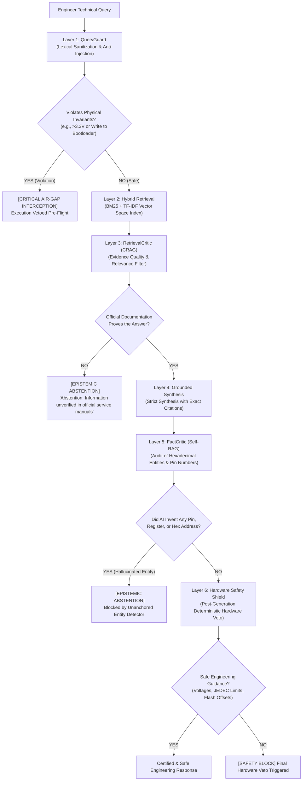

# TECHNICAL DOSSIER: ZERO-ERROR RAG ENGINE, 6-LAYER DEFENSE & HARDWARE SAFETY INVARIANTS
## Silicon Protection & Epistemic Determinism for Reverse Engineering Proprietary Systems

**Panadiga — Panasonic DIGA DMR-EH55 Engineering Ecosystem**  
**Classification:** Critical AI Systems Architecture / Silicon Protection Runbook  
**Subsystem:** `src/rag/` (Native Rust Core Engine) & `tools/rag_engine/` (Python Laboratory Suite)  

---

## 1. The Core Problem: The LLM Hallucination Hazard in Proprietary Embedded Silicon

Large Language Models (LLMs) are statistical engines optimized to predict token sequences. In web development or generic text processing, minor hallucinations produce trivial syntax errors easily caught by a compiler.

However, in the context of **reverse engineering proprietary silicon, multi-voltage mixed-signal mainboards, and Matsushita/Panasonic ASICs**:

> [!CAUTION]
> **THE COST OF HALLUCINATION IN HARDWARE IS PERMANENT SILICON DESTRUCTION:**
> 1. **Overvoltage on SoC & `NSW5V` Contention:** The Matsushita `AM34` / `MN103S` processor on `VEP79138` operates its logic signals (`SW_UART`, `XRESET`, `UARTM2P_T`, `UARTP2M_T`) at **3.3V LVTTL**. Meanwhile, `P7501` Pin 5 (`NSW5V` / `GP3`) links to the `~5.15V` rail (`IC1506` via `D7510`) and **MUST ALWAYS remain `Hi-Z Input` without internal pulls** (never drive push-pull or apply 5V TTL to UART/control pins).
> 2. **Destruction of Bootloader (IPL Permanent Brick):** The Spansion `S29JL064H` NOR Flash (`IC5001`, 8 MB) stores the first-stage Initial Program Loader (*IPL*) from `0x80000000` to `0x807EFFFF`. If an AI suggests a write or sector erase in this address range, the device permanently loses its reset vector and becomes an unrecoverable brick.
> 3. **MEIHFS Filesystem Corruption:** The proprietary Panasonic hard drive filesystem does not use standard PC partition tables. Incorrect assumptions regarding LBAs destroy the `"SH"` superblock, the 28 MB mirror sector, or the transactional journal.

To eliminate these failure modes, the Panadiga ecosystem implements the **Zero-Error RAG Engine**, a deterministic pipeline founded on **6 active layers of reciprocal validation and hard invariant checks**.

---

## 2. The 6 Defense Layers Architecture

Every query processed by the RAG engine passes through the following sequential validation pipeline:

---

## 3. Physical Hardware Safety Invariants (Non-Negotiable)

1. **Bench Maximum Voltage Invariant:**
   Logic signals on connector `P7501` are **$3.3\text{V}$ LVTTL** (`XRESET` open-drain; `NSW5V` Pin 5 `GP3` strict `Hi-Z Input` only). Applying push-pull or $>3.6\text{V}$ logic triggers immediate safety rejection.
2. **Flash Memory Write Invariant:**
   - Bootloader / IPL range (`0x80000000 - 0x807EFFFF`): **STRICTLY READ-ONLY**. Any write attempt aborts with error `E05`.
   - Permitted Write Range for U99 Unbrick: **Strictly the last 64 KB of NVRAM/EEMUL** (`0x807F0000 - 0x807FFFFF`, physical offset `0x7F0000 - 0x7FFFFF`).
3. **Forensic Storage Invariant:**
   Raw HDD dumps (`panasonic DMR EH-55 Firmware hdd_100.bin`) are immutable forensic evidence. In-place modification is forbidden; all transformations produce verified new artifacts validated against SHA-256 manifests.
