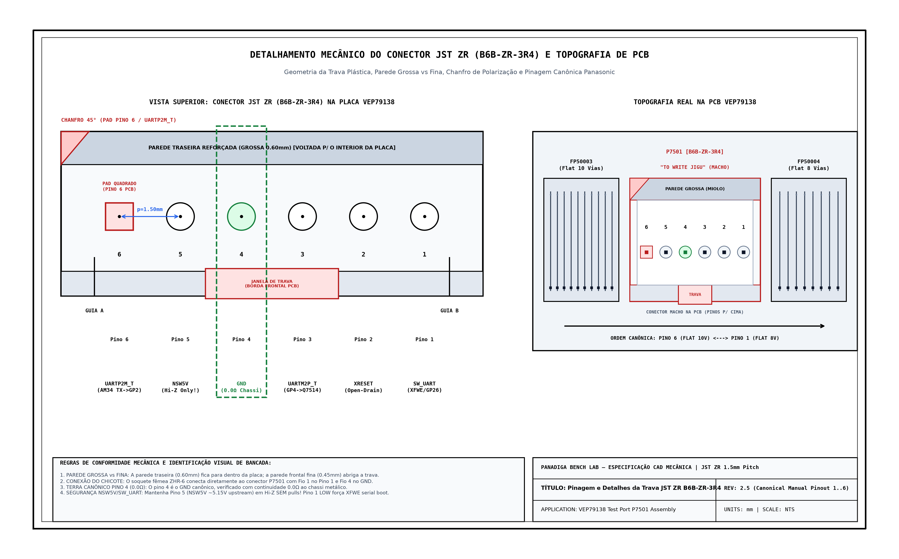
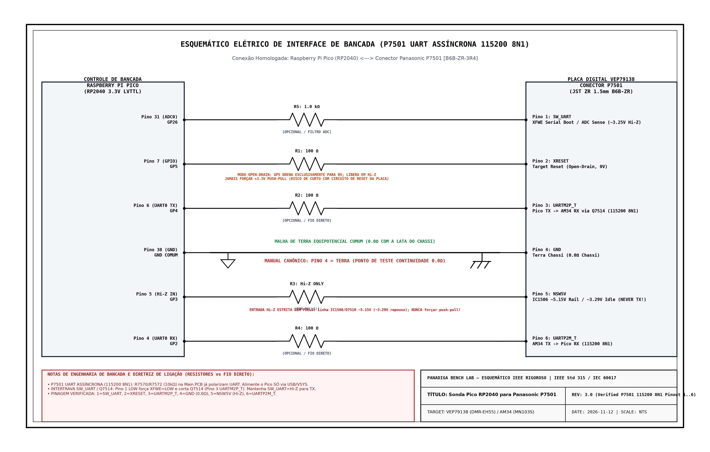

# BLUEPRINT DE ENGENHARIA DE HARDWARE E CIRCUITOS DE BANCADA
## Interface In-Circuit `P7501` Async UART (`115200 8N1`) & Gravação Externa Spansion `S29JL064H` (TSOP-48)
### Gravador Digital Panasonic DMR-EH55 — Placa Principal (`PCB: VEP79138`)

---

## 1. Identificação Geral do Sistema e Escopo de Engenharia

O presente documento constitui o **Blueprint de Engenharia Eletrônica e Hardware de Bancada** para diagnóstico elétrico, captura UART de inicialização, recuperação e programação de firmware do gravador de DVD/HDD **Panasonic DMR-EH55** (Chassi DIGA).

```text
                      ARQUITETURA DE HARDWARE PANASONIC DMR-EH55
   ┌─────────────────────────────────────────────────────────────────────────────┐
   │                        PLACA PRINCIPAL (VEP79138)                           │
   │                                                                             │
   │   ┌───────────────────────────┐             ┌───────────────────────────┐   │
   │   │   Matsushita / Panasonic  │             │   Spansion S29JL064H      │   │
   │   │      AM34 / MN103S        │   16-Bit    │        (IC5001)           │   │
   │   │    + Syscon IC7501        │◄───────────►│   64 Mbit / 8 MByte NOR   │   │
   │   │   RISC 32-bit Core        │     Bus     │      TSOP-48 Package      │   │
   │   └─────────────┬─────────────┘             └─────────────┬─────────────┘   │
   │                 │                                         │                 │
   │                 │ P7501 UART 115200 8N1                   │ WP#/ACC         │
   │                 │ + Controle Q7510 / Q7514 / QR7503       │ (Pin 14 Unlock) │
   │                 ▼                                         ▼                 │
   │          [ Header P7501 ]                        [ Pad Quadrado SMD ]       │
   │          Porta "TO JIGU"                         Hardware Unlock            │
   └─────────────────┬───────────────────────────────────────────────────────────┘
                     │
                     │ Chicote Blindado / Cabos de Bancada (<= 15 cm)
                     ▼
   ┌──────────────────────────────────┐        OU       ┌────────────────────────┐
   │    INTERFACE 1: IN-CIRCUIT       │                 │ INTERFACE 2: EXTERNO   │
   │  Raspberry Pi Pico (RP2040/2350) │                 │  Gravador Profissional │
   │  P7501 UART Engine @ 115200 8N1  │                 │   SVOD 4 / XGecu T48   │
   │    (Captura Não-Destrutiva)      │                 │ (Soquete ZIF TSOP-48)  │
   └──────────────────────────────────┘                 └────────────────────────┘
```

### Contexto da Falha e Missão de Hardware
* **Falha Crítica:** Travamento em ciclo fechado com display em código de pane **`U99`** (*Drive Communication / Parameter Timeout*), frequentemente ligado à corrupção dos blocos de parâmetros não-voláteis emulados em Flash (`EEMUL` / NVRAM) no topo da memória NOR (`0x7F0000` a `0x7FFFFF`, micro-setores `SA134` a `SA141`) ou falhas de drive/handshake.
* **Objetivos de Engenharia:**
  1. **Interface In-Circuit `P7501` Async UART (`115200 8N1`):** Conectar o **Raspberry Pi Pico (`RP2040` / `RP2350`)** diretamente ao conector de serviço **`P7501`** (`B6B-ZR-3R4`, `"TO JIGU"`) na placa `VEP79138`, mantendo guarda estrita **`Hi-Z Input` sem pulls em `NSW5V` (`GP3`)**, controle em Dreno Aberto (*Open-Drain*) para **`XRESET` (`GP5`)** e controle coordenado de **`SW_UART` (`GP26`)** frente ao transistor **`Q7514`**.
  2. **Interface de Gravação Direta TSOP-48:** Prover o mapa elétrico completo pino-a-pino da memória **Spansion `S29JL064H70TFI00` (`IC5001`)**, roteiro de dessoldagem térmica de baixo estresse com liga `Sn63/Pb37`, inserção no soquete ZIF, sanitização verificada via **`panadiga nvram clean`** e gravação em **SVOD 4** / **XGecu T48**.

---

## 2. Esquema Elétrico Detalhado de Bancada: `RP2040` / `RP2350` $\leftrightarrow$ `P7501`

A interconexão física entre o **Raspberry Pi Pico** e o conector **`P7501`** da placa `VEP79138` opera em **UART Assíncrona `115200 8N1`** acoplada a transistores discretos (`Q7510`, `Q7514`, `QR7503`) e ao nó de alimentação **`NSW5V` (`IC1506` via `D7510`)**.

### 2.0 Padrão Mecânico do Conector (`JST ZR 1.5mm` - `B6B-ZR-3R4`) & Placas Compatíveis

* **Padrão Físico do Conector `P7501`:** Conector **JST ZR de 6 pinos com passo (*pitch*) de `1.5 mm`**, modelo original Panasonic **`B6B-ZR-3R4`** (*through-hole top entry*, legenda **`TO JIGU`** no esquemático `VEP79138`).
* **Como Comprar o Chicote Pronto:** Procure por **Cabo JST ZR / ZH `1.5 mm` 6 pinos Fêmea para Dupont `2.54 mm`** (alojamento `ZHR-6` com terminais `SZH-002T-P0.5`). Evite padrões incompatíveis como JST SH (`1.0 mm`), JST PH (`2.0 mm`) ou JST XH (`2.54 mm`).
* **Compatibilidade Pico 1 (`RP2040`) e Pico 2 (`RP2350`):** Ambas as famílias (incluindo variantes sem fio `Pico W` / `Pico 2 W`) são nativamente suportadas pelo firmware [`firmware/pico-p7501/`](../../firmware/pico-p7501/).
* **Alerta Crítico de Protocolo (`P7501` Async UART vs. JTAG / `DWire32A`):** Os 3 manuais de serviço do DMR-EH55 e capturas ao vivo (`COM10`) provam que `P7501` **NÃO** possui linhas JTAG (`TDI/TDO/TMS`) nem `DWire32A` síncrono (`SDATA`/`SCLK`). Pino 6 (`UARTP2M_T`) é RX passivo a `115200 8N1`, Pino 3 (`UARTM2P_T`) é TX ativo (liberado por `Q7514` quando `SW_UART = Hi-Z`), e Pino 5 (`NSW5V`) vem do nó de `~5.15V` via `D7510` — **NUNCA** deve ser dirigido pelo Pico.

### 2.1 Esquema Elétrico Completo de Bancada (Referência Oficial Panasonic `VEP79138`)

> [!IMPORTANT]
> ### Disclaimer de Montagem: Protótipo de Bancada vs. Ferramenta Definitiva
> * **MODO PROTÓTIPO DE BANCADA (Jumpers Curtos $L \le 15\text{ cm}$):**  
>   A placa `VEP79138` já possui resistores pull-up internos **`R7570` (`10 kΩ`)** e **`R7572` (`10 kΩ`)** conectados a `NSW5V`, além de `R7562` (`4.7 kΩ`) e `R7559` (`10 kΩ`) em `Q7510`. **NÃO adicione resistor pull-up externo de `4.7 kΩ` para `3.3V`** na linha `UARTM2P_T` (Pino 3). Mantenha **`GP3` (`NSW5V`) sempre configurado como `Hi-Z Input` sem pulls**.
> * **MODO FERRAMENTA DEFINITIVA (Proteção Série Opcional para Cabos $> 15\text{ cm}$):**  
>   - **$R_{\text{ser}} = 100\,\Omega$:** Amortecimento/limitação em série opcional nas linhas `GP2` (`UARTP2M_T`), `GP4` (`UARTM2P_T`) e `GP5` (`XRESET`).
>   - **$R_{\text{prot}} = 1.0\text{ k}\Omega$:** Proteção série opcional no canal analógico `GP26 / ADC0` (`SW_UART`).

```text
       RASPBERRY PI PICO (RP2040 / RP2350)                          PLACA PRINCIPAL VEP79138
             PLACA DE BANCADA                                         CONECTOR P7501 (CANÔNICO)
    ┌───────────────────────────────┐                             ┌──────────────────────────────┐
    │                               │                             │                              │
    │  Pino 31 (GP26 / ADC0) ───────┼◄──[ R_PROT: 1.0kΩ (opc) ]───├───◄ Pino 1: SW_UART (D)      │
    │  (Boot Latch / ~3.25V Sense)  │     Q7510/R7562/R7559       │     (LOW->XFWE; Hi-Z->TX)    │
    │                               │                             │                              │
    │  Pino 7  (GP5 / XRESET) ──────┼───[ R_SER: 100Ω (opc) ]─────├───► Pino 2: XRESET           │
    │  (Open-Drain Emulado)         │     LOW=Reset / Hi-Z=Run    │     (QR7503, ~20µs subida)   │
    │                               │                             │                              │
    │  Pino 6  (GP4 / UART TX) ─────┼───[ R_SER: 100Ω (opc) ]─────├───► Pino 3: UARTM2P_T        │
    │  (115200 8N1 -> AM34 RX)      │     R7570 10kΩ na placa!    │     (MAX RXD via Q7514)      │
    │                               │                             │                              │
    │  Pino 38 (GND / Terra 0V) ────┼─────────────────────────────┼════ Pino 4: GND Comum        │
    │  (Referência 0V Chassi)       │   MALHA TERRA DIRETA 0.0Ω   │     (0.0Ω ao Chassi!)        │
    │                               │                             │                              │
    │  Pino 5  (GP3 / NSW5V Sense) ─┼◄──[ Hi-Z Input / SEM PULLS ]├───◄ Pino 5: NSW5V (X_SW_5R2V)│
    │  (NUNCA Dirigir Push-Pull!)   │     IC1506 ~5.15V / D7510   │     (~3.29V em repouso)      │
    │                               │                             │                              │
    │  Pino 4  (GP2 / UART RX) ─────┼◄──[ R_SER: 100Ω (opc) ]─────├───◄ Pino 6: UARTP2M_T        │
    │  (115200 8N1 <- AM34 TX)      │     R7572 10kΩ na placa!    │     (MAX TXD, Pad Quadrado)  │
    │                               │                             │                              │
    └───────────────────────────────┘                             └──────────────────────────────┘
```

### 2.2 Diagrama Mermaid de Arquitetura e Fluxo de Sinais

```mermaid
flowchart LR
    classDef hostNode fill:#ffffff,stroke:#2563eb,stroke-width:1.2px,color:#0f172a;
    classDef condNode fill:#ffffff,stroke:#475569,stroke-width:1.2px,color:#0f172a;
    classDef targetNode fill:#ffffff,stroke:#dc2626,stroke-width:1.2px,color:#0f172a;
    classDef gndNode fill:#f0fdf4,stroke:#16a34a,stroke-width:1.5px,color:#14532d;

    subgraph RP2040["Raspberry Pi Pico (Host RP2040 / RP2350)"]
        direction TB
        PICO_SW["Pino 31 (GP26 / ADC0)<br/>Sense e Controle SW_UART"]:::hostNode
        PICO_RST["Pino 7 (GP5 / XRESET)<br/>Open-Drain Emulado"]:::hostNode
        PICO_TX["Pino 6 (GP4 / UART TX)<br/>115200 8N1 Para Placa"]:::hostNode
        PICO_GND["Pino 38 (GND)<br/>Referência Terra 0V"]:::gndNode
        PICO_NSW["Pino 5 (GP3 / NSW5V)<br/>Estrito Hi-Z Input Sem Pulls"]:::condNode
        PICO_RX["Pino 4 (GP2 / UART RX)<br/>PIO0 RX 115200 8N1"]:::hostNode

        PICO_SW ~~~ PICO_RST ~~~ PICO_TX ~~~ PICO_GND ~~~ PICO_NSW ~~~ PICO_RX
    end

    subgraph VEP79138["Panasonic DMR-EH55 (VEP79138 - Conector P7501)"]
        direction TB
        CN_1["Pino 1: SW_UART<br/>Q7510 / IC7501 Pin 80"]:::targetNode
        CN_2["Pino 2: XRESET<br/>QR7503 (Ativo 0V)"]:::targetNode
        CN_3["Pino 3: UARTM2P_T<br/>MAX RXD via Q7514 / R7570"]:::targetNode
        CN_4["Pino 4: GND<br/>Referência 0.0 Ω ao Chassi"]:::gndNode
        CN_5["Pino 5: NSW5V<br/>IC1506 ~5.15V / D7510"]:::targetNode
        CN_6["Pino 6: UARTP2M_T<br/>MAX TXD (Pad Quadrado)"]:::targetNode

        CN_1 ~~~ CN_2 ~~~ CN_3 ~~~ CN_4 ~~~ CN_5 ~~~ CN_6
    end

    PICO_SW <---> CN_1
    PICO_RST ---> CN_2
    PICO_TX ---> CN_3
    PICO_GND === CN_4
    CN_5 -.->|"Hi-Z Input Apenas"| PICO_NSW
    CN_6 ---> PICO_RX
```



### 2.3 Tabela Mestra de Interconexão Pino-a-Pino (Pinagem Canônica `P7501`)

| Pino Canônico (`P7501`) | Sinal Esquemático | Circuito na Placa | Nível / Comportamento Medido | Pino Pico (`RP2040/RP2350`) | Função na Bancada e Topografia |
| :---: | :---: | :--- | :--- | :---: | :--- |
| **Pino 1** | `SW_UART` `(D)` | `Q7510` / `IC7501` Pin 80 | `~3.25V` Hi-Z / `~2.69V` PD | **Pino 31** (`GP26 / ADC0`) | Força serial boot (`XFWE`) quando `LOW` (corta `Q7514`); deixar `Hi-Z` p/ TX em `GP4`. |
| **Pino 2** | `XRESET` | `QR7503` | Estrito Open-Drain (`0V` / `Hi-Z`) | **Pino 7** (`GP5`) | Reset mestre (`~20 µs` subida Hi-Z). **Nunca dirigir `+3.3V` push-pull!** |
| **Pino 3** | `UARTM2P_T` | `MAX RXD` (`Q7514` + `R7570 10 kΩ`) | `3.3V` LVTTL `115200 8N1` | **Pino 6** (`GP4`, TX) | UART TX do Pico para RX da placa (requer `SW_UART = Hi-Z`). Sem pull-up externo. |
| **Pino 4** | **`GND`** | `GND_DIGITAL` | **`0.0V`** ($0.0\,\Omega$ chassi) | **Pino 38** (`GND`) | **Referência canônica de terra ($0.0\,\Omega$ direto ao chassi metálico).** |
| **Pino 5** | `NSW5V` | `X_SW_5R2V` (`IC1506` $\rightarrow$ `D7510`) | `~5.15V` up / `~3.29V` repouso | **Pino 5** (`GP3`) | Alimenta `R7570`/`R7572`/`IC7501`. **MANTER SEMPRE `Hi-Z Input` sem pulls!** |
| **Pino 6** | `UARTP2M_T` | `MAX TXD` (`R7535` $\rightarrow$ `R7572`) | `3.3V` LVTTL `115200 8N1` | **Pino 4** (`GP2`, RX) | RX UART no Pico (`<00>DDR CHECK: OK`, `CD diag`). **Pad QUADRADO** junto a `FP50003`. |

---

## 3. Análise de Integridade de Sinais, Níveis Lógicos e Timing `115200 8N1`

### 3.1 Compatibilidade de Níveis Lógicos (`3.3V` LVTTL + Limite `NSW5V`)

As portas seriais e de controle do conector **`P7501`** operam no domínio lógico de `3.3V` (polarizadas por `D3R3V`, `R7562` `4.7 kΩ`, `R7559` `10 kΩ` e divisores/diodo `D7510`), com a exceção crítica do nó de alimentação **`NSW5V`** (Pino 5):

| Parâmetro Elétrico | Especificação Alvo (`P7501` / `VEP79138`) | Especificação Pico (`RP2040 / RP2350`) | Condição Segura de Operação |
| :--- | :---: | :---: | :--- |
| Entrada Alta UART / Controle ($V_{IH\_min}$) | $2.00\text{ V}$ | $2.00\text{ V}$ | Margem LVTTL segura (`~3.25V` em repouso) |
| Entrada Baixa UART / Controle ($V_{IL\_max}$) | $0.80\text{ V}$ | $0.80\text{ V}$ | Open-Drain `0V` para `XRESET` e serial TX |
| Linha `NSW5V` (`P7501` Pino 5) | `~5.15V` (`IC1506` $\rightarrow$ `D7510`), `~3.29V` repouso | `GPIO_IN` sem pulls (`Hi-Z`) | **Proibido acionar output ou pulls em `GP3`** |
| Circuito `Q7510` B-C sob Pull-Down em `SW_UART` | $3.30\text{V} - V_{BC} \approx 2.68\text{--}2.69\text{V}$ | `ADC0` Hi-Z / PD interno | Assinatura diagnóstica validada no `PINCHECK` |

### 3.2 Máquina de Estados PIO UART RX (`p7501_uart.pio` — `115200 8N1`)

A máquina de estados `PIO0` opera com *oversampling* de **8 ciclos de máquina de estados por bit** ($8 \times 115.200 = 921.600\text{ Hz}$):
1. Aguarda borda de descida do **Start Bit** (`wait 0 pin 0` em `GP2`).
2. Salta exatamente **1,5 períodos de bit** (`12` ciclos) para amostrar o centro do **Bit 0** (`LSB first`) e repete a cada `8` ciclos até completar 8 bits.
3. Valida **Stop Bit HIGH** (`jmp pin, good_stop`) antes de empurrar o byte à FIFO RX; caso contrário, sinaliza erro de framing (`irq 4 rel`).
4. `GP3` (`NSW5V`) nunca é referenciado pelo programa PIO, garantindo isolação permanente em `Hi-Z Input`.

---

## 4. Memória Flash Spansion `S29JL064H70TFI00` (`IC5001`): Pinout e Gravação em Bancada

A memória Flash principal de boot e sistema é o circuito integrado **`IC5001`**, modelo **Spansion `S29JL064H70TFI00`**, montada na placa digital `VEP79138`.

### 4.1 Características Técnicas do Chip
* **Densidade:** 64 Megabits ($8\text{ Megabytes} = 8.388.608\text{ bytes}$).
* **Arquitetura de Barramento:** Configurável em 8 bits (Byte Mode: $8\text{M} \times 8$) ou 16 bits (Word Mode: $4\text{M} \times 16$). Na placa Panasonic, opera permanentemente em **Word Mode de 16 bits** (`BYTE# = 3.3V`).
* **Tempo de Acesso ($t_{AA}$):** $70\text{ ns}$.
* **Faixa de Tensão ($V_{CC}$):** $2.7\text{ V}$ a $3.6\text{ V}$ (Nominal: $3.3\text{ V}$).
* **Encapsulamento:** **TSOP-48 Tipo I** ($12\text{ mm} \times 20\text{ mm}$, passo entre pinos de $0.5\text{ mm}$).
* **Topologia de Setores (Modelo 00 - Top Boot):**
  * 126 setores principais homogêneos de $64\text{ KBytes}$.
  * 8 micro-setores homogêneos de $8\text{ KBytes}$ no topo do mapa de memória (`SA134` a `SA141`, faixa física `0x7F0000` a `0x7FFFFF`), exatamente onde reside a partição de calibração dinâmica `EEMUL`.

### 4.2 Diagrama de Pinos do Encapsulamento TSOP-48 (Top View)

```text
                                SPANSION S29JL064H70TFI00
                               ENCAPSULAMENTO TSOP-48 (TIPO I)
                                    (Visto de Cima / Top View)
                                      ┌───────────┐
                       [Endereço] A15 │ 1  o   48 │ A16       [Endereço]
                       [Endereço] A14 │ 2      47 │ BYTE#     [Controle Word/Byte]
                       [Endereço] A13 │ 3      46 │ VSS (GND) [Alimentação Terra]
                       [Endereço] A12 │ 4      45 │ DQ15/A-1  [Dado D15 / End. Byte]
                       [Endereço] A11 │ 5      44 │ DQ7       [Dado D7]
                       [Endereço] A10 │ 6      43 │ DQ14      [Dado D14]
                       [Endereço]  A9 │ 7      42 │ DQ6       [Dado D6 / Toggle]
                       [Endereço]  A8 │ 8      41 │ DQ13      [Dado D13]
                       [Endereço] A19 │ 9      40 │ DQ5       [Dado D5 / Flag Erro]
                       [Endereço] A20 │ 10     39 │ DQ12      [Dado D12]
                     [Controle]   WE# │ 11     38 │ DQ4       [Dado D4]
                     [Controle] RESET#│ 12     37 │ VCC       [Alimentação +3.3V]
                       [Endereço] A21 │ 13     36 │ DQ11      [Dado D11]
           [Hardware Lock]   WP#/ACC  │ 14     35 │ DQ3       [Dado D3]
             [Status Flag]     RY/BY# │ 15     34 │ DQ10      [Dado D10]
                       [Endereço] A18 │ 16     33 │ DQ2       [Dado D2 / Toggle 2]
                       [Endereço] A17 │ 17     32 │ DQ9       [Dado D9]
                       [Endereço]  A7 │ 18     31 │ DQ1       [Dado D1]
                       [Endereço]  A6 │ 19     30 │ DQ8       [Dado D8]
                       [Endereço]  A5 │ 20     29 │ DQ0       [Dado D0]
                       [Endereço]  A4 │ 21     28 │ OE#       [Controle Output Enable]
                       [Endereço]  A3 │ 22     27 │ VSS (GND) [Alimentação Terra]
                       [Endereço]  A2 │ 23     26 │ CE#       [Controle Chip Enable]
                       [Endereço]  A1 │ 24     25 │ A0        [Endereço]
                                      └───────────┘
```

### 4.3 Tabela Detalhada de Mapeamento de Pinos TSOP-48

| Pino | Nome | Grupo | Tipo | Nível Ativo | Descrição Elétrica e Funcional |
| :---: | :---: | :---: | :---: | :---: | :--- |
| **1** | `A15` | Endereço | Entrada | CMOS | Linha de endereço de palavra 15 |
| **2** | `A14` | Endereço | Entrada | CMOS | Linha de endereço de palavra 14 |
| **3** | `A13` | Endereço | Entrada | CMOS | Linha de endereço de palavra 13 |
| **4** | `A12` | Endereço | Entrada | CMOS | Linha de endereço de palavra 12 |
| **5** | `A11` | Endereço | Entrada | CMOS | Linha de endereço de palavra 11 |
| **6** | `A10` | Endereço | Entrada | CMOS | Linha de endereço de palavra 10 |
| **7** | `A9` | Endereço | Entrada | CMOS | Linha de endereço de palavra 9 |
| **8** | `A8` | Endereço | Entrada | CMOS | Linha de endereço de palavra 8 |
| **9** | `A19` | Endereço | Entrada | CMOS | Seleção de banco de alta ordem |
| **10** | `A20` | Endereço | Entrada | CMOS | Seleção de banco de alta ordem |
| **11** | `WE#` | Controle | Entrada | Baixo ($0\text{V}$) | *Write Enable*: trava escritas e comandos JEDEC no chip |
| **12** | `RESET#` | Controle | Entrada | Baixo ($0\text{V}$) | Reset por hardware da máquina interna da Flash |
| **13** | `A21` | Endereço | Entrada | CMOS | Bit mais significativo de endereço (espaço de 8MB) |
| **14** | `WP#/ACC` | Proteção | Entrada | Especial | Proteção contra gravação por hardware dos setores de boot |
| **15** | `RY/BY#` | Status | Saída | Open-Drain | Nível baixo indica ciclo de erase/programação em andamento |
| **16** | `A18` | Endereço | Entrada | CMOS | Linha de endereço de palavra 18 |
| **17** | `A17` | Endereço | Entrada | CMOS | Linha de endereço de palavra 17 |
| **18** | `A7` | Endereço | Entrada | CMOS | Linha de endereço de palavra 7 |
| **19** | `A6` | Endereço | Entrada | CMOS | Linha de endereço de palavra 6 |
| **20** | `A5` | Endereço | Entrada | CMOS | Linha de endereço de palavra 5 |
| **21** | `A4` | Endereço | Entrada | CMOS | Linha de endereço de palavra 4 |
| **22** | `A3` | Endereço | Entrada | CMOS | Linha de endereço de palavra 3 |
| **23** | `A2` | Endereço | Entrada | CMOS | Linha de endereço de palavra 2 |
| **24** | `A1` | Endereço | Entrada | CMOS | Linha de endereço de palavra 1 |
| **25** | `A0` | Endereço | Entrada | CMOS | Bit menos significativo no modo 16 bits |
| **26** | `CE#` | Controle | Entrada | Baixo ($0\text{V}$) | *Chip Enable*: habilita o chip para leitura/escrita |
| **27** | `VSS` | Alimentação| Ground | $0.0\text{V}$ | Terra do circuito integrado |
| **28** | `OE#` | Controle | Entrada | Baixo ($0\text{V}$) | *Output Enable*: ativa buffers de saída tri-state para leitura |
| **29** | `DQ0` | Dados | I/O | CMOS | Linha de dados bit 0 (LSB) |
| **30** | `DQ8` | Dados | I/O | CMOS | Linha de dados bit 8 |
| **31** | `DQ1` | Dados | I/O | CMOS | Linha de dados bit 1 |
| **32** | `DQ9` | Dados | I/O | CMOS | Linha de dados bit 9 |
| **33** | `DQ2` | Dados | I/O | CMOS | Linha de dados bit 2 (Toggle bit 2) |
| **34** | `DQ10` | Dados | I/O | CMOS | Linha de dados bit 10 |
| **35** | `DQ3` | Dados | I/O | CMOS | Linha de dados bit 3 |
| **36** | `DQ11` | Dados | I/O | CMOS | Linha de dados bit 11 |
| **37** | `VCC` | Alimentação| Power | $+3.3\text{V}$ | Alimentação principal positiva do chip |
| **38** | `DQ4` | Dados | I/O | CMOS | Linha de dados bit 4 |
| **39** | `DQ12` | Dados | I/O | CMOS | Linha de dados bit 12 |
| **40** | `DQ5` | Dados | I/O | CMOS | Linha de dados bit 5 (Flag de erro interno de Erase/Program) |
| **41** | `DQ13` | Dados | I/O | CMOS | Linha de dados bit 13 |
| **42** | `DQ6` | Dados | I/O | CMOS | Linha de dados bit 6 (Toggle bit de progresso) |
| **43** | `DQ14` | Dados | I/O | CMOS | Linha de dados bit 14 |
| **44** | `DQ7` | Dados | I/O | CMOS | Linha de dados bit 7 (*Data# Polling* de conclusão) |
| **45** | `DQ15/A-1`| MUX | I/O | CMOS | Bit MSB em 16-bit ou endereço A-1 em 8-bit |
| **46** | `VSS` | Alimentação| Ground | $0.0\text{V}$ | Terra de referência do circuito integrado |
| **47** | `BYTE#` | Controle | Entrada | Alto ($3.3\text{V}$) | Alto = Modo Word (16 bits), Baixo = Modo Byte (8 bits) |
| **48** | `A16` | Endereço | Entrada | CMOS | Linha de endereço de palavra 16 |

### 4.4 Configuração em Gravadores Universais de Bancada (SVOD 4 / XGecu T48)

Ao utilizar os gravadores de bancada **SVOD 4** ou **XGecu T48** com adaptador universal **TSOP-48 ZIF**:

```text
                         MONTAGEM NO GRAVADOR DE BANCADA
       ┌──────────────────────────────────────────────────────────────┐
       │   GRAVADOR SVOD 4 / XGECU T48 (USB 3.0 / USB 2.0 Host)       │
       │   Soquete ZIF Principal (DIP-48 / Pin Header 48 Pinos)       │
       └──────────────────────────────┬───────────────────────────────┘
                                      │ Encaixe Direto
       ┌──────────────────────────────▼───────────────────────────────┐
       │   PLACA ADAPTADORA TSOP-48 PARA GRAVADOR (ADP_F48_EX-1)      │
       │   - Capacitores de Desacoplamento 100nF + 10µF em VCC        │
       │   - Configuração de VCC: 3.3V Estabilizado                   │
       └──────────────────────────────┬───────────────────────────────┘
                                      │ Soquete Clamshell
       ┌──────────────────────────────▼───────────────────────────────┐
       │   SOQUETE CLAMSHELL ZIF TSOP-48 (Passo 0.5mm, 12x20mm)       │
       │   [ IC5001: Spansion S29JL064H70TFI00 Alinhada ]             │
       │   (Pino 1 voltado para o ponto de referência do adaptador)   │
       └──────────────────────────────────────────────────────────────┘
```

#### Parâmetros de Configuração de Software:
1. **Seleção do Dispositivo:**
   * No **XGecu T48 (Software Xgpro):** Selecionar `SPANSION S29JL064H [TSOP48]`.
   * No **SVOD 4:** Selecionar `Spansion -> S29JL064H` (Verificar se o algoritmo está em *16-bit mode*).
2. **Checagem de ID JEDEC (*Device ID Check*):**
   * Pressionar `Read ID` / `Check ID`. O gravador deve retornar obrigatoriamente:
     * **Manufacturer Code (Hex):** `0x0001` (Spansion / AMD).
     * **Device Identifier (Hex):** `0x227E` (Família S29JL064H) seguido de sub-códigos de modelo top-boot `0x2200` e `0x2201`.
   * Se o software retornar `0x0000`, `0xFFFF` ou valores aleatórios: **Não prossiga com gravação!** Há pinos com contato deficiente ou oxidação no soquete ZIF.
3. **Fluxo de Leitura, Patch e Gravação:**
   * **Passo 1 (Leitura Segura):** Ler o chip duas vezes consecutivas, salvando `DMR_EH55_DUMP_1.bin` e `DMR_EH55_DUMP_2.bin`.
   * **Passo 2 (Verificação Criptográfica):** Comparar os hashes SHA-256 de ambos os arquivos (`panadiga verify-artifact` / `Get-FileHash`). Devem ser idênticos.
   * **Passo 3 (Limpeza da NVRAM Corrompida via Rust CLI):**
     ```bash
     panadiga nvram clean DMR_EH55_DUMP_1.bin DMR_EH55_PATCHED_CLEAN.bin
     ```
   * **Passo 4 (Gravação e Verificação):** Carregar `DMR_EH55_PATCHED_CLEAN.bin` no software do gravador e executar *Erase Full + Blank Check + Program + Verify*.

---

## 5. Procedimento Operacional Padrão (POP): Dessoldagem e Ressoldagem Segura SMD

O chip **`IC5001`** possui 48 terminais com espaçamento fino (*pitch* de $0.5\text{ mm}$). O manuseio inadequado com soprador de ar quente pode causar arrancamento de ilhas (*pads*), empenamento do laminado multicamada da PCB `VEP79138` ou delaminação térmica do encapsulamento plástico.

### 5.1 Perfil Térmico Recomendado de Dessoldagem

```text
    Temperatura (°C)
      250 ┼─────────────────────────────────┐ (Pico: 235°C - 245°C / Max 25 seg)
          │                                 │
      200 ┼───────────────────────────/     \───────── Alívio e Remoção
          │                          /                 com Pinça ESD
      150 ┼─────────────/───────────/                  (Sem tração mecânica)
          │            / Pré-aquecimento
      100 ┼───────────/  Uniforme (120-150°C / 45 seg)
          │          /
       25 ┼─────────/
          └─────────┴───────────────┴───────┴─────────► Tempo (segundos)
          0        30              75      100
```

### 5.2 Roteiro Operacional Passo a Passo

#### Fase A: Preparação e Mascaramento Térmico
1. **Descarga Eletrostática (ESD):** O operador deve estar conectado à manta antiestática com pulseira aterrada ($1\text{ M}\Omega$).
2. **Isolamento de Componentes Críticos:**
   * Cobrir os capacitores eletrolíticos SMD próximos, o conector flat da mecânica do DVD e os pequenos resistores de precisão $0402$ ao redor da Flash com **duas camadas de Fita Kapton de poliimida**.
   * Aplicar fita adesiva de folha de alumínio sobre a fita Kapton para defletir o calor radiante do bocal de ar quente.

#### Fase B: Alívio Térmico com Liga Sn63/Pb37
1. A solda original de fábrica da Panasonic DMR-EH55 (ano de fabricação 2006) é livre de chumbo (*Lead-Free* / SAC305), cujo ponto de fusão gira em torno de $217\text{--}220^\circ\text{C}$.
2. Com o ferro de solda ajustado a $320^\circ\text{C}$, ponta chanfrada e fluxo **Amtech RMA-223-TPF / NC-559-V2**, aplique uma pequena quantidade de solda **Sn63/Pb37** em todas as 48 pernas do CI.
3. A mistura da liga eutética com chumbo reduz o ponto de fusão efetivo para cerca de **$183^\circ\text{C}$**, permitindo a retirada do chip sob menor estresse térmico da placa.

#### Fase C: Aplicação de Ar Quente e Remoção
1. **Configuração da Estação de Ar Quente:**
   * Temperatura: **$240^\circ\text{C}$** (se foi adicionada solda Sn63Pb37) ou **$280^\circ\text{C}$** (se mantida a liga original sem chumbo, medido no bocal a $2\text{ cm}$).
   * Vazão de ar (*Air Flow*): **Média-Baixa** ($30\text{--}40\text{ l/min}$) para evitar o deslocamento acidental de componentes $0402$/$0603$ vizinhos.
2. **Movimentação do Bocal:**
   * Mantenha o bocal circular de $8\text{--}10\text{ mm}$ em movimento elíptico contínuo sobre as duas fileiras de terminais, a uma distância de $1.5\text{ cm}$ da placa.
   * **Nunca concentre o jato em um único ponto ou diretamente no centro do silício.**
3. **Extração com Pinça ESD:**
   * Com a pinça curva ESD-15, toque suavemente a lateral do encapsulamento.
   * **Regra de Ouro:** Só levante o componente quando a solda de todos os 48 terminais estiver visivelmente em estado líquido brilhante. **Zero força mecânica vertical.** O chip deve "flutuar" para sair.

#### Fase D: Preparação dos Pads na PCB
1. Aplique fluxo líquido/gel nos pads da PCB.
2. Com a malha dessoldadora de cobre de boa absorção ($1.5\text{ mm}$) e ferro a $320^\circ\text{C}$, passe a malha suavemente sem pressionar contra o laminado para remover o excesso de estanho e nivelar os pads.
3. Limpe a região com cotonete e **Álcool Isopropílico 99.8%**. Inspecione sob microscópio estéreo ou lupa de bancada para assegurar que nenhum pad foi arrancado ou sofreu curto.

#### Fase E: Ressoldagem após Reprogramação
1. Alinhe o chip perfeitamente com os pads, conferindo a orientação do **Pino 1** (ponto chanfrado no chip alinhado com a marcação em serigrafia na placa).
2. Solde inicialmente dois pinos diagonais opostos (ex: Pino 1 e Pino 25) para travar o alinhamento mecânico.
3. Aplique fluxo NC-559 generosamente em ambas as fileiras de pinos.
4. Execute a técnica de **soldagem por arraste (*drag soldering*)** com ponta faca (K) ou concha: deslize suavemente a ponta aquecida ao longo dos terminais com um filete mínimo de solda, aproveitando a tensão superficial.
5. Inspecione visualmente a $360^\circ$ com microscópio:
   * Ausência de pontes de solda (*solder bridges*) entre pinos adjacentes.
   * Molhabilidade perfeita da solda (*fillet*) na junção entre o pino do chip e a ilha de cobre.
6. Limpeza final completa com Álcool Isopropílico para retirar todo resíduo de fluxo condutivo.

---

## 6. Lista Completa de Componentes de Bancada (Bill of Materials - BOM)

| Item | Qtd | Designador / Referência | Especificação Técnica / Fabricante | Tolerância / Tensão | Função Específica no Projeto de Bancada |
| :---: | :---: | :--- | :--- | :---: | :--- |
| **1** | 1 | `U_HOST` | Raspberry Pi Pico (`RP2040`) ou Pico 2 (`RP2350`) | Standard | Sonda `P7501` Async UART (`115200 8N1`) via PIO0 & ADC0 |
| **2** | 3 | `R_SER` (opcional) | Resistor de Filme de Metal $100\,\Omega$ $0.25\text{W}$ | $\pm 1\%$ ou $\pm 5\%$ | Amortecimento opcional em `GP2` (`UARTP2M_T`), `GP4` (`UARTM2P_T`) e `GP5` (`XRESET`) |
| **3** | 1 | `R_PROT` (opcional) | Resistor de Filme de Metal $1.0\text{ k}\Omega$ $0.25\text{W}$ | $\pm 1\%$ | Isolação opcional para `GP26 / ADC0` (`SW_UART`) |
| **4** | 1 | `CN_CONN` | Conector JST ZR 1.5mm fêmea (`ZHR-6`) para Dupont ($\le 15\text{ cm}$) | Passo `1.5 mm` | Ligação mecânica direta ao conector original `P7501` [`B6B-ZR-3R4`] |
| **5** | 1 | `PROG_TSOP` | Gravador Universal SVOD 4 ou XGecu T48 (Original) | USB 2.0/3.0 | Programação externa da Flash TSOP-48 `IC5001` |
| **6** | 1 | `ADP_TSOP48`| Adaptador ZIF TSOP-48 para DIP-48 (Soquete Clamshell) | Passo $0.5\text{ mm}$ | Acomodação mecânica da Spansion `S29JL064H` sem solda |
| **7** | 1 | `SOLDER_L` | Solda em Fio `Sn63/Pb37` 0.5mm com fluxo ativado | Ponto $183^\circ\text{C}$ | Alívio térmico para dessoldagem e ressoldagem segura |
| **8** | 1 | `FLUX_GEL` | Fluxo de Solda No-Clean Amtech NC-559-V2 ou RMA-223 | Seringa / Gel | Proteção antioxidante e condução térmica na refusão |
| **9** | 1 | `KAPTON_T` | Fita Adesiva de Poliimida Kapton $15\text{ mm}$ | Térmica $300^\circ\text{C}$| Blindagem térmica de componentes adjacentes |
| **10** | 1 | `DESOLD_W` | Malha Dessoldadora de Cobre Tratado Goot Wick $1.5\text{ mm}$ | Baixo resíduo | Limpeza e nivelamento dos pads TSOP-48 na placa |
| **11** | 1 | `CLEAN_IPA` | Álcool Isopropílico $99.8\%$ Puro | Grau Eletrônico | Limpeza química de resíduos de fluxo pós-solda |

---

## 7. Protocolo de Segurança Operacional e Validação Pré-Energização

Antes de ligar o aparelho à rede elétrica ou plugar o cabo USB do Pico ao computador, o operador de bancada deve cumprir rigorosamente o seguinte roteiro:

```text
               FLUXOGRAMA DE VERIFICAÇÃO DE SEGURANÇA EM BANCADA
    ┌────────────────────────────────────────────────────────────────────────┐
    │ 1. TESTE DE CURTO A FRIO (Aparelho Desligado da Tomada)               │
    │    Multímetro na escala de Resistência / Continuidade:                 │
    │    - Medir entre P7501 Pino 4 (GND) e Chassi: Deve dar 0.0Ω            │
    │    - Medir entre P7501 Pino 5 (NSW5V) e Pino 4: Sem curto com terra!   │
    └───────────────────────────────────┬────────────────────────────────────┘
                                        │ PASSOU (Sem curto)
                                        ▼
    ┌────────────────────────────────────────────────────────────────────────┐
    │ 2. VALIDAÇÃO ELÉTRICA NO PICO (USB Conectado ao PC)                   │
    │    Console PANADIGA> STATUS e PINCHECK:                                │
    │    - Confirmar SW_UART ~3.25V Hi-Z / ~2.69V PD / ~3.27V PU             │
    │    - Confirmar GP3 (NSW5V) bloqueado como Hi-Z Input sem pulls!        │
    └───────────────────────────────────┬────────────────────────────────────┘
                                        │ ELÉTRICA VERIFICADA
                                        ▼
    ┌────────────────────────────────────────────────────────────────────────┐
    │ 3. CAPTURA UART AO VIVO (115200 8N1)                                   │
    │    - Executar BOOTCAP / JIGBOOT / UARTMON em GP2 (UARTP2M_T)           │
    │    - Finalizar com UARTPROBE 8 -> ISOLATE antes de desligar/religar!   │
    └────────────────────────────────────────────────────────────────────────┘
```

> [!CRITICAL]
> **Avisos de Sobrevivência de Hardware (`NSW5V` e `XRESET`):**
> * **Pino 5 de `P7501` (`NSW5V` $\rightarrow$ `GP3`):** Recebe `~5.15V` via `D7510` a partir de `IC1506` (`~3.29V` em repouso). **Sob nenhuma hipótese configure `GP3` em modo saída (*push-pull*) ou habilite pulls internos.** Nunca alimente o Pico por `P7501`.
> * **Pino 2 de `P7501` (`XRESET` $\rightarrow$ `GP5`):** Ligado ao circuito de reset `QR7503`. **Sob nenhuma hipótese configure `GP5` em modo Push-Pull dirigindo nível alto ($+3.3\text{V}$).** Utilize exclusivamente dreno aberto (*Open-Drain*): `0V` (reset forçado) vs. `Hi-Z` (entrada sem pulls).

---

## 8. Inspeção Visual de Alta Resolução & Topografia Física na PCB (`P7501`)

Abaixo estão os diagramas CAD e esquemáticos oficiais gerados a partir da base técnica do Panadiga:

### 8.1 Topografia Física e Orientação do Conector `P7501`


### 8.2 Recorte Oficial do Esquemático Panasonic `P7501`


### 8.3 Esquema Elétrico de Montagem da Sonda Pico (`P7501`)


### 8.4 Protocolo Multimétrico de Validação em 3 Etapas (Antes de Ligar o Pico)

1. **Etapa 1 — Identificação Inequívoca do Terra (`GND`):**
   * Multímetro em continuidade com ponta preta no chassi metálico: apenas o **Pino 4 de `P7501`** registra **$0.0\,\Omega$**.
2. **Etapa 2 — Identificação do Pad Quadrado (`UARTP2M_T` - Pino 6):**
   * O Pino 6 localiza-se na extremidade mais próxima ao cabo flat **`FP50003`**, marcado pelo **pad quadrado** na face de solda/serigrafia.
3. **Etapa 3 — Validação de Tensão em Standby (`SW_UART`, `NSW5V`, `XRESET`):**
   * Com o gravador alimentado, meça **`Pino 1 (SW_UART) ≈ 3.25V`**, **`Pino 5 (NSW5V) ≈ 3.29V`** e **`Pino 2 (XRESET)`** caindo momentaneamente a `0V` durante reset de sistema.

---

## 9. Abertura Uncached da Memória AM34 & Estratégias de Extração da Spansion (`IC5001`)

### 9.1 Mapeamento de Memória do `AM34` / `MN103S` e Acesso Direto à Spansion
O núcleo Matsushita **AM34 (`MN103S`)** opera com espaço de endereçamento linear de 32 bits ($4\text{ GB}$):
* **`0x00000000` a `0x007FFFFF`:** Espelho cacheado de boot da NOR Flash.
* **`0x80000000` a `0x807FFFFF`:** Abertura física direta **uncached** da Spansion `S29JL064H` (**`IC5001`**) de 8 MB ($8.388.608$ bytes), onde os últimos 64 KB (`0x807F0000..0x807FFFFF`) armazenam os micro-setores NVRAM/EEMUL (`SA134..SA141`).

### 9.2 Acesso In-Circuit (`P7501` + `GDB` RSP) vs. Acesso Externo TSOP-48 (`SVOD 4` / `XGecu T48`)
* **Rota In-Circuit (`P7501` Async UART / `panadiga gdb-bridge`):** Quando houver console/monitor ativo expondo leitura em memória, o comando `DUMP [endereço_hex] [palavras]` e a ponte GDB RSP (`$m807F0000,0040#`) permitem inspecionar palavras de 32 bits sem dessolda.
* **Rota Física Externa (Confirmada para Unbrick U99 Completo):** Como a porta `P7501` padrão do DMR-EH55 entrega console serial `BOOTCAP` / `CD diag boot mode` sem protocolo JTAG/OCD síncrono, a extração integral e segura dos 8 MB de `IC5001` em unidade travada é feita removendo o chip TSOP-48 com perfil térmico controlado (Seção 5) e aplicando **`panadiga nvram clean`**.

---

## 10. Mecânica Elétrica Discreta em `P7501` (`Q7510` / `Q7514` / `QR7503`) e Diagnósticos `PINCHECK` / `SNIFF`

### 10.1 Por que `UARTSEND LOW:cmd` Retorna 0 Bytes (Corte de `Q7514`)
No circuito discreto da placa `VEP79138` (Manual NA p. 62–64):
* **`P7501` Pino 1 (`SW_UART`)** conecta-se ao **Coletor de `Q7510`** (`2SD0601A0L`) e à **Base de `QR7503`** (`UNR511300L`). A base de `Q7510` é polarizada em `3.30V` (`D3R3V` via `R7562` `4.7 kΩ`) e seu emissor (`XFWE`) sobe a `3.30V` via `R7559` (`10 kΩ`).
* Quando **`SW_UART = LOW` (`0V`)**, `Q7510` conduz e drena `XFWE` para nível baixo (instruindo o boot a entrar no modo serial/JIG), mas ao mesmo tempo coloca **`Q7514`** em corte via `R7528` (`4.7 kΩ`) — desconectando fisicamente o Pino 3 (`UARTM2P_T`) do pino `UARTM2P` da CPU!
* Logo, para transmitir qualquer byte do Pico (`GP4`) rumo à CPU via `P7501`, **`SW_UART` precisa ser liberado para `Hi-Z`**.
* Quando o RP2040 aplica pull-down interno em `GP26` durante `PINCHECK`, a junção B-C de `Q7510` conduz levemente e grampeia o Pino 1 em exatamente $3.30\text{V} - V_{BC} \approx 2.68\text{--}2.69\text{V}$, explicando com precisão a assinatura empírica observada na bancada (`3.25V Hi-Z | 2.69V PD | 3.27V PU`).

### 10.2 O Que os Comandos `PINCHECK`, `BUSDIAG` e `SNIFF` Executam na Bancada
* **`PINCHECK`:** Testa eletricamente `SW_UART` (`GP26` em `Hi-Z`, pull-down e pull-up), verifica o tempo de subida em `XRESET` (`GP5`, `~20 µs`), valida que `NSW5V` (`GP3`) permanece `Hi-Z Input` sem pulls e conta transições em `GP2` (`UARTP2M_T`).
* **`SNIFF [ms]`:** Coloca os pinos digitais de monitoração em alta impedância sem pulls e registra bordas ativas na porta serial `115200 8N1` (`GP2`) durante a janela solicitada (padrão `100 ms`).

---

## 11. Compatibilidade Universal com Placas Baseadas em `RP2040` e `RP2350`

Qualquer placa equipada com silício **Raspberry Pi `RP2040`** ou **`RP2350`** suporta o firmware `panasonic_p7501_uart`, utilizando exatamente os blocos **`PIO0`** e **`ADC0`** e a mesma atribuição de GPIOs:

```text
               FAMÍLIA DE PLACAS RP2040 / RP2350 HOMOLOGADAS
                  
  ┌───────────────────────────┐    ┌───────────────────────────┐    ┌───────────────────────────┐
  │  Raspberry Pi Pico / W    │    │  Raspberry Pi Pico 2 / 2W │    │    Waveshare RP2040-Zero  │
  │    (Referência RP2040)    │    │   (RP2350 + 520KB SRAM)   │    │     (Formato Ultra-Mini)  │
  │  RP2040 @ 133MHz / 264KB  │    │  Cortex-M33 @ 150MHz      │    │   RP2040 + Conector USB-C │
  └───────────────────────────┘    └───────────────────────────┘    └───────────────────────────┘
               ▲                                ▲                                ▲
               └────────────────────────────────┴────────────────────────────────┘
                                                │
                         MESMO MAPEAMENTO DE GPIOs (GP2..GP5, GP26, GND)
```

### 11.2 Tabela de Pinagem Cruzada entre Placas Populares (`P7501`)

| Sinal Canônico `P7501` | GPIO Pico | Raspberry Pi Pico / Pico 2 | Arduino Nano RP2040 Connect | Waveshare RP2040-Zero | Modo Elétrico |
| :--- | :---: | :---: | :---: | :---: | :--- |
| **`UARTP2M_T`** (RX Pico, Pad Quad.) | `GPIO2` | Pino 4 | Pino D2 | Pino GP2 | Entrada PIO UART `115200 8N1` |
| **`NSW5V`** (`X_SW_5R2V`) | `GPIO3` | Pino 5 | Pino D3 | Pino GP3 | **`Hi-Z Input` SEM PULLS (Nunca dirigir!)** |
| **`UARTM2P_T`** (TX Pico) | `GPIO4` | Pino 6 | Pino D4 | Pino GP4 | Saída UART `115200 8N1` (Open/Hi-Z em idle) |
| **`XRESET`** (Reset Alvo) | `GPIO5` | Pino 7 | Pino D5 | Pino GP5 | Estrito **Open-Drain** (`0V` / `Hi-Z`) |
| **`SW_UART`** (`(D)` / Boot Sense) | `GPIO26` | Pino 31 | Pino A0 | Pino GP26 | `ADC0 Hi-Z` (ou `LOW` p/ `XFWE` serial boot) |
| **`GND`** (Terra Digital) | `GND` | Pino 38 (ou 3, 8, 13, 18, 23, 28) | Pino GND | Pino GND | Referência $0.0\text{V}$ ao chassi ($0.0\,\Omega$) |

---

## 12. Regra Mandatória de Segurança: Desbloqueio do Pino 14 (`WP#/ACC`) da Spansion (`IC5001`)

### 12.1 A Armadilha de Hardware do Pino `WP#/ACC`
Conforme a folha de dados oficial da Spansion (**Publication `S29JL064H_00`, Revision B, Seção 7.0 "Hardware Data Protection"**):
* O **Pino 14 (`WP#/ACC`)** controla a proteção por hardware dos micro-setores finais em arquitetura **Top Boot (`S29JL064H00`)**:
  $$\text{Setor SA140 } (0\text{x007FC000 - 0x007FDFFF}) \quad \text{e} \quad \text{Setor SA141 } (0\text{x007FE000 - 0x007FFFFF})$$
* Quando mantido em nível baixo ($V_{IL} = 0\text{V}$), comandos JEDEC *Sector Erase* direcionados a `SA140`/`SA141` são **ignorados pelo circuito interno da Flash**.

### 12.2 Consequência Direta para o Erro U99
Como a partição `EEMUL` do DMR-EH55 abrange até `0x7FFFFF` (`SA134..SA141`), qualquer tentativa de apagamento in-circuit sem verificação do pino 14 em nível alto ($+3.3\text{V}$) pode deixar `SA140`/`SA141` intactos.

### 12.3 Procedimento de Verificação em Bancada
1. Antes de executar apagamento in-circuit com o chip montado, localize o **pino 14 de `IC5001`** (ou ponto de teste estanhado adjacente).
2. Meça a tensão DC em relação ao chassi:
   * **$3.3\text{V}$:** Desprotegido por hardware.
   * **$0.0\text{V}$:** Protegido; aplique $+3.3\text{V}$ via resistor de $1.0\text{ k}\Omega$ apenas durante o apagamento in-circuit (ou utilize gravador externo TSOP-48 ZIF na Rota A).

---

## 13. Referências Técnicas Oficiais e Normas de Engenharia

1. **Matsushita Electric Industrial Co., Ltd. / Panasonic:**
   * *Panasonic DMR-EH55 Service Manual (North America - NTSC)* — Order No. **`CHM0605028CE`**, Maio de 2006 (Esquemáticos da Main/Digital PCB `VEP79138`, regulador `IC1506` p. 55, circuito discreto `P7501` / `D7510` / `Q7510` / `Q7514` / `QR7503` / `IC7501` pp. 62–64, interconexão `P59001` p. 97).
   * *Panasonic DMR-EH55EC/EP Service Manual (Europe - PAL)* — Order No. **`DSD0603003CE`** (Vol. 1 e Vol. 2).
   * *Matsushita 32-bit RISC Microprocessor `MN103S` / `AM34` Core Architecture Reference Manual*.
2. **Spansion LLC:**
   * *`S29JL064H` 64 Megabit (8M x 8-Bit / 4M x 16-Bit) CMOS 3.0 Volt-only Flash Memory Data Sheet* — Publication **`S29JL064H_00`**, Revision B, Dezembro de 2005 (Setores Top Boot `SA0`–`SA141`, sequência JEDEC e pino `WP#/ACC`).
3. **Raspberry Pi Ltd:**
   * *`RP2040` / `RP2350` Microcontroller Datasheets* — Subsistema PIO (`PIO0`), Controle de Pads GPIO e `ADC0`.
