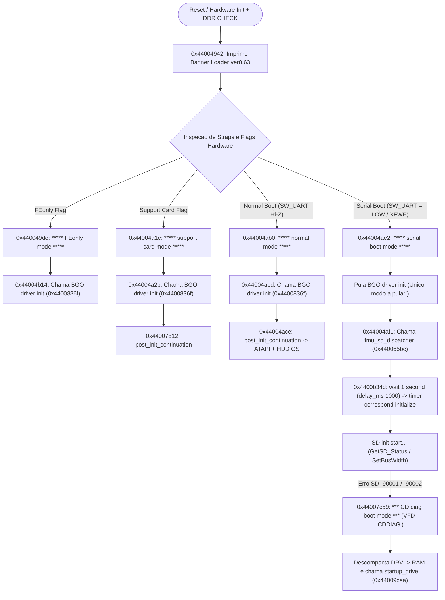
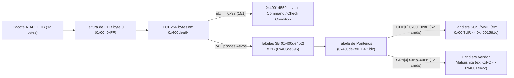

# Dossiê de Engenharia Reversa Profunda: Bootloader MN103S, Controlador Óptico R6-MV4 (`DRV`) e Telemetria ao Vivo

> **Classificação:** Pesquisa Empírica de Silício, Firmware e Hardware de Bancada  
> **Hardware Alvo (Ao Vivo em Bancada):** Gravador DVD/HDD **Panasonic DMR-EH55** (PCB Principal `VEP79138`, `Loader ver0.61 [06/03/06]`, interface `COM10` / RP2040 em `P7501`)  
> **Binários Desassemblados (Referência Estática):** Conjunto **DMR-EH58** extraído de [DVDRAM.7z](../../firmware_and_images/dmr-eh58/DVDRAM.7z) (`Loader ver0.63 [07/10/24]`, Drive `MATSHITA R6-MV4 A0 S415 05/14/08`) + Imagens e Partições HDD **DMR-EH55** (`0x02000000` / `0x04000000` e `PANA_DVD.FRM`)  
> **Escopo Documental:** Código de máquina 32-bit **Matsushita AM34 / MN103S (`MN10300`)**, fluxo completo de boot, protocolo `[SDCD]`/`ACMD13`, pilha ATAPI/CDB, CLI de serviço via UART do drive óptico e o dicionário completo de fábrica com **431 códigos internos de falha (Shift-JIS)**.

---

## 1. Metodologia e Distinção Rigorosa de Evidências (EH55 Ao Vivo vs. EH58 Estático)

Para preservar rigor científico absoluto para toda a comunidade de engenharia reversa, este dossiê separa explicitamente dois domínios complementares de evidência:

1. **Telemetria Empírica ao Vivo no Panasonic DMR-EH55 (`VEP79138`):**
   * Obtida diretamente pela porta **`P7501 (TO WRITE JIGU)`** via sonda **Raspberry Pi Pico (RP2040)** em `115200 8N1`, executando o **`Loader ver0.61 [06/03/06]`**.
   * Inclui capturas controladas com variação de hardware (*ablations*): modo normal (`SW_UART` em Hi-Z / erro `U99`), `serial boot mode` (`SW_UART = LOW` / visor `SDDIAG`), ausência de cabo flat do slot SD, remoção do conector Molex de força/IDE e testes com a tampa metálica superior do drive óptico completamente parafusada.
2. **Desassemblagem Estática Verificada em Bit-Level (`DMR-EH58 DVDRAM.7z` + Correlação EH55):**
   * Como o dump bruto da Flash NOR do EH55 possui o mesmo kernel de família `MN103S` mas os símbolos, tabelas completas de CLI, tabelas ATAPI e o firmware **descompactado** do drive óptico aparecem de forma cristalina no pacote de serviço `DVDRAM.7z` (`BOOT.BIN`, `DRV.BIN` / `DRV_decomp.bin`, `DEV.BIN`, `MAIN.BIN`), executou-se análise estática cruzada byte-a-byte entre ambas as gerações.
   * **Nota de Limite:** Endereços virtuais absolutos (`0x44xxxxxx` e `0x40xxxxxx`) referem-se exatamente aos binários do pacote **EH58** listados abaixo; os mecanismos, cabeçalhos criptográficos, códigos de erro internos (`0x83A7`), mensagens de console e protocolos ATAPI/SDCD manifestam-se identicamente nas capturas ao vivo do **EH55**.

---

## 2. Inventário Binário e Prova de Correlação Inter-Gerações (EH55 ↔ EH58)

| Modelo | Componente | Tamanho (Bytes / Hex) | MD5 | SHA-256 (Prefixo) | Papel Arquitetural |
| :--- | :--- | ---: | :--- | :--- | :--- |
| DMR-EH58 | `VERSION.TXT` | `83` (`0x000053`) | `53f2e8c30a5013bad58555ff5bc7aba6` | `9d21f0ddbce7d559...` | Metadados ASCII (`BOOT_VER,0.63`, `DEV_VER,3110PC`) |
| DMR-EH58 | `BOOT.BIN` | `262,144` (`0x040000`) | `7737e5710b351bd4b0f9b2b59c7b40f3` | `7c13c72a54c77387...` | Loader do SoC MN103S `ver0.63 [07/10/24]` (`0x44000000`, texto claro) |
| DMR-EH58 | `DEV.BIN` | `512` (`0x000200`) | `b0c41cdfade27202a02507f9acf969bb` | `7ae160135acb2f3a...` | Cabeçalho de Dispositivo (`AA 55 FF FF EH58EE`, `PANA_DVD_REC` @ `+0x20`) |
| DMR-EH58 | `DRV.BIN` | `720,896` (`0x0B0000`) | `78202974d402db9802d3fab3fdb31579` | `3a9699dd576e96ac...` | FW F/E do Drive compactado (`EXTRHEADDRV`, mesmo tamanho da Part 2 EH55) |
| DMR-EH58 | `DRV_decomp.bin` | `1,441,792` (`0x160000`) | `56cbd63993c800e05d0f914710d3c393` | `694a4ab8aa29fcc4...` | MCU MN103S do Drive descompactado (`0x40000000`, `MATSHITAR6-MV4 A0 S415`) |
| DMR-EH58 | `MAIN.BIN` | `6,361,216` (`0x611080`) | `4e6500cff94d923140ca52f00c38940e` | `f89af74a255f91ca...` | SO Principal (`M_FIRM`, cabeçalho ECB 64 bits `5187138d...`, `e5d1f34a...` @ `+0x38`) |
| DMR-EH58 | `DVDRAM.7z` | `7,179,299` (`0x6D8C23`) | `b24750771125d45e5672a4bd66d92aa7` | `d58297d6581551a9...` | Arquivo de atualização de serviço armazenado no repositório |
| DMR-EH55 | `PANA_DVD.FRM` | `7,531,744` (`0x72ECE0`) | `2b1b5754d63d131b54bd93a6fa73f39d` | `a596d52a8220a911...` | Contêiner óptico de atualização (`492F0560...`, CPRM/C2 ECB 64 bits) |
| DMR-EH55 | `hdd_partition_firmware_0x02000000.bin` | `6,173,264` (`0x5E3250`) | `393e52d939eee76bbf06a98f2415253f` | `6ec63de059c00b28...` | HDD Part 1 (`M_FIRM`, cabeçalho `5187138d...`, `e5d1f34a...` @ `+0x38`) |
| DMR-EH55 | `hdd_partition_firmware_0x04000000.bin` | `720,896` (`0x0B0000`) | `ee465f12930bef1599bb4fc256346ef0` | `487d5951d4aa7bc4...` | HDD Part 2 (imagem compactada `DRV`, cifrada em ECB 64 bits no disco) |

### 2.1 Provas Forenses da Estrutura Modular entre Gerações

1. **Partição 2 do HDD EH55 (`0x04000000`) = Microcódigo F/E Compactado do Drive Óptico (`DRV`):**
   * Anteriormente, inferiu-se em [ARQUITETURA_STORAGE_MEIHDFS_PARTICOES.md](ARQUITETURA_STORAGE_MEIHDFS_PARTICOES.md) que a Partição 2 (`720.896` bytes = `0x0B0000`) armazenaria fontes OSD ou recursos gráficos secundários.
   * A inspeção cruzada prova que **`DRV.BIN` do EH58 mede exatamente `720.896` bytes (`0x0B0000`)**. No pacote EH58 (`DRV.BIN`), ele inicia com o cabeçalho em texto claro `EXTRHEADDRV \x01\x00\x00\x00` seguido pelos metadados de tamanho descompactado (`0x00160000` em *little-endian* = `1.441.792` bytes). No HDD do EH55, a mesma partição de `720.896` bytes está cifrada em blocos ECB de 64 bits (contendo `1.280` blocos `03 50 65 C8 7B B8 E0 90` correspondentes a `0xFF * 8` e `2` blocos `E5 D1 F3 4A 51 8B 26 90` correspondentes a `0x00 * 8`).
   * Ao vivo na UART do **DMR-EH55**, o bootloader imprime textualmente:
     ```text
     F/E Address = 0x90202000 , Drive(compress) Size = 0xACC50
     uncompress dst=90202000 len=160000 src=84080040 len=acc01
     HEADER:5627DD54, DECOMP:5627DD54
     ```
     Ou seja: o buffer de destino descompactado em RAM tem tamanho **`0x160000` (`1.441.792` bytes)** — idêntico ao tamanho exato de **`DRV_decomp.bin` (`1.441.792` bytes)**.
2. **Continuidade da Cifra ECB de 64 bits entre EH55 (`0x02000000`) e EH58 (`MAIN.BIN`):**
   * Os primeiros **16 bytes** de `MAIN.BIN` (EH58, `6.361.216` bytes) são **`51 87 13 8D 5B 0A FB 22 08 CE 26 BC 77 EA 8E 24`**, rigorosamente idênticos aos primeiros 16 bytes da Partição 1 do HDD EH55 (`hdd_partition_firmware_0x02000000.bin`).
   * Além disso, no deslocamento `+0x38` de ambos os binários (`MAIN.BIN` e Partição 1 do EH55) aparece exatamente o mesmo bloco cifrado **`E5 D1 F3 4A 51 8B 26 90`** (equivalente ao bloco nulo `0x00 * 8` na cifra simétrica ECB Matsushita, detalhada em [DOSSIE_CRIPTOGRAFIA_E_FIRMWARE_PANA_DVD.md](DOSSIE_CRIPTOGRAFIA_E_FIRMWARE_PANA_DVD.md)).
3. **Identificação do Contêiner `DRV.BIN` e `DEV.BIN`:**
   * `DEV.BIN` (`512` bytes) contém assinatura inicial `AA 55 FF FF` seguida de `EH58EE` (`+0x04`) e a assinatura ASCII **`PANA_DVD_REC`** no offset `0x0020`.
   * Diferente dos arquivos `MAIN.BIN` e das partições no HDD, `BOOT.BIN` e `DRV.BIN` no pacote `DVDRAM.7z` possuem **0 ocorrências** dos blocos cifrados ECB de `0x00*8` ou `0xFF*8`, operando diretamente sem criptografia simétrica na mídia de serviço.

---

## 3. Semântica do Conjunto de Instruções MN10300 / AM34 (`MN103S`)

Durante a desassemblagem manual e automatizada dos binários Matsushita, confirmou-se uma regra crítica de cálculo de desvios para análise no **Ghidra** (`txt231/GhidraMn10300`) e scripts Python customizados:

* **Endereçamento de Carga Verificado:**
  * `BOOT.BIN`: base virtual `0x44000000` (espelho mapeado em cache/RAM a partir da área inferior da Flash; `CHIP_SELECT`, strings e ponteiros `0x4403xxxx` são indexados diretamente em `0x44000000..0x4403FFFF`).
  * `DRV_decomp.bin`: base virtual `0x40000000` (vetor de reset `0x40001000` gravado no offset `0x08` em *little-endian*; versão `1.00` em ASCII nos bytes `0x04..0x07`).
* **Regra Exata de Desvio Relativo (`call` / `jmp`):**
  * Nas instruções de 32 bits **`0xDD`** (`call d32`) / **`0xDC`** (`jmp d32`) e de 16 bits **`0xCD`** (`call d16`) / **`0xCC`** (`jmp d16`), o endereço de destino **NÃO** é calculado a partir do próximo PC (`VA + len + disp`), mas sim relativo ao **PC da instrução corrente**:
    `destino = VA_da_instrucao + disp_com_sinal`
  * **Prova Empírica em Código:**
    * Em `0x4400b35d` (`BOOT.BIN`), os bytes `dd 77 b0 ff ff` possuem deslocamento `disp = -0x4f89`. Calculando `0x4400b35d - 0x4f89` obtém-se **`0x440063d4`**, exatamente o prólogo `cf 10 3f f8 fe f4 f8 13` (logo após o epílogo `fc df 10 04` da função anterior!). O cálculo errado `va + 5 + disp` cairia 5 bytes dentro da função, truncando o `movm [d2,d3,a2,a3],(sp)`.
    * Da mesma forma, em `0x44009cb7`, a instrução `cd 5a fe` (`-0x1a6`) aponta via `0x44009cb7 - 0x1a6 = 0x44009b11`, pousando exatamente no prólogo `cf 10 3f f8 fe dc f8 13` da função emissora de pacotes ATAPI.
* **Convenções de Prólogo, Epílogo e Imediatos:**
  * Prólogos padrão empilham registradores com **`cf 10`** (`movm [d2,d3,a2,a3],(sp)`) seguido de alocação de frame negativo em `sp` (`f8 fe <off>`). Epílogos restauram via **`fc df 10 04`** (`ret [d2,d3,a2,a3], frame`).
  * Ponteiros de strings/MMIO de 32 bits usam prefixos **`fc cc <u32>`**, **`fc cd <u32>`**, **`fc c2 <u32>`**, **`fc 81 <u32>`** (carregamento de imediato 32-bit em registradores de endereço `a0..a3` / dados `d0..d3`).

---

## 4. Engenharia Reversa Completa do Bootloader `BOOT.BIN` (`Loader ver0.63`)

### 4.1 Mapa de Funções e Rotinas Verificadas (`0x44000000`)

| Endereço Virtual | Função / Papel Identificado | Assinatura Inicial (Hex) | Chamadores (`dd`/`cd`) & Xrefs | Comportamento Verificado em Disassembly |
| :--- | :--- | :--- | :--- | :--- |
| **`0x4400479f`** | `uart_getc` (RX Serial) | `cf 10 3f f8 fe fc fc ac` | `2` (`0x4400489a`, `0x44004904`) | Lê registradores UART MMIO `0xd400200c` (status RX) e `0xd4002009` (dado RX). **Nunca alcançada** fora da rotina morta `0x4400488a`. |
| **`0x440047c7`** | `uart_putc` (TX Serial) | `cf 10 3f f8 fe fc f8 53` | `9` (internos a `0x44004808` / `0x4400488a`) | Escreve byte TX em `0xd4002008` após polling do registrador de status `0xd400200c`. |
| **`0x44004808`** | `printf` (Console Boot) | `cf 10 3f f8 fe e8 f8 13` | `335` chamadas | Motor formatador principal de telemetria em `115200 8N1`. |
| **`0x4400488a`** | `console_getline` *(Inacessível)* | `cf 10 3f f8 fe ec f8 13` | **`0` chamadores / `0` ptr xrefs** | Rotina órfã compilada no binário; único local onde `uart_getc` é chamado. Prova ausência de shell RX no bootloader. |
| **`0x440063d4`** | `delay_ms` (Temporizador) | `cf 10 3f f8 fe f4 f8 13` | `25` chamadas (incl. `0x4400b35d`) | Laço de espera calibrado em milissegundos (recebe `d0 = 0x3e8` = `1000` após `'wait 1 second.\n'`). |
| **`0x440065bc`** | `fmu_sd_dispatcher` | `cf 10 3f f8 fe c8 f8 53` | `2` (`0x44004ad9` condicional, `0x44004af1` serial) | Gerencia fluxo de inicialização do cartão SD / atualização `fmu` (`helper` em `0x44006cd9`). |
| **`0x44007812`** | `post_init_continuation` | `cf 10 3f f8 fe f4 80 01` | `12` chamadas (todos os 4 modos) | Continuação após o despacho inicial de modo (`normal`, `serial`, `FEonly`, `support card`). |
| **`0x44007c59`** | `cd_diag_boot_mode` | `cf 10 3f f8 fe e0 00 f8` | `1` (`0x44007c0a`) | Imprime `'*** CD diag boot mode ***\n'`, exibe `'CDDIAG'` no visor VFD (`0x4400c777`), descompacta F/E (`0x4400bcc2`), inicia RTSC e drive (`0x44009cea`). |
| **`0x4400836f`** | `bgo_driver_init` | `cf 10 3f f8 fe e4 fc a4` | `3` (`0x44004a2b`, `0x44004abd`, `0x44004b14`) | Inicializa driver BGO; reporta `'BGO driver init failed[%u].\n'` (`0x44034bf0`). **Pulada exclusivamente no `serial boot mode`**. |
| **`0x44009b11`** | `atapi_issue_pkt` | `cf 10 3f f8 fe dc f8 13` | `6` (`0x44009c04`, `0x44009c52`, `0x44009cb7`...) | Envia pacote ATAPI de 12 bytes construído em stack ao drive óptico. |
| **`0x44009cea`** | `startup_drive` | `cf 10 3f f8 fe d8 f8 13` | `5` chamadas | Emite `'** startup drive **'` e executa polling periódico de `TEST UNIT READY`. |
| **`0x4400b34d`** | `wait_1_sec_timer_sync` | `fc cc 22 52 03 44 dd b5` | Despacho indireto / tabela | Imprime `'wait 1 second.\n'`, executa `mov 0x3e8, d0` (`2c e8 03`), chama `delay_ms` (`0x440063d4`) e imprime `'*** timer correspond initialize ***\n'`. |
| **`0x4400bcc2`** | `uncompress` (Descompressor) | `cf 10 3f f8 fe dc f8 13` | `6` chamadas (`0x44006e71`..`0x44007d1f`) | Descompacta módulo F/E (`F/E Address = 0x90202000`) e valida checksum `HEADER:` vs `DECOMP:`. |
| **`0x44027826`** | `GetSD_Status` (`ACMD13`) | `cf c0 fa fe 74 ff 80 40` | `2` (`0x44027d87`, `0x44027f93`) | Executa `CMD55 + ACMD13` para buffer `0x505748f0`, verifica campo `SD_CARD_TYPE` (`0x50574914`) e retorna `-91006` (`0xfffe9c82`) com `"[SDCD]This SD Card is't memory card"`. |

### 4.2 Máquina de Estados de Despacho de Boot (`0x44004930..0x44004b50`)



### 4.3 Prova de Inexistência de Receptor UART (`fmu` / `wait 1 second.`)

Uma hipótese anterior sugeria que, ao imprimir `'!!! start fmu to read & exec fvu. !!!'` seguido de `'wait 1 second.'`, o bootloader abriria uma janela de 1 segundo escutando a UART RX para transferir `fvu.exe` / `fio_recv` serialmente. A desassemblagem de `BOOT.BIN` refuta essa hipótese com três provas irrefutáveis:
1. Em `0x4400b34d`, após imprimir `'wait 1 second.\n'`, o código carrega literalmente a constante inteira **`1000` (`2c e8 03` = `0x03e8`)** no registrador `d0` e invoca **`delay_ms` (`0x440063d4`)**, passando imediatamente em `0x4400b364` para `'*** timer correspond initialize ***\n'` sem ler nenhum registrador UART.
2. A única função de leitura serial (`uart_getc` em `0x4400479f`) possui apenas 2 chamadores (`0x4400489a` e `0x44004904`), ambos encapsulados dentro de `0x4400488a`. Essa função `0x4400488a` tem **0 chamadores diretos (`dd`/`cd`) e 0 referências por ponteiro** em todo o binário.
3. As strings `'fvu.exe'` (`0x440398df`), `'fio_recv'` (`0x44039966`) e `'!!! start fmu to read & exec fvu. !!!'` (`0x440344e5`) apresentam lista vazia de xrefs diretos como strings executáveis operacionais na imagem de produção `0.63` (sendo vestígios estáticos do framework `FMU/FVU` de fábrica em SD/RAM, onde o fluxo real após o timer de 1s prossegue diretamente para montagem do cartão SD frontal em `[SDCD]`).

### 4.4 Causa Exata da Falha de Cartão SD `[SDCD]` (`-91006` e `-90002`)

Quando o cartão de teste inserido no slot frontal falha na inicialização em `serial boot mode`, as capturas ao vivo registram:
```text
SD init start...
[SDCD] sdcd_insrmv_check:SD Card inserted 
[SDCD]This SD Card is't memory card 
[SDCD]SetBusWidth:SD Status ERROR -91006
[SDCD] Set SD Bus Width fail ERROR:-91006
[SDCD] === This Card can't be controled ==== 
... SD init end
SD init failed[-90002].
```
Rastreando as funções `[SDCD]` em `BOOT.BIN` (`0x44027826..0x44028019`):
1. `SetBusWidth` (`0x44027f8c..0x44027fe0`) comuta a largura de barramento para 4 bits (`ACMD6_SET_BUS_WIDTH`) e imediatamente chama **`GetSD_Status` (`0x44027826` @ `0x44027f93`)**.
2. `GetSD_Status` envia `CMD55` + `ACMD13` (512 bits / 64 bytes de *SD Status* transferidos pelo barramento de 4 fios para o buffer em SRAM `0x505748f0`).
3. Em seguida, a rotina lê o campo **`SD_CARD_TYPE` no endereço `0x50574914`** (equivalente ao deslocamento `+0x24`, ou validação dos primeiros bytes de tipo de cartão no buffer DMA/4-bit). Se o campo diferir do esperado para cartão de memória SD padrão v1.0/v1.1 (ou sofrer corrupção de leitura no bus de 4 bits após `ACMD6` / incompatibilidade SDHC), a função imprime `"[SDCD]This SD Card is't memory card \n"` (`0x4403923b`) e retorna **`-91006`** (`0xFFFE9C82`), propagado por `SetBusWidth` (`0x44027fb4..0x44027fd7`) até abortar com `SD init failed[-90002]`.
4. **Consequência Prática:** Sem cartão SD clássico **v1.0/v1.1 (<= 1 GB ou padrão SDSC compatível sem falhar `ACMD13` em 4 bits)** contendo pacote válido, o `Loader` entra sempre em fallback para **`*** CD diag boot mode ***`** (`0x44007c59`). Nota-se ainda que com o flat SD desconectado, o código falha antes no pino de presença com **`SD init failed[-90001]`** (`SD Card remove`).

### 4.5 Rastreamento da Bandeja ATAPI (`1B 00 00 00 03`) em `BOOT.BIN`

Na rotina de controle da unidade óptica (`0x44009c40..0x44009ce5`):
* Para **fechar a bandeja**, `BOOT.BIN` zera um buffer CDB de 12 bytes na pilha e escreve dinamicamente via instruções `mov` + `movbu`:
  * `0x44009c9c`: `80 1b` + `f8 53 f4` -> `CDB[0] = 0x1B` (**`START STOP UNIT`**)
  * `0x44009ca6`: `80 03` + `f8 53 f8` -> `CDB[4] = 0x03` (**Bits `LoEj=1, Start=1` -> Fechar Bandeja / Load Media**)
  * `0x44009cb7`: `cd 5a fe` -> Chama `atapi_issue_pkt` (`0x44009b11`).
* Se o comando retorna erro (como visto no modo normal quando a mecânica / chave da bandeja não confirma fechamento), `0x44009cd5` imprime **`** can not close tray **\n`** (`0x44034fe5`).

---

## 5. Hardware Elétrico de Bancada (`P7501` / `VEP79138`) e Matriz de Testes ao Vivo

### 5.1 Anatomia de `P7501 (TO WRITE JIGU)` e Por Que Adaptadores FTDI Passivos Falham

Embora o conector físico **`P7501` / `CN55001`** (JST ZR de 6 vias, passo `1,5 mm`, código `B6B-ZR-3R4`) tenha sido originalmente hipotetizado na documentação inicial apenas como porta síncrona OCD (`DWire32A`), o esquemático oficial da placa `VEP79138` identifica `P7501` com a legenda **`TO WRITE JIGU`** e funções seriais/controle específicas:

| Pino `P7501` | Sinal Esquemático (`VEP79138`) | Pino RP2040 (Pico) | Circuito Físico na Placa Main & Digital |
| :---: | :--- | :---: | :--- |
| **1** | `SW_UART` | `GP26` (Saída LOW / ADC) | Liga-se ao **pino 80 (`SW_UART`) de `IC7501`** e à base/coletor de **`Q7510` (`2SD0601A0L`)**. Aterrar este pino (`0V`) satura/comuta a malha derrubando **`XFWE`**, forçando **`serial boot mode`** (e visor `SDDIAG`), **porém corta a polarização de base de `Q7514`** (`R7528 4.7kΩ`). |
| **2** | `XRESET` | `GP5` (Open-Drain) | Coletor de `QR7503`. Reset mestre do sistema (ativo baixo). Nunca injetar `3.3V` forçado em *push-pull*. |
| **3** | `MAX RXD` | `GP4` | Coletor de **`Q7514`** (`UARTM2P_T`); o emissor vai para `UARTM2P` (RX do SoC). **Bloqueio de RX:** `Q7514` só conduz quando `XFWE` está em nível alto. |
| **4** | `GND` | `GND` | Terra comum (`0.0V`). |
| **5** | `NSW5V` | `GP3` | Alimenta o topo dos resistores de pull-up **`R7527 (4.7kΩ)`**, **`R7559 (10kΩ)`** e **`R7562 (4.7kΩ)`**. Em estado desligado/standby ou sem 5V switched na malha `NSW5V`, adaptadores FT232RL / CH340 comuns ficam flutuando (~`3.3V` por corrente parasita de I/O, sem referência de `5.1V`), exigindo polarização controlada via sonda. |
| **6** | `MAX TXD` | `GP2` (RX UART Pico) | Linha `UARTP2M_T` ligada diretamente via resistor série **`R7535 (100Ω)`** à saída UART TX (`115200 8N1`) do SoC AM34. |

### 5.2 Matriz Consolidada das Capturas ao Vivo no DMR-EH55 (`COM10` / Pico)

Todas as capturas abaixo foram gravadas diretamente no **DMR-EH55** conectado ao Pico RP2040 em bancada (`115200 8N1`):

| Arquivo de Captura (Bancada) | Comando Pico / Condição Física | Bytes / Linhas | `startup reason` / SD Init | Mensagem Bandeja / Boot | Falha Final do Drive Óptico |
| :--- | :--- | :---: | :---: | :--- | :--- |
| **`bootcap_cover_shut_live.log`** | `BOOTCAP 30000` (`SW_UART` Hi-Z, **tampa parafusada**) | `4568 B` / `96` | *(Normal mode)* + `BGO driver init failed[1].` | `** can not close tray **` | `X(80020401) 59..52` -> `X(80040904)` + `SENSE[.. 83 A7 09 04 ..]` |
| **`normal_boot_90s.log`** | `BOOTCAP 30000` (`normal mode` estendido) | `24362 B` / `995` | `BGO driver init failed[1].` | `** can not close tray **` | Idem (`80040904` + `83 A7 09 04`) |
| **`no_ide_cable_boot.log`** | `JIGBOOT 25000` (`SW_UART=LOW`, **sem cabo flat IDE**, cartão SD 2GB presente) | `3019 B` / `69` | `startup reason = [70]` -> **`SD -91006` / `-90002`** | `*** CD diag boot mode ***` (não imprime tray error) | `X(80062900) X(80023a00)` -> `X(80020401)` -> `X(80040904)` + `83 A7` |
| **`no_molex_boot.log`** | `JIGBOOT 25000` (`SW_UART=LOW`, **sem alimentação Molex**) | `2732 B` / `70` | `startup reason = [70]` -> **`SD -91006` / `-90002`** | `*** CD diag boot mode ***` + reinício espontâneo (`<00>DDR CHECK: OK`) após `DECOMP` | Ciclo repetitivo de `80040904` + `83 A7` |
| **`no_sd_flat_boot.log`** | `JIGBOOT 25000` (`SW_UART=LOW`, **cabo flat SD desconectado**) | `2884 B` / `66` | `startup reason = [5]` -> **`SD init failed[-90001]`** (`Card remove`) | `*** CD diag boot mode ***` | `X(80020401)` -> `X(80040904)` + `83 A7` |
| **`jigboot_20s.log` / `jigboot_70s.log`** | `JIGBOOT 20000` / `70000` (`SW_UART=LOW`, visor `SDDIAG`, SD inserido) | `2026 B` / `4157 B` | `startup reason = [70]` -> **`SD -91006` / `-90002`** | `*** CD diag boot mode ***` | `X(80040904)` contagem regressiva até timeout `Drive start failed[-2147219196]` |
| **`sd_fmu_attempt1.log` / `2.log`** | `JIGBOOT 25000` (testes de estrutura FAT/fvu no SD 2GB) | `3019 B` / `2830 B` | `startup reason = [70]` -> **`SD -91006` / `-90002`** | `*** CD diag boot mode ***` | `83 A7 09 04` idêntico; prova que cartão aborta em hardware no `ACMD13` antes de ler arquivos FAT |

> [!NOTE]
> **Observação sobre `startup reason = [5]` vs `[70]`:** Quando o conjunto/flat SD está plugado e o bootloader entra em `serial boot mode` com o cartão 2GB inserido, o registrador de causa reporta `startup reason = [70]`. Ao desconectar fisicamente o cabo flat do painel frontal SD (`no_sd_flat_boot.log`), muda imediatamente para `startup reason = [5]` e o subsistema `[SDCD]` cai em `-90001` (*Card removed*) em vez de `-91006` / `-90002`.

---

## 6. Arquitetura Completa do Controlador Óptico `DRV_decomp.bin` (`MATSHITA R6-MV4`)

### 6.1 Prova Definitiva de Arquitetura `MN103S` (Não `MN102`) e Mapa de Memória

Contrariando a literatura de reparo informal que classificava o controlador do drive óptico da série DIGA como um chip de 16/24 bits da série `MN102`, a desassemblagem completa de **`DRV_decomp.bin` (`1.441.792` bytes)** comprova que ele é código nativo **32-bit `MN103S` (`AM3x`)**:
* **Cabeçalho e Vetores (`0x40000000`):**
  * `+0x00`: `ca 10 00 00`
  * `+0x04`: **`31 2e 30 30`** (`"1.00"` em ASCII)
  * `+0x08`: **`00 10 00 40`** -> Vetor de Reset / Entrada em **`0x40001000`**
  * `+0x0C`: `04 00 00 00`
  * `+0x10`: **`80 00 03 40`** -> Ponteiro de serviço/tabela em `0x40030080`
* **Conjunto de Instruções Idêntico ao `BOOT.BIN`:** O código inteiro emprega prólogos `cf 10`, epílogos `fc df 10 04`, chamadas `dd`/`cd` usando semântica `va + disp` e carregamentos imediatos `fc cc` / `fc c3` para barramentos internos de 32 bits:
  * **UART Hardware MMIO:** `0x880000c0` (`33` xrefs), `0x880000c2` (`13` xrefs), `0x880000c3` (`27` xrefs), `0x880000c4` (`5` xrefs), `0x880000c8` (`6` xrefs), `0x880000c9` (`23` xrefs), `0x880000cc` (`7` xrefs).
  * **Controlador Óptico / ODC-DRC MMIO:** `0x88800000` (`@0x4000578d` próximo ao contexto de erro de laser/calibração).
  * **SRAM Interna / Flag de Privilégio:** `0x889f5523` (`103` xrefs espalhadas pelos manipuladores da CLI serial de fábrica).
* **Identidade do Drive Embutida:**
  * `0x40008bf4`: `MATSHITAR6-MV4  A0     B014S05/14/08`
  * `0x40008ca4`: `MATSHITARAM47FK8AVC AVC 0000CommonFwHeader010000...`
  * `0x400dec04`: `MATSHITAR6-MV4  A0      S41505/14/08`

### 6.2 Pipeline ATAPI `CDB[0]` e Todos os 74 Opcodes Ativos

O despacho ATAPI no firmware `DRV` utiliza uma tabela de consulta direta de 256 bytes indexada por `CDB[0]`, que mapeia cada opcode válido para seu descritor (ou para o índice sentinela **`151` = `0x97`**, ponteiro `0x40014559` de comando não suportado). Dos 256 opcodes possíveis, **exatamente 74 são ativos** (**62 comandos padrão SCSI/MMC** + **12 opcodes proprietários Vendor Matsushita** `0xE8..0xFE`):

* **LUT de Índices (`uint8_t[256]`):** `0x400dea64`
* **Atributos de 3 bytes por índice (`3B * idx`):** `0x400de4b2`
* **Atributos de 2 bytes por índice (`2B * idx`):** `0x400de696`
* **Tabela de Ponteiros de Função (`uint32_t *`):** `0x400de7e0`



| CDB[0] | Indice LUT | attr3 (0x400de4b2) | attr2 (0x400de696) | Handler VA | Comando SCSI/MMC & Papel |
| :---: | :---: | :---: | :---: | :---: | :--- |
| `0x00` | `26` (`0x1A`) | `7d40b1` | `ff03` | `0x4001591c` | **`TEST UNIT READY`** — Comando periódico obrigatório; o `BOOT` EH55 envia `59..0` ciclos; falha ao vivo retorna Sense `04/09/04` (`83 A7`) |
| `0x01` | `83` (`0x53`) | `7fb0f2` | `ff03` | `0x4001bba2` | **`REZERO UNIT`** — Recalibra atuador/cabeça para a trilha zero |
| `0x03` | `1` (`0x01`) | `004001` | `ff03` | `0x400159ce` | **`REQUEST SENSE`** — Retorna buffer SCSI Sense de 18 bytes (bytes `[10..11]` contêm código interno uint16 Panasonic) |
| `0x04` | `133` (`0x85`) | `7fbaf0` | `1202` | `0x4001c15d` | **`FORMAT UNIT`** — Formatação de mídia regravável (DVD-RAM / DVD-RW) |
| `0x08` | `79` (`0x4F`) | `7f85b3` | `ff03` | `0x4001bd03` | **`READ(6)`** — Leitura legada de setor (CDB 6 bytes) |
| `0x0A` | `136` (`0x88`) | `7f8737` | `1a03` | `0x4001be42` | **`WRITE(6)`** — Gravação legada de setor (CDB 6 bytes) |
| `0x0B` | `84` (`0x54`) | `7f85f2` | `ff03` | `0x4001bba2` | **`SEEK(6)`** — Posicionamento/seek legado (CDB 6 bytes) |
| `0x12` | `0` (`0x00`) | `004001` | `ff03` | `0x4001591f` | **`INQUIRY`** — Retorna string de identificação `MATSHITAR6-MV4  A0      ` / `S415 05/14/08` |
| `0x15` | `8` (`0x08`) | `6938f1` | `ff03` | `0x4001a795` | **`MODE SELECT(6)`** — Configura páginas de modo (CDB 6 bytes) |
| `0x1A` | `6` (`0x06`) | `600001` | `ff03` | `0x4001a253` | **`MODE SENSE(6)`** — Consulta páginas de modo (CDB 6 bytes) |
| `0x1B` | `12` (`0x0C`) | `69b8f2` | `ff03` | `0x4001b718` | **`START STOP UNIT`** — Controla motor spindle e bandeja (`1B 00 00 00 03` = Fechar Bandeja; `02` = Abrir) |
| `0x1E` | `10` (`0x0A`) | `000001` | `ff03` | `0x40015bd5` | **`PREVENT ALLOW MEDIUM REMOVAL`** — Trava/destrava mecanismo de ejeção da bandeja |
| `0x23` | `78` (`0x4E`) | `6900f0` | `ff03` | `0x4001ccff` | **`READ FORMAT CAPACITIES`** — Reporta capacidades suportadas de formatação |
| `0x25` | `72` (`0x48`) | `7f00f1` | `ff03` | `0x40015cae` | **`READ CAPACITY(10)`** — Lê último LBA e tamanho do bloco lógico |
| `0x28` | `80` (`0x50`) | `7f85b3` | `ff03` | `0x4001bd03` | **`READ(10)`** — Leitura padrão de dados (CDB 10 bytes) |
| `0x2A` | `137` (`0x89`) | `7f8737` | `1a03` | `0x4001be42` | **`WRITE(10)`** — Gravação padrão de dados (CDB 10 bytes) |
| `0x2B` | `85` (`0x55`) | `7f85f2` | `ff03` | `0x4001bba2` | **`SEEK(10)`** — Posicionamento óptico padrão (CDB 10 bytes) |
| `0x2E` | `139` (`0x8B`) | `7f0718` | `0202` | `0x4001be42` | **`WRITE AND VERIFY(10)`** — Gravação seguida de verificação de leitura (DVD-RAM) |
| `0x2F` | `87` (`0x57`) | `7f35f2` | `de03` | `0x4001c0f7` | **`VERIFY(10)`** — Verifica setores da mídia sem transferência ao host |
| `0x35` | `132` (`0x84`) | `718090` | `ff03` | `0x4001d099` | **`SYNCHRONIZE CACHE(10)`** — Descarrega cache de gravação para o disco |
| `0x37` | `89` (`0x59`) | `7f3818` | `8602` | `0x40015d96` | **`READ DEFECT DATA(10)`** — Lê listas de defeitos (PDL/SDL em DVD-RAM) |
| `0x3B` | `15` (`0x0F`) | `49f8f0` | `ff03` | `0x4002168d` | **`WRITE BUFFER`** — Escrita de buffer de diagnóstico/firmware na RAM do drive (`idx=15`) |
| `0x3C` | `13` (`0x0D`) | `49f8f0` | `ff03` | `0x40021476` | **`READ BUFFER`** — Leitura de buffer de diagnóstico/memória do drive (`idx=13`) |
| `0x3E` | `82` (`0x52`) | `7f39f2` | `1e03` | `0x4001c0ae` | **`READ LONG(10)`** — Leitura bruta de setor incluindo bytes ECC |
| `0x3F` | `141` (`0x8D`) | `7f3b30` | `1a03` | `0x4001c0d5` | **`WRITE LONG(10)`** — Gravação bruta de setor incluindo bytes ECC |
| `0x42` | `128` (`0x80`) | `7e20f3` | `e000` | `0x400176d9` | **`READ SUB-CHANNEL`** — Lê subcanal Q de CD-Audio/CD-ROM |
| `0x43` | `90` (`0x5A`) | `7c00f3` | `ff03` | `0x40015e48` | **`READ TOC/PMA/ATIP`** — Lê TOC, PMA ou ATIP de mídias CD |
| `0x44` | `127` (`0x7F`) | `7e80f3` | `e000` | `0x4001d86b` | **`READ HEADER`** — Lê cabeçalho de setor em CD |
| `0x45` | `122` (`0x7A`) | `fe28f3` | `e000` | `0x4001d112` | **`PLAY AUDIO(10)`** — Reprodução de áudio CD-DA (LBA) |
| `0x46` | `3` (`0x03`) | `000001` | `ff03` | `0x4001adf0` | **`GET CONFIGURATION`** — Obtém descritores MMC e perfil ativo do drive |
| `0x47` | `124` (`0x7C`) | `fe28f3` | `e000` | `0x4001d15e` | **`PLAY AUDIO MSF`** — Reprodução de áudio CD-DA (MSF) |
| `0x4A` | `5` (`0x05`) | `000001` | `ff03` | `0x40017b49` | **`GET EVENT STATUS NOTIFICATION`** — Consulta assíncrona de eventos de bandeja e mídia |
| `0x4B` | `121` (`0x79`) | `fe28f3` | `e000` | `0x4001d601` | **`PAUSE/RESUME`** — Pausa ou retoma reprodução CD-DA |
| `0x4E` | `125` (`0x7D`) | `fe80f1` | `e000` | `0x4001d64e` | **`STOP PLAY/SCAN`** — Interrompe reprodução/varredura de áudio |
| `0x51` | `91` (`0x5B`) | `7d00b1` | `ff03` | `0x400167ff` | **`READ DISC INFORMATION`** — Lê status do disco, sessões e tabelas OPC |
| `0x52` | `92` (`0x5C`) | `7f00b3` | `ff03` | `0x40016bae` | **`READ TRACK INFORMATION`** — Lê metadados de trilha/RZone e próximo endereço gravável |
| `0x53` | `144` (`0x90`) | `7eaaf4` | `1801` | `0x4001d971` | **`RESERVE TRACK`** — Reserva tamanho de trilha em DVD-R/CD-R |
| `0x54` | `135` (`0x87`) | `7fbaf0` | `1a03` | `0x4001e1a2` | **`SEND OPC INFORMATION`** — Define valores de calibração de potência óptica (OPC) |
| `0x55` | `9` (`0x09`) | `6938f1` | `ff03` | `0x4001a795` | **`MODE SELECT(10)`** — Seleção de parâmetros de modo (10 bytes) |
| `0x58` | `143` (`0x8F`) | `7e2af4` | `1801` | `0x4001dba0` | **`REPAIR TRACK`** — Repara RZone incompleta em mídia gravável |
| `0x5A` | `7` (`0x07`) | `600001` | `ff03` | `0x4001a253` | **`MODE SENSE(10)`** — Leitura de parâmetros de modo (10 bytes) |
| `0x5B` | `142` (`0x8E`) | `7fa294` | `1803` | `0x4001dc35` | **`CLOSE TRACK/SESSION`** — Finaliza trilha, borda ou sessão |
| `0x5C` | `120` (`0x78`) | `7c00b0` | `d803` | `0x4001da71` | **`READ BUFFER CAPACITY`** — Consulta capacidade total/livre do buffer de gravação |
| `0x5D` | `93` (`0x5D`) | `7e3af0` | `c000` | `0x40017fa4` | **`SEND CUE SHEET`** — Envia CUE sheet para gravação Disc-At-Once |
| `0xA1` | `134` (`0x86`) | `7faaf0` | `1000` | `0x4001df68` | **`BLANK`** — Apagamento de mídia óptica regravável |
| `0xA3` | `95` (`0x5F`) | `fd00f1` | `1f03` | `0x400183b8` | **`SEND KEY`** — Troca de chaves de autenticação CSS/CPRM |
| `0xA4` | `17` (`0x11`) | `fd00f1` | `1f03` | `0x40018717` | **`REPORT KEY`** — Leitura de chaves CSS/CPRM e título |
| `0xA5` | `123` (`0x7B`) | `fe28f3` | `e000` | `0x4001d138` | **`PLAY AUDIO(12)`** — Reprodução CD-DA (CDB 12 bytes) |
| `0xA7` | `86` (`0x56`) | `7f00f0` | `1f03` | `0x4001d868` | **`SET READ AHEAD`** — Configura gatilho de pré-leitura do cache |
| `0xA8` | `81` (`0x51`) | `7f85b3` | `ff03` | `0x4001bd03` | **`READ(12)`** — Leitura de dados de alta taxa (CDB 12 bytes) |
| `0xAA` | `138` (`0x8A`) | `7f8737` | `1a03` | `0x4001be42` | **`WRITE(12)`** — Gravação de dados de alta taxa (CDB 12 bytes) |
| `0xAC` | `27` (`0x1B`) | `e900f0` | `ff03` | `0x4001f2e7` | **`GET PERFORMANCE`** — Consulta descritores de desempenho e velocidade |
| `0xAD` | `99` (`0x63`) | `fc00f1` | `1f03` | `0x40018e16` | **`READ DVD STRUCTURE`** — Lê estrutura física DVD, BCA e descritores CSS/CPRM |
| `0xAE` | `140` (`0x8C`) | `7f0718` | `0202` | `0x4001be42` | **`WRITE AND VERIFY(12)`** — Gravação com verificação (12 bytes) |
| `0xAF` | `88` (`0x58`) | `7f35f2` | `de03` | `0x4001c0f7` | **`VERIFY(12)`** — Verificação de setores (12 bytes) |
| `0xB6` | `73` (`0x49`) | `ff10f0` | `ff03` | `0x4001f954` | **`SET STREAMING`** — Configura janela de taxa constante (streaming real-time) |
| `0xB9` | `130` (`0x82`) | `7e01b3` | `e000` | `0x4001d6ad` | **`READ CD MSF`** — Leitura bruta de setores CD via MSF |
| `0xBA` | `126` (`0x7E`) | `fe28f3` | `e000` | `0x4001d291` | **`SCAN`** — Varredura rápida (scan) de faixa |
| `0xBB` | `94` (`0x5E`) | `6800f0` | `ff03` | `0x4001e145` | **`SET CD SPEED`** — Define limite de velocidade de rotação |
| `0xBD` | `25` (`0x19`) | `6000f0` | `ff03` | `0x40017ab8` | **`MECHANISM STATUS`** — Consulta estado físico da bandeja, slot e posição |
| `0xBE` | `129` (`0x81`) | `fe01b3` | `e000` | `0x4001d665` | **`READ CD`** — Leitura bruta de setores CD (2352B) e subcanais |
| `0xBF` | `65` (`0x41`) | `fd02f0` | `1800` | `0x40018ad3` | **`SEND DVD STRUCTURE`** — Envia parâmetros de estrutura DVD (timestamp/CMDP) |
| `0xE8` | `14` (`0x0E`) | `49f8f0` | `ff03` | `0x40021913` | **`VENDOR (Matsushita)`** **[VENDOR]** — Variante proprietária Matsushita de leitura diag/buffer (`idx=14`, flag `49f8f0`) |
| `0xEA` | `16` (`0x10`) | `49b8f0` | `ff03` | `0x40021b57` | **`VENDOR (Matsushita)`** **[VENDOR]** — Comando proprietário Matsushita de diag/buffer (`idx=16`, flag `49b8f0`) |
| `0xED` | `131` (`0x83`) | `000000` | `ff03` | `0x400209f3` | **`VENDOR (Matsushita)`** **[VENDOR]** — Comando proprietário Matsushita diag/EEPROM (`idx=131`, handler `0x400209f3`) |
| `0xF4` | `145` (`0x91`) | `febbf0` | `1a03` | `0x4001fcaf` | **`VENDOR (Matsushita)`** **[VENDOR]** — Utilitário proprietário óptico/gravação Matsushita (`idx=145`) |
| `0xF5` | `11` (`0x0B`) | `49f8f0` | `ff03` | `0x400219ac` | **`VENDOR (Matsushita)`** **[VENDOR]** — Leitura/controle proprietário Matsushita (`idx=11`, flag `49f8f0`) |
| `0xF6` | `71` (`0x47`) | `600000` | `ff03` | `0x4002099e` | **`VENDOR (Matsushita)`** **[VENDOR]** — Extensão proprietária de telemetria/consulta (`idx=71`) |
| `0xF9` | `73` (`0x49`) | `ff10f0` | `ff03` | `0x4001f954` | **`VENDOR (Matsushita)`** **[VENDOR]** — Compartilha índice `idx=73` e handler `0x4001f954` com `SET STREAMING` |
| `0xFA` | `27` (`0x1B`) | `e900f0` | `ff03` | `0x4001f2e7` | **`VENDOR (Matsushita)`** **[VENDOR]** — Compartilha índice `idx=27` e handler `0x4001f2e7` com `GET PERFORMANCE` |
| `0xFB` | `50` (`0x32`) | `fd3802` | `0600` | `0x4001ee9c` | **`VENDOR (Matsushita)`** **[VENDOR]** — Rotina proprietária Matsushita dedicada (`idx=50`, `0x4001ee9c`) |
| `0xFC` | `35` (`0x23`) | `fc0000` | `0600` | `0x4001e422` | **`VENDOR (Matsushita)`** **[VENDOR]** — Rotina proprietária Matsushita dedicada (`idx=35`, `0x4001e422`) |
| `0xFD` | `4` (`0x04`) | `400000` | `ff03` | `0x40020147` | **`VENDOR (Matsushita)`** **[VENDOR]** — Comando proprietário de serviço/fábrica (`idx=4`, `0x40020147`) |
| `0xFE` | `2` (`0x02`) | `000000` | `ff03` | `0x4002025e` | **`VENDOR (Matsushita)`** **[VENDOR]** — Comando proprietário de serviço/fábrica (`idx=2`, `0x4002025e`) |

### 6.3 O Monitor Serial Secreto de Fábrica: Todos os 62 Comandos CLI (`0x400df5c0`)

O microcontrolador do drive óptico embute um console de depuração completo despachado pela rotina **`0x400280ca`** (que carrega a tabela base **`0x400df5c0`** em `@0x40028108`). Diferentemente de suposições anteriores de ponteiros externos, cada uma das **62 entradas** ocupa exatamente **20 bytes** na estrutura packed `<8sIII`:
* `+0x00..0x07` (`char[8]`): Nome ASCII do comando inline (preenchido com `0x00`).
* `+0x08..0x0B` (`uint32 arg_flags`): Tipo/contagem de argumentos e flags de formatação.
* `+0x0C..0x0F` (`uint32 priv_mask`): Máscara de privilégio/modo exigida (`0x00`, `0x08`, `0x18`, `0x80`).
* `+0x10..0x13` (`uint32 handler`): Ponteiro de função executável em `0x40029xxx` ou `0x4013xxxx`.

Em estado normal bloqueado (verificado em **`0x889f5523`**), comandos privilegiados como `EEP` respondem `"  Prohibited access!\n"` (`0x400e9e33`), exigindo destravamento via **`SLOGON`** / **`PASS`**. Comandos concorrentes abortam com `"  Cancel [drive task busy]\n"` (`0x400e8ed4`) ou `"  Cancel [serial command busy]\n"` (`0x400e8ef0`).

| # | Mnemônico | arg_flags | priv_mask | Handler VA | Subsistema | Descrição Verificada / Mnemônico |
| :---: | :--- | :---: | :---: | :---: | :--- | :--- |
| `00` | **`SLOGON`** | `0x0c000000` | `0x00000000` | `0x40133ed0` | Sessão / Auth | Abre sessão serial de diagnóstico (interage com trava SRAM `0x889f5523`) |
| `01` | **`SLOGOFF`** | `0x0c000000` | `0x00000000` | `0x40133ede` | Sessão / Auth | Encerra sessão serial de diagnóstico |
| `02` | **`PASS`** | `0x22000000` | `0x00000080` | `0x4013420a` | Sessão / Auth | Validação de senha/privilégio (`priv_mask=0x80`) |
| `03` | **`VER`** | `0x00000000` | `0x00000008` | `0x40134243` | Sistema | Exibe versões de firmware do drive |
| `04` | **`RESET`** | `0x00000000` | `0x00000080` | `0x40134335` | Sistema | Reinicialização por software do MCU do drive (`priv_mask=0x80`) |
| `05` | **`LOGCUT`** | `0x11000000` | `0x00000000` | `0x40134343` | Telemetria | Filtra/silencia saída de logs internos |
| `06` | **`MMODE`** | `0x01000000` | `0x00000000` | `0x40134382` | Modo | Seleciona modo operacional master/monitor |
| `07` | **`SMODE`** | `0x01000000` | `0x00000000` | `0x401343c2` | Modo | Seleciona modo operacional serial/slave |
| `08` | **`PRMPT`** | `0x11000000` | `0x00000008` | `0x4013445d` | Console | Configura comportamento do prompt UART |
| `09` | **`RB`** | `0x11000000` | `0x00000008` | `0x40134483` | Memória I/O | Leitura de Byte (8 bits) em endereço de 32 bits |
| `10` | **`RW`** | `0x11000000` | `0x00000008` | `0x401344af` | Memória I/O | Leitura de Word (16/32 bits) em endereço |
| `11` | **`WB`** | `0x22000000` | `0x00000008` | `0x401344e0` | Memória I/O | Escrita de Byte em endereço de memória/MMIO |
| `12` | **`WW`** | `0x22000000` | `0x00000008` | `0x40134535` | Memória I/O | Escrita de Word em endereço de memória/MMIO |
| `13` | **`EEP`** | `0x02000000` | `0x00000008` | `0x401345de` | EEPROM I2C | Leitura/Escrita da EEPROM I2C externa (`0x0000..0x0EFF` em `FW/SRV/LPC/WT/SIG`; exibe `Prohibited access!` se bloqueado em `0x889f5523`) |
| `14` | **`D`** | `0x13000000` | `0x00000008` | `0x40134850` | Dump Hex | Dump hexadecimal + ASCII de memória (`ADDRESS 00 01 ... 0F`) |
| `15` | **`MLOG`** | `0x01000000` | `0x00000008` | `0x401348d7` | Logs Diag | Exibe histórico de falhas mecânicas (`[Mecha Log]`) via dicionário `0x400e3736` |
| `16` | **`DSCLOG`** | `0x01000000` | `0x00000008` | `0x40134902` | Logs Diag | Exibe log interno do DSC (Digital Servo Controller) |
| `17` | **`CLOG`** | `0x01000000` | `0x00000008` | `0x4013492e` | Logs Diag | Exibe ou limpa log de comandos/ciclos |
| `18` | **`ACSLOG`** | `0x01000000` | `0x00000008` | `0x4013495a` | Logs Diag | Exibe histórico de erros de acesso (`ｱｸｾｽｴﾗｰ`) |
| `19` | **`TMPLOG`** | `0x01000000` | `0x00000008` | `0x40134986` | Logs Diag | Exibe log de gerenciamento térmico do diodo laser/drive |
| `20` | **`LFMLOG`** | `0x01000000` | `0x00000008` | `0x401349b2` | Logs Diag | Exibe histórico diagnóstico LFM |
| `21` | **`LINFO`** | `0x01000000` | `0x00000008` | `0x40134cf9` | Mídia / Laser | Exibe informações de laser / camada do disco |
| `22` | **`RMD`** | `0x12000000` | `0x00000008` | `0x40134f36` | Mídia | Lê dados de gerenciamento de gravação RMD (DVD-R/RW) |
| `23` | **`RZONE`** | `0x01000000` | `0x00000008` | `0x4013583a` | Mídia | Exibe tabela de RZones graváveis |
| `24` | **`LPP`** | `0x00000000` | `0x00000008` | `0x40135020` | Mídia | Inspeciona decodificação Land Pre-Pit (LPP) |
| `25` | **`ADIP`** | `0x00000000` | `0x00000008` | `0x401353d1` | Mídia | Inspeciona dados ADIP (Address in Pregroove) |
| `26` | **`TOC`** | `0x01000000` | `0x00000008` | `0x40136014` | Mídia | Exibe Table of Contents (TOC) da mídia |
| `27` | **`TRACK`** | `0x01000000` | `0x00000008` | `0x4013607c` | Mídia | Exibe metadados por trilha/faixa |
| `28` | **`PON`** | `0x00000000` | `0x00000008` | `0x40136137` | Potência / Laser | Habilitação de potência/bloco (`compartilha 0x40136137 com HON`) |
| `29` | **`HON`** | `0x00000000` | `0x00000008` | `0x40136137` | Potência / Laser | Compartilha handler exato `0x40136137` com `PON` (HF/Heater ON) |
| `30` | **`POFF`** | `0x00000000` | `0x00000008` | `0x40136156` | Potência / Laser | Desabilitação de potência/bloco (`compartilha 0x40136156 com HOFF`) |
| `31` | **`HOFF`** | `0x00000000` | `0x00000008` | `0x40136156` | Potência / Laser | Compartilha handler exato `0x40136156` com `POFF` |
| `32` | **`PCONT`** | `0x00000000` | `0x00000008` | `0x40136175` | Potência / Laser | Controle contínuo de emissão/potência |
| `33` | **`PDOWN`** | `0x00000000` | `0x00000008` | `0x4013619f` | Potência / Laser | Reduz potência / entra em economia |
| `34` | **`PTIME`** | `0x02000000` | `0x00000008` | `0x401361c8` | Potência / Laser | Ajusta/consulta temporização de potência |
| `35` | **`ZTBL`** | `0x05000000` | `0x00000008` | `0x4013627b` | Tabela Zonas | Inspeciona tabela de zonas (DVD-RAM) |
| `36` | **`TSTWT`** | `0x11000000` | `0x00000008` | `0x40136405` | Calibração Gravação | Rotina de gravação de teste / OPC |
| `37` | **`MSF2PBA`** | `0x13000000` | `0x00000008` | `0x4013649b` | Endereçamento | Converte MSF (Min:Sec:Frame) para PBA |
| `38` | **`PBA2MSF`** | `0x11000000` | `0x00000008` | `0x401364bd` | Endereçamento | Converte PBA para MSF |
| `39` | **`REVADR`** | `0x11000000` | `0x00000008` | `0x400298e2` | Endereçamento | Conversão reversa de endereço físico (`0x400298e2`) |
| `40` | **`CONT`** | `0x00000000` | `0x00000008` | `0x401364fd` | Controle Exec | Continua execução/rotina pausada |
| `41` | **`BREAK`** | `0x00000000` | `0x00000008` | `0x4013652f` | Controle Exec | Interrompe loop de teste ativo |
| `42` | **`DSCC`** | `0x13000000` | `0x00000008` | `0x400290c4` | Controlador DSC | Interface de comando/ciclo do DSC (`priv_mask=0x08`) |
| `43` | **`DSC`** | `0x02000000` | `0x00000008` | `0x4002912d` | Controlador DSC | Emite comando direto ao DSC |
| `44` | **`FEP`** | `0x03000000` | `0x00000008` | `0x40029266` | Front-End FEP | Lê/grava registradores do Front-End Processor (FEP) |
| `45` | **`DSCREG`** | `0x12000000` | `0x00000018` | `0x40029549` | Controlador DSC | Leitura/escrita direta em registradores DSC (`priv_mask=0x18`) |
| `46` | **`LDD`** | `0x02000000` | `0x00000018` | `0x40029342` | Driver Laser | Controle direto de parâmetros do Laser Diode Driver (LDD) |
| `47` | **`CIRC`** | `0x22000000` | `0x00000018` | `0x400295ed` | Decodificador | Controle/leitura do bloco CIRC |
| `48` | **`DRC`** | `0x02000000` | `0x00000018` | `0x40029646` | Canal Leitura DRC | Leitura/escrita no Digital Read Channel (DRC) |
| `49` | **`ODCMEM`** | `0x12000000` | `0x00000018` | `0x40029758` | Controlador ODC | Acesso à memória interna do Optical Disc Controller (ODC) |
| `50` | **`ODCCTL`** | `0x16000000` | `0x00000018` | `0x4002990d` | Controlador ODC | Controle e gerenciamento do ODC (`arg_flags=0x16000000`) |
| `51` | **`ODCSTS`** | `0x00000000` | `0x00000018` | `0x40029a0b` | Controlador ODC | Consulta flags de status do ODC |
| `52` | **`ADR`** | `0x05000000` | `0x00000018` | `0x40029ab8` | Endereçamento | Monitoramento/configuração do bloco ADR (`priv_mask=0x18`) |
| `53` | **`DVDROM`** | `0x11000000` | `0x00000018` | `0x40029ccb` | Perfil Mídia | Força/configura perfil de leitura DVD-ROM |
| `54` | **`DUAL`** | `0x11000000` | `0x00000018` | `0x40029cd8` | Perfil Mídia | Configura perfil Dupla Camada (Dual Layer) |
| `55` | **`CDROM`** | `0x11000000` | `0x00000018` | `0x40029ce6` | Perfil Mídia | Força/configura perfil CD-ROM (laser IR 780 nm) |
| `56` | **`RAM26`** | `0x11000000` | `0x00000018` | `0x40029cf4` | Perfil Mídia | Configura perfil DVD-RAM 2.6 GB |
| `57` | **`RAM47`** | `0x11000000` | `0x00000018` | `0x40029d02` | Perfil Mídia | Configura perfil DVD-RAM 4.7 GB |
| `58` | **`DVDR`** | `0x11000000` | `0x00000018` | `0x40029d10` | Perfil Mídia | Configura perfil DVD-R |
| `59` | **`DVDRW`** | `0x11000000` | `0x00000018` | `0x40029d1e` | Perfil Mídia | Configura perfil DVD-RW |
| `60` | **`CDR`** | `0x11000000` | `0x00000018` | `0x40029d2c` | Perfil Mídia | Configura perfil CD-R |
| `61` | **`CDRW`** | `0x11000000` | `0x00000018` | `0x40029d3a` | Perfil Mídia | Configura perfil CD-RW |

### 6.4 Mapa de Parâmetros da EEPROM Externa do Drive (`0x0000..0x0EFF`)

As strings diagnósticas localizadas em `0x400e9e7d..0x400e9f80` documentam a segmentação exata da memória EEPROM de calibração óptica manipulada pelo comando CLI **`EEP`**:

| Faixa de Endereço (Hex) | Subsistema (`Prefixo`) | String Original (Shift-JIS) | Conteúdo Armazenado |
| :--- | :---: | :--- | :--- |
| **`0x0000 - 0x00FF`** | `FW` | `FW : ﾌｧｰﾑ制御ﾊﾟﾗﾒｰﾀ(0x0000-0x00FF)` | Parâmetros de controle de firmware |
| **`0x0100 - 0x04FF`** | `SRV` | `SRV: ｻｰﾎﾞ系ﾊﾟﾗﾒｰﾀ  (0x0100-0x04FF)` | Parâmetros do sistema de servo (foco/tracking/tilt) |
| **`0x0500 - 0x06FF`** | `LPC` | `LPC: ﾚｰｻﾞ系ﾊﾟﾗﾒｰﾀ  (0x0500-0x06FF)` | Parâmetros do controlador de potência de laser (`LPC`) |
| **`0x0700 - 0x08FF`** | `WT` | `WT : 記録系ﾊﾟﾗﾒｰﾀ  (0x0700-0x08FF)` | Parâmetros da estratégia/sistema de gravação (*Write*) |
| **`0x0900 - 0x0BFF`** | `SIG` | `SIG: 信号系ﾊﾟﾗﾒｰﾀ  (0x0900-0x0BFF)` | Parâmetros da cadeia de sinais RF / DRC / FEP |
| **`0x0C00 - 0x0CFF`** | `SRV` (Estendido) | `   : 高ｻｰﾎﾞ系ﾊﾟﾗﾒｰﾀ(0x0C00-0x0CFF)` | Parâmetros de servo em alta velocidade (*High-speed*) |
| **`0x0D00 - 0x0DFF`** | `LPC` (Estendido) | `   : 高ﾚｰｻﾞ系ﾊﾟﾗﾒｰﾀ(0x0D00-0x0DFF)` | Parâmetros de laser em alta velocidade (*High-speed*) |
| **`0x0E00 - 0x0EFF`** | `SIG` (Estendido) | `   : 高信号系ﾊﾟﾗﾒｰﾀ(0x0E00-0x0EFF)` | Parâmetros de sinal em alta velocidade (*High-speed*) |

---

## 7. Descoberta Central: Decodificação da Falha `83 A7 09 04` e Dicionário Completo (431 Códigos)

### 7.1 Anatomia Forense do Frame SCSI Sense Ao Vivo (`80040904`)

Mesmo após parafusar a tampa metálica superior com o clamper magnético no lugar (eliminando `** can not close tray **` no modo `CD diag boot mode`), a unidade **DMR-EH55** falhou em todas as 52 tentativas finais de `TEST UNIT READY` retornando:

```text
[RTSD] === DRIVE ACCESS ERROR === ( 80040904 )
*** CDB  [00 00 00 00 00 00 00 00 00 00 00 00] 
*** SENSE[70 00 04 00 00 00 00 0A 00 00 83 A7 09 04 00 00 00 00] 
H_STAT [0] T_STAT [2]
```

Decodificação byte-a-byte deste quadro de resposta:
* `Byte [0] = 0x70`: Código de Resposta SCSI — *Current Error, Fixed Format Sense Data*.
* `Byte [2] = 0x04`: Sense Key **`0x04` = `HARDWARE ERROR`** (erro irrecuperável de hardware no drive).
* **`Bytes [10..11] = 83 A7` (`0x83A7`)**: Campo específico de fabricante (**Matsushita Internal Mecha Error Code**).
* `Bytes [12..13] = 09 04`: SCSI `ASC = 0x09` / `ASCQ = 0x04` (*Track Following Error / Head Select Fault*), empacotado pelo driver `[RTSD]` do bootloader no inteiro `0x80040904` (`-2147219196` em complemento de dois).

Na desassemblagem de `DRV_decomp.bin`, localizou-se a rotina de formatação de histórico **`0x40028ea0`** (`MLOG` / `[Mecha Log]`), cujo ponteiro em `@0x40028ea5` referencia a tabela contígua em **`0x400e3736`**, percorrendo registros de **52 bytes (`0x34`)** (`uint16 code` + `char[50] Shift-JIS`) para imprimir `"\tﾒｶｴﾗｰ  [%wh]    : %s\n"`.

Nessa tabela, tanto o índice base **`0x00A7`** (`0x400e47de`) quanto o código composto **`0x83A7`** (`0x400e8c1e` = `0x8300 | 0xA7`) trazem a string exata de fábrica em japonês:

> **`0x83A7` (`@0x400e8c1e`):** **`0.5mW発光ができない(HFｵﾝ密調整)`**  
> **Tradução Direta:** ***"Incapaz de emitir 0,5 mW de luz laser (ajuste fino com modulador HF ON)."***

#### Implicação Técnica Definitiva sobre a Bancada EH55
Durante a calibração inicial de potência (*Automatic Power Control - APC*), antes mesmo de estabilizar foco ou ler o disco em `CDDIAG`, o controlador tenta fechar a malha do fotodiodo monitor (`PD`) para atingir a potência de leitura padrão de **`0,5 mW`** com o oscilador de alta frequência (`HF ON`) ligado em estágio de ajuste fino (`0x83A7`, imediatamente após `0x83A0` ajuste grosso 0,5 mW e antes de `0x83A8` 1,5 mW). Quando o retorno óptico medido falha:
1. **Diodo Laser (LD) CD 780 nm degradado/queimado** ou com aumento severo da corrente de limiar (*threshold* `Ith`); **OU**
2. **Ausência física das tensões de potência `DR+12V` / `DR+5V`** no conjunto pickup/driver (`IC50002` / `IC50003`), seja por fusível SMD aberto (**`IP50001` / `IP50002`** na placa digital), seja por corte do sinal **`DR_P_ON_H`** (Pino 42 do `IC7501` acionando `QR1501` -> MOSFETs `Q1509` `X_SW12V` e `Q1501` `X_SW5.8V`, mensurável nos pinos `1` `+12V` e `4` `+5V` do conector Molex `P1503` e no conector `P7402`/`P59001`). Como o MCU do drive usa a linha independente `D3R3V (3.3V)`, ele responde na porta ATAPI perfeitamente enquanto o bloco de laser permanece morto!

### 7.2 Dicionário Completo de Erros Internos do Drive Óptico (`431` Registros, `0x0000..0x83FF`)

Abaixo encontra-se a transcrição integral dos **431 registros consecutivos de 52 bytes (`0x400e3736` a `0x400e8e8e`)** presentes no firmware `MATSHITA R6-MV4`, preservando a codificação japonesa original e sua tradução técnica:

| Código | Endereço (`DRV`) | String Original (Shift-JIS) | Significado Técnico (Traduzido) |
| :---: | :---: | :--- | :--- |
| `0x0000` | `0x400e3736` | `ｴﾗｰなし` | Sem erro |
| `0x0001` | `0x400e376a` | `ｺﾏﾝﾄﾞｴﾗｰ` | Erro de comando |
| `0x0002` | `0x400e379e` | `ﾓｰﾀｵﾝｴﾗｰ` | Erro ao ligar motor spindle |
| `0x0003` | `0x400e37d2` | `ﾓｰﾀｵﾌｴﾗｰ` | Erro ao desligar motor spindle |
| `0x0004` | `0x400e3806` | `ﾓｰﾀﾛｯｸ外れ` | Perda de travamento (lock) do motor spindle |
| `0x0005` | `0x400e383a` | `記録面検出せず` | Camada de gravação não detectada |
| `0x0006` | `0x400e386e` | `ﾌｫｰｶｽｵﾝｴﾗｰ` | Erro ao ativar foco (Focus ON) |
| `0x0007` | `0x400e38a2` | `ｽﾃｯﾊﾟ内周ｽｲｯﾁ未検出` | Chave fim-de-curso interna do stepper não detectada |
| `0x0008` | `0x400e38d6` | `ｽﾃｯﾊﾟ内周ｽｲｯﾁ検出` | Chave fim-de-curso interna do stepper detectada |
| `0x0009` | `0x400e390a` | `ｽﾃｯﾊﾟ外周ﾘﾐｯﾄ検出` | Chave fim-de-curso externa do stepper detectada |
| `0x000A` | `0x400e393e` | `ﾄﾗｯｷﾝｸﾞ引き込み周期NG` | Período de captura (pull-in) de tracking inválido (NG) |
| `0x000B` | `0x400e3972` | `ﾄﾗｯｷﾝｸﾞ引き込みｴﾗｰ` | Erro de captura (pull-in) de tracking |
| `0x000C` | `0x400e39a6` | `TE 飽和ｴﾗｰ` | Erro de saturação de sinal TE (Tracking Error) |
| `0x000D` | `0x400e39da` | `ODFTE 飽和ｴﾗｰ` | Erro de saturação de ODFTE |
| `0x000E` | `0x400e3a0e` | `FEﾚｲﾔｰNG` | Sinal FE (Focus Error) de camada inválido (NG) |
| `0x000F` | `0x400e3a42` | `ｼｰｸ/ﾏﾙﾁｼﾞｬﾝﾌﾟﾀｲﾑｱｳﾄｴﾗｰ` | Erro de timeout em seek / multi-salto |
| `0x0010` | `0x400e3a76` | `ﾄﾗｯｸｼﾞｬﾝﾌﾟ` | Falha no salto de trilha (Track Jump) |
| `0x0011` | `0x400e3aaa` | `ﾌｫｰｶｽ駆動異常` | Anomalia no acionamento (drive) de foco |
| `0x0012` | `0x400e3ade` | `ﾄﾗｯｷﾝｸﾞ駆動異常` | Anomalia no acionamento (drive) de tracking |
| `0x0013` | `0x400e3b12` | `BBﾓｰﾄﾞ検出` | Modo BB detectado |
| `0x0014` | `0x400e3b46` | `FG未検出/ID未検出` | Pulso FG não detectado / ID não detectado |
| `0x0015` | `0x400e3b7a` | `ﾌｫｰｶｽｼﾞｬﾝﾌﾟﾀｲﾑｱｳﾄ` | Timeout no salto de foco (Focus Jump) |
| `0x0016` | `0x400e3bae` | `ﾌｫｰｶｽ飛びｴﾗｰ` | Erro de salto/desvio de foco |
| `0x0017` | `0x400e3be2` | `IDｹﾞｰﾄ検出悪化ｴﾗｰ` | Erro de degradação na detecção de ID gate |
| `0x0018` | `0x400e3c16` | `ﾄﾗｯｷﾝｸﾞｵﾌ状態の為、実行できない` | Não é possível executar com tracking desligado (OFF) |
| `0x0019` | `0x400e3c4a` | `ﾌｫｰｶｽｵﾌ状態の為、実行できない` | Não é possível executar com foco desligado (OFF) |
| `0x001A` | `0x400e3c7e` | `ﾘｰﾄﾞｹﾞｰﾄが短いよｴﾗｰ` | Erro de janela Read Gate curta demais |
| `0x001B` | `0x400e3cb2` | `未記録部ｴﾗｰ` | Erro de região não gravada |
| `0x001C` | `0x400e3ce6` | `ID ｹﾞｰﾄ検出 ﾀｲﾑｱｳﾄｴﾗｰ` | Timeout na detecção de ID gate |
| `0x001D` | `0x400e3d1a` | `ﾚﾝｽﾞ切り替えASﾚﾍﾞﾙｴﾗｰ` | Erro de nível AS na comutação de lente |
| `0x001E` | `0x400e3d4e` | `ﾚﾝｽﾞ切り替えﾀｲﾑｱｳﾄ` | Timeout na comutação de lente |
| `0x0020` | `0x400e3d82` | `ﾓｰﾀ径判定ﾀｲﾑｱｳﾄｴﾗｰ` | Timeout na detecção de diâmetro do disco pelo motor |
| `0x0021` | `0x400e3db6` | `L/G切替えﾀｲﾑｱｳﾄｴﾗｰ` | Timeout na comutação Land/Groove (L/G) |
| `0x0022` | `0x400e3dea` | `ﾓｰﾀ-の状態と実行条件が一致しない` | Estado do motor incompatível com a condição de execução |
| `0x0023` | `0x400e3e1e` | `AS飽和ｴﾗｰ` | Erro de saturação de sinal AS (soma total) |
| `0x0024` | `0x400e3e52` | `ﾄﾗｯｸｾﾝﾀｵﾌｾｯﾄｷｬﾝｾﾙNG` | Cancelamento de offset de centro de trilha inválido (NG) |
| `0x002B` | `0x400e3e86` | `DVD±R/RW記録学習ﾊﾟﾀｰﾝが正しく展開できない` | Falha ao expandir padrão de aprendizado de gravação DVD+/-R/RW |
| `0x002C` | `0x400e3eba` | `OPCｱｼﾝﾒﾄﾘ/ｼﾞｯﾀ計測時 ODCﾌﾟﾛﾄｺﾙ違反発生` | Violação de protocolo ODC durante medição OPC de assimetria/jitter |
| `0x002D` | `0x400e3eee` | `OPCｱｼﾝﾒﾄﾘ/ｼﾞｯﾀ計測時 LPP誤検出発生` | Falsa detecção de LPP durante medição OPC de assimetria/jitter |
| `0x002E` | `0x400e3f22` | `OPCｱｼﾝﾒﾄﾘ/ｼﾞｯﾀ計測ﾀｲﾑｱｳﾄ` | Timeout na medição OPC de assimetria/jitter |
| `0x002F` | `0x400e3f56` | `ﾓｰﾀ異常` | Anomalia de motor |
| `0x0030` | `0x400e3f8a` | `ﾁﾙﾄOKNG = NG` | Verificação Tilt OK/NG = NG |
| `0x0031` | `0x400e3fbe` | `ﾓｰﾀ回転数異常` | Anomalia de rotação (RPM) do motor |
| `0x0033` | `0x400e3ff2` | `ｽﾃｯﾊﾟ移動論理矛盾` | Contradição lógica no movimento do motor stepper |
| `0x0034` | `0x400e4026` | `ﾁﾙﾄ粗調整で測定ｴﾗｰ発生` | Erro de medição no ajuste grosseiro de tilt |
| `0x0035` | `0x400e405a` | `ﾊﾟﾗﾒｰﾀｴﾗｰ` | Erro de parâmetro |
| `0x0036` | `0x400e408e` | `SVIDGTﾀｲﾑｱｳﾄ` | Timeout de SVIDGT |
| `0x0037` | `0x400e40c2` | `JFMODEｴﾗｰ` | Erro de JFMODE |
| `0x0038` | `0x400e40f6` | `ﾁﾙﾄ粗学習ｴﾗｰ` | Erro de aprendizado grosseiro de tilt |
| `0x0039` | `0x400e412a` | `ﾁﾙﾄ密学習範囲ｴﾗｰ` | Erro de faixa no aprendizado fino de tilt |
| `0x003A` | `0x400e415e` | `ﾌｫｰｶｽ位置学習ｼﾞｯﾀﾎﾞﾄﾑのﾌｫｰｶｽ位置検出中` | Aprendizado de posição de foco (detecção no fundo do jitter) |
| `0x003B` | `0x400e4192` | `ﾌｫｰｶｽ密学習片検出中 L/G待ちﾀｲﾑｱｳﾄ発生 ` | Timeout aguardando L/G durante aprendizado fino de foco |
| `0x003C` | `0x400e41c6` | `指紋検出量大` | Magnitude excessiva de detecção de impressões digitais/sujeira |
| `0x003D` | `0x400e41fa` | `指紋検出待ちﾀｲﾑｱｳﾄｴﾗｰ` | Timeout aguardando detecção de sujeira/impressão digital |
| `0x003F` | `0x400e422e` | `一般ｴﾗｰ` | Erro geral |
| `0x0080` | `0x400e4262` | `再生ﾊﾟﾜｰｵﾝ動作開始時に異常発生(XLDERR)` | Anomalia ao iniciar energização de leitura do laser (XLDERR) |
| `0x0081` | `0x400e4296` | `LPC-IC異常検出ﾏｽｸﾚｼﾞｽﾀ初期化ｴﾗｰ` | Erro de inicialização do registrador de máscara de falha LPC-IC |
| `0x0082` | `0x400e42ca` | `LPC-IC異常検出要因ﾚｼﾞｽﾀｸﾘｱｴﾗｰ(ERRCLR=1)` | Erro ao limpar registrador de causa de falha LPC-IC (ERRCLR=1) |
| `0x0083` | `0x400e42fe` | `XLDERR解除できない(ERRCLR=1)` | Não é possível liberar XLDERR (ERRCLR=1) |
| `0x0084` | `0x400e4332` | `LPC-IC異常検出ﾏｽｸﾚｼﾞｽﾀｴﾗｰ(ERRCLR=1)` | Erro no registrador de máscara de falha LPC-IC (ERRCLR=1) |
| `0x0085` | `0x400e4366` | `XLDERR解除できない(ERRCLR=0)` | Não é possível liberar XLDERR (ERRCLR=0) |
| `0x0091` | `0x400e439a` | `再生時のｵﾌｾｯﾄが過大(x10,AAFON)` | Offset excessivo em leitura (x10, AAFON) |
| `0x0092` | `0x400e43ce` | `再生時のｵﾌｾｯﾄが過大(x10,AAFOFF)` | Offset excessivo em leitura (x10, AAFOFF) |
| `0x0093` | `0x400e4402` | `記録検波時のｵﾌｾｯﾄが過大(x1,AAFOFF)` | Offset excessivo na detecção de gravação (x1, AAFOFF) |
| `0x0094` | `0x400e4436` | `記録Peak Hold時のｵﾌｾｯﾄが過大(x1,AAFOFF)` | Offset excessivo em Record Peak Hold (x1, AAFOFF) |
| `0x0095` | `0x400e446a` | `記録Bottom Hold時のｵﾌｾｯﾄが過大(x1,AAFOFF)` | Offset excessivo em Record Bottom Hold (x1, AAFOFF) |
| `0x0096` | `0x400e449e` | `X5再生時のｵﾌｾｯﾄが過大(x5,AAFON)` | Offset excessivo em leitura x5 (x5, AAFON) |
| `0x0097` | `0x400e44d2` | `X5再生時のｵﾌｾｯﾄが過大(x5,AAFOFF)` | Offset excessivo em leitura x5 (x5, AAFOFF) |
| `0x0098` | `0x400e4506` | `記録ｽﾙｰ時のｵﾌｾｯﾄが過大(x1,AAFOFF)` | Offset excessivo em Record Thru (x1, AAFOFF) |
| `0x0099` | `0x400e453a` | `LPCｴﾗｰ` | Erro de LPC (0x0099) |
| `0x009A` | `0x400e456e` | `LPCｴﾗｰ` | Erro de LPC (0x009A) |
| `0x009B` | `0x400e45a2` | `LPCｴﾗｰ` | Erro de LPC (0x009B) |
| `0x009C` | `0x400e45d6` | `LPCｴﾗｰ` | Erro de LPC (0x009C) |
| `0x009D` | `0x400e460a` | `LPCｴﾗｰ` | Erro de LPC (0x009D) |
| `0x009E` | `0x400e463e` | `LPCｴﾗｰ` | Erro de LPC (0x009E) |
| `0x00A0` | `0x400e4672` | `0.5mW発光ができない(HFｵﾝ粗調整)` | Incapaz de emitir 0,5 mW de luz laser (ajuste grosso HF ON) |
| `0x00A1` | `0x400e46a6` | `1.5mW発光ができない(HFｵﾝ粗調整)` | Incapaz de emitir 1,5 mW de luz laser (ajuste grosso HF ON) |
| `0x00A2` | `0x400e46da` | `0.5mW発光ができない(HFｵﾌ粗調整)` | Incapaz de emitir 0,5 mW de luz laser (ajuste grosso HF OFF) |
| `0x00A3` | `0x400e470e` | `1.5mW発光ができない(HFｵﾌ粗調整)` | Incapaz de emitir 1,5 mW de luz laser (ajuste grosso HF OFF) |
| `0x00A4` | `0x400e4742` | `閾値Ith 増加(HFｵﾌ時)` | Corrente de limiar Ith aumentada (HF OFF) |
| `0x00A5` | `0x400e4776` | `ｽﾛｰﾌﾟ効率η減少(HFｵﾌ時)` | Eficiência de inclinação (slope efficiency eta) reduzida (HF OFF) |
| `0x00A6` | `0x400e47aa` | `HF切れ込み電流減少` | Corrente de corte do modulador HF reduzida |
| `0x00A7` | `0x400e47de` | `0.5mW発光ができない(HFｵﾝ密調整)` | Incapaz de emitir 0,5 mW de luz laser (ajuste fino HF ON) |
| `0x00A8` | `0x400e4812` | `1.5mW発光ができない(HFｵﾝ密調整)` | Incapaz de emitir 1,5 mW de luz laser (ajuste fino HF ON) |
| `0x00B0` | `0x400e4846` | `5.0mW発光ができない(HFｵﾌ粗調整時)` | Incapaz de emitir 5,0 mW de luz laser (ajuste grosso HF OFF) |
| `0x00B1` | `0x400e487a` | `10.0mW発光ができない(HFｵﾌ粗調整時)` | Incapaz de emitir 10,0 mW de luz laser (ajuste grosso HF OFF) |
| `0x00B2` | `0x400e48ae` | `ｽﾛｰﾌﾟ効率η減少(HFｵﾌ時)` | Eficiência de inclinação eta reduzida (HF OFF) |
| `0x00B3` | `0x400e48e2` | `5.0mW発光ができない(HFｵﾌ密調整時)` | Incapaz de emitir 5,0 mW de luz laser (ajuste fino HF OFF) |
| `0x00B4` | `0x400e4916` | `10.0mW発光ができない(HFｵﾌ密調整時)` | Incapaz de emitir 10,0 mW de luz laser (ajuste fino HF OFF) |
| `0x00B6` | `0x400e494a` | `5.0mW発光ができない(HFｵﾌ粗調整時)` | Incapaz de emitir 5,0 mW de luz laser (ajuste grosso HF OFF, bloco 2) |
| `0x00B7` | `0x400e497e` | `10.0mW発光ができない(HFｵﾌ粗調整時)` | Incapaz de emitir 10,0 mW de luz laser (ajuste grosso HF OFF, bloco 2) |
| `0x00B8` | `0x400e49b2` | `ｽﾛｰﾌﾟ効率η減少(HFｵﾌ時)` | Eficiência de inclinação eta reduzida (HF OFF, bloco 2) |
| `0x00B9` | `0x400e49e6` | `5.0mW発光ができない(HFｵﾌ密調整時)` | Incapaz de emitir 5,0 mW de luz laser (ajuste fino HF OFF, bloco 2) |
| `0x00BA` | `0x400e4a1a` | `10.0mW発光ができない(HFｵﾌ密調整時)` | Incapaz de emitir 10,0 mW de luz laser (ajuste fino HF OFF, bloco 2) |
| `0x00C0` | `0x400e4a4e` | `再生ﾌｨﾙﾀ飽和(DAC1=00h,FFh)` | Saturação do filtro de leitura (DAC1=00h ou FFh) |
| `0x00C1` | `0x400e4a82` | `ADIN3 範囲ｴﾗｰ(ﾊﾞｲｱｽﾃｽﾄﾊﾟﾙｽ異常発光)` | Erro de faixa ADIN3 (emissão anormal de pulso de teste de bias) |
| `0x00C2` | `0x400e4ab6` | `ADIN23範囲ｴﾗｰ(ﾋﾟｰｸﾃｽﾄﾊﾟﾙｽ異常発光)` | Erro de faixa ADIN23 (emissão anormal de pulso de teste de pico) |
| `0x00CA` | `0x400e4aea` | `再生ﾌｨﾙﾀﾘﾐｯﾄ(再生時に電流ﾘﾐｯﾀ作動)` | Limitador de corrente do filtro de leitura acionado |
| `0x00CB` | `0x400e4b1e` | `R-OPC連続動作(1ﾌﾞﾛｯｸ単位)異常` | Anomalia na operação contínua de R-OPC (unidade de 1 bloco) |
| `0x00CC` | `0x400e4b52` | `[DVD-R記録]ﾃｽﾄ発光時に SH2またはSH3ｴｯｼﾞ未検出` | [Gravação DVD-R] Borda SH2 ou SH3 não detectada no pulso de teste |
| `0x00CD` | `0x400e4b86` | `[DVD-R記録]FB制御中 ﾋﾟｰｸ - ｽﾍﾟｰｽﾊﾟﾜｰ範囲ｴﾗｰ` | [Gravação DVD-R] Erro de faixa Pico - Espaço sob controle FB |
| `0x00CE` | `0x400e4bba` | `[DVD-R記録]温度ｵﾌｾｯﾄ測定値異常(大)` | [Gravação DVD-R] Medição de offset térmico anormalmente alta |
| `0x00CF` | `0x400e4bee` | `[DVD-R記録]ﾊﾟﾜｰ学習ｴﾗｰ(ﾊﾟﾜｰDAC飽和)` | [Gravação DVD-R] Erro de aprendizado de potência (DAC de potência saturado) |
| `0x00D0` | `0x400e4c22` | `記録ﾊﾟﾜｰ設定ｴﾗｰ(Land  :BS1をPK1より大きく設定)` | Erro de ajuste de potência de gravação (Land: BS1 > PK1) |
| `0x00D1` | `0x400e4c56` | `記録ﾊﾟﾜｰ設定ｴﾗｰ(Groove:BS1をPK1より大きく設定)` | Erro de ajuste de potência de gravação (Groove: BS1 > PK1) |
| `0x00D2` | `0x400e4c8a` | `最大ﾊﾟﾜｰの設定値がLD発光限界を越えた` | Potência máxima configurada excede limite de emissão do LD |
| `0x00D3` | `0x400e4cbe` | `指定ｾｸﾀ数が最大を超えた` | Contagem de setores especificada excede o máximo |
| `0x00E0` | `0x400e4cf2` | `DVD-R RPCｵﾌｾｯﾄｷｬﾝｾﾙ用測定(FEPmuteなし)ｴﾗｰ` | Erro na medição de cancelamento de offset RPC DVD-R (sem FEP mute) |
| `0x0100` | `0x400e4d26` | `[SEK] ｼｰｸﾘﾄﾗｲｵｰﾊﾞｰ` | [SEK] Limite de tentativas de seek excedido |
| `0x0101` | `0x400e4d5a` | `[SEK] ｼｰｸ中にAbort検出` | [SEK] Abort detectado durante o seek |
| `0x0102` | `0x400e4d8e` | `[SEK] ﾀｰｹﾞｯﾄｱﾄﾞﾚｽ不正` | [SEK] Endereço de destino inválido |
| `0x0103` | `0x400e4dc2` | `[SEK] WPLLOKまたはWREFOKのﾀｲﾑｱｳﾄ` | [SEK] Timeout de WPLLOK ou WREFOK |
| `0x0104` | `0x400e4df6` | `[SEK] ｽﾋﾟﾝﾄﾞﾙﾓｰﾀNG` | [SEK] Motor spindle inválido (NG) |
| `0x0105` | `0x400e4e2a` | `[SEK] ｴﾝﾎﾞｽ領域でのｱﾄﾞﾚｽﾘｰﾄﾞ失敗` | [SEK] Falha na leitura de endereço na área gravada (emboss) |
| `0x0106` | `0x400e4e5e` | `[SEK] LPP同期確認ﾘﾄﾗｲｵｰﾊﾞｰ` | [SEK] Limite de tentativas na confirmação de sincronismo LPP |
| `0x0107` | `0x400e4e92` | `[SEK] LossLessLinkでCIRC設定保持されず` | [SEK] Configuração CIRC não mantida durante LossLessLink |
| `0x0108` | `0x400e4ec6` | `[SEK] ATIP CLV引き込み確認ﾘﾄﾗｲｵｰﾊﾞｰ` | [SEK] Limite de tentativas no lock ATIP CLV |
| `0x0109` | `0x400e4efa` | `[SEK] TILT OK確認ﾀｲﾑｱｳﾄ` | [SEK] Timeout na confirmação de TILT OK |
| `0x010A` | `0x400e4f2e` | `[SEK] ﾄﾗｯｷﾝｸﾞﾘｶﾊﾞﾘﾘﾄﾗｲｵｰﾊﾞｰ` | [SEK] Limite de tentativas na recuperação de tracking |
| `0x010B` | `0x400e4f62` | `[SEK] ﾌｫｰｶｽﾘｶﾊﾞﾘﾘﾄﾗｲｵｰﾊﾞｰ` | [SEK] Limite de tentativas na recuperação de foco |
| `0x0180` | `0x400e4f96` | `[SEK] 再起動許可設定で論理矛盾` | [SEK] Contradição lógica na permissão de reinício |
| `0x0181` | `0x400e4fca` | `[SEK] BCAﾘﾄﾗｲ指定回数が最大回数を越えた` | [SEK] Contagem de tentativas BCA excede o máximo |
| `0x0182` | `0x400e4ffe` | `[SEK] 変更したZoneﾃｰﾌﾞﾙ更新による再ｼｰｸ要求` | [SEK] Novo seek exigido pela atualização da tabela de zonas |
| `0x0200` | `0x400e5032` | `[TRY] ﾄﾚｲ動作ﾀｲﾑｱｳﾄ` | [TRY] Timeout na operação da bandeja (tray) |
| `0x0201` | `0x400e5066` | `[TRY] ﾘﾄﾗｲｵｰﾊﾞｰ` | [TRY] Limite de tentativas da bandeja excedido |
| `0x0202` | `0x400e509a` | `[TRY] ﾘﾄﾗｲ反転動作でOK` | [TRY] Sucesso na tentativa de movimento reverso da bandeja |
| `0x0280` | `0x400e50ce` | `[TRY] ﾄﾚｲｽｲｯﾁ検出矛盾` | [TRY] Contradição na detecção dos sensores de chave da bandeja |
| `0x0300` | `0x400e5102` | `[ADR] 現在ｱﾄﾞﾚｽ読込みがIDﾀｲﾑｱｳﾄした` | [ADR] Timeout de ID na leitura do endereço atual |
| `0x0301` | `0x400e5136` | `[ADR] 現在ｱﾄﾞﾚｽ読込みがWBLPLLﾀｲﾑｱｳﾄした` | [ADR] Timeout de WBLPLL na leitura do endereço atual |
| `0x0302` | `0x400e516a` | `[ADR] 現在ｱﾄﾞﾚｽ読込みでﾘｶﾊﾞﾘ回数ｵｰﾊﾞｰした` | [ADR] Excedido número de recuperações na leitura de endereço |
| `0x0303` | `0x400e519e` | `[ADR] ｱﾄﾞﾚｽﾊﾞｯﾌｧﾘﾝｸﾞでﾀｲﾑｱｳﾄ発生` | [ADR] Timeout no buffering de endereços |
| `0x0304` | `0x400e51d2` | `[ADR] 追従監視でｱﾄﾞﾚｽ読込みがﾀｲﾑｱｳﾄした` | [ADR] Timeout de leitura de endereço durante monitoramento de seguimento |
| `0x0305` | `0x400e5206` | `[ADR] 追従監視で内周側にｱﾌﾞｼﾞｬﾝ発生` | [ADR] Salto anormal para o raio interno durante seguimento |
| `0x0306` | `0x400e523a` | `[ADR] 追従監視で外周側にｱﾌﾞｼﾞｬﾝ発生` | [ADR] Salto anormal para o raio externo durante seguimento |
| `0x0307` | `0x400e526e` | `[ADR] 追従監視で外周側にｱﾌﾞｼﾞｬﾝ発生(通過?)` | [ADR] Salto anormal para o raio externo / ultrapassagem no seguimento |
| `0x0308` | `0x400e52a2` | `[ADR] 追従監視でｺﾏﾝﾄﾞ指定前にﾀｰｹﾞｯﾄ通過発生` | [ADR] Alvo ultrapassado antes da emissão do comando no seguimento |
| `0x0309` | `0x400e52d6` | `[ADR] 追従監視でCD Header同期NG発生` | [ADR] Falha (NG) de sincronismo CD Header no seguimento |
| `0x030A` | `0x400e530a` | `[ADR] 追従監視でODCｺﾏﾝﾄﾞ発行がｴﾗｰ終了した` | [ADR] Comando ODC terminou com erro no seguimento |
| `0x030B` | `0x400e533e` | `[ADR] ATIP有無判定でODCﾊﾝｸﾞ` | [ADR] Travamento do ODC na detecção de presença de ATIP |
| `0x030C` | `0x400e5372` | `[ADR] 追従監視でSub-Q/DataID同期NG発生` | [ADR] Falha (NG) de sincronismo Sub-Q/DataID no seguimento |
| `0x0380` | `0x400e53a6` | `[ADR] ｱﾄﾞﾚｽ割込み禁止でBufferingを実施` | [ADR] Buffering executado com interrupção de endereço desabilitada |
| `0x0381` | `0x400e53da` | `[ADR] ｱﾄﾞﾚｽ読込み準備未実施` | [ADR] Preparação de leitura de endereço não executada |
| `0x0382` | `0x400e540e` | `[ADR] ｱﾄﾞﾚｽ追従停止し忘れ` | [ADR] Esquecimento ao parar seguimento de endereço |
| `0x0383` | `0x400e5442` | `[ADR] ｱﾄﾞﾚｽ追従開始し忘れ` | [ADR] Esquecimento ao iniciar seguimento de endereço |
| `0x0384` | `0x400e5476` | `[ADR] 使用可能ｱﾄﾞﾚｽ情報が設定されていない` | [ADR] Informação de endereço utilizável não configurada |
| `0x0385` | `0x400e54aa` | `[ADR] ATN検出したがｻｰﾎﾞｴﾗｰが残っていない` | [ADR] ATN detectado, mas nenhum erro de servo restante |
| `0x0400` | `0x400e54de` | `[MSP] RAM非有効面` | [MSP] Face/superfície não válida para DVD-RAM |
| `0x0401` | `0x400e5512` | `[MSP] ﾘｶﾊﾞﾘでLaser異常検出` | [MSP] Anomalia de laser detectada durante recuperação |
| `0x0402` | `0x400e5546` | `[MSP] ﾘｶﾊﾞﾘでFocusはずれ検出` | [MSP] Perda de foco detectada durante recuperação |
| `0x0403` | `0x400e557a` | `[MSP] ﾘｶﾊﾞﾘでTrackingはずれ検出` | [MSP] Perda de tracking detectada durante recuperação |
| `0x0404` | `0x400e55ae` | `[MSP] ﾃﾞｨｽｸ判別用測定値異常` | [MSP] Valor medido anormal na discriminação de disco |
| `0x0405` | `0x400e55e2` | `[MSP] DVD-RWでｳｫﾌﾞﾙ無しと判別` | [MSP] DVD-RW detectado sem wobble |
| `0x0406` | `0x400e5616` | `[MSP] (暫定)再起動処理に突入` | [MSP] (Provisório) Entrando em rotina de reinicialização |
| `0x0407` | `0x400e564a` | `[MSP] ﾚﾝｽﾞｸﾘｰﾅﾃﾞｨｽｸと判断` | [MSP] Identificado como disco limpador de lente |
| `0x0408` | `0x400e567e` | `[MSP] Focusｼﾞｬﾝﾌﾟで指定Layerに飛べていない ` | [MSP] Focus jump falhou em atingir camada de destino |
| `0x0409` | `0x400e56b2` | `[MSP] Wobble有りでDVD-ROMだったので起動させない` | [MSP] Não iniciado: wobble detectado em mídia DVD-ROM |
| `0x040A` | `0x400e56e6` | `[MSP] 未ｻﾎﾟｰﾄﾃﾞｨｽｸと判断されたので起動させない` | [MSP] Não iniciado: disco classificado como não suportado |
| `0x040B` | `0x400e571a` | `[MSP] ﾄﾚｲ空き検出で起動させない(強制EJECT時など) ` | [MSP] Não iniciado: bandeja vazia detectada (ex. EJECT forçado) |
| `0x040C` | `0x400e574e` | `[MSP] PlusWobble判別で回転数制定せず` | [MSP] RPM não estabilizou na discriminação de +Wobble |
| `0x040D` | `0x400e5782` | `[MSP] SACD判断により起動ﾘﾄﾗｲ` | [MSP] Nova tentativa de partida por detecção de SACD |
| `0x040E` | `0x400e57b6` | `[MSP] DVD+R DLで起動時に記録領域みつからず` | [MSP] Área de gravação não encontrada na partida de DVD+R DL |
| `0x040F` | `0x400e57ea` | `[MSP] Disc装着不正` | [MSP] Assentamento/montagem incorreta do disco |
| `0x0480` | `0x400e581e` | `[MSP] 詳細ｴﾗｰなしで論理矛盾` | [MSP] Contradição lógica sem código de erro detalhado |
| `0x0481` | `0x400e5852` | `[MSP] 論理矛盾(詳細ｴﾗｰ振り分け未)` | [MSP] Contradição lógica (erro detalhado não despachado) |
| `0x0482` | `0x400e5886` | `[MSP] 指定起動で不正なﾃﾞｨｽｸｺｰﾄﾞ･ｽﾋﾟｰﾄﾞ指定` | [MSP] Código de disco ou velocidade inválidos na partida dirigida |
| `0x0483` | `0x400e58ba` | `[MSP] CD-R/RW判別関数の結果が不正` | [MSP] Resultado inválido da função de identificação CD-R/RW |
| `0x0484` | `0x400e58ee` | `[MSP] WBL有無判別のﾘﾄﾗｲ時に結果が不正` | [MSP] Resultado inválido na repetição de detecção de wobble (WBL) |
| `0x0485` | `0x400e5922` | `[MSP] ATIP-SubQ差の結果が不正` | [MSP] Resultado inválido na diferença ATIP-SubQ |
| `0x0486` | `0x400e5956` | `[MSP] ｻﾎﾟｰﾄしない起動ﾓｰﾄﾞが指定された` | [MSP] Solicitado modo de inicialização não suportado |
| `0x04E1` | `0x400e598a` | `[MSP] 半起動[CD LD迷光調整]` | [MSP] Partida parcial [Ajuste luz espúria LD de CD] |
| `0x04E2` | `0x400e59be` | `[MSP] 半起動[DVD LD迷光調整]` | [MSP] Partida parcial [Ajuste luz espúria LD de DVD] |
| `0x04E3` | `0x400e59f2` | `[MSP] 半起動[CD TPSATT,FEATT,FEBAL調整]` | [MSP] Partida parcial [Ajuste CD TPSATT, FEATT, FEBAL] |
| `0x04E4` | `0x400e5a26` | `[MSP] 半起動[CD TPSATT,FEATT,FEBAL調整後再開]` | [MSP] Partida parcial [Retomada após ajuste CD TPSATT/FE] |
| `0x04E5` | `0x400e5a5a` | `[MSP] 半起動[DVD FEATT,FEBAL調整]` | [MSP] Partida parcial [Ajuste DVD FEATT, FEBAL] |
| `0x04E6` | `0x400e5a8e` | `[MSP] 半起動[DVD FEATT,FEBAL調整後、再開]` | [MSP] Partida parcial [Retomada após ajuste DVD FE] |
| `0x04E7` | `0x400e5ac2` | `[MSP] 半起動[ﾚｰｻﾞ初期学習前]` | [MSP] Partida parcial [Antes do aprendizado inicial de laser] |
| `0x04E8` | `0x400e5af6` | `[MSP] 半起動[ﾚｰｻﾞ初期学習後]` | [MSP] Partida parcial [Após o aprendizado inicial de laser] |
| `0x0500` | `0x400e5b2a` | `[LPJ] LPP振幅未学習` | [LPJ] Amplitude LPP não aprendida |
| `0x0501` | `0x400e5b5e` | `[LPJ] LPP振幅学習ｴﾗｰ` | [LPJ] Erro no aprendizado de amplitude LPP |
| `0x0502` | `0x400e5b92` | `[LPJ] LPPｴﾗｰ数測定ｴﾗｰ` | [LPJ] Erro na medição de contagem de erros LPP |
| `0x0600` | `0x400e5bc6` | `[PTJ] FC位置密学習で基準FBAL値取得できずｴﾗｰ` | [PTJ] Falha ao obter FBAL de referência no aprendizado fino de foco |
| `0x0601` | `0x400e5bfa` | `[PTJ] RAM FC位置学習時のﾎﾟｼﾞｼｮﾆﾝｸﾞｴﾗｰ` | [PTJ] Erro de posicionamento no aprendizado de posição FC em RAM |
| `0x0602` | `0x400e5c2e` | `[PTJ] RAM FC位置学習時の消去/記録ｴﾗｰ` | [PTJ] Erro de apagamento/gravação no aprendizado de FC em RAM |
| `0x0603` | `0x400e5c62` | `[PTJ] RAM FC位置学習時のSEEKｴﾗｰ` | [PTJ] Erro de SEEK no aprendizado de posição FC em RAM |
| `0x0680` | `0x400e5c96` | `[PTJ] FCｹﾞｲﾝ学習のLayer指定で論理矛盾` | [PTJ] Contradição de Layer no aprendizado de ganho FC |
| `0x0681` | `0x400e5cca` | `[PTJ] FC位置粗学習のLayer指定で論理矛盾` | [PTJ] Contradição de Layer no aprendizado grosso de posição FC |
| `0x0682` | `0x400e5cfe` | `[PTJ] FC位置密学習のLayer指定で論理矛盾` | [PTJ] Contradição de Layer no aprendizado fino de posição FC |
| `0x0683` | `0x400e5d32` | `[PTJ] ﾌｫｰｶｽｹﾞｲﾝ学習結果なしｴﾗｰ` | [PTJ] Erro: ausência de resultado no aprendizado de ganho de foco |
| `0x0684` | `0x400e5d66` | `[PTJ] FC位置学習結果なしｴﾗｰ` | [PTJ] Erro: ausência de resultado no aprendizado de posição FC |
| `0x0685` | `0x400e5d9a` | `[PTJ] DiagｺﾏﾝﾄﾞでのFC位置学習ﾊﾟﾗﾒｰﾀ設定ｴﾗｰ` | [PTJ] Erro de parâmetro de posição FC em comando Diag |
| `0x0686` | `0x400e5dce` | `[PTJ] DVD-RW学習位置がPCA領域内でないｴﾗｰ` | [PTJ] Posição de aprendizado DVD-RW fora da área PCA |
| `0x0687` | `0x400e5e02` | `[PTJ] 温度ﾃｰﾌﾞﾙ探索ｴﾗｰ` | [PTJ] Erro de busca na tabela de temperatura |
| `0x0688` | `0x400e5e36` | `[PTJ] 温度管理ﾃｰﾌﾞﾙｴﾗｰ` | [PTJ] Erro na tabela de gerenciamento térmico (0x0688) |
| `0x0689` | `0x400e5e6a` | `[PTJ] 温度管理ﾃｰﾌﾞﾙｴﾗｰ` | [PTJ] Erro na tabela de gerenciamento térmico (0x0689) |
| `0x068A` | `0x400e5e9e` | `[PTJ] RAM FC位置学習実施領域なしｴﾗｰ` | [PTJ] Sem área disponível para aprendizado de posição FC em RAM |
| `0x068B` | `0x400e5ed2` | `[PTJ] ｽｸﾘﾌﾟﾄから意図しない値が返送された` | [PTJ] Valor inesperado retornado pelo script de aprendizado |
| `0x0700` | `0x400e5f06` | `[LDC] Laser発光状態でLDON指令が来た` | [LDC] Comando LDON recebido com laser já em emissão |
| `0x0701` | `0x400e5f3a` | `[LDC] 再生LDﾊﾟﾜｰ未設定` | [LDC] Potência de leitura do LD não configurada |
| `0x0702` | `0x400e5f6e` | `[LDC] ﾚｰｻﾞｰﾓｰﾄﾞ未指定` | [LDC] Modo do laser não especificado |
| `0x0703` | `0x400e5fa2` | `[LDC] ﾃﾞｨｽｸﾀｲﾌﾟの指定が不正` | [LDC] Especificação inválida de tipo de disco |
| `0x0704` | `0x400e5fd6` | `[LDC] ﾚｰｻﾞｰonの最中にレーザー変更` | [LDC] Tentativa de troca de laser com laser ligado |
| `0x0705` | `0x400e600a` | `[LDC] WSSETのﾓｰﾄﾞ指定が不正` | [LDC] Modo inválido especificado em WSSET |
| `0x0706` | `0x400e603e` | `[LDC] 遅延ｷｬﾘﾌﾞﾚｰｼｮﾝ整定待ちﾀｲﾑｱｳﾄ` | [LDC] Timeout de estabilização na calibração de atraso |
| `0x0707` | `0x400e6072` | `[LDC] 工程ﾊﾟﾜｰ未設定` | [LDC] Potência de processo não configurada |
| `0x0708` | `0x400e60a6` | `[LDC] 未ｻﾎﾟｰﾄ回転倍速指定` | [LDC] Velocidade de rotação especificada não suportada |
| `0x0709` | `0x400e60da` | `[LDC] ropc基準値未学習ｴﾗｰ` | [LDC] Valor de referência R-OPC não aprendido |
| `0x070A` | `0x400e610e` | `[LDC] 遅延ｷｬﾘﾌﾞﾚｰｼｮﾝでｵｰﾊﾞｰﾌﾛｰ` | [LDC] Overflow na calibração de atraso |
| `0x070B` | `0x400e6142` | `[LDC] 遅延ｷｬﾘﾌﾞﾚｰｼｮﾝでｱﾝﾀﾞｰﾌﾛｰ` | [LDC] Underflow na calibração de atraso |
| `0x070C` | `0x400e6176` | `[LDC] 遅延ｷｬﾘﾌﾞﾚｰｼｮﾝでWPLL NG発生` | [LDC] Falha WPLL NG na calibração de atraso |
| `0x070D` | `0x400e61aa` | `[LDC] 遅延ｷｬﾘﾌﾞﾚｰｼｮﾝでSPM NG発生` | [LDC] Falha SPM NG na calibração de atraso |
| `0x070E` | `0x400e61de` | `[LDC] WSSETでﾊﾟﾗﾒｰﾀ不正` | [LDC] Parâmetro inválido em WSSET |
| `0x070F` | `0x400e6212` | `[LDC] WSSETでﾚｼﾞｽﾀ更新に失敗した` | [LDC] Falha na atualização de registrador em WSSET |
| `0x0710` | `0x400e6246` | `[LDC] WSSETで未定義SWが通知された` | [LDC] SW indefinido notificado em WSSET |
| `0x0711` | `0x400e627a` | `[LDC] WSSETでODCとの通信に失敗した` | [LDC] Falha de comunicação com ODC em WSSET |
| `0x0712` | `0x400e62ae` | `[LDC] 遅延ｷｬﾘﾌﾞﾚｰｼｮﾝでODCがｴﾗｰを返した` | [LDC] ODC retornou erro na calibração de atraso |
| `0x0713` | `0x400e62e2` | `[LDC] Ram_Recoveryで想定外のﾓｰﾄﾞを指定された` | [LDC] Modo inesperado passado para Ram_Recovery |
| `0x0714` | `0x400e6316` | `[LDC] 初期特性学習未実施状態でLaserを発行` | [LDC] Emissão de laser antes do aprendizado de característica inicial |
| `0x0715` | `0x400e634a` | `[LDC] 不正規な再生Powerを設定しようとした` | [LDC] Tentativa de ajuste irregular de potência de leitura |
| `0x0716` | `0x400e637e` | `[LDC] 不正規な要求でCDWSﾚｼﾞｽﾀの設定を指定` | [LDC] Solicitação irregular de configuração de registrador CDWS |
| `0x0717` | `0x400e63b2` | `[LDC] DVD系WSSETのｵﾌﾟｼｮﾝﾋﾞｯﾄの指定が不正規` | [LDC] Bits de opção irregulares em WSSET para DVD |
| `0x0718` | `0x400e63e6` | `[LDC] ｵﾌｾｯﾄﾊﾟﾗﾒｰﾀ展開処理で未ｻﾎﾟｰﾄ機能が要求` | [LDC] Função não suportada na expansão de parâmetros de offset |
| `0x0719` | `0x400e641a` | `[LDC] WSSTUDYでﾊﾟﾗﾒｰﾀ不正` | [LDC] Parâmetro inválido em WSSTUDY |
| `0x071A` | `0x400e644e` | `[LDC] WSSTUDYで未定義SWが通知された` | [LDC] SW indefinido notificado em WSSTUDY |
| `0x071B` | `0x400e6482` | `[LDC] SHSETｺﾏﾝﾄﾞ発行がｴﾗｰ終了した` | [LDC] Execução do comando SHSET terminou com erro |
| `0x071C` | `0x400e64b6` | `[LDC] SHSETでﾚｼﾞｽﾀ更新失敗ｴﾗｰが発生した` | [LDC] Falha ao atualizar registrador em SHSET |
| `0x071D` | `0x400e64ea` | `[LDC] SHSETで未定義SWが通知された` | [LDC] SW indefinido notificado em SHSET |
| `0x0780` | `0x400e651e` | `[LDC] Write設定済み状態で､WRITE_BEFORE設定した` | [LDC] WRITE_BEFORE definido com escrita já configurada |
| `0x0781` | `0x400e6552` | `[LDC] Write解除済み状態で､WRITE_BEHIND設定した` | [LDC] WRITE_BEHIND definido com escrita já liberada |
| `0x0782` | `0x400e6586` | `[LDC] 階段ﾊﾟﾜｰ指定が正しくない` | [LDC] Especificação incorreta de potência em degraus |
| `0x0783` | `0x400e65ba` | `[LDC] CHGPWRで処理回数とﾓｰﾄﾞが不整合` | [LDC] Inconsistência entre contagem e modo em CHGPWR |
| `0x0784` | `0x400e65ee` | `[LDC] 有効な階段ﾊﾟﾜｰﾓﾆﾀ結果を保持していない` | [LDC] Sem resultado válido do monitor de potência em degraus |
| `0x0785` | `0x400e6622` | `[LDC] WSSTUDY指定が正しくない` | [LDC] Especificação incorreta em WSSTUDY |
| `0x0786` | `0x400e6656` | `[LDC] CAV状態で遅延ｷｬﾘﾌﾞﾚｰｼｮﾝを実行した` | [LDC] Calibração de atraso executada em estado CAV |
| `0x0787` | `0x400e668a` | `[LDC] PO_SET補正計算に必要な工程調整が未` | [LDC] Ajuste de processo ausente para cálculo de correção PO_SET |
| `0x0880` | `0x400e66be` | `[RFJ] Layer指定で論理矛盾` | [RFJ] Contradição lógica na especificação de Layer |
| `0x0881` | `0x400e66f2` | `[RFJ] RF調整学習ｴﾗｰ` | [RFJ] Erro de aprendizado no ajuste de RF |
| `0x0882` | `0x400e6726` | `[RFJ] DIAG:RF調整学習ﾊﾟﾗﾒｰﾀ矛盾` | [RFJ] DIAG: conflito de parâmetros no aprendizado de ajuste de RF |
| `0x0883` | `0x400e675a` | `[RFJ] OPC-ATT学習ｴﾗｰ` | [RFJ] Erro no aprendizado OPC-ATT |
| `0x0884` | `0x400e678e` | `[RFJ] OPC-ATT未学習` | [RFJ] OPC-ATT não aprendido |
| `0x0885` | `0x400e67c2` | `[RFJ] OPCATTｵﾌｾｯﾄ設定ｴﾗｰ` | [RFJ] Erro na configuração de offset OPCATT |
| `0x0886` | `0x400e67f6` | `[RFJ] OPCATT学習論理矛盾` | [RFJ] Contradição lógica no aprendizado OPCATT |
| `0x0887` | `0x400e682a` | `[RFJ] OPCATT学習ｽｸﾘﾌﾟﾄからの返送値ｴﾗｰ` | [RFJ] Erro no retorno do script de aprendizado OPCATT |
| `0x0888` | `0x400e685e` | `[RFJ] OPCATT学習倍速矛盾` | [RFJ] Contradição de velocidade no aprendizado OPCATT |
| `0x0889` | `0x400e6892` | `[RFJ] RFATT学習ｽｸﾘﾌﾟﾄからの返送値ｴﾗｰ` | [RFJ] Erro no retorno do script de aprendizado RFATT |
| `0x088A` | `0x400e68c6` | `[RFJ] RFATT学習倍速矛盾` | [RFJ] Contradição de velocidade no aprendizado RFATT |
| `0x088B` | `0x400e68fa` | `[RFJ] RFATT設定値矛盾` | [RFJ] Contradição no valor de configuração RFATT |
| `0x0980` | `0x400e692e` | `[LOG] ｽｸﾘﾌﾟﾄLOG取得禁止/許可で論理矛盾` | [LOG] Contradição lógica na permissão/proibição de script LOG |
| `0x0981` | `0x400e6962` | `[LOG] SEEK LOG取得禁止/許可で論理矛盾` | [LOG] Contradição lógica na permissão/proibição de SEEK LOG |
| `0x0A00` | `0x400e6996` | `[SGM] ｼﾞｯﾀ平均値計算用のｼﾞｯﾀ測定失敗ｴﾗｰ` | [SGM] Falha na medição de jitter para cálculo de média |
| `0x0A80` | `0x400e69ca` | `[SGM] 提供されない測定間隔を指定` | [SGM] Intervalo de medição não fornecido especificado |
| `0x0A81` | `0x400e69fe` | `[SGM] 提供されないｼﾞｯﾀｰﾓｰﾄﾞを指定` | [SGM] Modo de jitter não fornecido especificado |
| `0x0A82` | `0x400e6a32` | `[SGM] 測定対象でないﾒﾃﾞｨｱ種別` | [SGM] Tipo de mídia fora do escopo de medição |
| `0x0A83` | `0x400e6a66` | `[SGM] SLIPｵﾌﾟｼｮﾝのﾊﾟﾗﾒｰﾀ不正` | [SGM] Parâmetro inválido na opção SLIP |
| `0x0A84` | `0x400e6a9a` | `[SGM] BER測定で比較対照のﾃﾞｰﾀﾊﾟﾀｰﾝが事前未展開` | [SGM] Padrão de comparação BER não expandido previamente |
| `0x1080` | `0x400e6ace` | `[SIG] DRC設定でm_pubinfが不適切` | [SIG] m_pubinf inadequado na configuração de DRC |
| `0x1081` | `0x400e6b02` | `[SIG] DRC設定で内部管理不成立状態` | [SIG] Gestão interna inconsistente na configuração de DRC |
| `0x1082` | `0x400e6b36` | `[SIG] FEP設定で内部管理不成立状態` | [SIG] Gestão interna inconsistente na configuração de FEP |
| `0x1083` | `0x400e6b6a` | `[SIG] FEP設定でm_pubinfが不適切` | [SIG] m_pubinf inadequado na configuração de FEP |
| `0x1084` | `0x400e6b9e` | `[SIG] CIRC設定でm_pubinfが不適切` | [SIG] m_pubinf inadequado na configuração de CIRC |
| `0x1085` | `0x400e6bd2` | `[SIG] CIRC設定で内部管理不成立状態` | [SIG] Gestão interna inconsistente na configuração de CIRC |
| `0x1086` | `0x400e6c06` | `[SIG] 学習/測定用設定の要求が不正` | [SIG] Requisição inválida para ajuste de aprendizado/medição |
| `0x1087` | `0x400e6c3a` | `[SIG] ﾊﾞﾗｴﾃｨ設定の要求が不正` | [SIG] Requisição inválida para configuração de variedade |
| `0x1088` | `0x400e6c6e` | `[SIG] Zone指定が正しくない` | [SIG] Especificação de Zona incorreta |
| `0x1089` | `0x400e6ca2` | `[SIG] FEP OPCATTOFS設定EEPROMｱﾄﾞﾚｽ異常` | [SIG] Erro de endereço EEPROM em FEP OPCATTOFS |
| `0x108A` | `0x400e6cd6` | `[SIG] ﾊﾞﾗｴﾃｨ制御でZoneが特定されていない` | [SIG] Zona não identificada no controle de variedade |
| `0x108B` | `0x400e6d0a` | `[SIG] FEP-LPC設定で内部管理不成立状態` | [SIG] Gestão interna inconsistente na configuração FEP-LPC |
| `0x108C` | `0x400e6d3e` | `[SIG] SODC設定で内部管理不成立状態` | [SIG] Gestão interna inconsistente na configuração SODC |
| `0x1180` | `0x400e6d72` | `[TKJ] ﾄﾗｯｷﾝｸﾞｹﾞｲﾝ学習ｴﾗｰ` | [TKJ] Erro de aprendizado de ganho de tracking |
| `0x1181` | `0x400e6da6` | `[TKJ] TE振幅学習ｴﾗｰ` | [TKJ] Erro de aprendizado de amplitude TE |
| `0x1182` | `0x400e6dda` | `[TKJ] TECRSｴﾗｰ` | [TKJ] Erro de TECRS |
| `0x1183` | `0x400e6e0e` | `[TKJ] ﾄﾗｯｷﾝｸﾞｹﾞｲﾝ学習結果なしｴﾗｰ` | [TKJ] Ausência de resultado no aprendizado de ganho de tracking |
| `0x1184` | `0x400e6e42` | `[TKJ] 差動後TEATT調整不正CALLｴﾗｰ` | [TKJ] Chamada inválida ao ajuste diferencial TEATT |
| `0x1185` | `0x400e6e76` | `[TKJ] ﾃﾞｨｽｸ内外差補正学習のｽｸﾘﾌﾟﾄ設定ｴﾗｰ` | [TKJ] Erro de script no aprendizado de compensação radial |
| `0x1186` | `0x400e6eaa` | `[TKJ] ﾃﾞｨｽｸ内外差補正ｺﾝﾄﾛｰﾙのｽｸﾘﾌﾟﾄ設定ｴﾗｰ` | [TKJ] Erro de script no controle de compensação radial |
| `0x1187` | `0x400e6ede` | `[TKJ] ﾃﾞｨｽｸ内外差補正学習の指定ﾚｲﾔと現在ﾚｲﾔが違う` | [TKJ] Layer especificada diverge da atual na compensação radial |
| `0x1188` | `0x400e6f12` | `[TKJ] 温度管理ﾃｰﾌﾞﾙｴﾗｰ` | [TKJ] Erro na tabela de gerenciamento térmico |
| `0x1189` | `0x400e6f46` | `[TKJ] 温度管理ﾃｰﾌﾞﾙ更新ｴﾗｰ` | [TKJ] Erro ao atualizar tabela de gerenciamento térmico |
| `0x118A` | `0x400e6f7a` | `[TKJ] 温度ﾃｰﾌﾞﾙ探索ｴﾗｰ` | [TKJ] Erro de busca na tabela de temperatura |
| `0x118B` | `0x400e6fae` | `[TKJ] ﾚﾝｽﾞｼﾌﾄ学習未完了ｴﾗｰ` | [TKJ] Aprendizado de deslocamento de lente incompleto |
| `0x118C` | `0x400e6fe2` | `[TKJ] ﾄﾗｯｷﾝｸﾞ学習完了状態論理矛盾` | [TKJ] Contradição de estado na conclusão do aprendizado de tracking |
| `0x118D` | `0x400e7016` | `[TKJ] 記録/未記録TEATT補正係数切替条件ｴﾗｰ ` | [TKJ] Erro de condição na troca de coeficiente TEATT gravado/virgem |
| `0x118E` | `0x400e704a` | `[TKJ] 位相差補正設定条件ｴﾗｰ` | [TKJ] Erro de condição na configuração de compensação de fase |
| `0x118F` | `0x400e707e` | `[TKJ] 位相差補正設定ｸﾘｱ条件ｴﾗｰ` | [TKJ] Erro de condição ao limpar compensação de fase |
| `0x1190` | `0x400e70b2` | `[TKJ] 位相差補正学習時のﾘﾐｯﾄ値確保できていないｴﾗｰ` | [TKJ] Falha ao capturar valor limite no aprendizado de compensação de fase |
| `0x1191` | `0x400e70e6` | `[TKJ] 温度学習用ﾃｰﾌﾞﾙ作成時に学習値確保できずｴﾗｰ` | [TKJ] Falha ao capturar valor ao gerar tabela térmica |
| `0x1300` | `0x400e711a` | `[SPD] WREFOKとWPLLOKがHighにならずﾀｲﾑｱｳﾄ` | [SPD] Timeout aguardando WREFOK e WPLLOK em nível alto |
| `0x1301` | `0x400e714e` | `[SPD] ATIP同期が確立せずﾀｲﾑｱｳﾄ` | [SPD] Timeout ao estabelecer sincronismo ATIP |
| `0x1302` | `0x400e7182` | `[SPD] ATIP CLVがﾛｯｸせずﾀｲﾑｱｳﾄ` | [SPD] Timeout aguardando lock de ATIP CLV |
| `0x1303` | `0x400e71b6` | `[SPD] ATIP CLVがﾛｯｸせず` | [SPD] ATIP CLV não travou |
| `0x1304` | `0x400e71ea` | `[SPD] ATIP CLVで回転数が整定せず` | [SPD] Rotação do motor não estabilizou em ATIP CLV |
| `0x1305` | `0x400e721e` | `[SPD] WPLLOKがHighにならずﾀｲﾑｱｳﾄ` | [SPD] Timeout aguardando WPLLOK em nível alto |
| `0x1306` | `0x400e7252` | `[SPD] 記録不許可(記録倍速ｻﾎﾟｰﾄなし)` | [SPD] Gravação não permitida (velocidade sem suporte) |
| `0x1380` | `0x400e7286` | `[SPD] CAV設定でDVD-RAMを指定` | [SPD] DVD-RAM especificado em modo CAV |
| `0x1381` | `0x400e72ba` | `[SPD] Wobble CLV設定でDVD-R/RW以外を指定` | [SPD] Mídia não DVD-R/RW especificada em Wobble CLV |
| `0x1382` | `0x400e72ee` | `[SPD] ATIP CLV設定でCD-R/RW以外を指定` | [SPD] Mídia não CD-R/RW especificada em ATIP CLV |
| `0x1383` | `0x400e7322` | `[SPD] Zone CLV設定でDVD-RAM以外を指定` | [SPD] Mídia não DVD-RAM especificada em Zone CLV |
| `0x1384` | `0x400e7356` | `[SPD] Rough CLV設定でDVD-RAMを指定` | [SPD] DVD-RAM especificado em Rough CLV |
| `0x1385` | `0x400e738a` | `[SPD] BCA CAV設定でCD-ROM/R/RWを指定` | [SPD] CD-ROM/R/RW especificado em BCA CAV |
| `0x1386` | `0x400e73be` | `[SPD] 回転数設定でDVD-RAMで回転数指定` | [SPD] Rotação especificada manualmente para DVD-RAM |
| `0x1387` | `0x400e73f2` | `[SPD] 回転数設定でRough CLV以外で回転数指定` | [SPD] Rotação especificada fora de Rough CLV |
| `0x1388` | `0x400e7426` | `[SPD] 回転数設定でRough CLV以外で半径指定` | [SPD] Raio especificado fora de Rough CLV |
| `0x1389` | `0x400e745a` | `[SPD] 回転数設定でDVD-RAM以外でZone番号指定` | [SPD] Número de Zona especificado fora de DVD-RAM |
| `0x138A` | `0x400e748e` | `[SPD] 回転数設定でPure CLV以外で現在回転数指定` | [SPD] Rotação atual especificada fora de Pure CLV |
| `0x138B` | `0x400e74c2` | `[SPD] ｻﾎﾟｰﾄしていない倍速指定` | [SPD] Multiplicador de velocidade não suportado |
| `0x138C` | `0x400e74f6` | `[SPD] Read only固定でWrite指定` | [SPD] Gravação solicitada em modo fixo somente-leitura |
| `0x138D` | `0x400e752a` | `[SPD] 指定されたZone番号が存在しない` | [SPD] Número de Zona especificado inexistente |
| `0x138E` | `0x400e755e` | `[SPD] 倍速切り換えの禁止/許可設定で既に許可状態` | [SPD] Troca de velocidade já habilitada |
| `0x138F` | `0x400e7592` | `[SPD] 倍速切り換えの禁止/許可設定で既に禁止状態` | [SPD] Troca de velocidade já desabilitada |
| `0x1390` | `0x400e75c6` | `[SPD] 倍速切り換え禁止/許可設定で未ｻﾎﾟｰﾄﾓｰﾄﾞ指定` | [SPD] Modo não suportado na permissão de troca de velocidade |
| `0x1391` | `0x400e75fa` | `[SPD] 倍速切り換えで倍速ﾃｰﾌﾞﾙが無効` | [SPD] Tabela de velocidades inválida na troca de velocidade |
| `0x1392` | `0x400e762e` | `[SPD] 倍速ｱｯﾌﾟで倍速ﾃｰﾌﾞﾙが無効` | [SPD] Tabela de velocidades inválida na aceleração |
| `0x1393` | `0x400e7662` | `[SPD] 倍速ｱｯﾌﾟでm_pubと一致しない` | [SPD] Inconsistência com m_pub na aceleração |
| `0x1394` | `0x400e7696` | `[SPD] 倍速ﾀﾞｳﾝで倍速ﾃｰﾌﾞﾙが無効` | [SPD] Tabela de velocidades inválida na desaceleração |
| `0x1395` | `0x400e76ca` | `[SPD] 倍速ﾀﾞｳﾝでm_pubと一致しない` | [SPD] Inconsistência com m_pub na desaceleração |
| `0x1396` | `0x400e76fe` | `[SPD] 現在倍速がWrite未ｻﾎﾟｰﾄ` | [SPD] Velocidade atual não suporta gravação |
| `0x1397` | `0x400e7732` | `[SPD] 使用可能倍速の作成未ｻﾎﾟｰﾄのﾓｰﾄﾞ指定` | [SPD] Modo não suportado ao gerar velocidades utilizáveis |
| `0x1398` | `0x400e7766` | `[SPD] 使用不可倍速の設定で不正な倍速指定` | [SPD] Velocidade inválida ao configurar velocidades proibidas |
| `0x1399` | `0x400e779a` | `[SPD] 使用不可倍速の設定で未ｻﾎﾟｰﾄのﾓｰﾄﾞ指定` | [SPD] Modo não suportado ao definir velocidades proibidas (0x1399) |
| `0x139A` | `0x400e77ce` | `[SPD] DVD-RAM限定関数を別ﾒﾃﾞｨｱで使用` | [SPD] Função exclusiva de DVD-RAM chamada para outra mídia |
| `0x139B` | `0x400e7802` | `[SPD] 使用不可倍速の設定で未ｻﾎﾟｰﾄのﾓｰﾄﾞ指定` | [SPD] Modo não suportado ao definir velocidades proibidas (0x139B) |
| `0x1F80` | `0x400e7836` | `[WTJ] 未ｻﾎﾟｰﾄ回転倍速から記録学習ﾏﾈｰｼﾞｬが呼ばれた` | [WTJ] Gerenciador de aprendizado de gravação chamado em velocidade não suportada |
| `0x1F81` | `0x400e786a` | `[WTJ] 記録Power/Strategyが設定できない状態` | [WTJ] Estado impede configurar Power/Strategy de gravação |
| `0x1F82` | `0x400e789e` | `[WTJ] 記録Power/Strategy設定が未定義ﾓｰﾄﾞで要求` | [WTJ] Power/Strategy solicitado em modo indefinido |
| `0x7000` | `0x400e78d2` | `[DRC] DRCのﾊﾟﾜｰONﾘｾｯﾄｼｰｹﾝｽNG` | [DRC] Falha (NG) na sequência de reset power-ON do DRC |
| `0x7001` | `0x400e7906` | `[DRC] DRCのﾊﾟﾜｰONﾘｾｯﾄ時,1回目のODCﾀﾞｳﾝﾛｰﾄﾞ失敗` | [DRC] Falha no 1º download do ODC durante reset power-ON do DRC |
| `0x7002` | `0x400e793a` | `[DRC] DRCのﾊﾟﾜｰONﾘｾｯﾄ時,2回目のODCﾀﾞｳﾝﾛｰﾄﾞ失敗` | [DRC] Falha no 2º download do ODC durante reset power-ON do DRC |
| `0x7003` | `0x400e796e` | `[DRC] DRCのﾊﾟﾜｰONﾘｾｯﾄDRCﾚｼﾞｽﾀ書込時,ｱﾄﾞﾚｽｵｰﾊﾞｰ` | [DRC] Estouro de endereço ao gravar registrador DRC no reset power-ON |
| `0x7004` | `0x400e79a2` | `[DRC] DRCﾚｼﾞｽﾀ書込時,DRCｱﾄﾞﾚｽｵｰﾊﾞｰ` | [DRC] Estouro de endereço ao gravar registrador DRC |
| `0x7010` | `0x400e79d6` | `[CIRC] 初期化時、SODCへｺﾏﾝﾄﾞ発行できない状態` | [CIRC] Incapaz de emitir comando ao SODC na inicialização |
| `0x7080` | `0x400e7a0a` | `[DSC] SODC初期化NGなので、DSC初期化出来ず` | [DSC] Impossível inicializar DSC pois inicialização do SODC falhou |
| `0x7081` | `0x400e7a3e` | `[DSC] DSCのiRAM版で再ﾘｾｯﾄ出来ず` | [DSC] Falha ao re-resetar versão iRAM do DSC |
| `0x7082` | `0x400e7a72` | `[DSC] DSCのﾀﾞｳﾝﾛｰﾄｺﾏﾝﾄﾞで、odcがｴﾗｰ終了` | [DSC] ODC encerrou com erro no comando de download do DSC |
| `0x7083` | `0x400e7aa6` | `[DSC] DSCﾌﾞﾛｯｸ等を読むODCREGRｺﾏﾝﾄﾞがﾀｲﾑｱｳﾄ` | [DSC] Timeout no comando ODCREGR ao ler bloco DSC |
| `0x7084` | `0x400e7ada` | `[DSC] DSCｺﾏﾝﾄﾞのｽﾃｰﾀｽﾜｰﾄﾞがﾀｲﾑｱｳﾄを表明` | [DSC] Palavra de status do comando DSC sinalizou timeout |
| `0x7086` | `0x400e7b0e` | `[DSC] DSCｺﾏﾝﾄﾞのｽﾃｰﾀｽﾜｰﾄﾞが未定義` | [DSC] Palavra de status do comando DSC indefinida |
| `0x7087` | `0x400e7b42` | `[DSC] FEP OPCATTOFS設定EEPROMｱﾄﾞﾚｽ異常` | [DSC] Endereço EEPROM inválido em FEP OPCATTOFS |
| `0x7088` | `0x400e7b76` | `[DSC] FEP ﾚｼﾞｽﾀ書込でｱﾄﾞﾚｽ範囲越えた` | [DSC] Escrita em registrador FEP ultrapassou limite de endereço |
| `0x7089` | `0x400e7baa` | `[DSC] LPC ﾚｼﾞｽﾀ書込でｱﾄﾞﾚｽ範囲越えた` | [DSC] Escrita em registrador LPC ultrapassou limite de endereço |
| `0x708A` | `0x400e7bde` | `[DSC] ATNがたったのにエラーがないとADSCが報告した` | [DSC] ADSC reportou sem erros apesar de ATN ativo |
| `0x708B` | `0x400e7c12` | `[DSC] LWOFF要因でないﾚｰｻﾞｰｴﾗｰであった` | [DSC] Erro de laser não originado pelo sinal LWOFF |
| `0x708C` | `0x400e7c46` | `[DSC] ATN,INTODCの要因解析できないｴﾗｰ` | [DSC] Erro sem causa analisável em ATN / INTODC |
| `0x708D` | `0x400e7c7a` | `[DSC] ATNやLWOFF要因ﾋﾞｯﾄが立ってない` | [DSC] Nenhum bit de causa ATN ou LWOFF sinalizado |
| `0x708E` | `0x400e7cae` | `[DSC] FCｴﾗｰ状態だが、全てのATN要因なし` | [DSC] Estado de erro FC sem nenhum fator ATN ativo |
| `0x708F` | `0x400e7ce2` | `[DSC] trackingｴﾗｰ状態だが、全てのATN要因なし` | [DSC] Estado de erro de tracking sem nenhum fator ATN ativo |
| `0x7090` | `0x400e7d16` | `[DSC] tiltｴﾗｰ状態だが、全てのATN要因なし` | [DSC] Estado de erro de tilt sem nenhum fator ATN ativo |
| `0x7091` | `0x400e7d4a` | `[DSC] DSCやCPUの何処さがしてもｴﾗｰがない` | [DSC] Nenhuma falha localizada nem no DSC nem na CPU |
| `0x7500` | `0x400e7d7e` | `[CMD] ADSC Command実行ｴﾗｰｺｰﾄﾞ` | [CMD] Código de erro na execução de comando ADSC |
| `0x7E00` | `0x400e7db2` | `[ATN] LDERRが立っているがｴﾗｰ詳細決定できない` | [ATN] LDERR ativo, porém detalhe do erro indeterminável |
| `0x7FF0` | `0x400e7de6` | `[HRD] ﾊｰﾄﾞに与えられた特別ｴﾗｰｺｰﾄﾞ` | [HRD] Código especial de erro atribuído ao hardware |
| `0x8101` | `0x400e7e1a` | `TKON-NG` | TKON-NG (falha ao ativar Tracking) |
| `0x8102` | `0x400e7e4e` | `TKON状態で実行しようとした` | Tentativa de execução com TKON já ativo |
| `0x8103` | `0x400e7e82` | `TKON時にFo外れ発生` | Perda de foco (Fo off) ocorrida durante TKON |
| `0x8104` | `0x400e7eb6` | `TK低域駆動異常` | Anomalia no acionamento de baixa frequência de TK |
| `0x81C1` | `0x400e7eea` | `分散最大閾値の有効範囲外` | Limiar máximo de variância fora da faixa válida |
| `0x81C2` | `0x400e7f1e` | `分散最小閾値の有効範囲外` | Limiar mínimo de variância fora da faixa válida |
| `0x81C3` | `0x400e7f52` | `ﾓｰﾀ回転数整定せず` | Rotação do motor não estabilizou |
| `0x8200` | `0x400e7f86` | `ﾃﾞｨｽｸ指定なしｴﾗｰ` | Erro: nenhum disco especificado |
| `0x8201` | `0x400e7fba` | `apc spｵﾌｾｯﾄ異常` | Anomalia de offset APC sp |
| `0x8202` | `0x400e7fee` | `apc mpｵﾌｾｯﾄ異常` | Anomalia de offset APC mp |
| `0x8210` | `0x400e8022` | `ｺﾏﾝﾄﾞｷｬﾝｾﾙ中に記録終了` | Gravação encerrada durante cancelamento de comando |
| `0x8220` | `0x400e8056` | `ｸｰﾘﾝｸﾞﾊﾟﾙｽ未対応ﾃﾞｨｽｸが選択された` | Selecionado disco sem suporte a pulso de resfriamento |
| `0x8221` | `0x400e808a` | `2点発光0.3mWと0.7mWの電流値の大小関係ｴﾗｰ` | Erro na ordem das correntes de emissão em 2 pontos (0,3mW vs 0,7mW) |
| `0x8222` | `0x400e80be` | `ｸｰﾘﾝｸﾞﾊﾟﾜｰ計算時のｽﾛｰﾌﾟが異常` | Inclinação (slope) anormal ao calcular potência de resfriamento |
| `0x8223` | `0x400e80f2` | `ｸｰﾘﾝｸﾞﾊﾟﾜｰ電流値が負の数、or 最大値を超えた` | Corrente de potência de resfriamento negativa ou acima do máximo |
| `0x8224` | `0x400e8126` | `ｽﾍﾟｰｽﾊﾟﾜｰ電流値が負の数になった` | Corrente de potência de espaço (Space) negativa |
| `0x82D0` | `0x400e815a` | `記録ﾊﾟﾜｰ設定ｴﾗｰ(Land:BS1をPK1より大きく設定)` | Erro de potência de gravação (Land: BS1 > PK1) |
| `0x82D1` | `0x400e818e` | `記録ﾊﾟﾜｰ設定ｴﾗｰ(Groove:BS1をPK1より大きく設定)` | Erro de potência de gravação (Groove: BS1 > PK1) |
| `0x82D2` | `0x400e81c2` | `設定記録ﾊﾟﾜｰ値が最大値を超えた` | Potência de gravação configurada excedeu o máximo |
| `0x82D3` | `0x400e81f6` | `記録ﾊﾟﾜｰ学習用ﾊﾟﾜｰ設定のｾｸﾀ数指定NG` | Contagem de setores inválida para aprendizado de potência |
| `0x8301` | `0x400e822a` | `TE振幅測定ﾃﾞｰﾀなし` | Sem dados de medição de amplitude TE |
| `0x8302` | `0x400e825e` | `ｻﾌﾞTE飽和ｴﾗｰ` | Erro de saturação Sub-TE |
| `0x8303` | `0x400e8292` | `ﾒｲﾝTE飽和ｴﾗｰ` | Erro de saturação Main-TE (0x8303) |
| `0x8304` | `0x400e82c6` | `差動後TE飽和ｴﾗｰ` | Erro de saturação TE pós-diferencial |
| `0x8305` | `0x400e82fa` | `ads_teのﾘﾄﾗｲｵｰﾊﾞｰｴﾗｰ` | Limite de tentativas em ads_te excedido |
| `0x8306` | `0x400e832e` | `ads_tklsのﾘﾄﾗｲｵｰﾊﾞｰｴﾗｰ` | Limite de tentativas em ads_tkls excedido |
| `0x8307` | `0x400e8362` | `TEBAL調整ﾘﾄﾗｲｵｰﾊﾞｰ` | Limite de tentativas no ajuste TEBAL |
| `0x8308` | `0x400e8396` | `RFENVﾁﾙﾄ学習ｴﾗｰ` | Erro de aprendizado de tilt RFENV |
| `0x8309` | `0x400e83ca` | `ﾁﾙﾄ片切れ検出` | Detecção de corte unilateral de tilt |
| `0x830A` | `0x400e83fe` | `ｼﾞｯﾀｰﾍﾞｽﾄのﾁﾙﾄ学習ｴﾗｰ` | Erro de aprendizado de tilt por melhor jitter |
| `0x830B` | `0x400e8432` | `補間ﾃｰﾌﾞﾙがない状態で呼ばれた` | Chamado sem tabela de interpolação |
| `0x830C` | `0x400e8466` | `ﾌｫｰｶｽ駆動値のﾁﾙﾄ学習ｴﾗｰ` | Erro de aprendizado de tilt pelo valor de acionamento de foco |
| `0x830E` | `0x400e849a` | `TCTI ON状態でﾁﾙﾄ値変更しようとした` | Tentativa de alterar valor de tilt com TCTI ligado |
| `0x830F` | `0x400e84ce` | `非ｻﾎﾟｰﾄ機能を呼び出した,又は論理矛盾` | Chamada a função não suportada ou contradição lógica |
| `0x8310` | `0x400e8502` | `TEｵﾌｾｯﾄ調整ｴﾗｰ(ADSTE)` | Erro de ajuste de offset TE (ADSTE) |
| `0x8311` | `0x400e8536` | `FG異常(ﾓｰﾀ異常停止?)` | Anomalia de pulso FG (parada anormal do motor?) |
| `0x8312` | `0x400e856a` | `学習領域NG` | Área de aprendizado inválida (NG) |
| `0x8313` | `0x400e859e` | `ﾄﾗｯｸｸﾛｽ学習ｴﾗｰ` | Erro no aprendizado de cruzamento de trilha (Track Cross) |
| `0x8318` | `0x400e85d2` | `TI FEP学習ﾘﾄﾗｲｵｰﾊﾞｰ` | Limite de tentativas no aprendizado TI FEP |
| `0x8321` | `0x400e8606` | `ﾌｫｰｶｽｹﾞｲﾝｺｲﾙ片切れ検出ｴﾗｰ` | Corte unilateral detectado na bobina de ganho de foco |
| `0x8322` | `0x400e863a` | `演算ｵｰﾊﾞｰﾌﾛｰ` | Estouro aritmético (overflow) |
| `0x8329` | `0x400e866e` | `ｹﾞｲﾝ学習終了前ｴﾗｰﾁｪｯｸ` | Erro na verificação antes de encerrar aprendizado de ganho |
| `0x8330` | `0x400e86a2` | `bottom jit大NG(Groove)` | Bottom jitter alto demais (NG - Groove) |
| `0x8331` | `0x400e86d6` | `ｼﾞｯﾀ右肩未検出(Groove)` | Ombro direito de jitter não detectado (Groove) |
| `0x8332` | `0x400e870a` | `ｼﾞｯﾀ左肩未検出(Groove)` | Ombro esquerdo de jitter não detectado (Groove) |
| `0x8333` | `0x400e873e` | `bottom jit大NG(Land)` | Bottom jitter alto demais (NG - Land) |
| `0x8334` | `0x400e8772` | `ｼﾞｯﾀ右肩未検出(Land)` | Ombro direito de jitter não detectado (Land) |
| `0x8335` | `0x400e87a6` | `ｼﾞｯﾀ左肩未検出(Land)` | Ombro esquerdo de jitter não detectado (Land) |
| `0x8339` | `0x400e87da` | `FC位置学習終了前ｴﾗｰﾁｪｯｸNG` | Verificação pré-conclusão do aprendizado de posição FC falhou (NG) |
| `0x833B` | `0x400e880e` | `ｼﾞｯﾀ肩検出区間でL/G未検ｴﾗｰ` | L/G não detectado no intervalo de varredura de ombro de jitter |
| `0x8349` | `0x400e8842` | `FBAL租学習終了前ｴﾗｰﾁｪｯｸ` | Verificação pré-conclusão do aprendizado grosseiro de FBAL |
| `0x8351` | `0x400e8876` | `B/A平均値が所定値を超えた` | Média B/A ultrapassou o valor especificado |
| `0x8352` | `0x400e88aa` | `RFmp,orRFspcが0mVであった` | RFmp ou RFspc mediu 0 mV |
| `0x8360` | `0x400e88de` | `ｻﾎﾟｰﾄ外DSCﾊﾞｰｼﾞｮﾝ` | Versão de DSC fora de suporte |
| `0x8361` | `0x400e8912` | `補正学習ﾘﾄﾗｲｵｰﾊﾞ` | Limite de tentativas no aprendizado de correção |
| `0x8362` | `0x400e8946` | `ﾄﾗｯｷﾝｸﾞON又はOFFのため実行できない` | Impossível executar devido ao estado ON/OFF de tracking |
| `0x8370` | `0x400e897a` | `所定時間内にﾓｰﾀの回転数が静定しなかった` | Rotação do motor não estabilizou dentro do tempo previsto |
| `0x8380` | `0x400e89ae` | `計算ﾚﾝｼﾞｵｰﾊﾞｰ(係数ｼﾌﾄﾌｫｰﾏｯﾄ変換)` | Estouro de faixa de cálculo (conversão de deslocamento de coeficiente) |
| `0x8390` | `0x400e89e2` | `ﾒｲﾝTE飽和ｴﾗｰ` | Erro de saturação Main-TE (0x8390) |
| `0x8391` | `0x400e8a16` | `測定結果の不備により演算ができない` | Impossível calcular por falha nos dados medidos |
| `0x8392` | `0x400e8a4a` | `TKONの為、実行できない` | Impossível executar porque TKON está ativo |
| `0x8393` | `0x400e8a7e` | `DVD-RAMでRTTADJを実行しようとした` | Tentativa de executar RTTADJ em DVD-RAM |
| `0x83A0` | `0x400e8ab2` | `0.5mW発光ができない(HFｵﾝ粗調整)` | Incapaz de emitir 0,5 mW de luz laser (ajuste grosso HF ON) |
| `0x83A1` | `0x400e8ae6` | `1.5mW発光ができない(HFｵﾝ粗調整)` | Incapaz de emitir 1,5 mW de luz laser (ajuste grosso HF ON) |
| `0x83A2` | `0x400e8b1a` | `0.5mW発光ができない(HFｵﾌ粗調整)` | Incapaz de emitir 0,5 mW de luz laser (ajuste grosso HF OFF) |
| `0x83A3` | `0x400e8b4e` | `1.5mW発光ができない(HFｵﾌ粗調整)` | Incapaz de emitir 1,5 mW de luz laser (ajuste grosso HF OFF) |
| `0x83A4` | `0x400e8b82` | `閾値Ith 増加(HFｵﾌ時)` | Corrente de limiar Ith aumentada (HF OFF) |
| `0x83A5` | `0x400e8bb6` | `ｽﾛｰﾌﾟ効率η減少(HFｵﾌ時)` | Eficiência de inclinação eta reduzida (HF OFF) |
| `0x83A6` | `0x400e8bea` | `HF切れ込み電流減少` | Corrente de corte do modulador HF reduzida |
| **`0x83A7`** | `0x400e8c1e` | `0.5mW発光ができない(HFｵﾝ密調整)` | **Incapaz de emitir 0,5 mW de luz laser (ajuste fino HF ON) [FALHA AO VIVO EH55]** |
| `0x83A8` | `0x400e8c52` | `1.5mW発光ができない(HFｵﾝ密調整)` | Incapaz de emitir 1,5 mW de luz laser (ajuste fino HF ON) |
| `0x83B0` | `0x400e8c86` | `5.0mW発光ができない(HFｵﾌ粗調整)` | Incapaz de emitir 5,0 mW de luz laser (ajuste grosso HF OFF, bl.1) |
| `0x83B1` | `0x400e8cba` | `10.0mW発光ができない(HFｵﾌ粗調整)` | Incapaz de emitir 10,0 mW de luz laser (ajuste grosso HF OFF, bl.1) |
| `0x83B2` | `0x400e8cee` | `ｽﾛｰﾌﾟ効率η減少(HFｵﾌ時)` | Eficiência de inclinação eta reduzida (HF OFF, bl.1) |
| `0x83B3` | `0x400e8d22` | `5.0mW発光ができない(HFｵﾌ密調整)` | Incapaz de emitir 5,0 mW de luz laser (ajuste fino HF OFF, bl.1) |
| `0x83B4` | `0x400e8d56` | `10.0mW発光ができない(HFｵﾌ密調整)` | Incapaz de emitir 10,0 mW de luz laser (ajuste fino HF OFF, bl.1) |
| `0x83B6` | `0x400e8d8a` | `5.0mW発光ができない(HFｵﾌ粗調整)` | Incapaz de emitir 5,0 mW de luz laser (ajuste grosso HF OFF, bl.2) |
| `0x83B7` | `0x400e8dbe` | `10.0mW発光ができない(HFｵﾌ粗調整)` | Incapaz de emitir 10,0 mW de luz laser (ajuste grosso HF OFF, bl.2) |
| `0x83B8` | `0x400e8df2` | `ｽﾛｰﾌﾟ効率η減少(HFｵﾌ時)` | Eficiência de inclinação eta reduzida (HF OFF, bl.2) |
| `0x83B9` | `0x400e8e26` | `5.0mW発光ができない(HFｵﾌ密調整)` | Incapaz de emitir 5,0 mW de luz laser (ajuste fino HF OFF, bl.2) |
| `0x83BA` | `0x400e8e5a` | `10.0mW発光ができない(HFｵﾌ密調整)` | Incapaz de emitir 10,0 mW de luz laser (ajuste fino HF OFF, bl.2) |
| `0x83FF` | `0x400e8e8e` | `LD_OFSCANｴﾗｰ(引数おかしい)` | Erro em LD_OFSCAN (argumentos inválidos) |

---

## 8. Errata Empírica Consolidada (Correção de Hipóteses Históricas)

Para evitar a propagação de premissas incorretas na literatura aberta de reparo do Panasonic DIGA, esta tabela registra formalmente as **4 correções comprovadas empiricamente** por este trabalho:

| # | Hipótese Anterior (Histórica) | Verdade Comprovada em Código / Silício | Evidência Verificada |
| :---: | :--- | :--- | :--- |
| **1** | A CPU do drive óptico seria um microcontrolador de 16/24 bits **`MN102`**. | É um microcontrolador **`MN103S` / `AM3x` de 32 bits**, da mesma família arquitetural do SoC principal. | `DRV_decomp.bin` (`0x40000000`, `1.441.792 B`, vetor reset `0x40001000`) utiliza exclusivamente opcodes `MN10300` (`cf 10`, `fc df 10 04`, `dd`/`cd`, `fc cc`) e barramento de 32 bits (`0x88xxxxxx`). |
| **2** | A Partição 2 do HDD (`0x04000000`, `720.896` B) conteria fontes OSD ou gráficos auxiliares. | Armazena o **firmware compactado F/E do drive óptico (`DRV`)**. | `DRV.BIN` do EH58 mede exatos **`720.896` bytes (`0x0B0000`)**; EH55 executa `uncompress dst=90202000 len=160000`, onde `0x160000` (`1.441.792` B) equivale ao tamanho exato de `DRV_decomp.bin`. |
| **3** | A mensagem `wait 1 second.` sob `!!! start fmu to read & exec fvu. !!!` aguardaria envio UART de `fvu.exe`/`fio_recv`. | É uma pausa fixa de hardware (`delay_ms(1000)`); **não existe receptor UART ativo** no bootloader. | Em `0x4400b34d`, o loader passa `0x03e8` (`1000`) para `delay_ms` (`0x440063d4`) antes de `timer correspond initialize`. A única chamada `uart_getc` (`0x4400479f`) está em `0x4400488a`, função órfã com `0` chamadores e `0` xrefs. |
| **4** | O erro `80040904` no EH55 seria causado apenas pela tampa mecânica aberta, e o `BGO` inicializaria só no modo normal. | `80040904` traz subcódigo **`83 A7` = falha de emissão laser 0,5 mW (HF ON ajuste fino)**. Além disso, apenas `serial boot mode` pula `bgo_driver_init`. | Dicionário @ `0x400e8c1e` (`0x83A7`: `0.5mW発光ができない(HFｵﾝ密調整)`). `bgo_driver_init` (`0x4400836f`) tem 3 chamadores (`FEonly`, `support card`, `normal`), sendo omitida apenas no ramo `serial boot mode`. |

---

## 9. Contextualização na Literatura Aberta e Roteiro Prático de Recuperação

### 9.1 Estado da Arte na Comunidade Global
O levantamento técnico comparativo demonstrou o caráter inédito deste mapeamento dentro da comunidade aberta:
* Enquanto protocolos de gravação serial Flash da Matsushita como o **AMOBP** (`8E1`, paridade par e *auto-baud* até `230.400 bps`) e ferramentas de contêineres/disassembly já possuem referências abertas (**`theubusu/unixtract`**, **`WeebDataHoarder/pana-fw`**, **`txt231/GhidraMn10300`**, **`leecher1337/panasonic-rec`**), **não existia documentação pública prévia** descrevendo o protocolo de console ao vivo **`Loader ver0.61/0.63`** em `115200 8N1`, a árvore de decisão `JIGBOOT` / `SDDIAG` (`startup reason`, `[SDCD] -91006`, `CD diag boot mode`), nem os **431 códigos Shift-JIS** e **62 comandos CLI** de fábrica dos drives `R6-MV4`.

### 9.2 Checklist Acionável para Diagnóstico e Desbrick
1. **Para recuperar o `U99` na Flash NOR (`S29JL064H` / `IC5001`):** Manter o procedimento seguro de sanitização do setor circular `EEMUL` (64 KB no topo da Flash `S29JL064H` — ver [TEORIA_E_PRATICA_UNBRICK_U99_E_CRIPTOGRAFIA_MATSUSHITA.md](TEORIA_E_PRATICA_UNBRICK_U99_E_CRIPTOGRAFIA_MATSUSHITA.md)) sem corromper o IPL inferior.
2. **Para resolver `SD init failed[-90002]` (`-91006`) no slot frontal:** Substituir cartões de alta capacidade/protocolo recente por um cartão **SD clássico SDSC (v1.0/v1.1, <= 1 GB, FAT16)** que responda ao comando **`ACMD13` (`GetSD_Status`)** em barramento de 4 bits logo após `ACMD6` sem invalidar o tipo em `0x50574914`.
3. **Para diagnosticar fisicamente o erro `83 A7` (`80040904`) no DMR-EH55:**
   * Medir tensão DC com multímetro nos pinos **`1` (+12V)** e **`4` (+5V)** do conector Molex **`P1503`** (e nos pinos `14,16` +12V / `22,24` +5V de **`P7402` / `P59001`**).
   * Se ausente (`0V`): verificar o comando **`DR_P_ON_H`** (Pino 42 de `IC7501`), `QR1501` e os MOSFETs `Q1509`/`Q1501` (`X_SW12V`/`X_SW5.8V`).
   * Se `12V`/`5V` chegarem à Main PCB: testar continuidade nos fusíveis SMD **`IP50001`** (`12V`) e **`IP50002`** (`5V`) na Digital PCB antes de condenar o diodo laser / módulo pickup (`OPU`). Lembrar que durante `CDDIAG`, o diodo de CD emite em **780 nm (infravermelho próximo)**, invisível a olho nu (usar câmera de smartphone em ambiente escuro para confirmar emissão).

---

## 10. Resolução Definitiva do Protocolo de `P7501`: UART 6 Pinos (`115200 8N1`) vs. `DWire32A`

Uma dúvida recorrente durante a construção da sonda de bancada era se o conector de 6 pinos **`P7501` (`B6B-ZR-3R4`, `TO JIGU`)** da placa principal do Panasonic DMR-EH55 operava o protocolo síncrono proprietário **Matsushita `DWire32A`** (`EXTRG`/`SCLK`/`SDATA`/`nRESET`) ou uma **UART assíncrona de 6 pinos com controle de boot/reset**. A correlação completa dos manuais de serviço oficiais (`NA CHM0605028CE` e `EU DSD0603003CE` Vol.1/Vol.2) com ensaios elétricos ao vivo em `COM10` (`PINCHECK`, `BUSDIAG`, `UARTPROBE`, `JIGBOOT`) **encerra a questão de forma definitiva**:

> **Veredito Comprovado:** A porta **`P7501` do Panasonic DMR-EH55 é uma interface Dual-Target UART Assíncrona `115200 8N1` + Boot/Reset (`SW_UART`/`XRESET`) — e NÃO um barramento síncrono `DWire32A`.**

### 10.1 Provas Documentais e de Esquemático (`NA` / `EU Vol.2`)

1. **Inexistência de `DWire32A` / `CN55001` nos Esquemáticos do DMR-EH55:**
   * A varredura integral dos PDFs `panasonic_dmr_eh55p9_eh55pc9_service_manual_north_america.pdf`, `panasonic_dmr_eh55ec_service_manual_europe.pdf` e `panasonic_dmr_eh55ec_service_manual_vol2_schematics.pdf` retornou **zero ocorrências** para `MN2DS`, `MN2WS`, `CN55001`, `P55001`, `DWire` ou `IC55007` (identificadores oriundos de outro chassi DIGA).
   * No DMR-EH55: `VEP79138K` (`NA p.97`) designa a `DIGITAL P.C.B.` (`RTL`/módulo); `FP50002/3/4` (`EU Vol.2 p.113/126`) são os conectores de fita da unidade óptica DVD-RAM (OPU / Spindle / Tray); e **`P59001`** realiza a interconexão Main PCB $\leftrightarrow$ Digital PCB transportando os sinais **`UARTM2P`**, **`UARTP2M`**, **`XFWE`**, `SCLK`, `SBPTM`, `SBMTP`, `XMPREQ`, `XINTM` e `XINTP`.
2. **Circuito Discreto Completo de `P7501` (`NA p.55, p.62, p.63, p.64`):**
   * **Regulação `NSW5V` (`NA p.55`, `IC1506` = `C0DAEYH00002` / `SI-3011ZFE`):** Alimentado por `X_SW5R8V` via `LB1503`, habilitado no Pino 1 (`ON[H]`) por `P1501 Pino 18 (P_ON_H)` + `P_SAVE_H`, e regulado via divisor (`R1510 = 1.5 kΩ` + `R1509 = 39 kΩ`, `R1511 = 11 kΩ`) para **`~5.15V` nominais (`X_SW_5R2V`)**.
   * **Rede de Diodo OR e Pull-ups (`NA p.63`, `D7510` = `B0JDCE000002`):** Ânodos (Pinos 2 e 3) recebem `circle 12` (`X_SW_5R2V` = `P7501 Pino 5 NSW5V`). O cátodo Pino 4 (`circle 13`) alimenta os pull-ups `R7570 (10 kΩ)` em `UARTM2P_T`, `R7572 (10 kΩ)` em `UARTP2M_T` e o circuito `IC7514 5VDET`. O cátodo Pino 1 segue via `L7502` até `circle 17` (`IC7501 Pino 9 VDD[5V]`, `Pino 24 VREF+[5V]`, `Pinos 35/36 VDD2/3[5V]`), em OR com a bateria **`B7501`** (`CR2354` 3V via `D7509` + `R7560 1 kΩ`) e `C7538` (`470 µF`).
   * **Malha de Reset e Domínio `3.3V` (`NA p.62`):** `C7519 (0.1 µF 16V)` acopla `IC7501 Pino 81 (RST_UART)` ao `GND` (Pino 12) via jumper `K7503 (0 Ω)`. Os estágios de chaveamento `Q7504`, `Q7511`, `Q7513` e resistores `R7564/69/25/26` operam no barramento `circle 11` = `(C)` = **`D3R3V (3.3V)`**.
   * **Multiplexação Dual-Target por `SW_UART` (`NA p.64`, `Q7510`, `Q7514`, `QR7503`):**
     * **`P7501 Pino 1 (SW_UART = (D))`** liga-se ao **Coletor** de **`Q7510` (`2SD0601A0L`, NPN)** e à **Base** de **`QR7503` (`UNR511300L`, PNP digital)**.
     * A **Base de `Q7510`** vai por **`R7562 (4.7 kΩ)`** ao barramento `(C)` (**`D3R3V = 3.3V`**); o **Emissor de `Q7510`** conecta-se a **`XFWE`**, ao pull-up **`R7559 (10 kΩ)`** em `(C) 3.3V`, e por `R7528 (4.7 kΩ)` à **Base de `Q7514` (`2SD0601A0L`)**.
     * O Emissor de `QR7503` recebe `(E)` (`NSW5V`), e seu Coletor controla `(F)` (`IC7501 Pino 15 MMOD`, com pull-down `R7513 = 4.7 kΩ`).
     * **`Q7514`** faz o *gating* direto da linha **`P7501 Pino 3 (UARTM2P_T)`** (Coletor com `R7570 10 kΩ` em `circle 13`) $\leftrightarrow$ **`UARTM2P` do SoC Principal** (Emissor com pull-up `R7527 4.7 kΩ` em `3.3V`).

### 10.2 Tabela Verdade Elétrica de `P7501` ($\leftrightarrow$ Pico RP2040) e Reconciliação dos Sinais

| Pino `P7501` | Sinal no Esquemático | GPIO Pico (`COM10`) | Função Elétrica Verificada | Evidência Empírica (`PINCHECK` / `BUSDIAG`) |
| :---: | :--- | :---: | :--- | :--- |
| **1** | `SW_UART` (`(D)`) | `GP26 / ADC0` | Seleção Dual-Target + `XFWE` + `MMOD` (`IC7501`) via `Q7510`/`QR7503` | `Hi-Z: 3.24–3.25V`, `PD: 2.68–2.69V`, `PU: 3.26–3.27V` |
| **2** | `XRESET` | `GP5` | Reset em Open-Drain (nunca push-pull HIGH!) | `STRONG HIGH`, subida Hi-Z em **`20 µs`**; `GP5=0` enquanto asserido |
| **3** | `UARTM2P_T` (`MAX RXD`) | `GP4` (`TX` Pico) | RX de comandos para o alvo (roteado ao SoC via `Q7514` **apenas com `SW_UART = Hi-Z`**) | **`0` transições** em `BUSDIAG` (não é `SDATA` bidirecional) |
| **4** | `GND` | `GND` | Referência comum `0V` | Continuidade direta de chassi (`0.0 Ω`) |
| **5** | `NSW5V` (`X_SW_5R2V`) | `GP3` (**Manter `Hi-Z`!**) | Barramento de força **`~5.15V` nominais** (`IC1506`) — **NÃO é `SCLK`!** | **`0` transições** em todas as fases `PINCHECK`/`BUSDIAG` (`STRONG HIGH` estático) |
| **6** | `UARTP2M_T` (`MAX TXD`) | `GP2` (`RX` Pico) | **Saída Serial TX `115200 8N1`** do SoC (`BOOT.BIN`) / `IC7501` | **`872`** (`PINCHECK`), **`2124`** (Normal 0–1.3s), **`3308`** (JIG 0–1.3s) transições ASCII válidas |

### 10.3 Prova Matemática das Leituras `3.25V` / `2.69V` vs. `5.15V` e do Bloqueio em `UARTSEND`

1. **Por que `GP26` (`SW_UART`) mede `~3.25V` em `Hi-Z` e `~2.69V` em `Pull-Down` (seguro para o ADC de 3.3V):**
   * Embora `QR7503` tenha emissor em `NSW5V` (`~5.15V`), o transistor NPN **`Q7510`** (`2SD0601A0L`) possui a **Base polarizada em `3.30V`** (`(C) D3R3V` via `R7562 4.7 kΩ`) e o Emissor (`XFWE`) elevado a `3.30V` por `R7559 (10 kΩ)`.
   * Quando o RP2040 aplica seu *pull-down* interno (`~50–80 kΩ`), a junção **Base-Coletor de `Q7510` conduz diretamente** ($V_{BC} \approx 0.61\text{ V}$), grampeando o coletor (`P7501 Pino 1`) em $3.30\text{ V} - 0.61\text{ V} \approx \mathbf{2.68\text{–}2.69\text{ V}}$ — coincidindo exatamente com os **`2.68V` / `2.69V`** medidos por `PINCHECK` e `STATUS` em `COM10`. Em `Hi-Z`, a linha em circuito aberto repousa em **`3.24–3.25V`** (faixa de 3.3V compatível com o multímetro e sem saturar o RP2040).
2. **Por que `UARTSEND VER` retornou `0 bytes` ao usar `SW_UART=LOW` (`p7501_uart_interactive.c`):**
   * Ao puxar `SW_UART = LOW` (`sw_uart_out_low = true`), o fluxo drena `XFWE` para nível baixo através de `Q7510`, derrubando a tensão na **Base de `Q7514`** (via `R7528 4.7 kΩ`) abaixo do limiar de condução em relação ao emissor (`UARTM2P` em `3.3V` via `R7527`).
   * Consequentemente, **`Q7514` entra em corte e bloqueia fisicamente qualquer byte enviado em `P7501 Pino 3 (UARTM2P_T)` de alcançar o SoC Principal** quando `SW_UART = LOW`. Para alcançar a UART do SoC Principal, `SW_UART` precisa permanecer em **`Hi-Z` (`normal mode`)**.

---

## 11. Continuação da Engenharia Reversa Estática e Bancada (`Steps 47–50`)

### 11.1 Captura Contínua de `85s` (`JIGBOOT` + `UARTMON`) e Testes `UARTPROBE` / `UARTSEND` (`COM10`)

As capturas recentes em bancada real no DMR-EH55 (`COM10`, sessões `task-15472`, `task-15485` e validação elétrica direta pós-`UARTSEND`) esclareceram o ciclo completo até o fim da contagem regressiva `59..0`:

1. **Sequência Completa no Fim da Contagem (`CD diag boot mode` -> `0x80040904`):**
   * Durante `startup drive`, o console imprime inicialmente `X(80062900)X(80023a00)** startup drive **` seguido de **`X(80020401)59,58,...`** (`Sense 02/04/01`: *Logical Unit Is in Process of Becoming Ready*), que posteriormente escala para loops de `X(80040904)N,[RTSD] === DRIVE ACCESS ERROR ===` com `CDB [00 ...]` e `SENSE[70 00 04 00 00 00 00 0A 00 00 83 A7 09 04 00 00 00 00]` (`H_STAT [0] T_STAT [2]`).
   * Ao atingir o contador **`0`**, imprime exatamente **`X(80040904)0,Drive start failed[-2147219196].`** (`-2147219196 == (int32_t)0x80040904`) e sofre **reset frio imediato (`<00>DDR CHECK: OK`)**, reiniciando no modo `serial boot mode` -> `CD diag boot mode` (sem exibir saída de `DIGADIAG.FRM`).
2. **Descobertas Operacionais no Firmware Pico Flashed em `COM10`:**
   * **Diferença de build na placa:** o firmware atualmente gravado na RP2040 em `COM10` exibe no comando `HELP` o menu legado `DWire32A` (sem listar `BANNER`, `UARTPROBE`, `UARTSEND`, `UARTMON`, `JIGBOOT`), embora tais comandos já estejam compilados e operantes no binário (`UARTPROBE` usa o formato legado `=== UARTPROBE MODE %d (Captured %u bytes) ===`).
   * **Comportamento de trava em `GP26` após `UARTSEND` / `JIGBOOT`:** confirmou-se que após executar `UARTSEND VER` (ou `JIGBOOT`/`UARTMON`), mesmo após `ISOLATE`, o comando `STATUS` passa a ler **`VDD: 0.02V (LOW)`** e `PINCHECK` acusa `0.02V` em Hi-Z/PD/PU (aumentando as transições pós-reset de `GP2` de `872` para `1006`, sinalizando `SW_UART` mantido em nível baixo). Executar **`UARTPROBE 8`** seguido de `ISOLATE` libera `GP26` integralmente, restaurando `STATUS` para **`VDD: 2.68–2.70V (OK)`** e `PINCHECK` para **`3.25V | 2.69V | 3.27V`** (`GP2=872`).

### 11.2 Aprofundamento Estático `Steps 47–50` (`BOOT.BIN` e `DRV_decomp.bin`)

1. **`BOOT.BIN` — Rotina Pós-`Drive start failed` (`0x44007d09..0x44007e80`), `EXTRHEAD` e Ausência de Shell RX Ativo:**
   * Após imprimir `Drive start failed[%d].\n` (`0x44034b0d` em `0x44007d09`), o código carrega `0x84050000` (`0x44007d19`) e chama **`0x4400bcc2`** (`0x44007d1f`). Essa função invoca **`0x4400b52e`** para validar o cabeçalho comprimido **`EXTRHEAD`** (`0x4403526e`, comparado via `0x4402c2b6` — caso ausente, `0x4400bcea` referencia `Error! Fvu not compress header.\n` em `0x44035602`; caso válido, `0x4400bd21` imprime `Fvu Address = 0x%X , Size = 0x%X\n` em `0x44035623`).
   * Em falha de retorno (`!= 1`), `0x44007d32..0x44007d37` desvia para os manipuladores de sistema **`0x440079a4`** / **`0x44009bd7`** (tocando os registradores `0x50501518`, `0x50503760`, `0x50501514`, `0x5048025c`). A tabela de chamadores do bloco `0x44007b80..0x44007c58` mostra também o fluxo completo de `SDDIAG` (`Fvu check-sum invalid.\n`, `SD diag load failed[%d].\n`, `diag loader uncompress start...\n`, chamando `0x44007c59` em `0x44007c0a` e `0x4400bcc2` em `0x44007c29`).
   * Pela regra exata de deslocamento relativa ao **PC da instrução** (`VA_instr + disp`), validou-se que **`0x4400489a`** e **`0x44004904`** (`call16`) apontam para **`0x4400479f`** (`uart_getc`, lendo `0xd400200c`/`0xd4002009`), enquanto **`0x4400485c`** aponta para **`0x440047c7`** (`uart_putc`, escrevendo `0xd400200c`/`0xd4002008`). Ambos os chamadores de `uart_getc` residem apenas na função **`0x4400488a`** (`uart_gets` para `\r`/`\b`), que possui **`0` chamadores** em todo `BOOT.BIN`.
2. **`DRV_decomp.bin` — Mapeamento Corrigido de `0x83A7`, Arquitetura de Log `SLOG` via ATAPI e Registradores `0x880000xx`:**
   * **Errata de Xrefs `0x83A7`:** os bytes `a7 83` observados em varreduras brutas em `0x4006f5e2` e `0x401385ec` pertencem às instruções `0x4006f5e1: dd a7 83 fb ff` (**`call32 0x40027988`**, `printf`) e `0x401385eb: dd a7 83 ed ff` (**`call32 0x40010992`**, `strlen`), **não** sendo referências ao erro `0x83A7`. A ocorrência literal little-endian `0x83A7` reside em **`0x400e8c1e`** na tabela de erros mecânicos (`0x400e3736`, referenciada em `0x40028ea7`: `'0.5mW発光ができない(HFｵﾝ密調整)'`), logo após `0x83A5` (`0x400e8bb6`) e `0x83A6` (`0x400e8bea`).
   * **Mapeamento Sense LUT `0x400de35c`:** a entrada **`idx 0x38`** (`+0xa8` em **`0x400de404`**) contém exatamente a tripla **`04 / 09 / 04`** (entre `idx 0x37 = 04/09/03` e `idx 0x39 = 04/09/90`), com referências de tabela em `0x40011a6c`, `0x400154e1`, `0x40028c89`, `0x40028d03` e `0x400c8166`. Em **`0x40028c87..0x40028ee6`**, o decodificador interno de erros do drive formata mensagens Shift-JIS para Sense Errors (`0x400de35c`), Host Errors (`0x400e358b`), Access Errors (`0x400e35c8..`) e Mecha Errors (`0x400e3736`) via `0x40027988`.
   * **Canal Real de Console/CLI do Drive (`SLOG` em RAM -> ATAPI Vendor):** verificou-se que os registradores **`0x880000c0..0x880000df`** (inclusive o bloco `0x40027018..0x40027049` em `0x880000c9/d7/d6/ca/c3/c7`) pertencem à lógica de servo/RF/ATAPI espalhada por `0x40003xxx..0x40004xxx` e `0x40010fxx..0x40012xxx` — os helpers de console do CLI (`0x400277d0..0x40028020` e `0x400dd000..0x400de000`) possuem **zero** acessos diretos a `0x880000xx` ou `0xd40020xx`. Em vez disso, `putc` (**`0x400277de`**) e `getc` (**`0x40027b8e`**) operam sobre **buffers circulares em RAM** (`0x889f1fe0` = buffer de `SLOG`, além de `0x889f47e0`, `0x889f4fe0`, `0x889f501c`, `0x889f50ab`), e o buffer `0x889f1fe0` é drenado para o host através dos **manipuladores de comando ATAPI de fábrica** (**`0x40020b51`**, **`0x40020be4`**, **`0x40020c12`**, usando o descritor `0x889fc9e0..e3`).

