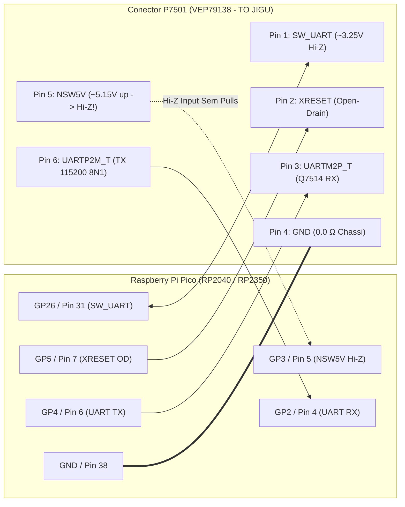

# GUIA CIRÚRGICO DE BANCADA: CONEXÃO `P7501` ASYNC UART SEM DESSOLDA
## Diagnóstico, Captura de Boot & Preparação de Bancada — Panasonic DMR-EH55 (`VEP79138`)
### Arquitetura Matsushita `AM34` / `MN103S` + Syscon `IC7501` $\leftrightarrow$ Raspberry Pi Pico (`RP2040` / `RP2350`)

---

## 1. Apresentação e Escopo Técnico

Este manual detalha o procedimento seguro de bancada para conectar um **Raspberry Pi Pico (`RP2040`)** ou **Pico 2 (`RP2350`)** ao conector de serviço de 6 pinos **`P7501` (`JST B6B-ZR-3R4`, legenda `"TO JIGU"`)** na placa `VEP79138` do gravador **Panasonic DIGA DMR-EH55**, realizando captura de boot a **`115200 8N1`**, diagnóstico elétrico completo da linha, controle discreto de reset/boot e ponte GDB RSP sem necessidade de soldar ou remover componentes da PCB principal.

> [!IMPORTANT]
> **Alinhamento Físico Verificado (`P7501` Async UART vs. Gravação Externa `IC5001`):**
> A verificação completa dos 3 manuais de serviço oficiais do **DMR-EH55** e medições ao vivo em bancada comprovaram que **`P7501`** é uma porta **UART Assíncrona `115200 8N1`** acoplada ao circuito discreto `Q7510` / `Q7514` / `QR7503` / `IC1506` / `D7510`.
> - A sonda Pico em `P7501` captura telemetria de inicialização ao vivo (`<00>DDR CHECK: OK`, `CD diag boot mode`), testa integridade elétrica de todos os pinos (`PINCHECK`, `UARTPROBE`, `FMUSCAN`) e abre a ponte `GDB` RSP sem dessolda.
> - Caso o aparelho apresente travamento em `U99` sem monitor interativo de escrita disponível em `P7501`, a reparação definitiva da NVRAM corrompida deve seguir a rota externa dessoldando a Flash Spansion `S29JL064H70TFI00` (**`IC5001`**) e executando `panadiga nvram clean` antes da regravação em programador **XGecu T48** ou **SVOD 4**.

---

## 1.1 Compatibilidade Universal com Placas RP2040 e RP2350 (Pico 1 e Pico 2)

> [!IMPORTANT]
> **Compatibilidade Total com Raspberry Pi Pico (RP2040) e Raspberry Pi Pico 2 (RP2350):**
> O ecossistema Panadiga suporta oficialmente tanto a **Pico 1 (`RP2040` / `Pico W`)** quanto a **Pico 2 (`RP2350` / `Pico 2 W`)**, além de placas baseadas no mesmo silício:
>
> * **Vantagens do RP2350 na Bancada:**
>   * **520 KB de SRAM (contra 264 KB do RP2040):** Buffer estendido para capturas seriais contínuas e cache de sessões GDB RSP.
>   * **Clock a 150 MHz e PIO 2.0:** Amostragem UART `115200 8N1` determinística com oversampling `8x` (`921.600 Hz`) em `p7501_uart.pio`.
>   * **Nível Lógico Nativo de `3.3V` + Guarda `NSW5V` (`GP3`):** Os sinais UART/controle de `P7501` operam em `3.3V LVTTL`, mas o Pino 5 (`NSW5V`) conecta-se ao nó `~5.15V` de `IC1506` via `D7510` — devendo **SEMPRE** permanecer em `Hi-Z Input` sem pulls no RP2040/RP2350.

---

## 1.2 Alerta de Engenharia: `P7501` Async UART (`115200 8N1`) vs. JTAG / `DWire32A` Legado

> [!CAUTION]
> **Por que não usar firmwares JTAG genéricos, adaptadores USB-TTL diretos sem Open-Drain nem protocolos `DWire32A` síncronos em `P7501`:**
>
> 1. **Interface Real do DMR-EH55:** O conector `P7501` **NÃO** é JTAG (`TDI/TDO/TMS/TCK`) nem `DWire32A` síncrono (`SDATA`/`SCLK`). Trata-se de UART Assíncrona `115200 8N1` (`UARTP2M_T` e `UARTM2P_T`) combinada com sinais discretos de boot/reset (`SW_UART`, `XRESET`) e alimentação comutada `NSW5V`.
> 2. **Bloqueio de TX por `Q7514`:** Quando `SW_UART` (Pino 1) é puxado para nível `LOW`, `Q7510` drena `XFWE` para entrar em serial boot (`CD diag boot mode`), mas simultaneamente coloca `Q7514` em corte, isolando o Pino 3 (`UARTM2P_T`) da CPU. Somente com `SW_UART = Hi-Z` o pino TX (`GP4`) atravessa `Q7514`.
> 3. **Risco de Dano em `NSW5V` e `XRESET`:** Conectar alimentação externa ou forçar nível alto push-pull no Pino 5 (`NSW5V`, `~5.15V` upstream) ou no Pino 2 (`XRESET`, `QR7503`) pode danificar o Pico ou a placa `VEP79138`. Utilize exclusivamente o firmware nativo `panasonic_p7501_uart`.

---

## 2. Padrão Mecânico e Comercial do Conector (`JST ZR 1.5mm` 6-Pin - `B6B-ZR-3R4`)

O conector de serviço **`P7501`** soldado na placa principal do DMR-EH55 (**`VEP79138`**) é um conector padrão **JST ZR de 6 pinos com passo (*pitch*) de `1.5 mm` (`B6B-ZR-3R4`)**, identificado no esquemático oficial Panasonic com a legenda **`TO JIGU`**.

### 2.1 Como Comprar o Cabo Correto (Plug-and-Play sem Microsolda)
Para conectar o Raspberry Pi Pico ao conector sem soldar diretamente nos pinos SMD da placa:
* **Termo Oficial de Busca Comercial:** `Cabo JST ZR / ZH 1.5mm 6 pinos Fêmea para Dupont 2.54mm Macho` (alojamento fêmea `ZHR-6` com terminais `SZH-002T-P0.5`).
* **Pitch (Espaçamento entre Pinos):** Exatamente **`1.5 mm`** entre centros.
* **Padrões Incompatíveis (Não Forçar):** Não utilize **JST SH (`1.0 mm`)**, **JST PH (`2.0 mm`)** ou **JST XH (`2.54 mm`)**.
* **Orientação Física:** A ilha quadrada de solda na PCB marca o **Pino 6 (`UARTP2M_T` / `MAX TXD`)**, localizado próximo ao conector flat **`FP50003`**.

---

## 2.2 Pinagem Canônica Verificada do Conector `P7501` (`VEP79138`)

> [!CAUTION]
> **GROUND TRUTH VERIFICADO EM ESQUEMÁTICO E BANCADA (`P7501`):**
> * **Pino 4 = `GND` ($0.0\,\Omega$ direto ao chassi metálico).**
> * **Pino 6 = `UARTP2M_T` (`MAX TXD`, ilha QUADRADA na PCB junto ao flat `FP50003`) — saída UART TX da placa (`115200 8N1`).**
> * **Pino 5 = `NSW5V` (`X_SW_5R2V`) — barramento estático de `~3.29V` em repouso (`~5.15V` upstream via `D7510` / `IC1506`). NUNCA aterrar nem dirigir em push-pull!**

```text
          CONECTOR CANÔNICO P7501 [B6B-ZR-3R4] ("TO JIGU") — VEP79138
                     ┌───────────────────────────────────────────┐
      Pino 1         │  [1] SW_UART   (~3.25V Hi-Z / LOW=XFWE)   │
      Pino 2         │  [2] XRESET    (Reset Open-Drain ~20µs)   │
      Pino 3         │  [3] UARTM2P_T (MAX RXD -> Pico GP4 TX)   │
      Pino 4 (GND)   │  [4] GND       (0.0Ω ao Chassi Metálico!) │
      Pino 5         │  [5] NSW5V     (MANTER GP3 EM Hi-Z!)      │
      Pino 6 (Quad.) │  [6] UARTP2M_T (MAX TXD -> Pico GP2 RX)   │
                     └───────────────────────────────────────────┘
```

### Tabela de Pinos e Comportamento Elétrico Medido (`COM10` + Manuais NA/EU)

| Pino `P7501` | Sinal no Esquemático | Circuito na Placa (`VEP79138`) | Nível / Comportamento Medido | Pino Pico (`RP2040/RP2350`) | Função na Recuperação / Diagnóstico |
| :---: | :--- | :--- | :--- | :---: | :--- |
| **Pino 1** | **`SW_UART`** `(D)` | Coletor `Q7510`, Base `QR7503`, `IC7501` Pin 80 | `3.24–3.25V` Hi-Z / `2.68–2.69V` PD | **`GP26 / ADC0`** (Pin 31) | Ativa boot serial/JIG (`XFWE`) em `LOW` (corta `Q7514`); manter `Hi-Z` p/ TX ativo. |
| **Pino 2** | **`XRESET`** | Malha de reset `QR7503` | Estrito Open-Drain (`0V` / `Hi-Z`, subida `~20 µs`) | **`GP5`** (Pin 7) | Reset mestre do alvo. Nunca dirigir `+3.3V` push-pull! |
| **Pino 3** | **`UARTM2P_T`** (`MAX RXD`) | Transmissor via `Q7514` (`R7570 10 kΩ`) | `3.3V` LVTTL `115200 8N1` | **`GP4`** (Pin 6, TX) | TX da sonda para RX do AM34 (`SW_UART=Hi-Z` p/ conduzir). Sem pull-up externo. |
| **Pino 4** | **`GND`** | `GND_DIGITAL` | **`0.0V`** ($0.0\,\Omega$ ao chassi) | **`GND`** (Pin 38) | Referência comum de `0V` da bancada. |
| **Pino 5** | **`NSW5V`** (`X_SW_5R2V`) | `IC1506` (`~5.15V`) via `D7510` | `~3.29V` repouso / `~5.15V` upstream | **`GP3`** (Pin 5) | Alimenta `R7570`/`R7572`/`IC7501`. **MANTER SEMPRE `Hi-Z Input` sem pulls!** |
| **Pino 6** | **`UARTP2M_T`** (`MAX TXD`) | `R7535` / `R7572 10 kΩ` | `3.3V` LVTTL `115200 8N1` ativo no boot | **`GP2`** (Pin 4, RX) | Único pino com stream UART ativo (`<00>DDR CHECK: OK`, `CD diag`). Pad quadrado. |

### Protocolo em 3 Passos com Multímetro Antes de Ligar o Pico
Com o aparelho fora da tomada e ponta **PRETA na carcaça metálica (chassi)**:
1. **Validar `Pino 4 (GND)`:** Em escala de continuidade, confirme **$0.0\,\Omega$** entre o **Pino 4 de `P7501`** e o chassi metálico.
2. **Validar `Pino 6 (UARTP2M_T)`:** Confirme visualmente o **pad quadrado** na extremidade próxima ao flat `FP50003`.
3. **Medir Tensões em Repouso (Standby/Ligado):** Com o multímetro em DC `20V`, verifique `Pino 1 (SW_UART) ≈ 3.25V`, `Pino 5 (NSW5V) ≈ 3.29V` e ausência de curtos entre pinos adjacentes antes de acoplar o Pico USB.

---

## 2.3 Verificação Crítica de Hardware: Pino 14 (`WP#/ACC`) da Spansion `S29JL064H` (`IC5001`)

> [!CAUTION]
> **Trava de Proteção Física contra Gravação (Hardware Write-Protect):**
> De acordo com o **Datasheet Oficial Spansion S29JL064H** (Seção *Top Boot Block Architecture*):
> * O **Pino 14 (`WP#/ACC`)** da memória Flash **`IC5001`** protege por hardware os dois últimos micro-setores de 8 KB: **`SA140` (`0x007FC000`)** e **`SA141` (`0x007FE000`)**.
> * Se o Pino 14 estiver aterrado (`0.0V`), comandos JEDEC *Sector Erase* (`0x30`) nesses setores são rejeitados internamente pelo chip.
> * Em procedimentos in-circuit que dependam de gravação na Flash, confirme com multímetro $+3.3\text{V}$ no pino 14 de `IC5001` antes de tentar apagar `EEMUL`.

---

## 3. Diagrama Elétrico de Bancada: RP2040 / RP2350 $\leftrightarrow$ `P7501`

A placa `VEP79138` **já incorpora** os resistores pull-up `R7570` (`10 kΩ`) e `R7572` (`10 kΩ`) ligados ao domínio `NSW5V`, além de `R7562` (`4.7 kΩ`) e `R7559` (`10 kΩ`) em `Q7510`. Portanto, **NÃO adicione resistor pull-up externo de `4.7 kΩ`**.

### 3.1 Esquema Elétrico Completo de Bancada

```text
       RASPBERRY PI PICO (RP2040 / RP2350)                          PLACA PRINCIPAL VEP79138
             PLACA DE BANCADA                                         CONECTOR P7501 (CANÔNICO)
    ┌───────────────────────────────┐                             ┌──────────────────────────────┐
    │                               │                             │                              │
    │  Pino 31 (GP26 / ADC0) ───────┼◄──[ R_PROT: 1.0kΩ (opc) ]───├───◄ Pino 1: SW_UART (D)      │
    │  (Boot Latch / ~3.25V Sense)  │     Q7510/R7562/R7559       │     (LOW->XFWE; Hi-Z->TX)    │
    │                               │                             │                              │
    │  Pino 7  (GP5 / XRESET) ──────┼───[ R_SER: 100Ω (opc) ]─────├───► Pino 2: XRESET           │
    │  (Open-Drain Emulado)         │     LOW=Reset / Hi-Z=Run    │     (QR7503, ~20µs subida)   │
    │                               │                             │                              │
    │  Pino 6  (GP4 / UART TX) ─────┼───[ R_SER: 100Ω (opc) ]─────├───► Pino 3: UARTM2P_T        │
    │  (115200 8N1 -> AM34 RX)      │     R7570 10kΩ na placa!    │     (MAX RXD via Q7514)      │
    │                               │                             │                              │
    │  Pino 38 (GND / Terra 0V) ────┼─────────────────────────────┼════ Pino 4: GND Comum        │
    │  (Referência 0V Chassi)       │   MALHA TERRA DIRETA 0.0Ω   │     (0.0Ω ao Chassi!)        │
    │                               │                             │                              │
    │  Pino 5  (GP3 / NSW5V Sense) ─┼◄──[ Hi-Z Input / SEM PULLS ]├───◄ Pino 5: NSW5V (X_SW_5R2V)│
    │  (NUNCA Dirigir Push-Pull!)   │     IC1506 ~5.15V / D7510   │     (~3.29V em repouso)      │
    │                               │                             │                              │
    │  Pino 4  (GP2 / UART RX) ─────┼◄──[ R_SER: 100Ω (opc) ]─────├───◄ Pino 6: UARTP2M_T        │
    │  (115200 8N1 <- AM34 TX)      │     R7572 10kΩ na placa!    │     (MAX TXD, Pad Quadrado)  │
    │                               │                             │                              │
    └───────────────────────────────┘                             └──────────────────────────────┘
```

### 3.2 Diagrama Mermaid de Interconexão



---

## 4. Cuidados Críticos de Proteção de Hardware

### 4.1 Regra de Sobrevivência 1: `NSW5V` (`GP3` / Pino 5) SEMPRE em `Hi-Z Input`
* O Pino 5 (`NSW5V` / `X_SW_5R2V`) recebe `~5.15V` a partir do regulador `IC1506` via diodo `D7510` para alimentar `R7570`/`R7572` e o Syscon `IC7501` (medindo `~3.29V` em repouso na linha).
* **JAMAIS** configure **`GP3` (`NSW5V`)** como saída digital (*push-pull*), jamais habilite resistores internos de pull-up/pull-down em `GP3` e **jamais alimente o Raspberry Pi Pico pelo conector `P7501`**.

### 4.2 Regra de Sobrevivência 2: Controle em Dreno Aberto (*Open-Drain*) de `XRESET` (`GP5`)
* O Pino 2 (`XRESET`) é conectado à malha de reset (`QR7503` / supervisor de sistema).
* **JAMAIS** configure `GP5` como saída em nível alto (`+3.3V` *push-pull*).
* **Modo Seguro (`p7501_hw.c`):**
  * **Forçar reset:** `GP5` como saída em **`0V`**.
  * **Liberar reset:** `GP5` como entrada **`Hi-Z` sem pulls** (`subida natural em ~20 µs`).

### 4.3 Regra 3: Comprimento dos Cabos e Ausência de Pull-Up Externo
* Mantenha o chicote JST/Dupont curto ($\le 15\text{ cm}$) e ligado ao terra comum (Pino 4 $\leftrightarrow$ Pino 38 do Pico).
* **NÃO** conecte pull-up externo de `4.7 kΩ` para `3V3_OUT`: `VEP79138` já possui `R7570` (`10 kΩ`) e `R7572` (`10 kΩ`).

---

## 5. Procedimento Operacional Padrão de Bancada (Passo a Passo)

```text
                     FLUXO OPERACIONAL VERIFICADO NO P7501
  ┌─────────────────────────────────────────────────────────────────────┐
  │ 1. TESTE A FRIO: Pin 4 <-> Chassi = 0.0Ω; checar isolação dos pinos │
  ├─────────────────────────────────────────────────────────────────────┤
  │ 2. CONEXÃO JST ZR-6: Plugue encaixado em P7501 + USB no Pico        │
  ├─────────────────────────────────────────────────────────────────────┤
  │ 3. TERMINAL (115200 bps): Abrir console -> Prompt 'PANADIGA> '      │
  ├─────────────────────────────────────────────────────────────────────┤
  │ 4. CHECK ELÉTRICO ('STATUS' e 'PINCHECK'): ~3.25V Hi-Z / ~2.69V PD  │
  ├─────────────────────────────────────────────────────────────────────┤
  │ 5. CAPTURA BOOT ('JIGBOOT' / 'BOOTCAP'): <00>DDR CHECK / CD diag    │
  ├─────────────────────────────────────────────────────────────────────┤
  │ 6. ENVIO SERIAL ('ENGAGE' -> 'UARTSEND'): SW_UART Hi-Z para Q7514   │
  ├─────────────────────────────────────────────────────────────────────┤
  │ 7. HIGIENE PÓS-TESTE ('UARTPROBE 8' -> 'ISOLATE'): Volta p/ Hi-Z!   │
  └─────────────────────────────────────────────────────────────────────┘
```

### Passo 1: Inspeção e Medições a Frio (Aparelho Desconectado da Tomada)
1. Desligue o DMR-EH55 da tomada AC.
2. Com multímetro em continuidade, confirme **$0.0\,\Omega$** entre o **Pino 4 (`GND`) de `P7501`** e o chassi metálico.
3. Confirme que não há curto-circuito entre Pinos 4 (`GND`), 5 (`NSW5V`) e 1 (`SW_UART`).

### Passo 2: Conexão do Chicote `P7501` $\leftrightarrow$ Raspberry Pi Pico
1. Conecte o cabo `ZHR-6` (`1.5 mm`) ao conector `P7501` mapeando exatamente os 6 pinos (`1->GP26`, `2->GP5`, `3->GP4`, `4->GND`, `5->GP3`, `6->GP2`).
2. Alimente o Pico exclusivamente pelo cabo **USB** conectado ao computador (ou celular Android via OTG / Bluetooth BLE se estiver em Pico W / 2 W).

### Passo 3: Energização e Abertura do Console (`PANADIGA> `)
1. Conecte o gravador Panasonic à tomada AC e ligue o cabo USB do Pico.
2. Abra a porta serial do Pico no aplicativo desktop (`panadiga-desktop`), na CLI (`panadiga`) ou terminal serial a `115200 bps`.
3. Pressione `<ENTER>` e confirme o prompt **`PANADIGA> `**.

### Passo 4: Verificação Elétrica (`STATUS` e `PINCHECK`)
```text
PANADIGA> PING
PONG
PANADIGA> STATUS
VDD: 3.25V (OK)
PANADIGA> PINCHECK
```
* **Leitura esperada em `PINCHECK`:** `SW_UART` (`GP26`) marca `~3.25V` em `Hi-Z`, `~2.69V` sob pull-down (grampeado via junção B-C de `Q7510`) e `~3.27V` sob pull-up; `XRESET` (`GP5`) sobe em `~20 µs` ao soltar; `NSW5V` (`GP3`) reportado estritamente em `Hi-Z Input`; `GP2` (`UARTP2M_T`) acusa centenas de bordas seriais ativas durante boot.

### Passo 5: Captura de Boot (`BOOTCAP` / `JIGBOOT` / `UARTMON`)
```text
PANADIGA> JIGBOOT
```
* A captura síncrona PIO em `GP2` (`115200 8N1`) exibirá mensagens do bootloader AM34 (`<00>DDR CHECK: OK`, `CD diag boot mode`, códigos `X(80020401)` / `X(80040904)` e status do mecanismo óptico/drive).

### Passo 6: Transmissão Serial Interativa (`ENGAGE` + `UARTSEND`) e Restauração (`UARTPROBE 8` + `ISOLATE`)
```text
PANADIGA> ENGAGE
[BUS] P7501 UART TX (GP4) engaged idle HIGH; NSW5V (GP3) kept Hi-Z Input.
PANADIGA> UARTSEND VER
PANADIGA> UARTPROBE 8
PANADIGA> ISOLATE
[BUS] P7501 pins placed in High-Impedance Isolation (NSW5V/XRESET Hi-Z, GP26 ADC0).
```
*(Lembre-se: `UARTSEND` mantendo `SW_UART = Hi-Z` permite a passagem por `Q7514`; ao concluir, rodar `UARTPROBE 8` + `ISOLATE` restaura a leitura limpa de `GP26 / ADC0` para os próximos comandos `STATUS`.)*

---

## 6. Tabela de Diagnóstico de Falhas de Bancada

| Sintoma Observado | Causa Mais Provável | Ação Corretiva Imediata |
| :--- | :--- | :--- |
| `VDD: 0.02V (LOW)` após `UARTSEND` / `JIGBOOT` | Estado residual digital em `GP26` ou gravador desligado | Execute `UARTPROBE 8` seguido de `ISOLATE` e verifique energia AC do gravador. |
| `PINCHECK` acusa `GP2 = 0` transições | Fio do Pino 6 (`UARTP2M_T`, pad quadrado) desconectado/invertido | Cheque continuidade entre o pad quadrado de `P7501` e `GP2` (Pin 4 do Pico) + terra comum `Pin 4 <-> GND`. |
| `UARTSEND LOW:cmd` retorna `0 bytes` | Comportamento esperado de hardware: `SW_UART = LOW` coloca `Q7514` em corte | Envie `UARTSEND <texto>` sem o prefixo `LOW:` após `ENGAGE`, mantendo `GP26` em `Hi-Z`. |
| Gravador trava em `U99` após captura `CD diag boot mode` | Setores `SA134..SA141` (`EEMUL`) corrompidos na Spansion `IC5001` e sem monitor ativo p/ escrita | Dessoldar `IC5001` TSOP-48 (Rota A), limpar via `panadiga nvram clean` e gravar no **XGecu T48** / **SVOD 4**. |
| Console serial não responde | Driver USB CDC não selecionado ou porta incorreta | Confirme porta COM/ttyACM com `panadiga pico list` e valide `115200 8N1`. |

---

## 7. Arquitetura da Sonda e Matriz de Compatibilidade Universal

### 7.1. Sonda `P7501` (`115200 8N1`) vs. Ponte USB-Serial Comum
* O **Raspberry Pi Pico (`RP2040` / `RP2350`)** une transceptor PIO UART (`p7501_uart.pio`) com controle coordenado de **`SW_UART`** (`GP26` em corte/Hi-Z para `Q7510`/`Q7514`), **`XRESET`** Open-Drain (`GP5`), guarda passiva **`NSW5V`** (`GP3` sempre `Hi-Z`) e bridge **`GDB` RSP**.
* **Alerta Elétrico:** Não ligue conversores USB-Serial genéricos diretamente ao `P7501` sem garantir nível `3.3V` estrito, Open-Drain real em `XRESET` e isolamento completo do Pino 5 (`NSW5V`).

### 7.2. Compatibilidade com Outros Fabricantes de NOR Flash (Padrão JEDEC CFI)
O payload alvo [`ram_loader_am34_target.c`](../../firmware/pico-p7501/flash/ram_loader_am34_target.c) e o motor `panadiga nvram clean` suportam geometrias Top-Boot padrão JEDEC/CFI de **Spansion** (`S29JL064H`, `S29GL064N`, `S29AL016D`), **ST/Numonyx** (`M29W640FB`/`FT`), **Macronix** (`MX29LV640DT`), **Fujitsu** (`MBM29LV640`) e **Toshiba/Winbond**.

### 7.3. Compatibilidade com Outros Gravadores da Família Panasonic DIGA
Referência de partições NVRAM Top-Boot (`EEMUL`) em gerações DIGA:
1. **8 MB NOR Flash (`0x807F0000..0x807FFFFF`):** `DMR-EH55`, `DMR-EH56`, `DMR-EH65`, `DMR-ES15`, `DMR-ES25`, `DMR-ES35V`, `DMR-EZ25`.
2. **4 MB NOR Flash (`0x803F0000..0x803FFFFF`):** `DMR-ES10`, `DMR-ES20`, `DMR-ES30V`, `DMR-EH50`, `DMR-EH60`, `DMR-E100H`, `DMR-E500H`.
3. **2 MB NOR Flash (`0x801F0000..0x801FFFFF`):** `DMR-E50`, `DMR-E55`, `DMR-E65`, `DMR-E80H`, `DMR-E85H`, `DMR-E95H`.
4. **16 MB NOR Flash (`0x80FF0000..0x80FFFFFF`):** `DMR-EX75`, `DMR-EX85`, `DMR-EX77`, `DMR-EX87`, `DMR-EX95V`, `DMR-EZ27`, `DMR-EZ45V`, `DMR-EZ48V`.
5. **Documentação de Arquitetura Completa:** Consulte [ARQUITETURA_E_BLUEPRINT_DE_ENGENHARIA.md](ARQUITETURA_E_BLUEPRINT_DE_ENGENHARIA.md).

---

## 8. Conector Inteiriço de 6 Pinos (`JST ZR-6`) & Isolamento Tri-State (`ISOLATE` / `HIZ`)

Como o conector **`P7501` (`B6B-ZR-3R4`)** utiliza um plugue fêmea **inteiriço de 6 vias (`1.5 mm`)**, não é necessário desconectar fios do alojamento plástico entre medições e boots normais:

1. **Segurança do Chicote Conectado:**
   * **Pino 4 (`GND`):** Terra comum ($0.0\,\Omega$).
   * **Pino 5 (`NSW5V` -> `GP3`):** Fica permanentemente configurado como **`Hi-Z Input` sem pulls** no HAL do Pico — **zero corrente drenada ou injetada**.
   * **Pino 2 (`XRESET` -> `GP5`):** Em repouso permanece em **`Hi-Z` Open-Drain** sem pulls.
   * **Pinos 1, 3 e 6 (`SW_UART`, `UARTM2P_T`, `UARTP2M_T`):** Colocados em isolamento seguro via comando **`ISOLATE`** (`HIZ`), mantendo a placa Panasonic livre para dar boot normal.
2. **Comandos `ISOLATE` (`HIZ`) e `ENGAGE` no Firmware:**
   * **`ISOLATE` / `HIZ`:** Executa `p7501_hw_isolate_bus_hiz()`, colocando os pinos de interface em alta impedância segura (`NSW5V` e `XRESET` em `Hi-Z`, `GP26` em `ADC0`).
   * **`ENGAGE`:** Executa `p7501_hw_engage_uart_bus()`, habilitando `GP4` (`UARTM2P_T`) em idle HIGH para transmissão TX ativa e mantendo `GP3` (`NSW5V`) estritamente em `Hi-Z Input`.

---

## 9. Checklist da 1ª Conexão Read-Only na Placa Real

Antes de qualquer comando de alteração ou intervenção invasiva:

1. **Passo 1 (`STATUS` $\rightarrow$ `PINCHECK`):** Confirma `Pin 4 = GND`, tensão saudável em `SW_UART` (`~3.25V Hi-Z | ~2.69V PD`), isolamento absoluto de `GP3 (NSW5V)` e atividade em `GP2 (UARTP2M_T)`.
2. **Passo 2 (`BOOTCAP` / `JIGBOOT` / `UARTMON`):** Registra o log completo `115200 8N1` de inicialização (`<00>DDR CHECK: OK`, `CD diag boot mode` ou falhas de sense) para diagnóstico preciso.
3. **Passo 3 (`UARTPROBE 8` $\rightarrow$ `ISOLATE`):** Verifica resposta serial mantendo `Q7514` habilitado (`SW_UART = Hi-Z`) e finaliza sempre devolvendo o barramento ao estado `ISOLATE`.
4. **Passo 4 (Reparo Definitivo NVRAM `U99`):** Caso necessário regravar `0x807F0000..0x807FFFFF`, realize leitura dupla verificada por SHA-256 da Spansion `S29JL064H` (**`IC5001`**) e limpe com **`panadiga nvram clean`**.
