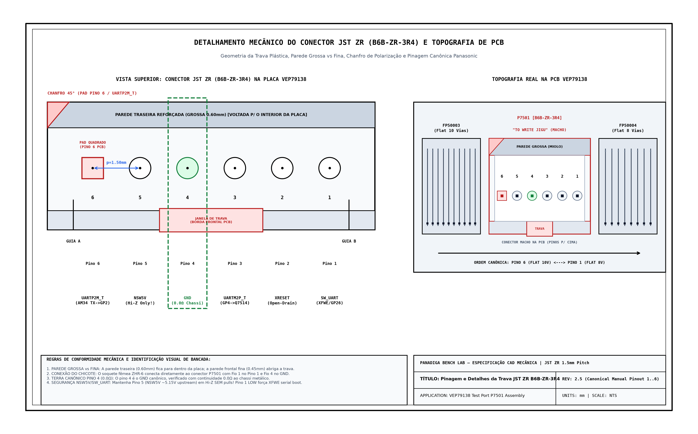
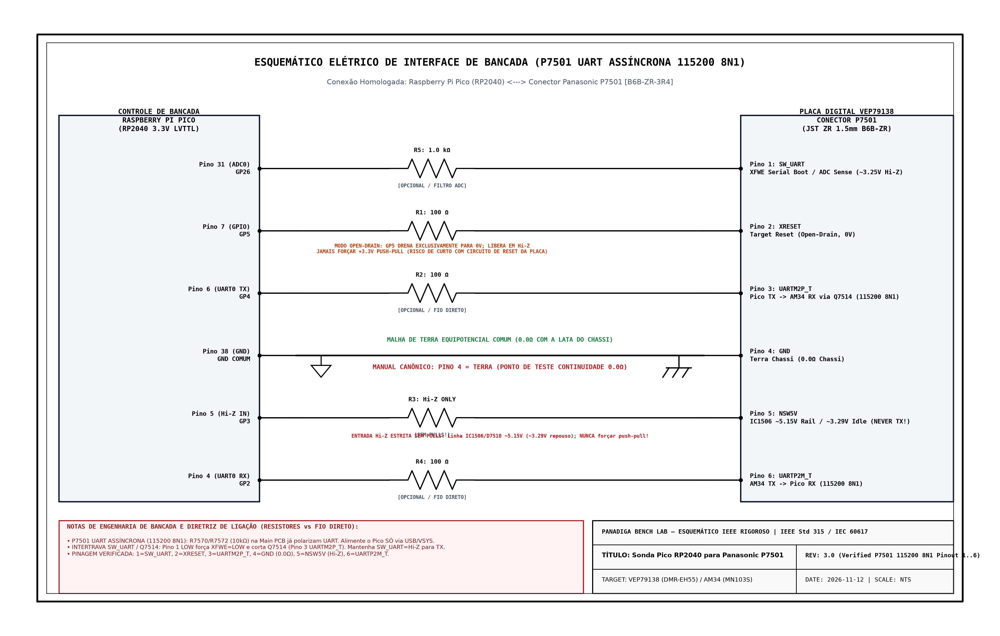

# Guia Prático Ilustrado de Montagem da Sonda `P7501` e Procedimentos de Bancada
## Assembly da Ferramenta de Comunicação Serial UART (`115200 8N1`) para Panasonic DMR-EH55 (Placa `VEP79138`)

---

## 1. Visão Geral e Propósito de Engenharia

Este documento fornece as instruções detalhadas de montagem mecânica, elétrica e de bancada para a sonda de diagnóstico **UART Assíncrona `P7501` (`115200 8N1`) + Controle Discreto de Boot/Reset** utilizando o microcontrolador **Raspberry Pi Pico (RP2040 / RP2350)**.

A ferramenta permite:
1. Interceptar sequências de inicialização a frio (`CD diag boot mode` / `XFWE` serial boot) na plataforma **Matsushita `AM34` / `MN103S` (`VEP79138`)** sem dessoldar `IC5001`.
2. Operar telemetria UART bidirecional (`UARTP2M_T` / `UARTM2P_T`) e ponte **GDB RSP** na porta TCP `3333` para análise de firmware no Ghidra/IDA.
3. Monitorar ao vivo `SW_UART` (`GP26`), tempo de subida em Open-Drain de `XRESET` (`GP5`) e presença do barramento `NSW5V` (`GP3` mantido estritamente como `Hi-Z Input` sem pulls), preservando intacta a Flash Spansion `S29JL064H` (`IC5001`).

> [!NOTE]
> ### Rigor Técnico de Bancada vs. Ilustrações Estilizadas (Refutação de Gráficos "PowerPoint")
> Ilustrações conceituais com tema escuro, efeitos visuais estilizados ou aproximações artísticas geradas por IA foram **terminantemente refutadas e descartadas desta documentação técnica**.  
> Em bancada de laboratório de hardware e microeletrônica, suposições visuais levam à queima de semicondutores. Todos os diagramas neste guia foram substituídos por:
> 1. **Desenhos Mecânicos CAD Baseados em Datasheet Oficial (JST ZR `B6B-ZR-3R4`)**: Geometria real da carcaça plástica, fenda central da trava, parede frontal fina vs. parede traseira reforçada grossa, chanfro a 45° no pino 1 e distinção de pads na PCB (pad quadrado no **Pino 6** vs. pads redondos nos **Pinos 1 a 5**).
> 2. **Esquemáticos Elétricos em Conformidade com Normas IEEE Std 315 e IEC 60617**: Simbologia padrão internacional sobre papel técnico branco, blocos de título de engenharia (Title Block), rastreamento de nós, proteção de `NSW5V` e clara distinção entre Terra de Sinal (IEEE Triangle) e Terra de Chassi Metálico (IEEE Chassis Ground).

---

## 2. AVISO CRÍTICO DE BANCADA: Identificação Inequívoca do Pino de Terra (GND) e Proteção `NSW5V`

> [!CAUTION]
> ### DISCLAIMER MANDATÓRIO DE BANCADA — PINO DO TERRA (`GND`) E `NSW5V`
> * **No Manual de Serviço Oficial da Panasonic (Esquemático `P7501 [B6B-ZR-3R4]`, pág. 62):** O **`GND` é ESTRITAMENTE O PINO 4**.
> * **Orientação Esquerda $\rightarrow$ Direita na PCB (entre `FP50003` e `FP50004`):** A sequência observada da esquerda para a direita é **Pino 6 (`UARTP2M_T`, pad quadrado), Pino 5 (`NSW5V`), Pino 4 (`GND`), Pino 3 (`UARTM2P_T`), Pino 2 (`XRESET`) e Pino 1 (`SW_UART`)**. Assim, contando da esquerda para a direita a partir do `FP50003`, o `GND` é o **3º pino** (que corresponde ao **Pino 4** na contagem canônica 1..6 a partir do `FP50004`).
> * **PERIGO DE CURTO-CIRCUITO & `NSW5V`:** NUNCA assuma que o Pino 1 (`SW_UART`, `~3.25V`), o Pino 5 (`NSW5V`, `~5.15V` via `D7510` de `IC1506` / `~3.29V` em repouso) ou o Pino 6 (`UARTP2M_T`) sejam terra! Além disso, o pino `GP3` do Pico conectado ao Pino 5 (`NSW5V`) **DEVE permanecer SEMPRE como `Hi-Z Input` sem pulls (NUNCA dirigir push-pull!)**.
> * **REGRA DE OURO INVIOLÁVEL:** Antes de conectar o Raspberry Pi Pico ou qualquer fonte, **coloque o multímetro em teste de continuidade e confirme o bipe sonoro de $0.0\,\Omega$ entre o pino escolhido como terra e a carcaça de lata metálica desprovida de tinta do chassi do aparelho!**

---

## 3. Fotografias Técnicas e Topografia da Placa VEP79138

### 3.1 Esquemático Oficial do Conector P7501 (Manual de Serviço Panasonic)
Abaixo está o registro fotográfico de alta resolução extraído diretamente da página de esquemáticos da placa principal:


*Detalhes visíveis no esquema oficial:*
- Conector identificado como **`P7501`**, part-number **`B6B-ZR-3R4`**, legenda **`TO JIGU`**.
- **Pino 1:** `SW_UART` (`(D)`) — `~3.25V` Hi-Z / `~2.69V` PD via `Q7510`; nível baixo ativa `XFWE` serial boot e coloca `Q7514` em corte
- **Pino 2:** `XRESET` — Reset mestre Open-Drain ativo-LOW (`GP5`, subida Hi-Z em `~20 µs` via `QR7503`)
- **Pino 3:** `UARTM2P_T` (`MAX RXD`) — Entrada serial do alvo (`GP4` Pico TX `115200 8N1` -> AM34 RX via `Q7514`, com `R7570 10 kΩ`)
- **Pino 4:** **`GND` (Terra com símbolo internacional de aterramento de chassi, $0.0\,\Omega$)**
- **Pino 5:** `NSW5V` (`X_SW_5R2V`) — Rail `~5.15V` (`IC1506` via `D7510`, `~3.29V` em repouso; manter `GP3` SEMPRE em `Hi-Z Input`!)
- **Pino 6:** `UARTP2M_T` (`MAX TXD`) — Saída serial do SoC AM34 (`115200 8N1` -> `GP2` Pico RX via `R7535`/`R7572 10 kΩ`, pad quadrado)

---

### 3.2 Topografia Física na Face Superior da Placa VEP79138 e Especificação CAD JST ZR

O conector de teste **`P7501`** situa-se delimitado entre dois conectores flat vitais:
* **À Esquerda (Pino 6):** Conector flat de 10 vias **`FP50003`** (motor spindle da unidade óptica).
* **À Direita (Pino 1):** Conector flat de 8 vias **`FP50004`** (motor da gaveta e sensores de fim de curso).

Abaixo está o desenho mecânico vetorial de engenharia, extraído diretamente da especificação geométrica do fabricante JST e do footprint IPC-7351 da placa:



#### Critérios Mecânicos e Invariantes Físicas do Conector JST ZR (B6B-ZR-3R4):
1. **Janela da Trava Plástica (Locking Notch)**:  
   A trava plástica do conector fêmea `ZHR-6` engata na **janela retangular vazada situada na parede frontal** (voltada para a borda externa da PCB). O clique de travamento deve ocorrer voltado para a borda frontal do chassi.
2. **Diferença de Parede (Parede Grossa vs. Parede Fina)**:  
   A carcaça de poliamida JST possui assimetria mecânica intencional:
   - **Parede Traseira (Grossa / Reforçada)**: Mede $0.60\text{ mm}$ de espessura de resina sólida, voltada para o miolo da placa.
   - **Parede Frontal (Fina)**: Mede $0.45\text{ mm}$ de espessura para acomodar a flexão da lingüeta de retenção da trava do plugue `ZHR-6`.
3. **Chanfro Angular de 45° no Pino 1 (Molding Chamfer)**:  
   O canto externo plástico no lado do pino 1 possui um chanfro mecânico moldado a $45^\circ$, servindo como guia tátil e visual na montagem de bancada.
4. **Assinatura de PCB: Pad Quadrado no Pino 6 vs. Pads Redondos nos Pinos 1..5**:  
   Caso precise identificar a polaridade visualmente pelas ilhas da placa:
   - **Pino 6 (`UARTP2M_T`, à esquerda junto ao `FP50003`)**: Pad de cobre **QUADRADO**.
   - **Pinos 5 a 1**: Pads de cobre **CIRCULARES / REDONDOS**.
5. **Pitch (Passo Entre Pinos)**:  
   Exatos **$1.50\text{ mm}$** centro-a-centro. Comprimento total da carcaça plástica: $10.50\text{ mm}$.

```text
       ORIENTAÇÃO MECÂNICA DO CONECTOR P7501 [B6B-ZR-3R4] (PINAGEM CANÔNICA DO MANUAL)
       Parede Traseira Grossa (0.60mm) voltada p/ o interior da placa (acima)
       Janela de Trava voltada p/ a borda frontal da PCB (abaixo)
       
       Flat 10 Vias (FP50003)                                          Flat 8 Vias (FP50004)
       [À Esquerda]                                                             [À Direita]
            ┌──────────────────────────────────────────────────────────────────┐
     Pino 6 │ ■ UARTP2M_T [PAD QUADRADO] TX UART AM34 (115200 8N1) -> Pico GP2 │
     Pino 5 │ ● NSW5V     [Pad Circular] ~5.15V/3.29V (GP3 SEMPRE Hi-Z Input!) │
     Pino 4 │ ● GND       [Pad Circular] Terra Canônico (0.0Ω ao Chassi!)      │
     Pino 3 │ ● UARTM2P_T [Pad Circular] RX UART AM34 <- Pico GP4 (via Q7514)  │
     Pino 2 │ ● XRESET    [Pad Circular] Reset Mestre (Open-Drain GP5 -> 0V)   │
     Pino 1 │ ● SW_UART   [Pad Circular] Boot Select / ADC0 (GP26)             │
            └──────────────────────────────────────────────────────────────────┘
```

---

## 4. Esquema Elétrico de Montagem da Sonda (RP2040 $\leftrightarrow$ P7501)

Abaixo está o diagrama elétrico oficial de engenharia, desenhado rigorosamente sob os padrões **IEEE Std 315 / IEC 60617** sobre papel milimetrado branco, com bloco de títulos e legendas normatizadas:



#### Fundamentação Elétrica do Acoplamento & Veredito sobre Resistores:
1. **Veredito de Bancada: Precisa ou Não Ligar Resistores?**  
   - **MODO DIRETO (FIO DIRETO CURTO $\le 15\text{ cm}$):**  
     Para testes de bancada com cabos curtos ($L \le 15\text{ cm}$), **os sinais lógicos `SW_UART`, `XRESET`, `UARTM2P_T` e `UARTP2M_T` operam em $3.3\text{V}$ LVTTL com resistores de pull-up e limitação já presentes na PCB (`R7570 10 kΩ`, `R7572 10 kΩ`, `R7535 100 Ω`, `R7559 10 kΩ`)**, dispensando pull-up externo de $4.7\text{ k}\Omega$ em `UARTM2P_T` (`GP4`).
   - **RESPEITAR A REGRA CRÍTICA DO PINO 5 (`NSW5V` / `GP3`):**  
     O Pino 5 (`NSW5V`) é alimentado a **`~5.15V` por `IC1506` via diodo `D7510`** (`~3.29V` em repouso) para polarizar `R7570`/`R7572` e `IC7501`. Portanto, **`GP3` DEVE permanecer SEMPRE como `Hi-Z Input` sem pulls (NUNCA dirigir em push-pull e NUNCA tentar alimentar o Pico por este pino!)**.
   - **RESISTORES SÉRIE OPCIONAIS EM FERRAMENTAS DEFINITIVAS:**  
     Em chicotes permanentes acima de $15\text{ cm}$, pode-se adicionar resistores série **$R_1 \dots R_3 = 100\,\Omega$** nas linhas lógicas (`GP2`, `GP4`, `GP5`) para amortecer reflexões e **$R_{\text{sense}} = 1.0\text{ k}\Omega$** em `GP26 / ADC0` (`SW_UART`).
2. **Estágio Open-Drain em `XRESET` (`GP5`):**  
   O microcontrolador RP2040/RP2350 comanda o pino `XRESET` estritamente drenando para $0\text{V}$ (nível baixo ativo) e soltando em Alta Impedância (`Hi-Z`, subida medida em `~20 µs` via `QR7503`). **NUNCA configure `GP5` como Push-Pull em nível alto (+3.3V)!**
3. **Distinção de Terras Normatizada:**  
   O esquemático diferencia o Terra de Sinal do RP2040 (símbolo IEEE triangular) e o Terra de Chassi Metálico da Panasonic (símbolo IEEE de carcaça). A malha deve ser unificada em conexão equipotencial direta de baixíssima resistência ($< 0.1\,\Omega$).

### 4.1 Tabela de Conexões e Mapeamento Sequencial Pino a Pino (1 a 6)

| Pino Canônico (Manual / `P7501`) | Sinal Matsushita | Pino RP2040/RP2350 (Pico) | Topografia & Chicote Fêmea `ZHR-6` | Condicionamento & Regra de Segurança |
| :---: | :---: | :---: | :--- | :--- |
| **Pino 1** | `SW_UART` (`(D)`) | `GP26 / ADC0` (Pino 31) | Pino mais à direita (junto ao Flat 8V `FP50004`). Fio 1 do `ZHR-6`. | `~3.25V` Hi-Z / `~2.69V` PD (`Q7510`). `LOW` seleciona serial boot e corta `Q7514`; `Hi-Z` libera TX UART. ($1.0\text{ k}\Omega$ opcional). |
| **Pino 2** | `XRESET` | `GP5` (Pino 7) | Reset mestre do sistema (`QR7503`). Fio 2 do `ZHR-6`. | **Estritamente Open-Drain** (`LOW` / `Hi-Z` em `~20 µs`). Série $100\,\Omega$ opcional. |
| **Pino 3** | `UARTM2P_T` (`MAX RXD`) | `GP4` (Pino 6 / UART TX) | Pico TX `115200 8N1` -> AM34 RX via `Q7514`. Fio 3 do `ZHR-6`. | Onboard `R7570 10 kΩ` p/ `NSW5V` (**sem pull-up externo!**). Requer `SW_UART = Hi-Z` para `Q7514` conduzir. |
| **Pino 4** | **`GND`** | **Pino 38 (`GND`)** | **Referência de terra canônica (3º pino da esq. p/ dir.). Fio 4 do `ZHR-6`.** | **MANDATÓRIO: Ligação direta de baixíssima resistência ($0.0\,\Omega$ com a carcaça metálica do chassi)!** |
| **Pino 5** | `NSW5V` (`X_SW_5R2V`) | `GP3` (Pino 5) | Rail `~5.15V` de `IC1506` via `D7510` (`~3.29V` repouso). Fio 5 do `ZHR-6`. | **SEMPRE `Hi-Z Input` sem pulls — NUNCA dirigir push-pull e NUNCA alimentar o Pico!** |
| **Pino 6** | `UARTP2M_T` (`MAX TXD`) | `GP2` (Pino 4 / UART RX) | Pino mais à esquerda (junto ao Flat 10V `FP50003`). **Pad QUADRADO**. Fio 6 do `ZHR-6`. | Saída UART `115200 8N1` do SoC AM34 (`R7535`/`R7572 10 kΩ`). Série $100\,\Omega$ opcional. |

---

## 5. Lista de Materiais (Bill of Materials — BOM)

Para montar a sonda de bancada com robustez profissional, utilize os seguintes componentes:

| Item | Qtd | Referência | Descrição Técnica | Função no Circuito |
| :---: | :---: | :--- | :--- | :--- |
| **1** | 1 | Microcontrolador | **Raspberry Pi Pico** (`RP2040`) ou **Pico 2** (`RP2350`) / Pico W | Controlador UART/PIO `P7501` (`115200 8N1`) e ponte GDB RSP |
| **2** | 3 | $R_1, R_2, R_3$ | Resistor de Filme Metálico **$100\,\Omega \pm 1\%$** ($1/8\text{W}$ ou $1/4\text{W}$) *(opcional)* | Amortecimento opcional em `UARTP2M_T` (`GP2`), `UARTM2P_T` (`GP4`) e `XRESET` (`GP5`) |
| **3** | 1 | $R_{\text{sense}}$ | Resistor de Filme Metálico **$1.0\text{ k}\Omega \pm 1\%$** *(opcional)* | Proteção opcional em série na porta `SW_UART` / `ADC0` (`GP26`) |
| **4** | 1 | Chicote de Conexão | Conector JST ZR 6 vias fêmea (`ZHR-6`) passo 1.5mm **OU** Fios flexíveis AWG 30 (Kynar / PTFE) | Conexão ao conector original `P7501 [B6B-ZR-3R4]` |
| **5** | 1 | Fixação Mecânica | Fita Kapton (resistente a calor) ou Cola Quente de alívio de tensão | Fixação dos fios na PCB para evitar rompimento das trilhas SMD |

---

## 6. Procedimento de Montagem Passo a Passo

### Etapa 1: Preparação da Placa `VEP79138`
1. Desconecte o cabo de energia AC do gravador Panasonic DMR-EH55.
2. Remova a tampa superior metálica (retirando os parafusos traseiros e laterais).
3. Localize visualmente os cabos flat adjacentes: **`FP50003`** (10 vias, à esquerda) e **`FP50004`** (8 vias, à direita).
4. Entre os dois flats, localize o conector **`P7501`** (`B6B-ZR-3R4`) com a legenda *"TO JIGU"*.
5. Se utilizar solda direta nas ilhas, limpe com álcool isopropílico 99.8% e aplique fluxo *no-clean*.

### Etapa 2: Conexão Elétrica (Opção Conector ou Solda Direta)
* **Se a placa possuir o conector encaixável:** Conecte diretamente o terminal JST `ZHR-6` crimpado.
* **Se soldar fios diretamente:**
  1. Estanhe suavemente as 6 ilhas (lembrando que o **Pino 6 `UARTP2M_T`** tem o pad quadrado junto ao `FP50003`).
  2. Solde 6 fios Kynar AWG 30 curtos ($\le 15\text{ cm}$).
  3. Prenda o feixe de fios com fita Kapton para alívio de tensão mecânica.

### Etapa 3: Checklist de Teste com Multímetro (OBRIGATÓRIO)
Antes de ligar o conector ao Raspberry Pi Pico:
1. **Teste de Continuidade do Terra (`Pino 4 = GND`):**
   - Ponta preta do multímetro no chassi de metal do aparelho.
   - Ponta vermelha no **Pino 4 do manual (3º pino da esquerda para a direita a partir do `FP50003`)**.
   - O multímetro **DEVE emitir bipe sonoro ininterrupto indicando resistência $< 0.3\,\Omega$**.
   - Teste todos os outros 5 pinos contra o chassi: nenhum outro pino pode apitar!
2. **Teste de Ausência de Curto entre Pinos:**
   - Meça resistência entre `Pino 5 (NSW5V)`, `Pino 1 (SW_UART)`, `Pino 6 (UARTP2M_T)` e `GND` (`Pino 4`): não pode acusar curto ($0\,\Omega$)!

### Etapa 4: Conexão ao Raspberry Pi Pico e Inicialização
1. Certifique-se de que o firmware em `firmware/pico-p7501/` esteja gravado no Pico e confira o mapeamento `GP2`, `GP3 (Hi-Z!)`, `GP4`, `GP5 (OD)`, `GP26`, `GND`.
2. Conecte o cabo USB do Pico ao computador (NUNCA alimente o Pico pelo `P7501`) e inicie o Workbench do Panadiga Desktop:
   ```powershell
   npm run tauri dev
   ```
3. Navegue até o módulo **Pico Bench** e observe o painel **Conexões Físicas (`Pico -> P7501`)** para validar a leitura segura e iniciar a captura serial a `115200 8N1`.
