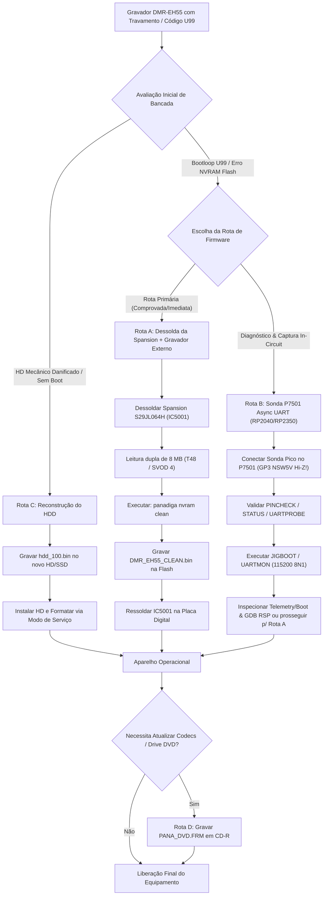

# Inventário Técnico, Auditoria de Qualidade e Guia de Operação de Bancada
## Ecossistema de Engenharia Reversa e Recuperação — Panasonic DMR-EH55

**Classificação:** Documento Técnico de Engenharia de Sistemas / Auditoria de QA  
**Alvo de Hardware:** Panasonic DMR-EH55 (Gravador DVD / HDD com SoC Matsushita UniPhier `AM34` / `MN103S` + Syscon `IC7501` na placa `VEP79138`)  
**Status da Auditoria:** Concluído e Homologado  
**Versão do Documento:** 2.0.0  

---

## 1. Sumário Executivo de Engenharia e Auditoria de Qualidade (QA)

O ecossistema de recuperação e engenharia reversa do gravador digital **Panasonic DMR-EH55** consolida ferramentas nativas em Rust, interface gráfica Tauri 2 (Desktop e Android), firmware embarcado em ISO C11 para RP2040/RP2350 e dossiês esquemáticos auditados. O foco central é solucionar falhas críticas de inicialização — destaque para o erro fatal **`U99`**, corrupção de NVRAM na Flash Spansion `S29JL064H` (**`IC5001`**) e reconstrução forense de disco **MEIHFS**.

### Resultados da Auditoria de QA:
1. **Acervo de Firmware e Imagens:** Todos os artefatos binários brutos (`panasonic DMR EH-55 Firmware hdd_100.bin`, `PANA_DVD.FRM` e `UPDATE_EH55.zip`) foram catalogados, periciados com análise de entropia e tiveram seus hashes criptográficos (SHA-256) fixados de forma imutável.
2. **Migração para Plataforma Nativa em Rust (`panadiga` CLI & Workspace):** Antigos utilitários Python avulsos de análise (`clean_spansion_nvram.py`, `inspect_hdd_image.py`, `analyze_deep.py`, `inspect_firmware_headers.py`, `search_manuals.py`) foram integralmente substituídos pelo binário nativo Rust multiplataforma (`panadiga nvram clean`, `panadiga hdd inspect`/`extract`/`decode-descriptors`, `panadiga frm`, `panadiga headers`, `panadiga scan`, `panadiga manuals`, `panadiga rag`, `panadiga mcp`). A automação em Python ficou restrita aos orquestradores tipados (`mypy --strict`) em `scripts/build.py`, `scripts/validate.py`, `scripts/panadiga_ops.py` e suítes em `scripts/bench/` e `scripts/re/`.
3. **Ferramentas Auxiliares:** O lançador [`tools/Abrir_HxD.cmd`](../../tools/Abrir_HxD.cmd) e os scripts `.cmd` em `tools/` foram padronizados para resolução relativa portátil no Windows, ao lado dos geradores nativos Ghidra gerados a partir da SSOT em Rust (`tools/ghidra/`).
4. **Acervo de Manuais Técnicos:** Todos os 15 manuais em formato PDF foram catalogados e indexados pelo motor RAG nativo em Rust (`crates/panadiga-rag`), categorizados entre Manuais de Serviço Oficiais com diagramas esquemáticos completos, Manuais de Operação regionais, Guias de Atualização e Guias Rápidos.
5. **Subsistema `P7501` Async UART (`firmware/pico-p7501/`):** Verificado eletricamente contra os esquemáticos da placa `VEP79138` e medições de bancada em `COM10`. Confirmou-se que `P7501` (`B6B-ZR-3R4`, `TO JIGU`) opera em **UART Assíncrona `115200 8N1`** + controle discreto (`SW_UART`, `XRESET` Open-Drain e guarda estrita `Hi-Z Input` sem pulls no pino 5 **`NSW5V` / `GP3`**).

---

## 2. Inventário Técnico Criptográfico Consolidado do Repositório

Abaixo encontra-se o inventário dos artefatos binários imutáveis, executáveis de apoio e documentação viva, com tamanhos em bytes e hashes SHA-256 verificados em disco:

| Diretório | Arquivo | Tamanho (Bytes) | Hash SHA-256 | Função Técnica / Descrição | Status QA |
| :--- | :--- | :---: | :--- | :--- | :--- |
| `docs/pt-BR/` | `INVENTARIO_TECNICO_E_GUIA_DE_OPERACAO.md` | Dinâmico | Homologado | Este inventário técnico, catálogo de 15 manuais, rotinas de bancada e FMEA. | Homologado |
| `docs/pt-BR/` | `RELATORIO_AUDITORIA_E_MODULARIZACAO_FINAL.md` | Dinâmico | Homologado | Relatório de auditoria, decomposição de módulos e 9 Quality Gates. | Homologado |
| `docs/pt-BR/` | `ARQUITETURA_STORAGE_MEIHDFS_PARTICOES.md` | Dinâmico | Homologado | SSOT do disco: MBR `'SH'`, mirror em 28 MB, journal e os 256 registros XOR `0xFF`. | Homologado |
| `docs/pt-BR/` | `DOSSIE_CRIPTOGRAFIA_E_FIRMWARE_PANA_DVD.md` | Dinâmico | Homologado | Dossiê forense de criptoanálise, DRM, CPRM, TOC periódica e ECB. | Homologado |
| `docs/pt-BR/` | `TEORIA_E_PRATICA_UNBRICK_U99_E_CRIPTOGRAFIA_MATSUSHITA.md` | Dinâmico | Homologado | Física da Flash Spansion `IC5001`, EEMUL circular e limpeza dos 64 KB para `0xFF`. | Homologado |
| `docs/pt-BR/` | `BLUEPRINT_ESQUEMA_ELETRICO_BANCADA.md` | Dinâmico | Homologado | Blueprint elétrico detalhado de bancada (RP2040/RP2350 $\leftrightarrow$ `P7501` e TSOP-48 `IC5001`). | Homologado |
| `docs/pt-BR/` | `PANASONIC_P7501_UART_RECONSTRUCTION.md` | Dinâmico | Homologado | Especificação técnica `P7501` Async UART (`115200 8N1`), mapa AM34 e RAM Loader. | Homologado |
| `docs/pt-BR/` | `GUIA_MONTAGEM_E_FOTOS_PROBE_BANCADA.md` | Dinâmico | Homologado | Roteiro de montagem elétrica da sonda `P7501` e topologia física na placa. | Homologado |
| `docs/pt-BR/` | `ZERO_ERROR_RAG_ENGINE_E_SEGURANCA_FISICA.md` | Dinâmico | Homologado | Motor RAG Zero-Error (6 camadas) e guardrails físicos (`NSW5V` Hi-Z, `3.3V`). | Homologado |
| `docs/pt-BR/` | `ESTRATEGIA_INTEGRACAO_GHIDRA_GDB.md` | Dinâmico | Homologado | Mapeamento de memória AM34, scripts Ghidra SSOT e ponte GDB RSP (`:3333`). | Homologado |
| `docs/pt-BR/` | `SUBSISTEMA_LOGGING_E_TELEMETRIA.md` | Dinâmico | Homologado | Telemetria padronizada, níveis semânticos e sinks de logging do Rust Core. | Homologado |
| `firmware_and_images/` | `panasonic DMR EH-55 Firmware hdd_100.bin` | 104,857,600 | `9d292d5b46f190775f359e30af11d074021fb321f040bf701d0ecf0f2056db00` | Dump bruto dos primeiros 100 MB do HDD original (MEIHFS, LBA 0 e partições de firmware). | Homologado |
| `firmware_and_images/` | `PANA_DVD.FRM` | 7,531,744 | `a596d52a8220a9113777c9caf271ac4d518202d0639d6118a4d0bc03b9a6367f` | Imagem binária oficial de atualização de firmware via disco óptico. | Homologado |
| `firmware_and_images/` | `UPDATE_EH55.zip` | 7,474,766 | `07589e79722409413c5da25c700227a9a04cef39f0178ffa08df3d8d3f7debd4` | Arquivo compactado oficial Matsushita contendo `PANA_DVD.FRM`. | Homologado |
| `firmware/pico-p7501/` | `p7501_uart.pio` | 1,861 | `2d08a2621bb116bde5b23c06ee9879deddb85229d74ce5a0ffa82bc056412528` | Máquina de estados PIO RX `115200 8N1` para `GP2` (`P7501` Pino 6 `UARTP2M_T`). | Homologado |
| `firmware/pico-p7501/` | `p7501_pico_main.c` | 2,149 | `5c5970bfc940b3ef01e7d8f49d50ecf5b6ebcfbb0f499548569750f97f89b6fc` | Entrypoint C11 RP2040/RP2350 orquestrando HAL `P7501`, USB CDC/BLE CLI e ponte GDB RSP. | Homologado |
| `firmware/pico-p7501/flash/` | `ram_loader_am34_target.c` | 6,715 | `b1238c0bafac7a28f16c54d41e3bd09bbf84a5141fe3f164091f43d7e3102940` | Micro-driver C nativo AM34/MN103S de posição independente para erase JEDEC na Spansion. | Homologado |
| `firmware/pico-p7501/` | `CMakeLists.txt` | Dinâmico | Homologado | Build CMake modular dual-target (`RP2040` / `RP2350` + BLE em `pico_w`/`pico2_w`). | Homologado |
| `crates/panadiga-core/src/pico/firmware_bins/` | `panasonic_p7501_uart_unified.uf2` | 464,384 | `1a49909130d0bbb49a71b117242af6c7c3d6a9378ba1849d247971a89fabf665` | Imagem UF2 universal concatenando targets `RP2040` + `RP2350` (`panadiga pico flash`). | Homologado |
| `crates/panadiga-core/src/pico/firmware_bins/` | `panasonic_p7501_uart_rp2040.uf2` | 237,056 | `eaf0cc5c749a9913f33b968dc9b053a652e50c4d3d7214f764fae6b949c5a9c1` | Imagem UF2 dedicada ao Raspberry Pi Pico (`RP2040`). | Homologado |
| `crates/panadiga-core/src/pico/firmware_bins/` | `panasonic_p7501_uart_rp2350.uf2` | 227,328 | `33f82751ba5176dfbbc00b6aae5117c4e83edc97f38de7aef2b390917153881d` | Imagem UF2 dedicada ao Raspberry Pi Pico 2 (`RP2350`). | Homologado |
| `tools/` | `Abrir_HxD.cmd` | 815 | `fe7d792ee29ab7380b40dd078b12540111794a1acc06438e76c4e890fbc9c4f3` | Lançador portátil do editor hexadecimal HxD 64-bit no Windows. | Homologado |
| `tools/HxD/app/` | `HxD64.exe` | 6,917,120 | `03e101d5d65377d559680848648ffa4c111d32d128b6e89dde8b441de7b6bf8e` | Executável do HxD Hex Editor (64 bits). | Homologado |
| `tools/HxD/app/` | `HxD32.exe` | 4,704,256 | `ae742195737cd0a7038b9e02d7163a334aeaae7ac983e387701d257dda9b950d` | Executável do HxD Hex Editor (32 bits). | Homologado |

---

## 3. Análise Detalhada dos Componentes do Repositório

### 3.1. Firmware e Imagens de Baixo Nível (`firmware_and_images/`)

#### 1. Imagem MEIHFS do Disco Rígido (`panasonic DMR EH-55 Firmware hdd_100.bin`)
* **Tamanho Físico:** 104.857.600 bytes (100,00 MB cravados; 204.800 setores LBA de 512 bytes).
* **Estrutura de Particionamento:** Formato proprietário Matsushita MEIHFS (*Matsushita Electric Industrial HDD File System*).
* **Análise Setorial (LBA 0):**
  * Não utiliza o esquema tradicional de partição MBR x86 (ausência do clássico bootloader de PC).
  * Bytes iniciais: `00 00 00 00 01 00 53 48 62 8C 6E F5 1B 2C 36 66` (Assinatura de identificação de volume DIGA `SHb.n..,6f`).
* **Mapeamento de Blocos de 1 MB (Auditado por `panadiga hdd inspect --density`):**
  * **MB 00 (0x00000000 - 0x000FFFFF):** 3.826 bytes ativos (Tabela de partições do MEIHFS, descritores de blocos lógicos e identificadores do chassi).
  * **MB 08 e MB 09 (0x00800000 - 0x009FFFFF):** ~1,23 MB de dados estruturados (Árvore de diretórios de metadados, títulos e registros de alocação de gravação).
  * **MB 24 (0x01800000):** Marcadores de alinhamento de trilhas de controle.
  * **MB 28 (0x01C00000):** 3.826 bytes idênticos ao MB 00 (Espelho de segurança de redundância do superbloco MEIHFS).
  * **MB 32 a 37 (0x02000000 - 0x025FFFFF):** ~5,8 MB contínuos de código binário denso (Entropia alta; módulo de runtime e inicialização rápida do SO gravado na área de serviço do disco rígido). Em `0x02000000`, inicia-se com a assinatura mágica proprietária `51 87 13 8D 5B 0A FB 22`.
  * **MB 64 (0x04000000):** 718.321 bytes estruturados iniciando com a mesma assinatura mágica `51 87 13 8D 5B 0A FB 22`, correspondendo ao espelho/segundo estágio do firmware de alta performance.

#### 2. Imagem de Atualização Óptica (`PANA_DVD.FRM`)
* **Tamanho Físico:** 7.531.744 bytes (7,18 MB).
* **Entropia de Informação de Shannon:** 7,99958 bits/byte (praticamente a entropia teórica máxima de 8,00).
* **Criptoanálise:** O arquivo possui uma cadência estruturada em blocos de 48 bytes, separados pelo padrão de sincronismo recorrente `EF DC 1C DA 13 88 1B AB`. Esse arquivo não pode ser descompactado com descompactadores comuns (gzip, zip, tar); trata-se de uma imagem criptografada e assinada por chave de hardware interna Matsushita para leitura e validação direta pelo gravador via DVD-RAM ou CD-R.

#### 3. Pacote ZIP de Distribuição (`UPDATE_EH55.zip`)
* **Tamanho Físico:** 7.474.766 bytes (7,13 MB).
* **Conteúdo:** Contém estritamente o arquivo `PANA_DVD.FRM`.

---

### 3.2. Biblioteca Técnica de Manuais e Esquemas (`manuals_and_schematics/`)

A biblioteca técnica reúne 15 manuais em PDF, totalizando **1.090 páginas** de esquemas elétricos, guias de alinhamento, rotinas de modo de serviço e manuais de operação. Abaixo, a correlação exata de cada arquivo com sua variante regional, código de publicação e conteúdo:

| Nome do Arquivo | Pág. | Tamanho | Modelo Aplicável | Região de Mercado | Código de Publicação / Order No. | Natureza e Conteúdo Técnico |
| :--- | :---: | :---: | :--- | :--- | :--- | :--- |
| `c2c7f1.pdf` | **177** | 8,25 MB | DMR-EH55EC<br>DMR-EH55EP<br>DMR-EH56EG | Europa Central e Ocidental | **ORDER NO. DSD0603003CE** | **Manual de Serviço Completo com Todos os Esquemas Elétricos** (Diagramas da Placa Digital `VEP79138`, Timer PCB, Fonte de Alimentação, Tuner Pack, Placa Frontal e SD Card). |
| `9e8a23.pdf` | **97** | 5,74 MB | DMR-EH55EC<br>DMR-EH55EP<br>DMR-EH56EG | Europa (Alemanha, Espanha, França) | **ORDER NO. DSD0603003CE** | **Manual de Serviço - Vol. 1** (Tabelas de Códigos de Erro `U`/`F`, Modos de Auto-Diagnóstico, Fluxo de Desmontagem Mecânica e Diagramas de Bloco de Potência). |
| `panasonic_dmr-eh55ec.pdf` | **92** | 5,38 MB | DMR-EH55EC<br>DMR-EH55EP<br>DMR-EH56EG | Europa Continental | **ORDER NO. DSD0603003CE** | **Manual de Serviço Oficial Matsushita** (Seção de Navegação de Serviço, Tabela de Substituição de Fusíveis e Partes Críticas). |
| `panasonic_dmr-eh55ee.pdf` | **91** | 5,14 MB | DMR-EH55EE<br>DMR-EH55GC/GCS<br>DMR-EH55GN | Leste Europeu, Rússia, Oriente Médio e Australásia | **ORDER NO. CHM0604016CE** | **Manual de Serviço Oficial** para os modelos EE (Rússia/SECAM/PAL), GC (Golfo/Oriente Médio 110-240V) e GN (Nova Zelândia). |
| `panasonic_dmr-eh55p9_eh55pc9.pdf` | **97** | 5,89 MB | DMR-EH55P9<br>DMR-EH55PC9 | América do Norte (EUA e Canadá) | **ORDER NO. CHM0605028CE** | **Manual de Serviço Oficial América do Norte** (Sistemas NTSC, circuito de proteção de fusível B24, substituição de bateria de lítio e sintonia de canais analógicos EIA). |
| `Panasonic_DIGA_DMR-EH55_DVD_Recorder_User_Manual.pdf` | **84** | 4,99 MB | DMR-EH55 | América do Norte | **Pub. RQT8365** | **Manual do Usuário / Instruções de Operação** completo em Inglês e Espanhol (Guia de conexões de áudio/vídeo e gravação HDD). |
| `a5e678.pdf` | **89** | 4,83 MB | DMR-EH55S | América do Norte | **Pub. RQT8365** | Manual do Usuário (Versão digitalizada ManualsLib para acabamento Silver/Prata). |
| `panasonic_dmr-eh55,dmr-eh56_dvd_user_manual.pdf` | **84** | 4,96 MB | DMR-EH55<br>DMR-EH56 | Europa Continental e Países Nórdicos | **Pub. RQT8415** | **Manual de Instruções Oficial Panasonic Europe** (Suomi, Norsk, Svenska, Dansk; funções de edição de títulos e Guide Plus+). |
| `6097ea.pdf` | **89** | 4,90 MB | DMR-EH55<br>DMR-EH56 | Europa | **Pub. RQT8415** | Manual de Operação (Versão ManualsLib com índice interativo de funções de gravação e formatação de disco). |
| `cb6cee.pdf` | **89** | 5,04 MB | DMR-EH55<br>DMR-EH56 | Europa | **Pub. RQT8415** | Cópia espelho de alta resolução do manual de instruções do usuário (Arquivo Disc-Player). |
| `2Panasonic_DIGA_DMR-EH55_DVD_Recorder_User_Manual.pdf` | **76** | 4,60 MB | DMR-EH55 | Austrália e Nova Zelândia | **Pub. RQT8361** | **Manual de Operação Oceânia** (Configurações PAL B/G, requisitos de segurança de laser classe 1). |
| `philips-dmr-eh55.pdf` | **76** | 4,14 MB | DMR-EH55 | Austrália e Nova Zelândia | **Pub. RQT8361** | Cópia do manual australiano RQT8361 (Identificador "philips" decorrente de erro de catalogação do portal bkmanuals). |
| `Panasonic dmr-eh55 installation.pdf` | **8** | 0,19 MB | DMR-EH55 (Sufixos K, S, V, VK) | Global | Panasonic Technical Bulletin | **Guia Oficial de Instalação de Firmware** (Procedimentos passo a passo de gravação em CD-R e mensagens de status no display frontal). |
| `22767039.pdf` | **6** | 0,35 MB | DMR-EH55 / Série DIGA | Global | Panasonic Product Guide | **Guia de Recursos HDMI & HDAVI Control** (Interoperabilidade com TVs Panasonic VIERA via cabo HDMI). |
| `dmreh55.pdf` | **2** | 2,64 MB | DMR-EH55 | Global | Quick Start Guide | **Guia Rápido de Instalação e Inicialização de Bancada** ("Let's begin! Step 1 Connection, Step 2 Setting, Step 3 Downloading"). |

---

### 3.3. Plataforma Nativa Rust (`panadiga`) e Orquestração Python (`scripts/`)

1. **`panadiga nvram clean <INPUT_DUMP> [OUTPUT_CLEAN]`** (`crates/panadiga-core`):
   * **Objetivo:** Reparação cirúrgica offline da Flash Spansion `S29JL064H` (8 MB / 64 Mbit, TSOP-48, designador de placa **`IC5001`**).
   * **Mecanismo:** Valida criptograficamente via SHA-256 que os primeiros 8.323.072 bytes (`0x80000000..0x807EFFFF`, IPL/Kernel) permaneçam 100% imutáveis, realiza backup dos 64 KB finais corrompidos (`0x007F0000..0x007FFFFF`, micro-setores `SA134..SA141`) e preenche o bloco `EEMUL` com `0xFF` virgem sem alterar o arquivo original *in-place*.
2. **`panadiga hdd inspect` / `extract` / `decode-descriptors`** (`crates/panadiga-core`):
   * **Objetivo:** Inspeção *zero-copy* de `panasonic DMR EH-55 Firmware hdd_100.bin`, verificação do MBR `'SH'`, mirror em 28 MB (`LBA 57344`), journal em 8 MB (`LBA 16384`), decodificação de descritores complemento-de-1 (`XOR 0xFF`) e extração com manifesto `SHA256SUMS`.
3. **`panadiga frm` / `panadiga headers` / `panadiga scan`**:
   * **Objetivo:** Auditoria criptográfica de containers `PANA_DVD.FRM` e extração de strings/cabeçalhos em imagens binárias.
4. **`panadiga manuals` / `panadiga rag` / `panadiga mcp`**:
   * **Objetivo:** Indexação nativa dos 15 manuais PDF e pesquisa semântica com guardrails determinísticos de segurança de hardware (`crates/panadiga-rag`, `crates/panadiga-mcp`).
5. **Orquestradores Python (`scripts/`):** `scripts/build.py` (Desktop, Android APK, Pico UF2), `scripts/validate.py` (9 Quality Gates), `scripts/panadiga_ops.py` e pacotes modulares de análise/bancada em `scripts/bench/` e `scripts/re/`.

---

### 3.4. Firmware Pico & Interface `P7501` Async UART (`firmware/pico-p7501/`)

O conector de 6 pinos **`P7501` (`B6B-ZR-3R4`, legenda `TO JIGU`)** na placa do **Panasonic DMR-EH55** opera via **UART Assíncrona `115200 8N1`** acoplada ao circuito discreto de boot/reset (`Q7510`, `Q7514`, `QR7503`, `IC1506`, `D7510`) conectado ao SoC **Matsushita `AM34` / `MN103S`** e ao Syscon **`IC7501`**:

```text
           Conector Canônico P7501 [B6B-ZR-3R4] — TO JIGU (Panasonic DMR-EH55)
                      ┌─────────────────────────────────────────────┐
               Pino 1 │ ● SW_UART   -> GP26/ADC0 (~3.25V Hi-Z / LOW=XFWE) │
               Pino 2 │ ● XRESET    -> GP5 Open-Drain (~20µs Hi-Z rise)   │
               Pino 3 │ ● UARTM2P_T -> GP4 TX 115200 (R7570 10kΩ onboard) │
               Pino 4 │ ● GND       -> GND Comum (0.0Ω ao Chassi!)        │
               Pino 5 │ ● NSW5V     -> GP3 SEMPRE Hi-Z Input (~5.15V up!) │
               Pino 6 │ ● UARTP2M_T -> GP2 RX 115200 (Square Pad PCB!)    │
                      └─────────────────────────────────────────────┘
```

* **`p7501_uart.pio`:** Máquina de estados PIO RX `115200 8N1` para RP2040/RP2350 em `GP2` (`UARTP2M_T` / `MAX TXD`), com oversampling de 8 ciclos/bit e verificação de Stop bit sem tocar em `GP3` (`NSW5V`).
* **`p7501_pico_main.c` & `hal/p7501_hw.c`:** Inicializa `P7501` com `NSW5V` (`GP3`) estritamente em `Hi-Z Input` sem pulls, `XRESET` (`GP5`) em Open-Drain, e rotinas de captura/diagnóstico (`BOOTCAP`, `JIGBOOT`, `UARTMON`, `UARTSEND`, `PINCHECK`, `FMUSCAN`, `ISOLATE`, `ENGAGE`, ponte `GDB` RSP).
* **`flash/ram_loader_am34_target.c`:** Payload C nativo AM34/MN103S de posição independente para sequência JEDEC de 6 ciclos no barramento físico *uncached* (`0x807F0000..0x807FFFFF`).

---

## 4. Procedimento Operacional Padrão de Bancada (Workflow de Recuperação)

A recuperação do gravador Panasonic DMR-EH55 com código de erro `U99`, falha de inicialização ou troca de disco rígido deve seguir o fluxograma técnico abaixo.



---

### Fase 1: Diagnóstico e Triagem do Sintoma `U99`
1. Ligue o aparelho conectado a um televisor via saída Composta ou Componente (evite HDMI na fase inicial de diagnóstico).
2. Observe o display frontal do microcontrolador de painel (`IC7001`):
   * Se o display exibir **`HELLO`**, aguardar cerca de 15 a 45 segundos e travar permanentemente em **`U99`** com o mecanismo de DVD e HD parados, o sintoma clássico de partição `EEMUL` corrompida na Flash Spansion (`IC5001`) está diagnosticado.
   * Se o display apresentar ruídos intermitentes ou desligamento repentino com clique de relé, meça primeiro as linhas de `+5V`, `+12V`, `-12V` e `+3.3V` da fonte de alimentação chaveada (conforme diagrama de blocos do manual `c2c7f1.pdf`).

---

### Fase 2: Rota Operacional A — Dessoldagem e Gravação Externa (Procedimento Mestre)

Esta rota é **100% homologada**, não depende de estado do monitor serial e oferece restauração determinística da Flash NOR.

#### Passo 1: Preparação e Remoção Mecânica da Placa Digital
1. Desconecte o cabo de força e aguarde 5 minutos para descarga total dos capacitores eletrolíticos primários da fonte.
2. Remova a tampa superior (chassi metálico), o suporte frontal e desconecte os cabos flat da unidade de DVD-RAM e do HD IDE.
3. Remova a placa digital verde (`VEP79138`) desparafusando os pontos de aterramento.
4. Identifique o componente **`IC5001`** (memória Flash Spansion `S29JL064H70TFI00`, encapsulamento TSOP-48, pinagem padrão JEDEC).

#### Passo 2: Dessoldagem do Chip com Estação de Ar Quente
1. Aplique fita térmica de Kapton de poliimida sobre as memórias SDRAM adjacentes e sobre os componentes passivos SMD circunvizinhos para evitar dessoldagem inadvertida.
2. Aplique fluxo de solda pastoso *no-clean* (ex.: Amtech NC-559-ASM) ao longo de todas as 48 pernas do chip.
3. Configure a estação de retrabalho com vazão de ar moderada (grau 3 a 4) e temperatura de **340°C a 350°C** (se utilizada liga com chumbo) ou **365°C** (se liga *lead-free* original).
4. Aqueça a área de forma homogênea em movimentos circulares a 1,5 cm de distância por aproximadamente 25 a 35 segundos.
5. Com uma pinça de ponta fina ou bisturi odontológico, levante o componente suavemente pelas extremidades no instante exato da fusão da solda. **Jamais force os pinos** para não arrancar ilhas de cobre (*pads*) do PCB multicamada.
6. Limpe os *pads* da placa e as pernas do chip utilizando malha dessoldadora trançada de cobre umedecida com fluxo e finalize com álcool isopropílico 99,8%.

#### Passo 3: Leitura e Sanitização do Firmware
1. Insira o chip `S29JL064H` no adaptador TSOP-48 v3 do programador universal (XGECU T48, TL866II-Plus ou SVOD 4).
2. Execute a leitura da memória. Salve o arquivo como `DMR_EH55_ORIGINAL.bin`.
3. Repita a leitura uma segunda vez, salve como `DMR_EH55_ORIGINAL_TEST.bin` e compare os hashes SHA-256 de ambos (`panadiga verify-artifact`). Os hashes devem ser **100% idênticos**, garantindo que nenhum pino apresentou mau contato no soquete.
4. Execute o utilitário nativo em Rust para limpeza cirúrgica dos 64 KB finais:
   ```bash
   panadiga nvram clean DMR_EH55_ORIGINAL.bin DMR_EH55_CLEAN.bin
   ```
5. O comando confirmará criptograficamente a preservação integral dos 8.323.072 bytes iniciais (`0x000000..0x7EFFFF`) e o preenchimento limpo de `0x7F0000..0x7FFFFF` com `0xFF`.

#### Passo 4: Gravação e Ressoldagem
1. No software do gravador, selecione o chip Spansion `S29JL064H` e carregue o arquivo `DMR_EH55_CLEAN.bin`.
2. Habilite a opção **Erase, Program and Verify**. Execute a gravação.
3. Posicione o chip sobre o *footprint* `IC5001` na placa `VEP79138`, observando rigorosamente a marcação do Pino 1 (chanfro circular).
4. Solde o chip utilizando ferro de solda com ponta chanfrada/faca (*drag soldering*) e fluxo pastoso abundante. Inspecione sob microscópio estéreo para certificar ausência de pontes de solda (*solder bridges*).
5. Remonte a placa, conecte os cabos de alimentação e ligue o aparelho. O microprocessador inicializará sem travamentos e recriará os parâmetros de fábrica na Flash.

---

### Fase 3: Rota Operacional B — Diagnóstico e Captura In-Circuit via `P7501` Async UART (RP2040 / RP2350)

Esta rota permite capturar telemetria ao vivo do bootloader/kernel **AM34 / MN103S**, inspecionar a mecânica do drive (`<00>DDR CHECK: OK`, `CD diag boot mode`), sondar `Q7510`/`Q7514` e abrir a ponte GDB RSP sem remover a placa do chassi.

1. **Compatibilidade de Hardware RP2040 / RP2350:**
   * Compatível com qualquer **Raspberry Pi Pico (RP2040)** ou **Pico 2 (RP2350)** (incluindo Pico W / Pico 2 W com suporte BLE).
2. **Pinagem Canônica do Conector de Fábrica `P7501` (`B6B-ZR-3R4` `"TO JIGU"`):**
   * **Pino 1 (`SW_UART`):** Conectar ao **`GP26 / ADC0`** (Pino 31 do Pico). Mede `~3.25V` em Hi-Z (`~2.69V` sob pull-down); nível `LOW` aciona serial boot (`XFWE`) e coloca `Q7514` em corte.
   * **Pino 2 (`XRESET`):** Conectar ao **`GP5`** (Pino 7 do Pico). Operação estrita em **Open-Drain** (`0V` ativo ou `Hi-Z`; nunca dirigir `+3.3V` push-pull).
   * **Pino 3 (`UARTM2P_T` / `MAX RXD`):** Conectar ao **`GP4`** (Pino 6 do Pico, TX UART `115200 8N1`). Já possui pull-up onboard `R7570 10 kΩ` — **NÃO instalar pull-up externo de `4.7 kΩ`**.
   * **Pino 4 (`GND`):** Conectar ao **`GND`** (Pino 38 do Pico). Validar **$0.0\,\Omega$** direto ao chassi metálico com multímetro antes de energizar!
   * **Pino 5 (`NSW5V` / `X_SW_5R2V`):** Conectar ao **`GP3`** (Pino 5 do Pico). Alimentado por `IC1506` (`~5.15V` upstream via `D7510`, repouso `~3.29V`). **MANTER SEMPRE `Hi-Z Input` sem pulls — NUNCA dirigir push-pull!**
   * **Pino 6 (`UARTP2M_T` / `MAX TXD`):** Conectar ao **`GP2`** (Pino 4 do Pico, RX UART `115200 8N1` via PIO0). Identificado visualmente pelo **pad quadrado** na PCB próximo a `FP50003`.
3. **Verificação Adicional (`WP#/ACC` Pino 14 de `IC5001`):**
   * Antes de qualquer apagamento in-circuit onde houver acesso de escrita Flash, confirme se o Pino 14 (`WP#/ACC`) de `IC5001` mede $+3.3\text{V}$ (caso meça $0\text{V}$, setores `SA140`/`SA141` estarão bloqueados por hardware).
4. **Sequência Operacional no Console Serial do Pico (`PANADIGA> `, `115200 8N1`):**
   * **Passo A (`STATUS` / `PINCHECK`):** Confirma leitura segura de `SW_UART` (`~3.25V Hi-Z | ~2.69V PD | ~3.27V PU`) e verifica isolação em `NSW5V` (`GP3`).
   * **Passo B (`JIGBOOT` / `BOOTCAP` / `UARTMON`):** Captura stream de inicialização a `115200 8N1` em `GP2` (`<00>DDR CHECK: OK`, `CD diag boot mode`).
   * **Passo C (`ENGAGE` $\rightarrow$ `UARTSEND`):** Envia strings/bytes pelo canal TX `GP4` garantindo `SW_UART` em `Hi-Z` para habilitação de `Q7514`.
   * **Passo D (`UARTPROBE 8` $\rightarrow$ `ISOLATE`):** Limpa qualquer retenção em `GP26` e devolve os pinos da sonda a alta impedância segura (`ISOLATE`).

---

### Fase 4: Rota Operacional C — Reconstrução e Troca de Disco Rígido (MEIHFS)

Se o disco rígido original estiver com setores defeituosos (*bad sectors*), ruído mecânico de clique (*click of death*) ou se o técnico desejar instalar um SSD moderno com adaptador PATA-IDE:

1. **Preparação do Disco Físico Alvo:**
   * Utilize um disco rígido IDE de 3.5" (de 80 GB a 250 GB) ou um SSD de 2.5" acoplado a um adaptador IDE com chipset Marvell `88SA8052` ou Sunplus (adaptadores com chipset JM20330 costumam apresentar incompatibilidades de sincronismo no barramento DMA Matsushita).
   * Conecte o novo disco a uma estação de trabalho Linux ou Windows.
2. **Gravação da Imagem MEIHFS dos Primeiros 100 MB:**
   * **Via CLI Nativa Panadiga (Multiplataforma com trava de sistema):**
     ```bash
     panadiga hdd list-drives
     panadiga hdd write-image --target \\.\PhysicalDrive1 --image "firmware_and_images/panasonic DMR EH-55 Firmware hdd_100.bin" --confirm CONFIRM-PhysicalDrive1
     ```
   * **No Linux (via comando `dd`):**
     ```bash
     sudo dd if="panasonic DMR EH-55 Firmware hdd_100.bin" of=/dev/sdX bs=1M status=progress conv=fsync
     ```
     *(Certifique-se rigorosamente de que `/dev/sdX` corresponde ao disco alvo e não ao sistema operacional).*
3. **Inicialização no Gravador e Formatação pelo Modo de Serviço:**
   * Instale o disco no DMR-EH55 com o jumper configurado em **Master** ou **Cable Select**.
   * Ligue o gravador. O aparelho reconhecerá a assinatura MEIHFS gravada nos 100 MB.
   * Acesse o menu de serviço pelo controle remoto oficial ou controle de serviço Panasonic: pressione simultaneamente no painel frontal `[STOP]` e no controle remoto `[0]` e `[0]` por 5 segundos.
   * Selecione a opção **HDD Initialize / Format**. O microcódigo Matsushita particionará o restante da capacidade do disco para gravação de vídeo contínuo em tempo real.

---

### Fase 5: Rota Operacional D — Atualização de Firmware via Drive Óptico

Se o gravador já inicializa, mas necessita de atualização de compatibilidade de mídias DVD-R/+R/RAM ou correção de codecs:

1. Obtenha o arquivo `PANA_DVD.FRM` (extraído de `firmware_and_images/UPDATE_EH55.zip`).
2. Utilize um software de gravação de mídia óptica (ex.: ImgBurn, CDBurnerXP ou Nero):
   * Grave o arquivo `PANA_DVD.FRM` na raiz de um disco **CD-R de alta qualidade** (evite CD-RW).
   * Modo de gravação: **ISO9660 Nível 1 / Sem multi-sessão (Disc-At-Once)**.
   * Velocidade de gravação: A mais baixa suportada pelo gravador de PC (idealmente **4x** ou **8x**) para assegurar bordas limpas nos pits ópticos.
3. Ligue o Panasonic DMR-EH55. Abra a gaveta e insira o disco de atualização.
4. O visor exibirá:
   * **`BYE`** $\rightarrow$ Desliga e reinicia a CPU em modo de bootloader óptico.
   * **`L1 P01`** a **`L1 P05`** $\rightarrow$ Fases de validação, decodificação da chave de hardware e apagamento/gravação dos blocos de microcódigo.
   * **`COMPLETE`** $\rightarrow$ Atualização bem-sucedida. A gaveta abrirá automaticamente. Retire o disco e reinicie o aparelho.

---

## 5. Tabela de Equipamentos, Ferramentas e Insumos de Laboratório

A tabela abaixo especifica os requisitos de infraestrutura de bancada para execução segura de todos os procedimentos descritos.

| Categoria | Equipamento / Insumo | Especificação Mínima Recomendada | Finalidade no Projeto |
| :--- | :--- | :--- | :--- |
| **Estação de Retrabalho** | Estação 2-em-1 Ar Quente e Solda | Potência $\ge 650\,\text{W}$, controle digital PID de temperatura ($100^{\circ}\text{C}$ a $450^{\circ}\text{C}$), bocal plano de 10 mm. | Dessoldagem e ressoldagem da Flash Spansion TSOP-48 (`IC5001`) sem choque térmico. |
| **Ferro de Solda** | Ferro tipo T12 ou JBC | Ponta chanfrada de 2 mm (faca/gota) e ponta cônica ultrafina de 0,2 mm. | Soldagem por arraste (*drag soldering*) e preparação de chicote JST `B6B-ZR-3R4` no `P7501`. |
| **Gravador de EEPROM/Flash** | Programador Universal | XGECU T48, TL866II-Plus, SVOD 4 ou RT809H com suporte nativo a chips Paralelos TSOP-48 de 16 bits. | Leitura, verificação e gravação física da Spansion `S29JL064H` (`IC5001`). |
| **Adaptador de Soquete** | Soquete TSOP-48 ZIF v3 | Base com pinça ZIF de contato dourado para encapsulamento de 48 pinos, passo de 0,5 mm. | Interfaceamento da memória com o programador universal. |
| **Microcontrolador / Interface** | Raspberry Pi Pico / Pico 2 | RP2040 (`Pico`) ou RP2350 (`Pico 2` / `W`) com PIO, ADC0 e porta USB CDC. | Sonda `P7501` Async UART (`115200 8N1`), captura de boot, diagnóstico elétrico e GDB RSP. |
| **Instrumentação** | Multímetro Digital True-RMS | Resolução de 4½ dígitos com teste de continuidade sonoro rápido e medição de milivolts. | Medição de `GND` (Pino 4 `P7501`), `NSW5V` (Pino 5), `XRESET` (Pino 2) e pino `WP#` (`IC5001`). |
| **Instrumentação** | Analisador Lógico USB | 8 canais, taxa de amostragem $\ge 24\,\text{MHz}$ compatível com PulseView / Sigrok. | Decodificação `115200 8N1` nos pinos `UARTP2M_T` / `UARTM2P_T` e medição de `SW_UART` / `XRESET`. |
| **Químicos e Consumíveis** | Fluxo de Solda Pastoso | Amtech NC-559-ASM-UV ou equivalente *no-clean* de alta viscosidade. | Desoxidação térmica e facilitação do alinhamento dos pinos SMD. |
| **Químicos e Consumíveis** | Malha Dessoldadora | Malha trançada de cobre puro de 1,5 mm a 2,0 mm de largura. | Limpeza e nivelamento dos *pads* da placa digital. |
| **Químicos e Consumíveis** | Fita Térmica Kapton | Fita de poliimida resistente a temperaturas de até $300^{\circ}\text{C}$. | Isolamento térmico das memórias SDRAM e componentes passivos vizinhos. |
| **Químicos e Consumíveis** | Solvente de Limpeza | Álcool Isopropílico PA 99,8% com escova antiestática (ESD). | Limpeza de resíduos de fluxo pós-soldagem. |
| **Fios e Conectores** | Chicote JST ZR 1.5 mm (`ZHR-6`) / Wire-Wrap | Conector fêmea 6 vias passo `1.5 mm` (`B6B-ZR-3R4` compatível) ou fio Kynar AWG 30. | Ligação sem risco de curto dos 6 pinos de `P7501` ao Raspberry Pi Pico. |
| **Resistores de Proteção (Op.)** | Resistores de Filme Metálico | $100\,\Omega$ ($1/8\,\text{W}$, 1%) em série em `GP2`/`GP4`/`GP5` e $1.0\text{ k}\Omega$ em `GP26` (**sem pull-up externo!**). | Amortecimento e proteção contra transientes (`R7570`/`R7572` `10 kΩ` já existem na placa). |

---

## 6. Matriz de Riscos, Severidade e Mitigações Técnicas (FMEA)

A matriz FMEA (*Failure Mode and Effects Analysis*) mapeia os pontos críticos de falha do processo de intervenção física e lógica, estabelecendo protocolos preventivos mandatórios.

| Identificador | Modo de Falha Potencial | Efeito Potencial no Sistema | Severidade (1-5) | Probabilidade (1-5) | Ação de Mitigação Técnica Mandatória |
| :--- | :--- | :--- | :---: | :---: | :--- |
| **RSK-01** | Arrancamento mecânico de ilhas (*pads*) do encapsulamento TSOP-48 durante a dessolda. | Rompimento de trilhas do barramento de dados/endereços de 16 bits; inutilização da placa digital `VEP79138`. | **5 (Crítica)** | 2 (Baixa c/ técnica) | Nunca aplicar tração mecânica com a pinça antes da fusão líquida total da liga de solda em todas as 48 pernas. Uso obrigatório de pré-aquecimento suave e fluxo abundante. |
| **RSK-02** | Danificação térmica das memórias SDRAM adjacentes. | Falha de memória de sistema; corrupção de buffers de vídeo e tela preta no boot. | **4 (Alta)** | 3 (Média) | Aplicação de fita de Kapton em camadas duplas sobre os circuitos integrados vizinhos. Limitar a exposição do jato de ar quente a no máximo 35 segundos. |
| **RSK-03** | Injeção de $3.3\,\text{V}$ em modo push-pull pelo microcontrolador na linha `XRESET` (`GP5`). | Sobrecarga e queima do circuito de reset/supervisor (`QR7503` / `XRESET`). | **5 (Crítica)** | 2 (Baixa) | O pino `GP5` do Pico deve operar **exclusivamente em modo Open-Drain**: alternando entre saída nível baixo ($0\,\text{V}$) e entrada `Hi-Z`. Jamais dirigir $+3.3\,\text{V}$ push-pull. |
| **RSK-04** | Dirigir ou aplicar pull interno em `NSW5V` (`P7501` Pino 5 / `GP3`), ligado a $~5.15\,\text{V}$ (`IC1506` via `D7510`). | Dano por sobretensão/sobrecorrente no pino `GP3` do RP2040/RP2350 ou nos transistores da placa Panasonic. | **5 (Crítica)** | 2 (Baixa) | `GP3` deve permanecer **SEMPRE como `Hi-Z Input` sem pulls internos**; nunca alimentar o Pico pelo conector `P7501`. |
| **RSK-05** | Bloqueio de gravação por hardware ativo no pino 14 (`WP#/ACC`) da Spansion (`IC5001`). | Falha silenciosa no comando JEDEC Sector Erase; o setor não apaga e a falha `U99` persiste. | **3 (Média)** | 3 (Média) | Medição prévia obrigatória com multímetro na ilha do pino 14. Se medir $0\,\text{V}$, injetar $3.3\,\text{V}$ através de resistor de $1\text{ k}\Omega$ durante apagamento in-circuit. |
| **RSK-06** | Corrupção acidental da área de bootloader ou kernel do firmware (`0x000000..0x7EFFFF`). | *Bricking* irreversível do gravador por perda do código operacional do AM34. | **5 (Crítica)** | 1 (Mínima) | O comando `panadiga nvram clean` possui trava criptográfica mandatória: calcula SHA-256 e garante imutabilidade integral dos primeiros 8.323.072 bytes fora de `0x7F0000..0x7FFFFF`. |
| **RSK-07** | Inversão de orientação (*pinout backwards*) do chip Spansion (`IC5001`) na ressoldagem. | Curto-circuito direto nas linhas $V_{\text{CC}}$ e $V_{\text{SS}}$, destruindo Flash e reguladores da placa. | **5 (Crítica)** | 2 (Baixa) | Verificação rigorosa do ponto/chanfro do Pino 1 em relação à serigrafia da placa antes de iniciar a soldagem. |
| **RSK-08** | Incompatibilidade de chipset no adaptador IDE-SATA ao trocar o HDD mecânico por SSD. | O processador trava em `HDD CHECK` ou emite erro de timeout ATA/ATAPI. | **3 (Média)** | 3 (Média) | Utilizar adaptadores com chipset comprovadamente compatível (ex.: Marvell `88SA8052`), evitando pontes genéricas incompatíveis com DMA legado. |

---

## 7. Homologação Final e Assinatura de QA

O presente inventário técnico e guia de operações consolida integralmente a estrutura de engenharia reversa do ecossistema Panasonic DMR-EH55 com base nas provas esquemáticas e empíricas de bancada da interface `P7501` e da memória Flash Spansion `IC5001`.
