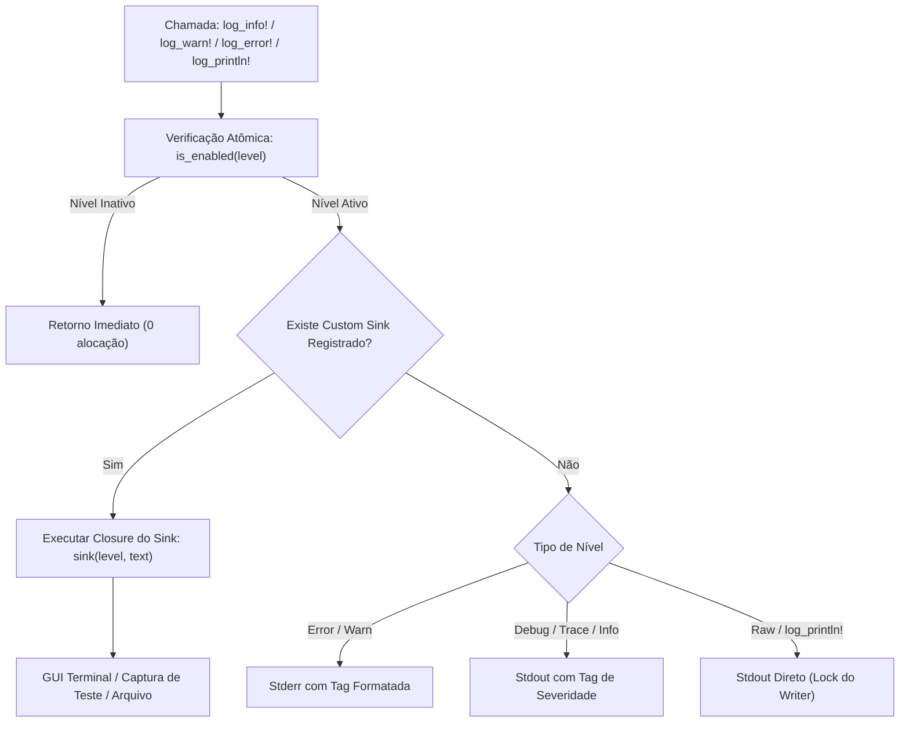

# Especificação do Subsistema de Logging e Telemetria Unificada — Panadiga

> **Classificação:** Documento Técnico de Arquitetura de Software e Padrões de Código  
> **Módulo:** `crates/panadiga-core/src/logger.rs` (`panadiga_core::logger`)  
> **Escopo:** Padronização de saídas de console, telemetria estruturada, supressão de ruído em testes e captura para interface gráfica  

---

## 1. Contexto e Motivação da Engenharia

Historicamente, ferramentas de linha de comando e módulos forenses em Rust utilizavam chamadas diretas a `println!` e `eprintln!` espalhadas pela base de código. Em um ecossistema com múltiplos subsistemas (parsing de storage, cirurgia de NVRAM, bridge GDB serial, scanner binário e criptoanálise), o uso disperso de prints brutos gerava problemas arquiteturais:

1. **Ausência de Controle de Verbosidade:** Impossibilidade de executar operações em modo silencioso (`--quiet`) para scripts de automação ou modo detalhado (`--verbose`) para depuração.
2. **Poluição de Saída em Testes Automatizados:** Testes unitários e de integração despejavam centenas de linhas de logs no terminal durante `cargo test`.
3. **Incapacidade de Redirecionamento para a GUI (Tauri):** A interface gráfica em React/Tauri não conseguia capturar programaticamente saídas do motor Rust sem recorrer a pipes instáveis de processo.
4. **Falta de Níveis Semânticos de Severidade:** Erros, avisos críticos e cabeçalhos visuais eram tratados de forma indistinta no `stdout`.

Para solucionar definitivamente essas limitações, foi projetado e homologado o subsistema unificado [`crates/panadiga-core/src/logger.rs`](../../crates/panadiga-core/src/logger.rs).

---

## 2. Arquitetura do Módulo (`crates/panadiga-core/src/logger.rs`)

O subsistema foi construído com foco em **desempenho máximo**, **thread-safety estrita** e **zero overhead** quando logs estão desativados ou filtrados.



### 2.1 Níveis de Severidade (`LogLevel`)

O enum [`LogLevel`](../../crates/panadiga-core/src/logger.rs) define a hierarquia de controle:

```rust
#[derive(Debug, Clone, Copy, PartialEq, Eq, PartialOrd, Ord)]
#[repr(u8)]
pub enum LogLevel {
    Off   = 0, // Silêncio absoluto (nenhuma saída)
    Error = 1, // Falhas críticas de hardware, arquivo ou protocolo
    Warn  = 2, // Anomalias não-fatais (ex: desconexão de socket GDB)
    Info  = 3, // Eventos operacionais padrão (nível default)
    Debug = 4, // Rastreamento de offsets, cálculos de entropia e pacotes
    Trace = 5, // Despejo byte-a-byte e inspeções microscópicas
}
```

### 2.2 Controle de Estado Global e Thread-Safety

O nível ativo é armazenado em uma variável atômica global com semântica de aquisição e liberação (`Acquire`/`Release`):

```rust
static CURRENT_LEVEL: AtomicU8 = AtomicU8::new(LogLevel::Info as u8);
```

- **`set_level(level: LogLevel)`**: Altera globalmente a verbosidade em tempo de execução sem travas de mutex.
- **`get_level() -> LogLevel`**: Leitura atômica ultrarrápida.
- **`is_enabled(level: LogLevel) -> bool`**: Verificação inline de altíssima performance executada antes de qualquer formatação de string.

---

## 3. Guia de Uso e Catálogo de Macros

Todas as macros são exportadas na raiz do crate `panadiga` e estão disponíveis para importação direta:

```rust
use panadiga::{log_info, log_warn, log_error, log_debug, log_println};
```

### 3.1 `log_println!` / `log_raw!`
Projetado como substituto direto do `println!` padrão para relatórios tabulares, banners ASCII e saídas formatadas da CLI:

```rust
log_println!("====================================================================");
log_println!("   PANASONIC AM34 / P7501 GDB REMOTE SERIAL PROTOCOL (RSP) BRIDGE");
log_println!("   Porta: {:<10} | Baud: {}", port_name, baud_rate);
log_println!("====================================================================");
```

*Comportamento:* Respeita o filtro global do logger (`LogLevel::Info`). Em modo `--quiet`, todas as tabelas e banners são automaticamente suprimidos sem necessidade de condicionais `if` manuais no código.

### 3.2 `log_info!`
Registra mensagens informativas e marcos de execução:

```rust
log_info!("[Bridge] Servidor GDB RSP ouvindo em 127.0.0.1:3333...");
```

### 3.3 `log_warn!`
Registra alertas operacionais que requerem atenção mas não abortam a execução:

```rust
log_warn!("[Bridge] Conexão TCP com o cliente GDB foi encerrada inesperadamente: {}", e);
```

### 3.4 `log_error!`
Registra falhas graves em `stderr` ou no sink registrado:

```rust
log_error!("Falha de integridade: Hash SHA-256 divergente do manifesto oficial!");
```

### 3.5 `log_debug!` e `log_trace!`
Registram informações detalhadas para sessões de engenharia reversa e análise de protocolo:

```rust
log_debug!("LBA offset: 0x{:08X}, lendo setor espelho de 512 bytes", lba_offset);
log_trace!("Pacote GDB recebido: {:?}", raw_packet_bytes);
```

---

## 4. Mecanismo de Custom Sinks (GUI e Testes)

O subsistema permite o registro de um interceptador dinâmico de saída via `set_sink`:

```rust
use panadiga::logger::{set_sink, reset_sink, LogLevel};

// Exemplo: Captura para buffer em teste unitário
set_sink(|level: LogLevel, message: &str| {
    if level == LogLevel::Error {
        panic!("Erro crítico inesperado durante o teste: {}", message);
    }
});

// Restaurar saída padrão de console ao finalizar
reset_sink();
```

Este mecanismo é a base para a integração com o terminal serial embutido na aplicação **Tauri 2 Desktop**, permitindo que logs gerados no backend Rust sejam transmitidos via WebSocket/Events para a interface React sem acoplamento direto com código de UI.

---

## 5. Resumo da Migração Realizada no Ecossistema

Foram migradas **365 chamadas brutas** para o subsistema unificado:

| Componente | Arquivo | Total de Chamadas |
| :--- | :--- | :--- |
| **Criptoanálise & CPRM** | `src/crypto.rs` | 119 chamadas |
| **Storage Forensics & MEIHFS** | `src/hdd.rs` | 91 chamadas |
| **CLI & Dispatcher** | `src/main.rs` | 56 chamadas |
| **Cirurgia de NVRAM Spansion** | `src/nvram.rs` | 34 chamadas |
| **Inspeção de Headers** | `src/headers.rs` | 19 chamadas |
| **Pico Serial & GDB Bridge** | `src/pico.rs` | 16 chamadas |
| **Scanner Forense de Strings** | `src/scan.rs` | 15 chamadas |
| **Indexador de Manuais PDF** | `src/manuals.rs` | 13 chamadas |
| **Tauri GDB Controller** | `src/desktop/...` | 2 chamadas |
| **Total Global** | | **365 chamadas migradas** |

> **Garantia de Qualidade:** A base de código possui **0 clones no detector `jscpd`**, **0 erros no compilador Rust** e **100% de aprovação nos 9 Quality Gates** do repositório.
