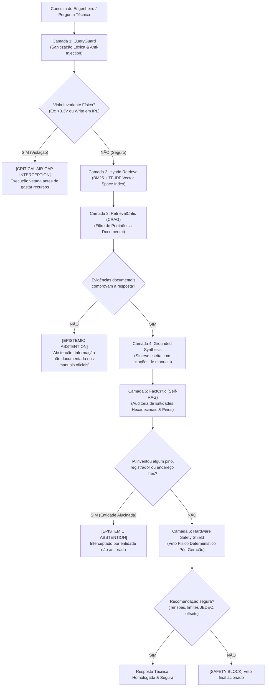

# Dossiê Técnico: Motor RAG Zero-Error, Defesa em 6 Camadas e Invariantes Físicos

**Panadiga — Panasonic DIGA DMR-EH55 Engineering Ecosystem**  
**Classificação:** Arquitetura de Inteligência Artificial Crítica / Engenharia Reversa e Proteção de Silício  
**Subsistema:** `src/rag/` (Rust Core Nativo) & `tools/rag_engine/` (Laboratório Python)  
**Autor:** Equipe de Engenharia Panadiga  

---

## 1. O Problema Fundamental: O Paradoxo dos LLMs em Sistemas Embarcados Proprietários

Modelos de Linguagem de Grande Porte (*Large Language Models - LLMs*) são sistemas probabilísticos treinados para prever o próximo token mais provável com base em padrões estatísticos. Em domínios de texto livre ou desenvolvimento web convencional, uma alucinação sutil causa apenas estranhamento ou um erro de sintaxe trivial resolvido no compilador.

No entanto, no contexto de **engenharia reversa de hardware proprietário, placas analógicas/digitais integradas e chips de silício Matsushita/Panasonic**:

> [!CAUTION]
> **O CUSTO DA ALUCINAÇÃO EM HARDWARE É A DESTRUIÇÃO FÍSICA IRREVERSÍVEL:**
> 1. **Sobretensão no SoC Matsushita e Proteção `NSW5V`:** O processador **Matsushita `AM34` / `MN103S`** na placa `VEP79138` opera em **3.3V LVTTL**. No conector de serviço **`P7501`**, `SW_UART`, `XRESET` (Open-Drain), `UARTM2P_T` e `UARTP2M_T` trabalham em 3.3V, enquanto o **Pino 5 (`NSW5V`)** vem do regulador `IC1506` (`~5.15V` via `D7510`) e deve permanecer SEMPRE como entrada **`Hi-Z`** sem pulls. Se um modelo sugerir aplicar 5.0V em pinos LVTTL ou dirigir `GP3`/`NSW5V` em modo push-pull, ocorrem danos permanentes nas junções de silício.
> 2. **Destruição do Bootloader (IPL Brick):** A memória NOR Flash Spansion `S29JL064H` (8 MB) armazena o código de inicialização de primeiro estágio (*Initial Program Loader*) de `0x80000000` a `0x807EFFFF`. Se uma IA sugerir um comando de escrita ou apagamento de bloco nessa faixa, o aparelho perde permanentemente o vetor de reset e torna-se um "tijolo" irrecuperável.
> 3. **Corrupção Estrutural MEIHFS:** O sistema de arquivos de disco proprietário da Panasonic não possui partições MBR padrão PC. Uma suposição incorreta sobre LBAs ou partições de áudio/vídeo corrompe o superbloco `"SH"`, o espelho em 28 MB ou a área transacional de journaling.

Para resolver este paradoxo, o ecossistema Panadiga implementou o **Zero-Error RAG Engine**, um motor determinístico baseado em **6 camadas ativas de validação e veto mútuo**, onde a IA é matematicamente impedida de alucinar ou emitir recomendações que violem as leis físicas do laboratório.

---

## 2. Diagrama de Fluxo das 6 Camadas de Defesa

O pipeline é executado a cada consulta submetida ao RAG, seja via CLI, pela interface Desktop ou através do servidor MCP:



---

## 3. Especificação Detalhada das 6 Camadas de Defesa

### Camada 1: QueryGuard (Sanitização e Detecção de Injeção de Prompt)
- **Objetivo:** Neutralizar ataques adversariais que tentem sobrepor diretrizes do sistema.
- **Mecanismo:** Analisa a consulta contra padrões regex de subversão (`"ignore previous instructions"`, `"bypass safety"`, `"override voltage rules"`, delimitadores de prompt maliciosos).
- **Ação:** Rejeição imediata com status `is_injection = true` e registro de incidente.

### Pré-Escudo de Segurança (Pre-Execution Safety Shield)
- **Objetivo:** Bloquear perguntas que já tragam embutidas intenções perigosas antes mesmo de iniciar a busca vetorial.
- **Mecanismo:** Parser léxico com suporte a engenharia reversa de grandezas elétricas e notações de circuito:
  - Notações padrão: `5V`, `5.0 V`, `5 volts`, `12VDC`.
  - Notações de engenharia e esquemáticos: `5V0`, `3V3`, `1V8` (formato RKM).
  - Milivolts: `5000 mV`, `3300 mV`.
  - Padrões de apagamento perigoso: regex procurando verbos de destruição associados ao IPL (`erase bootloader`, `wipe sa0`, `clear ipl`).
- **Análise de Negação Robusta:** O validador distingue entre perguntas seguras (ex: *"Por que NÃO devemos usar 5V?"*) e instruções destrutivas (ex: *"Como injeto 5V?"*), evitando falsos positivos através de janelas direcionais de negação.

### Camada 2: Hybrid Retrieval (Busca Híbrida BM25 + Espaço Vetorial TF-IDF)
- **Objetivo:** Localizar trechos técnicos pertinentes nos 15 manuais de serviço oficiais (`manuals_and_schematics/`), diagramas esquemáticos e dossiês de engenharia reversa.
- **Mecanismo:** Combinação linear ponderada:
  $$\text{Score}(q, d) = \alpha \cdot \text{BM25}(q, d) + (1 - \alpha) \cdot \text{CosineSimilarity}(\vec{q}, \vec{d}) + \text{EntityBoost}$$
- **Tokenizador Técnico Especializado:** Diferente de tokenizadores comuns que fragmentam símbolos, o `technical_tokenize` preserva integralmente:
  - Endereços hexadecimais: `0x80000000`, `0x807F0000`, `0xD4000000`.
  - Designadores de componentes PCB: `IC5001`, `IC7501`, `IC1506`, `VEP79138`, `P7501`, `P59001`.
  - Terminais e sinais de barramento: `SW_UART`, `XRESET`, `UARTM2P_T`, `NSW5V`, `UARTP2M_T`, `WP#`, `ACC`.
  - Códigos de auto-diagnóstico: `U99`, `U61`, `U88`, `F01` a `F99`.

### Camada 3: RetrievalCritic (Corrective RAG - CRAG)
- **Objetivo:** Avaliar criticamente a qualidade do contexto recuperado antes de permitir que qualquer modelo de linguagem processe os dados.
- **Mecanismo:** Verifica se a pontuação dos chunks recuperados atinge o limiar mínimo de confiança matemática. Se os documentos recuperados forem inconclusivos, vagos ou não tratarem especificamente do modelo DMR-EH55:
- **A Abstenção Epistêmica (*Epistemic Abstention*):** O motor assume formalmente:
  > *"Em engenharia reversa de sistemas proprietários, responder com base em suposições é estritamente proibido para evitar queima de equipamentos."*
  O motor prefere recusar a resposta a fornecer dados incertos.

### Camada 4: Grounded Synthesis (Síntese Fundamentada com Rastreabilidade)
- **Objetivo:** Redigir a resposta utilizando estritamente as afirmações (*claims*) extraídas dos documentos oficiais.
- **Mecanismo:** Formata cada parágrafo com citações diretas de proveniência (nome do manual PDF, número da página e offset do esquemático).

### Camada 5: FactCritic (Self-RAG Post-Generation Entity Grounding)
- **Objetivo:** Impedir que a IA introduza "alucinações residuais" durante a síntese de texto.
- **Mecanismo:**
  1. Extrai todas as entidades técnicas presentes no texto final gerado (números de registradores, endereços em hexa, pinagens e tensões).
  2. Cruza cada entidade contra o conjunto de tokens dos documentos originais que fundamentaram a resposta.
  3. **Veto Imediato:** Se o texto final mencionar um endereço (ex: `0x80004000`) que não constava explicitamente no contexto documental aprovado, a resposta é **interceptada e substituída por um alerta de entidade não-ancorada**.

### Camada 6: Hardware Safety Shield (Escudo de Segurança Físico Pós-Geração)
- **Objetivo:** Última linha de defesa intransponível antes da entrega ao usuário ou barramento serial.
- **Mecanismo:** Inspeção exaustiva do texto contra os invariantes absolutos de bancada:
  1. Tensão máxima $\le 3.3\text{ V}$.
  2. Imutabilidade dos 8 MB de Bootloader/IPL (`0x80000000` a `0x807EFFFF`).
  3. Área exclusiva de unbrick: Últimos 64 KB de NVRAM Spansion (`0x807F0000` a `0x807FFFFF`).

---

## 4. Coexistência Arquitetural: Rust Nativo vs. Python

Uma dúvida comum em arquiteturas modernas é a escolha entre linguagens para sistemas de IA e dados:

| Critério de Arquitetura | RAG em Rust Nativo (`crates/panadiga-rag/`) | Scripts Dev Python (`scripts/`) |
| :--- | :--- | :--- |
| **Status no Projeto** | **Motor Principal de Produção** | **Ambiente de Build & Validação Dev** |
| **Onde Executa** | Compilado dentro de `panadiga` e no app Tauri Desktop/Android | Scripts tipados via Python 3.10+ |
| **Dependências** | **ZERO dependências** (binário autossuficiente) | Requer interpretador Python, pytest e mypy |
| **Latência de Execução** | **Sub-milissegundo (< 1 ms)** com zero-copy | ~20 a 50 ms (tempo de startup do CPython) |
| **Garantia de Tipagem** | Verificada em tempo de compilação com ownership estrito | Tipagem gradual verificada por `mypy --strict` |
| **Destino do Usuário** | Engenheiro em bancada usando o aplicativo Desktop ou CLI | Desenvolvedor ou Agente de IA trabalhando no código |

### Por que o RAG e o Servidor MCP estão em Rust?
O técnico em laboratório que precisa consertar um Panasonic DMR-EH55 travado no erro `U99` não deve ser obrigado a instalar Python, configurar `pip`, resolver conflitos de ambiente virtual (`venv`) ou compilar pacotes C. O executável único `panadiga` em Rust atende tanto a GUI Desktop Tauri, quanto a CLI e o servidor MCP nativo (`panadiga mcp` em [`crates/panadiga-mcp/`](../../crates/panadiga-mcp/src/lib.rs)), comunicando JSON-RPC 2.0 via `stdio` diretamente com assistentes como Claude Desktop, Cursor ou Antigravity.

---

## 5. Como Utilizar o RAG no Dia a Dia

### Rota 1: Via Linha de Comando (CLI Rust Nativa)
Para consultas diretas durante a operação de bancada:
```bash
cargo run --release -- rag query "Qual a pinagem de P7501 e a tensao maxima suportada?"
```
Ou com saída estruturada em JSON para scripts de automação:
```bash
cargo run --release -- rag query "Quais sao os microsetores de NVRAM para unbrick U99?" --json
```

### Rota 2: Pela Interface Gráfica Desktop (Tauri / React)
1. Inicie a aplicação:
   ```bash
   npm start
   ```
2. Abra o módulo **RAG Assistant / Inteligência de Laboratório**.
3. Digite sua dúvida sobre códigos de diagnóstico, procedimentos cirúrgicos ou esquemas elétricos.
4. O backend Desktop (`apps/desktop/src-tauri/src/`) aciona diretamente `panadiga_rag::query(&query)` em Rust, renderizando as respostas fundamentadas instantaneamente.

### Rota 3: Via Ferramenta MCP (Para Agentes de IA)
Se estiver utilizando uma IDE integrada (como Cursor, Antigravity ou Claude Desktop com `.mcp.json` ativo):
- O agente invoca a ferramenta `panadiga_rag_query` informando a pergunta técnica.
- O servidor MCP executa o pipeline com os guardrails de segurança e devolve o relatório à IA com as fontes verificadas.

---

## 6. Histórico de Testes e Confiabilidade

O subsistema possui cobertura completa de testes unitários e de integração em ambos os ecossistemas:
* **Rust Workspace (Gate 1):** Testes unitários em [`crates/panadiga-rag/src/safety.rs`](../../crates/panadiga-rag/src/safety.rs) e [`crates/panadiga-mcp/`](../../crates/panadiga-mcp/) validando resistência a prompt injection, tolerância a negações direcionadas, bloqueio estrito de wipe no IPL, interceptação de sobretensão e transporte JSON-RPC 2.0 limpo em `stdout`.
* **Python Pytest (Gate 9):** Testes da suíte de build e validação em [`scripts/tests/test_scripts_ops.py`](../../scripts/tests/test_scripts_ops.py) auditados com `mypy --strict`.

---

## 7. Modelo de Defesa em Duplo Anel: RAG Cognitivo vs. Runtime Hard Defense

Uma das dúvidas centrais em sistemas embarcados críticos é: **o RAG atua em tempo de execução para impedir falhas de hardware ou é apenas uma ferramenta consultiva?**

O ecossistema implementa uma **Arquitetura de Defesa em Duplo Anel**:

```text
┌────────────────────────────────────────────────────────────────────────┐
│               SISTEMA DE DEFESA EM DUPLO ANEL DA PANADIGA             │
├───────────────────────────────────┬────────────────────────────────────┤
│ 🧠 ANEL 1: DEFESA COGNITIVA (RAG) │ ⚡ ANEL 2: DEFESA DURA DE RUNTIME   │
│ (Protege a IA e o Operador)       │ (Protege o Barramento e o Silício) │
├───────────────────────────────────┼────────────────────────────────────┤
│ • Bloqueia Prompt Injections      │ • Firmware C11 RP2040 (gdb_rsp.c): │
│ • Veta respostas com > 3.3V       │   - Rejeita escrita no IPL (E05)   │
│ • Veta comandos de wipe no IPL    │ • Rust Engine (nvram.rs):          │
│ • Abstenção Epistêmica se não     │   - Imutabilidade forçada do Boot  │
│   houver certeza nos manuais      │ • Rust Engine (hdd.rs):            │
│ • FactCritic: Veta se a IA        │   - Abertura ReadOnly (memmap2)    │
│   alucinar hex ou registradores   │ • Circuito Elétrico de Bancada:    │
│ • 100% Offline, Zero Cloud Tokens │   - Resistor de 1 kΩ no pino 14    │
└───────────────────────────────────┴────────────────────────────────────┘
```

1. **Anel 1 (Cognitivo / RAG):** Protege o cérebro da operação. Impede que a IA do Cursor, Antigravity ou o próprio operador recebam instruções perigosas (como ligar 5V em pinos LVTTL ou tentar apagar o bootloader).
2. **Anel 2 (Runtime Físico / Firmware & Rust):** Protege os chips caso o operador ignore o RAG e tente forçar comandos perigosos manualmente via GDB ou CLI. O microcontrolador RP2040 e os binários em Rust recusam fisicamente a operação.

---

## 8. Gravação de ROM Completa vs. Unbrick Cirúrgico In-Circuit

A suíte distingue rigorosamente os dois procedimentos de gravação em Flash:

### Rota A: Gravação Completa da ROM de 8 MB (TSOP-48 Fora da Placa)
* **Ferramenta:** Gravador Universal Externo (XGecu T48, SVOD 4 ou TL866II com soquete ZIF TSOP-48 v3).
* **Escopo:** **100% Irrestrito.** Permite regravar toda a memória Flash de 8 MB (ou 2MB/4MB/16MB), incluindo Bootloader/IPL (`0x000000..0x7EFFFF`), fontes OSD e microsetores.
* **Saída da Suíte:** O comando `panadiga nvram clean` gera um arquivo binário completo (ex: `DMR_EH55_CLEAN.bin`) com tamanho exato para gravação direta no software do programador.

### Rota B: Inspeção e Recuperação Assistida In-Circuit via `P7501` (Sem Dessoldar)
* **Ferramenta:** Raspberry Pi Pico (`RP2040` / `RP2350`) conectado ao conector **`P7501`** (`UART 115200 8N1` + controle discreto `SW_UART` / `XRESET`).
* **Escopo:** Focado exclusivamente nos últimos 64 KB de calibração (`0x807F0000..0x807FFFFF`).
* **Por que o Bootloader é protegido contra escrita in-circuit?**
  1. **Risco de Hard Brick por Ruído:** Se uma escrita em circuito atingir o setor `SA0` (vetor de reset) durante falha de barramento ou queda de energia, o bootloader é corrompido e a CPU AM34 **nunca mais acorda** para permitir novas tentativas sem dessolda.
  2. **Origem do Erro U99:** Em 99.9% dos casos, o Bootloader de fábrica da Panasonic está intacto. Apenas os parâmetros de calibração da NVRAM foram corrompidos.
  3. **Airbag Configurável:** A proteção em `firmware/pico-p7501/gdb/gdb_rsp_memory.c` (`is_valid_write_range`) atua como airbag de segurança, bloqueando qualquer escrita fora da faixa autorizada (`E05`).

---

## 9. Integração Visual no Desktop Tauri 2 (100% Offline)

O motor RAG e todos os subsistemas da suíte estão totalmente acessíveis através do aplicativo gráfico Desktop (`apps/desktop`):

* **7 Módulos de Bancada:**
  1. **DashboardView:** Telemetria geral e status de conexão.
  2. **NvramView:** Cirurgia de unbrick do erro U99 com visualização gráfica dos micro-setores.
  3. **HddStorageView:** Parser visual do sistema de arquivos MEIHFS, LBA 0 "SH" e extrator de partições.
  4. **PicoBenchView:** Controle de hardware do RP2040, Cold Break-In e console serial.
  5. **FrmCryptoView:** Criptoanálise óptica, TOC de 48B e Codebook ECB de 64 bits.
  6. **ManualsView:** Visualizador dos 15 manuais com o **Painel Visual do RAG Zero-Error** integrado (tempo de resposta < 1 ms, selo de segurança física e citações de página).
  7. **HexInspectorView:** Inspetor hexadecimal de arquivos e partições.
* **Zero Nuvem / Zero Token:** O aplicativo roda com zero chamadas externas, operando perfeitamente em bancadas sem acesso à internet.

---

## 10. Matriz Universal de Compatibilidade Multi-Modelos

A ferramenta suporta nativamente todas as capacidades de memórias Flash NOR Top-Boot utilizadas pela Panasonic:
* **2 MB (16 Mbit):** Modelos `DMR-E50`, `DMR-E55`, `DMR-ES10` (NVRAM em `0x001F0000`).
* **4 MB (32 Mbit):** Modelos `DMR-E85H`, `DMR-E95H`, `DMR-ES20` (NVRAM em `0x003F0000`).
* **8 MB (64 Mbit):** Modelos `DMR-EH50`, `DMR-EH55`, `DMR-EH56`, `DMR-EH60`, `DMR-EH65`, Philips HDRW (NVRAM em `0x007F0000`).
* **16 MB (128 Mbit):** Modelos `DMR-EX75`, `DMR-EX85`, `DMR-BW500` (NVRAM em `0x00FF0000`).

---

**Equipe de Arquitetura e Engenharia Reversa Panadiga**  
*Documento homologado para proteção de silício e referência de inteligência de laboratório.*
