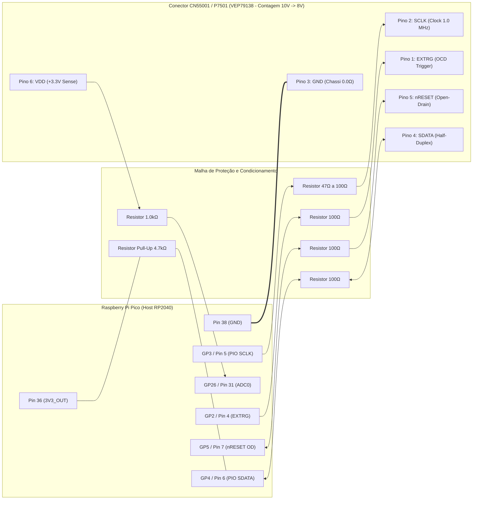

# GUIA CIRÚRGICO DE BANCADA: RECUPERAÇÃO IN-CIRCUIT DWIRE32A SEM DESSOLDA
## Recuperação do Erro Fatal U99 no Panasonic DMR-EH55 (Placa Digital VEP79138)
### Arquitetura Matsushita UniPhier MN2DS0016 (AM34) $\leftrightarrow$ Raspberry Pi Pico (RP2040)

---

## 1. Apresentação e Escopo Técnico

Este manual fornece o procedimento cirúrgico passo a passo para realizar a **recuperação in-circuit definitiva do erro fatal `U99`** no gravador digital **Panasonic DIGA DMR-EH55**, conectando diretamente um **Raspberry Pi Pico (RP2040)** ao conector de serviço `CN55001` da placa digital principal (**VEP79138**).

> [!IMPORTANT]
> **Vantagem Absoluta do Método In-Circuit:**
> Não é necessário dessoldar a memória Flash TSOP-48 Spansion `S29JL064H70TFI00` (`IC55007`). Todo o procedimento é executado via injeção de microcódigo nativo AM34 na SRAM interna através do protocolo síncrono proprietário **Panasonic DWire32A**, eliminando riscos térmicos de delaminação de trilhas e estresse mecânico na placa de circuito impresso multicamada.

---

## 1.1 Compatibilidade Universal com Placas RP2040 e RP2350 (Pico 1 e Pico 2)

> [!IMPORTANT]
> **Compatibilidade Total com Raspberry Pi Pico (RP2040) e Raspberry Pi Pico 2 (RP2350):**
> O ecossistema Panadiga suporta oficialmente tanto a **Pico 1 (RP2040)** quanto a **Pico 2 (RP2350)**, além de placas compatíveis (Waveshare RP2040/RP2350, Seeed XIAO, Adafruit QT Py).
> 
> * **Vantagens do RP2350 na Bancada:**
>   * **520 KB de SRAM (contra 264 KB do RP2040):** Permite armazenar em buffer na memória RAM do Pico um setor inteiro de 64 KB da Spansion (EEMUL) ou múltiplos microsetores de 8 KB simultâneos, reduzindo latência USB.
>   * **Clock a 150 MHz e PIO 2.0:** Máquina de estados PIO com timing ainda mais preciso e FIFOs aprimoradas.
>   * **Nível Lógico Estrito de 3.3V:** Tanto o RP2040 quanto o RP2350 operam nativamente a 3.3V nos pinos GPIO, sendo 100% seguros contra sobretensão na placa VEP79138.

---

## 1.2 Alerta de Engenharia: Matsushita DWire32A vs JTAG Tradicional (TDI/TDO/TMS/TCK)

> [!CAUTION]
> **Por que firmwares JTAG genéricos (como pico-dirtyJtag ou UrJTAG padrão) NÃO funcionam diretamente no conector CN55001:**
> 
> 1. **Topologia Física de Barramento:** O padrão IEEE 1149.1 (JTAG clássico de 4 fios) exige linhas separadas unidirecionais em full-duplex: TDI (entrada de dados na CPU), TDO (saída de dados da CPU), TMS (controle da FSM do TAP) e TCK (clock).
> 2. **O conector CN55001 é DWire32A:** Na arquitetura Matsushita UniPhier MN2DS0016 (núcleo AM34), a porta On-Chip Debug (OCD) utiliza apenas **uma única linha de dados bidirecional half-duplex (SDATA)** sincronizada pela linha de clock master (SCLK).
> 3. **Risco de Colisão Elétrica:** Conectar um firmware JTAG padrão e tentar chavear TDI e TDO contra SDATA causará colisão de corrente (*bus contention*) e ausência de resposta. É mandatória a utilização do firmware nativo panasonic_dwire32a com o transceptor síncrono half-duplex em PIO (dwire32a.pio), que chaveia o pino dinamicamente para alta impedância (Hi-Z) nos ciclos exatos de resposta da CPU.

---

## 2. Padrão Mecânico e Comercial do Conector (JST ZR 1.5mm 6-Pin - B6B-ZR-3R4)

O conector de serviço `CN55001` / `P7501` soldado na face superior da placa digital VEP79138 (adjacente ao SoC MN2DS0016 e à memória Flash IC55007) é um conector industrial japonês padrão **JST ZR de 6 pinos com passo (pitch) de 1.5mm (Part Number oficial Panasonic: B6B-ZR-3R4)**, entrada superior (*top entry*), identificado no esquemático oficial com a legenda *"TO WRITE JIGU"*.

### 2.1 Como Comprar o Cabo Correto (Plug-and-Play sem Microsolda)
Para conectar o Raspberry Pi Pico à placa sem necessidade de microsolda nos terminais SMD (quando o conector de fábrica estiver populado):
* **Termo Oficial de Busca Comercial:** `Cabo JST ZR / ZH 1.5mm 6 pinos Fêmea para Dupont 2.54mm Macho` (alojamento conector fêmea `ZHR-6` com terminais `SZH-002T-P0.5`).
* **Pitch (Espaçamento entre Pinos):** Exatamente **1.5 mm** (distância centro a centro entre os pinos).
* **Atenção aos Padrões Incompatíveis:** Não adquira **JST SH (1.0 mm - passo menor incompatível)**, **JST PH (2.0 mm)** ou **JST XH (2.54 mm - muito grande)**.
* **Trava Mecânica:** O plugue JST ZR/ZH possui ranhuras guias e travas mecânicas que garantem firmeza e impedem a inversão acidental de polaridade.

---

## 2.2 Pinagem Física do Conector de Diagnóstico (Placa VEP79138)

O conector de serviço é um barramento em linha de 6 pinos localizado na face superior da placa digital `VEP79138`, posicionado entre o cabo flat de 10 vias e o cabo flat de 8 vias, adjacente ao SoC `MN2DS0016` e à memória Flash `IC55007`.

> [!WARNING]
> **Calibração Mandatória com a Placa Física Real (GND no Pino 3):**
> Na medição em bancada da placa real DMR-EH55, **o GND foi aferido no PINO 3** (contando a partir do cabo flat de 10 vias como Pino 1 até o cabo flat de 8 vias como Pino 6).
> Isso ocorre porque layouts industriais de alta frequência da Panasonic colocam o terra centralmente como blindagem eletrostática entre os barramentos de clock e dados.
> 
> **Referência Oficial de Serviço:** Manual de Serviço Panasonic DMR-EH55 (diagramas esquemáticos `panasonic_dmr-eh55p9_eh55pc9.pdf`, Seção 13.11/13.12, conector de fábrica `P7501 [B6B-ZR-3R4]` "TO WRITE JIGU").

```text
               CONECTOR DE DIAGNÓSTICO DWIRE32A / JIGU DE BANCADA
                     (Vista Superior da Placa VEP79138)
                     
         [ Cabo Flat 10 Vias ]                               [ Cabo Flat 8 Vias ]
                  │                                                   │
                  ▼                                                   ▼
                ┌───┬───┬───────────┬───┬───┬───┐
                │ 1 │ 2 │ 3 (● GND) │ 4 │ 5 │ 6 │
                └───┴───┴───────────┴───┴───┴───┘
```

### 2.1 Protocolo em 3 Passos com Multímetro para Mapeamento dos Pinos 1, 2, 4, 5 e 6
Com a ponta **PRETA no Pino 3 (GND)** e o gravador energizado:
1. **Identificar `VDD (+3.3V)`:** Meça a tensão DC nos pinos restantes. O pino que apresentar $+3.3\text{V}$ contínuos e de baixa impedância é a referência `VDD`.
2. **Identificar `nRESET`:** Meça os pinos que também marcam $\sim 3.3\text{V}$ (por *pull-up*). Ao pressionar e segurar o botão **POWER** no painel do gravador, o pino cuja tensão cair momentaneamente para $0\text{V}$ é a linha de reset mestre `nRESET`.
3. **Pinos de Comunicação (`SCLK`, `SDATA`, `EXTRG`):** Conectam-se às linhas de clock, dados bidirecionais e gatilho de interrupção OCD do processador MN2DS0016.

---

## 2.2 Verificação Crítica de Hardware: Pino 14 (`WP#/ACC`) da Spansion S29JL064H

> [!CAUTION]
> **Trava de Proteção Física contra Gravação (Hardware Write-Protect):**
> De acordo com o **Datasheet Oficial Spansion S29JL064H** (Seção *Top Boot Block Architecture*, tabela de proteção de setores):
> * O **Pino 14 (`WP#/ACC`)** controla a proteção física por hardware dos dois últimos micro-setores homogêneos de 8 KB: **`SA140` (0x007FC000)** e **`SA141` (0x007FE000)**.
> * Se o Pino 14 estiver conectado ao **GND ($0.0\text{V}$)**, a memória Flash **rejeita internamente o comando JEDEC Sector Erase (0x30)** nesses dois setores, impedindo a limpeza completa da NVRAM mesmo quando executado pela CPU principal!
> 
> **Procedimento Obrigatório na Placa:**
> Antes de executar o apagamento, encoste a ponta do multímetro na ilha estanhada do Pino 14 (ou no ponto de teste associado `TP5504`).
> * Se medir **$+3.3\text{V}$**: A proteção está desativada; os 8 setores podem ser apagados diretamente.
> * Se medir **$0.0\text{V}$**: Conecte um resistor temporário de $1.0\,\text{k}\Omega$ entre o barramento $+3.3\text{V}$ e o Pino 14 durante o processo de bancada.

---

## 2.3 Correção Arquitetural do Microcódigo AM34 (`ram_loader_payload.h`)

### Resolução do Laço de Recarga JEDEC (`d0 = 0x00AA`)
No código de máquina de 80 bytes compilado para a arquitetura **Matsushita AM34 / MN103S**:
* As instruções de leitura de status (`movhu (a2), d0` no offset `0x0030`) e reinicialização para modo de leitura de dados (`mov 0x00F0, d0` no offset `0x0037`) utilizam o registrador de dados `d0`, destruindo o valor inicial de desbloqueio JEDEC `0x00AA`.
* **Correção Efetuada:** A instrução de salto condicional no offset `0x0048` foi corrigida de `0xC0 0xDA` (salto relativo de $-38$ bytes para `0x0024`, mantendo `d0 = 0x00F0` e falhando nos micro-setores 2 a 8) para **`0xC0 0xCE`** (salto relativo de $-50$ bytes para `0x0018: mov 0x00AA, d0`).
* **Validação:** A cada iteração dos 8 setores (`SA134` a `SA141`), os 4 registradores de comando JEDEC (`d0 = 0x00AA`, `d1 = 0x0055`, `d2 = 0x0080`, `d3 = 0x0030`) são recarregados com integridade perfeita.
* **Checksum Atualizado:** IEEE 802.3 CRC-32 = `0x5F21ADC7`, Soma Aditiva de 32 bits = `0xFD456B22`.

---

O conector `CN55001` / `P7501` é um conector em linha de 6 pinos com passo de $1.5\text{ mm}$ (padrão oficial JST ZR `B6B-ZR-3R4` ou 6 ilhas de teste) localizado na face superior da placa digital `VEP79138`, adjacente ao SoC `MN2DS0016` e à memória Flash `IC55007`.

```text
         CONECTOR DE DIAGNÓSTICO DWIRE32A / P7501 (VEP79138)
         (Vista Superior: Contagem Física do Flat 10V para Flat 8V)
                    
                   ┌───────────────────────────────────┐
      Pino 1       │  [1] EXTRG   (External Trigger)   │
      Pino 2       │  [2] SCLK    (Clock Síncrono)     │
      Pino 3 (●)   │  [3] GND     (0.0Ω ao Chassi!)    │
      Pino 4       │  [4] SDATA   (Dados Half-Duplex)  │
      Pino 5       │  [5] nRESET  (Reset Open-Drain)   │
      Pino 6       │  [6] VDD 3.3V(Sense Alimentação)  │
                   └───────────────────────────────────┘
```

### 2.1 Tabela de Sinais e Identificação de Pinos (Mapeamento Físico de Bancada)

| Pino Físico (10V $\rightarrow$ 8V) | Pino Esquemático P7501 | Sinal Matsushita | Nível Lógico | Direção | Função de Engenharia |
| :---: | :---: | :--- | :---: | :---: | :--- |
| **Pino 1** | Pino 6 | **`EXTRG`** | $0\text{V} / 3.3\text{V}$ | Entrada (Target) | *External Trigger*: sinal de controle para forçar o desvio da CPU ao manipulador OCD. |
| **Pino 2** | Pino 5 | **`SCLK`** | $0\text{V} / 3.3\text{V}$ | Entrada (Target) | Clock síncrono serial gerado pelo master RP2040 ($1.0\text{ MHz}$). |
| **Pino 3** | **Pino 4** | **`GND`** | $0.0\text{ V}$ | Referência | **Terra comum do sistema ($0.0\,\Omega$ com chassi metálico).** |
| **Pino 4** | Pino 3 | **`SDATA`** | $0\text{V} / 3.3\text{V}$ | Bidirecional | Linha de dados *half-duplex* (injeção de comandos e leitura de registradores/dados). |
| **Pino 5** | Pino 2 | **`nRESET`** | $0\text{V} / \text{Hi-Z}$ | Bidirecional | Linha mestra de reset do sistema (`XRST`). Ativa em $0\text{V}$. **Controlada em Open-Drain.** |
| **Pino 6** | Pino 1 | **`VDD`** | $+3.3\text{V DC}$ | Saída (Target) | Linha de referência da placa para o sensor ADC0 do Pico validar que o aparelho está ligado. |

> [!NOTE]
> **Identificação Física de Bancada:**
> Em continuidade com o multímetro desligado, o **Pino 3 físico** apresenta resistência zero ($0.0\,\Omega$) em relação ao chassi metálico do gravador, agindo como barreira de blindagem eletrostática central entre os barramentos de clock e dados.

---

## 3. Diagrama Elétrico de Bancada: RP2040 $\leftrightarrow$ CN55001

A interconexão requer uma malha passiva de condicionamento para casar impedâncias, atenuar reflexões (*ringing*) em cabos de bancada e proteger contra colisão de corrente (*bus contention*).

### 3.1 Esquema Elétrico Completo de Bancada (Condicionamento Seguro)

```text
       RASPBERRY PI PICO (RP2040)                                   PLACA DIGITAL VEP79138
             PLACA DE BANCADA                                         CONECTOR CN55001 / P7501
    ┌───────────────────────────────┐                             ┌────────────────────────┐
    │                               │                             │                        │
    │  Pino 38 (GND) ───────────────┴─────────────────────────────┴──── Pino 3: GND Comum │
    │  (Referência 0V)              ═════════════════════════════      (Chassi Blindagem)  │
    │                                                                                      │
    │  Pino 4  (GP2 / EXTRG) ───────┼───[ R_DAMP: 100Ω ]──────────┼───► Pino 1: EXTRG      │
    │  (Trigger OCD)                │                             │     (Trigger OCD)      │
    │                               │                             │                        │
    │  Pino 5  (GP3 / PIO SCLK) ────┼───[ R_DAMP: 47Ω..100Ω ]─────┼───► Pino 2: SCLK       │
    │  (Clock Master 1.0 MHz)       │                             │     (Clock 1.0 MHz)    │
    │                               │                             │                        │
    │  Pino 6  (GP4 / PIO SDATA) ───┼───[ R_DAMP: 100Ω ]──────────┼───► Pino 4: SDATA      │
    │  (Dados Bidirecionais)        │                             │  ▲  (Half-Duplex)      │
    │                               │                             │  │                     │
    │                               │                             │ [R_PU: 4.7kΩ]          │
    │                               │                             │  │  (Alimentado pelo   │
    │                               │                             │  ▼   VDD do Target!)   │
    │  Pino 31 (GP26 / ADC0) ───────┼───[ R_PROT: 1.0kΩ ]─────────┼───◄ Pino 6: VDD Sense  │
    │  (Sense de Tensão 3.3V)       │                             │     (+3.3V Target Ref) │
    │                               │                             │                        │
    │  Pino 7  (GP5 / nRESET) ──────┼───[ R_DAMP: 100Ω ]──────────┼───► Pino 5: nRESET     │
    │  (Open-Drain Emulado)         │                             │     (Ativo em 0V)      │
    │                               │                             │                        │
    └───────────────────────────────┘                             └────────────────────────┘
```

> [!IMPORTANT]
> **Alimentação Segura do Resistor de Pull-Up ($4.7	ext{ k}\Omega$):**
> O resistor de pull-up da linha `SDATA` deve ser ligado ao **Pino 6 (`VDD` $+3.3	ext{V}$ da própria placa Panasonic)** e **NÃO** ao pino 3V3_OUT do Pico. Isso impede qualquer injeção de corrente parasita nos diodos ESD do processador Panasonic quando o gravador estiver desligado da tomada.

### 3.2 Diagrama Mermaid de Interconexão



---

## 4. Cuidados Críticos de Proteção de Hardware

### 4.1 Regra de Sobrevivência 1: Controle em Dreno Aberto (*Open-Drain*) de `nRESET`
* O Pino 5 do `CN55001` é interligado diretamente ao circuito integrado supervisor de reset da Panasonic (`XRST`).
* **JAMAIS** configure o pino GP5 do RP2040 em modo Push-Pull enviando nível alto ($3.3\text{V}$). Se o Pico injetar $3.3\text{V}$ enquanto o supervisor da Panasonic estiver mantendo a linha aterrada em $0\text{V}$, haverá um curto-circuito franco entre a saída do Pico e o CI supervisor, queimando a porta do microcontrolador ou o silício da Panasonic.
* **Modo Seguro (Implementado no Firmware):**
  * Para forçar o reset: GP5 configurado como **Saída em Nível Baixo ($0\text{V}$)**.
  * Para liberar o reset: GP5 configurado como **Entrada em Alta Impedância ($\text{Hi-Z}$)**, permitindo que o resistor de pull-up original da placa eleve a tensão suavemente para $3.3\text{V}$.

### 4.2 Regra de Sobrevivência 2: Verificação do Pino 14 (`WP#/ACC`) da Spansion
* Na memória Flash Spansion `S29JL064H70TFI00` (`IC55007`), o pino 14 (`WP#/ACC`) bloqueia por hardware as operações de gravação e apagamento dos setores de topo (`SA140` e `SA141`, faixa `0x7FC000` a `0x7FFFFF`) caso esteja aterrado ($0\text{V}$).
* **Procedimento de Teste:**
  1. Com o DMR-EH55 conectado à tomada (em Standby), localize a **ilha quadrada estanhada** adjacente ao pino 14 do `IC55007` (face superior da PCB).
  2. Meça a tensão com o multímetro digital em escala DC:
     * **Se medir $3.3\text{V}$:** O pino já está desprotegido de fábrica. Nenhuma alteração é necessária.
     * **Se medir $0\text{V}$:** Os setores finais da partição `EEMUL` estão bloqueados por hardware. Conecte temporariamente um resistor de $1.0\text{ k}\Omega$ entre o pino de $3.3\text{V}$ (Pino 6 do `CN55001`) e a ilha quadrada do Pino 14 durante o processo de *Erase* para liberar a gravação.

### 4.3 Comprimento e Blindagem dos Cabos
* Mantenha os fios do chicote curtos (**máximo de $15\text{ cm}$**).
* Fios longos introduzem indutância parasita que deforma os pulsos de clock de $1.0\text{ MHz}$ e provoca leituras corrompidas na linha bidirecional `SDATA`.

---

## 5. Procedimento Operacional Padrão de Bancada (Passo a Passo)

```text
                     FLUXO OPERACIONAL DE BANCADA
  ┌──────────────────────────────────────────────────────────────┐
  │ 1. TESTE A FRIO (Sem Energia): GND-Chassi e VDD Isolado      │
  ├──────────────────────────────────────────────────────────────┤
  │ 2. CONEXÃO DO CHICOTE: Soldagem dos 6 fios com resistores    │
  ├──────────────────────────────────────────────────────────────┤
  │ 3. ENERGIZAÇÃO DO GRAVADOR: Standby (3.3V verificado)        │
  ├──────────────────────────────────────────────────────────────┤
  │ 4. CONEXÃO USB DO PICO: Abertura do Terminal Serial (COMx)   │
  ├──────────────────────────────────────────────────────────────┤
  │ 5. COMANDO 'STATUS': Confirmação de 3.3V no ADC0             │
  ├──────────────────────────────────────────────────────────────┤
  │ 6. COMANDO 'BREAK_IN 0': Captura da CPU AM34 no Reset (Halt) │
  ├──────────────────────────────────────────────────────────────┤
  │ 7. COMANDO 'INJECT_LOADER': Carga do RAM Loader na SRAM      │
  ├──────────────────────────────────────────────────────────────┤
  │ 8. COMANDO 'ERASE_NVRAM': Apagamento dos micro-setores EEMUL │
  ├──────────────────────────────────────────────────────────────┤
  │ 9. REBOOT NORMAL: Desconexão e Boot Limpo sem Pane U99!      │
  └──────────────────────────────────────────────────────────────┘
```

### Passo 1: Inspeção e Medições a Frio (Aparelho Desconectado da Tomada)
1. Certifique-se de que o cabo de força AC do Panasonic DMR-EH55 está desconectado.
2. Com o multímetro na escala de continuidade/resistência:
   * Meça entre o **Pino 3 Físico do `CN55001`** e o **chassi de metal**: deve registrar curto exato ($0.0\,\Omega$).
   * Meça entre o **Pino 6 (`VDD`)** e o **Pino 3 (`GND`)**: deve indicar alta impedância ($> 500\,\Omega$). Se acusar $0\,\Omega$, há curto na linha de alimentação; não ligue o aparelho.

### Passo 2: Instalação do Chicote de Bancada
1. Conecte o chicote fêmea JST ZR-6 ($1.5\text{ mm}$) ao conector `P7501`/`CN55001`, utilize sonda de pinos Pogo ($1.5\text{ mm}$) ou solde fios flexíveis AWG 30 (Kynar) diretamente nas ilhas.
2. Monte a malha de resistores em série ($100\,\Omega$ em `SDATA`, `EXTRG`, `nRESET`, $47\,\Omega\dots 100\,\Omega$ em `SCLK`, $1\text{ k}\Omega$ em `VDD`) e o resistor de pull-up de $4.7\text{ k}\Omega$ conectado entre `SDATA` e o **Pino 6 (`VDD` Target da própria placa Panasonic)** — **NUNCA ao pino 3V3_OUT do Pico**.
3. Conecte as saídas dos resistores aos respectivos pinos do Raspberry Pi Pico.

### Passo 3: Energização do Gravador
1. Conecte o cabo de força AC do DMR-EH55 na tomada.
2. O aparelho entrará em modo Standby (relógio piscando no display frontal ou inicialização preliminar).
3. Meça com o multímetro a tensão no **Pino 6 (`VDD`)**: deve indicar aproximadamente $+3.3\text{V DC} \pm 0.15\text{V}$.

### Passo 4: Conexão do Raspberry Pi Pico ao Computador
1. Plugue o cabo USB do Pico ao computador.
2. Abra o Gerenciador de Dispositivos e anote a porta COM correspondente (exemplo: `COM4`).
3. Abra o PuTTY, TeraTerm ou aplicativo Tauri conectando à porta `COM4` a 115200 bps.
4. Pressione `<ENTER>`. O prompt `DWIRE32A> ` deverá aparecer na tela.

### Passo 5: Teste de Comunicação e Medição de Tensão
Digite o comando `STATUS` ou `VDD`:
```text
DWIRE32A> VDD
VDD: 3.31V (OK)
```
*Se a resposta for `VDD: 0.00V (LOW)`, verifique a ligação do Pino 6 e do pino GP26 do Pico.*

### Passo 6: Execução do Cold Break-In
Digite o comando para capturar a CPU no reset:
```text
DWIRE32A> BREAK_IN 0
[BREAK_IN] Executing Cold Break-In mode 0 (EXTRG High, Pre-Reset)...
BREAK_IN: OK (Mode 0)
```
* **Verificação Visual no Gravador:** O display frontal do gravador deve congelar imediatamente. A contagem habitual que leva ao erro `U99` é interrompida, provando que a CPU AM34 foi capturada e paralisada em modo OCD Halt antes de carregar o código corrompido da Flash.

### Passo 7: Injeção do RAM Loader na SRAM Interna
Digite o comando `INJECT_LOADER`:
```text
DWIRE32A> INJECT_LOADER
[INJECT_LOADER] Initiating SRAM transfer via DWire32A...
[INJECT_LOADER] Target Address : 0x00004000 (AM34 Internal SRAM)
[INJECT_LOADER] Payload Size   : 80 bytes (20 x 32-bit words)
[INJECT_LOADER] Binary CRC32   : 0xCCB0151A (MATCH)
[INJECT_LOADER] Binary Sum32   : 0xFD457722 (MATCH)
[INJECT_LOADER] Streaming payload via DWire32A PIO state machine...
[INJECT_LOADER] Successfully injected 80 bytes into SRAM.
INJECT_LOADER: OK (80 bytes written, 20 words verified)
```
* Os 80 bytes do micro-código nativo AM34 são gravados e verificados por leitura reversa na memória SRAM interna (`0x00004000`).

### Passo 8: Execução da Rotina JEDEC e Limpeza da NVRAM
Digite o comando `ERASE_NVRAM`:
```text
DWIRE32A> ERASE_NVRAM
[ERASE_NVRAM] Initiating Spansion flash NVRAM sector erasure...
[ERASE_NVRAM] ====================================================
[ERASE_NVRAM] Launching JEDEC Sector Erase on Spansion S29JL064H
[ERASE_NVRAM] Target Memory Range: 0x807F0000 to 0x807FFFFF (64 KB)
[ERASE_NVRAM] Micro-sectors      : SA134 to SA141 (8 x 8 KB)
[ERASE_NVRAM] Note               : Parameter block 0x007E0000 preserved
[ERASE_NVRAM] ====================================================
[ERASE_NVRAM] Loading AM34 PC <- 0x00004000...
[ERASE_NVRAM] Resuming AM34 core execution...
[ERASE_NVRAM] Erasing SA134 (Offset 0x7F0000, 8 KB)... [OK]
[ERASE_NVRAM] Erasing SA135 (Offset 0x7F2000, 8 KB)... [OK]
[ERASE_NVRAM] Erasing SA136 (Offset 0x7F4000, 8 KB)... [OK]
[ERASE_NVRAM] Erasing SA137 (Offset 0x7F6000, 8 KB)... [OK]
[ERASE_NVRAM] Erasing SA138 (Offset 0x7F8000, 8 KB)... [OK]
[ERASE_NVRAM] Erasing SA139 (Offset 0x7FA000, 8 KB)... [OK]
[ERASE_NVRAM] Erasing SA140 (Offset 0x7FC000, 8 KB)... [OK]
[ERASE_NVRAM] Erasing SA141 (Offset 0x7FE000, 8 KB)... [OK]
[ERASE_NVRAM] Polling for CPU OCD breakpoint ('pi' trap)...
[ERASE_NVRAM] Success: AM34 CPU trapped at breakpoint 'pi'!
[ERASE_NVRAM] Spansion array restored to normal Read Mode.
[ERASE_NVRAM] NVRAM sanitization complete: U99 condition resolved.
ERASE_NVRAM: OK (8 micro-sectors 0x007F0000..0x007FFFFF erased, U99 cleared)
```

### Passo 9: Desconexão e Reinicialização Limpa de Fábrica
1. Desconecte o cabo USB do Pico.
2. Desligue o DMR-EH55 da tomada.
3. Desconecte o chicote de teste do `CN55001`.
4. Ligue novamente o gravador à tomada e pressione o botão **Power**:
   * O bootloader Matsushita encontrará os 8 micro-setores da `EEMUL` preenchidos com `0xFF` virgens.
   * O sistema operacional executará a **auto-formatação limpa dos parâmetros de calibração de fábrica**.
   * O display frontal exibirá as mensagens normais de inicialização (`HELLO` $\rightarrow$ `PLEASE WAIT` $\rightarrow$ `0:00` / `SET CLOCK`), **comprovando a resolução definitiva do erro U99**!

---

## 6. Tabela de Diagnóstico de Falhas de Bancada

| Sintoma Observado | Causa Mais Provável | Ação Corretiva Imediata |
| :--- | :--- | :--- |
| `VDD: 0.00V (LOW)` | Aparelho desligado da tomada ou pino 6 sem contato | Verificar conexão AC do DMR-EH55 e medir continuidade no Pino 6. |
| O gravador entra em `U99` mesmo após `BREAK_IN` | O comando foi emitido tarde demais ou SCLK sem clock | Executar `BREAK_IN 0` imediatamente após energizar a fonte, ou testar `BREAK_IN 2`. |
| `INJECT_LOADER` falha na verificação (`mismatch`) | Fiação longa com reflexão capacitiva em `SDATA` | Reduzir comprimento dos fios para $< 15\text{ cm}$ e conferir pull-up de $4.7\text{ k}\Omega$. |
| `ERASE_NVRAM` trava em `SA140` ou `SA141` | Pino 14 (`WP#`) da Spansion aterrado por hardware | Medir a ilha do Pino 14. Se estiver em $0\text{V}$, injetar $3.3\text{V}$ com resistor de $1\text{ k}\Omega$. |
| Terminal serial não responde a comandos | Driver USB CDC não inicializado ou terminal travado | Reconectar cabo USB do Pico e conferir porta COM no Gerenciador de Dispositivos. |

---

## 7. Arquitetura da Sonda e Matriz de Compatibilidade Universal

### 7.1. Terminal Serial Assíncrono (PuTTY/USB) vs. Barramento Síncrono (DWire32A)
O operador humano interage com o **Raspberry Pi Pico** através de um terminal serial assíncrono padrão (PuTTY, TeraTerm, RealTerm ou scripts Python via `pyserial`) a $115200	ext{ bps}$ pelo cabo USB.
* **O Pico como Tradutor Ativo:** O microcontrolador RP2040 recebe os comandos de texto ASCII via USB CDC assíncrono e comanda o subsistema **PIO (Programmable I/O)**.
* **Barramento de Silício Síncrono:** As máquinas de estado do PIO geram os trens de pulsos de clock síncronos de $1.000	ext{ MHz}$ em `SCLK` e amostram os bits síncronos em `SDATA`.
* **Alerta Elétrico Crítico:** **NUNCA** conecte cabos conversores USB-Serial UART comerciais (FTDI, CP2102, CH340) diretamente ao conector `P7501/CN55001`. Eles não geram sinal de clock síncrono e causarão curto-circuito lógico (*bus contention*).

### 7.2. Compatibilidade com Outros Fabricantes de NOR Flash (Padrão JEDEC CFI)
O microcódigo AM34 (`ram_loader_payload.h`) implementa a sequência padrão internacional **JEDEC / CFI (Common Flash Interface) / AMD Standard Command Set**. Portanto, o procedimento de recuperação opera de forma transparente não apenas em chips Spansion, mas também em memórias equivalentes de segunda fonte:
* **Spansion:** `S29JL064H`, `S29GL064N`, `S29AL016D`
* **STMicroelectronics / Numonyx:** `M29W640FB`, `M29W640FT` *(frequente em placas Panasonic)*
* **Macronix:** `MX29LV640DT`, `MX29GL640`
* **Fujitsu:** `MBM29LV640`
* **Toshiba / Winbond:** `TC58FVM6T2A`, `W19B640BT`

### 7.3. Compatibilidade com Outros Gravadores da Família Panasonic DIGA
A arquitetura de emulação de EEPROM em Flash (`EEMUL`) é a causadora do clássico erro `U99` em toda a geração de gravadores Matsushita. Este procedimento atende:
1. **Compatibilidade 100% Plug-and-Play Direta (8 MB Flash Top-Boot):** Panasonic DMR-EH55 (todas as versões mundiais), DMR-EH56, DMR-EH50, DMR-EH60, DMR-EH65 e gravadores OEM parceiros (ex: Philips chassi DIGA).
2. **Gerações Anteriores (Flash de 2 MB / 4 MB):** Modelos como DMR-E85H, DMR-E95H, DMR-E55, DMR-ES10 sofrem da mesma corrupção de EEMUL. O algoritmo é idêntico, requerendo apenas apontar o endereço base do topo da Flash para `0x803F0000` (Flash de 4 MB) ou `0x801F0000` (Flash de 2 MB).
3. **Documento Técnico de Referência Completa:** Para a análise profunda de silício, tempos de setup/hold e matriz cross-device detalhada, consulte o [Dossiê de Arquitetura da Suíte Panadiga e Matriz de Compatibilidade](../docs/ARQUITETURA_SUITE_PANADIGA_E_COMPATIBILIDADE_UNIVERSAL.md).
