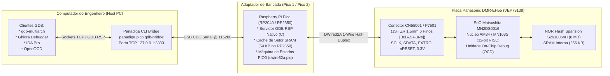

# Guia de Depuração Interativa de Hardware: GDB, Ghidra e IDA Pro via DWire32A

**Documento Oficial de Engenharia Reversa e Depuração em Tempo Real**  
**Subsistema:** Ponte de Comunicação Host-Target e Depuração On-Chip Debug (OCD)  
**Processador-Alvo:** Matsushita UniPhier `MN2DS0016` (Núcleo RISC de 32 bits `AM34` / `MN103S`)  
**Hardware de Bancada:** Raspberry Pi Pico (RP2040) / Raspberry Pi Pico 2 (RP2350)  
**Interface Física:** Conector `CN55001` / `P7501` (JST ZR 1.5mm 6 pinos [`B6B-ZR-3R4`] na Digital Board `VEP79138`)  

---

## 1. O que são os "Clientes GDB" e Onde Eles Entram no Projeto?

Ao trabalhar na engenharia reversa do gravador Panasonic DMR-EH55, existem **3 níveis de operação**:

```
+-------------------------------------------------------------------------------+
| NÍVEL 1: Operações Básicas / Reparo Rápido                                    |
| Ferramentas: 'panadiga nvram clean' / 'panadiga pico ping'                    |
| Objetivo: Limpar dumps estáticos, checar tensões de 3.3V, sanitizar arquivos. |
+-------------------------------------------------------------------------------+
                                      |
                                      v
+-------------------------------------------------------------------------------+
| NÍVEL 2: Operações Gráficas de Bancada                                         |
| Ferramentas: Panadiga Desktop App (Tauri / Interface Visual)                  |
| Objetivo: Clicar em botões para Cold Break-In e Erase da NVRAM (cres U99).    |
+-------------------------------------------------------------------------------+
                                      |
                                      v
+-------------------------------------------------------------------------------+
| NÍVEL 3: Engenharia Reversa Profunda & Inspeção de Silício (AQUI ENTRAM ELES) |
| Ferramentas: mn10300-elf-gdb, gdb-multiarch, Ghidra Debugger, IDA Pro, OpenOCD|
| Objetivo: Pausar a CPU física, rodar código instrução por instrução, ver      |
| registradores ao vivo e capturar chaves de criptografia em trânsito na RAM.   |
+-------------------------------------------------------------------------------+
```

### Quem são esses clientes?

1. **`mn10300-elf-gdb` / `gdb-multiarch` (GNU Debugger)**:  
   É o cliente padrão de linha de comando. Ele permite definir breakpoints na execução do firmware real, avançar instrução por instrução em assembly (`stepi`), inspecionar e alterar registradores (`D0..D3`, `A0..A3`, `PC`, `SP`) e ler qualquer área de memória da placa.
2. **Ghidra (Ghidra Debugger)**:  
   O descompilador da NSA. Permite abrir o arquivo de firmware, conectar-se à porta do GDB Bridge (`127.0.0.1:3333`) e assistir ao código C descompilado sincronizado com a placa física, destacando a linha de código exata que o chip Panasonic está executando na bancada.
3. **IDA Pro (GDB Remote Debugger)**:  
   Ferramenta de engenharia reversa que se conecta diretamente via socket GDB RSP, oferecendo visualização em grafo do fluxo de execução do processador AM34.
4. **OpenOCD**:  
   Ferramenta de automação industrial de JTAG/OCD para scripts em lote e integração de bancada contínua.

---

## 2. Diagrama de Topologia da Ponte (Pipeline Ponta-a-Ponta)



---

## 3. Passo a Passo Prático de Conexão

### Passo 1: Iniciar a Ponte no Terminal

Com a placa do DMR-EH55 conectada ao Raspberry Pi Pico via cabo JST ZR 1.5mm (alojamento ZHR-6) (veja o [Guia de Bancada](file:///c:/Users/danie/Documents/Panasonic%20Firmware%20HDD%20bin/dwire32a_jtag_research/GUIA_BANCADA_DWIRE32A_SEM_DESSOLDA.md)), abra um terminal no PC e inicie a ponte:

```bash
# Identifique a porta COM do seu Pico (ex: COM3)
panadiga pico list

# Inicie a ponte TCP <-> Serial GDB RSP na porta padrão 3333
panadiga pico gdb-bridge --port COM3 --listen 127.0.0.1:3333
```

O terminal exibirá:
```text
====================================================================
   PANASONIC AM34 / DWIRE32A GDB REMOTE SERIAL PROTOCOL (RSP) BRIDGE
   Serial Interface : COM3 @ 115200 baud
   TCP GDB Listener : 127.0.0.1:3333
====================================================================
[Bridge] Requesting Pico firmware enter GDB RSP server mode...
[Bridge] Listening for GDB debugger connections on 127.0.0.1:3333...
[Bridge] In your debugger terminal, run:
         (gdb) target remote 127.0.0.1:3333
--------------------------------------------------------------------
```

---

### Passo 2: Conectando com o GNU Debugger (`gdb-multiarch`)

Em outro terminal no seu computador:

```bash
# Inicie o depurador multi-arquitetura
gdb-multiarch
```

Dentro do prompt do GDB, execute os seguintes comandos:

```text
# 1. Definir a arquitetura para o núcleo Matsushita MN10300 / AM34
(gdb) set architecture mn10300

# 2. Conectar-se à ponte Panadiga aberta na porta 3333
(gdb) target remote 127.0.0.1:3333

# O GDB reportará o processador interceptado (ex: SIGTRAP / Halt)
0x80000000 in ?? ()

# 3. Ler o banco de registradores do processador físico
(gdb) info registers

# Saída real do chip:
# d0: 0x00000000   d1: 0x00000000   d2: 0x00000000   d3: 0x00000000
# a0: 0x00000000   a1: 0x00000000   a2: 0x00000000   a3: 0x0003fff0
# mdr: 0x00000000  psw: 0x00000000  pc: 0x80000000   sp: 0x0003fff0

# 4. Ler 16 palavras da memória Flash inicial (Boot Vector no endereço 0x80000000)
(gdb) x/16wx 0x80000000

# 5. Executar uma instrução por vez (Single-Step)
(gdb) stepi

# 6. Retomar a execução contínua
(gdb) continue

# 7. Forçar a CPU a pausar a qualquer momento
Pressione Ctrl+C no terminal do GDB
```

---

### Passo 3: Conectando com o Ghidra Debugger

O Ghidra possui suporte nativo à família Matsushita MN10300:

1. Abra o Ghidra e crie um projeto com o dump da memória Flash (`IC55007`, 8 MB).
2. Na janela de arquitetura, selecione:  
   * **Language:** `MN10300`  
   * **Variant:** `default` (32-bit Little Endian).
3. Abra a ferramenta **Ghidra Debugger** (`Window -> Debugger`).
4. Na aba **Targets**, clique no ícone de conexão (**Connect**):
   * Selecione o conector: **`gdb via GDB/MI (local or remote)`**.
   * No campo de comando/host, aponte para:  
     `target remote 127.0.0.1:3333`
5. O Ghidra sincronizará automaticamente o ponteiro do descompilador com o valor real do registrador `PC` retornado pela placa física.

---

### Passo 4: Conectando com o IDA Pro

1. Abra o dump no IDA Pro selecionando o processador **Panasonic MN10300 / AM34**.
2. No menu superior, vá em: `Debugger -> Select Debugger -> GDB Remote Debugger`.
3. Vá em `Debugger -> Process Options`:
   * **Hostname:** `127.0.0.1`
   * **Port:** `3333`
4. Clique em `Debugger -> Attach to Process`.
5. Você poderá definir breakpoints visuais na interface do IDA; quando o aparelho atingir a rotina desejada, a tela do IDA congelará mostrando os registradores exatos da placa.

---

### Passo 5: Usando com OpenOCD

Se preferir usar o OpenOCD para automatizar scripts de bancada ou dump em massa via TCL:

```bash
openocd -f dwire32a_jtag_research/openocd_panasonic_am34.cfg
```

Pelo prompt do OpenOCD (porta Telnet 4444):
```text
telnet localhost 4444
> panasonic_cold_break_in
> panasonic_read_spansion_id
> panasonic_dump_nvram backup_nvram.bin
> panasonic_erase_nvram
```

---

## 4. O Que se Consegue Fazer na Prática com o GDB que Não Era Possível Antes?

1. **Captura de Chaves Criptográficas em Tempo Real:**  
   O gravador descriptografa blocos do contêiner `PANA_DVD.FRM` e das partições do HD diretamente na SRAM. Com o GDB, você pausa a CPU exatamente após a rotina de expansão de chave e faz um dump da memória em texto plano.
2. **Diagnóstico Cirúrgico de Travamentos (Erro U99):**  
   Ao colocar um breakpoint na rotina de validação da NVRAM (`0x007F0000`), você descobre exatamente qual byte de calibração ou checksum está causando o pânico do processador.
3. **Injeção e Teste de Microcódigo sem Regravar a Flash:**  
   Você pode carregar pequenos trechos de código em assembly na SRAM livre (`0x00004000`) usando o comando `set {int}0x00004000 = 0x...` e desviar o `PC` para testar funções customizadas sem gastar ciclos de vida da memória NOR Flash Spansion.
